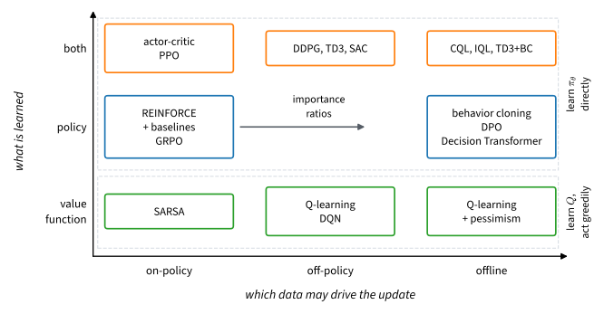

# Deep Reinforcement Learning
:label:`chap_deep_rl`

The last agent of :numref:`chap_reinforcement_learning` swung a pendulum up after a few hundred thousand steps. A simulator makes that cheap. A robot arm would wear out first, and a language model trained on its own answers cannot discard each batch of answers after one update. The agent waited for every episode to end, used each batch once and never limited how far an update moved its policy. How much can one sample teach, and what goes wrong when we make it teach more?

Four ideas answer, each with an error of its own. An agent can trust a learned estimate of the rest of an episode instead of waiting for it :cite:`Samuel.1959,Sutton.1988`; the estimate is biased while it is young. It can reuse an older policy's data, reweighted or replayed :cite:`Lin.1992`; the data goes stale and the targets move. It can bound each update by the change in the policy's behavior :cite:`Kakade.Langford.2002,Schulman.Wolski.Dhariwal.ea.2017`; the bound limits each step, not where the steps lead. It can learn a model of the environment and plan in it :cite:`Sutton.1990`, inheriting the model's errors and computing at every step. Together, a learned target, a network shared across states and another policy's data can make values diverge, which a table never does. Controllers, game players and post-trained language models are built from these ideas.

:numref:`sec_actorcritic` asks whether a policy must wait for the episode to end. :numref:`sec_ppo` asks whether one batch can drive several updates, and how far. :numref:`sec_regularized` asks how far a policy may stray from the data behind a learned reward. :numref:`sec_dqn` asks whether a network can learn values from any transition, as a table can. :numref:`sec_sac` asks how the pendulum can be learned in a few thousand steps. :numref:`sec_model_based` asks whether an agent that learns the physics from a few hundred steps can plan its way up. :numref:`sec_offline` asks what can be learned when no new action may be tried. :numref:`sec_rl_sequences` asks what survives when the environment appends tokens and a checker gives the reward.

CartPole carries the three methods with discrete actions, so that their sample counts share one axis, and Pendulum carries soft actor-critic and the learned model. Exact answers come from the verifier task and two gridworlds: one built so that a learned reward can be exploited, and the slippery lake. The code, in PyTorch and JAX, runs in CPU minutes. :numref:`fig_rl_roadmap` and :numref:`tab_rl_map` place every method of both chapters, and :numref:`sec_deep_rl-further-reading` collects those this chapter names without teaching. Several agents, hidden state, and meta- and hierarchical learning are left out; the Language Models part treats post-training at scale, including learning from human preferences, in more depth.

```toc
:maxdepth: 2

actor-critic
ppo
regularized
dqn
sac
model-based
offline-rl
rl-sequences
further-reading
```

<!-- slides -->

::: {.slide}
::: {.cover}
[Dive into Deep Learning · §15]{.kicker}

Deep Reinforcement Learning: Sample Efficiency and Function Approximation<br>**bootstrapped critics · trust regions · KL penalties · replay buffers · world models · offline logs · LLM post-training**
:::
:::

::: {.slide title="Why Naive Policy Gradients Waste Interactions"}
[Motivation]{.kicker}

::: {.cols .vc}
::: {.col}
- **Full-Episode Waiting:** Monte Carlo returns $\hat{G}_t$ stall learning until an episode terminates or hits a time limit.
- **Single-Use Experience:** Every batch of $1{,}600$ transitions drives one gradient step and is immediately discarded.
- **Unguarded Parameter Steps:** Nothing bounds how far one noisy step shifts action probabilities, risking irreversible policy collapse.
:::

::: {.col .fig .big}
@fig:ch15-drl-naive-pg-waste
:::
:::
:::

::: {.slide title="Four Mechanisms to Extract More from Every Sample"}
[Core Ideas]{.kicker}

::: {.cols .vc}
::: {.col}
- **1. Bootstrap a Critic (§{sec_actorcritic}, §{sec_dqn}–§{num:sec_sac}):** Replaces episode tail $\hat{G}_{t+1}$ at the cost of young-critic bias $e(s')$.
- **2. Reuse Old Transitions (§{sec_ppo}, §{sec_dqn}–§{num:sec_offline}):** Replaces fresh rollouts at the cost of distribution shift and moving targets.
- **3. Bound Policy Shifts (§{sec_ppo}–§{num:sec_regularized}, §{sec_rl_sequences}):** Restrains steps via ratio clipping or a KL leash to $\pi_{\textrm{ref}}$.
- **4. Plan in a World Model (§{sec_model_based}):** Substitutes test-time imagination for real trials at the cost of compounding rollout error.
:::

::: {.col .fig .big}
@fig:ch15-drl-four-mechanisms
:::
:::
:::

::: {.slide title="The Deadly Triad: When Value Networks Diverge"}
[Fundamental Hazard]{.kicker}

::: {.cols .vc}
::: {.col}
- **1. Bootstrapping:** Targets $y = r + \gamma \hat{V}_w(s')$ move with the network's own predictions.
- **2. Function Approximation:** Shared parameters $w$ couple all states globally.
- **3. Off-Policy Data:** Transitions come from a replay buffer or fixed log rather than the current policy, driving $\|\mathbf{w}\|_\infty \to \infty$ even on Baird's linear MDP (§{sec_dqn}).
:::

::: {.col .fig .big}
@fig:ch15-drl-triad-overview
:::
:::
:::

::: {.slide title="Taxonomic Roadmap of Deep Reinforcement Learning"}
[Algorithmic Map]{.kicker}

::: {.cols .vc}
::: {.col}
- **Two organizing axes:** Every method in Chapters §{num:chap_reinforcement_learning} and §{num:chap_deep_rl} is positioned by *what it learns* (policy, action-value, or dynamics model) and *which data drive the update* (on-policy, off-policy replay, or fixed offline logs).
- **Left to right progression:** We move from strict on-policy rollouts (§{sec_actorcritic}) to bounded multi-epoch batch reuse (§{sec_ppo}), off-policy replay buffers (§{sec_dqn}–§{num:sec_model_based}), and purely offline datasets (§{sec_offline}–§{num:sec_rl_sequences}).
:::

::: {.col .fig .big}
{.nostretch width=100%}
:::
:::
:::

::: {.slide title="Running Benchmarks and Sample-Efficiency Gains"}
[Experimental Suite]{.kicker}

::: {.cols .vc}
::: {.col}
- **Continuous Pendulum-v1 ($\ge -200$ goal):** Sample cost drops from $\sim 300\text{k}$ steps (REINFORCE) to $2.4\text{k}$–$11\text{k}$ (SAC, §{sec_sac}) and $200$–$600$ steps (World-Model MPC, §{sec_model_based}).
- **Discrete CartPole-v1 ($500$ ceiling):** Multi-epoch PPO (§{sec_ppo}) halves the sample cost of 1-step Actor–Critic ($\sim 60\text{k} \to \sim 25\text{k}$ steps), with DQN (§{sec_dqn}) solving in $\sim 40\text{k}$ steps.
- **Exact tabular & verifier audits:** Diagnose reward hacking (§{sec_regularized}, §{sec_rl_sequences}) and offline overestimation (§{sec_offline}) against closed-form optima.
:::

::: {.col .fig .big}
@fig:ch15-drl-benchmark-gains
:::
:::
:::

::: {.slide title="Chapter §{num:chap_deep_rl} Roadmap: Eight Core Questions"}
[Study Guide]{.kicker}

| Section | Central Question | Core Mathematical Mechanism |
| :--- | :--- | :--- |
| **§{sec_actorcritic} Actor-Critic & GAE** | Must a policy wait for the episode to end? | TD error $\delta_t = r_t + \gamma \hat{V}(s_{t+1}) - \hat{V}(s_t)$ and backward scan $\sum_l (\gamma\lambda)^l \delta_{t+l}$ |
| **§{sec_ppo} Trust Regions & PPO** | How many updates can one batch safely drive? | Per-step importance ratio $\rho_t(\theta)$ and clipped surrogate $\min(\rho_t \hat{A}_t, \textrm{clip}(\rho_t)\hat{A}_t)$ |
| **§{sec_regularized} KL-Regularized RL** | How far may a policy stray from preference data? | Reference tilt $\pi^\star(a) \propto \pi_{\textrm{ref}}(a) e^{r(a)/\beta}$ and soft backup $V_\beta = \beta \log \sum_a \pi_{\textrm{ref}} e^{Q_\beta/\beta}$ |
| **§{sec_dqn} Deep Q-Networks** | Can a network learn values from any transition? | Uniform experience replay, frozen target network $Q_{w^-}$, and Double DQN decoupling |
| **§{sec_sac} Soft Actor-Critic** | How do we learn continuous control in $3{,}000$ steps? | Maximum-entropy target $-\beta \log \pi$, squashed Gaussian Jacobian, twin critics $\min_j Q_j$ |
| **§{sec_model_based} World Models & MPC** | Can a learned physics model plan a swing-up? | State-delta regression $\hat{f}_\phi(s,a)$, warm-started random shooting, policy distillation |
| **§{sec_offline} Offline RL** | What can be learned when no new trial is allowed? | Empirical MDP stitching and pessimistic penalty $-\kappa/\sqrt{n(s,a)}$ (CQL / TD3+BC) |
| **§{sec_rl_sequences} RL for Sequences** | What survives when actions are tokens? | Token credit decomposition, verifiable rewards, GRPO with $k_3$ KL loss, and DPO |
:::
