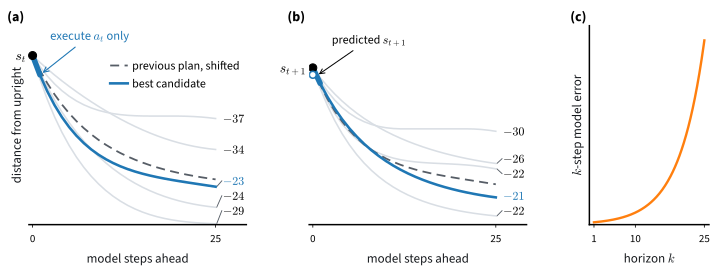

# Learned Models and Planning
:label:`sec_model_based`

Soft actor-critic swung the pendulum up after a few thousand transitions, and it used every transition in the same way: as the target of one regression for its critic, a reward plus the discounted value of the next state. A transition records more than that. It shows how the pendulum moved under a particular torque, and the physics behind that motion is the same at every visit. A child who has been pushed on a swing a few times can say where the swing will be a moment later and how hard to push to send it higher. Could an agent learn the physics of the pendulum from a few hundred steps and plan its way up, with no critic and no policy?

:numref:`sec_qlearning` did this on the lake. It counted the transitions it had seen into an estimated model and ran value iteration on the estimate, treating it as exact. Pendulum's states are continuous, so they cannot be counted. Regression takes the place of counting: a network learns to predict the next state and the reward from the current state and the torque. Search takes the place of value iteration: the agent tries many torque sequences inside the model and executes the first torque of the best one. Sutton's Dyna architecture combined a learned model with planning in 1990 :cite:`Sutton.1990`, and neural-network models searched in this way control simulated robots from minutes of experience :cite:`Nagabandi.Kahn.Fearing.ea.2018`.

A model lets an agent use computation in place of experience: every real step can be followed by thousands of imagined ones. A search can also start from what a policy proposes and teach its result back to the policy. AlphaZero and MuZero learned to play board games beyond human strength in this way :cite:`Silver.Hubert.Schrittwieser.ea.2018,Schrittwieser.Antonoglou.Hubert.ea.2020`, and search guided by a learned policy is also how reasoning models spend extra computation at test time. In this section we fit a model of Pendulum from one random episode, measure how its errors grow along a plan, plan with it, and turn the search into a better policy. One question stays with us throughout: how far from its data can a model be trusted?

```{.python .input #model-based-learned-models-and-planning}
%%tab pytorch
%matplotlib inline
from d2l import torch as d2l
import gymnasium as gym
import numpy as np
import torch
from torch import nn
torch.set_num_threads(1)
```

```{.python .input #model-based-learned-models-and-planning}
%%tab jax
%matplotlib inline
from d2l import jax as d2l
from flax import nnx
import gymnasium as gym
import jax
from jax import numpy as jnp
import numpy as np
import optax
```

## A Dynamics Model from Data

### Regression in Place of Counting

Pendulum is the task of :numref:`sec_sac`. A pendulum hangs from a motorized pivot; the state is $s = (\cos\vartheta, \sin\vartheta, \dot\vartheta)$, where $\vartheta$ is the angle from upright, and the action is a torque $a \in [-2, 2]$. Each step gives the reward $-(\vartheta^2 + 0.1\,\dot\vartheta^2 + 0.001\,a^2)$ with $\vartheta$ wrapped to $[-\pi, \pi]$, and an episode lasts 200 steps. A pendulum hanging still at the bottom loses $\pi^2 \approx 9.9$ per step, about $2{,}000$ per episode; random torques lose about $900$ to $1{,}700$; a controller that swings the pendulum up and balances it loses between zero and a few hundred, depending on where it starts.

A *model* of the environment predicts what the environment does. We write $\hat f_\phi$ for a network with parameters $\phi$ that maps a state and an action to a predicted next state and reward,

$$(\hat s', \hat r) = \hat f_\phi(s, a).$$

On the lake the model was a table of frequencies, and every entry was estimated only from the visits to its own state-action pair. A network shares its parameters across states, so a transition at one angle also teaches the model about nearby angles. We fit it by least squares on the stored transitions $(s_i, a_i, r_i, s'_i)$,

$$
\min_\phi \sum_i \big\| \hat f_\phi(s_i, a_i) - (s'_i, r_i) \big\|^2.
$$
:eqlabel:`eq_model_least_squares`

The fit asks the model to reproduce the recorded next state and reward of every stored transition. With a table in place of the network, the minimizer at each pair would be the average of the outcomes observed there: the counted model of :numref:`sec_qlearning`, reduced to its mean. Pendulum is deterministic, so the mean outcome is the outcome. A stochastic environment would need a model of the whole distribution of next states, as the counts provided on the lake.

Two choices make the regression easy. The network predicts the change of state $s' - s$ rather than $s'$ itself, because in one step of 0.05 seconds the pendulum moves only a little, and the change is the part worth learning. And every input and target coordinate is standardized to mean zero and variance one over the stored data, because the coordinates live on different scales: the cosine and sine lie in $[-1, 1]$, the angular velocity in $[-8, 8]$, and the reward in about $[-16, 0]$. Without standardization least squares would mostly fit the reward.

The settings for the whole section come first: the torque bound $c = 2$, the depth $n = 25$ of a plan, the number of candidate plans the search tries, the number of Adam steps per fit of the model, the number of seeds, and the seed that fixes the starting states of our test.

```{.python .input #model-based-regression-in-place-of-counting-1}
%%tab pytorch, jax
c, horizon, num_cand = 2.0, 25, 500   # torque bound, depth n, candidates
fit_steps, num_seeds, test_seed = 1_000, 5, 1_000
```

Data come from whole episodes. `run_episode` acts in a *vector environment*, gymnasium's container that steps several copies of Pendulum in lockstep, so that one call can run a controller from ten starting states at once. A controller is any function from a batch of observations to a batch of actions, and `random_controller` returns one that draws uniformly random torques. `score` runs a controller for one episode from ten fixed starts, those of environment seeds 1000 to 1009, and returns the mean return; it is the test for every controller in this section. The transitions go into a `d2l.ReplayBufferC`, the replay buffer of :numref:`sec_sac` with a floating-point action column. Here it serves only as a store of arrays; we never sample batches from it. `model_data` turns the stored transitions into the inputs $(s, a)$ and targets $(s' - s, r)$ of the regression, with their means and standard deviations.

```{.python .input #model-based-regression-in-place-of-counting-2}
%%tab pytorch, jax
def run_episode(envs, controller, buffer=None, seed=None, num_steps=200):
    """One episode in every environment of a vector env, acting by
    controller(obs) -> actions. Returns the returns; records transitions."""
    obs, total = envs.reset(seed=seed)[0], 0.0
    for _ in range(num_steps):
        act = controller(obs)
        next_obs, rew, term, _, _ = envs.step(act)
        for i in range(envs.num_envs if buffer is not None else 0):
            buffer.add(obs[i], act[i], rew[i], next_obs[i], float(term[i]))
        obs, total = next_obs, total + rew
    return total

def random_controller(rng, scale=c):
    """Uniformly random torques: the data of the first episode."""
    return lambda obs: rng.uniform(-scale, scale, (len(obs), 1)).astype(
        np.float32)

def score(controller, num_starts=10, seed=test_seed):
    """Mean return of a controller over ten fixed Pendulum starts."""
    envs = gym.make_vec('Pendulum-v1', num_envs=num_starts,
                        vectorization_mode='sync')
    return run_episode(envs, controller, seed=seed).mean()

def model_data(buffer):
    """Inputs (s, a) and targets (s' - s, r) of the stored transitions,
    with their means and standard deviations."""
    n = buffer.size
    x = np.concatenate([buffer.obs[:n], buffer.act[:n]], -1)
    y = np.concatenate([buffer.next_obs[:n] - buffer.obs[:n],
                        buffer.rew[:n, None]], -1)
    return x, y, (x.mean(0), x.std(0) + 1e-6, y.mean(0), y.std(0) + 1e-6)
```

`DynamicsModel` is a multilayer perceptron with two hidden layers of 64 units and the smooth SiLU activation (:numref:`sec_mlp`). It holds the standardization statistics in `stats`; its forward pass standardizes the input, undoes the standardization of the output, and adds the predicted change to the state. `fit_model` recomputes the statistics from all stored data, then takes Adam steps on minibatches of 256 transitions. Its optimizer is created once with the model, in `make_model`, so each later fit continues from the previous parameters instead of starting over.

```{.python .input #model-based-regression-in-place-of-counting-3}
%%tab pytorch
class DynamicsModel(nn.Module):
    """(s', r) from (s, a): an MLP that maps standardized inputs to the
    standardized change of state and reward."""
    def __init__(self, obs_dim=3, act_dim=1, hidden=64):
        super().__init__()
        d_in, d_out = obs_dim + act_dim, obs_dim + 1
        self.net = nn.Sequential(nn.Linear(d_in, hidden), nn.SiLU(),
                                 nn.Linear(hidden, hidden), nn.SiLU(),
                                 nn.Linear(hidden, d_out))
        self.stats = (torch.zeros(d_in), torch.ones(d_in),
                      torch.zeros(d_out), torch.ones(d_out))

    def forward(self, obs, act):
        mu_x, sd_x, mu_y, sd_y = self.stats
        x = (torch.cat([obs, act], -1) - mu_x) / sd_x
        y = self.net(x) * sd_y + mu_y          # (s' - s, r) in data units
        return obs + y[..., :-1], y[..., -1]

def make_model(seed, lr=1e-3):
    torch.manual_seed(seed)
    model = DynamicsModel()
    return model, torch.optim.Adam(model.parameters(), lr=lr)

def fit_model(model, opt, buffer, rng, num_steps=fit_steps, batch_size=256):
    """Least squares on all stored transitions, in standardized units."""
    x, y, stats = model_data(buffer)
    model.stats = tuple(torch.as_tensor(v) for v in stats)
    mu_x, sd_x, mu_y, sd_y = stats
    x = torch.as_tensor((x - mu_x) / sd_x)
    y = torch.as_tensor((y - mu_y) / sd_y)
    for _ in range(num_steps):
        i = torch.as_tensor(rng.integers(len(x), size=batch_size))
        loss = ((model.net(x[i]) - y[i]) ** 2).mean()
        opt.zero_grad()
        loss.backward()
        opt.step()
    return float(loss.detach())
```

```{.python .input #model-based-regression-in-place-of-counting-3}
%%tab jax
class DynamicsModel(nnx.Module):
    """(s', r) from (s, a): an MLP that maps standardized inputs to the
    standardized change of state and reward."""
    def __init__(self, obs_dim=3, act_dim=1, hidden=64, rngs=None):
        d_in, d_out = obs_dim + act_dim, obs_dim + 1
        self.net = nnx.Sequential(
            d2l.Linear(d_in, hidden, rngs=rngs), jax.nn.silu,
            d2l.Linear(hidden, hidden, rngs=rngs), jax.nn.silu,
            d2l.Linear(hidden, d_out, rngs=rngs))
        self.stats = nnx.Variable((jnp.zeros(d_in), jnp.ones(d_in),
                                   jnp.zeros(d_out), jnp.ones(d_out)))

    def __call__(self, obs, act):
        mu_x, sd_x, mu_y, sd_y = self.stats.get_value()
        x = (jnp.concatenate([obs, act], -1) - mu_x) / sd_x
        y = self.net(x) * sd_y + mu_y          # (s' - s, r) in data units
        return obs + y[..., :-1], y[..., -1]

def make_model(seed, lr=1e-3):
    model = DynamicsModel(rngs=nnx.Rngs(seed))
    return model, nnx.Optimizer(model, optax.adam(lr), wrt=nnx.Param)

@nnx.jit
def model_step(model, opt, x, y):
    loss = lambda m: ((m.net(x) - y) ** 2).mean()
    value, grads = nnx.value_and_grad(loss)(model)
    opt.update(model, grads)
    return value

def fit_model(model, opt, buffer, rng, num_steps=fit_steps, batch_size=256):
    """Least squares on all stored transitions, in standardized units."""
    x, y, stats = model_data(buffer)
    model.stats.set_value(tuple(jnp.asarray(v) for v in stats))
    mu_x, sd_x, mu_y, sd_y = stats
    x, y = (x - mu_x) / sd_x, (y - mu_y) / sd_y
    step = nnx.cached_partial(model_step, model, opt)
    for _ in range(num_steps):
        i = rng.integers(len(x), size=batch_size)
        loss = step(x[i], y[i])
    return float(loss)
```

:begin_tab:`jax`
The layers are `d2l.Linear`, the initialization used for every JAX network in these two chapters (:numref:`sec_deeprl`). The statistics live in an `nnx.Variable`, so the compiled functions below read their current values after every refit. `model_step` is one compiled Adam step, and `nnx.cached_partial` binds the model and the optimizer to it once per fit.
:end_tab:

We collect one episode of random torques from seed 0 and fit the model to its 200 transitions:

```{.python .input #model-based-regression-in-place-of-counting-4}
%%tab pytorch, jax
env = gym.make_vec('Pendulum-v1', num_envs=1, vectorization_mode='sync')
rng = np.random.default_rng(0)
buffer = d2l.ReplayBufferC(200, 3, 1)
print(f'return of the random episode: '
      f'{run_episode(env, random_controller(rng), buffer, seed=0)[0]:.0f}')
model, opt = make_model(0)
print(f'final minibatch loss (standardized units): '
      f'{fit_model(model, opt, buffer, rng):.4f}')
```

The random episode loses about a thousand, and the loss at the end of the fit is a small fraction of the targets' variance, which is one in standardized units.

### One Step by Hand

A small training loss does not tell us what the model predicts. We look at one transition of the episode in the units of the problem. `rollout_model` feeds a state and a sequence of actions through the model, each predicted state becoming the input of the next step; with a single action it is one prediction.

```{.python .input #model-based-one-step-by-hand-1}
%%tab pytorch
@torch.no_grad()
def rollout_model(model, obs, actions):
    """Open-loop rollout in the model: obs (..., 3) and actions (..., n, 1)
    give the predicted states (..., n, 3) and rewards (..., n)."""
    s, actions = torch.as_tensor(obs), torch.as_tensor(actions)
    states, rewards = [], []
    for t in range(actions.shape[-2]):
        s, r = model(s, actions[..., t, :])
        states.append(s)
        rewards.append(r)
    return torch.stack(states, -2).numpy(), torch.stack(rewards, -1).numpy()
```

```{.python .input #model-based-one-step-by-hand-1}
%%tab jax
@nnx.jit
def rollout_model(model, obs, actions):
    """Open-loop rollout in the model: obs (..., 3) and actions (..., n, 1)
    give the predicted states (..., n, 3) and rewards (..., n)."""
    def step(s, a):
        s, r = model(s, a)
        return s, (s, r)
    _, (states, rewards) = jax.lax.scan(step, obs,
                                        jnp.moveaxis(actions, -2, 0))
    return jnp.moveaxis(states, 0, -2), jnp.moveaxis(rewards, 0, -1)
```

:begin_tab:`jax`
`rollout_model` runs the steps with `jax.lax.scan` under `nnx.jit`; it compiles once for every shape of its inputs, and the section calls it with only a few shapes.
:end_tab:

```{.python .input #model-based-one-step-by-hand-2}
%%tab pytorch, jax
def angle(s):
    """Angle from upright in degrees, from states (cos, sin, velocity)."""
    return np.degrees(np.arctan2(s[..., 1], s[..., 0]))

i = 100
pred, r_hat = rollout_model(model, buffer.obs[i], buffer.act[i][None])
print('s       ', buffer.obs[i].round(4), f'a = {buffer.act[i, 0]:.4f}')
print("true s' ", buffer.next_obs[i].round(4), f'r = {buffer.rew[i]:.4f}')
print("model s'", np.asarray(pred[0]).round(4),
      f'r = {float(r_hat[0]):.4f}')
print(f'angle error {abs(angle(pred[0]) - angle(buffer.next_obs[i])):.3f} '
      f'degrees')
```

At step 100 the pendulum is at $\vartheta = \operatorname{atan2}(-0.3394, -0.9407) = -2.795$ radians, about $160$ degrees from upright, and it swings at $5.69$ radians per second while the torque is nearly zero. The reward is $-(2.795^2 + 0.1 \cdot 5.690^2 + 0.001 \cdot 0.08^2) = -11.05$, as printed. In the 0.05 seconds of one step the angle moves to $\operatorname{atan2}(-0.5789, -0.8154) = -144.6$ degrees, about $5.6 \times 0.05 = 0.28$ radians or 16 degrees, and the model predicts this move to within a fraction of a degree. Its reward is off by less than three tenths. One step is easy: it is a small correction of a state the model has just been shown.

### Compounding Error

A plan needs more than one step. To score a sequence of torques the model must predict 25 steps ahead, and from the second step on its input is its own previous prediction. The model was trained only on true states, never on its own slightly wrong ones, so an error at one step changes the input of the next: a small error in the angle changes the torque that gravity exerts, which changes the velocity, which changes the angle further. We measure this with *open-loop* rollouts, which follow the actions recorded in an episode while the model predicts the states, and we compare the predicted angle after $k$ steps with the recorded one.

`kstep_error` starts a rollout at every step of an episode that leaves 25 steps before the end, and reports the root-mean-square error of the angle after $k = 1, 5, 10, 25$ steps, wrapped so that $+179$ and $-179$ degrees are two degrees apart.

```{.python .input #model-based-compounding-error-1}
%%tab pytorch, jax
def kstep_error(model, buffer, first=0, ks=(1, 5, 10, 25), T=200):
    """RMS angle error (degrees) of open-loop model rollouts along the
    recorded actions, from every step of the stored T-step episodes (rows
    first onward) that leaves max(ks) steps before the episode ends."""
    n = max(ks)
    ep = lambda x: x[first:buffer.size].reshape(-1, T, *x.shape[1:])
    obs, act, nxt = ep(buffer.obs), ep(buffer.act), ep(buffer.next_obs)
    windows = lambda x: np.stack([x[:, t:t + n]
                                  for t in range(T - n + 1)], 1)
    pred = np.asarray(rollout_model(model, obs[:, :T - n + 1],
                                    windows(act))[0])
    d = np.radians(angle(pred) - angle(windows(nxt)))
    d = np.arctan2(np.sin(d), np.cos(d))         # wrapped to (-pi, pi]
    return [np.degrees(np.sqrt(np.mean(d[..., k - 1] ** 2))) for k in ks]
```

For each of five seeds we fit a model to one random episode and test it on a second random episode from the same seed:

```{.python .input #model-based-compounding-error-2}
%%tab pytorch, jax
models = []
print('seed   k=1    k=5   k=10   k=25   (degrees, held-out random episode)')
for seed in range(num_seeds):
    rng = np.random.default_rng(seed)
    train, test = d2l.ReplayBufferC(200, 3, 1), d2l.ReplayBufferC(200, 3, 1)
    run_episode(env, random_controller(rng), train, seed=seed)
    run_episode(env, random_controller(rng), test)
    m, o = make_model(seed)
    fit_model(m, o, train, rng)
    models.append((m, test))
    errors = kstep_error(m, test)
    print(f'{seed:4d} ' + ' '.join(f'{e:6.2f}' for e in errors))
```

On every seed the error after ten steps is several times the error after one step, and after one step it is a fraction of a degree on most seeds. After 25 steps the error depends on the seed, but on these held-out episodes it stays below about 20 degrees: under random torques the pendulum keeps swinging near the bottom, where the training episode went too. We return to this proviso after the planner has taken the pendulum elsewhere.

The depth of a plan is a dial like the $n$ of the $n$-step returns in :numref:`sec_actorcritic`. A deeper plan sees further consequences of a torque; a swing-up takes a few dozen steps, and a plan that ends before the pendulum rises cannot tell a good pumping sequence from a bad one. But each further step adds the model's error to the prediction. We use $n = 25$ steps, 1.25 seconds, and exercise :exref:`ex_model-based-horizon` moves the dial.

## Planning in the Model

### Random Shooting

Inside the model, trying a sequence of torques costs a few matrix multiplications and no real step. The simplest search uses this directly. Suppose the pendulum hangs still at the bottom. We draw five random sequences of 25 torques, roll each out in the model fitted above, and add up its predicted rewards:

```{.python .input #model-based-random-shooting-1}
%%tab pytorch, jax
rng = np.random.default_rng(0)
s = np.array([[-1.0, 0.0, 0.0]], np.float32)      # hanging down, at rest
A = rng.uniform(-c, c, (1, 5, horizon, 1)).astype(np.float32)
_, r_hat = rollout_model(model, np.repeat(s[:, None], 5, axis=1), A)
for a, ret in zip(A[0], np.asarray(r_hat[0]).sum(-1)):
    print(f'first actions {a[:3, 0].round(2)}  predicted return {ret:8.2f}')
```

Hanging still for 25 steps would lose about $25 \times 9.9 \approx 247$. Every random sequence rocks the pendulum a little away from the bottom, so all five predictions are less negative than that, and they lie within a few points of each other. Of the five we would pick the one with the highest predicted return and apply its first torque.

That is *random shooting*: draw many candidate sequences $(a_0^{(j)}, \ldots, a_{n-1}^{(j)})$, predict their returns

$$\hat G^{(j)} = \sum_{t=0}^{n-1} \hat r_t^{(j)},$$

where $\hat r_t^{(j)}$ is the model's reward for step $t$ of candidate $j$, and keep the best. The sum is undiscounted, since over 25 steps with $\gamma = 0.99$ a discount would change the weights by at most a fifth. Only the first torque of the best sequence is executed. At the next step the agent observes the real state and plans again from there. This scheme, *model-predictive control* (MPC), is a long-standing method in control engineering. Replanning at every step means that the model's errors over the later steps of a plan never act on the real pendulum: before they can, the next real observation replaces the prediction.

`plan` carries this out for a batch of $B$ states at once. It perturbs a given plan for each state with Gaussian noise into 500 candidates, keeps the given plan itself as one of them, clips the torques to $[-c, c]$, rolls all candidates out with `rollout_model`, and returns each state's best sequence with its predicted return. Because the given plan is one of the candidates, the returned plan never has a lower predicted return than the plan it started from. One action costs $500 \times 25 = 12{,}500$ evaluations of the model.

```{.python .input #model-based-random-shooting-2}
%%tab pytorch, jax
def plan(model, obs, init, rng, noise=c, num_cand=num_cand, scale=c):
    """Random shooting around a plan for each of B states: obs (B, 3), init
    (B, n, 1). Each plan is perturbed into num_cand candidates (the plan
    itself is one), all are rolled out in the model, and the candidate with
    the highest predicted return is returned with that return."""
    B = len(obs)
    A = init[:, None] + noise * rng.standard_normal(
        (B, num_cand) + init.shape[1:], dtype=np.float32)
    A[:, 0] = init
    A = np.clip(A, -scale, scale)
    s = np.repeat(obs[:, None], num_cand, axis=1)          # (B, num_cand, 3)
    ret = np.asarray(rollout_model(model, s, A)[1]).sum(-1)  # (B, num_cand)
    best = ret.argmax(1)
    return A[np.arange(B), best], ret[np.arange(B), best]
```

### Warm Starts

Which plan should the search start from? Without any knowledge it would start from zero torque and draw fresh candidates at every step. That throws away the plan found one step earlier, which was presumably good, and forces the search to find a swing-up among 500 random sequences again at every step. Consecutive torques then come from unrelated plans. A *warm start* reuses the previous plan: its first torque has just been executed, so the remaining 24 are shifted forward by one step, a zero torque is appended, and the search perturbs this shifted plan. A good plan is then found once and refined from step to step. :numref:`fig_rl_model_planning` shows one step of this search.

![Planning in a learned model by random shooting with a warm start. (a) At state $s_t$, candidate action sequences drawn around the previous plan shifted by one step (dashed) are rolled out through $\hat f_\phi$ for 25 steps and scored by the sum of predicted rewards (numbers at the right); only the first action of the best sequence (blue) is executed. (b) The real next state differs a little from the predicted one (open circle), and the planner starts again from it, around the best plan of (a) shifted by one step. (c) The model's open-loop error grows with the horizon, one reason to replan at every step. The vertical axis and the scores come from a schematic one-dimensional model, not from Pendulum.](../img/mdl-rl-model-planning.svg)
:label:`fig_rl_model_planning`

`mpc` builds such a controller from a model. The plans live in the controller's closure, one per environment, created at its first call; the perturbation has standard deviation $c = 2$, the width of the torque range. In separate runs with five seeds, a planner that drew fresh, uniformly random sequences at every step remained 40 to 110 points worse per episode on its test starts than the warm-started planner after five episodes of data, and was far worse early on.

```{.python .input #model-based-warm-starts}
%%tab pytorch, jax
def mpc(model, rng, horizon=horizon, noise=c):
    """Model-predictive control: at every step plan in the model, starting
    from the previous plan shifted by one step, and execute its first
    action."""
    plans = None
    def controller(obs):
        nonlocal plans
        if plans is None:
            plans = np.zeros((len(obs), horizon, 1), np.float32)
        shifted = np.concatenate([plans[:, 1:], np.zeros_like(plans[:, :1])],
                                 1)
        plans = plan(model, obs, shifted, rng, noise)[0]
        return plans[:, 0]
    return controller
```

### Swing-Up from a Few Episodes

How many real steps does the planner need? `mpc_run` starts with one random episode. Then, three times, it refits the model on all data so far, scores the planner on the ten test starts, and runs one episode with the planner to collect more data; a last refit and score follow. The scores therefore measure the planner built from 200, 400, 600 and 800 real steps.

```{.python .input #model-based-swing-up-from-a-few-episodes-1}
%%tab pytorch, jax
def mpc_run(seed, num_rounds=3):
    """One random episode, then rounds of: refit the model on all data,
    score the planner on the ten test starts, collect one MPC episode."""
    env = gym.make_vec('Pendulum-v1', num_envs=1, vectorization_mode='sync')
    rng, (model, opt) = np.random.default_rng(seed), make_model(seed)
    buffer = d2l.ReplayBufferC(200 * (num_rounds + 1), 3, 1)
    run_episode(env, random_controller(rng), buffer, seed=seed)
    scores = []
    for r in range(num_rounds + 1):
        fit_model(model, opt, buffer, rng)
        scores.append(score(mpc(model, rng)))
        if r < num_rounds:
            run_episode(env, mpc(model, rng), buffer)
    return scores, buffer
```

The printout shows the returns of the four collected episodes and the four scores, for five seeds:

```{.python .input #model-based-swing-up-from-a-few-episodes-2}
%%tab pytorch, jax
runs = [mpc_run(seed) for seed in range(num_seeds)]
print('seed  episode returns: random, MPC x 3 |'
      '  test score at 200/400/600/800 steps')
for seed, (scores, buf) in enumerate(runs):
    rets = buf.rew[:buf.size].reshape(-1, 200).sum(1)
    print(f'{seed:4d} ' + ''.join(f'{r:7.0f}' for r in rets) + '  | '
          + ''.join(f'{s:7.0f}' for s in scores))
```

What is a good score? From the ten test starts, a controller that swings up and balances loses close to nothing from the start nearest the top and about 250 to 320 from each of the five starts near the bottom, about 170 on average. The soft actor-critic of :numref:`sec_sac`, scored the same way, settles near $-170$ and first reaches $-200$ after several thousand steps at one update per step.

After 600 real steps, three episodes, the planner scores between about $-165$ and $-215$ on every run, close to that level, and after 800 steps between about $-170$ and $-195$. On three of the five seeds the model of the random episode alone already gives a planner that scores between about $-175$ and $-340$, far from the random policy's $-1{,}000$ and below. On the other two, seeds 3 and 4, the first planner fails, with a score near $-1{,}500$; its first one or two episodes fail as well, and after 600 real steps the same planner succeeds.

### Coverage

The two slow seeds are the two whose random episode lost the most, about $1{,}500$ and $1{,}700$: the random torques never lifted the pendulum far from the bottom. We take the model fitted to that one random episode for each seed, as in the error table above, and test it along the planner's own episodes instead of a second random one:

```{.python .input #model-based-coverage}
%%tab pytorch, jax
print('seed   k=1    k=5   k=10   k=25   (degrees, the planner\'s episodes)')
for seed, ((m, _), (_, buf)) in enumerate(zip(models, runs)):
    errors = kstep_error(m, buf, first=200)      # skip the random episode
    print(f'{seed:4d} ' + ' '.join(f'{e:6.1f}' for e in errors))
```

On seeds 0 to 2 the errors along the planner's episodes start as small as on random data, a fraction of a degree after one step, and grow to tens of degrees after 25 steps. These episodes spend most of their time near the upright position, where the pendulum is unstable and a small error in the predicted angle decides on which side it falls. On seeds 3 and 4 the error is several degrees after a single step and tens of degrees after five. The model is accurate where its data went and wrong elsewhere. On the lake, a pair that had never been tried looked worthless to the counted model; here the network extrapolates into the upper half circle it has never seen, and its extrapolation is wrong. The planner's failed attempts are what repair it: an attempt to swing up, even a failed one, carries the pendulum higher than random torques did and records what happens there. On the next refit the model has data from those states, and the plan built on it works. The planner explores without any explicit exploration rule, because it goes where the model promises reward and the model is corrected wherever it was wrong.

### The Cost of a Real Step

The planner needs a few hundred real steps. Soft actor-critic needs about five to eleven thousand at one gradient step per environment step, and between about 2,400 and 4,000 at ten gradient steps per environment step, a count that includes its first thousand steps of random warm-up. On the axis of environment steps the planner needs at least ten times fewer than the first and about five times fewer than the second.

The other axis is computation. Every action of the planner is a search: 12,500 evaluations of the model, a few milliseconds on one CPU core for this small network, and every episode adds a refit of a thousand Adam steps. Soft actor-critic takes one or ten gradient steps of three small networks per real step, and acting needs only one forward pass of its actor. A real robot must also finish the search within its control period, here 0.05 seconds. The model does not make learning free. It moves the cost from experience, which is scarce on a robot, to computation, which is scarce on the robot's controller.

## Search as Policy Improvement

### Search Seeded by the Actor

The planner has no policy. Every action requires a full search, and nothing it finds is remembered except through the model and the shifted plan of the last step. A policy network would act with one forward pass and generalize across states, but it must be trained, and :numref:`sec_sac` needed thousands of steps to train one through a critic. Can the search train the policy instead?

Start the search from the policy's own plan. Let the actor be a network that maps a state to a torque, $\mu_\theta(s)$. In the model, the actor's plan from state $s$ is the sequence of torques it chooses along its own predicted trajectory: $a_0 = \mu_\theta(s)$, $\hat s_1$ from $\hat f_\phi(s, a_0)$, $a_1 = \mu_\theta(\hat s_1)$, and so on for $n$ steps. `actor_plan` computes it for a batch of states. `improve` hands this plan to `plan` in place of the shifted previous plan, with the same 500 candidates and the same perturbation, and returns the first torque of the best candidate.

```{.python .input #model-based-search-seeded-by-the-actor}
%%tab pytorch, jax
def actor_plan(model, actor, obs, horizon=horizon):
    """The actor's own deterministic plan for each state, imagined in the
    model: (B, n, 1)."""
    acts = []
    for _ in range(horizon):
        acts.append(actor.act_greedy(obs))
        obs = np.asarray(rollout_model(model, obs, acts[-1][:, None])[0])[:, 0]
    return np.stack(acts, 1)

def improve(model, actor, obs, rng, noise=c):
    """Search seeded by the actor: the best first action for each state."""
    return plan(model, obs, actor_plan(model, actor, obs), rng, noise)[0][:, 0]
```

Since the actor's own plan is one of the candidates, the search returns an action whose plan has a predicted return at least as high as the actor's plan. Under the model and over $n$ steps, search seeded by a policy is never worse than the policy. This is the greedy step of policy iteration in :numref:`subsec_vi_policy_iteration`, which chose at every state an action at least as good as the current policy's, judged by the policy's own values; here the judge is the model's prediction over the next 25 steps. The guarantee holds only inside the model and only over the horizon. A wrong model can certify a worse action, and a plan that ends after 25 steps cannot value what happens later.

### Distillation into the Actor

If the search improves on the actor, we can train the actor to imitate the search. This is the behavior cloning of :numref:`sec_imitation` with the search as the expert: label states with `improve` and regress the actor's torque onto the labels with a squared error, since the torque is continuous. The actor is `d2l.SquashedGaussianPolicy` from :numref:`sec_sac`, a two-layer network whose Gaussian mean is squashed by $c \tanh$ into the torque range; we train only its mean, $\mu_\theta(s) = c \tanh(\text{mean}_\theta(s))$, which is also what its `act_greedy` returns. `make_actor` builds the actor with its Adam optimizer, and `distill` takes 1,000 Adam steps of this regression.

```{.python .input #model-based-distillation-into-the-actor-1}
%%tab pytorch
def make_actor(seed, lr=1e-3):
    torch.manual_seed(seed)
    actor = d2l.SquashedGaussianPolicy(3, 1, scale=c)
    return actor, torch.optim.Adam(actor.parameters(), lr=lr)

def distill(actor, opt, obs, labels, rng, num_steps=1_000, batch_size=256):
    """Regress the actor's mean action, scale * tanh(mean), onto labels."""
    obs, labels = torch.as_tensor(obs), torch.as_tensor(labels)
    for _ in range(num_steps):
        i = torch.as_tensor(rng.integers(len(obs), size=batch_size))
        a = actor.scale * torch.tanh(actor.policy(obs[i])[0])
        loss = ((a - labels[i]) ** 2).mean()
        opt.zero_grad()
        loss.backward()
        opt.step()
    return float(loss.detach())
```

```{.python .input #model-based-distillation-into-the-actor-1}
%%tab jax
def make_actor(seed, lr=1e-3):
    actor = d2l.SquashedGaussianPolicy(3, 1, scale=c, rngs=nnx.Rngs(seed))
    return actor, nnx.Optimizer(actor, optax.adam(lr), wrt=nnx.Param)

@nnx.jit
def distill_step(actor, opt, obs, labels):
    loss = lambda m: ((m.scale * jnp.tanh(m.policy(obs)[0]) - labels)
                      ** 2).mean()
    value, grads = nnx.value_and_grad(loss)(actor)
    opt.update(actor, grads)
    return value

def distill(actor, opt, obs, labels, rng, num_steps=1_000, batch_size=256):
    """Regress the actor's mean action, scale * tanh(mean), onto labels."""
    step = nnx.cached_partial(distill_step, actor, opt)
    for _ in range(num_steps):
        i = rng.integers(len(obs), size=batch_size)
        loss = step(obs[i], labels[i])
    return float(loss)
```

Each round of `search_and_distill` refits the model, labels 200 stored states drawn at random with the search, distills the labels into the actor, and collects one real episode acting with search. Acting with search makes each episode as good as the current model and actor allow, so the data reach the states a good controller visits. With a network that also predicts the value of each state and a tree search over discrete moves, this loop of acting with search, labeling and distilling is the loop of AlphaZero.

The loop records per round the return of the episode collected with search and the score of the actor alone, acting with no search at all; at the end it scores acting with search on the ten starts.

```{.python .input #model-based-distillation-into-the-actor-2}
%%tab pytorch, jax
def search_and_distill(seed, num_rounds=8, num_labels=200):
    """One random episode, then rounds of: refit the model, label stored
    states with the search, regress the actor onto the labels, collect one
    episode acting with search. Returns per round the collected return and
    the actor's score alone, and the final score acting with search."""
    env = gym.make_vec('Pendulum-v1', num_envs=1, vectorization_mode='sync')
    rng, (model, opt) = np.random.default_rng(seed), make_model(seed)
    actor, actor_opt = make_actor(seed)
    buffer = d2l.ReplayBufferC(200 * (num_rounds + 1), 3, 1)
    run_episode(env, random_controller(rng), buffer, seed=seed)
    search = lambda obs: improve(model, actor, obs, rng)
    rounds = []
    for _ in range(num_rounds):
        fit_model(model, opt, buffer, rng)
        obs = buffer.obs[rng.choice(buffer.size, num_labels, replace=False)]
        distill(actor, actor_opt, obs, search(obs), rng)
        rounds.append([run_episode(env, search, buffer)[0],
                       score(actor.act_greedy)])
    return np.array(rounds), score(search)
```

Eight rounds start from one random episode, so the actor of round $r$ has seen $200 r$ real steps. We run three seeds and plot the median with the range over seeds:

```{.python .input #model-based-distillation-into-the-actor-3}
%%tab pytorch, jax
results = [search_and_distill(seed) for seed in range(3)]
rounds = np.array([r for r, _ in results])
d2l.plot_curves({'episode acting with search': rounds[:, :, 0],
                 'actor alone, ten starts': rounds[:, :, 1]},
                'real environment steps', 'return',
                x=200 * np.arange(1, 9), reference=-200)
print('final score on the ten starts, acting with search:',
      ' '.join(f'{s:.0f}' for _, s in results))
```

### Rounds of Search and Distillation

Acting with search, the agent swings the pendulum up within two or three rounds on each of the five seeds we tried, and after eight rounds it scores between about $-175$ and $-320$ on the ten starts. That is close to the warm-started planner above, a little below it, because each search starts from the actor's plan rather than from a plan refined over many steps. The actor alone improves on every run, from between about $-900$ and $-1{,}600$ after the first round to between about $-190$ and $-1{,}100$ after the eighth, and its score can drop by hundreds from one round to the next. The network has learned part of what the search knows; acting on its own, it falls short.

The likely cause is the one that :numref:`sec_imitation` measured on the lake. The labels lie on states the search visits. An actor that imitates the search imperfectly drifts, when it acts alone, into states the search never went to, where it has no labels, and its errors compound there. On the lake, DAgger (:numref:`subsec_il_dagger`) repaired this by labeling the learner's own states, and exercise :exref:`ex_model-based-dagger` tries the same repair here. AlphaZero avoids the gap by searching at test time as well, so its network only has to make the search's starting point good. The search and the network then improve each other: a better actor seeds a better search, and a better search teaches the actor.

### Imagined Transitions as Data

A model can also feed a learner that has no planner. Dyna :cite:`Sutton.1990` interleaves real steps with updates on transitions sampled from the model, and model-based policy optimization (MBPO) :cite:`Janner.Fu.Zhang.ea.2019` does this for soft actor-critic: every few hundred steps it refits the model, rolls the current actor out in the model for a few steps from states in the replay buffer, and fills most of each training batch with these imagined transitions. The imagined data are as plentiful as computation allows. The model's errors, however, enter the critic's targets, and short rollouts are how MBPO limits the compounding error measured above.

Does this reduce the real steps on Pendulum? We ran soft actor-critic with its temperature fixed at 0.2, ten gradient steps per environment step, and batches made of 5% real and 95% imagined transitions from three-step rollouts, refitting the model every 250 steps. Over five seeds its greedy actor first scored $-200$ or better on ten fixed starts after 1,500 to 3,000 steps; without the model, at the same ten updates per step, it took 1,500 to 2,500. At a matched update ratio the imagined transitions did not reduce the real steps. Much of what MBPO gains over soft actor-critic at one update per step can come from the extra updates per real step, which replay supplies without a model; raising the update ratio of a model-free learner matched MBPO's sample efficiency :cite:`Chen.Wang.Zhou.ea.2021`. Exercise :exref:`ex_model-based-dyna` repeats the comparison. A model helps most where this section used it: to look ahead before acting and to turn the search into a policy. Ensembles of models that know where they are uncertain, models of a learned latent state, and searches that end in a learned value carry these ideas further; :numref:`sec_deep_rl-further-reading` describes them.

We can now fit a model of the dynamics from a few hundred steps, plan through it, and teach a policy what the search finds. Every step trusted the model only where its own episodes had gone and only for 25 steps, and it could test that trust by acting and refitting. :numref:`sec_offline` takes away the acting: the data are a fixed log, and nothing that a model or a value function promises beyond that log can be checked.

## Summary

A transition records how the environment moves, and a network fitted to transitions by least squares, $\hat f_\phi(s, a) \to (\hat s', \hat r)$, extends the counted model of the lake to continuous states. Its one-step errors are small, but they compound along a rollout, and they are large wherever the data never went. Model-predictive control searches torque sequences in the model, executes the first torque and plans again at the next step; with a warm start, a planner built from one to three episodes swings the pendulum up after a few hundred real steps, where soft actor-critic needed thousands, and each of its actions needs thousands of model evaluations. A search seeded by a policy never predicts a lower return than the policy, so it improves the policy, and regressing the actor onto the search's actions transfers part of that improvement; acting alone, the actor lags behind, because its labels lie on the search's states. Imagined transitions as training data did not reduce the real steps of soft actor-critic at a matched number of updates per step.

## Exercises

1. [code] **Depth of the plan.** The planner looks $n = 25$ steps ahead.
    1. Before running anything, use the two error tables of this section to
       predict what happens to the test score with $n = 10$ and with
       $n = 50$, keeping 500 candidates.
    1. Run `mpc_run` with both depths for three seeds and compare the scores
       after 600 real steps with those for $n = 25$.
    1. A swing-up from the bottom takes a few dozen steps of pumping. Explain
       the result for $n = 10$ by what its predicted returns can and cannot
       distinguish, and the result for $n = 50$ by the error tables. How does
       the cost of one action change with $n$?
   :exlabel:`ex_model-based-horizon`

1. [code] **How much random data.** Seeds 3 and 4 needed the planner's own
   failed episodes before the model covered the upper half circle.
    1. For both seeds, fit the model to one, two and five random episodes.
       Report the highest point the pendulum reached in the data (the largest
       $\cos\vartheta$) and the 25-step error of each model along the planner's
       episodes, as in the coverage table.
    1. How many random episodes does a planner built from random data alone
       need to swing up from most test starts? Compare with the 600
       steps that the planner's own episodes needed, and explain the
       difference.
   :exlabel:`ex_model-based-data`

1. [code] **The cross-entropy method.** The *cross-entropy method*
   :cite:`Rubinstein.Kroese.2004` repeats random shooting several times per
   action and refits the sampling distribution to the best candidates.
    1. Change `plan` so that it runs five rounds: after each, set the mean and
       the standard deviation of every torque of the plan to those of the 50
       best of the 500 candidates, and draw the next 500 from this Gaussian.
    1. Compare the test scores after 600 real steps and the model evaluations
       per action with the warm-started random shooting of this section.
    1. Run the method without the warm start, starting every step from a mean
       of zero torque and a standard deviation of $c$. Does refining within one
       step replace refining across steps?
   :exlabel:`ex_model-based-cem`

1. [code] **Disagreement as a trust signal.** ● An ensemble of models can say
   where it does not know :cite:`Chua.Calandra.McAllister.ea.2018`.
    1. For seeds 3 and 4, fit three models with different seeds to the random
       episode. Along the planner's episodes, compare the disagreement of the
       three models (the standard deviation of their predicted angles) with the
       error of their mean prediction after 1, 5 and 25 steps. Does a large
       disagreement predict a large error?
    1. Score each candidate in `plan` by the mean predicted return of the three
       models minus $\kappa$ times the disagreement summed over its steps, for
       $\kappa \in \{0, 1, 10\}$. How does the first MPC episode of seeds 3 and
       4 change?
    1. Repeat part b with $-\kappa$, a bonus for disagreement. Which sign suits
       an agent that can still collect data, and which an agent that cannot?
   :exlabel:`ex_model-based-ensemble`

1. [code] **Labels on the actor's own states.** ● The loop of this section
   collects its episodes acting with search, so the labels lie on the states
   the search visits.
    1. Change `search_and_distill` so that every round collects its episode
       with the actor alone, `actor.act_greedy`, while the labels still come
       from `improve`. This is DAgger of :numref:`sec_imitation`, with the
       search as the expert.
    1. Run five seeds and compare the actor's scores per round with those of
       this section. Which version gives the steadier actor?
    1. On some seeds the new version may never swing the pendulum up. Inspect
       the data of such a run and explain the failure with the coverage table
       of this section. How could the two ways of collecting data be combined?
   :exlabel:`ex_model-based-dagger`

1. [extended] **Imagined transitions for soft actor-critic.** ●● Model-based
   policy optimization :cite:`Janner.Fu.Zhang.ea.2019` trains soft
   actor-critic on transitions imagined by a model.
    1. Copy `train_sac` from :numref:`sec_sac` into your notebook. After the
       warm-up, every 250 environment steps, refit a `DynamicsModel` on the
       replay buffer and roll the current actor out for three steps in the
       model from 2,000 states drawn from the buffer. Keep the imagined
       transitions of the last four refits in a second `d2l.ReplayBufferC` and
       draw 95% of every batch from it.
    1. With ten updates per environment step, run five seeds for 4,000 steps,
       and score the greedy actor on the ten test starts every 250 steps.
       Run the control arm, the same loop without the model, with the same
       seeds. Report the first step at which each run scores $-200$ or better.
    1. Why must the control arm use the same number of updates per environment
       step? Repeat both arms with one update per step and interpret the
       difference.
    1. Change the rollout length to one step and to ten steps. Which result
       does the error table of this section predict, and what do you observe?
   :exlabel:`ex_model-based-dyna`

1. [code] **Lookahead with a value.** The planner of this section adds
   rewards over a fixed horizon and ignores what comes after it. With a value
   function the horizon can be one step.
    1. On CartPole, fit a `DynamicsModel` with a four-dimensional state to
       5,000 transitions of random actions; let the pole's angle and the cart's
       position decide termination by CartPole's known rule.
    1. Train the DQN of :numref:`sec_dqn` for 10,000 steps and act greedily in
       two ways: by $\operatorname{argmax}_a Q(s, a)$, and by the one-step
       lookahead $\operatorname{argmax}_a \big[\hat r(s, a) + \gamma \max_{a'} Q(\hat s'(s, a), a')\big]$.
       Compare the returns over 20 episodes for five seeds.
    1. Repeat after 40,000 steps of training. When does the lookahead help,
       and when do the model's errors outweigh what it adds?
   :exlabel:`ex_model-based-cartpole`

<!-- slides -->

::: {.slide}
::: {.cover}
[Dive into Deep Learning · §15.6]{.kicker}

Learned Models and Planning<br>
**a dynamics model from data · compounding error · model-predictive control · search distilled into a policy**
:::
:::

::: {.slide title="Soft Actor-Critic Used Each Transition as One Regression Target"}
[The problem]{.kicker}

Pendulum: torque $a \in [-2, 2]$, angle $\vartheta$ from upright; each step
costs $\vartheta^2 + 0.1\,\dot\vartheta^2 + 0.001\,a^2$; 200 steps per episode.

- soft actor-critic: 5,000 to 11,000 real steps at one update per step,
  2,400 to 4,000 at ten
- every transition $(s, a, r, s')$ only fed a critic target $r + \gamma V(s')$
- but it also shows how the pendulum moves, by the same physics at every visit

::: {.d2l-note .warn}
Can an agent learn the physics from a few hundred steps and plan its way up?
:::
:::

::: {.slide title="By the End of This Deck You Can"}
[Goals]{.kicker}

- fit a model $\hat f_\phi(s, a) \to (\hat s', \hat r)$ by regression;
- measure how its error grows along a rollout, and where it is wrong;
- plan with it: random shooting, warm starts, replanning at every step;
- compare a planner with soft actor-critic in real steps and in computation;
- turn search into a better policy, and say why the policy lags behind.

**Running example:** Pendulum; one random episode, then a few more.
**Idea:** learn the dynamics, search in the model, execute the first torque.
:::

::: {.slide title="Where this fits"}
[Where this fits]{.kicker}

::: {.cols .vc}
::: {.col}
| section | adds |
|---|---|
| Actor-Critic Methods | a bootstrapped critic, multi-step returns |
| Trust Regions and PPO | several clipped steps per batch |
| KL-Regularized Policy Optimization | a KL penalty to a reference |
| Deep Q-Networks | replay, target networks |
| Soft Actor-Critic | entropy, a pathwise actor, twin critics |
| **Learned Models and Planning** | **a model of the dynamics, search in it** |
| Offline Reinforcement Learning | learning from a fixed log |
| RL for Sequence Generation | tokens as actions, checkable rewards |
:::

::: {.col .narrow}
- **Uses:** the counted model of the lake, the replay buffer, the squashed
  Gaussian actor, behavior cloning.
- **Skips:** model ensembles, latent models, value at the end of a plan.
:::
:::
:::

::: {.slide title="Regression Replaces Counting"}
[A model from data]{.kicker}

On the lake: count transitions, $\hat P(s' \mid s, a) = N(s, a, s')/N(s, a)$.
Continuous states cannot be counted, so fit a network:

$$\min_\phi \sum_i \big\| \hat f_\phi(s_i, a_i) - (s'_i, r_i) \big\|^2$$

- two hidden layers of 64 units; predicts the change $s' - s$ and the reward
- inputs and targets standardized: $\dot\vartheta \in [-8, 8]$, $r \in [-16, 0]$
- one parameter vector for all states: one transition teaches nearby angles
- data: one episode of random torques, 200 transitions
:::

::: {.slide title="One Step Is Predicted to a Fraction of a Degree"}
[A model from data]{.kicker}

@!model-based-one-step-by-hand-2

- the pendulum swings from $-160.2°$ to $-144.6°$ in 0.05 s
- reward by hand: $-(2.795^2 + 0.1 \cdot 5.690^2 + 0.001 \cdot 0.08^2) = -11.05$
:::

::: {.slide title="Errors Compound When the Model Feeds on Its Own Predictions"}
[A model from data]{.kicker}

Open loop: follow recorded torques, feed each prediction back as input.

@!model-based-compounding-error-2

- ten steps: several times the one-step error
- 25 steps stay modest here: random torques keep the pendulum near the bottom
:::

::: {.slide title="Check: How Fast Does a Small Error Grow?"}
[Check]{.kicker}

A one-step angle error of 0.01 radians grows tenfold every fifteen steps.
After how many steps is it of order one radian, about 57 degrees?

::: {.fragment .fade-up}
::: {.d2l-note}
**Answer.** A factor of 100 is two factors of ten: about 30 steps. A plan of
25 steps is near the edge, so its last steps are the least reliable.
:::
:::
:::

::: {.slide title="Random Shooting: Try Torque Sequences in the Model, Keep the Best"}
[Planning in the model]{.kicker}

$$\hat G^{(j)} = \sum_{t=0}^{n-1} \hat r^{(j)}_t, \qquad j = 1, \ldots, 500, \quad n = 25$$

@!model-based-random-shooting-1

- hanging still for 25 steps would score $25 \times 9.9 \approx -247$
- execute the first torque of the best; plan again from the real next state
:::

::: {.slide title="A Warm Start Searches Around the Previous Plan"}
[Planning in the model]{.kicker}

{width=80%}

- previous best plan, shifted by one step, plus Gaussian noise of scale $c = 2$
- fresh sequences at every step: 40 to 110 points worse per episode
:::

::: {.slide title="From One to Three Episodes, the Planner Swings Up on Every Run"}
[Planning in the model]{.kicker}

@!model-based-swing-up-from-a-few-episodes-2

- a good controller scores about $-170$ on these ten starts
- after 600 real steps: $-165$ to $-215$ on every run
:::

::: {.slide title="The Model Is Wrong Where the Data Never Went"}
[Planning in the model]{.kicker}

Model of the random episode, tested along the planner's episodes:

@!model-based-coverage

- seeds 3 and 4: the random episode never left the bottom
- the planner's failed swings collect the missing data; then it succeeds
:::

::: {.slide title="Check: What Does the Planner Do Where Its Data Never Went?"}
[Check]{.kicker}

Seed 4's model has seen only the lower half circle. The planner asks it what
happens if the pendulum rises. What does it get, and why is the episode
still useful?

::: {.fragment .fade-up}
::: {.d2l-note}
**Answer.** An extrapolation, wrong by tens of degrees within five steps, so
the plan fails. But the attempt carries the pendulum higher than random
torques did, and the next refit has data there.
:::
:::
:::

::: {.slide title="A Few Hundred Real Steps, Thousands of Model Evaluations per Action"}
[Planning in the model]{.kicker}

| | real steps | work per real step |
|---|---|---|
| planner, until it swings up | 200 to 600 | $500 \times 25 = 12{,}500$ model evaluations |
| SAC, 1 update per step, to $-200$ | 5,000 to 11,000 | 1 gradient step |
| SAC, 10 updates per step, to $-200$ | 2,400 to 4,000 | 10 gradient steps |

- the planner also searches when it acts, within the 0.05 s control period
- the model moves the cost from experience to computation
:::

::: {.slide title="Search Seeded by the Actor Never Predicts Less than the Actor"}
[Search as policy improvement]{.kicker}

- actor's plan in the model: $a_t = \mu_\theta(\hat s_t)$, $\hat s_{t+1}$ from
  $\hat f_\phi(\hat s_t, a_t)$, for 25 steps
- perturb it into 500 candidates, keep the plan itself as one of them
- best candidate: predicted return $\geq$ the actor's own
- the greedy step of policy iteration, judged by the model over 25 steps
- only inside the model and over the horizon: a wrong model certifies wrongly
:::

::: {.slide title="Distilled Search Teaches the Actor Part of What the Search Knows"}
[Search as policy improvement]{.kicker}

@!model-based-distillation-into-the-actor-3

- acting with search: swing-up within two or three rounds on every run
- actor alone: improves, but lags and jumps; its labels lie on the search's states
:::

::: {.slide title="Imagined Transitions Did Not Cut SAC's Real Steps at Equal Updates"}
[Search as policy improvement]{.kicker}

Dyna, MBPO: roll the actor out 3 steps in the model, 95% of each batch imagined.

| ten updates per real step | first score $\geq -200$ |
|---|---|
| SAC with imagined transitions | 1,500 to 3,000 steps |
| SAC without a model | 1,500 to 2,500 steps |

- five seeds per arm
- the gain over one update per step comes from the extra updates
:::

::: {.slide title="Wrap-up"}
[Wrap-up]{.kicker}

- $\hat f_\phi(s, a) \to (\hat s', \hat r)$ by least squares: the counted model, for continuous states.
- One step: a fraction of a degree. Along a rollout the error compounds; off the data it is tens of degrees.
- Warm-started random shooting with replanning: swing-up after 200 to 600 real steps on every run.
- Soft actor-critic: 5,000 to 11,000 steps at one update per step; the planner: 12,500 model evaluations per action.
- Search seeded by the actor improves on it inside the model; distilled, the actor learns part of it.
- Imagined transitions: no fewer real steps at a matched update ratio.

**Next:** no interaction at all. What can be learned from a fixed log?
:::
