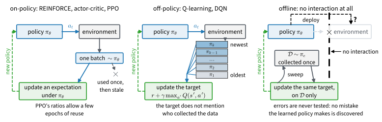

# Offline Reinforcement Learning
:label:`sec_offline`

Every method in this chapter so far could try things out. When Q-learning overestimated an action, the agent eventually took it, saw what happened, and corrected its table; the planner of :numref:`sec_model_based` trusted its learned model only near the states its own episodes had visited, and gathered more episodes when it needed them. Now suppose there are no more episodes. A hospital has years of treatment records but will not experiment on its patients. A company has the logs of the recommender it deployed last year. A robotics lab has hours of teleoperated demonstrations. Can a policy be learned from such a fixed record alone, and how good can it be?

The record was collected by some *behavior policy* $\pi_e$, and Q-learning's target does not depend on who chose the action, so we can run Q-learning over the logged transitions. The difficulty comes next. To do better than the behavior policy, the learned policy must prefer actions that the behavior policy took rarely, and those are the actions whose values rest on the fewest samples. The maximum in the target picks the largest estimates, the largest estimates are often the luckiest ones, and no new trial will ever test them. The remedy, called *pessimism*, distrusts an estimate in proportion to how little data it rests on. It is the mirror image of the optimism that drove exploration in :numref:`sec_exploration`.

We work on the slippery lake of :numref:`sec_valueiter`, where the exact optimum is known, so that every value a learned table predicts can be checked against the truth. We first ask which update rules can use another policy's data at all. We then learn from two fixed logs, measure how far the predictions exceed what any policy can earn, and see what pessimism repairs and when it is unnecessary.

```{.python .input #offline-rl-which-data-may-drive-which-update}
%%tab pytorch
%matplotlib inline
from d2l import torch as d2l
import gymnasium as gym
import numpy as np
```

```{.python .input #offline-rl-which-data-may-drive-which-update}
%%tab jax
%matplotlib inline
from d2l import jax as d2l
import gymnasium as gym
import numpy as np
```

## Learning from a Fixed Record

### Which Targets Can Use Another Policy's Data

The update rules of the last two chapters fall into two families. A policy gradient is an expectation over the current policy's own trajectories, so samples from another policy estimate a different quantity. REINFORCE and actor-critic are therefore *on-policy*, and PPO stretches one batch over a few epochs only by correcting each action's probability with a ratio. The Q-learning target $r + \gamma \max_{a'} \hat{Q}(s', a')$ depends on how the environment responded to $(s, a)$, but not on the policy that chose $a$. A transition collected by an earlier policy, by another agent, or by a fixed log is therefore a valid sample of the same backup, and Q-learning is *off-policy*. :numref:`fig_rl_data_rules` shows the three ways of using data side by side.


:label:`fig_rl_data_rules`

SARSA, the on-policy relative of Q-learning from :numref:`sec_qlearning`, bootstraps on the action $a'$ that the behavior policy actually took at $s'$ instead of the best one. We restate its temporal-difference error :eqref:`eq_qlearning_sarsa`:

$$\delta_{\textrm{SARSA}} = r + \gamma\, Q(s', a') - Q(s, a).$$
:eqlabel:`eq_sarsa`

Averaged over $a' \sim \pi_e(\cdot \mid s')$, this target is the Bellman expectation backup of $\pi_e$, so SARSA learns $Q^{\pi_e}$, the values of the policy that collected the data. A log from someone else teaches SARSA only about that someone else. Q-learning learns $Q^*$ from any log, and exercise :exref:`ex_qlearning-cliff-walking` of :numref:`sec_qlearning` shows the two side by side on the cliff.

Off-policy does not mean that any data will do. An entry of Q-learning's table is only as good as the transitions behind it, so the pairs that the greedy policy chooses, at every state it reaches, must have been tried, and tried often enough to be estimated. This requirement is called the *coverage condition*. Online, an agent repairs poor coverage by going where its estimates are uncertain. In *offline reinforcement learning* the agent receives a fixed dataset and nothing else :cite:`Levine.Kumar.Tucker.ea.2020`, so the coverage of the log is all there is.

### Two Logs of the Slippery Lake

The slippery lake has 16 cells and 4 actions. Eleven cells are neither a hole nor the goal, so the agent can act in 44 state-action pairs, and every move slides sideways two times in three. The experimenter knows the lake's transition table and reads it into a `d2l.TabularMDP`, the arrays $P(s' \mid s, a)$ and $r(s, a)$ of :numref:`sec_mdp`; the learners below never see it. We draw 40 logs of each kind:

```{.python .input #offline-rl-sarsa-one-symbol-the-opposite-rule-1}
%%tab pytorch, jax
gamma, num_datasets = 0.95, 40      # discount; logs of each kind
env = gym.make('FrozenLake-v1', is_slippery=True)
mdp = d2l.TabularMDP.from_gym(env, gamma)
```

Value iteration from :numref:`sec_valueiter` on the true model gives the yardstick: no policy can earn more than $V^*(s_0)$ from the start cell. `greedy` turns a table of action values into its greedy policy, written as a table of action probabilities, and splits ties evenly, as `d2l.epsilon_greedy` does; a rule that sent every tie to the first action would walk left from every row of zeros. `mdp.policy_value` evaluates such a table exactly, by solving the linear Bellman equations $V^\pi = (I - \gamma P_\pi)^{-1} r_\pi$ of :numref:`sec_valueiter`. Every value below that a policy *earns* is computed this way, without rollouts.

```{.python .input #offline-rl-the-experiment-with-a-behavior-cloning-bar-3}
%%tab pytorch, jax
V_star = d2l.value_iteration(mdp, num_iters=1000)[-1]
Q_star = mdp.backup(V_star)

def greedy(Q):
    """The greedy policy of Q as a table of probabilities, ties split
    evenly, the rule of d2l.epsilon_greedy."""
    best = Q == Q.max(axis=1, keepdims=True)
    return best / best.sum(axis=1, keepdims=True)

print(f'V*(s0) = {V_star[0]:.3f}')
```

The first kind of log comes from an agent with no competence at all: 500 episodes of uniformly random actions. It tries every action everywhere but rarely reaches the goal. The second comes from a competent but imperfect operator: 100 episodes of $\epsilon$-greedy actions on $Q^*$ with $\epsilon = 0.2$, so the operator takes the best action with probability $0.8 + 0.2/4 = 0.85$ and a random one otherwise. We call it the *narrow* log, because it concentrates its samples on the operator's choices. `make_log` collects a log with `d2l.rollout`, which runs a policy for complete episodes and returns the transitions as a `d2l.Batch` with fields `obs`, `act`, `rew`, `next_obs` and `term`; the seed fixes the log. `count` tallies $n(s, a)$, how often the log tried each pair. Each entry of `logs` also carries the behavior's table of action probabilities, so that we can evaluate the behavior itself:

```{.python .input #offline-rl-distribution-shift-measured}
%%tab pytorch, jax
def make_log(env, behavior, num_episodes, seed):
    """A fixed log: complete episodes of behavior(obs, rng), seeded."""
    env.reset(seed=seed)
    rng = np.random.default_rng(seed)
    return d2l.rollout(env, behavior, num_episodes, rng)

def count(batch, shape=(16, 4)):
    """n(s, a): how often the log tried each state-action pair."""
    n = np.zeros(shape)
    np.add.at(n, (batch.obs, batch.act), 1)
    return n

def uniform(s, rng):
    return int(rng.integers(4))

def operator(s, rng):            # epsilon-greedy on Q*, epsilon = 0.2
    return d2l.epsilon_greedy(Q_star[s], 0.2, rng)

logs = {'uniform': (uniform, np.full((16, 4), 1 / 4), 500),
        'narrow': (operator, 0.8 * greedy(Q_star) + 0.2 / 4, 100)}
live = np.isin(env.unwrapped.desc.flatten(), [b'S', b'F'])  # 11 cells
for name, (behavior, pi_e, num_episodes) in logs.items():
    batch = make_log(env, behavior, num_episodes, seed=0)
    n = count(batch)[live]
    print(f'{name:>7}: {len(batch):,} transitions, {(n > 0).sum()}/{n.size} '
          f'pairs tried, median support {np.median(n):.0f}; '
          f'behavior earns {mdp.policy_value(pi_e)[0]:.3f}')
```

The random agent earns $0.008$ from the start cell, about a twentieth of the optimum $0.180$, but its 500 episodes try every live pair, a typical pair about forty times. The operator earns $0.087$, about half the optimum, from a log half as long. It piles its samples onto its own choices, leaves two pairs untried, and gives a typical pair only eight samples. Coverage and competence pull in opposite directions, and the two logs sit at the two ends.

### Distribution Shift against the Exact Optimum

Q-learning runs over a log as it runs over an environment. `offline_q_sweeps` shuffles the logged transitions, applies the update of :numref:`sec_qlearning` with the decaying step $1/(1 + 0.1\, n)$ of `d2l.q_learning`, where $n$ counts the updates of the pair so far, and repeats this for 200 sweeps:

```{.python .input #offline-rl-the-experiment-with-a-behavior-cloning-bar-1}
%%tab pytorch, jax
def offline_q_sweeps(batch, gamma, num_sweeps=200, shape=(16, 4), seed=0):
    """The Q-learning loop of d2l.q_learning, step 1 / (1 + 0.1 n(s, a)),
    swept over the fixed log in a fresh random order each time."""
    Q, visits = np.zeros(shape), np.zeros(shape)
    rng = np.random.default_rng(seed)
    for _ in range(num_sweeps):
        for i in rng.permutation(len(batch)):
            s, a, s2 = batch.obs[i], batch.act[i], batch.next_obs[i]
            visits[s, a] += 1
            Q[s, a] += (batch.rew[i] + gamma * (1 - batch.term[i])
                        * Q[s2].max() - Q[s, a]) / (1 + 0.1 * visits[s, a])
    return Q
```

Every sweep revisits the same transitions, so the table settles at a fixed point that depends on the log alone. Count the log into an estimated model: $\hat{P}(s' \mid s, a)$ is the fraction of the tries of $(s, a)$ that landed in $s'$, and $\hat{r}(s, a)$ their mean reward. The fixed point is the table of optimal action values of this *empirical MDP*, the certainty-equivalent table of :numref:`sec_qlearning`. `offline_q` computes it directly, by value iteration on the counted model. Its argument `kappa` is a per-pair penalty subtracted inside every backup, which stays zero until we turn to pessimism below. An untried pair has a row of zeros, so it leads nowhere and is worth nothing. The clip at zero, the smallest value any policy can have on this lake because rewards are never negative, keeps the penalty from driving values below it. With a positive `kappa` the function also charges an untried pair an infinite penalty, but the clip returns it to the same floor of zero, so pessimism leaves untried pairs where the naive table already put them:

```{.python .input #offline-rl-distribution-shift-against-the-exact-optimum-1}
%%tab pytorch, jax
def offline_q(batch, gamma, kappa=0.0, num_iters=500, shape=(16, 4)):
    """Where offline Q-learning with decaying steps converges: value
    iteration on the log's empirical MDP. kappa > 0 subtracts
    kappa / sqrt(n(s, a)) inside every backup, distrusts untried pairs
    entirely, and clips at zero, the floor this environment guarantees."""
    n = count(batch, shape)
    P, r = np.zeros(shape + shape[:1]), np.zeros(shape)
    np.add.at(P, (batch.obs, batch.act, batch.next_obs), 1)
    np.add.at(r, (batch.obs, batch.act), batch.rew)
    m = np.maximum(n, 1)                         # untried: rows of zeros
    mdp_hat = d2l.TabularMDP(P / m[..., None], r / m, gamma)
    penalty = np.where(n > 0, kappa / np.sqrt(m),
                       np.inf if kappa > 0 else 0.0)
    Q = np.zeros(shape)
    for _ in range(num_iters):
        Q = np.maximum(mdp_hat.backup(Q.max(axis=1)) - penalty, 0.0)
    return Q
```

Do the loop and the direct solution agree? We run both on the first uniform log:

```{.python .input #offline-rl-distribution-shift-against-the-exact-optimum-2}
%%tab pytorch, jax
batch = make_log(env, uniform, 500, seed=0)
Q_loop, Q_solve = offline_q_sweeps(batch, gamma), offline_q(batch, gamma)
print(f'largest difference between the two tables: '
      f'{np.abs(Q_loop - Q_solve).max():.3f}')
print(f'their greedy policies earn {mdp.policy_value(greedy(Q_loop))[0]:.3f}'
      f' and {mdp.policy_value(greedy(Q_solve))[0]:.3f}')
```

The two tables differ by less than a hundredth in every entry, and their greedy policies earn the same. The loop takes seconds per log and the direct solution milliseconds, so the experiments below call `offline_q`. Exercise :exref:`ex_offline-rl-dataset-size` asks how the remaining error of the table shrinks with the size of the log.

The second learner is behavior cloning from :numref:`sec_imitation`, which fits the policy that collected the log. On a table, cross-entropy training recovers the log's action frequencies at each state, so `clone_policy` counts them and acts uniformly at a state the log never visited. A clone predicts what the log achieved, the mean discounted return of its episodes:

```{.python .input #offline-rl-the-experiment-with-a-behavior-cloning-bar-2}
%%tab pytorch, jax
def clone_policy(batch, shape=(16, 4)):
    """Behavior cloning on a table: the log's empirical action
    distribution, uniform wherever the log is silent."""
    n = count(batch, shape)
    total = n.sum(axis=1, keepdims=True)
    return np.where(total > 0, n / np.maximum(total, 1), 1 / shape[1])
```

On each of the 40 logs of each kind we fit the naive table, the one with no penalty, and the clone, and record what each one predicts at the start cell and what its policy earns there. The `Batch` method `episode_returns` gives the discounted return of every logged episode:

```{.python .input #offline-rl-the-experiment-with-a-behavior-cloning-bar-4}
%%tab pytorch, jax
datasets, pred, value = {}, {}, {}   # predicted and earned values
for name, (behavior, _, num_episodes) in logs.items():
    datasets[name] = [make_log(env, behavior, num_episodes, seed)
                      for seed in range(num_datasets)]
    fits = [offline_q(batch, gamma) for batch in datasets[name]]
    pred[name, 'naive'] = np.array([Q[0].max() for Q in fits])
    value[name, 'naive'] = np.array(
        [mdp.policy_value(greedy(Q))[0] for Q in fits])
    pred[name, 'clone'] = np.array(
        [batch.episode_returns(gamma).mean() for batch in datasets[name]])
    value[name, 'clone'] = np.array(
        [mdp.policy_value(clone_policy(batch))[0]
         for batch in datasets[name]])
```

`summary` prints the medians over the 40 logs, and on how many logs the prediction exceeds the optimum and the policy's own exact value; `tally` counts on how many logs one learner's policy earns more than another's, less, or the same:

```{.python .input #offline-rl-the-experiment-with-a-behavior-cloning-bar-5}
%%tab pytorch, jax
def summary(pred, value, v_star):
    """Medians; on how many logs the prediction exceeds V*(s0) and the
    exact value of the learner's own policy."""
    return (f'predicts {np.median(pred):.2f}, earns '
            f'{np.median(value):.2f}; above V* on {(pred > v_star).sum():2d}'
            f', above own value on {(pred > value + 1e-9).sum():2d}')

def tally(value, other):
    """On how many logs value is higher, lower, equal to other."""
    diff = value - other
    return (diff > 1e-9).sum(), (diff < -1e-9).sum(), (abs(diff) <= 1e-9).sum()

for name in logs:
    for arm in ['clone', 'naive']:
        print(f'{name:>7} {arm}: ' + summary(pred[name, arm],
                                             value[name, arm], V_star[0]))
    wins = tally(value[name, 'naive'], value[name, 'clone'])[0]
    print(f'{"":>7} the naive table beats the clone on {wins} of '
          f'{num_datasets} logs')
```

On the uniform logs the naive table predicts more than its own policy earns on 36 of 40 logs, and more than any policy can earn on 28; the median prediction is about $0.20$, above the optimum $0.18$. On the narrow logs the gap is wider: the prediction exceeds $V^*$ on 39 of 40 logs, with a median of $0.25$, while the policies earn only about $0.1$. Comparing what a learner predicts with what its policy earns is the standard diagnostic of offline reinforcement learning, and with deep networks the gap can be far larger :cite:`Fujimoto.Meger.Precup.2019`.

Where do the inflated predictions come from? We take the first narrow log and plot each tried live pair at its support $n(s, a)$ against the error $\hat{Q}(s, a) - Q^*(s, a)$ of the naive table, and mark the pair the greedy policy picks at each cell (where two actions tie, `argmax` marks the first one, while `greedy` splits the tie; ties among the picks are rare on these logs):

```{.python .input #offline-rl-the-experiment-with-a-behavior-cloning-bar-6}
%%tab pytorch, jax
batch = datasets['narrow'][0]
n, Q = count(batch), offline_q(batch, gamma)
err, tried = Q - Q_star, live[:, None] & (n > 0)
cells = np.flatnonzero(live)
picks = Q[cells].argmax(axis=1)
print('picks with n <= 5: ' + ', '.join(
    f'cell {s} (n = {n[s, a]:.0f}, {err[s, a]:+.2f})'
    for s, a in zip(cells, picks) if n[s, a] <= 5))
d2l.plot([n[tried], n[cells, picks]], [err[tried], err[cells, picks]],
         xlabel='samples of the pair in the log, n(s, a)',
         ylabel='error of the naive table', legend=['pair', 'greedy pick'],
         xscale='log', fmts=('C0o', 'C1^'), figsize=(5, 3.5))
```

Every pair with more than twenty samples errs upward, by about $0.05$ to $0.15$. Their own transitions are well estimated, but their targets bootstrap from the values of later cells, and those carry the errors of the cells after them, which the maximum in each later backup tilts upward. Below about ten samples the errors spread in both directions, from $-0.15$ to $+0.26$, and the greedy policy's thinly supported picks include the two largest errors in the plot: two picks rest on two samples and one on five, and two of them are overestimated by $0.26$ and $0.20$, more than the optimum itself. One log could be a coincidence, so we pool the picks over all 40 narrow logs and compare the picks that rest on one to five samples with all pairs that have so little support:

```{.python .input #offline-rl-distribution-shift-against-the-exact-optimum-3}
%%tab pytorch, jax
pick_n, pick_err, all_n, all_err = [], [], [], []
for batch in datasets['narrow']:
    n, Q = count(batch), offline_q(batch, gamma)
    picks = Q[cells].argmax(axis=1)
    pick_n.append(n[cells, picks])
    pick_err.append((Q - Q_star)[cells, picks])
    all_n.append(n[live].ravel())
    all_err.append((Q - Q_star)[live].ravel())
pick_n, pick_err, all_n, all_err = map(
    np.concatenate, (pick_n, pick_err, all_n, all_err))
thin, thin_all = (pick_n >= 1) & (pick_n <= 5), (all_n >= 1) & (all_n <= 5)
print(f'greedy picks resting on 1 to 5 samples: {thin.mean():.0%} of picks')
print(f'their median error {np.median(pick_err[thin]):+.2f}; all pairs '
      f'with 1 to 5 samples {np.median(all_err[thin_all]):+.2f}')
```

About a quarter of the greedy policy's picks rest on five or fewer samples, and these picks are overestimated by about $0.2$, two to three times the typical error of pairs with so little support. The maximum does not pick thin pairs at random. It picks the thin pairs whose errors happen to be positive, the maximization bias of :numref:`subsec_dqn-max-bias`, and the next backup passes their inflated values on to the cells before them. The resulting mismatch between the actions the log contains and the actions the learned policy takes is called *distribution shift*. Online it would correct itself: the agent would take the overestimated action, collect the transitions that pull its value down, and move on. Offline the log never changes, so the error stays.

### The Clone and Stitching

The clone is nearly calibrated. Its prediction is the log's own average return, an unbiased estimate of the behavior's value, which the clone's value approximates closely; the prediction lies above the clone's value on about half the logs and below it on the rest. On the uniform logs the same property is its weakness: it reproduces a random walk and earns $0.01$.

The naive table beats the clone on all 40 uniform logs, and earns about $0.14$, three-quarters of the optimum, from data whose collector earned $0.008$. The reason is the per-transition backup. Suppose one random episode reaches cell 10 and then falls into a hole, while another reaches cell 10 by a different route and slides on to the goal. The backup values cell 10 by the second episode's continuation and passes that value back along the first episode's route, composing a path that no single episode followed. This composition is called *stitching*, and it is what lets offline Q-learning improve on the policy that collected its data. On the narrow logs the clone becomes a strong baseline: it copies an operator who earns $0.087$ and earns about $0.09$ itself, while the naive table, misled by its thinly supported picks, beats it on only 27 of 40 logs.

## Pessimism

### A Two-Armed Bandit by Hand

Before changing the lake learner we take the smallest case. An offline log for a two-armed bandit holds 100 pulls of arm 1, which always pays $1/2$, and a single pull of arm 2, which pays $1$ with probability $1/4$ and $0$ otherwise. Suppose that single pull paid $1$, which happens one time in four. The arm with the best empirical mean is then arm 2, with $1$ against $0.5$, and choosing it earns $0.25$ on average.

A *lower confidence bound* subtracts from each empirical mean $\hat{r}(a)$ a radius that shrinks with the arm's count $n(a)$. Hoeffding's inequality, with rewards in $[0, 1]$, gives the radius

$$b(a) = \sqrt{\frac{\log(2K/q)}{2\, n(a)}}$$

for $K$ arms and a failure probability $q$: with probability at least $1 - q$, every arm's true mean lies within $b(a)$ of its empirical mean. With $K = 2$ and $q = 0.1$, $b(1) = \sqrt{\log 40 / 200} \approx 0.136$ and $b(2) = \sqrt{\log 40 / 2} \approx 1.358$. The lower bounds are $0.5 - 0.136 = 0.364$ for arm 1 and $1 - 1.358 = -0.358$ for arm 2, so the rule picks arm 1 :cite:`Rashidinejad.Zhu.Ma.ea.2021`. Averaged over what the single pull might have paid, the empirical best arm earns $\frac34 \cdot 0.5 + \frac14 \cdot 0.25 \approx 0.44$, and the lower-bound rule earns $0.5$ every time.

Pessimism has a cost. If arm 2 paid $0.7$ on average and its empirical mean were $0.7$, the rule would keep refusing it until $0.7 - \sqrt{\log 40 / (2 n_2)}$ exceeds $0.364$, which first happens at $n_2 = 17$ pulls. A pessimistic learner gives up good actions until the data vouch for them.

### The Penalty as One Line

The lake learner gets the same treatment. Each entry of the naive table averages $n(s, a)$ noisy targets, so its sampling error shrinks like $1/\sqrt{n(s, a)}$. With $\kappa > 0$, `offline_q` subtracts $\kappa/\sqrt{n(s, a)}$ inside every backup and clips the result at zero,

$$Q(s, a) \leftarrow \max\Big( \hat{r}(s, a) + \gamma \sum_{s'} \hat{P}(s' \mid s, a) \max_{a'} Q(s', a') - \frac{\kappa}{\sqrt{n(s, a)}},\ 0 \Big).$$
:eqlabel:`eq_offline_pessimistic`

The update is the naive one; the only difference is the penalty, which is largest where the log is thinnest. A pair that was never tried stays at the floor of zero, with or without the penalty. This form is the tabular version of pessimistic value iteration :cite:`Jin.Yang.Wang.2021`. Here $\kappa$ is a free scale rather than the constant of Hoeffding's inequality, because the targets of one pair bootstrap from the same estimated successors and are not independent.

The penalty mirrors the bonus of the upper-confidence-bound rule of :numref:`sec_exploration`, which picks the arm with the largest $\hat{\mu}(a) + \kappa\sqrt{\log t / n(a)}$. Both terms shrink like $1/\sqrt{n}$; they differ in sign because they differ in feedback. Online, an optimistic estimate sends the agent to try the action, and the trial corrects the estimate. Offline no trial is possible, so the same uncertainty is subtracted, and an action is chosen only when the data support it.

### Narrow Data and Uniform Data

We now rerun `offline_q`, the backup :eqref:`eq_offline_pessimistic` with $\kappa = 0.1$, on the same 80 logs:

```{.python .input #offline-rl-kappa-over-root-n}
%%tab pytorch, jax
kappa = 0.1
for name in logs:
    fits = [offline_q(batch, gamma, kappa) for batch in datasets[name]]
    pred[name, kappa] = np.array([Q[0].max() for Q in fits])
    value[name, kappa] = np.array(
        [mdp.policy_value(greedy(Q))[0] for Q in fits])
    print(f'{name:>7} kappa {kappa}: ' + summary(
        pred[name, kappa], value[name, kappa], V_star[0]))
    better, worse, tied = tally(value[name, kappa], value[name, 'naive'])
    print(f'{"":>7} against naive: better on {better}, worse on {worse}, '
          f'tied on {tied}; beats the clone on '
          f'{tally(value[name, kappa], value[name, "clone"])[0]}')
```

On the narrow logs pessimism does what the bandit promised. The prediction falls from $0.25$ to about $0.13$ and exceeds the optimum on only 4 logs. The policy earns more than the naive table on 29 of 40 logs and less on 1, with a median of about $0.14$, and it beats the clone on 39 of 40.

On the uniform logs the same penalty removes the overestimation, with no prediction above the optimum, but it lowers the return on 28 of 40 logs and raises it on 4. With every action tried tens of times, there are few lucky estimates to protect against, and a penalty that differs from pair to pair only changes which well-supported action looks best. The theory of pessimistic offline learning says when to expect which outcome: the guarantee of the lower-confidence learner needs the log to cover the pairs of the *optimal* policy, not every pair :cite:`Rashidinejad.Zhu.Ma.ea.2021`. The narrow log covers the optimal policy's choices thickly and everything else thinly, which is where pessimism helps; a uniform log covers everything, and the naive table needs no protection.

### Choosing the Penalty

How large should $\kappa$ be? A larger value makes the table more cautious, and we try $\kappa = 0.3$ on the same logs:

```{.python .input #offline-rl-choosing-the-penalty}
%%tab pytorch, jax
kappa = 0.3
for name in logs:
    fits = [offline_q(batch, gamma, kappa) for batch in datasets[name]]
    p = np.array([Q[0].max() for Q in fits])
    v = np.array([mdp.policy_value(greedy(Q))[0] for Q in fits])
    better, worse, _ = tally(v, value[name, 'naive'])
    print(f'{name:>7} kappa {kappa}: predicts {np.median(p):.2f}, earns '
          f'{np.median(v):.2f}; against naive better on {better}, '
          f'worse on {worse}')
```

At $\kappa = 0.3$ the start value is driven to zero on nearly every log, and the policy loses to the naive table on 36 of the 40 narrow logs and on all 40 uniform ones. The reason is that the penalty is charged at every backup, and a value is a discounted sum over a path. Along a path whose pairs have about $n$ samples each, the charges add up to at most about $\kappa / (\sqrt{n}\,(1 - \gamma))$, twenty times the per-step charge at $\gamma = 0.95$; episodes end at the goal or in a hole, so the charges actually collected along a path are fewer. Even the bound stays below $V^*(s_0) = 0.18$ at $\kappa = 0.3$ once every pair along the path has over a thousand samples, while the 100-episode logs hold several hundred samples at the start cell and far fewer further on. With five times as much data from the same operator the per-step charge shrinks by $\sqrt{5}$. Most pairs along the optimal path then hold a few hundred samples, short of the thousand the bound asks for, and still, as exercise :exref:`ex_offline-rl-how-much-pessimism` shows, $\kappa = 0.3$ does little harm there: the charge actually collected is already small enough. The penalty has to match the amount of data, so choosing $\kappa$ is a model-selection problem.

### Calibration and Model Selection

Every comparison above used the experimenter's exact model of the lake, which no offline deployment has. A deployment has the log, and it must estimate how well a candidate policy would do, for each value of $\kappa$ or each learned table, from that log alone. One estimator reweights the logged episodes by the probability ratio of each action under the candidate and the behavior policy. Its weight is the product of these ratios over an episode, the product whose variance grows with the horizon in :numref:`sec_ppo`, and for a greedy candidate most episodes get weight zero. Another evaluates the candidate in the empirical MDP of a held-out part of the log, which is reliable only where that part covers the candidate's choices. Calibration can be checked in part: a table that predicts more than the best discounted return in its own log is suspect. On the lake this check never fires: the best episode of every log returns about $0.5$ or more, above every prediction in this section. Exercise :exref:`ex_offline-rl-what-you-cannot-measure` tries both estimators on the uniform logs.

## Beyond the Table

### Constraining the Policy or the Values

With continuous states and actions there are no counts, but the two responses of this section remain: keep the policy close to the actions the log supports, or push down the values of the actions it does not. The first is the KL-regularized objective of :numref:`sec_regularized` with the behavior policy as the reference. At each state the policy maximizes

$$\mathbb{E}_{a \sim \pi(\cdot \mid s)}\big[\hat{Q}(s, a)\big] - \beta\, D_{\textrm{KL}}\big(\pi(\cdot \mid s) \,\Vert\, \pi_e(\cdot \mid s)\big),$$

and an action the log never took carries an infinite penalty. In practice $\pi_e$ is unknown and is replaced by the log. TD3+BC, for instance, adds to the actor's objective the squared distance between the policy's action and the logged one :cite:`Fujimoto.Gu.2021`. Up to a constant, the squared distance is the negative log-likelihood of the logged action under a Gaussian centered at the policy's action, so the term is a sample estimate of the divergence in the other direction, $D_{\textrm{KL}}(\pi_e \Vert \pi)$. Direct preference optimization, which closes the next section, learns from a fixed dataset of preferences between pairs of responses under the same constraint, with a reference policy in the role of $\pi_e$.

The second response replaces $\kappa/\sqrt{n}$, which needs counts, with a penalty that needs only the network's outputs. Conservative Q-learning (CQL) adds to the temporal-difference loss a term that lowers the values of all actions at a logged state and raises the value of the logged action; with discrete actions the term is $\alpha_{\textrm{c}}\big(\log\sum_{a'} e^{Q(s, a')} - Q(s, a)\big)$ :cite:`Kumar.Zhou.Tucker.ea.2020`. :numref:`tab_rl_offline_families` sets the two families against what this section did with counts.

:Two families of offline methods, and their counterparts on the lake.
:label:`tab_rl_offline_families`

| family | what it constrains | in this section | representative |
|:--|:--|:--|:--|
| policy constraint | the policy stays near the logged actions | the clone, at the extreme | TD3+BC |
| value penalty | values of unsupported actions are pushed down | $\kappa/\sqrt{n}$ in `offline_q` | CQL |

A hard rule that allows only logged actions inside the maximum would change nothing on the lake: an untried pair already has value zero, the floor, so it never wins a maximum. The difficulty there was thin support, not absent support. The Further Reading of this chapter (:numref:`sec_deep_rl-further-reading`) compares the deep methods built on these two ideas.

### Return Conditioning

A third approach avoids the maximum altogether. Decision Transformer treats each logged trajectory as a sequence of returns-to-go, states, and actions, trains an autoregressive model to predict each action, and at test time conditions it on a high desired return :cite:`Chen.Lu.Rajeswaran.ea.2021`. A small network that conditions on the return by ordinary supervised learning recovers much of its performance, so much of the gain comes from conditioning on the return rather than from the sequence architecture :cite:`Emmons.Eysenbach.Kostrikov.ea.2022`. Return-conditioned methods do about as well as value-based ones on benchmarks where good trajectories exist in the log. They fall behind where a good policy must be stitched together from pieces of different episodes, and they can fail in stochastic environments, where a high return in the log may be luck :cite:`Paster.McIlraith.Ba.2022,Brandfonbrener.Bietti.Buckman.ea.2022`.

The smallest case shows the failure. In a one-step task, action A pays $1$ with probability $1/2$ and $0$ otherwise, and action B always pays $0.6$; a uniformly random behavior has logged both many times. Every logged episode with return $1$ took action A, so a policy conditioned on the highest return in the log always takes A and earns $0.5$, less than the $0.6$ of B. The return-conditioned policy imitates the lucky episodes, while a Q-learner averages the outcomes of each action and picks B.

We can now learn a policy from a fixed log, compare what it predicts with what it earns, and tell a supported estimate from a lucky one. Pessimism improves on the naive table when the log is narrow and should be left out when the log covers everything. The counts show how evenly a log covers the pairs, but not whether it covers the optimal policy's pairs, and nothing in the log fixes $\kappa$. The common practical answer is to stop being purely offline: learn from the log, then collect a little new data and fine-tune. One idea of this section reaches :numref:`sec_rl_sequences`: there, DPO learns a language model from a fixed dataset of preferences under the KL constraint above.

## Summary

Offline reinforcement learning learns a policy from a fixed log, which only off-policy targets such as Q-learning's can use, and only where the log covers the pairs the learned policy chooses. Without interaction, the maximum in the backup selects the thinly supported actions whose estimates happen to be too high, and no new trial corrects them: on the slippery lake the naive table predicts more than the optimum on most logs and earns far less than it predicts. Pessimism subtracts an uncertainty penalty $\kappa/\sqrt{n}$ inside the backup, the mirror of the exploration bonus. It improves the policy when the log is narrow and costs return when the log already covers every action, and its scale must be chosen without the evaluation the experiments here relied on. Deep offline methods constrain the policy toward the logged actions or penalize unsupported values, and return-conditioned methods avoid the maximum at the price of stitching and of trusting lucky episodes.

## Exercises

1. **Expected SARSA.** Expected SARSA replaces the sampled action $a'$ in
   :eqref:`eq_sarsa` by an average under a policy $\pi$,
   $$\delta = r + \gamma \sum_{a'} \pi(a' \mid s')\, Q(s', a') - Q(s, a).$$
    1. Show that the target becomes the Q-learning target when $\pi$ is the
       greedy policy of $Q$.
    1. For $\pi \neq \pi_e$, Expected SARSA estimates $Q^\pi$ from
       transitions collected by $\pi_e$, and its update contains no
       importance ratio. Explain why the one-step action-value target needs
       none, and why a state-value target $r + \gamma V^\pi(s')$ for
       $V^\pi(s)$ would need the ratio $\pi(a \mid s) / \pi_e(a \mid s)$.

    *Adapted from Richard S. Sutton and Andrew G. Barto,
    [Reinforcement Learning: An Introduction](http://incompleteideas.net/book/RLbook2020.pdf),
    Section 6.6.*

1. [code] **Data from a better policy.** The narrow logs came from an
   operator acting $\epsilon$-greedily on `Q_star` with $\epsilon = 0.2$.
   Draw 40 logs of 100 episodes from a better operator with
   $\epsilon = 0.1$, and 40 mixed logs of 50 uniform episodes followed by
   50 episodes of the $\epsilon = 0.2$ operator (concatenate two
   `d2l.Batch`es, shifting the second batch's `ep_ends` by the length of
   the first).
    1. Fit the naive table and the clone on every log and evaluate both
       exactly. On which kind of log does the clone beat the naive table,
       and how does the exact value of the behavior explain it?
    1. On the $\epsilon = 0.1$ logs, count at each live cell how often the
       log contains the action that the naive greedy policy picks there.
       What do these counts explain about its return?
    1. Which matters more for offline Q-learning on this lake: how well the
       log covers the pairs, or how good its behavior is? Use the mixed logs
       in your answer.
   :exlabel:`ex_offline-rl-where-data-comes`

1. [code] **How much pessimism.** Rerun `offline_q` with
   $\kappa \in \{0, 0.02, 0.05, 0.1, 0.2, 0.3, 1\}$ on the uniform and
   narrow logs, and on two more kinds of 40 logs each: 500 episodes of the
   $\epsilon = 0.2$ operator, and 100 episodes of an $\epsilon = 0.1$
   operator.
    1. For each kind of log, plot the median exact value of the greedy
       policy against $\kappa$, with the clone's value as a horizontal line.
       Where does the penalty help, where is it harmless, and where does it
       hurt?
    1. What does the greedy policy do at $\kappa = 1$, and how well
       calibrated is its prediction? What does this case say about
       calibration as a criterion for choosing $\kappa$?
    1. How does the best $\kappa$ move as the log grows from 100 to 500
       episodes of the same operator? Relate your answer to the bound
       $\kappa / (\sqrt{n}\,(1 - \gamma))$ on the accumulated charge, and
       explain why the charge actually collected is smaller.
    1. Which information did you use to find the best $\kappa$ that an
       offline deployment does not have?
   :exlabel:`ex_offline-rl-how-much-pessimism`

1. **Conditioning on luck.** Return-conditioned supervised learning, the
   simplest tabular form of Decision Transformer, acts in state $s$ for a
   target return $g$ with the log's action distribution among the episodes
   that achieved $g$, $\pi(a \mid s, g) = P_{\mathcal{D}}(a \mid s, G = g)$
   :cite:`Brandfonbrener.Bietti.Buckman.ea.2022`. Take the one-step task of
   the text, but let action A pay $1$ with probability $p$.
    1. For which $p$ does conditioning on the highest return in the log
       select the optimal action?
    1. What does offline Q-learning learn from the same data, and why do
       the lucky episodes not mislead it?
    1. [code] On the slippery lake, keep only the episodes of each uniform
       log that reached the goal, clone them with `clone_policy`, and
       evaluate the result exactly. How does it compare with the clone of
       the whole log and with the naive table? Which of the two
       limitations of return conditioning named in the text does the
       comparison show?

1. [code] **Dataset size and the error floor.** Each entry of the naive
   table averages $n(s, a)$ targets, which suggests errors that fall like
   $1/\sqrt{n}$. Draw five uniform logs each of $100$, $500$ and $2{,}000$
   episodes. Pool the live pairs' supports $n$ and absolute errors
   $e = |\hat{Q} - Q^*|$, and compute the median of $e\sqrt{n}$ for $n$ in
   $[1, 10)$, $[10, 30)$, $[30, 100)$ and $[100, \infty)$. Does
   $e\sqrt{n}$ stay constant? If it rises with $n$, the errors fall more
   slowly than $1/\sqrt{n}$. Explain the residual with the target of a
   well-sampled pair: what does that target contain besides the pair's own
   samples, and how does its error shrink as the log grows?
   :exlabel:`ex_offline-rl-dataset-size`

1. **Pessimism in a two-armed bandit.** ● An offline log for a
   two-armed bandit holds $n_1$ pulls of arm 1, which always pays $1/2$, and
   $n_2$ pulls of arm 2, which pays $1$ with probability $1/4$ and $0$
   otherwise. Write $r(a)$ for the mean reward of arm $a$, $\hat{r}(a)$ for
   its empirical mean, and $a^*$ for the best arm. Ties go to arm 1.
    1. The empirical best arm maximizes $\hat{r}(a)$. Compute the
       probability that it is arm 2, and the expected shortfall
       $r(a^*) - r(\hat{a})$, for $n_2 \in \{1, 5, 20\}$. How does the
       answer depend on $n_1$?
    1. The lower-confidence-bound rule of the text selects
       $\hat{a} = \operatorname{argmax}_a \hat{r}(a) - b(a)$ with
       $b(a) = \sqrt{\log(2K/q) / (2 n(a))}$. Assume that every arm
       has at least one pull. Use Hoeffding's inequality, as stated in
       exercise :exref:`ex_qlearning-ucb-logarithmic-regret` of
       :numref:`sec_exploration`, and a union bound to show that
       $r(a^*) - r(\hat{a}) \leq 2 b(a^*)$ with probability at least
       $1 - q$.
    1. The optimistic rule $\operatorname{argmax}_a \hat{r}(a) + b(a)$ has
       the form of the upper-confidence-bound rule. Derive the analogous
       bound for it. On whose count does the bound depend now, and why is
       this dependence harmless online but harmful offline?
    1. Let arm 2 pay $1$ with probability $0.7$ instead, and take
       $n_1 = 100$ and $q = 0.1$. For $n_2 \in \{5, 10, 17, 30\}$,
       compute the exact probability that each rule, the empirical best
       arm and the lower bound, selects arm 2, and the expected reward
       of each rule. Compare with part (a), where arm 2 was the worse arm:
       what does pessimism protect against, and what does it cost?

1. [code] **Evaluation without a simulator.** ● Every comparison in this
   section evaluated the learned policies exactly in the true model, which
   a genuine offline deployment cannot do. Ordinary importance sampling
   estimates the value of a target policy $\pi$ from $m$ episodes of a
   behavior policy $\pi_e$ by $\frac{1}{m} \sum_i w_i G_i$, and weighted
   importance sampling by $\sum_i w_i G_i / \sum_i w_i$, where $G_i$ is the
   discounted return of episode $i$ and
   $w_i = \prod_t \pi(a_t \mid s_t) / \pi_e(a_t \mid s_t)$ is the product
   over its steps.
    1. For the greedy policy of the naive table of the first uniform log,
       how many of the log's 500 episodes receive a nonzero weight? Explain
       the number with the length of the episodes.
    1. Evaluate instead the $\epsilon$-greedy version of the naive table of
       each uniform log, with $\epsilon = 0.3$, on the log that trained it.
       Compute both estimates and the effective sample size
       $(\sum_i w_i)^2 / \sum_i w_i^2$ of the weights, and compare the
       estimates with the exact value `mdp.policy_value(pi)[0]`, which only
       the experimenter can compute. For a fixed target policy, ordinary
       importance sampling is unbiased. How does the spread of the weights
       explain the errors of the two estimates?
    1. Could either estimator have selected $\kappa$ in exercise
       :exref:`ex_offline-rl-how-much-pessimism` reliably?

    *Adapted from Richard S. Sutton and Andrew G. Barto,
    [Reinforcement Learning: An Introduction](http://incompleteideas.net/book/RLbook2020.pdf),
    Section 5.5.*
   :exlabel:`ex_offline-rl-what-you-cannot-measure`

1. **Conservative Q-learning in a table.** ●● Conservative Q-learning
   :cite:`Kumar.Zhou.Tucker.ea.2020` adds to the squared Bellman error a
   term that lowers values under a chosen action distribution
   $\mu(a \mid s)$ and raises them under the log's empirical action
   distribution $\hat{\pi}_e(a \mid s) = n(s, a) / n(s)$, where
   $n(s) = \sum_a n(s, a)$. In a table, one iteration chooses
   $$\hat{Q}_{k+1} = \operatorname*{argmin}_Q\; \alpha_{\textrm{c}} \Big( \mathbb{E}_{s \sim \mathcal{D},\, a \sim \mu(\cdot \mid s)}\big[Q(s, a)\big] - \mathbb{E}_{(s, a) \sim \mathcal{D}}\big[Q(s, a)\big] \Big) + \frac{1}{2} \mathbb{E}_{(s, a) \sim \mathcal{D}} \Big[ \big( Q(s, a) - \hat{\mathcal{T}} \hat{Q}_k(s, a) \big)^2 \Big],$$
   where $\mathbb{E}_{\mathcal{D}}$ averages over the transitions of the log,
   $\alpha_{\textrm{c}} > 0$ sets the strength of the penalty, and
   $\hat{\mathcal{T}} \hat{Q}_k(s, a)$ averages the Q-learning target
   $r + \gamma \max_{a'} \hat{Q}_k(s', a')$ over the transitions from
   $(s, a)$ in the log. Assume that $\mu(a \mid s) > 0$ only where
   $n(s, a) > 0$; otherwise the objective is unbounded below.
    1. Show that every pair with $n(s, a) > 0$ satisfies
       $$\hat{Q}_{k+1}(s, a) = \hat{\mathcal{T}} \hat{Q}_k(s, a) - \alpha_{\textrm{c}} \Big( \frac{\mu(a \mid s)}{\hat{\pi}_e(a \mid s)} - 1 \Big).$$
       Which pairs does the penalty lower, and which does it raise?
    1. Let $\mu = \pi$ for some policy $\pi$. Show that one iteration lowers
       $\sum_a \pi(a \mid s) \hat{Q}_{k+1}(s, a)$ by
       $\alpha_{\textrm{c}} \big( \sum_a \pi(a \mid s)^2 / \hat{\pi}_e(a \mid s) - 1 \big)$
       relative to the same average of the backup, and that this amount is
       nonnegative.
    1. Take for $\mu$ the greedy policy of the naive table of the first
       narrow log. For its live pairs, plot the CQL penalty of part (a) and
       the penalty $\kappa / \sqrt{n(s, a)}$ of `offline_q` against
       $n(s, a)$. Which property of the data does each penalty respond to,
       and which pairs do the two treat differently?

1. [extended] **Deep offline Q-learning.** Function approximation adds a
   failure the table cannot show: a network extrapolates values to
   actions and states the log never contains. Train the DQN of
   :numref:`sec_dqn` on CartPole for about half its usual budget, then
   freeze its replay buffer as an offline log.
    1. Train a fresh network on the frozen buffer alone, with no
       interaction, and record $\max_a \hat{Q}(s_0, a)$ at a few start
       states every few thousand updates, together with the return of the
       greedy policy in the environment. With $\gamma = 0.99$ and episodes
       capped at 500 steps, no policy can earn a discounted return above
       about $99.3$. Does the predicted value cross it?
    1. Add to the temporal-difference loss the CQL term
       $\alpha_{\textrm{c}}\big(\log\sum_{a'} e^{\hat{Q}(s, a')} - \hat{Q}(s, a)\big)$,
       averaged over the minibatch, for
       $\alpha_{\textrm{c}} \in \{0.1, 1\}$. Repeat part (a) with three
       seeds for each setting. Does the predicted value stay below the
       bound, and which learner's policy earns more?
    1. Which part of the CQL term plays the role of $\kappa/\sqrt{n}$, and
       which part of the log does it use in place of the counts?

[Discussions](https://d2l.discourse.group/t/36806)

<!-- slides -->

::: {.slide}
::: {.cover}
[Dive into Deep Learning · §15.7]{.kicker}

Offline Reinforcement Learning<br>
**learning from a fixed log · distribution shift · stitching · pessimism · choosing the penalty**
:::
:::

::: {.slide title="A Table Learned from 100 Logged Episodes Predicts 0.25 Where No Policy Earns More Than 0.18"}
[The problem]{.kicker}

- A hospital has treatment records but will not experiment on patients; a
  company has last year's logs. No new trial is allowed.
- Online, an overestimated action is eventually taken, and the outcome
  corrects the estimate. Offline, nothing ever tests it.
- Slippery lake, 100 episodes of a competent operator: Q-learning on the log
  predicts **0.25** at the start; the optimum is **0.18**; its policy earns
  about **0.1**.

::: {.d2l-note .warn}
The maximum in the target picks the luckiest estimates, and in a fixed log
the luckiest estimates rest on the fewest samples.
:::
:::

::: {.slide title="By the End of This Deck You Can"}
[Goals]{.kicker}

- say which update rules can learn from another policy's log;
- learn from a fixed log by solving its empirical MDP, and score the
  prediction against the exact optimum;
- explain distribution shift, and why the backup stitches episodes together;
- pick the safer arm with a lower confidence bound, and put $\kappa/\sqrt{n}$
  into the backup;
- predict when pessimism helps and when it costs.

**Running example:** slippery 4×4 FrozenLake, $\gamma = 0.95$,
$V^*(s_0) = 0.18$; 40 uniform and 40 narrow logs.

**The idea:** distrust an estimate in proportion to how little data it rests on.
:::

::: {.slide title="A Fixed Log Replaces the Environment"}
[Where this fits]{.kicker}

::: {.cols .vc}
::: {.col}
| section | adds |
|---|---|
| Actor-Critic Methods | a critic in place of the full return |
| Trust Regions and PPO | several steps on one batch |
| KL-Regularized Policy Optimization | a KL penalty toward a reference |
| Deep Q-Networks | replay and a target network |
| Soft Actor-Critic | continuous actions, entropy |
| Learned Models and Planning | a model to plan in |
| **Offline Reinforcement Learning** | **a fixed log, no new trials** |
| RL for Sequence Generation | a checker's verdict on a response |
:::

::: {.col .narrow}
- **Uses:** tabular Q-learning, value iteration, exact policy values,
  behavior cloning, the UCB rule.
- **Skips:** deep offline methods at scale (named only); off-policy
  evaluation (an exercise).
:::
:::
:::

::: {.slide title="The Q-Learning Target Does Not Depend on Who Chose the Action"}
[Which data]{.kicker}

{width=96%}

$r + \gamma \max_{a'} Q(s', a')$ is a valid sample from any collector; a
policy gradient needs the current policy's own trajectories.
:::

::: {.slide title="SARSA Learns the Collector's Values; Q-Learning Learns Q*"}
[Which data]{.kicker}

$$\delta_{\textrm{SARSA}} = r + \gamma\, Q(s', a') - Q(s, a), \qquad
a' \sim \pi_e(\cdot \mid s')$$

- Averaged over $a'$, SARSA's target is the Bellman expectation backup of
  the behavior policy $\pi_e$: it learns $Q^{\pi_e}$.
- Q-learning's $\max_{a'}$ targets $Q^*$ from any log, **if** the log covers
  the pairs the greedy policy picks: the *coverage condition*.
- Offline, the coverage of the log is all there is.
:::

::: {.slide title="Two Logs: Broad Coverage, or a Competent Operator"}
[Two logs]{.kicker}

- **uniform:** 500 episodes of random actions;
- **narrow:** 100 episodes of $\epsilon$-greedy on $Q^*$, $\epsilon = 0.2$
  (best action with probability 0.85).

@!offline-rl-distribution-shift-measured

Coverage and competence pull in opposite directions.
:::

::: {.slide title="Swept Q-Learning on a Log Converges to the Log's Empirical MDP"}
[Learning from a log]{.kicker}

```{.python #offline-rl-exercises-1}
def offline_q(batch, gamma, num_iters=500):
    n = count(batch)                          # n(s, a)
    P, r = np.zeros((16, 4, 16)), np.zeros((16, 4))
    np.add.at(P, (batch.obs, batch.act, batch.next_obs), 1)
    np.add.at(r, (batch.obs, batch.act), batch.rew)
    m = np.maximum(n, 1)                      # untried: zero rows
    mdp_hat = d2l.TabularMDP(P / m[..., None], r / m, gamma)
    Q = np.zeros((16, 4))
    for _ in range(num_iters):
        Q = mdp_hat.backup(Q.max(axis=1))
    return Q
```

@!offline-rl-distribution-shift-against-the-exact-optimum-2

The 200-sweep loop with step $1/(1+0.1n)$ and the solve agree.
:::

::: {.slide title="The Naive Table Predicts More Than the Optimum and Earns Less"}
[Distribution shift]{.kicker}

Prediction = $\max_a \hat{Q}(s_0, a)$; earned = exact value of the greedy
policy; 40 logs each.

@!offline-rl-the-experiment-with-a-behavior-cloning-bar-5

Narrow logs: above $V^* = 0.18$ on 39 of 40, while the policy earns about 0.1.
:::

::: {.slide title="The Greedy Policy Picks Thin Pairs Whose Errors Happen to Be High"}
[Distribution shift]{.kicker}

@!offline-rl-the-experiment-with-a-behavior-cloning-bar-6

First narrow log: error $\hat{Q} - Q^*$ of every tried pair against its
support. Well-sampled pairs inherit a small upward error from later cells.
:::

::: {.slide title="A Quarter of the Picks Rest on Five Samples or Fewer, Overestimated by 0.2"}
[Distribution shift]{.kicker}

Pooled over all 40 narrow logs:

@!offline-rl-distribution-shift-against-the-exact-optimum-3

- The maximum selects the thin pairs with positive errors; the backup
  passes their values to earlier cells.
- *Distribution shift:* the learned policy takes actions the log rarely
  contains. Online the next trial would correct them; offline nothing does.
:::

::: {.slide title="Check: Calibrated but Weak, or Overconfident but Better?"}
[Check]{.kicker}

Uniform logs: the clone predicts 0.01 and earns 0.01; the naive table
predicts 0.20 and earns 0.14. Why is the clone calibrated, and how does the
table beat a random collector?

. . .

- The clone predicts the log's own average return, an unbiased estimate of
  the behavior's value, which the clone nearly matches.
- The backup joins one episode's route to cell 10 with another's walk from
  cell 10 to the goal, a path no episode followed: *stitching*.
- Narrow logs: the clone copies a good operator (0.09); the naive table
  beats it on only 27 of 40.
:::

::: {.slide title="A Lower Confidence Bound Picks the Right Arm from 100 Pulls and 1"}
[Pessimism]{.kicker}

Arm 1 paid $1/2$ on 100 pulls; arm 2 paid 1 on its single pull (true mean
$1/4$). Hoeffding radius, $K = 2$ arms, failure probability $q = 0.1$:

$$b(a) = \sqrt{\frac{\log(2K/q)}{2\,n(a)}}:\quad b(1) = 0.136,\ \
b(2) = 1.358$$

- Empirical best: arm 2 (1 against 0.5), earning 0.25.
- Lower bounds: $0.5 - 0.136 = 0.364$ against $1 - 1.358 = -0.358$: arm 1.
- Averaged over the single pull: 0.44 for the empirical best, 0.50 for the
  bound.
:::

::: {.slide title="Check: When Does the Bound Accept a Better Arm?"}
[Check]{.kicker}

Arm 2 now pays 0.7 on average, and its empirical mean is 0.7. Arm 1's lower
bound stays at 0.364. How many pulls of arm 2 must the log hold before the
bound prefers it?

. . .

- Need $0.7 - \sqrt{\log 40 / (2 n_2)} > 0.364$.
- $n_2 = 16$: $0.360$; $n_2 = 17$: $0.371$. **17 pulls.**
- Pessimism refuses good actions until the data vouch for them.
:::

::: {.slide title="On the Lake, Pessimism Is One Line Inside the Backup"}
[Pessimism]{.kicker}

$$Q(s, a) \leftarrow \max\Big( \hat{r}(s, a) + \gamma\, \hat{P}(\cdot \mid s, a)
\cdot \max_{a'} Q(\cdot, a') - \frac{\kappa}{\sqrt{n(s, a)}},\ 0 \Big)$$

```{.python #offline-rl-exercises-2}
penalty = np.where(n > 0, kappa / np.sqrt(m), np.inf)
Q = np.maximum(mdp_hat.backup(Q.max(axis=1)) - penalty, 0.0)
```

- Untried pairs: the clip turns the infinite penalty into 0, the value they
  already had.
- Mirror of UCB's $+\kappa\sqrt{\log t / n}$: online, optimism buys a trial
  that corrects the estimate; offline, no trial comes.
:::

::: {.slide title="Pessimism Helps on the Narrow Log and Costs on the Uniform One"}
[Narrow and uniform]{.kicker}

$\kappa = 0.1$, the same 80 logs:

@!offline-rl-kappa-over-root-n

- Narrow: better than naive on 29 of 40, beats the clone on 39.
- Uniform: no prediction above $V^*$, but worse on 28 of 40.
- The guarantee needs the log to cover the **optimal** policy's pairs, not
  every pair.
:::

::: {.slide title="At 100 Episodes, Kappa = 0.3 Drives Nearly Every Start Value to Zero"}
[Choosing the penalty]{.kicker}

@!offline-rl-choosing-the-penalty

- Charged at every backup, the penalty adds up along a path to at most about
  $\kappa / (\sqrt{n}\,(1 - \gamma))$: 20 times the per-step charge.
- At $\kappa = 0.3$ the bound drops below $0.18$ only past 1,000 samples per
  pair; with five times the data the realized charge is already small.
- The penalty has to match the amount of data.
:::

::: {.slide title="Check: Why Can Kappa Not Be Chosen from the Log?"}
[Check]{.kicker}

Every comparison so far used the exact value of each policy in the true lake.
What could an offline deployment use instead, and what goes wrong?

. . .

- Importance weights $\prod_t \pi(a_t \mid s_t)/\pi_e(a_t \mid s_t)$: a
  greedy candidate gives most logged episodes weight zero; the rest vary
  wildly.
- The empirical MDP of held-out data: thin exactly where the candidate's
  choices differ from the log's.
- In practice: learn from the log, then collect a little new data.
:::

::: {.slide title="Deep Offline Methods Constrain the Policy or the Values"}
[Beyond the table]{.kicker}

- **Policy constraint:** the KL-regularized objective with the behavior
  policy as reference,
  $\mathbb{E}_{a\sim\pi}[\hat{Q}(s, a)] - \beta\, D_{\textrm{KL}}(\pi \,\Vert\, \pi_e)$;
  TD3+BC adds a cloning term.
- **Value penalty:** CQL adds
  $\alpha_{\textrm{c}}\big(\log\sum_{a'} e^{Q(s, a')} - Q(s, a)\big)$
  to the TD loss; no counts needed.
:::

::: {.slide title="Conditioning on a High Return Imitates the Lucky Episodes"}
[Return conditioning]{.kicker}

One step: action A pays 1 with probability 1/2, action B always pays 0.6;
a random behavior logged both many times.

- Every logged return of 1 came from A, so "act like the episodes that got
  1" always picks A and earns **0.5**.
- A Q-learner averages each action's outcomes and picks B: **0.6**.
- Return conditioning needs no maximum, but cannot stitch and trusts luck.
:::

::: {.slide title="Wrap-up"}
[Wrap-up]{.kicker}

- Only off-policy targets can use a log, and only where it covers the
  greedy policy's pairs.
- Naive table on narrow logs: predicts 0.25, optimum 0.18, earns about 0.1;
  a quarter of its picks rest on 5 samples or fewer.
- Stitching: on uniform logs it earns 0.14 against the clone's 0.01.
- $\kappa/\sqrt{n}$ inside the backup: narrow logs better on 29 of 40;
  uniform logs worse on 28 of 40; $\kappa = 0.3$ zeroes nearly every start
  value of the 100-episode logs.

**Next:** a fixed dataset of human preferences, and the same KL constraint,
for language models.
:::
