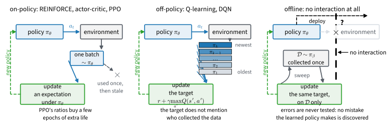
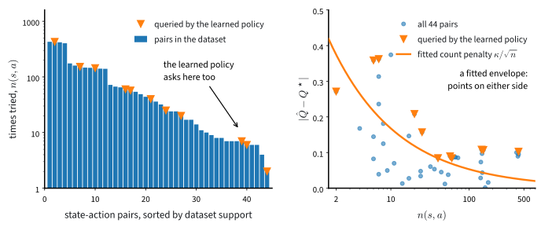

# On-Policy, Off-Policy, and Offline Learning
:label:`sec_offline`

On-policy estimators require data from the current policy, whereas off-policy value methods can use transitions collected by other policies. This distinction determines whether a batch may be reused and whether learning from a fixed dataset is possible. We first compare the Q-learning and SARSA targets to make the distinction explicit.

In *offline reinforcement learning*, the agent receives a fixed dataset and cannot collect additional transitions. Errors on poorly covered actions are therefore not corrected by subsequent interaction. Using tabular FrozenLake, where the optimal value is known, we measure this extrapolation error and examine a count-based pessimistic penalty. The example also clarifies the difference between improving predicted value and improving the policy's delivered return.

```{.python .input #offline-rl-which-data-may-drive-which-update}
%%tab pytorch
%matplotlib inline
from d2l import torch as d2l
import gymnasium as gym
import numpy as np
```

```{.python .input #offline-rl-which-data-may-drive-which-update}
%%tab jax
%matplotlib inline
from d2l import jax as d2l
import gymnasium as gym
import numpy as np
```

## On-Policy and Off-Policy Updates

### The Two Families of Update Rules

The update rules of the last two chapters fall into two families. A policy gradient is an expectation under the current policy's trajectory distribution, so samples from another policy generally estimate a different quantity. REINFORCE and actor-critic are therefore *on-policy*; PPO permits limited reuse by correcting action probabilities. By contrast, the Q-learning target $r + \gamma \max_{a'} \hat{Q}(s', a')$ depends on the environment transition but not on the policy that selected $a$. A transition collected by an earlier policy, another agent, or a fixed log is therefore a valid sample of the same Bellman backup. This is *off-policy* learning. :numref:`fig_rl_data_rules` compares these cases with the offline setting introduced below.


:label:`fig_rl_data_rules`

### SARSA: Bootstrapping on the Action Taken

SARSA differs from Q-learning in the action used for bootstrapping. In the update from :eqref:`eq_td_error`, replace the best action at $s'$ by the action $a'$ actually selected by the behavior policy:

$$\delta_{\textrm{SARSA}} = r + \gamma\, Q(s', a') - Q(s, a),$$
:eqlabel:`eq_sarsa`

The quintuple $(s,a,r,s',a')$ gives SARSA its name
:cite:`Rummery.Niranjan.1994`. In :numref:`fig_rl_backups`, its update is panel
(d) without the arc denoting maximization: the target follows the sampled
action $a'$.

Averaging this target over $a'\sim\pi_e(\cdot\mid s')$ yields the Bellman
expectation backup for the behavior policy $\pi_e$. For a stationary behavior
policy, SARSA therefore converges to $Q^{\pi_e}$, whereas Q-learning targets
$Q^*$ independently of the behavior policy. During learning, our
$\epsilon$-greedy behavior changes with the table, so we compare the final
table with the value of the final frozen policy. The following implementation
runs both algorithms on the slippery lake with $\epsilon=0.3$; only the
bootstrap action differs:

```{.python .input #offline-rl-sarsa-one-symbol-the-opposite-rule-1}
%%tab pytorch, jax
gamma, epsilon = 0.95, 0.3            # discount; the fixed exploration rate
num_episodes, num_datasets = 500, 15  # episodes per dataset; dataset draws
num_sweeps, alpha, kappa = 200, 0.2, 0.1  # offline sweeps; step; pessimism
env = gym.make('FrozenLake-v1', is_slippery=True)
mdp = d2l.TabularMDP.from_gym(env, gamma)
```

```{.python .input #offline-rl-sarsa-one-symbol-the-opposite-rule-2}
%%tab pytorch, jax
def td_control(seed, env, num_episodes, epsilon, on_policy):
    """Q-learning and SARSA in one loop: they differ in a single symbol."""
    rng = np.random.default_rng(seed)
    Q, visits = np.zeros((16, 4)), np.zeros((16, 4))
    env.reset(seed=seed)
    for _ in range(num_episodes):
        s, done = env.reset()[0], False
        a = d2l.epsilon_greedy(Q[s], epsilon, rng)
        while not done:
            s2, r, terminated, truncated, _ = env.step(a)
            a2 = d2l.epsilon_greedy(Q[s2], epsilon, rng)
            target = Q[s2, a2] if on_policy else Q[s2].max()  # the symbol
            visits[s, a] += 1
            Q[s, a] += (r + gamma * (1 - terminated) * target
                        - Q[s, a]) / (1 + 0.1 * visits[s, a])
            s, a, done = s2, a2, terminated or truncated
    return Q

Q_q = td_control(0, env, 8000, epsilon, on_policy=False)
Q_sarsa = td_control(0, env, 8000, epsilon, on_policy=True)
d2l.show_grid(env.unwrapped.desc, np.stack([Q_q.max(-1), Q_sarsa.max(-1)]),
              np.stack([Q_q.argmax(-1), Q_sarsa.argmax(-1)]),
              titles=['Q-learning, epsilon = 0.3', 'SARSA, epsilon = 0.3'])
```

The greedy policies differ only at state $6$, where the two symmetric actions
have equal optimal value as discussed in :numref:`sec_qlearning`. Their value
tables nevertheless represent different quantities. Q-learning estimates
$0.182$ at the start, close to the optimal value $V^*(s_0)=0.180$. SARSA's
largest start-state entry is $0.062$ because its continuation includes
$\epsilon$-greedy exploration, which sometimes moves toward a hole.

Since SARSA estimates $Q^{\pi_e}$, its start-state value is not
$\max_a Q(s_0,a)$ but the policy-weighted average
$\sum_a\pi_e(a\mid s_0)Q(s_0,a)$. The following evaluation compares each
table with the policy whose return it is intended to predict:

```{.python .input #offline-rl-sarsa-one-symbol-the-opposite-rule-3}
%%tab pytorch, jax
env.reset(seed=1)
rng = np.random.default_rng(1)
for name, Q in [('Q-learning', Q_q), ('SARSA', Q_sarsa)]:
    greedy = d2l.evaluate(env, lambda s, r_: int(Q[s].argmax()), 1000)
    earned = d2l.evaluate(env, lambda s, r_: d2l.epsilon_greedy(
        Q[s], epsilon, r_), 1000, gamma, rng)
    claim = (1 - epsilon) * Q[0].max() + epsilon * Q[0].mean()
    print(f'{name:>10}: greedy policy succeeds {greedy:.1%}; '
          f'the behavior earns {earned:.3f}')
    print(f'{"":>10}  the policy-weighted table value '
          f'sum_a pi(a|s0) Q(s0, a) claims {claim:.3f}')
```

The two tables evaluate different policies. Q-learning assigns values to greedy continuation, even though the agent collected data with an $\epsilon=0.3$ behavior policy. If its table is interpreted as the behavior policy's value, it predicts $0.180$ instead of the observed $0.061$. SARSA accounts for the exploratory actions and predicts $0.061$, within a hundredth of the observed $0.070$. Their greedy policies both perform within a few percentage points of the $73.6$ percent optimum from :numref:`sec_valueiter`. The important difference is therefore the reference policy: Q-learning evaluates greedy continuation, whereas SARSA evaluates the behavior that generated the data. The latter is the relevant quantity when exploration remains part of deployment.

### Bounded Staleness and Importance Ratios

The distinction is not absolute in practical systems. Importance ratios can correct data from a nearby policy, but their variance grows rapidly as the two policies separate; PPO therefore reuses each batch for only a limited number of epochs. In distributed learning, actors may also lag behind the central learner. IMPALA's V-trace truncates importance corrections so that moderately stale data remains useful with controlled variance :cite:`Espeholt.Soyer.Munos.ea.2018`. The remainder of this section considers the extreme case: a fixed dataset with no further interaction.

## Offline Learning

### Measuring Distribution Shift

In *offline reinforcement learning*, a behavior policy collects a fixed dataset of transitions, and the learner receives no further interaction with the environment. It must choose a policy without exploring or testing its estimates through new actions. This setting, called batch reinforcement learning in older literature, arises when logged data are plentiful but experimentation is costly or unsafe, as with hospital records, driving logs, and the interaction history of a deployed system :cite:`Levine.Kumar.Tucker.ea.2020`.

We continue with the slippery lake because its exact optimum is computable. We can therefore compare both predicted values and realized returns with the best achievable value, rather than with another learned method. The cited literature provides the corresponding deep-network experiments. Here the behavior policy selects actions uniformly at random:

```{.python .input #offline-rl-distribution-shift-measured}
%%tab pytorch, jax
def behavior(obs, rng):
    """The data-collection policy: uniformly random, no competence at all."""
    return int(rng.integers(4))

env.reset(seed=0)
data = d2l.rollout(env, behavior, num_episodes, np.random.default_rng(0))
counts = np.zeros((16, 4))
np.add.at(counts, (data.obs, data.act), 1)
live = np.isin(env.unwrapped.desc.flatten(), [b'S', b'F'])
print(f'{len(data)} transitions; support over the {4 * live.sum()} live '
      f'pairs: min {int(counts[live].min())}, median '
      f'{int(np.median(counts[live]))}, max {int(counts[live].max())}')
print(f'the behavior earned {data.episode_returns(gamma).mean():.3f} '
      f'per episode, discounted')
```

The 500 random episodes visit all $44$ live state--action pairs, with at least $7$ visits per pair and a median of $42$. This coverage meets the tabular condition used in :numref:`sec_qlearning`, but the behavior policy obtains only $0.012$ return per episode, compared with the optimum of $0.180$.

Broad coverage and poor behavior serve different purposes in the experiment. Coverage supplies information about every available action, while poor behavior leaves room for an offline learner to construct a better policy from those transitions.

Q-learning can use transitions from any behavior policy, so it can be applied to this fixed dataset: repeatedly shuffle the transitions, apply the usual updates, and stop when the values settle. However, outperforming the behavior policy requires counterfactual estimates for actions that appear rarely, or not at all, in the data. These estimates must be obtained by generalizing from observed actions :cite:`Levine.Kumar.Tucker.ea.2020`.

The learned policy preferentially selects actions with large estimated values. Estimation errors are largest where the dataset provides the least support, so this selection can concentrate the policy on poorly estimated actions. The resulting mismatch between the dataset's action distribution and the learned policy's action distribution is called *distribution shift*. In :numref:`fig_rl_distribution_shift`, several actions selected by the learned policy lie in the sparsely sampled region where the fitted values have the largest errors.

![Distribution shift after offline Q-learning on an independent draw of 500 uniformly random episodes, comprising 3697 transitions (`data` has 3997). Left: the 44 available state--action pairs, ordered by their counts in the dataset; crosses mark the pairs selected by the learned greedy policy. Several selected pairs lie in the sparsely sampled tail and have errors near $0.3$. Right: absolute value error against visit count, together with the fitted curve $\kappa/\sqrt{n}$ for $\kappa=0.53$. The curve is a descriptive envelope rather than a statistical law: the errors decrease more slowly than $1/\sqrt{n}$ and remain near $0.10$ even for well-supported pairs. Maximization bias, the constant step size, and incomplete convergence all contribute to this residual.](../img/mdl-rl-distribution-shift.svg)
:label:`fig_rl_distribution_shift`

### The Loss of Self-Correction

Offline learning removes the self-correction available in :numref:`sec_qlearning`. Online, an overestimated action is eventually selected, tested, and corrected by new data. Offline, the learned policy may select the same action repeatedly in evaluation, but the training dataset never changes and the estimate receives no corrective transition.

Maximization makes this problem systematic. A maximum over noisy estimates is biased upward, as :numref:`sec_qlearning` introduced and :numref:`fig_rl_max_bias` measures. The greedy policy selects the largest errors rather than typical errors, and bootstrapping propagates those inflated values to earlier states. The same optimization pressure appeared in :numref:`sec_regularized`, where a policy exploited errors in a learned reward. Here the errors occur in the value function and enter through the maximum in every backup.

### The Experiment and the Behavior-Cloning Baseline

The experiment requires an offline algorithm, two comparison methods, and a known optimum. The function below repeatedly shuffles the fixed dataset and applies the Q-learning update. Its parameter `kappa` controls a pessimistic penalty developed in the next section; `kappa = 0` gives naive offline Q-learning. An unobserved state--action pair has count $n=0$ and must not be treated as though it had one observation. With pessimism enabled, such pairs receive the lowest possible value on this nonnegative-reward environment:

```{.python .input #offline-rl-the-experiment-with-a-behavior-cloning-bar-1}
%%tab pytorch, jax
def offline_q(batch, num_sweeps, alpha, gamma, kappa=0.0,  #@save
              shape=(16, 4), seed=0):
    """Q-learning swept over a fixed dataset, with optional pessimism.

    kappa > 0 subtracts kappa/sqrt(n(s, a)) from every value consulted;
    an untried pair is distrusted entirely, and no pessimistic value
    drops below zero, the floor this environment guarantees.
    """
    Q, counts = np.zeros(shape), np.zeros(shape)
    np.add.at(counts, (batch.obs, batch.act), 1)
    penalty = np.where(counts > 0, kappa / np.sqrt(np.maximum(counts, 1)),
                       np.inf if kappa > 0 else 0.0)
    rng = np.random.default_rng(seed)
    for _ in range(num_sweeps):
        for i in rng.permutation(len(batch)):
            s, a, s2 = batch.obs[i], batch.act[i], batch.next_obs[i]
            v2 = np.maximum(Q[s2] - penalty[s2], 0.0).max()
            Q[s, a] += alpha * (batch.rew[i] + gamma
                                * (1 - batch.term[i]) * v2 - Q[s, a])
    return np.maximum(Q - penalty, 0.0)
```

The first comparison method is behavior cloning from :numref:`sec_imitation`, a standard baseline for offline learning. In the tabular setting, cross-entropy training recovers the empirical action distribution at each state, which can be computed by counting. Because the behavior policy is stochastic, the clone also samples its actions. Its predicted performance is the dataset's average return.

```{.python .input #offline-rl-the-experiment-with-a-behavior-cloning-bar-2}
%%tab pytorch, jax
def clone_policy(batch, num_actions=4):
    """Behavior cloning on a table: the dataset's empirical action
    distribution, uniform wherever the dataset is silent."""
    counts = np.zeros((16, num_actions))
    np.add.at(counts, (batch.obs, batch.act), 1)
    total = counts.sum(axis=1, keepdims=True)
    probs = np.where(total > 0, counts / np.maximum(total, 1), 1 / num_actions)
    return lambda s, rng: int(rng.choice(num_actions, p=probs[s]))
```

The environment model is available to the experimenter but not to the learning algorithms. Value iteration from :numref:`sec_valueiter` therefore supplies the exact value of the best possible policy:

```{.python .input #offline-rl-the-experiment-with-a-behavior-cloning-bar-3}
%%tab pytorch, jax
V_star = d2l.value_iteration(mdp, num_iters=1000)[-1]
Q_star = mdp.backup(V_star)
print(f'the yardstick no offline deployment has: V*(s0) = {V_star[0]:.3f}')
```

We repeat the experiment on fifteen independently collected datasets because results from one set of 500 random episodes vary substantially. On each dataset, we train naive offline Q-learning, its pessimistic variant, and behavior cloning. For every method, we record the predicted start-state value and the return obtained by its learned policy:

```{.python .input #offline-rl-the-experiment-with-a-behavior-cloning-bar-4}
%%tab pytorch, jax
datasets, fits = [], []
results = {name: ([], []) for name in ['naive', 'pessimistic', 'clone']}
for seed in range(num_datasets):
    env.reset(seed=seed)
    rng = np.random.default_rng(seed)
    batch = d2l.rollout(env, behavior, num_episodes, rng)
    datasets.append(batch)
    Q_n = offline_q(batch, num_sweeps, alpha, gamma)
    fits.append(Q_n)
    for name, Q in [('naive', Q_n), ('pessimistic', offline_q(
            batch, num_sweeps, alpha, gamma, kappa))]:
        results[name][0].append(Q[0].max())
        results[name][1].append(d2l.evaluate(
            env, lambda s, r_: int(Q[s].argmax()), 500, gamma, rng))
    results['clone'][0].append(batch.episode_returns(gamma).mean())
    results['clone'][1].append(d2l.evaluate(env, clone_policy(batch),
                                            500, gamma, rng))
```

```{.python .input #offline-rl-the-experiment-with-a-behavior-cloning-bar-5}
%%tab pytorch, jax
for name, (pred, actual) in results.items():
    print(f'{name:>11}: predicted median {np.median(pred):.3f}, '
          f'spread {min(pred):.3f} to {max(pred):.3f}')
    print(f'{"":>11}  actual    median {np.median(actual):.3f}, '
          f'spread {min(actual):.3f} to {max(actual):.3f}')
over = [sum(p > V_star[0] for p in results[k][0])
        for k in ['naive', 'pessimistic']]
print(f'promises above V*(s0): naive on {over[0]} of {num_datasets} '
      f'datasets, pessimistic on {over[1]} of {num_datasets}')
wins = sum(p > q for p, q in zip(results['pessimistic'][1],
                                 results['naive'][1]))
print(f'pessimism delivered the better policy on {wins} of '
      f'{num_datasets} datasets')
```

```{.python .input #offline-rl-the-experiment-with-a-behavior-cloning-bar-6}
%%tab pytorch, jax
names = list(results)
x, w = np.arange(len(names)), 0.35
d2l.set_figsize((5.5, 3.5))
for i, side in enumerate(['predicted value at the start', 'actual return']):
    vals = np.array([results[k][i] for k in names])
    med = np.median(vals, axis=1)
    d2l.plt.bar(x + w * i, med, w, label=side,
                yerr=[med - vals.min(axis=1), vals.max(axis=1) - med],
                capsize=3)
d2l.plt.axhline(V_star[0], ls='--', color='gray')
d2l.plt.xticks(x + w / 2, names)
d2l.plt.ylabel('discounted value')
d2l.plt.legend();
```

Across the fifteen datasets, naive offline Q-learning predicts a start-state value between $0.185$ and $0.388$, with median $0.274$. The true optimum is $0.180$, so every prediction exceeds the value achievable by any policy in this environment. Yet the learned greedy policies have a median return of only $0.097$. Comparing predicted value with realized return is a standard diagnostic in offline reinforcement learning; with deep networks and continuous actions, the discrepancy can be much larger :cite:`Levine.Kumar.Tucker.ea.2020,Fujimoto.Meger.Precup.2019`.

Behavior cloning predicts a median value of $0.007$ and obtains $0.008$. It is well calibrated but reproduces the poor random behavior. Naive offline Q-learning produces policies with returns roughly an order of magnitude larger, even though it substantially overestimates their values.

These two comparisons measure different properties. Comparison with behavior cloning asks whether offline learning improves on the data-collection policy. Comparison of predicted and realized return asks whether its value estimates are calibrated. Naive Q-learning succeeds on the first criterion and fails on the second.

## Pessimism

### The Count-Based Penalty $\kappa/\sqrt{n}$

The largest errors occur at poorly supported state--action pairs. We therefore subtract $\kappa/\sqrt{n(s,a)}$ both inside the bootstrap maximum and from the final values, where $n(s,a)$ is the pair's count in the dataset, and clip each penalized value at zero, the smallest value any policy can attain here because rewards are nonnegative. This is the penalty implemented by `offline_q` when `kappa > 0`.

The $1/\sqrt{n}$ dependence is motivated by the sampling error of an $n$-sample average and resembles the UCB radius $\kappa\sqrt{\log t/n}$ from :numref:`sec_qlearning`. Here it is a heuristic shrinkage term, not a confidence interval with a coverage guarantee. We evaluate this shape by pooling the counts and errors against $Q^*$ from the fifteen naive runs:

```{.python .input #offline-rl-kappa-over-root-n}
%%tab pytorch, jax
support, error = [], []
for batch, Q in zip(datasets, fits):
    c = np.zeros((16, 4))
    np.add.at(c, (batch.obs, batch.act), 1)
    support.append(c[live].ravel())
    error.append(np.abs(Q - Q_star)[live].ravel())
support, error = np.concatenate(support), np.concatenate(error)
n, e = support[support > 0], error[support > 0]
kappa_fit = np.median(e * np.sqrt(n))
print(f'{len(n)} supported live pairs over {num_datasets} datasets: error '
      f'min {e.min():.3f}, median {np.median(e):.3f}, max {e.max():.3f}')
print(f'kappa centering kappa/sqrt(n) on the cloud: {kappa_fit:.2f}')
print(f'residual error at n > 100: median {np.median(e[n > 100]):.3f}')
grid = np.logspace(np.log10(n.min()), np.log10(n.max()), 50)
d2l.plot([n, grid], [e, kappa_fit / np.sqrt(grid)],
         xlabel='n(s, a) in the dataset', ylabel='error of the fitted value',
         legend=['one pair, one dataset', 'kappa/sqrt(n)'],
         xscale='log', fmts=('o', '-'), figsize=(5, 3.5))
```

The fitted scale is $\kappa=0.57$, but it only centers the curve on these fifteen datasets. The errors range from $0.000$ to $0.458$, with median $0.094$, and do not follow a clean $1/\sqrt{n}$ law. Even above 100 visits, their median remains $0.077$. Maximization bias, the constant step size $\alpha$, and incomplete convergence can all produce this residual, which additional samples do not necessarily remove.

Among the 660 state--action-pair and dataset combinations, one pair is unobserved and receives the $n=0$ treatment defined above. We use the milder value $\kappa=0.1$, about one fifth of the descriptive fit. Exercise :exref:`ex_offline-rl-how-much-pessimism` explores both smaller and larger penalties.

The example combines four distinct difficulties. *Support failure* occurs when an action or region is absent from the data. *Statistical uncertainty* remains when counts are finite and is the component approximated by $1/\sqrt{n}$. *Bootstrapped extrapolation* propagates errors through function approximation and is largely absent from this tabular experiment. Finally, *model selection* requires choosing $\kappa$ without the online evaluation that the setting forbids.

### Optimism Online, Pessimism Offline

Online exploration and offline learning use similar count-dependent terms with opposite signs. UCB adds $\kappa\sqrt{\log t/n}$ to favor actions with little data, whereas offline pessimism subtracts $\kappa/\sqrt{n}$ to avoid relying on them. These terms express the same qualitative dependence on support but are not the same statistical quantity: the online bonus includes $\log t$, and the two methods tune their scales for different objectives.

The difference follows from feedback. Online, an optimistic action can be selected and its estimate corrected with new observations; optimism can therefore drive exploration. Offline, no new observation can correct an optimistic error, so uncertainty is handled conservatively.

### Calibration after Pessimism

The pessimistic estimate has median $0.121$, down from $0.274$, and exceeds the true optimum on only two of the fifteen datasets. Its range is $0.035$ to $0.225$. The policy itself is not better: it outperforms the naive policy on only four datasets, and its median return is $0.080$ rather than $0.097$. Pessimism has instead reduced the discrepancy between predicted and realized performance. More sophisticated versions of this conservative principle are common in modern offline reinforcement learning :cite:`Levine.Kumar.Tucker.ea.2020`.

## Beyond the Gridworld

### Constraining the Policy, the Values, or Both

Exact counts are unavailable in continuous state and action spaces, but deep offline methods retain the same two responses: constrain the policy to supported actions or reduce values outside the data distribution. Batch-constrained Q-learning takes the first approach and restricts the learned policy to actions represented in the dataset :cite:`Fujimoto.Meger.Precup.2019`. Its tabular analogue replaces the graded penalty in `offline_q` with a hard support constraint:

```{.python .input #offline-rl-constrain-the-policy-the-values-or-both}
%%tab pytorch, jax
def support_q(batch, num_sweeps, alpha, gamma, seed=0):
    """offline_q with the graded penalty replaced by a hard support rule."""
    Q, counts = np.zeros((16, 4)), np.zeros((16, 4))
    np.add.at(counts, (batch.obs, batch.act), 1)
    rng = np.random.default_rng(seed)
    for _ in range(num_sweeps):
        for i in rng.permutation(len(batch)):
            s, a, s2 = batch.obs[i], batch.act[i], batch.next_obs[i]
            v2 = np.where(counts[s2] > 0, Q[s2], 0.0).max()   # changed line 1
            Q[s, a] += alpha * (batch.rew[i] + gamma
                                * (1 - batch.term[i]) * v2 - Q[s, a])
    return np.where(counts > 0, Q, 0.0)                       # changed line 2

assert np.array_equal(support_q(data, num_sweeps, alpha, gamma), fits[0])
print('on this dataset the support rule reproduces the naive run, '
      'bit for bit')
```

On this dataset, the hard support constraint reproduces naive Q-learning exactly. Values start at zero, rewards are nonnegative, and every available pair has at least seven observations. An unobserved action therefore cannot obtain a larger value than an observed one, and no available action is actually unobserved. The failure here is variation in the amount of support, which a binary rule cannot distinguish but $\kappa/\sqrt{n}$ can.

In continuous action spaces, almost every exact action is absent from the dataset, so support constraints become more important. Conservative Q-learning instead penalizes the values of out-of-distribution actions :cite:`Kumar.Zhou.Tucker.ea.2020`. Implicit Q-learning avoids querying unseen actions by backing up an upper expectile of values observed in the dataset :cite:`Kostrikov.Nair.Levine.2022`. TD3+BC adds a behavior-cloning term to an off-policy actor and provides a strong simple baseline :cite:`Fujimoto.Gu.2021`.

Most practical offline methods constrain the policy, the value estimates, or both.

### Sequence Modeling without Bootstrapping

Decision Transformer avoids bootstrapping by treating each trajectory as a sequence of returns-to-go, states, and actions :cite:`Chen.Lu.Rajeswaran.ea.2021`. An autoregressive model is trained by supervised prediction and, at test time, is conditioned on a desired return. It uses neither a value function nor a maximization target. On standard benchmarks, this approach matches strong value-based offline methods. However, a later study found that a small return-conditioned network trained by ordinary supervised learning recovers much of the performance, so the contribution of the sequence architecture remains unsettled. :numref:`sec_rl_sequences` returns to this connection for language models.

### Offline Model Selection

The preceding comparisons use simulator rollouts, which are unavailable in a genuine offline deployment. Selecting $\kappa$, the number of sweeps, or one of several learned policies requires estimating counterfactual performance from logged data. Importance-weighted estimators for this task inherit the high variance described in :numref:`sec_ppo` when the evaluated policy differs from the behavior policy :cite:`Levine.Kumar.Tucker.ea.2020`.

Reliable offline model selection remains an open problem. Exercise :exref:`ex_offline-rl-what-you-cannot-measure` examines what can be inferred when direct evaluation rollouts are unavailable.

## Summary

On-policy updates estimate expectations under the current policy; importance ratios permit limited correction for older policies. Q-learning is off-policy because its Bellman target does not depend on the data-collection policy, whereas SARSA evaluates the behavior policy itself. Offline reinforcement learning applies off-policy updates to a fixed dataset. Without interaction, overestimated actions outside the dataset's support cannot be tested and corrected. A count-based pessimistic penalty reduces these estimates but does not guarantee a better policy. Deep offline methods likewise constrain policies, values, or both, and model selection without online evaluation remains difficult.

**Experimental scope.** The SARSA comparison uses one seed and one exploration rate. The offline experiment reports fifteen independently collected datasets and 500 evaluation episodes per learned policy. Naive offline Q-learning predicts values above the known optimum on every dataset. Pessimism substantially improves calibration but does not improve median return in this example. Exact optimal values are available only because the experiment uses a small known MDP.

## Exercises

1. **Expected SARSA.** Expected SARSA replaces the sampled action $a'$ in
   :eqref:`eq_sarsa` by an average under a policy $\pi$,
   $$\delta = r + \gamma \sum_{a'} \pi(a' \mid s')\, Q(s', a') - Q(s, a).$$
    1. Let $\pi = \pi_e$, the behavior policy. Show that, given $(s, a)$
       and $s'$, the Expected SARSA target equals the conditional
       expectation of the SARSA target over $a' \sim \pi_e(\cdot \mid s')$.
       Conclude that both methods have the fixed point $Q^{\pi_e}$, and use
       the law of total variance to show that the Expected SARSA target has
       no larger variance.
    1. Show that the target becomes the Q-learning target when $\pi$ is the
       greedy policy of $Q$.
    1. For $\pi \neq \pi_e$, Expected SARSA estimates $Q^\pi$ from
       transitions collected by $\pi_e$, and its update contains no
       importance ratio. Explain why the one-step action-value target needs
       none. Exercise :exref:`ex_offline-rl-truncated-ratios` treats the
       state-value target, which does need one.
    1. Which source of variance does Expected SARSA remove, and which
       remains? Predict whether it gains more over SARSA on a gridworld with
       deterministic moves or on the slippery lake.

    *Adapted from Richard S. Sutton and Andrew G. Barto,
    [Reinforcement Learning: An Introduction](http://incompleteideas.net/book/RLbook2020.pdf),
    Section 6.6.*

1. [code] **Coverage of the random log.** The counts of `data` over the 44
   live state--action pairs have minimum $7$, median $42$ and maximum $465$.
   They can be predicted from the model. Under the
   uniformly random policy, let $P_{\textrm{live}}$ be the transition matrix
   among the live states, computed from `mdp.P`. The expected number of
   visits to each live state in one episode is then the start-state row of
   $N = (I - P_{\textrm{live}})^{-1}$. Ignore the time limit, which almost
   never binds for this policy.
    1. Compute this row, the expected episode length, and the expected count
       of each live pair in 500 episodes, and compare them with `len(data)`
       and the printed counts. Where on the lake are the rarest pairs, and
       which role do these states play for the optimal policy?
    1. Model each count as a Poisson variable whose mean is the expected
       count. Estimate the expected number of unobserved live pairs in
       fifteen datasets, and compare it with the one unobserved pair among
       the 660 combinations of live pair and dataset in `datasets`. Which
       assumption of the Poisson model is questionable here?
    1. How many random episodes would bring the expected count of every
       live pair to at least $100$?

1. [code] **Data from a better policy.** The random behavior covers every
   pair but rarely reaches the goal. Build three kinds of datasets of 500
   episodes each: from `behavior`; from a near-optimal policy that acts by
   `d2l.epsilon_greedy` on `Q_star` with $\epsilon = 0.1$; and from 250
   episodes of each, concatenated into one `d2l.Batch` (shift the second
   batch's `ep_ends` by the length of the first). Draw five datasets of
   each kind.
    1. On every dataset, train naive offline Q-learning and `clone_policy`,
       and record the predicted value and the actual return as the loop that
       fills `results` does. Which combination of data and method delivers
       the best policy, and which the best-calibrated prediction?
    1. On which kind of data does the clone outperform naive offline
       Q-learning? Explain the pattern with the return of each behavior
       policy.
    1. On the near-optimal datasets, count at each live state how often the
       dataset contains the action that the greedy policy of naive offline
       Q-learning selects there. What do these counts explain about its
       return?
   :exlabel:`ex_offline-rl-where-data-comes`

1. [code] **How much pessimism.** Rerun the loop that fills `results`
   with the pessimistic arm's $\kappa$ set to each value in
   $\{0, 0.02, 0.1, 0.3, 1\}$.
    1. Plot the median predicted value and the median actual return against
       $\kappa$ on the same axes. Between which values of $\kappa$ do the two
       curves cross, and what happens on either side of the crossing?
    1. What does the greedy policy do at $\kappa = 1$, and how well
       calibrated is its prediction? What does this case say about
       calibration as a criterion for choosing $\kappa$?
    1. Which $\kappa$ delivers the best median return? Which information did
       you use to find it that an offline deployment does not have?
   :exlabel:`ex_offline-rl-how-much-pessimism`

1. **Conditioning on luck.** Decision Transformer conditions each action on
   a desired return. Its simplest tabular form, return-conditioned
   supervised learning, acts in state $s$ for a target return $g$ with the
   dataset's action distribution among the episodes that achieved $g$,
   $\pi(a \mid s, g) = P_{\mathcal{D}}(a \mid s, G = g)$
   :cite:`Brandfonbrener.Bietti.Buckman.ea.2022`. A one-step task has two
   actions, and a uniformly random behavior has collected plentiful data.
   Action A pays $1$ with probability $1/2$ and $0$ otherwise; action B
   always pays $0.6$.
    1. Which action does the policy take for $g = 1$, the highest return in
       the data, and what is its expected reward? Which action does it take
       for $g = 0.6$?
    1. Let A pay $1$ with probability $p$. For which $p$ does conditioning
       on the highest return select the optimal action?
    1. What does offline Q-learning learn from the same data, and why do
       the lucky episodes not mislead it?

1. **Truncated importance ratios.** ● V-trace
   :cite:`Espeholt.Soyer.Munos.ea.2018` corrects data from a behavior
   policy $\pi_e$ toward a target policy $\pi$ with the truncated ratios
   $\rho_t = \min\big(\bar{\rho},\, \pi(a_t \mid s_t) / \pi_e(a_t \mid s_t)\big)$.
   In its one-step form, the state-value update on a transition collected
   by $\pi_e$ is
   $$V(s_t) \leftarrow V(s_t) + \alpha\, \rho_t \big(r_t + \gamma V(s_{t+1}) - V(s_t)\big).$$
   Assume that $\pi_e(a \mid s) > 0$ wherever $\pi(a \mid s) > 0$.
    1. For $\bar{\rho} = \infty$, show that the expected update under
       $a_t \sim \pi_e(\cdot \mid s_t)$ vanishes at every state exactly when
       $V$ satisfies the Bellman expectation equation of $\pi$.
    1. For finite $\bar{\rho}$, show that the expected update vanishes at
       the value function of the policy
       $$\pi_{\bar{\rho}}(a \mid s) = \frac{\min\big(\bar{\rho}\, \pi_e(a \mid s),\, \pi(a \mid s)\big)}{\sum_b \min\big(\bar{\rho}\, \pi_e(b \mid s),\, \pi(b \mid s)\big)}.$$
    1. Compute $\pi_{\bar{\rho}}$ for two actions with $\pi_e = (0.5, 0.5)$,
       $\pi = (0.9, 0.1)$ and $\bar{\rho} = 1$, the value IMPALA uses. Which
       policy does $\pi_{\bar{\rho}}$ approach as $\bar{\rho} \to 0$, and for
       which $\bar{\rho}$ does it equal $\pi$?
    1. In distributed training, $\pi_e$ is a slightly older copy of $\pi$.
       Why is the bias of truncation small in this regime, and what does
       truncation buy in exchange?
   :exlabel:`ex_offline-rl-truncated-ratios`

1. [code] **Dataset size and the error floor.** ● The computation of
   `kappa_fit` reports a median error of $0.077$ at pairs with more than
   $100$ visits, and the section names three candidate causes: maximization
   bias, the constant step size $\alpha$, and incomplete convergence. In a
   dataset of $500$ random episodes, the pairs with more than $100$ visits
   are, in expectation, the twelve pairs of states $0$, $1$ and $4$. Measure
   the error at these twelve pairs throughout.
    1. Rerun naive offline Q-learning on five datasets each of $100$, $500$
       and $2000$ random episodes. How do the median predicted value and the
       median actual return move with the size? How does the median error
       against `Q_star` at the twelve pairs move?
    1. Separate the step size from the other causes. Build the empirical
       MDP of each dataset from its counts,
       $\hat{P}(s' \mid s, a) = n(s, a, s') / n(s, a)$, with $\hat{r}(s, a)$
       the average observed reward and zero rows for unvisited pairs, as
       `d2l.TabularMDP(P_hat, r_hat, gamma)`. Solve it with
       `d2l.value_iteration` and apply its `backup` to the solution. This
       certainty-equivalent table is the limit of offline Q-learning with
       decaying step sizes, as in exercise
       :exref:`ex_qlearning-batch-td-monte-carlo` of
       :numref:`sec_qlearning`. Repeat the measurements of part (a) with it.
       Which part of the error floor disappears?
    1. Does the certainty-equivalent prediction still exceed $V^*(s_0)$?
       Which of the three causes explains what remains? How should it scale
       with the size of the dataset, and do your measurements agree?
   :exlabel:`ex_offline-rl-dataset-size`

1. **Pessimism in a two-armed bandit.** ● An offline dataset for a
   two-armed bandit holds $n_1$ pulls of arm 1, which always pays $1/2$, and
   $n_2$ pulls of arm 2, which pays $1$ with probability $1/4$ and $0$
   otherwise. Write $r(a)$ for the mean reward of arm $a$, $\hat{r}(a)$ for
   its empirical mean, and $a^*$ for the best arm. Ties go to arm 1.
    1. The empirical best arm maximizes $\hat{r}(a)$. Compute the
       probability that it is arm 2, and the expected shortfall
       $r(a^*) - r(\hat{a})$, for $n_2 \in \{1, 5, 20\}$. How does the
       answer depend on $n_1$?
    1. The lower-confidence-bound rule
       :cite:`Rashidinejad.Zhu.Ma.ea.2021` selects
       $\hat{a} = \operatorname{argmax}_a \hat{r}(a) - b(a)$ with
       $$b(a) = \sqrt{\frac{\log(2K/\delta)}{2 n(a)}}$$
       for $K$ arms with rewards in $[0, 1]$, where $n(a)$ counts the pulls
       of arm $a$. Assume that every arm has at least one pull. Use
       Hoeffding's inequality, as stated in exercise
       :exref:`ex_qlearning-ucb-logarithmic-regret` of
       :numref:`sec_qlearning`, and a union bound to show that
       $r(a^*) - r(\hat{a}) \leq 2 b(a^*)$ with probability at least
       $1 - \delta$.
    1. The optimistic rule $\operatorname{argmax}_a \hat{r}(a) + b(a)$ has
       the form of :eqref:`eq_ucb`. Derive the analogous bound for it. On
       whose count does the bound depend now, and why is this dependence
       harmless online but harmful offline?
    1. Take $n_1 = 100$, $n_2 = 1$ and $\delta = 0.1$. Which arm does the
       lower-confidence-bound rule select? Suppose instead that arm 2 pays
       $1$ with probability $0.7$, and take its empirical mean to be $0.7$
       at every count. How many pulls of arm 2 must the dataset hold before
       the rule selects it?

1. [code] **Missing and thin support.** ● On `data`, `support_q`
   reproduced naive offline Q-learning bit for bit. Every live pair of
   `data` was observed, and with zero initialization and nonnegative
   rewards an unobserved pair could not have outranked an observed one
   anyway. A network, however, assigns arbitrary values to actions it has
   never been trained on. Model this by giving `offline_q` and `support_q`
   an argument `init` for the initial table, with entries drawn uniformly
   from $[0, 1]$.
    1. Collect 500 episodes from a behavior that picks uniformly among
       *left*, *down* and *right* and never *up*. On three such datasets,
       compare naive offline Q-learning, `support_q`, and `offline_q` with
       $\kappa = 0.1$ by predicted value and actual return. Which method
       fails, and how?
    1. Let the behavior pick *up* with probability $0.01$ and the other
       three actions uniformly otherwise, and repeat. Print the counts of
       the *up* pairs at the live states. Why does the prediction of naive
       offline Q-learning fall compared with part (a)? How do the
       predictions of `support_q` and of `offline_q` with $\kappa = 0.1$
       change, and which *up* pairs cause the change?
    1. A cautious human operator collected a dataset and avoided the
       actions that the operator judged unsafe, taking some of them rarely
       and others never. What does the rarity of an action tell the learner
       in such a dataset? Which of the two rules, the support rule or the
       count penalty, uses this information? How does each treat an action
       that the operator took exactly once?

1. [code] **Evaluation without a simulator.** ● Every comparison in this
   section rolled the learned policies out in the environment, which a
   genuine offline deployment cannot do. Ordinary importance sampling
   estimates the value of a target policy $\pi$ from $m$ episodes of a
   behavior policy $\pi_e$ by $\frac{1}{m} \sum_i w_i G_i$, and weighted
   importance sampling by $\sum_i w_i G_i / \sum_i w_i$, where $G_i$ is the
   discounted return of episode $i$ and
   $w_i = \prod_t \pi(a_t \mid s_t) / \pi_e(a_t \mid s_t)$ is the product
   over its steps.
    1. For the greedy policy of `fits[0]`, how many of the 500 episodes of
       `data` receive a nonzero weight? Explain the number with the length
       of the episodes.
    1. Evaluate instead the $\epsilon$-greedy version of each table in
       `fits`, with $\epsilon = 0.3$, on the dataset that trained it.
       Compute both estimates and the effective sample size
       :eqref:`eq_mdl-bayes-is-ess` of the weights,
       $(\sum_i w_i)^2 / \sum_i w_i^2$. Compare the estimates with the exact
       value `d2l.policy_evaluation(mdp, pi, 1000)[-1][0]`, where `pi` is
       the $16 \times 4$ array of the policy's action probabilities; only
       the experimenter can compute this value. For a fixed target policy,
       ordinary importance sampling is unbiased by
       :eqref:`eq_offpolicy_objective`. How does the spread
       of the weights explain the errors of the two estimates?
    1. A model-based alternative evaluates a greedy policy exactly in the
       empirical MDP of problem :exref:`ex_offline-rl-dataset-size`b.
       Evaluate the greedy policy of each table in `fits` in the empirical
       MDP of the dataset that trained it.
    1. Train instead on the first 250 episodes of each dataset, and evaluate
       the resulting greedy policy in the empirical MDP of the other 250.
       Compare both model-based estimates with the exact values. Which
       estimate is biased, in which direction, and why? Which one is
       noisier?
    1. Could any of these estimators have selected $\kappa$ in exercise
       :exref:`ex_offline-rl-how-much-pessimism` reliably?

    *Adapted from Richard S. Sutton and Andrew G. Barto,
    [Reinforcement Learning: An Introduction](http://incompleteideas.net/book/RLbook2020.pdf),
    Section 5.5.*
   :exlabel:`ex_offline-rl-what-you-cannot-measure`

1. [extended] **Conservative Q-learning in a table.** ●● Conservative
   Q-learning (CQL) :cite:`Kumar.Zhou.Tucker.ea.2020` adds to the squared
   Bellman error a term that lowers values under a chosen action
   distribution $\mu(a \mid s)$ and raises them under the dataset's
   empirical action distribution
   $\hat{\pi}_e(a \mid s) = n(s, a) / n(s)$, where
   $n(s) = \sum_a n(s, a)$. In a table, one iteration chooses
   $$\hat{Q}_{k+1} = \operatorname*{argmin}_Q\; \alpha_{\textrm{c}} \Big( E_{s \sim \mathcal{D},\, a \sim \mu(\cdot \mid s)}\big[Q(s, a)\big] - E_{(s, a) \sim \mathcal{D}}\big[Q(s, a)\big] \Big) + \frac{1}{2} E_{(s, a) \sim \mathcal{D}} \Big[ \big( Q(s, a) - \hat{\mathcal{B}} \hat{Q}_k(s, a) \big)^2 \Big],$$
   where $E_{\mathcal{D}}$ averages over the transitions of the dataset,
   $\alpha_{\textrm{c}} > 0$ sets the strength of the penalty, and
   $\hat{\mathcal{B}} \hat{Q}_k(s, a)$ averages the Q-learning target
   $r + \gamma \max_{a'} \hat{Q}_k(s', a')$ over the transitions from
   $(s, a)$ in the dataset.
    1. Show that every pair with $n(s, a) > 0$ satisfies
       $$\hat{Q}_{k+1}(s, a) = \hat{\mathcal{B}} \hat{Q}_k(s, a) - \alpha_{\textrm{c}} \Big( \frac{\mu(a \mid s)}{\hat{\pi}_e(a \mid s)} - 1 \Big).$$
       Which pairs does the penalty lower, and which does it raise?
    1. Let $\mu = \pi$ for some policy $\pi$. Show that one iteration lowers
       $\sum_a \pi(a \mid s) \hat{Q}_{k+1}(s, a)$ by
       $\alpha_{\textrm{c}} \big( \sum_a \pi(a \mid s)^2 / \hat{\pi}_e(a \mid s) - 1 \big)$
       relative to the same average of the backup, and that this amount is
       nonnegative.
    1. Take for $\mu$ the greedy policy of `fits[0]`. For the live pairs of
       `data`, plot the CQL penalty of part (a) and the penalty
       $\kappa / \sqrt{n(s, a)}$ of `offline_q` against $n(s, a)$. Which
       property of the data does each penalty respond to, and which pairs do
       the two treat differently?
    1. A sample-based version of CQL extends the loop of `offline_q` with
       $\kappa = 0$: after the update of $Q(s, a)$, it subtracts
       $\alpha\, \alpha_{\textrm{c}}\, \mu(\cdot \mid s)$ from the row
       $Q(s, \cdot)$ and adds $\alpha\, \alpha_{\textrm{c}}$ to $Q(s, a)$,
       where $\mu(\cdot \mid s)$ is the softmax of $Q(s, \cdot) / \tau$ with
       $\tau = 0.01$. Show that the expected update over a sweep vanishes at
       the fixed point of part (a).
    1. Implement this update and run it on the fifteen `datasets` for
       $\alpha_{\textrm{c}} \in \{0.003, 0.01, 0.03, 0.1\}$, about a minute
       of CPU time per value. Compare the predicted values and actual
       returns with those of `offline_q` at $\kappa = 0.1$.
    1. Does the predicted value $\max_a \hat{Q}(s_0, a)$ of CQL stay below
       the actual return of its greedy policy at every
       $\alpha_{\textrm{c}}$? Explain what you find with parts (a) and (b).
       Which of the two penalties carries over to a deep network, and what
       would have to replace $n(s, a)$ for the other?

[Discussions](https://d2l.discourse.group/)

<!-- slides -->

::: {.slide}
::: {.cover}
[Dive into Deep Learning · §15.5]{.kicker}

Which data may drive which update<br>
**on-policy and off-policy targets · learning from a fixed dataset · measuring overestimation · count-based pessimism**
:::
:::

::: {.slide title="Data Reuse Depends on the Target Expectation"}
The quantity estimated by an update determines which data may be used.

- **On-policy methods** estimate an expectation under the current policy.
  Data from another policy require a change-of-measure correction. PPO uses
  this correction for a few epochs, and V-trace uses truncated corrections for
  moderately stale actor data.
- **Off-policy methods** use a target such as
  $r+\gamma\max_{a'}Q(s',a')$ that does not depend on the behavior policy.
  Experience replay exploits this property at scale.

{width=98%}
:::

::: {.slide title="The SARSA Update"}
$$\delta_{\textrm{SARSA}} = r + \gamma\, Q(s', a') - Q(s, a)$$

Bootstrap on the action *actually taken*: the fixed point becomes
$Q^{\pi_e}$, the behavior's value, exploration and all. On-policy.

. . .

@offline-rl-sarsa-one-symbol-the-opposite-rule-2
:::

::: {.slide title="Two Tables, Two Questions"}
@!offline-rl-sarsa-one-symbol-the-opposite-rule-3

. . .

- Q-learning estimates $0.182$ at the start, close to $V^* = 0.180$.
  This estimate describes the greedy policy, not the exploratory behavior
  that generated the data; the latter earns roughly one third as much.
- SARSA's table, read policy-weighted as
  $\sum_a \pi_e(a \mid s_0)\, Q(s_0, a)$, claims $0.061$ against the
  observed return $0.070$. Every entry therefore includes the effect of
  $\epsilon$-greedy exploration.
- The two tables select nearly the same actions, within sampling error, but
  estimate returns under different policies.
:::

::: {.slide title="Offline Learning without New Data"}
A fixed dataset permits no further interaction. Improving on the behavior
policy requires estimating returns for actions that it rarely took. A learned
policy may then prefer actions whose values are based on the least data, a
form of **distribution shift**.

. . .

An inflated value cannot be corrected by a new trial. Moreover, maximization
selects positive estimation errors, and bootstrapping can propagate them to
earlier states.
:::

::: {.slide title="Distribution Shift, Measured"}
{width=98%}

. . .

The greedy policy often selects state--action pairs from the low-count tail.
The fitted penalty $\kappa/\sqrt{n}$ is only a descriptive envelope for the
observed errors; their nonzero floor is not explained by counts alone.
:::

::: {.slide title="Three Arms, Fifteen Datasets"}
Naive offline Q-learning, its pessimistic variant at
$\kappa = 0.1$, and the behavior clone of :numref:`sec_imitation`,
each evaluated by its predicted value and its realized return.

@!offline-rl-the-experiment-with-a-behavior-cloning-bar-5
:::

::: {.slide title="Overestimation and Pessimism"}
- Naive: median predicted value $0.274$, above the optimum $0.180$ on **all
  fifteen** datasets; median realized return $0.097$.
- Pessimistic: median predicted value $0.121$; calibrated on all but two
  datasets. The policy is no better (ahead on only 4 of 15).
- Clone: predicted value $0.007$ and realized return $0.008$. Its estimate is
  calibrated, but its policy achieves little reward.

. . .

Pessimism improves value calibration here but does not improve policy return;
the naive method beats the clone tenfold: the dataset knew more than
its collector used.
:::

::: {.slide title="Optimism and Pessimism"}
During online interaction, an optimistic estimate directs the agent toward
the corresponding action and thereby produces evidence that can correct the
estimate. An offline dataset provides no such feedback, so conservative
methods instead bias uncertain values downward.

$$\textrm{UCB: } \hat{\mu} + \kappa\sqrt{\log t / n} \qquad
\textrm{offline: } \hat{Q} - \kappa/\sqrt{n}$$

Both formulas use an uncertainty radius that decreases with the sample count,
but with opposite signs. The online bonus contains $\log t$ so that an action
can become attractive again as time passes; an offline dataset has no
corresponding time index.
:::

::: {.slide title="Beyond the Gridworld"}
- **Constrain the policy**: BCQ restricts actions to those supported by the
  data. Its tabular analogue changed nothing in this experiment because zero
  initialization already supplies the lower bound; the difficulty is sparse,
  rather than entirely absent, support.
- **Constrain the values**: CQL pushes down out-of-data actions; IQL
  never queries them; TD3+BC just adds a cloning term.
- **Drop the bootstrap**: Decision Transformer conditions a sequence model on
  desired return, avoiding both maximization and temporal-difference
  bootstrapping. The contribution of the transformer architecture itself
  remains an empirical question.
- Model selection without a simulator remains an important open problem.
:::

::: {.slide title="Recap"}
- The quantity being estimated determines which data may be used. SARSA evaluates the behavior policy, whereas Q-learning targets greedy continuation.
- Offline = off-policy at its limit, minus self-correction.
- The naive predicted value exceeded the computable optimum on all 15
  datasets, while its realized return was roughly one third of that estimate.
- The clone is the mandatory baseline: calibrated and weak here.
- a count-shrinking radius: added online (UCB, with its $\log t$),
  subtracted offline as $\kappa/\sqrt{n}$; the sign is set by
  whether the loop is open.
- At scale: constrain policy or values, or model sequences instead.
:::
