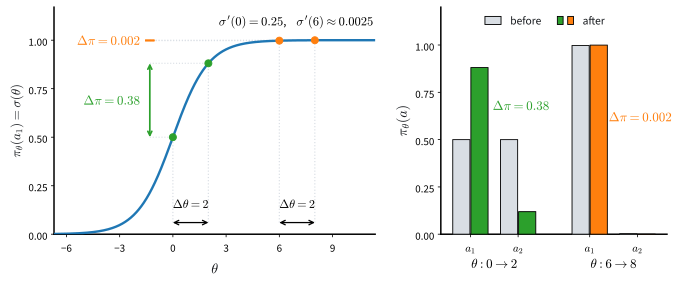
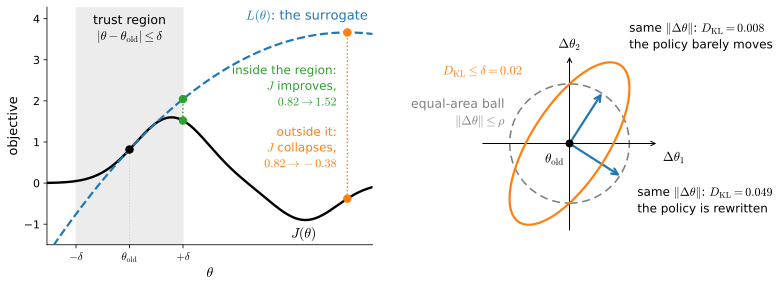
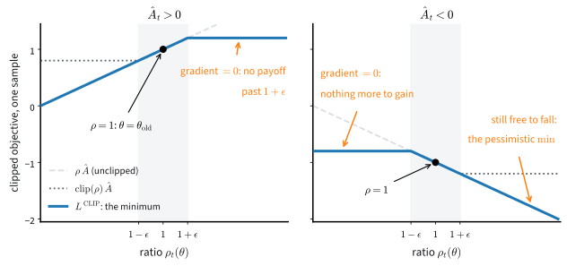

# Trust Regions and Proximal Policy Optimization
:label:`sec_ppo`

Policy-gradient methods update parameters $\theta$, but the same parameter displacement can produce very different changes in the distribution $\pi_\theta(\cdot\mid s)$. Large policy changes can invalidate the data used to estimate an update and can move an on-policy learner into a poor data-collection regime. We begin with a two-action example that makes this mismatch explicit.

Trust-region methods constrain change in policy space rather than parameter space :cite:`Schulman.Levine.Abbeel.ea.2015`. Proximal Policy Optimization (PPO) replaces the explicit constraint with a clipped surrogate objective and reuses each on-policy batch for several updates :cite:`Schulman.Wolski.Dhariwal.ea.2017`. This section derives importance-ratio correction, relates trust regions to the performance-difference lemma, and evaluates clipping through training curves and policy-drift diagnostics.

```{.python .input #ppo-trust-regions-and-proximal-policy-optimization-1}
%%tab pytorch
%matplotlib inline
from d2l import torch as d2l
import gymnasium as gym
import numpy as np
import torch
torch.set_num_threads(1)
```

```{.python .input #ppo-trust-regions-and-proximal-policy-optimization-1}
%%tab jax
%matplotlib inline
from d2l import jax as d2l
from flax import nnx
import gymnasium as gym
import jax
from jax import numpy as jnp
import numpy as np
```

## Parameter Space versus Policy Space

Since we now update the parameters of the policy directly, we should ask what a parameter update does to the policy itself. A family of policies with a single parameter $\theta$ and two actions answers it; we borrow the example from Joshua Achiam's lectures on policy optimization :cite:`Achiam.2017`. Let

$$\pi_\theta(a) = \begin{cases} \sigma(\theta) & a = 1 \\ 1 - \sigma(\theta) & a = 2, \end{cases} \qquad \textrm{where } \sigma(\theta) = \frac{1}{1 + e^{-\theta}}.$$

Take two parameter updates of exactly the same size, $\Delta\theta = 2$, from two different starting points:

$$\pi_{\theta=0}(a{=}1) = \sigma(0) = 0.50 \ \xrightarrow{\ \Delta\theta = 2\ }\ \sigma(2) = 0.88, \qquad \pi_{\theta=6}(a{=}1) = \sigma(6) = 0.9975 \ \xrightarrow{\ \Delta\theta = 2\ }\ \sigma(8) = 0.9997.$$

The first update takes the agent from indifferent between the two actions to strongly committed to one of them, a drastic change in behavior. The second changes nothing that an observer of the agent could detect. :numref:`fig_rl-policy-vs-parameter` plots the map from parameter to policy with both updates drawn on it, and, beside it, the two action distributions before and after each update.


:label:`fig_rl-policy-vs-parameter`

Both updates change $\theta$ by two. Starting from $\theta=0$, the action probability changes from $0.50$ to $0.88$; starting from $\theta=6$, it changes from $0.9975$ to $0.9997$. Equal distances in parameter space can therefore correspond to very different distances between policies.

The derivative $\sigma'(\theta)=\sigma(\theta)(1-\sigma(\theta))$ is $0.25$ at $\theta=0$ and about $0.0025$ at $\theta=6$. A parameter step therefore has much greater effect near an even policy than near a saturated one.

This variation can make on-policy training difficult. A large noisy update near $\theta=0$ may move the policy into saturation. The frequently selected action then has an almost-zero score, while the alternative action has an informative score but is sampled rarely. As a result, later on-policy batches may provide too little evidence to reverse the update. Limiting Euclidean distance in parameter space does not directly limit this change in behavior.

The update should therefore constrain a distance between policies rather than a Euclidean distance between parameters. Within this constraint, the optimizer can take a large parameter step when it produces only a small policy change and can reuse a batch for several updates.

## Reusing Data with Importance Sampling

### The Change of Measure

Every estimator since :numref:`sec_policygradient` has used trajectories sampled from the current policy. After one gradient step, that batch was treated as stale, which made policy-gradient learning expensive in environment interactions. Suppose instead that the batch was collected by an earlier policy $\pi_{\theta_{\textrm{old}}}$. How can it be used to evaluate an updated policy $\pi_\theta$?

Importance sampling gives the exact answer. For any function $f$ of trajectories,

$$E_{\tau \sim P(\cdot;\, \theta)} \big[ f(\tau) \big] = \sum_\tau P(\tau; \theta)\, f(\tau) = \sum_\tau P(\tau; \theta_{\textrm{old}})\ \frac{P(\tau; \theta)}{P(\tau; \theta_{\textrm{old}})}\, f(\tau) = E_{\tau \sim P(\cdot;\, \theta_{\textrm{old}})} \Big[ \frac{P(\tau; \theta)}{P(\tau; \theta_{\textrm{old}})}\, f(\tau) \Big],$$
:eqlabel:`eq_change_of_measure`

valid whenever every trajectory the new policy can produce has positive probability under the old one, a condition softmax policies satisfy automatically because they never assign zero probability to any action. Applied with $f = R$, the return, this rewrites the objective of :numref:`sec_policygradient` as an expectation under the *old* policy,

$$J(\theta) = E_{\tau \sim P(\cdot;\, \theta)} \big[ R(\tau) \big] = E_{\tau \sim P(\cdot;\, \theta_{\textrm{old}})} \Big[ \frac{P(\tau; \theta)}{P(\tau; \theta_{\textrm{old}})}\, R(\tau) \Big],$$
:eqlabel:`eq_offpolicy_objective`

Thus data from the old policy give an unbiased estimate of the new policy's return when weighted by the trajectory likelihood ratio. Expanding $P(\tau;\theta)$ from :eqref:`eq_traj_prob` cancels the transition probabilities between numerator and denominator, just as in :numref:`sec_policygradient`. The remaining weight is a product of policy ratios:

$$\frac{P(\tau; \theta)}{P(\tau; \theta_{\textrm{old}})} = \prod_{t=0}^{T-1} \frac{\pi_\theta(a_t \mid s_t)}{\pi_{\theta_{\textrm{old}}}(a_t \mid s_t)}.$$
:eqlabel:`eq_traj_ratio`

### The Exploding Product of Ratios

Although the estimator is unbiased, its variance can be prohibitive. Each ratio is nonnegative and unbounded above, and multiplying ratios across a long trajectory can produce weights spanning many orders of magnitude. A trajectory that is rare under the old policy and common under the new one can then dominate the estimate. The variance of the exact correction :eqref:`eq_offpolicy_objective` generally grows with the horizon.

### The Per-Step Surrogate

The practical compromise keeps one ratio per step. Define

$$\rho_t(\theta) = \frac{\pi_\theta(a_t \mid s_t)}{\pi_{\theta_{\textrm{old}}}(a_t \mid s_t)}$$

and optimize the sampled surrogate objective

$$\hat{L}(\theta) = \frac{1}{n} \sum_{i=1}^n \sum_{t} \rho_t^i(\theta)\ \hat{A}_t^i,$$
:eqlabel:`eq_surrogate`

where $\hat{A}_t^i$ is an advantage estimate for step $t$ of trajectory $i$, such as the normalized reward-to-go of :numref:`sec_baselines`. Relative to :eqref:`eq_offpolicy_objective`, this approximation replaces the product of ratios by one ratio per step and retains the old policy's state distribution. These choices reduce variance. The approximation is locally exact in the sense needed for optimization: at $\theta = \theta_{\textrm{old}}$, every ratio equals one and $\nabla_\theta \rho_t = \nabla_\theta \log \pi_\theta(a_t \mid s_t)$. Thus :eqref:`eq_surrogate` has the correct policy gradient at the old parameters, but it may be inaccurate after a large policy change. This raises the next question: how should the size of that change be measured and controlled?

### The Length-Normalized Trajectory Ratio

A length-normalized trajectory ratio lies between the full product and the individual per-step ratios. Raising the product to the power $1/T$ gives its geometric mean, whose logarithm is the average per-step log-ratio and whose scale does not grow exponentially with sequence length. Group Sequence Policy Optimization (GSPO) clips this sequence-level ratio rather than each per-step ratio in language-model training :cite:`Zheng.Liu.Li.ea.2025`. :numref:`sec_rl_sequences` returns to this construction for token trajectories.

## Bounding the Step

### The Performance Difference Lemma

To relate the surrogate to actual performance, abbreviate the old policy's advantage :eqref:`eq_advantage` as $A^{\textrm{old}}(s,a)=Q^{\pi_{\theta_{\textrm{old}}}}(s,a)-V^{\pi_{\theta_{\textrm{old}}}}(s)$. The performance difference lemma expresses the return of a candidate policy relative to the old policy:

**Proposition** (performance difference lemma, :citet:`Kakade.Langford.2002`).

$$
J(\theta) - J(\theta_{\textrm{old}}) = E_{\tau \sim P(\cdot;\, \theta)} \Big[ \sum_{t=0}^{T-1} \gamma^t\, A^{\textrm{old}}(s_t, a_t) \Big].
$$
:eqlabel:`eq_perf_diff`

**Proof.** Write $V$ for $V^{\pi_{\theta_{\textrm{old}}}}$. Along any trajectory, the sum $\sum_t \gamma^t \big( r_t + \gamma V(s_{t+1}) - V(s_t) \big)$ telescopes: the interior $V$ terms cancel in pairs, and $V = 0$ at termination, leaving $R(\tau) - V(s_0)$. Now take expectations under $\tau \sim P(\cdot;\, \theta)$. On the left, conditioned on $(s_t, a_t)$, the expectation of $r_t + \gamma V(s_{t+1})$ over the next state is $Q^{\pi_{\theta_{\textrm{old}}}}(s_t, a_t)$, by :eqref:`eq_dynamic_programming_q` written with $V^\pi$, so each term becomes $\gamma^t\, E\big[ A^{\textrm{old}}(s_t, a_t) \big]$. On the right, $E[R(\tau)] = J(\theta)$, and $E[V(s_0)] = J(\theta_{\textrm{old}})$ because both policies draw $s_0$ from the same $\mu_0$. $\blacksquare$

The lemma says that improvement depends on the old policy's advantages evaluated along trajectories of the new policy. Those trajectories are unavailable until the candidate policy is deployed. Replacing their state distribution by the old policy's state distribution, and reweighting only the sampled actions by $\rho_t$, gives the surrogate in :eqref:`eq_surrogate` after omitting the conventional factor $\gamma^t$. The approximation is exact at $\theta_{\textrm{old}}$ and deteriorates as the two policies induce different state distributions. Its accuracy therefore depends on policy change, not directly on parameter distance.

### Trust Regions and the Monotonic-Improvement Bound

Trust Region Policy Optimization answers with a constraint measured where the two-action example said it must be: in policy space. Maximize the surrogate, but keep the new policy close to the old one,

$$\max_\theta\ \hat{L}(\theta) \quad \textrm{subject to} \quad \frac{1}{n}\sum_{i,t} D_{\textrm{KL}}\big( \pi_{\theta_{\textrm{old}}}(\cdot \mid s_t^i)\ \Vert\ \pi_\theta(\cdot \mid s_t^i) \big) \leq \delta_{\textrm{KL}},$$
:eqlabel:`eq_trpo_constraint`

where the Kullback--Leibler divergence (:numref:`sec_mdl-information_theory`) measures the change in the action distribution at each visited state. The monotonic-improvement result is stated for population quantities rather than a sampled batch. Let $\rho_{\textrm{old}}(s)=\sum_{t\geq0}\gamma^tP(s_t=s\mid\pi_{\theta_{\textrm{old}}})$ denote the old policy's discounted state-visitation measure, with total mass $1/(1-\gamma)$ in a continuing task, and define the population surrogate

$$\bar{L}(\theta) = \sum_s \rho_{\textrm{old}}(s) \sum_a \pi_\theta(a \mid s)\, A^{\textrm{old}}(s, a),$$
:eqlabel:`eq_pop_surrogate`

the sampled surrogate with every sample replaced by its expectation. Two facts distinguish the two quantities. First, $\bar{L}(\theta_{\textrm{old}})=0$ because the old policy's expected advantage vanishes at every state; the finite-sample $\hat{L}$ need not be zero there and also omits the $\gamma^t$ weights, as discussed after :eqref:`eq_rtg`. Second, the theoretical bound uses the largest divergence over all states, including states absent from a sampled batch. With $A_{\max} = \max_{s, a} \lvert A^{\textrm{old}}(s, a) \rvert$,

$$
J(\theta)\ \geq\ J(\theta_{\textrm{old}}) + \bar{L}(\theta)\ -\ \frac{4 \gamma A_{\max}}{(1-\gamma)^2}\ \max_s\, D_{\textrm{KL}}\big( \pi_{\theta_{\textrm{old}}}(\cdot \mid s)\ \Vert\ \pi_\theta(\cdot \mid s) \big),
$$
:eqlabel:`eq_trpo_bound`

:cite:`Kakade.Langford.2002,Schulman.Levine.Abbeel.ea.2015`. At $\theta=\theta_{\textrm{old}}$, the bound holds with equality. Increasing its right-hand side therefore guarantees an increase in the true objective. TRPO makes three practical approximations: it replaces $\bar{L}$ by the sampled surrogate, replaces the worst-state divergence by an empirical mean over visited states, and selects a KL limit $\delta_{\textrm{KL}}$ instead of using the conservative theoretical coefficient. It then solves the constrained problem by second-order optimization. The constraint measures the update in policy space. Locally, KL divergence induces the Fisher metric, and the associated update is the natural gradient :cite:`Amari.1998,Kakade.2002`. The right panel of :numref:`fig_rl_trust_region` compares this geometry with a Euclidean constraint.

![Bounding a policy update. Left: the surrogate $L$ is tangent to the true objective $J$ at $\theta_{\textrm{old}}$ but becomes inaccurate after a large policy change. Here the unconstrained maximizer of $L$ lowers $J$ from $0.82$ to $-0.38$, whereas the best point inside the shaded trust region raises it to $1.52$. Right: for a three-action softmax policy, the exact local constraint $D_{\textrm{KL}}\leq0.02$ is an ellipse in parameter space. Two parameter steps of equal Euclidean length produce KL divergences $0.008$ and $0.049$, so parameter distance does not determine policy distance.](../img/mdl-rl-trust-region.svg)
:label:`fig_rl_trust_region`

### The Clipped Objective

PPO replaces the second-order constrained optimization with a first-order clipped objective. Rather than clipping the ratios themselves, it limits the improvement attributed to ratios outside a prescribed interval:

$$L^{\textrm{CLIP}}(\theta) = \frac{1}{n} \sum_{i,t} \min\Big( \rho_t^i(\theta)\, \hat{A}_t^i,\ \ \textrm{clip}\big(\rho_t^i(\theta),\ 1-\epsilon,\ 1+\epsilon\big)\, \hat{A}_t^i \Big),$$
:eqlabel:`eq_ppo_clip`

with a clipping parameter $\epsilon$, typically $0.2$. Consider one sample. If $\hat{A}_t > 0$, its contribution increases with $\rho_t$ only until $\rho_t = 1+\epsilon$; beyond this value, the clipped term is selected and its gradient is zero. If $\hat{A}_t < 0$, the corresponding threshold is $1-\epsilon$. The minimum is deliberately one-sided: a change that lowers the objective remains visible, whereas further movement in the favorable direction is no longer rewarded. The ratio itself is not clipped and can still cross the band because other samples share the same network parameters. Thus clipping is a soft incentive rather than a hard constraint. It nevertheless permits several epochs of optimization on a single batch without continually rewarding large changes in individual action probabilities.


:label:`fig_rl_ppo_clip`

Unlike the TRPO bound in :eqref:`eq_trpo_bound`, the clipped objective does not guarantee monotonic improvement. It is a first-order heuristic that discourages large changes in sampled action probabilities. The ablation below tests its effect empirically, and the subsequent diagnostics measure the policy changes that the theorem would otherwise constrain.

### Asymmetric Clipping Bands
:label:`subsec_ppo_asymmetric`

A symmetric interval in ratio space permits different absolute probability changes. If the old policy assigns probability $0.01$ to an action, the upper ratio $1+\epsilon$ with $\epsilon=0.2$ stops rewarding increases above $0.012$. An action with probability $0.60$ may instead increase to $0.72$ within the same ratio interval. Low-probability actions therefore receive much smaller allowed changes in probability mass.

An asymmetric band uses $1-\epsilon_{\textrm{low}}$ and $1+\epsilon_{\textrm{high}}$, with $\epsilon_{\textrm{high}}>\epsilon_{\textrm{low}}$, to permit larger relative increases. Variants of this design appear in some recent language-model training recipes discussed near :numref:`sec_rl_sequences`. It is not a standard component of PPO, and Exercise :exref:`ex_ppo-asymmetric-bands` examines its arithmetic.

### The Entropy Bonus

Implementations often add a small *entropy bonus*, `entropy_coef` times the mean entropy of the action distributions. The bonus discourages probabilities from concentrating near zero or one, where the frequently sampled action has a small score and recovery can become slow.

The function `ppo_epochs` adds this term and records policy entropy after each epoch, allowing saturation to be measured directly. :numref:`sec_regularized` shows that an entropy bonus is equivalent, up to a constant, to a KL penalty relative to a uniform reference policy.

## PPO in Practice

### The Choice of Advantage Estimate

Equation :eqref:`eq_ppo_clip` accepts any declared advantage estimator.
Reward-to-go minus a learned baseline gives the Monte Carlo endpoint;
the TD error $\delta_t$ gives the one-step bootstrapped endpoint; and GAE
mixes depths using the telescoping identity :eqref:`eq_gae_deltas`. This
$\delta_t$ is distinct from the trust-region radius
$\delta_{\textrm{KL}}$.

:numref:`sec_actorcritic` found the smallest one-draw error in its local
diagnostic near $\lambda=0.95$, also a common implementation default
:cite:`Schulman.Moritz.Levine.ea.2016`. We use that value explicitly; it
is a heuristic setting, not a consequence of PPO's clipped objective.
The loop below is a full-batch teaching implementation. It preserves the
estimator equations but uses an update schedule chosen for legibility;
the final table lists the additional production choices it omits.

### The Implementation

We use the CartPole setup from :numref:`sec_actorcritic`, including the
`ActorCritic.mlp` model, batches of eight episodes, and `critic_steps` critic
updates. Three new hyperparameters determine the PPO update. We deliberately
use `num_epochs = 20` passes over each batch to make the effects of reuse
visible; `epsilon_clip = 0.2` sets the clipping interval, and
`entropy_coef = 0.01` weights the entropy bonus.

```{.python .input #ppo-the-implementation-1}
%%tab pytorch, jax
gamma, lam, num_updates, batch_episodes = 0.99, 0.95, 60, 8
num_seeds, num_epochs, critic_steps = 8, 20, 20
epsilon_clip, entropy_coef = 0.2, 0.01
if tab.selected('pytorch'):
    def cartpole_agent(seed):
        torch.manual_seed(seed)
        return d2l.ActorCritic.mlp(4, 2)
if tab.selected('jax'):
    def cartpole_agent(seed):
        return d2l.ActorCritic.mlp(4, 2, rngs=nnx.Rngs(seed))
```

Two pieces of per-framework speed first, not algorithm, both following the compilation rule of :numref:`sec_compilation` exactly as :numref:`sec_actorcritic` did: compile what has a fixed shape and runs hot. The acting forward is compiled and cached in the jax tab and stays eager in the pytorch tab; both tabs gain a batched probability read `_probs` that the vectorized collection at the end of the section will want.

```{.python .input #ppo-the-implementation-2}
%%tab pytorch
def _probs(ac, obs):   # batched action probabilities, read as numpy
    with torch.no_grad():
        return torch.softmax(ac.policy(torch.as_tensor(obs)), -1).numpy()
```

```{.python .input #ppo-the-implementation-2}
%%tab jax
_act_probs = nnx.jit(lambda net, obs: jax.nn.softmax(net(obs), -1))

def _probs(ac, obs):   # the fixed-shape acting forward, compiled and
    if not hasattr(ac, '_fwd'):    # cached as in :numref:`sec_actorcritic`
        ac._fwd = nnx.cached_partial(_act_probs, ac.policy)
    return np.asarray(ac._fwd(jnp.asarray(obs)))

@d2l.add_to_class(d2l.ActorCritic)
def act(self, obs, rng):
    p = _probs(self, obs)
    return int(rng.choice(len(p), p=p))

@d2l.add_to_class(d2l.ActorCritic)
def act_greedy(self, obs, rng=None):
    return int(_probs(self, obs).argmax())
```

The critic's regression is the same hot loop it was in :numref:`sec_actorcritic`, and the jax tab repeats that section's padding trick, batches padded to a power-of-two length so the jitted pass compiles once per size bucket; sections are self-contained, so the cell is repeated rather than imported.

```{.python .input #ppo-the-implementation-3}
%%tab pytorch
# Eager per-pass cost is about a millisecond in this tab; the library
# helper needs no compilation story here, unlike its jax sibling.
fit_value = d2l.fit_value
```

```{.python .input #ppo-the-implementation-3}
%%tab jax
def _pad(x, size):  #@save
    return jnp.asarray(np.pad(x, ((0, size - len(x)),) + ((0, 0),)
                              * (x.ndim - 1)))

_value_fwd = nnx.jit(lambda net, obs: net(obs).squeeze(-1))

@d2l.add_to_class(d2l.ActorCritic)
def value_np(self, obs):   # batched reads only, padded to the bucket size
    size = 1 << max(6, (len(obs) - 1).bit_length())
    return np.asarray(_value_fwd(self.value, _pad(obs, size)))[:len(obs)]

@nnx.jit
def _critic_pass(value, opt, obs, target, mask):
    loss, grads = nnx.value_and_grad(lambda v: (mask * (
        v(obs).squeeze(-1) - target) ** 2).sum() / mask.sum())(value)
    opt.update(value, grads)
    return loss

def fit_value(ac, obs, target, num_steps=1):
    """d2l.fit_value, padded to a power-of-two length: the jitted pass
    compiles once per size bucket (:numref:`sec_compilation`)."""
    size = 1 << max(6, (len(target) - 1).bit_length())
    mask = jnp.asarray((np.arange(size) < len(target)).astype(np.float32))
    for _ in range(num_steps):
        loss = _critic_pass(ac.value, ac.opt_v, _pad(obs, size),
                            _pad(target, size), mask)
    return float(loss)
```

`ppo_epochs` receives a batch together with the quantities frozen before
reuse: the advantages and the collecting policy's log-probabilities. It
then performs `num_epochs` gradient passes on the clipped surrogate plus
the entropy bonus.

The function records one diagnostic row per epoch: the fraction of ratios
outside the band, the sample mean of
$\log\pi_{\theta_{\textrm{old}}}-\log\pi_\theta$, and mean policy entropy.
The expected log-ratio under the old policy is a KL divergence at the
visited states, but its finite-sample estimate may be negative. The
`use_clip` control retains importance ratios and removes only clipping.
The JAX tab compiles one padded step per size bucket.

```{.python .input #ppo-the-implementation-4}
%%tab pytorch
def ppo_epochs(ac, batch, adv, logp_old, epsilon, num_epochs,  #@save
               entropy_coef=0.01, use_clip=True):
    """num_epochs clipped-surrogate passes on one frozen batch; returns
    [num_epochs, 3] numpy diagnostics: fraction of ratios outside the
    band, approximate KL, mean policy entropy."""
    obs, act = torch.as_tensor(batch.obs), torch.as_tensor(batch.act)
    adv, logp_old = torch.as_tensor(adv), torch.as_tensor(logp_old)
    diag = []
    for _ in range(num_epochs):
        logp_all = torch.log_softmax(ac.policy(obs), dim=-1)
        logp = logp_all.gather(-1, act[:, None]).squeeze(-1)
        rho = torch.exp(logp - logp_old)
        surr = rho * adv
        if use_clip:
            surr = torch.min(surr,
                             rho.clamp(1 - epsilon, 1 + epsilon) * adv)
        entropy = -(logp_all.exp() * logp_all).sum(-1).mean()
        loss = -surr.mean() - entropy_coef * entropy
        ac.opt_pi.zero_grad()
        loss.backward()
        ac.opt_pi.step()
        diag.append((((rho - 1).abs() > epsilon).float().mean().item(),
                     (logp_old - logp).mean().item(), entropy.item()))
    return np.array(diag)
```

```{.python .input #ppo-the-implementation-4}
%%tab jax
@nnx.jit  #@save
def _ppo_step(policy, opt, obs, act, adv, logp_old, mask, epsilon,
              entropy_coef, use_clip):
    def loss_fn(policy):
        logp_all = jax.nn.log_softmax(policy(obs), axis=-1)
        logp = jnp.take_along_axis(logp_all, act[:, None], -1).squeeze(-1)
        rho = jnp.exp(logp - logp_old)
        surr = jnp.where(use_clip, jnp.minimum(
            rho * adv, jnp.clip(rho, 1 - epsilon, 1 + epsilon) * adv),
            rho * adv)
        entropy = -(jnp.exp(logp_all) * logp_all).sum(-1)
        loss = -(mask * (surr + entropy_coef * entropy)).sum() / mask.sum()
        return loss, (rho, logp, entropy)
    (_, (rho, logp, entropy)), grads = nnx.value_and_grad(
        loss_fn, has_aux=True)(policy)
    opt.update(policy, grads)
    n = mask.sum()
    return ((mask * (jnp.abs(rho - 1) > epsilon)).sum() / n,
            (mask * (logp_old - logp)).sum() / n, (mask * entropy).sum() / n)

def ppo_epochs(ac, batch, adv, logp_old, epsilon, num_epochs,  #@save
               entropy_coef=0.01, use_clip=True):
    """num_epochs clipped-surrogate passes on one frozen batch; returns
    [num_epochs, 3] numpy diagnostics: fraction of ratios outside the
    band, approximate KL, mean policy entropy."""
    size = 1 << max(6, (len(adv) - 1).bit_length())
    mask = jnp.asarray((np.arange(size) < len(adv)).astype(np.float32))
    obs, act, adv, logp_old = (_pad(np.asarray(x), size) for x in
                               (batch.obs, batch.act, adv, logp_old))
    step = nnx.cached_partial(_ppo_step, ac.policy, ac.opt_pi)
    return np.array([step(obs, act, adv, logp_old, mask, epsilon,
                          entropy_coef, use_clip)
                     for _ in range(num_epochs)])
```

The training loop extends :numref:`sec_actorcritic` in one place. After the
critic updates, it computes GAE advantages and records log probabilities under
the behavior policy. It then passes these fixed quantities to `ppo_epochs`
instead of taking a single actor step. During reuse, only the current policy
$\pi_\theta$ changes.

As before, the critic is updated first and regresses on the $\lambda$-return
target `gae + value`. For each update, the generator yields the batch
return, the three diagnostics averaged over the epochs, and the three
diagnostics of the last epoch, in this order. An optional `trace` retains the full
diagnostic matrix for the experiments below.

```{.python .input #ppo-the-implementation-5}
%%tab pytorch, jax
def train_ppo(seed, ac, use_clip=True, trace=None):
    """Freeze the advantages and the collecting policy's log-probs, then
    spend num_epochs surrogate passes; GAE(0.95) is the default."""
    rng, env = np.random.default_rng(seed), gym.make('CartPole-v1')
    env.reset(seed=seed)
    for _ in range(num_updates):
        batch = d2l.rollout(env, ac.act, batch_episodes, rng)
        for _ in range(critic_steps):   # fresh lambda-return target, per pass
            fit_value(ac, batch.obs, batch.gae(ac.value_np, gamma, lam)
                      + ac.value_np(batch.obs))
        adv = d2l.normalize(batch.gae(ac.value_np, gamma, lam))
        logp_old = ac.log_prob_np(batch.obs, batch.act)
        d = ppo_epochs(ac, batch, adv, logp_old, epsilon_clip, num_epochs,
                       entropy_coef, use_clip)
        if trace is not None:
            trace.append(d)
        yield (float(batch.episode_returns().mean()), *d.mean(0), *d[-1])
```

### Ablating the Clip
:label:`subsec_ppo_ablation`

Twenty epochs per batch is aggressive reuse: each batch of eight episodes now drives twenty gradient steps instead of one, and the ratios have twenty chances to drift from one. This is on purpose. The failure this section is about only shows itself when the combined step gets big, and we want it on screen. We run the clipped objective on eight seeds, keeping the trained agents for the audits below and the full diagnostics for the next subsection:

```{.python .input #ppo-the-ablation-1}
%%tab pytorch, jax
agents = {'clipped (PPO)': [cartpole_agent(s) for s in range(num_seeds)],
          'no clip': [cartpole_agent(s) for s in range(num_seeds)]}
trace = []
runs = {'clipped (PPO)': np.array(
    [list(train_ppo(s, agents['clipped (PPO)'][s], trace=trace))
     for s in range(num_seeds)])}
diag = np.array(trace).reshape(num_seeds, num_updates, num_epochs, 3)
```

Then the control, identical in every line except that the clip is off:

```{.python .input #ppo-the-ablation-2}
%%tab pytorch, jax
runs['no clip'] = np.array(
    [list(train_ppo(s, agents['no clip'][s], use_clip=False))
     for s in range(num_seeds)])
```

First the casualties, counted rather than asserted, with a run declared dead if its last ten updates average below a return of 100:

```{.python .input #ppo-the-ablation-3}
%%tab pytorch, jax
for name, r in runs.items():
    dead = r[:, -10:, 0].mean(axis=1) < 100
    print(f'{name:>13}: {int(dead.sum())} of {num_seeds} seeds end dead; '
          f'casualties {np.flatnonzero(dead).tolist()}')
```

```{.python .input #ppo-the-ablation-4}
%%tab pytorch, jax
d2l.plot_curves({name: r[:, :, 0] for name, r in runs.items()},
                xlabel='update', ylabel='mean return of the batch',
                reference=500)
```

With twenty optimization epochs per batch, at least half of the unclipped seeds finish with a return below 100. Repeated unconstrained updates move the policy into a saturated region in which gradients are small, and subsequent batches are then collected by the poor policy. Every clipped seed finishes near the maximum return under the same data and update schedule. The identities of the failed seeds, and their exact number, can vary with numerical details, so the comparison concerns the failure rate rather than particular seeds. With fewer epochs or a smaller learning rate, the unclipped variant usually succeeds; clipping is most useful when batch reuse and step size would otherwise produce an excessive policy change.

The clipping rate must be defined carefully. Each update checks every sample once per epoch, and the first epoch begins with $\rho_t=1$ for every sample. We report both the fraction of all per-epoch checks outside the band and the corresponding fraction in the final epoch of each batch:

```{.python .input #ppo-the-ablation-5}
%%tab pytorch, jax
for name, r in runs.items():
    print(f'{name:>13}: ratio checks outside the band: '
          f'{r[:, :, 1].mean():.1%} across all epochs')
    print(f'{"":>13}  {r[:, :, 4].mean():.1%} at the last epoch '
          f'of each batch')
```

For the clipped runs, both counts are near one check in twenty. Clipping sets
the surrogate gradient to zero for samples whose ratios have crossed the
relevant boundary. In the unclipped control, ratios cross the band three to
four times as often overall and continue to move across repeated epochs.

### Training Diagnostics
:label:`subsec_ppo_diagnostics`

:numref:`sec_deeprl` closed with the warning that the loss carries no signal here and that what deserves watching are diagnostics of the *update*. This section is where that advice becomes concrete, because the run above already returned every number an engineer would watch. Within a batch:

```{.python .input #ppo-how-to-know-your-rl-is-broken-1}
%%tab pytorch, jax
d2l.plot_curves({'ratio checks outside the band': diag[:, :, :, 0].mean(1),
                 'approximate KL': diag[:, :, :, 1].mean(1),
                 'entropy': diag[:, :, :, 2].mean(1)},
                xlabel='epoch within the batch', ylabel='diagnostic')
print(f'entropy: {diag[:, :5, :, 2].mean():.2f} over the first five '
      f'updates, {diag[:, -5:, :, 2].mean():.2f} over the last five')
```

Within each batch, the approximate KL divergence and the fraction outside the clipping band begin at zero and increase during the first few epochs. They then level off because samples beyond the band no longer contribute gradients in the favorable direction. Most policy movement therefore occurs early in the batch. Across updates, policy entropy decreases from about $0.65$ to $0.25$ nats. The entropy bonus slows this concentration but does not prevent it; :numref:`sec_regularized` studies the corresponding regularized objective directly.

The distribution behind those summary fractions is worth one look. Take two fresh identical agents at the *start* of training, where drift is largest, give both the same batch, the same frozen advantages and log-probabilities, and spend twenty passes with the clip on in one and off in the other, reading every ratio after each pass:

```{.python .input #ppo-how-to-know-your-rl-is-broken-2}
%%tab pytorch, jax
probe = {True: cartpole_agent(2), False: cartpole_agent(2)}   # twins
env = gym.make('CartPole-v1')
env.reset(seed=2)
batch = d2l.rollout(env, probe[True].act, batch_episodes,
                    np.random.default_rng(2))
adv = d2l.normalize(batch.gae(probe[True].value_np, gamma, lam))
logp_old = probe[True].log_prob_np(batch.obs, batch.act)
rhos = {}
for clip in (True, False):
    R = []
    for _ in range(num_epochs):   # one pass at a time, ratios read after
        ppo_epochs(probe[clip], batch, adv, logp_old, epsilon_clip, 1,
                   entropy_coef, use_clip=clip)
        R.append(np.exp(probe[clip].log_prob_np(batch.obs, batch.act)
                        - logp_old))
    rhos[clip] = np.array(R)
```

```{.python .input #ppo-how-to-know-your-rl-is-broken-3}
%%tab pytorch, jax
d2l.set_figsize((6, 4))
for clip, name in ((True, 'clipped (PPO)'), (False, 'no clip')):
    d2l.plt.hist(rhos[clip][-1], bins=60, alpha=0.5, label=name)
for edge in (1 - epsilon_clip, 1 + epsilon_clip):
    d2l.plt.axvline(edge, linestyle='--', color='black')
d2l.plt.xlabel(r'ratio $\rho_t(\theta)$ after {} passes'.format(num_epochs))
d2l.plt.ylabel('ratio checks')
d2l.plt.legend()
d2l.plt.show()
```

After twenty passes, the clipped agent's ratios remain concentrated near one,
with a minority beyond the dashed boundaries. The unclipped ratios are much
more dispersed and many approach zero. The effective sample size
:eqref:`eq_mdl-bayes-is-ess`, $N_{\textrm{eff}} = 1 / \sum_j \bar{w}_j^2$, where
$\bar{w}_j$ is the ratio of step $j$ of the batch divided by the sum of all
its ratios, summarizes this concentration: it equals the
batch size for uniform weights and one when a single weight dominates.

```{.python .input #ppo-how-to-know-your-rl-is-broken-4}
%%tab pytorch, jax
ess = {}
for clip, name in ((True, 'clipped (PPO)'), (False, 'no clip')):
    w = rhos[clip] / rhos[clip].sum(axis=1, keepdims=True)
    ess[name] = 1 / (w ** 2).sum(axis=1) / rhos[clip].shape[1]
d2l.plot_curves(ess, xlabel='epoch within the batch',
                ylabel='effective sample size / n')
print(f'after {num_epochs} epochs the batch is worth '
      + ' vs '.join(f'{v[-1]:.0%} ({k})' for k, v in ess.items())
      + f' of its {len(batch)} steps')
```

With clipping, the weight distribution remains comparatively flat through the
twentieth epoch. Without clipping, it becomes concentrated enough that the
weight-based effective sample size falls to about half the batch or less.

This is only a ratio-concentration diagnostic. It does not include advantage
signs or magnitudes, temporal dependence, repeated state visits, or states that
the updated policy would visit but the old batch did not. It should therefore
be read alongside approximate KL, clip fraction, entropy, and return rather
than as a count of independent gradient samples.

Finally, we evaluate the clipped policies greedily to remove variability from action sampling:

```{.python .input #ppo-how-to-know-your-rl-is-broken-5}
%%tab pytorch, jax
ac, env = agents['clipped (PPO)'][0], gym.make('CartPole-v1')
env.reset(seed=2)
score = d2l.evaluate(env, ac.act_greedy, num_episodes=100)
print(f'greedy mean return over 100 episodes: {score:.0f}')
```

### Vectorized Collection and Minibatch Updates
:label:`subsec_ppo_vectorized`

The implementation above is deliberately small: it uses one environment, complete episodes, full-batch epochs, and a learning rate of $10^{-2}$. This rate is four to forty times larger than common tuned settings so that the unclipped failure is visible within sixty updates; it should not be treated as a recommended PPO default. Production implementations usually step $N$ environments in parallel for a fixed horizon $T$, producing an $N\times T$ array of transitions. Since this array often ends in the middle of an episode, the value function supplies the continuation value at the truncation boundary, as described in :numref:`sec_mdp`.

```{.python .input #ppo-from-a-teaching-loop-to-a-real-one-1}
%%tab pytorch, jax
envs = gym.vector.SyncVectorEnv([lambda: gym.make('CartPole-v1')] * 8)
obs, _ = envs.reset(seed=0)
rng, steps = np.random.default_rng(3), []
for _ in range(32):                       # the fixed 32 x 8 rectangle
    act = np.array([rng.choice(2, p=p) for p in _probs(ac, obs)])
    obs, rew, term, trunc, _ = envs.step(act)
    steps.append((rew, term | trunc))
rew, done = map(np.array, zip(*steps))
print(f'a fixed {rew.shape} rectangle of steps, '
      f'{int(done.sum())} episode boundaries inside it')
print(f'V at the cut, pricing the unrecorded future: '
      f'{ac.value_np(obs).round(0)}')
```

The trained agent does not terminate within 32 steps, so all eight trajectories end at the collection horizon. Their continuation values are close to $1/(1-\gamma)=100$, the discounted value of balancing indefinitely. Without this bootstrap, the truncated data would omit most of its return. Production implementations also shuffle the collected array into a few epochs of minibatches rather than using full-batch passes. The following comparison uses four epochs with minibatches of size 32:

```{.python .input #ppo-from-a-teaching-loop-to-a-real-one-2}
%%tab pytorch, jax
full, mini = cartpole_agent(1), cartpole_agent(1)   # identical twins
env = gym.make('CartPole-v1')
env.reset(seed=1)
batch = d2l.rollout(env, full.act, batch_episodes,
                    np.random.default_rng(1))
adv = d2l.normalize(batch.gae(full.value_np, gamma, lam))
logp_old = full.log_prob_np(batch.obs, batch.act)
ppo_epochs(full, batch, adv, logp_old, epsilon_clip, num_epochs,
           entropy_coef)
idx = np.random.default_rng(1).permutation(len(batch))
for _ in range(4):                  # four passes of minibatches of 32
    for i in range(0, len(idx), 32):
        sl = idx[i:i + 32]
        mb = d2l.Batch(batch.obs[sl], batch.act[sl], batch.rew[sl],
                       batch.next_obs[sl], batch.term[sl], [len(sl)])
        ppo_epochs(mini, mb, adv[sl], logp_old[sl], epsilon_clip, 1,
                   entropy_coef)
print(f'{len(batch)} steps spent as {num_epochs} full-batch passes '
      f'or as {4 * int(np.ceil(len(idx) / 32))} minibatch steps:')
for name, ag in (('full batch', full), ('minibatches', mini)):
    kl = (logp_old - ag.log_prob_np(batch.obs, batch.act)).mean()
    print(f'  {name:>11}: approximate KL from the collecting policy '
          f'{kl:.3f}')
```

The two procedures produce policy changes of similar order. Minibatching reduces memory requirements and improves hardware utilization while adding gradient noise. Each sample's ratio is checked four times rather than twenty, and advantage normalization is commonly recomputed within each minibatch. There is also an update-order difference: our loop completes all critic passes before computing advantages and updating the actor, whereas typical implementations compute advantages once with the pre-update critic and then interleave policy and value losses across minibatches.

### Omitted Implementation Details
:label:`subsec_ppo_omitted`

The gap between this section's PPO and a production one is a list of small, named decisions, none of which needs new theory:

| What real implementations add | Purpose |
|---|---|
| Learning-rate annealing to zero | reduce late updates as the policy approaches convergence |
| Observation and reward normalization | running estimates hold network inputs and value targets near unit scale on tasks whose raw numbers vary by orders of magnitude |
| Value-loss clipping | the critic gets a band of its own; its measured benefit is disputed, yet nearly every implementation ships it |
| KL-based early stopping | stop the epochs when the measured approximate KL passes a threshold: our diagnostic panel turned into an actuator |
| Orthogonal initialization, small policy head | start the policy near uniform so the first updates cannot blow the ratios out |
| Advantage normalization per minibatch | :numref:`sec_baselines`'s per-batch step size, recomputed at the granularity the gradient uses |
| Joint policy-and-value minibatch updates | one shuffled pass interleaves both losses; our critic-first, actor-second phases are a teaching choice |

The list is not ours. A community audit collected 37 such implementation details and measured which ones matter :cite:`Huang.Dossa.Raffin.ea.2022`; a controlled study went further and showed that at matched code-level choices PPO and TRPO perform nearly identically, so these details, not the clipped objective, account for much of PPO's practical edge :cite:`Engstrom.Ilyas.Santurkar.ea.2020`; and a large-scale sweep across a quarter-million trained agents reached similarly sober conclusions about which knobs carry the performance :cite:`Andrychowicz.Raichuk.Stanczyk.ea.2021`. The practical instruction a textbook can give is therefore this: when you need a real PPO, read a maintained single-file implementation and diff it against this section; the roughly 300-line `cleanrl/ppo.py` is the standard study text. Every line you do not recognize will be on the list above, and now you know why each is there.

## Summary

Equal parameter steps need not produce equal changes in a policy. Importance sampling corrects expectations when data come from an older policy, but trajectory-level products of ratios can have high variance. The per-step surrogate is a local approximation that retains the old policy's state distribution. TRPO controls this approximation through a divergence constraint and a monotonic-improvement bound. PPO instead clips individual probability ratios; this is simpler but does not inherit the TRPO guarantee. Practical PPO also uses GAE, an entropy bonus, repeated optimization epochs, and diagnostics for KL divergence, clipping, entropy, and effective sample size.

**Experimental scope.** The clipping ablation uses eight seeds per method and framework. With twenty reuse epochs, every clipped run reaches high CartPole return, whereas at least half of the unclipped runs collapse. The exact failure rate and diagnostic values vary across seeds. The implementation uses full batches from a single environment and omits vectorized collection and minibatch updates, so it illustrates the clipped objective rather than reproducing a production PPO system.

## Exercises

1. **Step limits for one logit.** Take the two-action policy
   $\pi_\theta(a{=}1) = \sigma(\theta)$ of
   :numref:`fig_rl-policy-vs-parameter` and three ways of limiting an update
   $\theta \to \theta + \Delta$: a trust region on the divergence, PPO's clip,
   and a cap on $|\Delta|$.
    1. Expand $D_{\textrm{KL}}\big(\pi_\theta \Vert \pi_{\theta+\Delta}\big)$
       to second order in $\Delta$ and show that it equals
       $\frac{1}{2}\sigma'(\theta)\,\Delta^2$. Compute the exact divergence of
       the two updates with $\Delta = 2$ drawn in the figure, from
       $\theta = 0$ and from $\theta = 6$. Which of them stays inside a trust
       region with $\delta_{\textrm{KL}} = 0.02$?
    1. Use the second-order form to find the largest $|\Delta|$ that this
       trust region permits at $\theta = 0$ and at $\theta = 6$. At
       $\theta = 6$, compute the exact divergence of the two steps of that
       size, one in each direction. Why is the second-order form much less
       accurate there than at $\theta = 0$?
    1. Now let the clip of :eqref:`eq_ppo_clip` with $\epsilon = 0.2$ limit
       the step, for one sample with positive advantage. The update raises
       the probability of the sampled action, so $\Delta > 0$ when the sample
       is $a = 1$ and $\Delta < 0$ when it is $a = 2$. Find the largest
       $|\Delta|$ over which the clipped objective still increases, for both
       actions at $\theta = 0$ and at $\theta = 6$.
    1. Which of the three limits permits large parameter steps where the
       policy is insensitive to $\theta$ and only small ones where it is
       sensitive? At $\theta = 6$, for which sampled action is the clip
       looser than the trust region, and for which is it tighter?
   :exlabel:`ex_ppo-step-limits`

1. **Exploding product of ratios.** A two-action policy that ignores the
   state collects episodes with $\pi_{\theta_{\textrm{old}}} = (0.5, 0.5)$,
   and the data are used to evaluate $\pi_\theta = (0.6, 0.4)$. Write $W_T$
   for the trajectory ratio :eqref:`eq_traj_ratio` of an episode of $T$
   steps.
    1. Compute $E[\rho_t]$ and $E[\rho_t^2]$ under the old policy. Problem
       :exref:`ex_deep-rl-importance-weights`b of :numref:`sec_deeprl`
       found the second moment of a trajectory weight for two Gaussian
       policies. Use the same argument to find $E[W_T]$ and
       $\textrm{Var}[W_T]$ here, and evaluate the variance for
       $T \in \{10, 100, 500\}$, where $500$ is CartPole's episode limit.
    1. As the number $n$ of episodes grows, the effective sample size
       :eqref:`eq_mdl-bayes-is-ess` of the weights $W_T$ approaches
       $n / E[W_T^2]$. For which $n$ does this limit equal one at
       $T = 200$? Simulate one batch of that many episodes (the number of
       steps with $a = 1$ in an episode is binomial) and compute its
       effective sample size. Why does the batch report a much larger
       effective sample size than the limit? Which of the two describes the
       variance of the importance-weighted estimate?
    1. The per-step surrogate :eqref:`eq_surrogate` weights each step by a
       single ratio $\rho_t$. What is the variance of that weight here, and
       which approximation in :eqref:`eq_surrogate` makes it independent of
       $T$?
   :exlabel:`ex_ppo-exploding-product`

1. **The first epoch of a batch.** `ppo_epochs` evaluates the clipped
   objective :eqref:`eq_ppo_clip` with log-probabilities `logp_old` that
   `train_ppo` freezes before the first pass.
    1. Show that at $\theta = \theta_{\textrm{old}}$ the gradient of
       $L^{\textrm{CLIP}}$ equals the gradient of the unclipped surrogate
       :eqref:`eq_surrogate`, and hence the policy-gradient estimate of
       :numref:`sec_baselines` with weights $\hat{A}_t^i$. Which property of
       $\textrm{clip}(\rho, 1-\epsilon, 1+\epsilon)$ near $\rho = 1$ does the
       argument use?
    1. Predict how a clipped and an unclipped run of `train_ppo` with
       `num_epochs = 1` and the same seed differ, and what the first column of
       the diagnostics of `ppo_epochs` reads in both. Problem
       :exref:`ex_ppo-reuse-against-clipping`a checks the prediction.
    1. Suppose `logp_old` were recomputed from the current policy before
       every pass, without gradient. What would twenty passes then optimize,
       and why would the clip never act? REINFORCE stores no log-probabilities
       of the collecting policy; why does PPO have to?

   *Adapted from Emma Brunskill,
   [CS234: Reinforcement Learning, Assignment 2](https://web.stanford.edu/class/cs234/assignments/a2/CS234_A2_Questions.pdf),
   Section 2.7(c).*

1. **Asymmetric bands.** An action has probability $0.01$ under the
   collecting policy. Suppose that every batch raises its probability by
   exactly the factor $1 + \epsilon_{\textrm{high}}$ at which the clip stops
   rewarding further growth (:numref:`subsec_ppo_asymmetric`), and that the
   next batch is collected by the updated policy.
    1. How many batches does it take to raise the probability from $0.01$ to
       $0.5$ with $\epsilon_{\textrm{high}} = 0.2$, and how many with
       $\epsilon_{\textrm{high}} = 0.28$, the value that
       :citet:`Yu.Zhang.Zhu.ea.2025` pair with $\epsilon_{\textrm{low}} = 0.2$?
    1. In a two-action problem, the other action starts at probability
       $0.99$. Compute its ratio after one such batch. Which side of the band,
       applied to which action, limits how fast a rarely sampled action can
       gain probability?
    1. Lowering the bound $1 - \epsilon_{\textrm{low}}$ as well would widen
       the band on both sides. What would that do to rare actions with
       negative advantage?
    1. Policy entropy falls from about $0.65$ to $0.25$ nats over the CartPole
       runs of :numref:`subsec_ppo_diagnostics`. Convert both values into the
       probability $p$ of the more likely of the two actions. The upper clip
       limits the growth of an action only while
       $(1 + \epsilon_{\textrm{high}})\, p < 1$, as in problem
       :exref:`ex_ppo-step-limits`c. Over which part of this range of $p$ does
       raising $\epsilon_{\textrm{high}}$ from $0.2$ to $0.28$ let the more
       likely action grow faster as well as the rare one? What does that do to
       the entropy? A language model has tens of thousands of actions, most of
       them with small probability. Why does the same change keep its entropy
       higher?
   :exlabel:`ex_ppo-asymmetric-bands`

1. [code] **Entropy of the dead seeds.** The ablation of
   :numref:`subsec_ppo_ablation` explains the unclipped collapses by
   saturation. The array `runs['no clip'][:, :, 3]` holds the mean policy
   entropy over the epochs of each batch. Without new training, split the
   unclipped seeds into dead and surviving ones by the criterion of the
   ablation, a mean return below 100 over the last ten updates, and plot the
   entropy of both groups against the update. Do the dead seeds end with a
   saturated policy?
   :exlabel:`ex_ppo-dead-seed-entropy`

1. **What the diagnostics estimate.** Fix a state $s$, draw
   $a \sim \pi_{\theta_{\textrm{old}}}(\cdot \mid s)$, and let
   $\rho = \pi_\theta(a \mid s) / \pi_{\theta_{\textrm{old}}}(a \mid s)$.
    1. The approximate KL of `ppo_epochs` averages $k_1 = -\log \rho$ over the
       batch. Show that
       $E[k_1] = D_{\textrm{KL}}\big(\pi_{\theta_{\textrm{old}}}(\cdot \mid s) \Vert \pi_\theta(\cdot \mid s)\big)$.
       Then show that $k_3 = (\rho - 1) - \log \rho$ has the same expectation
       and is nonnegative for every sample. Expand both estimators to second
       order in $\rho - 1$. Why does $k_3$ have a much smaller variance than
       $k_1$ when the policy changes little? `cleanrl/ppo.py` logs both.
    1. Problem :exref:`ex_ppo-exploding-product`b uses the limit
       $n / E[w^2]$ of the effective sample size
       :eqref:`eq_mdl-bayes-is-ess` of $n$ independent weights $w$ with
       $E[w] = 1$. Derive this limit with the law of large numbers. Then show
       that $E[\rho^2] = 1 + \chi^2$, so that the effective sample size of the
       weights $\rho$ divided by $n$ approaches $1 / (1 + \chi^2)$, where

       $$\chi^2 = \sum_a \frac{\big(\pi_\theta(a \mid s) - \pi_{\theta_{\textrm{old}}}(a \mid s)\big)^2}{\pi_{\theta_{\textrm{old}}}(a \mid s)}.$$

       Show that $\chi^2 \approx 2 D_{\textrm{KL}}$ to second order in the
       policy change.
    1. With states drawn from a batch, $\chi^2$ becomes its average over the
       visited states. Which values of $\chi^2$ do the two fractions
       `ess[name][-1]` of :numref:`subsec_ppo_diagnostics` imply? Which
       approximate KL does the second-order relation of (b) predict for each?
       Compare each prediction with the $k_1$ estimate of the same ratios,
       `(-np.log(rhos[clip][-1])).mean()` for `clip` in `(True, False)`. For
       which agent does the second-order relation fail? Besides the size of
       the policy change, which assumption of (b) do ratios violate that are
       measured on the very batch the policy was trained on?

   *Adapted from John Schulman,
   [Approximating KL Divergence](http://joschu.net/blog/kl-approx.html),
   estimators $k_1$ and $k_3$.*
   :exlabel:`ex_ppo-diagnostics-estimate`

1. **Bootstrapping at the cut.** In :numref:`subsec_ppo_vectorized`, all
   eight trajectories of the $32 \times 8$ rectangle end at the collection
   horizon, where $\hat{V} \approx 100$. Suppose that GAE with
   $\gamma = 0.99$ and $\lambda = 0.95$ treated each cut as a termination and
   used $\hat{V}(s_T) = 0$ there.
    1. Problem :exref:`ex_actor-critic-lambda-return-recursion`b of
       :numref:`sec_actorcritic` differentiates the $\lambda$-return with
       respect to the critic's value at a truncation point. Use the
       derivative to show that the advantage $\hat{A}_{T-1-k}$ of the step
       $k$ steps before the cut shifts by
       $-(\gamma\lambda)^k \gamma \hat{V}(s_T)$. Evaluate the shift for
       $k \in \{0, 10, 31\}$ with $\hat{V}(s_T) = 100$.
    1. For which $k$ does the shift exceed $1$, the reward of one step? Which
       fraction of the steps of a trajectory is shifted by more than that
       with the horizon $T = 32$ used there, and with $T = 128$,
       the default of `cleanrl/ppo.py`?
    1. The CartPole observation does not contain the time since the
       rectangle began. What does a policy update with the shifted advantages
       teach the policy about the actions it took shortly before each cut?

1. **Length-normalized ratio.** ● GSPO :cite:`Zheng.Liu.Li.ea.2025`
   replaces the per-step ratios, both as weights and inside the clip, by the
   geometric mean $s = W_T^{1/T}$ of the trajectory ratio
   :eqref:`eq_traj_ratio`. Model the per-step log-ratios $\log \rho_t$ under
   the old policy as independent and identically distributed, with mean
   $-\kappa$ and variance $v$, where $\kappa$ is the per-step divergence
   $D_{\textrm{KL}}(\pi_{\theta_{\textrm{old}}} \Vert \pi_\theta)$.
    1. Show that $\log W_T$ has mean $-\kappa T$ and variance $vT$, whereas
       $\log s$ has mean $-\kappa$ and variance $v / T$.
    1. Show that $E[s] = \big(E[\rho_t^{1/T}]\big)^T \leq 1$ and that
       $E[s] \to e^{-\kappa}$ as $T \to \infty$. Evaluate $E[s]$ for the two
       policies of problem :exref:`ex_ppo-exploding-product` at
       $T \in \{10, 500\}$. Is $s$ an importance weight in the sense of
       :eqref:`eq_change_of_measure`?
    1. GSPO's experiments clip $s$ to $[1 - 3 \cdot 10^{-4}, 1 + 4 \cdot 10^{-4}]$,
       whereas their GRPO baseline clips per-token ratios to
       $[1 - 0.2, 1 + 0.27]$. Use (a) to explain why a sequence-level band
       must be much narrower than a per-token band to bind at all.

1. [code] **Entropy bonus and saturation.** ● `train_ppo` reads
   `entropy_coef` as a global. Count a seed as dead by the criterion of
   :numref:`subsec_ppo_ablation`.
    1. Rerun the unclipped variant on the eight seeds with `entropy_coef` in
       $\{0, 0.05, 0.2\}$ and count the dead seeds. The number and identities
       of the dead seeds already change with numerical details alone
       (:numref:`subsec_ppo_ablation`), so a change by one seed is no
       evidence. Which coefficient lowers the count by more than that? Does
       the entropy of its dead and surviving seeds, plotted as in problem
       :exref:`ex_ppo-dead-seed-entropy`, explain why?
    1. Run the clipped variant at that coefficient, or at $0.2$ if none
       qualifies. What does it cost in final return and final entropy?

1. [extended] **Reuse and band width.** ● `train_ppo` reads `num_epochs` and
   `epsilon_clip` as globals, so both can be set between runs. Count a seed
   as dead by the criterion of :numref:`subsec_ppo_ablation`. The two sweeps
   take about forty runs of `train_ppo`.
    1. Vary `num_epochs` over $\{1, 2, 5, 10, 20\}$ with and without
       clipping, three seeds each. Report the fraction of dead seeds and the
       fraction of ratio checks outside the band. Where does the unclipped
       variant start losing seeds, and does the clipped one ever lose one?
    1. At `num_epochs = 20` with clipping, sweep `epsilon_clip` over
       $\{0.02, 0.1, 0.2, 0.5, 10^6\}$ on the same three seeds. When does a
       small $\epsilon$ hurt, and which run does $\epsilon = 10^6$ reproduce?
    1. The fraction outside the band is measured against the same $\epsilon$
       that the clip uses. How does it move across the sweep of (b), and why
       does it stop measuring policy drift at $\epsilon = 10^6$? Which
       diagnostics of `ppo_epochs` do not depend on $\epsilon$?
   :exlabel:`ex_ppo-reuse-against-clipping`

1. [code] **Minibatch epochs.** ● :numref:`subsec_ppo_vectorized` spends one
   batch as four epochs of minibatches of 32 by slicing it into `d2l.Batch`
   objects.
    1. Extend `train_ppo` to spend every batch this way, reshuffling the
       minibatches in each epoch. Compare it with twenty full-batch passes on
       three seeds: learning curves, the approximate KL of each batch's final
       policy from the collecting policy, and the fraction of ratio checks
       outside the band.
    1. The full-batch run checks each ratio twenty times per batch and the
       minibatch run four times. Why is the outside-the-band fraction not a
       fair comparison of the two procedures? Which of the measurements of
       (a) is?
    1. Typical implementations compute the advantages once with the critic
       from before the update. Move the GAE computation in `train_ppo` above
       the critic passes and rerun the full-batch variant of (a) on the same
       seeds. For one batch, compare the advantages before normalization
       under the two orders. How does a critic that
       was just fitted to the batch's own $\lambda$-returns change the
       advantages it produces?

1. [code] **KL early stopping.** ● :numref:`subsec_ppo_omitted` lists
   KL-based early stopping. Spinning Up's PPO computes the approximate KL
   before every pass and ends the passes on a batch once it exceeds
   $1.5$ times `target_kl`, which defaults to $0.01$.
    1. Replace the `ppo_epochs` call in `train_ppo` by a loop of single
       passes, `ppo_epochs(..., 1, ...)`, as the loop that collects `rhos` in
       :numref:`subsec_ppo_diagnostics` does. Before each pass, compute the
       approximate KL from `log_prob_np` and apply the stopping rule. Record
       the number of passes spent on each batch.
    1. Run the unclipped variant with early stopping on the eight seeds of
       the ablation. Does the stopping rule alone prevent the collapse? How
       does the number of passes per batch change over training?
    1. Run the clipped variant with early stopping as well. Which of the two
       mechanisms limits the policy change of a batch in this run? What does
       the answer say about describing the clip as a trust region?

   *Adapted from Joshua Achiam,
   [Spinning Up in Deep RL](https://github.com/openai/spinningup/blob/master/spinup/algos/pytorch/ppo/ppo.py),
   PPO implementation, early stopping on `target_kl`.*

1. **The monotonic-improvement bound.** ●● This problem derives
   :eqref:`eq_trpo_bound` by the coupling argument of
   :citet:`Schulman.Levine.Abbeel.ea.2015`. Take an infinite-horizon task
   with $\gamma < 1$ and write $\pi = \pi_{\theta_{\textrm{old}}}$,
   $\tilde{\pi} = \pi_\theta$, $A = A^{\textrm{old}}$, and
   $\bar{A}(s) = \sum_a \tilde{\pi}(a \mid s)\, A(s, a)$. Let
   $\alpha = \max_s D_{\textrm{TV}}\big(\pi(\cdot \mid s), \tilde{\pi}(\cdot \mid s)\big)$
   with the total variation distance
   $D_{\textrm{TV}}(p, q) = \frac{1}{2} \sum_a |p(a) - q(a)|$.
    1. Show from :eqref:`eq_perf_diff` that
       $J(\theta) - J(\theta_{\textrm{old}}) = \sum_t \gamma^t E_{s_t \sim \tilde{\pi}}\big[\bar{A}(s_t)\big]$,
       and that the population surrogate :eqref:`eq_pop_surrogate` is
       $\bar{L}(\theta) = \sum_t \gamma^t E_{s_t \sim \pi}\big[\bar{A}(s_t)\big]$,
       where $s_t \sim \pi$ denotes the state distribution at time $t$ under
       $\pi$.
    1. Two distributions at total variation distance $\alpha$ can be coupled:
       there is a joint distribution of $(a, \tilde{a})$ with marginals
       $\pi(\cdot \mid s)$ and $\tilde{\pi}(\cdot \mid s)$ under which
       $P(a \neq \tilde{a}) \leq \alpha$ at every state. Use
       $E_{a \sim \pi}[A(s, a)] = 0$ to show that
       $|\bar{A}(s)| \leq 2\alpha A_{\max}$.
    1. Run both policies from the same start state with coupled actions at
       every step, and let $n_t$ count the steps before $t$ at which the two
       actions differ. On the event $n_t = 0$, the two trajectories coincide
       up to time $t$. Show that
       $\big|E_{s_t \sim \tilde{\pi}}[\bar{A}(s_t)] - E_{s_t \sim \pi}[\bar{A}(s_t)]\big| \leq 4\alpha \big(1 - (1 - \alpha)^t\big) A_{\max}$.
    1. Sum over $t$ to obtain

       $$\big|J(\theta) - J(\theta_{\textrm{old}}) - \bar{L}(\theta)\big| \leq \frac{4 \alpha^2 \gamma A_{\max}}{(1-\gamma)^2},$$

       and finish the proof with $D_{\textrm{TV}}^2 \leq D_{\textrm{KL}}$.
    1. Evaluate the coefficient $4\gamma / (1-\gamma)^2$ at $\gamma = 0.99$.
       Use (b) to show that $\bar{L}(\theta) \leq 2\alpha A_{\max} / (1-\gamma)$.
       With Pinsker's inequality $D_{\textrm{KL}} \geq 2 D_{\textrm{TV}}^2$,
       show that the bound certifies an improvement only if
       $\alpha < (1-\gamma) / (4\gamma)$. How large can $\bar{L}(\theta)$ of
       a certified step then be, in units of $A_{\max}$? Compare this limit
       on $\alpha$ with the total variation $\sqrt{\delta_{\textrm{KL}} / 2}$
       that Pinsker's inequality permits at a state whose divergence equals
       the limit $\delta_{\textrm{KL}} = 0.01$ that
       :citet:`Schulman.Levine.Abbeel.ea.2015` use in all their experiments.

1. [extended] **TRPO from the pieces.** ●● Replace the `ppo_epochs` call in
   `train_ppo` by one TRPO update :cite:`Schulman.Levine.Abbeel.ea.2015` on
   the constrained problem :eqref:`eq_trpo_constraint` with
   $\delta_{\textrm{KL}} = 0.01$, and leave the critic and the advantages
   unchanged. Treat the parameters of `ac.policy` as one flat vector, and
   freeze the collecting policy's action probabilities, `_probs(ac, batch.obs)`,
   together with `logp_old`.
    1. Compute the gradient $\mathbf{g}$ of the surrogate :eqref:`eq_surrogate`
       at $\theta_{\textrm{old}}$. Write a function that returns the
       Fisher-vector product $F\mathbf{v}$, the Hessian of the mean
       divergence over the batch's states at $\theta_{\textrm{old}}$ applied
       to $\mathbf{v}$, by differentiating the gradient of that divergence a
       second time. Check it against a finite difference of the gradient.
    1. Solve $F\mathbf{x} = \mathbf{g}$ approximately by ten iterations of
       conjugate gradient, and scale the step to $\beta\mathbf{x}$ with
       $\beta = \sqrt{2\delta_{\textrm{KL}} / \mathbf{x}^\top F \mathbf{x}}$.
       Halve $\beta$ until the measured mean divergence is at most
       $\delta_{\textrm{KL}}$ and the surrogate has increased.
    1. Train three seeds and compare them with the clipped runs of
       :numref:`subsec_ppo_ablation`: learning curves, the measured divergence
       of each update, and the number of halvings. How many gradient and
       Fisher-vector computations does each method spend per batch?
    1. :citet:`Engstrom.Ilyas.Santurkar.ea.2020` found that PPO and TRPO
       perform similarly when their code-level choices are matched. Here the
       two share every choice except the policy update. Does your comparison
       agree?

[Discussions](https://d2l.discourse.group/)

<!-- slides -->

::: {.slide}
::: {.cover}
[Dive into Deep Learning · §15.2]{.kicker}

Trust regions and proximal policy optimization<br>
**parameter distance lies about policy distance · reuse a batch, exactly · the performance difference lemma · a clip instead of a constraint**
:::
:::

::: {.slide title="Parameter Space versus Policy Space"}
One parameter, two actions (example due to Joshua Achiam),
two updates of the **same size** $\Delta\theta = 2$:

{width=95%}

. . .

$\sigma'(0) = 0.25$ against $\sigma'(6) \approx 0.0025$: no learning
rate is right in both regions. One oversized step near indifference
throws the policy into saturation, scores vanish, and the on-policy
data is collected by the broken policy: **the run is over**. Capping
the step in $\theta$ caps the wrong quantity.
:::

::: {.slide title="Importance Sampling"}
What can a batch from $\pi_{\theta_{\text{old}}}$ say about
$\pi_\theta$? Change of measure:

$$J(\theta)
  = E_{\tau \sim \theta_{\text{old}}}\!\Big[
    \tfrac{P(\tau;\theta)}{P(\tau;\theta_{\text{old}})}\, R(\tau) \Big],
\qquad
\frac{P(\tau;\theta)}{P(\tau;\theta_{\text{old}})}
  = \prod_t \frac{\pi_\theta(a_t\mid s_t)}
    {\pi_{\theta_{\text{old}}}(a_t\mid s_t)}.$$

- transitions cancel in the ratio: model-free, again
- **exact and unbiased**, but the product compounds along the
  trajectory; all the bias traded for horizon-growing variance
:::

::: {.slide title="The Per-Step Surrogate"}
Keep one ratio per step:

$$\rho_t = \frac{\pi_\theta(a_t\mid s_t)}
  {\pi_{\theta_{\text{old}}}(a_t\mid s_t)},
\qquad
\hat L(\theta) = \frac1n \sum_{i,t} \rho^i_t(\theta)\, \hat A^i_t.$$

. . .

Two corners cut: product $\to$ per-step ratio; states still from the
old policy's visits. At $\theta_{\text{old}}$, $\nabla \hat L$ **is**
the policy gradient. $\hat L$ is a *local* model: trustworthy near
where it was built, but inaccurate after large policy changes.
:::

::: {.slide title="The Performance Difference Lemma"}
$$J(\theta) - J(\theta_{\text{old}})
  = E_{\tau \sim P(\cdot;\,\theta)} \Big[ \sum_t \gamma^t\,
    A^{\text{old}}(s_t, a_t) \Big]$$

The result follows by summing the TD identity along a trajectory and taking
expectations :cite:`Kakade.Langford.2002`.

. . .

- Improvement equals the new policy's expected old-policy advantage.
- The new trajectory distribution determines which states are visited.
- The surrogate keeps the old state distribution and reweights sampled
  actions by $\rho_t$; both approximations arise from replacing the new
  trajectory distribution.
:::

::: {.slide title="TRPO: a Bound, then a Constraint"}
$$J(\theta) \geq J(\theta_{\text{old}}) + \bar L(\theta)
  - \frac{4\gamma A_{\max}}{(1-\gamma)^2}
    \max_s D_{\text{KL}}\big(\pi_{\theta_{\text{old}}} \Vert
    \pi_\theta\big)$$

Here $\bar L$ is the population surrogate under the old policy's discounted
occupancy, and $\bar L(\theta_{\text{old}})=0$ exactly; its sampled estimate
need not be zero. Increasing this lower bound guarantees monotonic improvement
in $J$. Practical TRPO replaces the maximum statewise divergence by a sampled
mean KL constraint over visited states and solves the resulting approximation
with second-order optimization. The practical constraint is a proxy rather
than the bound displayed above.

. . .

{width=95%}

For small policy changes, KL divergence induces the Fisher metric, so the
corresponding steepest-ascent direction is the natural gradient. This is
another instance of the geometry-dependent norms discussed in
:numref:`sec_muon`.
:::

::: {.slide title="The Clipped Objective"}
$$L^{\text{CLIP}} = \frac1n\sum_{i,t}
  \min\!\big(\rho\hat A,\ \text{clip}(\rho,1-\epsilon,1+\epsilon)
  \hat A\big)$$

{width=95%}

. . .

When a ratio crosses the clipping boundary in the direction that would improve
the sampled objective, that sample contributes zero gradient beyond the
boundary. Changes that worsen the objective remain unclipped. This construction
resembles a trust-region penalty but provides no monotonic-improvement
guarantee.
:::

::: {.slide title="Reusing a Batch"}
Before reusing a batch, freeze its advantages and the log probabilities under
the behavior policy. The implementation then takes several optimization epochs
and returns diagnostics for the resulting policy change:

@ppo-the-implementation-4
:::

::: {.slide title="train_ppo: GAE(0.95) by Default"}
The implementation uses generalized advantage estimation from
:numref:`sec_actorcritic` with the commonly used setting $\lambda=0.95$:

@ppo-the-implementation-5
:::

::: {.slide title="The Ablation: Eight Seeds, Clip On and Off"}
@!ppo-the-ablation-4

. . .

Both variants use the same batches and 20 optimization passes. At least half
of the unclipped seeds collapse to returns near 9, whereas every clipped seed
reaches the task ceiling. Roughly 5% of ratio evaluations activate the clip.
The individual failing seeds vary between runs, but the failure frequency is
consistent in this experiment.
:::

::: {.slide title="Training Diagnostics"}
@!ppo-how-to-know-your-rl-is-broken-1

. . .

- In these runs, KL divergence and clipping events are concentrated in the
  first optimization epochs for each batch; clipping limits subsequent drift.
- During training, entropy decreases from about $0.65$ to $0.25$ nats. The
  entropy bonus slows this decrease, as discussed in
  :numref:`sec_regularized`.
:::

::: {.slide title="Policy Drift within a Batch"}
Because the likelihood ratios are importance weights, their effective sample
size provides a diagnostic of weight concentration:

@!ppo-how-to-know-your-rl-is-broken-4

. . .

With clipping, the likelihood ratios remain nearly uniform over the chosen
number of epochs. Without clipping, their effective sample size falls to half
the batch or less. This weight-only diagnostic does not account for advantages,
sample dependence, or mismatch in the state distribution.
:::

::: {.slide title="Vectorized Collection and Minibatches"}
- Vectorized environments collect an $N\times T$ array of transitions. At the
  collection boundary, $V$ supplies the bootstrap value, just as for other
  truncations discussed in :numref:`sec_mdp`.
- Several minibatch epochs, such as four epochs with batches of 32, distribute
  the update over smaller stochastic-gradient steps.
- Common implementation details include learning-rate annealing, normalization,
  value clipping, KL-based early stopping, and orthogonal initialization
  :cite:`Huang.Dossa.Raffin.ea.2022`.

. . .

When implementation details are matched, TRPO and PPO achieve similar
performance :cite:`Engstrom.Ilyas.Santurkar.ea.2020`. Thus empirical
differences cannot be attributed to the nominal objective alone. The reference
implementation `cleanrl/ppo.py` provides a useful comparison with the shorter
version in this section.
:::

::: {.slide title="Recap"}
- Parameter distance does not determine policy distance, so updates should
  be constrained in policy space.
- Importance sampling permits reuse, but trajectory-ratio variance grows
  rapidly; the per-step surrogate is accurate only near the old policy.
- The performance difference lemma evaluates the old advantage under the
  new policy's trajectory distribution.
- TRPO optimizes a constrained bound; PPO uses clipping without a monotonic
  improvement guarantee.
- Common implementations use GAE near $0.95$ and an entropy bonus.
:::
