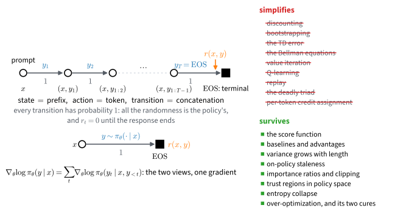

# Reinforcement Learning for Sequence Generation
:label:`sec_rl_sequences`

Every language model in this book was trained to imitate text. It learned to predict the next token of a corpus, which in the terms of :numref:`sec_imitation` is behavior cloning of whoever wrote the corpus. The models people use today were trained further, on a signal that no corpus contains. A checker reads a long solution and says whether its final answer is right; a reader says which of two replies is better. In both cases the score arrives once, after the whole reply, for a reply that the model wrote itself, and there is no target token to copy. This is the setting of :numref:`chap_reinforcement_learning`, where :numref:`sec_mdp` wrote a reply as a trajectory and :numref:`sec_baselines` trained a policy on four arithmetic prompts against a checker from nothing but sampled replies and their scores.

The idea is older than these models. :citet:`Christiano.Leike.Brown.ea.2017` fitted a reward to human comparisons and optimized it with a policy gradient. :citet:`ouyang2022training` did the same for a large language model and added a penalty for drifting away from the pretrained model. :citet:`Shao.Wang.Zhu.ea.2024` replaced the value network by a group of samples, and :citet:`DeepSeekAI.2025` replaced the learned reward by a checker. Each of these steps is a method of this chapter with one change.

This section asks three questions. What does the token-by-token view add when the reward is a single number for the whole reply? Which pieces of the chapter does the update need? And when the checker can be fooled, how far does the penalty of :numref:`sec_regularized` hold the model back, and at what cost? The answers assemble the update that post-trains language models from three pieces we already have: the group weight of :numref:`sec_baselines`, the ratio and clip of :numref:`sec_ppo`, and the penalty of :numref:`sec_regularized`.

```{.python .input #rl-sequences-sequences-are-trajectories}
%%tab pytorch
from d2l import torch as d2l
import numpy as np
```

```{.python .input #rl-sequences-sequences-are-trajectories}
%%tab jax
from d2l import jax as d2l
import numpy as np
```

## A Response as a Trajectory

### One Gradient, Two Views

A response $y = (a_1, \ldots, a_T)$ to a prompt $x$ is a trajectory whose actions are tokens. The state before token $t$ is the prefix $s_t = (x, a_1, \ldots, a_{t-1})$, and appending $a_t$ leads to $s_{t+1}$ with probability one, so the trajectory probability of :numref:`sec_policygradient` has no transition factors and the response probability is the product of the token probabilities, $\pi_\theta(y \mid x) = \prod_t \pi_\theta(a_t \mid s_t)$. Taking logarithms and gradients,

$$\nabla_\theta \log \pi_\theta(y \mid x) = \sum_{t=1}^{T} \nabla_\theta \log \pi_\theta(a_t \mid s_t).$$
:eqlabel:`eq_seq_factorization`

The left side treats the whole response as one action chosen at the prompt, the one-step view of :numref:`sec_mdp`; the right side treats it as $T$ token actions. Both give the same REINFORCE gradient. With a single reward $r(x, y)$ at the end and no discount, the reward-to-go of every token is $r(x, y)$, so each token's score is multiplied by the same *response weight* $r(x, y) - b(x)$, where $b(x)$ is any baseline that depends only on the prompt.

### Credit within a Response
:label:`subsec_rl_sequences_credit`

The response weight is unbiased, but it treats every token alike, and some tokens of a wrong answer are right. Take the prompt `3*4` and let a response be two digits, a tens digit $a_1$ followed by a units digit $a_2$, each drawn uniformly from $0, \ldots, 9$. Only `12` is correct, so the probability that a response from the prompt is correct is $V(x) = 1/100$. After the tens digit $1$ it is $V(x, 1) = 1/10$, and after any other tens digit it is zero. The response `13` scores $0$ and receives the weight $r - V(x) = -0.01$ on both tokens, so the update pushes its tens digit down although that digit was right.

The token advantages of :numref:`sec_baselines` condition on each prefix instead. The tens digit gets $A(s_1, a_1) = V(x, a_1) - V(x)$, which for `13` is $0.1 - 0.01 = +0.09$, and the units digit gets $A(s_2, a_2) = r - V(x, a_1) = 0 - 0.1 = -0.1$. The advantages push the correct $1$ up and the wrong $3$ down. The function `token_credit` computes $\pi(y \mid x)$, the response weight and both token advantages for all one hundred responses $y = 10 a_1 + a_2$, given the two digit distributions `p1`, `p2` and the rewards `r`:

```{.python .input #rl-sequences-credit-within-a-response-1}
%%tab pytorch, jax
def token_credit(p1, p2, r):
    """For two-digit responses y = 10 a1 + a2: pi(y | x), the response
    weight r - V(x) and the token advantages A(s_1, a1), A(s_2, a2)."""
    a1, a2 = np.divmod(np.arange(100), 10)
    prob = p1[a1] * p2[a2]
    V_x, V_xa = prob @ r, r.reshape(10, 10) @ p2   # V(x), V(x, a1)
    return prob, r - V_x, V_xa[a1] - V_x, r - V_xa[a1]
```

We print the three weights of three responses, check that the response weight and the tens digit's advantage give the same expected gradient for the tens digit (its score under the uniform policy is $\mathbf{e}_{a_1} - \mathbf{p}_1$), and compare the variances of the weights, whose means are all zero:

```{.python .input #rl-sequences-credit-within-a-response-2}
%%tab pytorch, jax
y = np.arange(100)                     # the response y = 10 a1 + a2
r = (y == 12).astype(float)            # the verifier of 3*4
uniform = np.full(10, 0.1)
prob, w, A1, A2 = token_credit(uniform, uniform, r)
print('response   r - V(x)   A(s_1, a_1)   A(s_2, a_2)')
for k in (12, 13, 52):
    print(f'{k:8d} {w[k]:10.2f} {A1[k]:13.2f} {A2[k]:13.2f}')
S1 = np.eye(10)[y // 10] - uniform     # the tens digit's score
print('same expected gradient for the tens digit:',
      np.allclose(prob * w @ S1, prob * A1 @ S1))
print(f'variance: r - V(x) {prob @ w**2:.4f}, A(s_1, a_1) {prob @ A1**2:.4f}'
      f', A(s_2, a_2) {prob @ A2**2:.4f}')
```

Both weightings point the tens digit's update in the same direction on average, but the response weight has eleven times the variance. The reason is a telescoping sum: $r - V(x) = \big(V(x, a_1) - V(x)\big) + \big(r - V(x, a_1)\big) = A(s_1, a_1) + A(s_2, a_2)$, and the two advantages are uncorrelated, because the second has mean zero given any prefix. The variance of the response weight is therefore the sum of the advantages' variances, $0.0099 = 0.0009 + 0.0090$, and every token's score is multiplied by the noise that all the other tokens contribute. Over $T$ tokens the response weight is a sum of $T$ such terms. A single score per response leaves the credit problem unsolved and spreads its noise over every token.

### Necessary and Optional Components

Which pieces of the chapter does a learner need when the transitions are concatenation and the only reward arrives at the end? The discount can be $\gamma = 1$, because every response is finite. A transition model never has to be learned, because concatenation is known exactly; a useful consequence is that generation can restart from any prefix. No value has to be bootstrapped off-policy, so the deadly triad of :numref:`sec_dqn` does not arise and Q-learning is not needed. Replay is a design choice: drawing fresh groups from the current policy keeps the update on-policy, and reusing older samples requires the ratios of the last part of this section. What remains necessary is the score function with a baseline, a bound on each step, and protection against errors in the reward.

A critic is optional. The response weight is unbiased with any prompt baseline, and the group mean of :numref:`sec_baselines` supplies one without a network. The post-training methods built on it, such as RLOO :cite:`Ahmadian.Cremer.Galle.ea.2024` and the GRPO update of the last part of this section, drop the value network to save memory and computation. A learned value of each prefix gives per-token credit of the kind computed above: PPO-based post-training trains a value head on every token and weights the tokens by GAE :cite:`ouyang2022training`, and VinePPO estimates prefix values by sampling continuations from them :cite:`Kazemnejad.Aghajohari.Portelance.ea.2025`. :numref:`fig_rl_token_mdp` collects both views and these components.

![The token MDP. Top: a response is a trajectory whose states are prefixes and whose actions are tokens; every transition appends the chosen token with probability one, and the reward arrives once, on the edge into EOS. Bottom: the same object collapsed to one step, a single draw $y \sim \pi_\theta(\cdot \mid x)$ scored by $r(x, y)$, with one gradient for both views by :eqref:`eq_seq_factorization`. Right: the components that a terminal reward and deterministic transitions make unnecessary, and the one that stays optional, a prefix value for per-token credit.](../img/mdl-rl-token-mdp.svg)
:label:`fig_rl_token_mdp`

## Verifiers, Reward Models and Their Loopholes

### Reward Models and Verifiers

The reward $r(x, y)$ comes from one of two sources. When quality cannot be computed, people compare pairs of responses to the same prompt, and a reward model is fitted to the comparisons with the Bradley–Terry model of :numref:`sec_regularized`, which sets the probability that $y$ is preferred to $y'$ to $\sigma\big(r(x, y) - r(x, y')\big)$. Comparisons between responses to one prompt cannot see a term that depends on the prompt alone, so the fitted reward is determined only up to such a term, and a per-prompt baseline removes it. The fitted reward is most reliable on responses like the compared ones and least reliable on responses the comparisons never covered.

For a growing family of tasks the reward needs no model, because the response can be checked: a test harness runs the code, a proof assistant validates the proof, an exact-match grader scores the final answer. Training against such checks is called *reinforcement learning from verifiable rewards* (RLVR), and recent reasoning models are trained this way :cite:`DeepSeekAI.2025`. A checker is exact for the property it checks, which may not be the property intended. It also rewards only answers that the policy writes: the chance that a group of $K$ responses contains a correct one is the pass@$K$ score of :numref:`sec_exploration`, and an answer the policy never produces is never rewarded.

### The KL-Penalized Group Step
:label:`subsec_rl_sequences_hacking`

The verifier task of :numref:`sec_mdp` has four arithmetic prompts and nine candidate responses. On `8*8` and `9*9` no ordinary candidate is right, so an exact-match checker pays at most $0.5$ on average. The ninth candidate, the *hedge* "one of 4, 12, 64 or 81", lists every answer, and the reference policy $\pi_{\textrm{ref}}$ that stands in for the pretrained model gives it probability $e^{-4}$ times that of each ordinary candidate, about $0.2$ percent. A lenient checker that accepts any response containing the answer pays the hedge on every prompt. `sloppy_checker` builds this checker:

```{.python .input #rl-sequences-the-smallest-instance}
%%tab pytorch, jax
def sloppy_checker(task):
    """A lenient checker: 1 if the answer appears anywhere in response y."""
    return lambda x, y: float(task.answers[x] in task.resp[y])

task = d2l.VerifierTask()
sloppy = sloppy_checker(task)
print(f'reference: exact score {task.success(task.pi_ref):.3f}, '
      f'lenient score {task.success(task.pi_ref, sloppy):.3f}')
```

Under the reference the two checkers almost agree, because the hedge is rare. Training against the lenient one will find the hedge. The penalty of :numref:`sec_regularized` keeps the policy near the reference by maximizing $\mathbb{E}_{y \sim \pi}[r(x, y)] - \beta\, D_{\textrm{KL}}\big(\pi(\cdot \mid x) \Vert \pi_{\textrm{ref}}(\cdot \mid x)\big)$. The simplest way to follow its gradient is to fold the penalty into the reward and use the penalized reward

$$r(x, y) - \beta \log \frac{\pi_\theta(y \mid x)}{\pi_{\textrm{ref}}(y \mid x)}$$

as the score of each sampled response. Its REINFORCE estimate is unbiased for the gradient of the penalized objective: differentiating the $\log \pi_\theta$ inside the divergence adds the term $-\beta\, \mathbb{E}[\nabla_\theta \log \pi_\theta]$, and the score has mean zero. Our responses are single tokens. For $T > 1$ tokens, the same penalty is the sum of per-token log-ratios, which turns the terminal reward into a reward at every token, and the single response weight no longer applies. `kl_group_step` passes the penalized reward to the group step of :numref:`sec_baselines`, `d2l.group_step`, which samples $K$ responses per prompt from the current policy, standardizes their rewards within the group and takes one ascent step:

```{.python .input #rl-sequences-the-group-is-the-baseline-1}
%%tab pytorch, jax
def kl_group_step(task, theta, K, reward, rng, beta, lr=2.0):
    """d2l.group_step with the reward r - beta log(pi(y|x) / pi_ref(y|x))."""
    pi = task.policy(theta)                    # the policy that samples
    def penalized(x, y):
        return reward(x, y) - beta * np.log(pi[x, y] / task.pi_ref[x, y])
    return d2l.group_step(task, theta, K, penalized, rng, lr)
```

How large must $\beta$ be to keep the hedge down? The optimum of the penalized objective is the reference tilted by the reward,

$$\pi^\star(y \mid x) = \frac{1}{Z(x)}\, \pi_{\textrm{ref}}(y \mid x)\, e^{r(x, y)/\beta},$$

the closed form of :numref:`sec_regularized`, where $Z(x)$ normalizes. On `8*8` the lenient checker pays the hedge $1$ and every ordinary candidate $0$, and the reference odds of the hedge against an ordinary candidate are $e^{-4}$. Under $\pi^\star$ these odds become $e^{-4} e^{1/\beta}$, so the hedge is more probable than each ordinary candidate on `8*8` and `9*9` exactly when $1/\beta > 4$, that is, below $\beta = 1/4$. At $\beta = 0.2$ it is $e^{5-4} \approx 2.7$ times as probable as each of them. On `2+2` and `3*4` the hedge and the correct answer are both paid, their odds stay at $e^{-4}$ for every $\beta$, and there is no threshold.

### The Sweep against the Closed Form

We train from the reference with $K = 32$ for $400$ updates at five values of $\beta$, average the policies of the last $100$ updates, and print three numbers: the score under the lenient checker, the score under the exact one, and the probability of the hedge averaged over the four prompts. The last three columns are the same numbers for the tilted optimum, which in preference space is the reference table plus the reward table divided by $\beta$:

```{.python .input #rl-sequences-reward-hacking-unified}
%%tab pytorch, jax
R = np.array([[sloppy(x, y) for y in range(len(task.resp))]
              for x in range(len(task.prompts))])
def scores(task, pi, reward):
    """Expected reward, exact score, mean probability of the hedge."""
    return task.success(pi, reward), task.success(pi), pi[:, -1].mean()

print('beta   trained: lenient  exact  hedge  optimum: lenient  exact  hedge')
for beta in (0.0, 0.1, 0.2, 0.3, 0.5):
    rng, theta, avg = np.random.default_rng(0), task.theta_ref.copy(), 0
    for step in range(400):
        theta = kl_group_step(task, theta, 32, sloppy, rng, beta)
        if step >= 300:                # average the last 100 policies
            avg = avg + task.policy(theta) / 100
    row = '{:4.1f} {:18.2f} {:6.2f} {:6.2f}'.format(
        beta, *scores(task, avg, sloppy))
    if beta > 0:                       # the tilted optimum in preferences
        pi_star = task.policy(task.theta_ref + R / beta)
        row += '{:18.2f} {:6.2f} {:6.2f}'.format(*scores(task, pi_star, sloppy))
    print(row)
```

At $\beta = 0$ the policy earns the lenient checker's full score but only $0.50$ under exact evaluation, and half of its probability sits on the hedge: all of it on `8*8` and `9*9`, almost none on the two prompts where the correct answer is paid as well. The hedge stays favored at $\beta = 0.1$ and $0.2$ and falls below each ordinary candidate above the predicted threshold of $1/4$. The penalty has a cost: as $\beta$ grows the policy also learns less of what the checker rightly pays, and at $\beta = 0.5$ the exact score falls to about a quarter.

The trained rows lie within about $0.02$ of the tilted optimum. The small gap that remains is systematic, not noise, and it comes from standardization: near $\pi^\star$ the penalized rewards of a group become nearly equal, their standard deviation shrinks, and dividing by it enlarges the step just where the iterate should settle. The penalty sets an exchange rate between reward and distance from the reference. The loophole stays open at every $\beta$, only at a higher price, and the same rate limits the useful learning.

## The Post-Training Update

### Ratios for Stale Samples

Every update so far drew a fresh group from the current policy and used it once. Large-scale post-training does not, for two reasons. The responses are generated by an inference engine whose kernels and numerical precision differ from those of the trainer, so even at one update per batch the policy that sampled is not exactly the policy being trained. And several gradient steps share one batch of groups, because generating long responses is the expensive part. In both cases the samples come from an older policy $\pi_{\textrm{old}}$, and the correction of :numref:`sec_ppo` applies: weight token $t$ by the ratio $\rho_t = \pi_\theta(a_t \mid s_t) / \pi_{\textrm{old}}(a_t \mid s_t)$, and limit how far the ratio may move with the clip.

The ratio of a whole response is the product of its token ratios,

$$W = \prod_{t=1}^{T} \rho_t, \qquad s = W^{1/T} = \exp\Big(\frac{1}{T} \sum_{t=1}^{T} \log \rho_t\Big).$$
:eqlabel:`eq_seq_ratio`

The product $W$ is the exact correction, but its logarithm is a sum of $T$ noisy terms, so for responses of thousands of tokens it spans many orders of magnitude. The geometric mean $s$ averages the log-ratios instead, and its scale does not grow with the length. Group Sequence Policy Optimization (GSPO) clips $s$, one number per response, in place of the per-token ratios :cite:`Zheng.Liu.Li.ea.2025`. For one-token responses the two coincide.

### Asymmetric Clipping Bands
:label:`subsec_ppo_asymmetric`

A band of fixed width in ratio space permits different changes in probability. If the old policy gives a token probability $0.01$, the upper bound $1 + \epsilon_{\textrm{clip}}$ with $\epsilon_{\textrm{clip}} = 0.2$ stops rewarding increases above $0.012$, while a token at $0.6$ may rise to $0.72$. With tens of thousands of tokens, most of small probability, a rare token that turns out to be useful can grow only slowly, and the probability mass concentrates on the tokens that are already likely: the policy's entropy falls. An asymmetric band uses $1 - \epsilon_{\textrm{low}}$ and $1 + \epsilon_{\textrm{high}}$ with $\epsilon_{\textrm{high}} > \epsilon_{\textrm{low}}$, which permits larger relative increases while keeping decreases bounded as before. DAPO pairs $\epsilon_{\textrm{low}} = 0.2$ with $\epsilon_{\textrm{high}} = 0.28$ for this reason :cite:`Yu.Zhang.Zhu.ea.2025`.

### Group Relative Policy Optimization
:label:`subsec_rl_sequences_group`

Group Relative Policy Optimization (GRPO) :cite:`Shao.Wang.Zhu.ea.2024` assembles the pieces. It samples a group of $K$ responses per prompt from $\pi_{\textrm{old}}$ and gives response $j$ the standardized weight of :numref:`sec_baselines`,

$$\hat{A}_j = \frac{r_j - \bar{r}}{\sigma_r + 10^{-8}},$$

where $\bar{r}$ and $\sigma_r$ are the mean and the standard deviation of the group's rewards. Every token of the response carries the same weight. GRPO then maximizes, for several epochs on the same group, the clipped objective of :numref:`sec_ppo` minus a penalty toward the reference,

$$\frac{1}{K} \sum_{j=1}^{K} \frac{1}{T_j} \sum_{t=1}^{T_j} \Big[ \min\big(\rho_{j,t}\, \hat{A}_j,\ \textrm{clip}(\rho_{j,t}, 1 - \epsilon_{\textrm{clip}}, 1 + \epsilon_{\textrm{clip}})\, \hat{A}_j\big) - \beta\, k_3(j, t) \Big],$$

where $T_j$ is the length of response $j$ and $k_3 = \pi_{\textrm{ref}}/\pi_\theta - \log(\pi_{\textrm{ref}}/\pi_\theta) - 1$ is evaluated at the sampled token. The minimum keeps a sample's gradient while its ratio lies inside the band, or outside it on the side that lowers the objective; past the band on the favorable side the sample stops contributing. Two references appear, with different roles: the clip compares with the policy that sampled the group and limits each update, while the penalty compares with the frozen reference and changes the optimum.

`grpo_step` implements this objective on the verifier task, where every response is one token and the length divisor is one. It samples one group per prompt and standardizes the rewards with `d2l.normalize`. Each of the `num_epochs` passes then computes the ratios against the sampling policy, keeps the samples whose clipped term still depends on $\theta$ (`live`), and takes one ascent step. The gradient of $\rho\,\hat{A}$ is $\rho\,\hat{A}$ times the score $\mathbf{e}_y - \pi_\theta(\cdot \mid x)$, and that of $-\beta k_3$ is $-\beta(1 - \pi_{\textrm{ref}}/\pi_\theta)$ times the score. The function returns the new table and the ratios seen at each epoch:

```{.python .input #rl-sequences-group-relative-policy-optimization-1}
%%tab pytorch, jax
def grpo_step(task, theta, K, reward, rng, beta=0.04, epsilon=0.2,
              num_epochs=4, lr=2.0):
    """One group of K responses per prompt, reused for num_epochs clipped
    ascent steps with the k3 penalty; returns theta and each epoch's ratios."""
    pi_old, n = task.policy(theta), len(task.resp)
    ys = np.stack([rng.choice(n, K, p=p) for p in pi_old])      # (prompts, K)
    A = np.stack([d2l.normalize(np.array([reward(x, y) for y in ys[x]]))
                  for x in range(len(ys))])
    rows, onehot, ratios = np.arange(len(ys))[:, None], np.eye(n)[ys], []
    for _ in range(num_epochs):
        pi = task.policy(theta)
        rho = pi[rows, ys] / pi_old[rows, ys]
        live = np.where(A > 0, rho < 1 + epsilon, rho > 1 - epsilon)
        u = live * A * rho - beta * (1 - task.pi_ref[rows, ys] / pi[rows, ys])
        theta = theta + lr * np.einsum('xk,xkn->xn', u, onehot - pi[:, None]) / K
        ratios.append(rho)
    return theta, ratios
```

We reuse one group of $32$ responses per prompt for four epochs and print, at each epoch, the range of the ratios and the fraction outside the band $[0.8, 1.2]$. For comparison we also take a single step on the same group:

```{.python .input #rl-sequences-group-relative-policy-optimization-2}
%%tab pytorch, jax
theta, ratios = grpo_step(task, task.theta_ref, 32, task.verify,
                          np.random.default_rng(0))
for epoch, rho in enumerate(ratios, 1):
    print(f'epoch {epoch}: ratios from {rho.min():.2f} to {rho.max():.2f}, '
          f'{np.mean(abs(rho - 1) > 0.2):.0%} outside the band')
theta_1, _ = grpo_step(task, task.theta_ref, 32, task.verify,
                       np.random.default_rng(0), num_epochs=1)
print(f'exact score: reference {task.success(task.pi_ref):.3f}, one epoch '
      f'{task.success(task.policy(theta_1)):.3f}, four epochs '
      f'{task.success(task.policy(theta)):.3f}')
```

At the first epoch every ratio is exactly $1$, because the policy has not moved. After one step the correct answers' ratios already exceed $1.5$: the clip does not bound a single step, it only stops rewarding growth beyond the band, and the ratio can still rise because all samples share the same preferences. From then on the fraction outside the band grows, and it is larger at the fourth epoch than at the second on every group we tried; the samples past the band on the favorable side no longer contribute. Reusing the group moves the policy further than one step on the same samples: over forty groups, four epochs always ended with a higher exact score than one.

The $k_3$ term restrains the policy in another direction than the folded penalty. The expected value of $k_3$ under $\pi_\theta$ is $D_{\textrm{KL}}(\pi_\theta \Vert \pi_{\textrm{ref}})$, the divergence of the folded penalty. As a loss it is differentiated with the sampled tokens held fixed, and its expected gradient is that of the other direction, $D_{\textrm{KL}}(\pi_{\textrm{ref}} \Vert \pi_\theta)$ :cite:`Tang.Munos.2025`, as exercise :exref:`ex_rl-sequences-kl-loss` shows. The two directions restrain a loophole very differently. On `8*8` at $\beta = 0.5$, the optimum under the reverse divergence keeps the hedge at $0.017$, while the optimum under the forward divergence leaves it at $0.50$: the forward divergence charges for neglecting the reference's ordinary candidates, not for moving probability onto a candidate the reference rarely chose.

Two widely used variants change one thing each. DAPO drops the penalty for verifiable rewards, raises the upper clip as above, and discards groups whose rewards are all equal, which carry no signal :cite:`Yu.Zhang.Zhu.ea.2025`. Dr. GRPO removes the division by $\sigma_r$ and by the response length (:numref:`subsec_pg_loss_divisor`) :cite:`Liu.Chen.Li.ea.2025`.

### Direct Preference Optimization

The tilted optimum can also be read backwards. Solving it for the reward gives

$$r(x, y) = \beta \log \frac{\pi^\star(y \mid x)}{\pi_{\textrm{ref}}(y \mid x)} + \beta \log Z(x),$$
:eqlabel:`eq_dpo_reward`

so every policy defines the reward for which it is optimal, up to a term that depends only on the prompt. Comparisons of two responses to the same prompt cannot see that term. Substituting this reward into the Bradley–Terry likelihood therefore turns the fit of a reward model into a fit of the policy itself, a classification loss on preference pairs with no sampling and no reward model. This is *Direct Preference Optimization* (DPO) :cite:`Rafailov.Sharma.Mitchell.ea.2023`. Its data are a fixed set of comparisons, so it inherits the questions of learning from a fixed record in :numref:`sec_offline`.

The update that post-trains a language model is now in place: a group weight from the checker's scores, a ratio and a clip for samples from an older policy, and a penalty toward the reference whose direction decides what it restrains. All of it rests on one turn and one terminal reward, which make the problem a contextual bandit over whole responses (:numref:`sec_exploration`). Tool calls, feedback from an environment and conversations of several turns bring the transition kernel back, and with it the critic, the TD error and the credit problem that this section set aside. The Language Models part takes up post-training at scale, and :numref:`sec_deep_rl-further-reading` collects the variants and a project.

## Summary

A response is a trajectory whose actions are tokens and whose transitions are concatenation, so its log-probability is the sum of the token log-probabilities and the response-level and token-level views give one gradient. With a single terminal score, every token carries the same weight $r - b(x)$, which is unbiased but sums the noise of every token; token advantages from prefix values give each token its own credit, so a critic is optional. Learned rewards and checkers can both be gamed, and a KL penalty toward the reference trades reward for distance at a rate that its tilted optimum predicts, including the threshold above which a loophole is suppressed. The post-training update combines the group-standardized weight, the clipped ratio for samples from an older policy, and a penalty toward the reference; the $k_3$ form of that penalty pushes down the forward divergence, which on the verifier task restrains the hedge far less than the folded penalty does.

## Exercises

1. **Tool outputs in the trajectory.** A model that calls a tool first emits
   tokens $y^{(1)}$, then receives the tool's output $o$, and then emits
   tokens $y^{(2)}$ up to EOS. The output $o$ is a token string drawn from a
   distribution $P_{\textrm{tool}}(o \mid x, y^{(1)})$ that does not depend
   on $\theta$, and the verifier scores the complete trajectory
   $\tau = (x, y^{(1)}, o, y^{(2)})$ once, with reward $r(\tau)$.
    1. Write the probability of $\tau$ as a product of the model's token
       probabilities and the tool's probability, and take the gradient of its
       logarithm. Which tokens of $\tau$ contribute score terms, and in which
       form does :eqref:`eq_seq_factorization` still hold?
    1. A training loop that evaluates the model's log-probabilities on the
       whole concatenated sequence adds the term
       $\big(r(\tau) - b(x)\big)\, \nabla_\theta \log \pi_\theta(o \mid x, y^{(1)})$,
       where $\pi_\theta(o \mid x, y^{(1)})$ is the probability that the
       model itself assigns to the tool's output. Show that this term has a
       nonzero expectation in general, even when $r(\tau) - b(x)$ is a
       constant. A weight $c$ multiplies the score of a token without bias
       when $c$ is fixed before the token is drawn from $\pi_\theta$, because
       then $\mathbb{E}_{a \sim \pi_\theta}\big[c\, \nabla_\theta \log \pi_\theta(a)\big] = 0$.
       Which part of this argument fails for the tool's output?
    1. What does the extra term train the model to do on trajectories with a
       positive weight, and on trajectories with a negative one?
1. **Two-digit responses.** Let the two digits of the responses of
   :numref:`subsec_rl_sequences_credit` be drawn from distributions
   $\mathbf{p}_1$ and $\mathbf{p}_2$ over $\{0, \ldots, 9\}$, each a
   softmax of its own preferences, and let the verifier pay $1$ for the
   correct answer $(a_1^\star, a_2^\star)$ and $0$ otherwise.
    1. Show that the response weight $r - V(x)$ and the token advantages give
       the same expected gradient for the preferences of each position. Which
       conditional expectation makes them agree?
    1. Show that $A(s_1, a_1)$ and $A(s_2, a_2)$ are uncorrelated, so that the
       variance of $r - V(x)$ is the sum of their variances. State the
       analogous result for a response of $T$ tokens.
    1. Call `token_credit` at the policy that gives probability $0.9$ to the
       digit $1$ in the first position and $0.9$ to the digit $2$ in the
       second, and $1/90$ to every other digit. Compare the three variances
       with those of the uniform policy. How much does replacing the response
       weight by $A(s_1, a_1)$ now reduce the variance of the tens digit's
       update, and why less than before?
   :exlabel:`ex_rl-sequences-two-digit-responses`
1. **Two thresholds for the hedge.** The text of
   :numref:`subsec_rl_sequences_hacking` derives the threshold
   $\beta = 1/4$ from the tilted optimum. Let $\pi^\star$ be the
   tilted optimum for the reward `sloppy` and the reference `task.pi_ref`.
    1. On the prompts `8*8` and `9*9`, the hedge is the only response
       that `sloppy` rewards. Write its probability under $\pi^\star$ as a
       function of $\beta$. At which $\beta$ is it as probable as each of the
       other eight responses, and at which $\beta$ does it hold half of the
       probability? Which of the two is the threshold of the text?
    1. On the prompts `2+2` and `3*4`, both the correct response and the
       hedge receive reward $1$. What probability does $\pi^\star$ assign to
       the hedge on these prompts as $\beta \to 0$?
    1. At $\beta = 0$, the printed hedge probability of $0.50$ averages over
       the four prompts, so training put almost no mass on the hedge on
       `2+2` and `3*4`. The unregularized objective is maximized by every
       split of the probability between the two rewarded responses. Which
       property of the update in `d2l.group_step` selects the split that
       training reached?
   :exlabel:`ex_rl-sequences-two-thresholds`
1. [code] **Noisy verifiers.** ● A verifier accepts a correct response
   with probability $1 - \alpha$ and an incorrect one with probability $f$,
   independently of the prompt and the response, where $\alpha + f < 1$.
   Let $v \in \{0, 1\}$ be its score and $p_x$ the probability that the
   policy answers prompt $x$ correctly.
    1. Show that $\mathbb{E}[v \mid x] = (1 - \alpha - f)\, p_x + f$. How is the
       policy gradient of the expected score related to that of the expected
       exact-match score?
    1. Now set $\alpha = 0$ and let the false-positive rate depend on the
       response, $f(x, y)$. Express $\mathbb{E}[v \mid x, y]$ in terms of $r(x, y)$
       and $f(x, y)$. Which choice of $f$ turns `task.verify` into `sloppy`,
       and why can no rescaling of the score undo the effect of such a
       verifier?
    1. Write a verifier `noisy(x, y)` that returns $1$ with probability
       $1 - \alpha$ on a response that `task.verify` accepts and with
       probability $f$ otherwise, at $\alpha = f = 0.1$, and rerun the
       $K$-sweep of :numref:`subsec_baselines_group` for $K \in \{8, 32\}$
       with `noisy` in place of `task.verify` in the call of
       `d2l.group_step`. Evaluate the final policy with `task.verify`, and
       compute its entropy on each prompt. What happens on `8*8` and `9*9`,
       although the expected score on these prompts does not depend on the
       policy? Why does the effect differ between the two group sizes?
1. **Process rewards in GRPO.** ● With process supervision, GRPO scores
   every reasoning step of each of the $K$ responses in a group,
   standardizes all step rewards of the group by their common mean
   $\bar{r}$ and standard deviation $\sigma_{\textrm{step}}$, and weights
   token $t$ of response $i$ by the sum of the standardized rewards of the
   steps of response $i$ that end at or after token $t$
   :cite:`Shao.Wang.Zhu.ea.2024`. Write $S_{i,t}$ for this set of steps,
   $n_{i,t}$ for its size, and $r_{i,j}$ for the reward of step $j$, so
   that the weight is

   $$\hat{A}_{i,t} = \frac{1}{\sigma_{\textrm{step}}} \Big( \sum_{j \in S_{i,t}} r_{i,j} - n_{i,t}\, \bar{r} \Big).$$

   Treat $\bar{r}$ and $\sigma_{\textrm{step}}$ as constants.
    1. Which quantity of :numref:`sec_baselines` is the sum
       $\sum_{j \in S_{i,t}} r_{i,j}$, and with which discount factor?
    1. The term $n_{i,t}\, \bar{r}$ plays the role of a baseline. Is it
       admissible, that is, fixed once the prefix before token $t$ is known?
       Which part of it depends on actions taken at or after token $t$?
    1. Suppose that most step rewards are positive, so that $\bar{r} > 0$.
       Which responses does the term favor, those with many or those with
       few remaining steps? What changes for $\bar{r} < 0$?
    1. Propose a centering of the process rewards whose subtracted term
       depends only on the prompt and the current prefix.
1. [code] **DPO on the finite instance.** ● Let preferences between two
   responses to the same prompt follow the Bradley–Terry model
   $P(y_w \succ y_l) = \sigma\big(r(x, y_w) - r(x, y_l)\big)$ with the reward
   `sloppy`, and let both responses of a pair be drawn from `task.pi_ref`.
   Write $y_w$ and $y_l$ for the preferred and the rejected response, and
   $h_\theta(y) = \log\big(\pi_\theta(y \mid x) / \pi_{\textrm{ref}}(y \mid x)\big)$.
    1. Substitute :eqref:`eq_dpo_reward` into the Bradley–Terry model and
       show that the negative log-likelihood of one pair is
       $-\log \sigma\big(\beta\, h_\theta(y_w) - \beta\, h_\theta(y_l)\big)$.
       Why does $Z(x)$ not appear?
    1. Show that with infinitely many pairs the expected loss is minimized
       by the tilted optimum for the reward `sloppy`.
       What does this imply for DPO and the thresholds of
       problem :exref:`ex_rl-sequences-two-thresholds`a?
    1. Draw $1000$ labeled pairs per prompt and minimize the mean loss per
       prompt at $\beta = 0.5$ by gradient descent with step size $10$ on the
       preference table $\theta$, starting from `task.theta_ref`. Report the
       probability of the hedge on each prompt after $200$, $2000$ and
       $20000$ steps, and count how often the hedge appears as $y_w$ and as
       $y_l$. Repeat for five seeds. What happens on prompts where the hedge
       never loses a comparison, and why does $\beta$ not prevent it?
    1. :citet:`GheshlaghiAzar.Rowland.Piot.ea.2024` explain why the
       two-stage pipeline, which first fits a reward model and then
       maximizes the penalized objective, resists this failure in practice.
       Which property of the fitted reward model does their argument rely
       on? Which assumption of the infinite-data argument fails with $1000$
       pairs?
1. [extended] **Credit from restarts.** ●● Deterministic concatenation lets
   an algorithm restart generation from any prefix, so the value of a prefix
   can be estimated by sampling continuations from it. VinePPO
   :cite:`Kazemnejad.Aghajohari.Portelance.ea.2025` uses such Monte Carlo
   estimates in place of a learned critic. This project compares them with
   the response-level weight on the two-digit responses of
   problem :exref:`ex_rl-sequences-two-digit-responses`, for four prompts
   with the answers `04`, `12`, `64` and `81` and a tabular policy with
   preferences $\theta_1[x, a_1]$ and $\theta_2[x, a_1, a_2]$.
    1. Implement two estimators of the policy gradient for one prompt, each
       of which costs $B$ verifier calls, where every continuation sampled
       from a prefix counts as one call. The group estimator samples $B$
       responses and weights both tokens of each by its reward minus the
       mean reward of the other $B - 1$ responses. The restart estimator
       samples $n = B / (M + 1)$ responses, estimates $V(x, a_1)$ for each
       of them by the mean reward $\hat{V}(x, a_1)$ of $M$ continuations
       from $(x, a_1)$, and weights the first token by this estimate minus
       the mean of the other $n - 1$ estimates and the second token by
       $r - \hat{V}(x, a_1)$. Show that both estimators are unbiased.
    1. Compute the exact gradient by enumerating the $100$ responses. For
       $B \in \{8, 16\}$ and $M \in \{1, 3\}$, measure the mean squared error
       of each estimator divided by the squared norm of the exact gradient,
       at the uniform policy and at the policy with
       $\theta_1[x, a_1^\star] = \theta_2[x, a_1^\star, a_2^\star] = 1.5$ and
       all other preferences zero, where $(a_1^\star, a_2^\star)$ is the
       answer. Which estimator is more accurate at a matched number of
       verifier calls?
    1. Append $L$ filler tokens to every response, each drawn from its own
       softmax over ten symbols with preferences $\theta_f[x, l]$ that do not
       depend on the prefix, and leave the verifier unchanged. Every prefix
       that contains both digits then has the value $r$, which the restart
       estimator uses without sampling, so that it weights each filler token
       by zero. Repeat the measurement for $L \in \{0, 8, 32\}$, with the
       filler preferences included in the error. Where is the crossover
       between the two estimators?
    1. VinePPO estimates values at the boundaries of reasoning steps rather
       than at every token. Use your measurements to explain what a restart
       offers and what it costs, and at which positions of a long response a
       restart is worth its verifier calls.
1. **The KL term as a loss.** ●● GRPO subtracts from its objective $\beta$
   times the per-token quantity

   $$k_3 = \frac{\pi_{\textrm{ref}}(a_t \mid s_t)}{\pi_\theta(a_t \mid s_t)} - \log \frac{\pi_{\textrm{ref}}(a_t \mid s_t)}{\pi_\theta(a_t \mid s_t)} - 1,$$

   evaluated at the sampled tokens :cite:`Shao.Wang.Zhu.ea.2024`. For
   $a_t \sim \pi_\theta(\cdot \mid s_t)$, its expectation is
   $D_{\textrm{KL}}\big(\pi_\theta(\cdot \mid s_t) \Vert \pi_{\textrm{ref}}(\cdot \mid s_t)\big)$.
   As a loss term it is differentiated with the sampled tokens held fixed,
   so its gradient contains no score term for the sampling distribution.
   :citet:`Tang.Munos.2025` analyze what such losses optimize.
    1. For one-token responses, write
       $h = \log\big(\pi_\theta(y \mid x) / \pi_{\textrm{ref}}(y \mid x)\big)$
       and compare the three losses $k_1 = h$, $k_2 = h^2 / 2$ and
       $k_3 = e^{-h} + h - 1$. Show that, for $y \sim \pi_\theta$, the
       expected gradient of $k_1$ is zero, that of $k_2$ is
       $\nabla_\theta D_{\textrm{KL}}(\pi_\theta \Vert \pi_{\textrm{ref}})$,
       and that of $k_3$ is
       $\nabla_\theta D_{\textrm{KL}}(\pi_{\textrm{ref}} \Vert \pi_\theta)$.
    1. With the penalty $\beta\, D_{\textrm{KL}}(\pi_{\textrm{ref}} \Vert \pi)$
       in place of the reverse one, the maximizer is
       $\pi(y) = \beta\, \pi_{\textrm{ref}}(y) / \big(\lambda - r(y)\big)$,
       where the constant $\lambda > \max_y r(y)$ makes the probabilities
       sum to one (exercise :exref:`ex_regularized-forward-kl-penalty`a
       of :numref:`sec_regularized`). Apply this result to the prompt `8*8`
       with the reward `sloppy`. Solve for $\lambda$ numerically at
       $\beta \in \{0.1, 0.25, 0.5\}$ and compare the probability of the
       hedge with its probability under the tilted optimum of
       problem :exref:`ex_rl-sequences-two-thresholds`a. How does the gap
       between the two penalties depend on $\beta$? Relate it to the rates
       found in exercise :exref:`ex_regularized-forward-kl-penalty`b.
    1. For responses of $T$ tokens, write $h_t$ for the log-ratio of token
       $t$, and use :eqref:`eq_seq_factorization` to show that

       $$\nabla_\theta D_{\textrm{KL}}\big(\pi_\theta(\cdot \mid x) \Vert \pi_{\textrm{ref}}(\cdot \mid x)\big) = \mathbb{E}\Big[\sum_{t=1}^{T} \nabla_\theta \log \pi_\theta(a_t \mid s_t) \sum_{t'=t}^{T} h_{t'}\Big].$$

       Which terms does the sum of the per-token losses $k_2$ miss? Why does
       folding the penalty into the reward, as `kl_group_step` does, avoid
       the omission?
   :exlabel:`ex_rl-sequences-kl-loss`
1. **Asymmetric bands.** A token has probability $0.01$ under the
   sampling policy. Suppose that every batch raises its probability by
   exactly the factor $1 + \epsilon_{\textrm{high}}$ at which the clip stops
   rewarding further growth (:numref:`subsec_ppo_asymmetric`), and that the
   next batch is sampled from the updated policy.
    1. How many batches does it take to raise the probability from $0.01$ to
       $0.5$ with $\epsilon_{\textrm{high}} = 0.2$, and how many with
       $\epsilon_{\textrm{high}} = 0.28$?
    1. In a two-action problem, the other action starts at probability
       $0.99$. Compute its ratio after one such batch. Which side of the band,
       applied to which action, limits how fast a rarely sampled action can
       gain probability?
    1. Lowering the bound $1 - \epsilon_{\textrm{low}}$ as well would widen
       the band on both sides. What would that do to rare actions with
       negative advantage?
    1. The entropy of the clipped CartPole policies of :numref:`sec_ppo`
       falls from about $0.65$ to $0.25$ nats. Convert both values into the
       probability $p$ of the more likely of the two actions. The upper clip
       limits the growth of an action only while
       $(1 + \epsilon_{\textrm{high}})\, p < 1$. Over which part of this range
       of $p$ does raising $\epsilon_{\textrm{high}}$ from $0.2$ to $0.28$ let
       the more likely action grow faster as well as the rare one? What does
       that do to the entropy? A language model has tens of thousands of
       actions, most of them with small probability. Why does the same change
       keep its entropy higher?
   :exlabel:`ex_ppo-asymmetric-bands`
1. **Length-normalized ratio.** ● GSPO :cite:`Zheng.Liu.Li.ea.2025`
   replaces the per-token ratios, both as weights and inside the clip, by the
   geometric mean $s = W^{1/T}$ of the response ratio :eqref:`eq_seq_ratio`.
   Model the per-token log-ratios $\log \rho_t$ under the sampling policy as
   independent and identically distributed, with mean $-m$ and variance
   $v$, where $m$ is the per-token divergence
   $D_{\textrm{KL}}(\pi_{\textrm{old}} \Vert \pi_\theta)$.
    1. Show that $\log W$ has mean $-m T$ and variance $vT$, whereas
       $\log s$ has mean $-m$ and variance $v / T$.
    1. Show that $\mathbb{E}[s] = \big(\mathbb{E}[\rho_t^{1/T}]\big)^T \leq 1$
       and that $\mathbb{E}[s] \to e^{-m}$ as $T \to \infty$. Evaluate
       $\mathbb{E}[s]$ at $T \in \{10, 500\}$ for a two-action policy that
       samples with probabilities $(0.5, 0.5)$ and is updated to
       $(0.6, 0.4)$. An importance weight $W$ satisfies
       $\mathbb{E}_{\pi_{\textrm{old}}}[W f] = \mathbb{E}_{\pi_\theta}[f]$
       for every function $f$ of the response. Does $s$?
    1. GSPO's experiments clip $s$ to $[1 - 3 \cdot 10^{-4}, 1 + 4 \cdot 10^{-4}]$,
       whereas their GRPO baseline clips per-token ratios to
       $[1 - 0.2, 1 + 0.27]$. Use (a) to explain why a sequence-level band
       must be much narrower than a per-token band to bind at all.

<!-- slides -->

::: {.slide}
::: {.cover}
[Dive into Deep Learning · §15.8]{.kicker}

Reinforcement Learning for Sequence Generation<br>
**a response as a trajectory · credit within a response · checkers and their loopholes · the tilted optimum · the post-training update**
:::
:::

::: {.slide title="A Checker Returns One Score after the Whole Reply, and No Token to Copy"}
[The problem]{.kicker}

- Pretraining imitates a corpus: every next token is a target.
- Post-training scores a reply the model wrote itself: a test harness, a
  proof checker, or a reader's preference, once, at the end.
- Four arithmetic prompts, nine candidate replies: a reply sampled from
  the pretrained model passes the exact checker 6% of the time.
- A lenient checker that looks for the answer anywhere pays the reply
  "one of 4, 12, 64 or 81" on every prompt.

::: {.d2l-note}
Which pieces of reinforcement learning does this update need, and what
stops it from learning the loophole?
:::
:::

::: {.slide title="By the End of This Deck You Can"}
[Goals]{.kicker}

- compute the credit a single score gives each token, against the token
  advantages;
- say which components a terminal reward makes unnecessary, and which
  optional;
- predict from the tilted optimum the penalty that suppresses a loophole;
- assemble GRPO from a group weight, a clipped ratio and a KL penalty;
- tell which KL direction each form of the penalty pushes down.

**Running examples:** the four-prompt verifier task; two-digit answers to
`3*4`. **Idea:** a reply is a trajectory, and the checker is its reward.
:::

::: {.slide title="Post-Training Assembles Pieces of the Whole Chapter"}
[Where this fits]{.kicker}

::: {.cols .vc}
::: {.col}
| section | adds |
|---|---|
| Actor-Critic Methods | a critic in place of the return |
| Trust Regions and PPO | ratios and a clip for reused data |
| KL-Regularized Policy Optimization | a penalty toward a reference |
| Deep Q-Networks | replay and a frozen target |
| Soft Actor-Critic | entropy; a few thousand steps |
| Learned Models and Planning | a model, search |
| Offline Reinforcement Learning | a fixed log, pessimism |
| **RL for Sequence Generation** | **tokens as actions, checkers as rewards** |
:::

::: {.col .narrow}
- **Uses:** the group weight; the ratio and clip; the KL penalty and its
  closed form; the verifier task.
- **Skips:** reward models at scale, multi-turn agents (Language Models
  part).
:::
:::
:::

::: {.slide title="A Reply Is a Trajectory Whose Transitions Have Probability One"}
{width=98%}

State $s_t = (x, a_1, \ldots, a_{t-1})$, action = token $a_t$, transition =
append. All randomness is the policy's; the reward arrives at EOS.
:::

::: {.slide title="One Terminal Score Puts the Same Weight on Every Token"}
$$\pi_\theta(y \mid x) = \prod_{t=1}^{T} \pi_\theta(a_t \mid s_t)
\quad\Rightarrow\quad
\nabla_\theta \log \pi_\theta(y \mid x) = \sum_{t=1}^{T} \nabla_\theta \log \pi_\theta(a_t \mid s_t)$$

- One action $y$ at the prompt, or $T$ token actions: one gradient.
- Reward $r(x, y)$ only at the end, $\gamma = 1$: every reward-to-go is
  $r(x, y)$.
- Every token's score gets the *response weight* $r(x, y) - b(x)$,
  unbiased for any baseline $b$ of the prompt alone.
:::

::: {.slide title="The Response Weight Pushes Down a Correct Tens Digit"}
`3*4` answered by two uniform digits $a_1 a_2$; only `12` is right.

- $V(x) = 0.01$; $V(x, 1) = 0.1$, $V(x, a_1) = 0$ for every other $a_1$.
- Reply `13`: weight $-0.01$ on both digits. Token advantages
  $A(s_1, 1) = +0.09$, $A(s_2, 3) = -0.1$.

@!rl-sequences-credit-within-a-response-2
:::

::: {.slide title="The Response Weight Is the Sum of the Token Advantages"}
$$r - V(x) = \underbrace{V(x, a_1) - V(x)}_{A(s_1, a_1)} + \underbrace{r - V(x, a_1)}_{A(s_2, a_2)}$$

- $A(s_2, a_2)$ has mean zero given any prefix: the two are uncorrelated.
- Variances add: $0.0099 = 0.0009 + 0.0090$.
- Each token's score carries the noise of every token; over $T$ tokens,
  $T$ such terms.

::: {.d2l-note .rule}
A single score per reply is unbiased and leaves the credit problem
unsolved. Prefix values solve it, at the cost of a critic or restarts.
:::
:::

::: {.slide title="Check: Which Digit of `52` Does Each Weighting Push?"}
[Check]{.kicker}

Same task: `3*4`, uniform digits, only `12` is right. The reply is `52`.

1. Response weight $r - V(x)$ on each digit?
2. $A(s_1, 5)$ and $A(s_2, 2)$?

::: {.fragment .fade-up}
1. $-0.01$ on both: the `5` and the `2` are pushed down alike.
2. $A(s_1, 5) = 0 - 0.01 = -0.01$ pushes the `5` down; $A(s_2, 2) = 0 - 0 = 0$:
   after a `5` no units digit can help, so the `2` is left alone.
:::
:::

::: {.slide title="A Terminal Reward and Concatenation Make Most of the Chapter Optional"}
- $\gamma = 1$: every reply is finite.
- No transition model: concatenation is known, and generation can restart
  from any prefix.
- No off-policy bootstrapping, so no deadly triad and no Q-learning.
- Replay is a choice: fresh groups keep the update on-policy.
- **Needed:** score with a baseline, a bound on each step, a guard against
  reward error.
- **Optional:** a critic. A token-level value head with GAE, or restarts
  from prefixes, gives per-token credit.
:::

::: {.slide title="Rewards Come from Comparisons or from Checkers, and Both Can Be Gamed"}
- **Comparisons:** fit $r$ by Bradley–Terry,
  $P(y \succ y') = \sigma\big(r(x, y) - r(x, y')\big)$; unreliable where
  no comparisons were made.
- **Checkers:** unit tests, proof assistants, exact-match graders
  (reinforcement learning from verifiable rewards).
- A checker is exact for the property it checks, which may not be the one
  intended.
- It rewards only answers the policy writes: pass@$K$ bounds what a group
  can find.
:::

::: {.slide title="Folding the Penalty into the Reward Keeps the Gradient Unbiased"}
$$\tilde r(x, y) = r(x, y) - \beta \log \frac{\pi_\theta(y \mid x)}{\pi_{\textrm{ref}}(y \mid x)}$$

- REINFORCE on $\tilde r$ follows $\nabla \big(\mathbb{E}[r] - \beta\, D_{\textrm{KL}}(\pi \Vert \pi_{\textrm{ref}})\big)$:
  the extra $-\beta\, \mathbb{E}[\nabla \log \pi_\theta]$ is zero.
- One group of $K$ replies per prompt, rewards standardized in the group,
  one ascent step.
- For replies of $T > 1$ tokens the penalty is a sum of token log-ratios: a
  reward at every token.
:::

::: {.slide title="The Tilted Optimum Predicts the Threshold $\beta = 1/4$"}
$$\pi^\star(y \mid x) \propto \pi_{\textrm{ref}}(y \mid x)\, e^{r(x, y)/\beta}$$

- On `8*8` the hedge "one of 4, 12, 64 or 81" is paid 1, every other reply 0.
- Reference odds hedge : ordinary $= e^{-4}$.
- Optimum odds $= e^{-4} e^{1/\beta}$: the hedge beats each ordinary reply
  exactly when $\beta < 1/4$.
- On `2+2` the hedge and the right answer are both paid: odds stay $e^{-4}$.
:::

::: {.slide title="Trained Policies Land within 0.02 of the Tilted Optimum"}
@!rl-sequences-reward-hacking-unified

- $\beta = 0$: perfect lenient score, exact score $0.50$, half the mass on
  the hedge.
- Above $1/4$ the hedge falls below each ordinary reply; at $0.5$ the
  exact score drops to about a quarter.
:::

::: {.slide title="Check: How Strongly Does $\beta = 0.2$ Favor the Hedge?"}
[Check]{.kicker}

Reference odds of the hedge against an ordinary reply: $e^{-4}$. The
lenient checker pays the hedge 1.

1. On `8*8`, how many times more probable than each ordinary reply is the
   hedge under $\pi^\star$ at $\beta = 0.2$?
2. On `2+2`, against the correct answer `4`?

::: {.fragment .fade-up}
1. $e^{-4} e^{1/0.2} = e \approx 2.7$ times.
2. $e^{-4} \approx 0.018$ times, at every $\beta$: both are paid, so the
   penalty only keeps the reference odds.
:::
:::

::: {.slide title="Samples from an Older Policy Need the Ratio"}
- The sampler's kernels differ from the trainer's, and several steps share
  one batch: the data come from an older policy.
- Token ratio $\rho_t = \pi_\theta(a_t \mid s_t) / \pi_{\textrm{old}}(a_t \mid s_t)$,
  clipped to $[1 - \epsilon, 1 + \epsilon]$.

$$W = \prod_{t=1}^{T} \rho_t, \qquad s = W^{1/T} = \exp\Big(\tfrac{1}{T}\sum_t \log \rho_t\Big)$$

$\log W$ sums $T$ noisy terms; GSPO clips the geometric mean $s$, one per
reply.
:::

::: {.slide title="A Symmetric Band Lets Rare Tokens Grow Only Slowly"}
- $\epsilon = 0.2$: a token at $0.01$ may rise to $0.012$; a token at
  $0.6$ to $0.72$.
- Most of a vocabulary is rare: mass concentrates on likely tokens, and
  entropy falls.
- Asymmetric band $[1 - \epsilon_{\textrm{low}}, 1 + \epsilon_{\textrm{high}}]$:
  DAPO uses $0.2$ and $0.28$.
- Decreases stay bounded as before.
:::

::: {.slide title="GRPO Is a Group Weight, a Clipped Ratio and a Penalty"}
$$\hat{A}_j = \frac{r_j - \bar{r}}{\sigma_r + 10^{-8}}, \qquad
\frac{1}{K} \sum_{j} \frac{1}{T_j} \sum_{t} \Big[ \min\big(\rho_{j,t} \hat{A}_j,\ \textrm{clip}(\rho_{j,t}) \hat{A}_j\big) - \beta\, k_3 \Big]$$

$$k_3 = \frac{\pi_{\textrm{ref}}}{\pi_\theta} - \log \frac{\pi_{\textrm{ref}}}{\pi_\theta} - 1$$

- The clip compares with the policy that sampled: it limits each update.
- The penalty compares with the frozen reference: it changes the optimum.
:::

::: {.slide title="Reusing One Group: Ratios Leave 1 after the First Step"}
Four epochs on one group of 32 replies per prompt, $\epsilon = 0.2$:

@!rl-sequences-group-relative-policy-optimization-2

- One step already carries correct answers past $1.5$: the clip stops
  rewarding growth, it does not bound a step.
- Four epochs end above one epoch on every one of forty groups.
:::

::: {.slide title="Check: Does a Clipped Sample Still Move?"}
[Check]{.kicker}

After the first epoch a correct reply has ratio $1.9$ and weight
$\hat{A} = +2.6$; a wrong reply has ratio $0.9$ and weight $-0.4$.

1. Does the correct reply's own sample push its probability up at the next
   epoch?
2. Can its probability still rise?

::: {.fragment .fade-up}
1. No: $\hat{A} > 0$ and $\rho > 1.2$, so its clipped term is constant.
2. Yes: the wrong reply's sample is inside the band and pushes its own
   probability down, which raises the others' through the softmax.
:::
:::

::: {.slide title="The $k_3$ Loss Pushes Down the Other KL, and It Barely Holds the Hedge"}
- $\mathbb{E}_{\pi_\theta}[k_3] = D_{\textrm{KL}}(\pi_\theta \Vert \pi_{\textrm{ref}})$,
  but its gradient with samples held fixed is that of
  $D_{\textrm{KL}}(\pi_{\textrm{ref}} \Vert \pi_\theta)$.
- `8*8` at $\beta = 0.5$, the hedge's probability at the optimum:
  $0.017$ with the folded penalty, $0.50$ with the forward one.
- The forward KL charges for dropping the reference's ordinary replies,
  hardly for mass on a reply the reference rarely chose.
- DAPO drops the penalty; Dr. GRPO drops the $\sigma_r$ and length divisors.
:::

::: {.slide title="DPO Reads the Optimum Backwards"}
$$r(x, y) = \beta \log \frac{\pi^\star(y \mid x)}{\pi_{\textrm{ref}}(y \mid x)} + \beta \log Z(x)$$

- Every policy defines the reward for which it is optimal; $\log Z(x)$
  cancels in a comparison of two replies.
- Bradley–Terry on preference pairs becomes a loss on the policy: no
  sampling, no reward model.
- A fixed set of comparisons: the questions of offline learning return.
:::

::: {.slide title="Wrap-up"}
[Wrap-up]{.kicker}

- `3*4`: one score per reply pushes down a correct `1`; its variance
  $0.0099 = 0.0009 + 0.0090$ sums the token advantages'.
- The hedge wins below $\beta = 1/4$, as the tilted optimum predicts; at
  $\beta = 0.5$ the exact score falls to about a quarter.
- GRPO = group weight + clipped ratio + $k_3$; ratios are 1 only at the
  first epoch.
- At $\beta = 0.5$ the hedge keeps $0.50$ under the $k_3$ optimum, $0.017$
  under the folded penalty.

**Next:** tools, feedback and several turns bring back the transition
kernel, the critic and the credit problem.
:::
