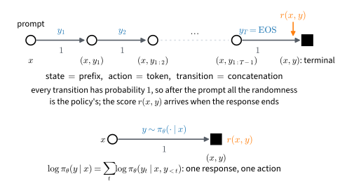

# Reinforcement Learning for Sequence Generation
:label:`sec_rl_sequences`

Every language model in this book was trained to imitate text, which is behavior cloning (:numref:`sec_imitation`) of whoever wrote the corpus. The models people use today are trained further, on a signal that no corpus contains: a checker says whether the final answer of a solution is right, or a reader says which of two responses is better. The score arrives once, after a whole response that the model wrote itself, with no target token to copy. :numref:`sec_policygradient` and :numref:`sec_baselines` trained a policy in this setting, on four arithmetic prompts and a checker.

The idea is older than these models. :citet:`Christiano.Leike.Brown.ea.2017` fitted a reward to human comparisons and optimized it with a policy gradient; :citet:`ouyang2022training` did so for a large language model, with a penalty for drifting from the supervised model; :citet:`Shao.Wang.Zhu.ea.2024` replaced the value network by a group of samples, and :citet:`DeepSeekAI.2025` the learned reward by a checker.

What does the token-by-token view add when the reward is one number per response, and how far does the penalty of :numref:`sec_regularized` hold back a policy that has found a loophole? The answers assemble the post-training update from the group weight of :numref:`sec_baselines`, the ratio and clip of :numref:`sec_ppo`, and that penalty.

```{.python .input #rl-sequences-sequences-are-trajectories}
%%tab pytorch
import math
import numpy as np
import torch
from torch import nn
from torch.nn import functional as F
from d2l import torch as d2l
```

```{.python .input #rl-sequences-sequences-are-trajectories}
%%tab jax
import math
import numpy as np
import jax
from jax import numpy as jnp
from flax import nnx
import optax
from d2l import jax as d2l
```

## A Response as a Trajectory

### One Gradient, Two Views

A response $y = (a_1, \ldots, a_T)$ to a prompt $x$ is a trajectory whose actions are tokens (:numref:`tab_rl_sequence_dictionary`). The state before token $t$ is the prefix $s_t = (x, a_1, \ldots, a_{t-1})$, and appending $a_t$ leads to $s_{t+1}$ with probability one, so the response probability is the product of the token probabilities, $\pi_\theta(y \mid x) = \prod_t \pi_\theta(a_t \mid s_t)$, and

$$\nabla_\theta \log \pi_\theta(y \mid x) = \sum_{t=1}^{T} \nabla_\theta \log \pi_\theta(a_t \mid s_t).$$
:eqlabel:`eq_seq_factorization`

:Autoregressive text generation as a Markov decision process.
:label:`tab_rl_sequence_dictionary`

| Language modeling | Reinforcement learning |
|:--|:--|
| prompt $x \sim \mu_0$ | start state $s_1$ |
| token $a_t$ | action $a_t$ |
| prefix $(x, a_1, \ldots, a_{t-1})$ | state $s_t$ |
| complete response $y = (a_1, \ldots, a_T)$ | trajectory $\tau$ |
| prefix ending in EOS, $(x, y)$ | terminal state |
| next-token distribution | policy $\pi_\theta(a_t \mid s_t)$ |
| verifier or reward-model score $r(x, y)$ | terminal reward |

The left side of :eqref:`eq_seq_factorization` treats the response as one action, the right side as $T$ token actions. With one reward $r(x, y)$ at the end and no discount, every token's reward-to-go is $r(x, y)$, so both views multiply every token's score by the same *response weight* $r(x, y) - b(x)$, for any baseline $b(x)$ of the prompt alone.

### Credit within a Response
:label:`subsec_rl_sequences_credit`

The response weight is unbiased, but it treats every token alike, and some tokens of a wrong answer are right. Let the prompt `3*4` be answered by a tens digit $a_1$ and a units digit $a_2$, each uniform over $0, \ldots, 9$. Only `12` is correct, so $V(x) = 1/100$, $V(x, 1) = 1/10$, and $V(x, a_1) = 0$ for every other tens digit. The response `13` scores $0$ and receives the weight $r - V(x) = -0.01$ on both tokens, which pushes its correct tens digit down. The token advantages of :numref:`sec_baselines` condition on the prefix instead: the tens digit gets $A(s_1, a_1) = V(x, a_1) - V(x) = +0.09$ and the units digit $A(s_2, a_2) = r - V(x, a_1) = -0.1$. The function `token_credit` computes $\pi(y \mid x)$, the response weight and both advantages for all one hundred responses $y = 10 a_1 + a_2$:

```{.python .input #rl-sequences-credit-within-a-response-1}
%%tab pytorch, jax
def token_credit(p1, p2, r):
    """For two-digit responses y = 10 a1 + a2: pi(y | x), the response
    weight r - V(x) and the token advantages A(s_1, a1), A(s_2, a2)."""
    a1, a2 = np.divmod(np.arange(100), 10)
    prob = p1[a1] * p2[a2]
    V_x, V_xa = prob @ r, r.reshape(10, 10) @ p2   # V(x), V(x, a1)
    return prob, r - V_x, V_xa[a1] - V_x, r - V_xa[a1]
```

We print the three weights of three responses, check that the response weight and the tens digit's advantage give the same expected gradient for the tens digit (whose score is $\mathbf{e}_{a_1} - \mathbf{p}_1$), and compare the variances of the weights, all of mean zero:

```{.python .input #rl-sequences-credit-within-a-response-2}
%%tab pytorch, jax
y = np.arange(100)                     # the response y = 10 a1 + a2
r = (y == 12).astype(float)            # the verifier of 3*4
uniform = np.full(10, 0.1)
prob, w, A1, A2 = token_credit(uniform, uniform, r)
print('response   r - V(x)   A(s_1, a_1)   A(s_2, a_2)')
for k in (12, 13, 52):
    print(f'{k:8d} {w[k]:10.2f} {A1[k]:13.2f} {A2[k]:13.2f}')
S1 = np.eye(10)[y // 10] - uniform     # the tens digit's score
print('same expected gradient for the tens digit:',
      np.allclose(prob * w @ S1, prob * A1 @ S1))
print(f'variance: r - V(x) {prob @ w**2:.4f}, A(s_1, a_1) {prob @ A1**2:.4f}'
      f', A(s_2, a_2) {prob @ A2**2:.4f}')
```

The response weight has eleven times the variance of the tens digit's advantage. It telescopes, $r - V(x) = \big(V(x, a_1) - V(x)\big) + \big(r - V(x, a_1)\big) = A(s_1, a_1) + A(s_2, a_2)$, and the two terms are uncorrelated because the second has mean zero given any prefix, so their variances add: $0.0099 = 0.0009 + 0.0090$. Every token's score carries the noise of all the other tokens, $T$ terms for $T$ tokens.

### Necessary and Optional Components

Known transitions and one terminal reward make much of the chapter unnecessary: responses are finite, so $\gamma = 1$; no transition model is learned, and generation can restart from any prefix; nothing is bootstrapped off-policy, so the deadly triad of :numref:`sec_dqn` does not arise. A critic is optional, because the response weight is unbiased and the group mean of :numref:`sec_baselines` is a baseline without a network, as in RLOO :cite:`Ahmadian.Cremer.Galle.ea.2024` and GRPO; a value head on every prefix :cite:`ouyang2022training`, or continuations sampled from the prefix as in VinePPO :cite:`Kazemnejad.Aghajohari.Portelance.ea.2025`, buys per-token credit. What remains necessary is the score with a baseline, a bound on each step, and protection against errors in the reward (:numref:`fig_rl_token_mdp`).


:label:`fig_rl_token_mdp`

## Verifiers, Reward Models and Their Loopholes

The reward comes from a model fitted to human comparisons (:numref:`sec_regularized`), least reliable where the comparisons never went, or from a check such as a test harness or an exact-match grader. Training against checks, *reinforcement learning from verifiable rewards* (RLVR), is how recent reasoning models are trained :cite:`DeepSeekAI.2025`. A checker is exact for the property it checks, which may not be the property intended.

### The KL-Penalized Group Step
:label:`subsec_rl_sequences_hacking`

On the verifier task of :numref:`sec_mdp` no ordinary candidate answers `8*8` or `9*9`, and the ninth candidate, the *hedge* "one of 4, 12, 64 or 81", has $e^{-4}$ times the reference probability of each ordinary one. `sloppy_checker` accepts any response that contains the answer, so it pays the hedge on every prompt:

```{.python .input #rl-sequences-the-smallest-instance}
%%tab pytorch, jax
def sloppy_checker(task):
    """A lenient checker: 1 if the answer appears anywhere in response y."""
    return lambda x, y: float(task.answers[x] in task.resp[y])

task = d2l.VerifierTask()
sloppy = sloppy_checker(task)
print(f'reference: exact score {task.success(task.pi_ref):.3f}, '
      f'lenient score {task.success(task.pi_ref, sloppy):.3f}')
```

Training against the lenient checker will find the hedge. The penalty $\beta\, D_{\textrm{KL}}\big(\pi(\cdot \mid x) \Vert \pi_{\textrm{ref}}(\cdot \mid x)\big)$ of :numref:`sec_regularized` can be folded into the reward, scoring each sampled response by $r(x, y) - \beta \log\big(\pi_\theta(y \mid x) / \pi_{\textrm{ref}}(y \mid x)\big)$. The REINFORCE estimate stays unbiased, because differentiating the $\log \pi_\theta$ inside adds $-\beta\, \mathbb{E}[\nabla_\theta \log \pi_\theta] = 0$. For $T > 1$ tokens the log-ratio is a sum of per-token log-ratios, which turns the terminal reward into a reward at every token, so each token's weight may keep only the log-ratios from that token on (exercise :exref:`ex_rl-sequences-kl-loss`c). `kl_group_step` passes the penalized reward to the group step `d2l.group_step` of :numref:`sec_baselines`:

```{.python .input #rl-sequences-the-group-is-the-baseline-1}
%%tab pytorch, jax
def kl_group_step(task, theta, K, reward, rng, beta, lr=2.0):
    """d2l.group_step with the reward r - beta log(pi(y|x) / pi_ref(y|x))."""
    pi = task.policy(theta)                    # the policy that samples
    def penalized(x, y):
        return reward(x, y) - beta * np.log(pi[x, y] / task.pi_ref[x, y])
    return d2l.group_step(task, theta, K, penalized, rng, lr)
```

How large must $\beta$ be? The optimum is the reference tilted by the reward, $\pi^\star(y \mid x) = \pi_{\textrm{ref}}(y \mid x)\, e^{r(x, y)/\beta} / Z(x)$ (:numref:`sec_regularized`). On `8*8` the lenient checker pays only the hedge, so its odds against an ordinary candidate rise from $e^{-4}$ to $e^{-4} e^{1/\beta}$: the hedge is the more probable exactly when $\beta < 1/4$, and at $\beta = 0.2$ it is $e \approx 2.7$ times as probable. On `2+2` and `3*4` the correct answer is paid too, the odds stay at $e^{-4}$, and there is no threshold.

### The Sweep against the Closed Form

We train with $K = 32$ for $400$ updates at five values of $\beta$, average the last $100$ policies, and print the lenient score, the exact score and the mean probability of the hedge, beside the same numbers for the tilted optimum (in preferences, the reference plus the reward divided by $\beta$):

```{.python .input #rl-sequences-reward-hacking-unified}
%%tab pytorch, jax
R = task.reward_table(sloppy)             # sloppy(x, y) for every pair
def scores(task, pi, reward):
    """Expected reward, exact score, mean probability of the hedge."""
    return task.success(pi, reward), task.success(pi), pi[:, -1].mean()

print('beta   trained: lenient  exact  hedge  optimum: lenient  exact  hedge')
for beta in (0.0, 0.1, 0.2, 0.3, 0.5):
    rng, theta, avg = np.random.default_rng(0), task.theta_ref.copy(), 0
    for step in range(400):
        theta = kl_group_step(task, theta, 32, sloppy, rng, beta)
        if step >= 300:                # average the last 100 policies
            avg = avg + task.policy(theta) / 100
    row = '{:4.1f} {:18.2f} {:6.2f} {:6.2f}'.format(
        beta, *scores(task, avg, sloppy))
    if beta > 0:                       # the tilted optimum in preferences
        pi_star = task.policy(task.theta_ref + R / beta)
        row += '{:18.2f} {:6.2f} {:6.2f}'.format(*scores(task, pi_star, sloppy))
    print(row)
```

At $\beta = 0$ the policy earns the full lenient score but only $0.50$ under exact evaluation, with all of its probability on the hedge on `8*8` and `9*9`. The hedge stays favored at $\beta = 0.1$ and $0.2$. Above $1/4$ it is not: at $\beta = 0.3$ it is about half as probable as each ordinary candidate on `8*8`, as $e^{-4} e^{1/0.3} \approx 0.5$ predicts. The price is useful learning: at $\beta = 0.5$ the exact score falls to about a quarter. The trained rows lie within about $0.02$ of the optimum, a small systematic gap: near $\pi^\star$ the penalized rewards of a group become nearly equal, and standardization enlarges the step just where the iterate should settle. The penalty prices the loophole at every $\beta$; it never closes it.

## The Post-Training Update

### Ratios for Stale Samples

Every update so far used a fresh group once. Large-scale post-training does not: an inference engine whose kernels and precision differ from the trainer's generates the responses, and several gradient steps share each batch. The samples come from an older policy $\pi_{\theta_{\textrm{old}}}$, so token $t$ is weighted by the ratio $\rho_t = \pi_\theta(a_t \mid s_t) / \pi_{\theta_{\textrm{old}}}(a_t \mid s_t)$ and clipped as in :numref:`sec_ppo`. A whole response has the ratio $W$ and its geometric mean $\bar\rho$,

$$W = \prod_{t=1}^{T} \rho_t, \qquad \bar\rho = W^{1/T} = \exp\Big(\frac{1}{T} \sum_{t=1}^{T} \log \rho_t\Big).$$
:eqlabel:`eq_seq_ratio`

The product $W$ is the exact correction, but its logarithm sums $T$ noisy terms and spans many orders of magnitude for long responses. Group Sequence Policy Optimization (GSPO) clips $\bar\rho$ instead, one number per response whose scale does not grow with the length :cite:`Zheng.Liu.Li.ea.2025`.

### Asymmetric Clipping Bands
:label:`subsec_ppo_asymmetric`

A band of fixed width in ratio space permits different changes in probability: at $\epsilon_{\textrm{clip}} = 0.2$ a token at $0.01$ gains nothing by rising above $0.012$, a token at $0.6$ nothing above $0.72$. Over a vocabulary of tens of thousands of mostly rare tokens, useful rare tokens grow slowly and the entropy falls, so DAPO raises only the upper bound, to $1 + \epsilon_{\textrm{high}}$ with $\epsilon_{\textrm{high}} = 0.28$ :cite:`Yu.Zhang.Zhu.ea.2025` (exercise :exref:`ex_ppo-asymmetric-bands`).

### Group Relative Policy Optimization
:label:`subsec_rl_sequences_group`

Group Relative Policy Optimization (GRPO) :cite:`Shao.Wang.Zhu.ea.2024` assembles the pieces. It samples $K$ responses per prompt from $\pi_{\theta_{\textrm{old}}}$ and gives every token of response $j$ the standardized weight $\hat{A}_j = (r_j - \bar{r}) / (\sigma_r + 10^{-8})$ of :numref:`sec_baselines`, where $\bar{r}$ and $\sigma_r$ are the mean and the standard deviation of the group's rewards. It then maximizes, for several epochs on the same group,

$$
\begin{aligned}
&\frac{1}{K} \sum_{j=1}^{K} \frac{1}{T_j} \sum_{t=1}^{T_j} \Big[ \min\big(\rho_{j,t}\, \hat{A}_j,\ \textrm{clip}(\rho_{j,t}, 1 - \epsilon_{\textrm{clip}}, 1 + \epsilon_{\textrm{clip}})\, \hat{A}_j\big) \\
&\qquad\qquad\qquad - \beta\, k_3(j, t) \Big],
\end{aligned}
$$

where $T_j$ is the length of response $j$ and $k_3 = \pi_{\textrm{ref}}/\pi_\theta - \log(\pi_{\textrm{ref}}/\pi_\theta) - 1$ is evaluated at the sampled token. The minimum drops a sample's gradient once its ratio is past the band on the favorable side. The clip compares with the sampling policy and limits each update; the penalty compares with the frozen reference and changes the optimum.

`grpo_step` implements this objective on the verifier task, where every response is one token. Each of its `num_epochs` passes computes the ratios against the sampling policy, keeps the samples whose clipped term still depends on $\theta$ (`live`), and takes one ascent step; the gradients of $\rho\,\hat{A}$ and of $-\beta k_3$ are $\rho\,\hat{A}$ and $-\beta(1 - \pi_{\textrm{ref}}/\pi_\theta)$ times the score $\mathbf{e}_y - \pi_\theta(\cdot \mid x)$:

```{.python .input #rl-sequences-group-relative-policy-optimization-1}
%%tab pytorch, jax
def grpo_step(task, theta, K, reward, rng, beta=0.04, epsilon=0.2,
              num_epochs=4, lr=2.0):
    """One group of K responses per prompt, reused for num_epochs clipped
    ascent steps with the k3 penalty; returns theta and each epoch's ratios."""
    pi_old, n = task.policy(theta), len(task.resp)
    ys = np.stack([rng.choice(n, K, p=p) for p in pi_old])      # (prompts, K)
    A = np.stack([d2l.standardize(np.array([reward(x, y) for y in ys[x]]))
                  for x in range(len(ys))])
    rows, onehot, ratios = np.arange(len(ys))[:, None], np.eye(n)[ys], []
    for _ in range(num_epochs):
        pi = task.policy(theta)
        rho = pi[rows, ys] / pi_old[rows, ys]
        live = np.where(A > 0, rho < 1 + epsilon, rho > 1 - epsilon)
        u = live * A * rho - beta * (1 - task.pi_ref[rows, ys] / pi[rows, ys])
        theta = theta + lr * np.einsum('xk,xkn->xn', u, onehot - pi[:, None]) / K
        ratios.append(rho)
    return theta, ratios
```

We reuse one group of $32$ responses per prompt for four epochs, print each epoch's range of ratios and fraction outside the band $[0.8, 1.2]$, and compare with a single step on the same group:

```{.python .input #rl-sequences-group-relative-policy-optimization-2}
%%tab pytorch, jax
epsilon = 0.2                            # grpo_step's half-width of the band
theta, ratios = grpo_step(task, task.theta_ref, 32, task.verify,
                          np.random.default_rng(0), epsilon=epsilon)
for epoch, rho in enumerate(ratios, 1):
    print(f'epoch {epoch}: ratios from {rho.min():.2f} to {rho.max():.2f}, '
          f'{np.mean(abs(rho - 1) > epsilon):.0%} outside the band')
theta_1, _ = grpo_step(task, task.theta_ref, 32, task.verify,
                       np.random.default_rng(0), num_epochs=1)
print(f'exact score: reference {task.success(task.pi_ref):.3f}, one epoch '
      f'{task.success(task.policy(theta_1)):.3f}, four epochs '
      f'{task.success(task.policy(theta)):.3f}')
```

At the first epoch every ratio is $1$, because the policy has not moved. After one step the correct answers' ratios already exceed $1.5$: the clip does not bound a step, it only stops rewarding growth beyond the band. The fraction outside the band then grows, and on almost every group it is larger at the fourth epoch than at the second. Over forty groups, four epochs always ended with a higher exact score than one.

The $k_3$ term restrains the policy differently from the folded penalty. Its expectation under $\pi_\theta$ is $D_{\textrm{KL}}(\pi_\theta \Vert \pi_{\textrm{ref}})$, but differentiated with the samples held fixed it has the expected gradient of the forward divergence $D_{\textrm{KL}}(\pi_{\textrm{ref}} \Vert \pi_\theta)$ :cite:`Tang.Munos.2025` (exercise :exref:`ex_rl-sequences-kl-loss`). The two directions of :numref:`subsec_kl_direction` differ sharply on a loophole: on `8*8` at $\beta = 0.5$ the reverse optimum keeps the hedge at $0.017$, the forward optimum at $0.50$. The forward divergence charges for neglecting the reference's ordinary candidates, not for moving probability onto one it rarely chose.

Two widely used variants adjust these choices. DAPO drops the penalty, raises the upper clip, and discards groups whose rewards are all equal :cite:`Yu.Zhang.Zhu.ea.2025`. Dr. GRPO removes the division by $\sigma_r$ and by the response length (:numref:`subsec_pg_loss_divisor`) :cite:`Liu.Chen.Li.ea.2025`.

### Direct Preference Optimization

Read backwards, the tilted optimum gives the reward

$$r(x, y) = \beta \log \frac{\pi^\star(y \mid x)}{\pi_{\textrm{ref}}(y \mid x)} + \beta \log Z(x),$$
:eqlabel:`eq_dpo_reward`

so every policy defines the reward for which it is optimal, up to a term of the prompt that comparisons cannot see. Substituting it into the Bradley-Terry likelihood turns reward fitting into a classification loss on the policy itself, with no sampling and no reward model: *Direct Preference Optimization* (DPO) :cite:`Rafailov.Sharma.Mitchell.ea.2023`. Its data are a fixed set of comparisons, so it inherits the questions of :numref:`sec_offline`.

Everything here rests on one turn and one terminal reward, which make the problem a contextual bandit over whole responses (:numref:`sec_exploration`); tool calls, feedback from an environment and conversations of several turns bring back the transition kernel, and with it the critic and the credit problem. The Language Models part takes up post-training at scale, and :numref:`sec_deep_rl-further-reading` collects variants and a project.

The chapter began with a pendulum that needed a few hundred thousand steps. On CartPole the one-step critic did not save steps, four PPO epochs per batch halved them, and DQN needed 35 to 45 thousand; on Pendulum soft actor-critic needed a few thousand and a learned model a few hundred, paid for in computation; an offline learner takes no new step at all, and four epochs on a group moved a policy further on the same samples. Each saving rests on an estimate that can be wrong: a critic, a stale batch, a model, a log or a checker.

## Summary

A response is a trajectory of tokens, and both views give one gradient. One terminal score gives every token the weight $r - b(x)$, whose variance sums the token advantages' variances; prefix values give each token its own credit at the cost of a critic or restarts, and because the response weight is unbiased, the critic is optional. A KL penalty prices a checker's loophole at the rate its tilted optimum predicts, threshold included. GRPO combines the group weight, the clipped ratio and the $k_3$ penalty, whose gradient is that of the forward divergence, which barely restrains the hedge.

## Exercises

1. **Tool outputs in the trajectory.** A model that calls a tool emits
   tokens $y^{(1)}$, receives the tool's output
   $o \sim P_{\textrm{tool}}(\cdot \mid x, y^{(1)})$, which does not depend
   on $\theta$, and then emits tokens $y^{(2)}$. The verifier scores
   $\tau = (x, y^{(1)}, o, y^{(2)})$ once, with reward $r(\tau)$.
    1. Write the probability of $\tau$ and the gradient of its logarithm.
       Which tokens contribute score terms?
    1. A training loop that evaluates log-probabilities on the whole
       sequence adds the term
       $\big(r(\tau) - b(x)\big)\, \nabla_\theta \log \pi_\theta(o \mid x, y^{(1)})$,
       with the model's own probability of the tool's output. Show that it
       has a nonzero expectation in general, even for a constant weight, and
       say which step of the argument that a score has mean zero fails. What
       does the term train the model to do?
1. **Two-digit responses.** Let the two digits of
   :numref:`subsec_rl_sequences_credit` be drawn from distributions
   $\mathbf{p}_1$ and $\mathbf{p}_2$, each a softmax of its own preferences,
   and let the verifier pay $1$ for the correct answer only.
    1. Show that the response weight $r - V(x)$ and the token advantages give
       the same expected gradient for the preferences of each position. Which
       conditional expectation makes them agree?
    1. Show that $A(s_1, a_1)$ and $A(s_2, a_2)$ are uncorrelated, and state
       the analogous result for a response of $T$ tokens.
    1. Call `token_credit` at the policy that gives probability $0.9$ to the
       digit $1$ in the first position and to the digit $2$ in the second,
       and $1/90$ to every other digit. How much does replacing the response
       weight by $A(s_1, a_1)$ now reduce the variance of the tens digit's
       update, and why less than at the uniform policy?
   :exlabel:`ex_rl-sequences-two-digit-responses`
1. **Two thresholds for the hedge.** Let $\pi^\star$ be the tilted optimum
   for the reward `sloppy` and the reference `task.pi_ref`.
    1. On `8*8` and `9*9` the hedge is the only response that `sloppy`
       rewards. Write its probability under $\pi^\star$ as a function of
       $\beta$. At which $\beta$ is it as probable as each of the other eight
       responses, and at which does it hold half of the probability? Which of
       the two is the threshold of the text?
    1. On `2+2` and `3*4` the correct response and the hedge are both
       rewarded. What probability does $\pi^\star$ give the hedge as
       $\beta \to 0$?
    1. At $\beta = 0$ training put almost no mass on the hedge on `2+2` and
       `3*4`, although every split of the probability between the two
       rewarded responses maximizes the unregularized objective. Which
       property of the update in `d2l.group_step` selects the split that
       training reached?
   :exlabel:`ex_rl-sequences-two-thresholds`
1. [code] **DPO on the finite instance.** ● Let preferences between two
   responses to the same prompt, both drawn from `task.pi_ref`, follow the
   Bradley-Terry model with the reward `sloppy`. Write $y_w$ and $y_l$ for
   the preferred and the rejected response, and
   $h_\theta(y) = \log\big(\pi_\theta(y \mid x) / \pi_{\textrm{ref}}(y \mid x)\big)$.
    1. Substitute :eqref:`eq_dpo_reward` into the Bradley-Terry model and
       show that the negative log-likelihood of one pair is
       $-\log \sigma\big(\beta\, h_\theta(y_w) - \beta\, h_\theta(y_l)\big)$,
       where $\sigma$ is the logistic function. Why does $Z(x)$ not appear?
    1. Show that with infinitely many pairs the expected loss is minimized
       by the tilted optimum. What does this imply for the thresholds of
       exercise :exref:`ex_rl-sequences-two-thresholds`a?
    1. Draw $1000$ labeled pairs per prompt and minimize the mean loss at
       $\beta = 0.5$ by gradient descent with step size $10$ on the
       preference table, starting from `task.theta_ref`. Over five seeds,
       report the probability of the hedge on each prompt after $200$,
       $2000$ and $20000$ steps. What happens on prompts where the hedge
       never loses a comparison, and why does $\beta$ not prevent it?
1. **The KL term as a loss.** ●● GRPO subtracts $\beta k_3$ at every
   sampled token and differentiates it with the tokens held fixed
   :cite:`Shao.Wang.Zhu.ea.2024`; :citet:`Tang.Munos.2025` analyze what such
   losses optimize.
    1. For one-token responses, write
       $h = \log\big(\pi_\theta(y \mid x) / \pi_{\textrm{ref}}(y \mid x)\big)$
       and compare the losses $k_1 = h$, $k_2 = h^2 / 2$ and
       $k_3 = e^{-h} + h - 1$. Show that, for $y \sim \pi_\theta$, the
       expected gradient of $k_1$ is zero, that of $k_2$ is
       $\nabla_\theta D_{\textrm{KL}}(\pi_\theta \Vert \pi_{\textrm{ref}})$,
       and that of $k_3$ is
       $\nabla_\theta D_{\textrm{KL}}(\pi_{\textrm{ref}} \Vert \pi_\theta)$.
    1. With the forward penalty $\beta\, D_{\textrm{KL}}(\pi_{\textrm{ref}} \Vert \pi)$,
       the maximizer is $\pi(y) = \beta\, \pi_{\textrm{ref}}(y) / \big(m - r(y)\big)$,
       where the multiplier $m > \max_y r(y)$ makes the probabilities sum to
       one (exercise :exref:`ex_regularized-forward-kl-penalty`a). On `8*8`
       with the reward `sloppy`, solve for $m$ numerically at
       $\beta \in \{0.1, 0.25, 0.5\}$ and compare the probability of the
       hedge with that under the tilted optimum. How does the gap depend on
       $\beta$?
    1. For responses of $T$ tokens, write $h_t$ for the log-ratio of token
       $t$, and use :eqref:`eq_seq_factorization` to show that

       $$\nabla_\theta D_{\textrm{KL}}\big(\pi_\theta(\cdot \mid x) \Vert \pi_{\textrm{ref}}(\cdot \mid x)\big) = \mathbb{E}\Big[\sum_{t=1}^{T} \nabla_\theta \log \pi_\theta(a_t \mid s_t) \sum_{t'=t}^{T} h_{t'}\Big].$$

       Which terms does the sum of the per-token losses $k_2$ miss? Why does
       folding the penalty into the reward, as `kl_group_step` does, avoid
       the omission?
   :exlabel:`ex_rl-sequences-kl-loss`
1. **Asymmetric bands.** A token has probability $0.01$ under the sampling
   policy. Suppose that every batch raises its probability by exactly the
   factor $1 + \epsilon_{\textrm{high}}$ at which the clip stops rewarding
   further growth (:numref:`subsec_ppo_asymmetric`), and that the next batch
   is sampled from the updated policy.
    1. How many batches does it take to raise the probability from $0.01$ to
       $0.5$ with $\epsilon_{\textrm{high}} = 0.2$, and how many with
       $\epsilon_{\textrm{high}} = 0.28$?
    1. In a two-action problem the other action starts at probability
       $0.99$. Compute its ratio after one such batch. Which side of the
       band, applied to which action, limits how fast a rarely sampled action
       can gain probability?
    1. With two actions, the upper clip limits the growth of the more likely
       action, of probability $p$, only while
       $(1 + \epsilon_{\textrm{high}})\, p < 1$. For which $p$ does raising
       $\epsilon_{\textrm{high}}$ from $0.2$ to $0.28$ let the likely action
       grow faster as well, and what does that do to the entropy? Why does
       the same change keep the entropy of a language model, with tens of
       thousands of mostly rare tokens, higher?
   :exlabel:`ex_ppo-asymmetric-bands`
1. **Length-normalized ratio.** ● GSPO :cite:`Zheng.Liu.Li.ea.2025`
   replaces the per-token ratios, both as weights and inside the clip, by the
   geometric mean $\bar\rho = W^{1/T}$ of :eqref:`eq_seq_ratio`. Model the
   per-token log-ratios $\log \rho_t$ under the sampling policy as
   independent and identically distributed, with mean $-d$ and variance $v$,
   where $d$ is the per-token divergence
   $D_{\textrm{KL}}(\pi_{\theta_{\textrm{old}}} \Vert \pi_\theta)$.
    1. Show that $\log W$ has mean $-d T$ and variance $vT$, whereas
       $\log \bar\rho$ has mean $-d$ and variance $v / T$.
    1. Show that $\mathbb{E}[\bar\rho] \leq 1$ and that
       $\mathbb{E}[\bar\rho] \to e^{-d}$ as $T \to \infty$. An importance
       weight $W$ satisfies
       $\mathbb{E}_{\pi_{\theta_{\textrm{old}}}}[W f] = \mathbb{E}_{\pi_\theta}[f]$
       for every function $f$ of the response. Does $\bar\rho$?
    1. GSPO clips $\bar\rho$ to $[1 - 3 \cdot 10^{-4}, 1 + 4 \cdot 10^{-4}]$,
       its GRPO baseline per-token ratios to $[1 - 0.2, 1 + 0.27]$. Use (a)
       to explain why a sequence-level band must be much narrower to bind.

[Discussions](https://d2l.discourse.group/t/36807)

<!-- slides -->

::: {.slide}
::: {.cover}
[Dive into Deep Learning · §15.8]{.kicker}

Reinforcement Learning for Sequence Generation and LLMs<br>**token-level MDP · credit decomposition · verifiable rewards (RLVR) · GRPO & asymmetric clipping · k3 KL penalty · DPO**
:::
:::

::: {.slide title="From Next-Token Imitation to Verifier Post-Training"}
[Motivation]{.kicker}

Pretraining a language model by cross-entropy is **behavior cloning** on a static corpus, where every token position has a ground-truth target token to copy. Post-training changes the supervision structure completely:

::: {.cols}
::: {.col}
- **Outcome-Level Supervision:** The model generates an entire response $y = (a_1, \dots, a_T)$ to a prompt $x$, and a reward model or deterministic **verifier** (unit test, compiler, math checker) returns a single scalar score $r(x, y)$ at EOS.
- **No Target Tokens to Imitate:** When a reasoning chain fails a test, the checker says $r = 0$, not which intermediate token went wrong.
:::

::: {.col}
- **The 4-Prompt Verifier Benchmark:** Across 4 arithmetic prompts and 9 candidate replies, the pretrained reference policy $\pi_{\textrm{ref}}$ passes the exact checker only $6.2\%$ of the time (ceiling $50\%$).
- **The Loophole Threat:** A lenient substring checker accidentally rewards the hedged reply *"one of 4, 12, 64 or 81"* on every prompt!
:::
:::
:::

::: {.slide title="Autoregressive Text Generation as a Token-Level MDP"}
[The Token MDP]{.kicker}

::: {.cols .vc}
::: {.col}
- Every response $y = (a_1, \dots, a_T)$ is a trajectory in a deterministic-transition MDP where state $s_t = (x, a_1, \dots, a_{t-1})$ is the prefix and action $a_t$ is the next token:
  $$\pi_\theta(y \mid x) = \prod_{t=1}^{T} \pi_\theta(a_t \mid s_t)$$
  $$\nabla_\theta \log \pi_\theta(y \mid x) = \sum_{t=1}^{T} \nabla_\theta \log \pi_\theta(a_t \mid s_t)$$
- With $\gamma = 1$ and a single terminal reward $r(x, y)$ at EOS, the sequence-level bandit gradient and the token-level MDP policy gradient are **algebraically identical**!
:::

::: {.col .fig}
{.nostretch width=100%}
:::
:::
:::

::: {.slide title="Computing Response vs. Token Credit on Two Digits"}
[Credit Assignment]{.kicker}

To compare whole-response weighting against per-token credit assignment, consider answering `3*4` with a two-digit number $y = 10 a_1 + a_2$ where only `12` ($a_1 = 1, a_2 = 2$) receives reward $r = 1$:

@rl-sequences-credit-within-a-response-1

- **Prefix Value Functions:** Under a uniform policy ($p_1 = p_2 = 0.1$), the prompt value is $V(x) = 1/100 = 0.01$, the prefix value after a correct tens digit is $V(x, a_1{=}1) = 1/10 = 0.10$, and $V(x, a_1{\neq}1) = 0$.
:::

::: {.slide title="Why Response Weights Penalize Correct Prefix Tokens"}
[Credit Comparison]{.kicker}

Evaluating the whole-response weight $r(x, y) - V(x)$ alongside the prefix-conditioned token advantages $A(s_1, a_1) = V(x, a_1) - V(x)$ and $A(s_2, a_2) = r - V(x, a_1)$ on replies `12`, `13`, and `52`:

@!rl-sequences-credit-within-a-response-2

- On reply `13` (correct tens digit `1`, wrong units digit `3`), the response weight puts **$-0.01$ on both digits** (pushing the correct tens digit *down*), whereas $A(s_1, 1) = +0.09$ rewards `1` and $A(s_2, 3) = -0.10$ punishes `3`!
:::

::: {.slide title="Orthogonal Variance Decomposition Across Tokens"}
[Why Per-Token Credit Matters]{.kicker}

Although $r(x, y) - V(x)$ and $A(s_1, a_1)$ have the exact same *expected* gradient for the first token ($\mathbb{E}[r - V(x, a_1) \mid s_1, a_1] = 0$), the response weight is the sum of all per-token advantages:

$$r(x, y) - V(x) = \underbrace{\big(V(x, a_1) - V(x)\big)}_{A(s_1, a_1)} + \underbrace{\big(r(x, y) - V(x, a_1)\big)}_{A(s_2, a_2)}$$

- **Uncorrelated Increments:** Because $\mathbb{E}[A(s_2, a_2) \mid s_1, a_1] = 0$, the token advantages are orthogonal and their variances add:
  $$\textrm{Var}\big(r - V(x)\big) = \textrm{Var}\big(A(s_1, a_1)\big) + \textrm{Var}\big(A(s_2, a_2)\big) = 0.0009 + 0.0090 = 0.0099$$
- **The $11\times$ Variance Tax:** Using the whole-response weight inflates the first token's gradient variance **$11\times$** by injecting the random noise of all downstream tokens $t' > t$.
:::

::: {.slide title="What the Token MDP Simplifies and What Remains"}
[Architectural Simplifications]{.kicker}

Known deterministic transitions ($s_{t+1} = \textrm{concat}(s_t, a_t)$) and finite responses ($\gamma = 1$) eliminate half the machinery of Chapter 15:

| Deep RL Component | Needed in Single-Turn LLM Post-Training? | Reason / Alternative Used in Practice |
| :--- | :---: | :--- |
| **Learned World Model (§15.6)** | **No** | Token concatenation is exact and known; rollouts can branch from any prefix |
| **Off-Policy Q-Network (§15.4)** | **No** | $|\mathcal{A}| \sim 10^5$ tokens creates severe $\max_a$ bias; fresh group rollouts avoid replay |
| **Learned Value Critic (§15.1)** | **Optional** | Group baseline $\bar{r}$ (GRPO / RLOO) is unbiased without a critic; prefix critic buys token credit |
| **Clipped Ratio & KL Penalty** | **Essential** | Guards multi-epoch updates across inference/trainer precision gaps and prevents reward hacking |
:::

::: {.slide title="Verifiable Rewards (RLVR) and Grader Loopholes"}
[Verifiers & Loopholes]{.kicker}

Training directly against deterministic checkers—unit tests, math verifiers, or proof assistants (**RLVR**; DeepSeek-R1, 2025)—eliminates learned reward-model approximation error, *unless the checker itself has a specification loophole*:

@rl-sequences-the-smallest-instance

- On `VerifierTask`, no ordinary reply solves `8*8` or `9*9` (so the exact ceiling is $0.500$), while `sloppy_checker` checks only substring inclusion (`answer in resp`)—paying $+1$ to the hedged reply *"one of 4, 12, 64 or 81"* on every prompt!
:::

::: {.slide title="Folding KL Regularization into the Group Step"}
[KL-Penalized Group Update]{.kicker}

To restrain the policy from collapsing onto the loophole, `kl_group_step` folds the per-sample reverse-KL log-ratio $-\beta \log\big(\pi_\theta(y \mid x)/\pi_{\textrm{ref}}(y \mid x)\big)$ directly into the reward passed to `d2l.group_step`:

@rl-sequences-the-group-is-the-baseline-1

- **Unbiased Reverse-KL Gradient:** By the zero-mean score identity $\mathbb{E}_{y \sim \pi_\theta}[\nabla_\theta \log \pi_\theta(y \mid x)] = 0$, weighting $\nabla_\theta \log \pi_\theta$ by $r(x, y) - \beta \log(\pi_\theta/\pi_{\textrm{ref}})$ yields an unbiased estimate of $\nabla_\theta\big(\mathbb{E}[r] - \beta D_{\textrm{KL}}(\pi_\theta \Vert \pi_{\textrm{ref}})\big)$.
:::

::: {.slide title="Closed-Form Prediction of the Loophole Threshold"}
[Exact Threshold Analysis]{.kicker}

When does the KL penalty stop the policy from exploiting `sloppy_checker` via the hedged reply $y_{\textrm{hedge}} =$ *"one of 4, 12, 64 or 81"*?

- **Reference Odds:** Under $\pi_{\textrm{ref}}$, the hedge has logit $-4$ against $0$ for each of the 8 ordinary candidates, so its prior odds are $\pi_{\textrm{ref}}(y_{\textrm{hedge}}) / \pi_{\textrm{ref}}(y_{\textrm{ord}}) = e^{-4} \approx 0.018$.
- **Tilted Optimum Odds (§15.3):** On prompts `8*8` and `9*9` (where no ordinary candidate is correct), `sloppy_checker` pays $r = 1$ to the hedge and $r = 0$ to all 8 ordinary candidates, tilting the posterior odds to:
  $$\frac{\pi^\star(y_{\textrm{hedge}} \mid x)}{\pi^\star(y_{\textrm{ord}} \mid x)} = \frac{\pi_{\textrm{ref}}(y_{\textrm{hedge}} \mid x)}{\pi_{\textrm{ref}}(y_{\textrm{ord}} \mid x)}\, e^{(1 - 0)/\beta} = e^{1/\beta - 4}$$
- **Critical Threshold ($\beta = 1/4 = 0.25$):** The hedge beats each ordinary candidate whenever $\beta < 0.25$, and is suppressed below them whenever **$\beta > 0.25$**!
:::

::: {.slide title="Empirical Beta Sweep vs. Exact Tilted Optima"}
[Theory Meets Training]{.kicker}

Training with `kl_group_step` ($K = 32$ samples per prompt, 400 updates) across $\beta \in \{0.0, 0.1, 0.2, 0.3, 0.5\}$ matches the closed-form tilted optimum $\pi^\star$ within $0.02$ at every temperature:

@!rl-sequences-reward-hacking-unified

::: {.d2l-note}
**The Regularization Trade-off:** At $\beta = 0$, the policy achieves a perfect lenient score ($1.00$) by placing $100\%$ of its mass on the hedge for `8*8` and `9*9` ($0.50$ hedge average). Raising $\beta$ to $0.3 > 0.25$ suppresses the hedge ($0.07$), while over-penalizing at $\beta = 0.5$ drags the exact score back down ($0.50 \to 0.26$).
:::
:::

::: {.slide title="Stale Samples, Sequence Ratios, and Asymmetric Clipping"}
[Scale Systems Nuances]{.kicker}

In large-scale LLM post-training, decoupled inference engines (vLLM/SGLang in `fp8`/`bf16`) generate rollouts in parallel while the trainer takes multiple gradient steps per batch:

::: {.cols}
::: {.col}
- **Token vs. Sequence Ratios (GSPO):** The exact trajectory ratio $W = \prod_{t=1}^T \rho_t$ has log-variance $O(T)$ that explodes over thousands of reasoning tokens; **GSPO** (Zheng et al., 2025) clips the length-normalized geometric mean:
  $$\bar{\rho} = W^{1/T} = \exp\Big(\frac{1}{T}\sum_{t=1}^{T} \log \rho_t\Big)$$
:::

::: {.col}
- **Asymmetric Clipping (`Clip-Higher` in DAPO):** With symmetric $\epsilon_{\textrm{clip}} = 0.2$, a rare reasoning token at $\pi_{\textrm{old}} = 0.01$ stops receiving gradient at $0.012$, while a common token at $0.60$ grows to $0.72$.
- **DAPO (Yu et al., 2025)** decouples the band to $[1 - \epsilon_{\textrm{low}}, 1 + \epsilon_{\textrm{high}}] = [0.80, 1.28]$, letting rare high-advantage tokens grow faster and preventing entropy collapse.
:::
:::
:::

::: {.slide title="Group Relative Policy Optimization (GRPO)"}
[The Complete GRPO Update]{.kicker}

**GRPO** (Shao et al., 2024) eliminates the value network by sampling a group of $K$ responses $\{y_1, \dots, y_K\} \sim \pi_{\theta_{\textrm{old}}}(\cdot \mid x)$ per prompt, standardizing their rewards within the group, and optimizing the clipped surrogate minus the per-token $k_3$ KL penalty:

$$\hat{A}_j = \frac{r_j - \bar{r}}{\sigma_r + 10^{-8}}, \qquad L^{\textrm{GRPO}}(\theta) = \frac{1}{K}\sum_{j=1}^{K} \frac{1}{T_j}\sum_{t=1}^{T_j}\Big[\min\big(\rho_{j,t}\hat{A}_j,\ \textrm{clip}(\rho_{j,t}, 1-\epsilon, 1+\epsilon)\hat{A}_j\big) - \beta\, k_3(j, t)\Big]$$

@rl-sequences-group-relative-policy-optimization-1
:::

::: {.slide title="Multi-Epoch Group Reuse in GRPO"}
[GRPO Diagnostics]{.kicker}

Reusing a single group of $K = 32$ responses per prompt for 4 epochs (`grpo_step`, $\epsilon_{\textrm{clip}} = 0.2$) lifts the exact verifier score from $0.062$ ($\pi_{\textrm{ref}}$) to $0.273$ (1 epoch) to **$0.487$** (4 epochs, near the $0.500$ ceiling):

@!rl-sequences-group-relative-policy-optimization-2

- At epoch 1 every ratio is $\rho = 1.00$; after the very first step, correct answers' ratios already jump past $1.50$ ($> 1 + \epsilon_{\textrm{clip}}$), confirming that PPO/GRPO clipping halts further gradient contribution without bounding the parameter step itself.
:::

::: {.slide title="The k3 KL Estimator and Its Forward-KL Gradient"}
[KL Loss Subtlety]{.kicker}

Instead of folding $-\beta \log(\pi_\theta/\pi_{\textrm{ref}})$ into the reward, GRPO differentiates the nonnegative per-token estimator $k_3 = \frac{\pi_{\textrm{ref}}}{\pi_\theta} - \log \frac{\pi_{\textrm{ref}}}{\pi_\theta} - 1 = e^{-h} + h - 1$ (where $h = \log(\pi_\theta/\pi_{\textrm{ref}})$) directly with the sampled tokens held fixed (Tang & Munos, 2025):

| Estimator ($h = \log(\pi_\theta / \pi_{\textrm{ref}})$) | Expectation $\mathbb{E}_{y \sim \pi_\theta}[k_i(y)]$ | Expected Direct Gradient $\mathbb{E}_{y \sim \pi_\theta}[\nabla_\theta k_i(y)]$ | Hedge Prob on `8*8` ($\beta = 0.5$) |
| :--- | :---: | :---: | :---: |
| **$k_1 = h$** | $D_{\textrm{KL}}(\pi_\theta \Vert \pi_{\textrm{ref}})$ | **$0$** (useless as a direct loss!) | — |
| **$k_2 = \frac{1}{2} h^2$ ( or $h$ in reward)** | $\frac{1}{2}\mathbb{E}[h^2]$ | **$\nabla_\theta D_{\textrm{KL}}(\pi_\theta \Vert \pi_{\textrm{ref}})$ (Reverse KL)** | **$0.017$** (exponential suppression) |
| **$k_3 = e^{-h} + h - 1$ (GRPO)** | $D_{\textrm{KL}}(\pi_\theta \Vert \pi_{\textrm{ref}})$ | **$\nabla_\theta D_{\textrm{KL}}(\pi_{\textrm{ref}} \Vert \pi_\theta)$ (Forward KL)** | **$0.500$** (barely restrains rare loophole!) |

::: {.d2l-note .warn}
Because forward KL $D_{\textrm{KL}}(\pi_{\textrm{ref}} \Vert \pi_\theta)$ penalizes dropping mass on responses that $\pi_{\textrm{ref}}$ *frequently* takes rather than adding mass to responses $\pi_{\textrm{ref}}$ *rarely* takes ($e^{-4}$), differentiating $k_3$ directly leaves the hedge at $0.50$ probability!
:::
:::

::: {.slide title="Direct Preference Optimization: Inverting the Tilt"}
[Offline Preference Learning]{.kicker}

Instead of fitting a reward model $\hat{r}$ and running online RL, **Direct Preference Optimization (DPO)** (Rafailov et al., 2023) solves the closed-form tilted optimum $\pi^\star(y \mid x) = \frac{1}{Z(x)} \pi_{\textrm{ref}}(y \mid x) e^{r(x, y)/\beta}$ **backwards for the reward $r(x, y)$**:

$$r(x, y) = \beta \log \frac{\pi^\star(y \mid x)}{\pi_{\textrm{ref}}(y \mid x)} + \beta \log Z(x)$$

- **Cancellation of the Partition Function $Z(x)$:** Substituting this reparameterized reward into the Bradley–Terry preference likelihood $P(y_w \succ y_l \mid x) = \sigma\big(r(x, y_w) - r(x, y_l)\big)$ cancels $\beta \log Z(x)$:
  $$\mathcal{L}_{\textrm{DPO}}(\theta) = -\mathbb{E}_{(x, y_w, y_l) \sim \mathcal{D}}\Big[\log \sigma\Big(\beta \log \frac{\pi_\theta(y_w \mid x)}{\pi_{\textrm{ref}}(y_w \mid x)} - \beta \log \frac{\pi_\theta(y_l \mid x)}{\pi_{\textrm{ref}}(y_l \mid x)}\Big)\Big]$$
- **Purely Offline Classification:** DPO trains the policy directly on a fixed preference log via binary cross-entropy—inheriting both the simplicity of supervised learning and the offline coverage pitfalls of §15.7.
:::

::: {.slide title="Concept Check: Token Credit, Clipping, and Tools"}
[Check Your Understanding]{.kicker}

Test your understanding on three practical LLM post-training scenarios:

1. **Token Advantages on Wrong Prefixes:** In our two-digit `3*4 = 12` task (uniform policy, $V(x) = 0.01, V(x, 1) = 0.1, V(x, 5) = 0$), what are the token advantages $A(s_1, 5)$ and $A(s_2, 2)$ for the wrong reply `52`, versus the response weight $r - V(x)$?
2. **Softmax Coupling After Clipping:** In GRPO with $\epsilon_{\textrm{clip}} = 0.2$, suppose a correct reply has $\hat{A} = +2.6$ and ratio $\rho = 1.9 > 1.2$, while a wrong reply has $\hat{A} = -0.4$ and $\rho = 0.9 \in [0.8, 1.2]$. Can the next epoch still increase the correct reply's probability?
3. **Masking External Tool Outputs:** When an agentic LLM emits a query $y^{(1)}$, receives an external Python interpreter output $o \sim P_{\textrm{tool}}(\cdot \mid x, y^{(1)})$, and emits a final answer $y^{(2)}$, why must the tokens of $o$ be masked out of $\sum_t \nabla_\theta \log \pi_\theta(a_t \mid s_t)$?

::: {.d2l-note .fragment .fade-up}
**Answers:**

1. Response weight puts **$-0.01$ on both digits** (unfairly penalizing the `2` in the units place); token advantages give **$A(s_1, 5) = -0.01$** and **$A(s_2, 2) = 0 - 0 = 0.00$** (recognizing that once `5` was chosen, the failure was already sealed!).
2. **Yes!** Although the correct reply's own clipped term has zero gradient, the unclipped wrong reply pushes its own logit *down*, which increases the correct reply's probability through the shared softmax denominator.
3. The tool's transition $P_{\textrm{tool}}(o \mid x, y^{(1)})$ does not depend on $\theta$ and cancels in the trajectory ratio; differentiating $\log \pi_\theta(o \mid x, y^{(1)})$ violates $\mathbb{E}[\nabla \log \pi] = 0$ and biases the model to hallucinate tool outputs!
:::
:::

::: {.slide title="Summary: Post-Training Methods for Language Models"}
[Key Takeaways]{.kicker}

| Method / Variant | Baseline / Critic | Ratio & Clipping | KL Regularization | Primary Use Case & Trade-off |
| :--- | :--- | :--- | :--- | :--- |
| **RLHF with PPO** | Token value head $\hat{V}_w(s_t)$ + GAE | Per-token $\rho_t$ clipped at $1 \pm 0.2$ | Per-token $-\beta \log(\pi_\theta/\pi_{\textrm{ref}})$ in reward | Fine-grained token credit, but requires training a separate critic LLM |
| **GRPO (Shao et al.)** | Group standardization $(r_j - \bar{r})/\sigma_r$ | Per-token $\rho_{j,t}$ clipped at $1 \pm 0.2$ | Direct per-token $\beta k_3$ loss (forward KL gradient) | Saves $\sim 50\%$ critic memory; standard for verifiable math/code reasoning |
| **DAPO / Dr. GRPO** | Group mean $r_j - \bar{r}$ (drops $\sigma_r, T_j$ divisors) | Asymmetric $[0.80, 1.28]$ (`Clip-Higher`) | Often $\beta = 0$ on exact verifiers | Prevents entropy collapse on rare tokens and eliminates length bias |
| **GSPO (Zheng et al.)** | Group baseline $\hat{A}_j$ | Sequence geometric mean $\bar{\rho} = W^{1/T}$ | Sequence-level KL penalty | Stabilizes importance weights on very long chain-of-thought rollouts |
| **DPO (Rafailov et al.)** | Implicit via paired $y_w$ vs. $y_l$ | None (offline supervised loss) | Exact reverse-KL parameterization $\beta \log(\pi_\theta/\pi_{\textrm{ref}})$ | Fast offline preference tuning without online rollouts or reward model |
:::
