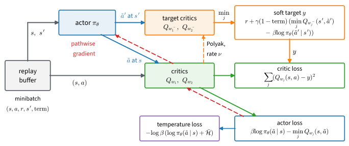

# Soft Actor-Critic
:label:`sec_sac`

At the end of :numref:`sec_deeprl` a policy network learned to swing a pendulum up and balance it, but only after a few hundred thousand environment steps. Each batch of 1,600 steps drove one update and was then thrown away. A simulator makes such steps cheap. A robot arm does not: every step takes real time, wears the hardware and risks breaking something. This section asks how an agent can learn the same controller from a few thousand steps.

Two ideas we have already met carry most of the gain. Replay, the buffer of past transitions that :numref:`sec_dqn` trained from, lets every transition drive many updates instead of one, provided a critic can learn from actions that an older policy chose. The pathwise gradient of :numref:`sec_deeprl` then moves the actor by differentiating that critic through the action itself. DDPG :cite:`Lillicrap.Hunt.Pritzel.ea.2016` combined the two with a deterministic actor and proved brittle, because an actor that climbs its critic also climbs the critic's errors. TD3 :cite:`Fujimoto.vanHoof.Meger.2018` traced much of this to the maximization bias of :numref:`subsec_dqn-max-bias` and trained two critics, trusting the lower one. Soft Actor-Critic (SAC) :cite:`Haarnoja.Zhou.Abbeel.ea.2018,Haarnoja.Zhou.Hartikainen.ea.2018` keeps both repairs and adds a third idea, the entropy reward of :numref:`sec_regularized`. The policy is paid for staying random, so an actor trained against its own critic keeps exploring instead of collapsing onto whichever action the critic currently prefers.

In one sentence, SAC adds the policy's entropy to the reward, learns the resulting value off-policy from replayed transitions, and moves the actor by differentiating the critic through its own sampled action. Two details need care. A torque confined to $[-2, 2]$ needs a bounded policy with a correct density, because the gradient now flows through the action. And the weight on entropy must suit the scale of the reward, so SAC learns it instead of fixing it. We derive the evaluation and improvement steps of the entropy-regularized objective, build and check the bounded policy, assemble the update, and then measure how many steps the pendulum needs and how far the critic's predictions can be trusted.

```{.python .input #sac-setup}
%%tab jax
# Deterministic XLA kernels. On an accelerator XLA otherwise picks each
# matrix product's kernel by timing candidates, and kernels that add in
# different orders differ in the last bits; training runs at large step
# sizes can turn such differences into different outcomes. JAX reads
# XLA_FLAGS once, when it starts, so this cell runs before the imports.
import os
os.environ['XLA_FLAGS'] = (os.environ.get('XLA_FLAGS', '') +
                           ' --xla_gpu_deterministic_ops=true').strip()
```

```{.python .input #sac-soft-actor-critic-1}
%%tab pytorch
import math
import numpy as np
import torch
from torch import nn
from torch.nn import functional as F
from d2l import torch as d2l
```

```{.python .input #sac-soft-actor-critic-1}
%%tab jax
import math
import numpy as np
import jax
from jax import numpy as jnp
from flax import nnx
import optax
from d2l import jax as d2l
```

```{.python .input #sac-soft-actor-critic-3}
%%tab pytorch
import copy
import gymnasium as gym
```

```{.python .input #sac-soft-actor-critic-3}
%%tab jax
import gymnasium as gym
```

```{.python .input #sac-soft-actor-critic-4}
%%tab pytorch
torch.set_num_threads(1)
```

The running example is Pendulum from :numref:`sec_deeprl`. A pendulum hangs from a motorized pivot. The agent observes $(\cos\vartheta, \sin\vartheta, \dot\vartheta)$, with $\vartheta$ the angle from upright, and applies a torque $u \in [-2, 2]$. Each step costs $\vartheta^2 + 0.1\,\dot\vartheta^2 + 0.001\,u^2$, so a pendulum hanging still at the bottom, $\vartheta = \pi$, costs $\pi^2 \approx 9.9$ per step, more than in any other resting position. An episode lasts 200 steps. Uniformly random torques return about $-1{,}200$, and a controller that swings up and balances returns about $-200$ or better. Every run below takes at most 20,000 environment steps, and every configuration is trained with three seeds; $c = 2$ is the action scale. Ranges of steps and statements about how often something happens across runs were checked over twenty runs per configuration.

```{.python .input #sac-soft-actor-critic-2}
%%tab pytorch, jax
num_env_steps, num_seeds, c = 20_000, 3, 2.0
```

## The Maximum-Entropy Objective

### Entropy as Reward

:numref:`sec_regularized` kept a policy near a fixed reference policy $\pi_{\textrm{ref}}$ by subtracting $\beta\, D_{\textrm{KL}}(\pi \Vert \pi_{\textrm{ref}})$ from the expected reward, where $\beta > 0$ weighs divergence against reward. When the reference is uniform over $|\mathcal{A}|$ actions, $D_{\textrm{KL}}(\pi \Vert \textrm{uniform}) = \log|\mathcal{A}| - H(\pi)$, with $H(\pi) = -\mathbb{E}_{a \sim \pi}[\log \pi(a)]$ the entropy of the policy. The penalty is then an entropy bonus plus a constant that no policy can change. The same holds for Pendulum's interval of torques: the uniform density on $[-2, 2]$ has entropy $\log 4 \approx 1.39$ nats, the largest of any density on that interval, and $\log 4$ takes the place of $\log|\mathcal{A}|$. SAC applies the bonus at every step:

$$
J(\pi) = \mathbb{E}_{\pi}\Big[ \sum_t \gamma^t \big( r_t + \beta\, H(\pi(\cdot \mid s_t)) \big) \Big].
$$
:eqlabel:`eq_maxent_objective`

The agent collects $\beta$ units of reward for every nat of entropy at every state it visits, so the *temperature* $\beta$ has units of reward per nat. We keep the letter $\beta$ of :numref:`sec_regularized`. The SAC papers write $\alpha$, which in this book is the step size of temporal-difference learning.

Unlike the optional entropy bonus in the actor loss of :numref:`sec_ppo`, this term is part of the objective. It changes the optimum, and the best policy stays random wherever several actions are nearly as good. For continuous actions $H$ is a differential entropy, the integral of $-\pi \log \pi$ over a density, and it is negative for a density concentrated on an interval shorter than one. Maximum-entropy reinforcement learning is older than deep learning :cite:`Ziebart.Maas.Bagnell.ea.2008`; SAC is its off-policy actor-critic.

Like the other methods of this chapter, SAC alternates two kinds of steps, as generalized policy iteration does (:numref:`fig_rl_gpi`): evaluation moves the value estimates toward those of the current policy, and improvement moves the policy toward the actions those estimates favor. The entropy changes both steps. A state with two actions shows how before any network appears.

### Two Actions by Hand

Take one state with two actions whose values are $Q = (1, 0)$, and let $\beta = 0.5$. :numref:`sec_regularized` showed that the KL-regularized optimum multiplies the reference by $e^{Q/\beta}$ and renormalizes, and that its value is $\beta \log Z$. With a uniform reference,

$$\pi^\star(a) = \frac{e^{Q(a)/\beta}}{Z}, \qquad Z = \sum_a e^{Q(a)/\beta}, \qquad \max_\pi \big(\mathbb{E}_\pi[Q] + \beta H(\pi)\big) = \beta \log Z.$$

Here $\pi^\star = (e^2, 1)/(e^2 + 1) = (0.88, 0.12)$. Its entropy is $0.37$ nats and $\mathbb{E}_{\pi^\star}[Q] = 0.88$, so the soft value is $0.88 + 0.5 \cdot 0.37 = 1.06$, which equals $0.5 \log(e^2 + 1)$. The soft value exceeds the hard maximum $1$: the tilted policy gives up $0.12$ of expected value and gains $0.18$ in entropy bonus. A second fact matters for what follows. The bracket $Q(a) - \beta \log \pi^\star(a)$ takes the same value for both actions, $1 + 0.5 \cdot 0.13$ and $0 + 0.5 \cdot 2.13$, both $1.06$. At the optimum, one sampled action gives the soft value without error. The following cell compares $\pi^\star$ with the uniform policy and with a nearly greedy one:

```{.python .input #sac-soft-evaluation-one-new-term-in-the-target}
%%tab pytorch, jax
Q, beta = np.array([1.0, 0.0]), 0.5
pi_star = np.exp(Q / beta) / np.exp(Q / beta).sum()   # the tilted optimum
for name, pi in (('tilted', pi_star), ('uniform', np.array([0.5, 0.5])),
                 ('nearly greedy', np.array([0.99, 0.01]))):
    bracket = Q - beta * np.log(pi)        # one sampled action's soft value
    print(f'{name:>13}: pi = {pi.round(2)}, E[Q] + beta H = '
          f'{pi @ bracket:.3f}, bracket = {bracket.round(2)}')
print(f'beta log Z = {beta * np.log(np.exp(Q / beta).sum()):.3f}')
```

The tilted policy attains $\beta \log Z = 1.063$, and both other policies fall short of it, the nearly greedy one at $1.018$ and the uniform one at $0.847$. Under them the bracket differs between the two actions, by one unit for the uniform policy, so a single sampled action gives a noisy estimate of their soft value. Only at the optimum is the estimate exact.

### Soft Policy Evaluation
:label:`subsec_sac-soft-evaluation`

The soft value of a state counts the entropy collected there along with the future reward, $V^\pi(s) = \mathbb{E}_{a \sim \pi}\big[Q^\pi(s, a) - \beta \log \pi(a \mid s)\big]$, where $Q^\pi(s, a)$ includes the entropy bonuses of all later states but not that of $s$ itself. The critic of :numref:`sec_actorcritic` regressed onto the one-step target $r + \gamma V(s')$, cut to $r$ at a terminal state. SAC's critic learns $Q$, so it needs the value of the next state in terms of $Q$, and it gets it from the identity above with one sampled action. Let $Q_{w^-}$ be a slowly changing copy of the critic $Q_w$, the target network of :numref:`sec_dqn`, which keeps the regression target from moving with every update. The target is

$$
y = r + \gamma\, \big(1 - \mathbf{1}(s' \textrm{ terminal})\big) \Big( Q_{w^-}(s', \tilde{a}') - \beta \log \pi_\theta(\tilde{a}' \mid s') \Big), \qquad \tilde{a}' \sim \pi_\theta(\cdot \mid s').
$$
:eqlabel:`eq_sac_target`

The one new term, $-\beta \log \pi_\theta(\tilde{a}' \mid s')$, is the entropy bonus at $s'$, estimated through the action just drawn. The transition $(s, a, r, s')$ comes from the replay buffer, but $\tilde{a}'$ is drawn fresh from the current policy, because $V^\pi$ is an expectation under the policy being evaluated. The buffer supplies what happened; the policy supplies what it would do next.

A single draw estimates the soft value of the current policy, so this step is soft policy evaluation. It is not the log-sum-exp backup of :numref:`sec_regularized`, which computes the value of the tilted optimum. The two agree only when the current policy is that optimum, where the bracket is the same for every action, as in the two-action case. Soft evaluation is ordinary policy evaluation for a reward augmented by the entropy bonus, so the argument of :numref:`sec_valueiter` applies: each application of the evaluation operator shrinks the largest error by the factor $\gamma$, and repeated application converges to $Q^\pi$. The argument needs bounded augmented rewards, so the entropies must be bounded as well as the rewards. That holds for finitely many actions, and for continuous policies whose density stays bounded, which we assume.

### Soft Policy Improvement
:label:`subsec_sac-soft-improvement`

The improvement step also comes from :numref:`sec_regularized`, which showed that the regularized objective of any policy falls short of the optimum's value by a KL divergence:

$$
\mathbb{E}_{\pi}[r] - \beta\, D_{\textrm{KL}}(\pi \Vert \pi_{\textrm{ref}}) = \beta \log Z - \beta\, D_{\textrm{KL}}(\pi \Vert \pi^\star),
$$
:eqlabel:`eq_sac_kl_identity`

where $\pi^\star \propto \pi_{\textrm{ref}}\, e^{r/\beta}$ is the tilted optimum. With $r$ replaced by $Q(s, \cdot)$ and a uniform reference, maximizing $\mathbb{E}_\pi[Q] + \beta H(\pi)$ at a state is the same as minimizing $D_{\textrm{KL}}\big(\pi \Vert e^{Q/\beta}/Z\big)$, since the two differ by $\beta \log Z$, which does not depend on $\pi$. A network policy usually cannot represent the tilted distribution, so SAC moves it toward the member of its family closest in this divergence, the *reverse-KL projection*. In this direction the divergence penalizes any mass the policy puts where $e^{Q/\beta}$ is small, so when the tilted distribution has two separated peaks a Gaussian settles on one of them instead of spreading over both (:numref:`subsec_kl_direction`). Writing the action as a differentiable function of noise gives the actor loss

$$
L_{\pi}(\theta) = \mathbb{E}_{s \sim \mathcal{D},\, z}\Big[ \beta \log \pi_\theta\big(\tilde{a}_\theta(s, z) \mid s\big) - Q_{w}\big(s, \tilde{a}_\theta(s, z)\big) \Big], \qquad \tilde{a}_\theta(s, z) = c \tanh\big(\mu_\theta(s) + \sigma_\theta(s)\, z\big),
$$
:eqlabel:`eq_sac_actor`

with $z \sim \mathcal{N}(0, I)$ and states drawn from the replay buffer $\mathcal{D}$. The loss is the negative soft value of a fresh action, so lowering it raises the critic's value and the entropy together; the squash $c \tanh$, which keeps the action in range, is the subject of the next part. Its gradient is the pathwise gradient of :numref:`sec_deeprl`. For a Gaussian action $a = \mu + \sigma z$, that gradient is $\nabla_\mu \mathbb{E}[Q(a)] = \mathbb{E}[Q'(\mu + \sigma z)]$: it differentiates through the action instead of weighting a score, and on that section's example its single-sample variance was $1.0$, against $21.75$ for the score function. It needs a critic that is differentiable in the action. With discrete actions one sums the expectation over the actions instead.

If each state's maximization were exact, the improvement step would raise the soft value everywhere.

**Proposition.** Let rewards and entropies be bounded, and let the family $\Pi$ contain $\pi_{\textrm{old}}$ and allow the policy at each state to be chosen independently, as a table does. If $\pi_{\textrm{new}}(\cdot \mid s)$ maximizes $\mathbb{E}_{a \sim \pi}\big[ Q^{\pi_{\textrm{old}}}(s, a) \big] + \beta H(\pi(\cdot \mid s))$ over $\Pi$ at every $s$, then $V^{\pi_{\textrm{new}}} \geq V^{\pi_{\textrm{old}}}$ everywhere.

**Proof.** Write $H_t$ for the entropy of $\pi_{\textrm{new}}$ at $s_t$. Because $\pi_{\textrm{old}} \in \Pi$, optimality at $s_0 = s$, followed by $Q^{\pi_{\textrm{old}}}(s, a) = r(s, a) + \gamma\, \mathbb{E}[V^{\pi_{\textrm{old}}}(s_1)]$, gives

$$
V^{\pi_{\textrm{old}}}(s) \leq \mathbb{E}_{a \sim \pi_{\textrm{new}}}\big[ Q^{\pi_{\textrm{old}}}(s, a) - \beta \log \pi_{\textrm{new}}(a \mid s) \big] = \mathbb{E}_{\pi_{\textrm{new}}}\big[ r_0 + \beta H_0 + \gamma\, V^{\pi_{\textrm{old}}}(s_1) \big].
$$

Applying the same inequality to $V^{\pi_{\textrm{old}}}(s_1)$, then to $V^{\pi_{\textrm{old}}}(s_2)$, and so on $n$ times, gives $V^{\pi_{\textrm{old}}}(s) \leq \mathbb{E}_{\pi_{\textrm{new}}}\big[ \sum_{t < n} \gamma^t (r_t + \beta H_t) \big] + \gamma^n\, \mathbb{E}\big[V^{\pi_{\textrm{old}}}(s_n)\big]$. Values are bounded, so the last term vanishes as $n \to \infty$, and the sum tends to $V^{\pi_{\textrm{new}}}(s)$. $\blacksquare$

SAC takes one gradient step on each loss while the critic is still learning, so the proposition describes the exact algorithm, not the loop we run; :citet:`Haarnoja.Zhou.Abbeel.ea.2018` give the full argument in their Appendix B.

## The Squashed Gaussian Policy

### Clipping and the Pathwise Gradient

The Gaussian policy of :numref:`sec_deeprl` drew an unbounded torque and let the environment clip it to $[-2, 2]$. That did no harm to the score-function estimator, which never differentiates through the action. SAC's pathwise estimator does, and clipping causes two problems. Outside the interval the clip's derivative is zero, so a sample beyond a boundary gives the actor no gradient, even at states where the boundary torque is the best action. And clipping moves all the probability beyond each boundary onto the boundary itself, so the clipped distribution has no density there and $\log \pi$ in :eqref:`eq_sac_target` and :eqref:`eq_sac_actor` is undefined. A bounded distribution with a smooth, invertible map from a Gaussian removes both problems.

### The Tanh Change of Variables

Draw $u \sim \mathcal{N}\big(\mu_\theta(s), \sigma_\theta(s)^2\big)$ and squash it, $a = c \tanh u$. The map is smooth and increasing, so a short interval around $u$ and its image around $a$ have the same probability, and the image is shorter by the factor $da/du = c\,(1 - \tanh^2 u)$. The density of $a$ is therefore the Gaussian density divided by this factor, coordinate by coordinate:

$$
\log \pi(a \mid s) = \sum_i \Big[ \log \mathcal{N}\big(u_i;\, \mu_i, \sigma_i\big) - \log\big(1 - \tanh^2 u_i\big) - \log c \Big].
$$
:eqlabel:`eq_tanh_logdet`

Each term of the sum corrects the Gaussian log-density for the compression of one coordinate. :numref:`fig_rl_squashed_density` shows the effect for one mean and spread. Near $a = 2$ the squash packs the whole upper tail of $u$ into a short interval of actions, so the density rises there. Without the correction the expression misses this compression and integrates to $1.13$ instead of $1$.


:label:`fig_rl_squashed_density`

The $\log c$ term does not change the actor's gradient, but it shifts every log-density, and with it the reported entropy and the term $\beta \log \pi$ of the target, by $\log 2 \approx 0.69$ nats. We keep it, so that the reported entropies are those of the actual torque distribution.

The policy network is the `GaussianHead` of :numref:`sec_deeprl`. A *trunk* computes features, a linear layer maps them to the mean $\mu_\theta(s)$, and with `state_std=True` a second linear layer gives $\log \sigma_\theta(s)$, clamped to $[-5, 2]$. SAC needs a spread that depends on the state, because its entropy bonus is paid at every state: a pendulum balancing at the top needs a narrow policy, while one being swung up can use a wide one, and a single shared $\sigma$ cannot provide both. For the trunk we use two ReLU layers of 64 units, the shape of the critics below, in place of the single tanh layer of :numref:`sec_deeprl`; published SAC implementations use the same shape with 256 units. The clamp never binds in our runs, where $\log \sigma$ stays above about $-3.5$, and removing it does not change their outcome. We keep it as a guard: it keeps $\sigma$ away from zero, so that $\log\pi$ in the target cannot blow up through a collapsing spread. It does not bound the entropy of the squashed action, which a mean far past the squash still drives down. Common implementations clamp to $[-20, 2]$.

`SquashedGaussianPolicy` wraps the head. `sample` draws $u = \mu + \sigma z$ and returns the squashed action with its log-probability, both differentiable, for the losses. `log_prob_u` evaluates :eqref:`eq_tanh_logdet` from the pre-squash $u$ that the sampler keeps, so no inverse hyperbolic tangent appears on the differentiable path. `act` draws a NumPy action for the environment, `act_logp` returns such an action with its log-probability, for the measurements at the end of this section, and both take their sample $u$ from `_draw`; `act_greedy` returns the squashed mean $c \tanh \mu_\theta(s)$. The class is saved to the library because the next section reuses it.

```{.python .input #sac-the-change-of-variables}
%%tab pytorch
class SquashedGaussianPolicy(nn.Module):  #@save
    """d2l.GaussianHead with SAC's network (two ReLU layers and a
    state-dependent standard deviation), squashed through
    a = scale * tanh(u)."""
    def __init__(self, obs_dim, act_dim, hidden=64, scale=2.0, seed=None):
        super().__init__()
        with d2l.seeded(seed):
            trunk = nn.Sequential(nn.Linear(obs_dim, hidden), nn.ReLU(),
                                  nn.Linear(hidden, hidden), nn.ReLU())
            self.policy = d2l.GaussianHead(obs_dim, act_dim, hidden,
                                           state_std=True, trunk=trunk)
        self.scale = scale

    def log_prob_u(self, u, mean, std):
        """log pi at a = scale tanh(u), from the pre-squash u the sampler
        keeps."""
        logdet = 2 * (np.log(2) - u - nn.functional.softplus(-2 * u))
        return (torch.distributions.Normal(mean, std).log_prob(u)
                - logdet - np.log(self.scale)).sum(-1)

    def sample(self, obs):
        """A reparameterized action and its log-probability, differentiable."""
        mean, std = self.policy(obs)
        u = mean + std * torch.randn_like(std)
        return self.scale * torch.tanh(u), self.log_prob_u(u, mean, std)

    @torch.inference_mode()
    def _draw(self, obs, rng):
        """A pre-squash sample u with the head's mean and std, from numpy
        states and the noise of rng."""
        mean, std = self.policy(torch.as_tensor(obs))
        noise = rng.standard_normal(mean.shape, dtype=np.float32)
        return mean + std * torch.as_tensor(noise), mean, std

    def act(self, obs, rng):
        """A sampled action, numpy in and out."""
        return self.scale * np.tanh(self._draw(obs, rng)[0].numpy())

    @torch.inference_mode()
    def act_logp(self, obs, rng):
        """A sampled action and its log-probability, numpy in and out."""
        u, mean, std = self._draw(obs, rng)
        return (self.scale * np.tanh(u.numpy()),
                self.log_prob_u(u, mean, std).numpy())

    @torch.inference_mode()
    def act_greedy(self, obs, rng=None):
        """The squashed mean scale * tanh(mean), numpy in and out."""
        mean = self.policy(torch.as_tensor(obs))[0].numpy()
        return self.scale * np.tanh(mean)
```

```{.python .input #sac-the-change-of-variables}
%%tab jax
class SquashedGaussianPolicy(nnx.Module):  #@save
    """d2l.GaussianHead with SAC's network (two ReLU layers and a
    state-dependent standard deviation), squashed through
    a = scale * tanh(u)."""
    def __init__(self, obs_dim, act_dim, hidden=64, scale=2.0, seed=None):
        rngs = nnx.Rngs(d2l.get_key() if seed is None else seed)
        trunk = nnx.Sequential(
            d2l.Linear(obs_dim, hidden, rngs=rngs), jax.nn.relu,
            d2l.Linear(hidden, hidden, rngs=rngs), jax.nn.relu)
        self.policy = d2l.GaussianHead(obs_dim, act_dim, hidden,
                                       state_std=True, trunk=trunk, rngs=rngs)
        self.scale = scale

    def log_prob_u(self, u, mean, std):
        """log pi at a = scale tanh(u), from the pre-squash u the sampler
        keeps."""
        logdet = 2 * (jnp.log(2.0) - u - jax.nn.softplus(-2 * u))
        return (jax.scipy.stats.norm.logpdf(u, mean, std)
                - logdet - jnp.log(self.scale)).sum(-1)

    def sample(self, obs, key):
        """A reparameterized action and its log-probability, differentiable."""
        mean, std = self.policy(obs)
        u = mean + std * jax.random.normal(key, std.shape)
        return self.scale * jnp.tanh(u), self.log_prob_u(u, mean, std)

    def _draw(self, obs, rng):
        """A pre-squash sample u with the head's mean and std, from numpy
        states and the noise of rng."""
        mean, std = d2l.forward_np(self.policy, obs)   # compiled forward
        noise = rng.standard_normal(mean.shape, dtype=np.float32)
        return mean + std * noise, mean, std

    def act(self, obs, rng):
        """A sampled action, numpy in and out."""
        return self.scale * np.tanh(self._draw(obs, rng)[0])

    def act_logp(self, obs, rng):
        """A sampled action and its log-probability, numpy in and out."""
        u, mean, std = self._draw(obs, rng)
        return (self.scale * np.tanh(u),
                np.asarray(self.log_prob_u(u, mean, std)))

    def act_greedy(self, obs, rng=None):
        """The squashed mean scale * tanh(mean), numpy in and out."""
        return self.scale * np.tanh(d2l.forward_np(self.policy, obs)[0])
```

:begin_tab:`jax`
`_draw`, which `act` and `act_logp` share, and `act_greedy` run the head through `d2l.forward_np`, which compiles one forward pass per network and reads the current parameters at each call (:numref:`sec_utils`), so acting one state at a time needs no recompilation after an update.
:end_tab:

Inside `log_prob_u` the Gaussian and Jacobian terms are summed over the action coordinates before any average over the batch. Summing one and averaging the other gives the right answer for Pendulum's single coordinate and a wrong one for every larger action space.

### A Numerically Stable Log-Determinant

The direct form `log(1 - tanh(u)**2)` subtracts two nearly equal numbers once $\tanh u$ is close to $1$, and it fails when float32 rounds $\tanh u$ to exactly $1$. Since $1 - \tanh^2 u = 4 e^{-2u} / (1 + e^{-2u})^2$, taking logarithms gives

$$
\log\big(1 - \tanh^2 u\big) = 2\, \big( \log 2 - u - \operatorname{softplus}(-2u) \big),
$$
:eqlabel:`eq_tanh_logdet_stable`

an identity that holds for every $u$ and involves no subtraction of nearly equal numbers; `log_prob_u` uses it. The following float32 calculation compares the direct form, a common guarded version that adds $10^{-6}$, and the stable form:

```{.python .input #sac-the-stable-form-and-what-the-epsilon-hides-1}
%%tab pytorch, jax
u = np.float32([0, 3, 8, 10, 20])
t = np.tanh(u)
with np.errstate(divide='ignore'):
    naive = np.log(1 - t ** 2)
guarded = np.log(1 - t ** 2 + np.float32(1e-6))
stable = 2 * (np.log(np.float32(2)) - u - np.logaddexp(np.float32(0), -2 * u))
print(f'{"u":>4} {"naive":>10} {"guarded":>10} {"stable":>10}')
for row in zip(u, naive, guarded, stable):
    print(f'{row[0]:4.0f} {row[1]:10.4f} {row[2]:10.4f} {row[3]:10.4f}')
```

The direct form is already slightly off at $u = 8$, where float32 has few digits left for $1 - \tanh^2 u$, and it is $-\infty$ from $u = 10$ on. The guard avoids the infinity, but it is more than a nat too high at $u = 8$ and stays at $\log 10^{-6} = -13.8155$ from $u = 10$ on, so it no longer registers further saturation. The reported entropy and the entropy term of :eqref:`eq_sac_actor` then go wrong while the return curve looks normal.

Normalization gives a second, independent check of the change of variables. We evaluate the density on a fine grid of actions, invert the squash on that grid, and integrate :eqref:`eq_tanh_logdet` by the trapezoid rule, with and without the Jacobian term:

```{.python .input #sac-the-stable-form-and-what-the-epsilon-hides-2}
%%tab pytorch, jax
def squashed_logp(a, mu, sigma, logdet=True):
    up = np.arctanh(a / c)          # only here: the training path keeps u
    lp = (-0.5 * ((up - mu) / sigma) ** 2 - np.log(sigma)
          - 0.5 * np.log(2 * np.pi))
    if logdet:
        lp -= 2 * (np.log(2) - up - np.logaddexp(0, -2 * up)) + np.log(c)
    return lp

a_grid = np.linspace(-c + 1e-6, c - 1e-6, 200_001)
for m, s in ((0.0, 0.5), (0.7, 0.8)):
    w = np.trapezoid(np.exp(squashed_logp(a_grid, m, s)), a_grid)
    wo = np.trapezoid(np.exp(squashed_logp(a_grid, m, s, False)), a_grid)
    print(f'mu = {m}, sigma = {s}: integrates to {w:.6f} with the '
          f'log-det, {wo:.3f} without')
```

With the correction the density integrates to $1.000000$ at both settings; without it the integrals are $1.65$ and $1.13$. This error would barely change the return on Pendulum while making every reported entropy wrong, and the check finds it without any training. The grid stops $10^{-6}$ short of $\pm c$, where $\operatorname{arctanh}$ is infinite, which is why the check uses moderate $\sigma$.

## The Algorithm

### Twin Critics and Polyak Targets

The maximum of noisy estimates is biased upward (:numref:`subsec_dqn-max-bias`): two independent estimates of the same value, each off by zero-mean noise of standard deviation $\sigma$, have a maximum that exceeds the value by about $0.56\sigma$ on average. An actor that climbs its critic's gradient does the same thing continuously. It moves toward actions whose value the critic happens to overestimate, and the bootstrap carries the error into the next target. Following TD3, SAC trains two critics $Q_{w_1}$ and $Q_{w_2}$ from different initializations and uses their pointwise minimum in the target,

$$
y = r + \gamma\, \big(1 - \mathbf{1}(s' \textrm{ terminal})\big) \Big( \min_{j=1,2} Q_{w_j^-}(s', \tilde{a}') - \beta \log \pi_\theta(\tilde{a}' \mid s') \Big),
$$
:eqlabel:`eq_sac_target_twin`

and in the actor loss :eqref:`eq_sac_actor`, where $\min_j Q_{w_j}$ replaces $Q_w$. Both critics regress onto the same target $y$. Where they disagree, the minimum believes the lower one, so it is a deliberately pessimistic estimate. At the end of this section we measure what this pessimism costs and what it prevents.

Each critic has a target copy $w_j^-$, as in DQN, but the copy is not overwritten every 250 environment steps as in :numref:`sec_dqn`. After every update it moves a small fraction $\nu$ of the way toward the online weights:

$$w_j^- \leftarrow \nu\, w_j + (1 - \nu)\, w_j^-, \qquad \nu = 0.005.$$

This *Polyak averaging* is an exponential moving average with a half-life of $\ln 2/\nu \approx 139$ updates, so the regression target drifts slowly instead of standing still and then jumping. Only the critics have copies. The action $\tilde{a}'$ in the target comes from the current policy, and the target needs no extra smoothing of that action, because a stochastic policy averages its own targets over its spread. :numref:`fig_rl_sac_update` shows how the pieces of one update connect.

![One SAC update. Top row: the soft target $y$, computed by the target critics at a fresh action $\tilde a'$ drawn from the current actor at $s'$ (the minimum of the two, less $\beta \log \pi_\theta(\tilde a' \mid s')$). Middle row: the critics regress $Q_{w_j}(s, a)$ onto $y$. Bottom row: the actor loss reaches the actor through the critics and the fresh action $\tilde a$ (red, the pathwise gradient), and the temperature has a loss of its own on the same log-probability; the dashed orange arrow is the Polyak update, the only edge that writes into the target critics.](../img/mdl-rl-sac-update.svg)
:label:`fig_rl_sac_update`

### Automatic Temperature
:label:`subsec_sac-temperature`

A fixed $\beta$ fixes an exchange rate between reward and entropy, and the right rate depends on the units of the reward. Multiplying every reward by $10$ has the same effect on the optimal policy as dividing $\beta$ by $10$ (exercise :exref:`ex_sac-quadratic-critic`), so a temperature tuned for one task is wrong for the same task measured in other units. The second SAC paper :cite:`Haarnoja.Zhou.Hartikainen.ea.2018` fixes the entropy instead. It asks for the best policy whose entropy at the visited states is at least a target $\bar H$,

$$\max_\pi \; \mathbb{E}_\pi\Big[\sum_t \gamma^t r_t\Big] \quad \textrm{subject to} \quad \mathbb{E}_{s}\big[H(\pi(\cdot \mid s))\big] \geq \bar H,$$

and treats $\beta$ as the Lagrange multiplier of the constraint. The common choice is $\bar H = -\dim \mathcal{A}$, here $-1$ nat. The multiplier is learned by gradient descent on

$$J(\beta) = -\log\beta \; \mathbb{E}_{s \sim \mathcal{D},\, a \sim \pi_\theta}\big[\log \pi_\theta(a \mid s) + \bar H\big],$$

whose derivative with respect to $\log\beta$ is $\hat H - \bar H$, the excess of the batch's entropy estimate $\hat H = -\mathbb{E}[\log \pi_\theta]$ over the target. A step therefore lowers $\beta$ while the policy is more random than the target, which makes randomness cheaper to give up, and raises $\beta$ while it is less random. We learn $\log\beta$ so that $\beta$ stays positive, start from $\beta = 1$, the default of common implementations, and use Adam at the learning rate of the networks, $3 \times 10^{-4}$. Adam moves a parameter by about its learning rate per step while the gradient keeps its sign, so as long as the entropy stays above the target, $\log \beta$ falls by about $3 \times 10^{-4}$ per update. After 6,000 updates that predicts $\beta \approx e^{-1.8} \approx 0.17$, which we will compare with the measured trace.

The first SAC paper already trained two critics, together with a separate network for the state value. The algorithm built here has no value network and learns its temperature, as in the second paper; it is the version common implementations use.

### The Update Step and the Loop

The replay buffer of :numref:`sec_dqn`, `d2l.ReplayBuffer`, keeps transitions $(s, a, r, s', \textrm{term})$ in preallocated arrays. `add` stores one transition and overwrites the oldest once the buffer is full, and `sample` draws a batch uniformly and returns it as a `d2l.Batch`. Its action column holds integers. `ReplayBufferC` widens that column to float vectors and changes nothing else. Like the policy, it is saved because the next section reuses it.

```{.python .input #sac-nothing-here-needs-a-ratio-1}
%%tab pytorch, jax
class ReplayBufferC(d2l.ReplayBuffer):  #@save
    """d2l.ReplayBuffer with the action column widened to float vectors."""
    def __init__(self, capacity, obs_dim, act_dim):
        super().__init__(capacity, obs_dim)
        self.act = np.zeros((capacity, act_dim), np.float32)
```

SAC learns off-policy without importance ratios. The critic target :eqref:`eq_sac_target_twin` does not depend on the policy that collected the transition, because the next action is drawn fresh, and the actor loss draws its own actions too. Replay still changes the distribution of states over which the losses are averaged, since buffer states were visited by older policies, and no ratio of action probabilities corrects for that.

The `ActorCritic` container of :numref:`sec_deeprl`, a policy with one state-value network and its optimizer, does not fit SAC, which has action-value critics, their target copies and a temperature. `SoftActorCritic` holds the actor, a list of critics and a list of target copies, $\log\beta$, and one Adam optimizer each for the actor, the critics and $\log\beta$. With `beta=None` the temperature is learned, starting from $\beta = 1$; a number fixes it. `beta` returns the temperature as a scalar array. `min_q` evaluates the minimum over a list of critics, the online ones by default, and `q_np` does the same on NumPy inputs for the measurements at the end.

```{.python .input #sac-nothing-here-needs-a-ratio-2}
%%tab pytorch
class SoftActorCritic:
    """One actor, a list of action-value critics, their frozen copies, and
    the temperature beta = exp(log_beta), learned if beta is None."""
    def __init__(self, actor, qs, targets, lr, beta=None):
        self.actor, self.qs, self.targets = actor, qs, targets
        self.opt_pi = torch.optim.Adam(actor.parameters(), lr=lr)
        self.opt_q = torch.optim.Adam(
            [p for q in qs for p in q.parameters()], lr=lr)
        start = 1.0 if beta is None else beta   # a learned beta starts at 1
        self.log_beta = torch.tensor(float(np.log(start)),
                                     requires_grad=beta is None)
        self.opt_beta = (torch.optim.Adam([self.log_beta], lr=lr)
                         if beta is None else None)

    @property
    def beta(self):
        """The temperature exp(log_beta), a scalar tensor without gradient."""
        return self.log_beta.detach().exp()

    def min_q(self, obs, act, nets=None):
        """min_j Q_j(s, a) over the online critics, or over `nets`."""
        x = torch.cat([obs, act], -1)
        return torch.min(torch.stack(
            [q(x).squeeze(-1) for q in (self.qs if nets is None else nets)]),
            0).values

    def q_np(self, obs, act):
        """min_j Q_j(s, a), numpy in and out."""
        with torch.inference_mode():
            return self.min_q(torch.as_tensor(obs),
                              torch.as_tensor(act)).numpy()
```

```{.python .input #sac-nothing-here-needs-a-ratio-2}
%%tab jax
class SoftActorCritic(nnx.Module):
    """One actor, a list of action-value critics, their frozen copies, and
    the temperature beta = exp(log_beta), learned if beta is None."""
    def __init__(self, actor, qs, targets, lr, beta=None):
        self.actor = actor
        self.qs, self.targets = nnx.List(qs), nnx.List(targets)
        self.opt_pi = nnx.Optimizer(actor, optax.adam(lr), wrt=nnx.Param)
        self.opt_q = nnx.Optimizer(self.qs, optax.adam(lr), wrt=nnx.Param)
        self.learn_beta = beta is None
        start = 1.0 if beta is None else beta   # a learned beta starts at 1
        self.temp = nnx.Dict(log_beta=nnx.Param(jnp.log(start)))
        self.opt_beta = nnx.Optimizer(self.temp, optax.adam(lr),
                                      wrt=nnx.Param)

    @property
    def beta(self):
        """The temperature exp(log_beta), a scalar array."""
        return jnp.exp(self.temp.log_beta[...])

    def min_q(self, obs, act, nets=None):
        """min_j Q_j(s, a) over the online critics, or over `nets`."""
        nets = self.qs if nets is None else nets
        x = jnp.concatenate([obs, act], -1)
        return jnp.min(jnp.stack([q(x).squeeze(-1) for q in nets]), 0)

    def q_np(self, obs, act):
        """min_j Q_j(s, a), numpy in and out, through compiled forwards."""
        x = np.concatenate([obs, act], -1)
        return np.min([d2l.forward_np(q, x) for q in self.qs], 0)[..., 0]
```

`make_critic` builds one critic, a network from the concatenated state and action to one number, with two ReLU layers of 64 units. `make_sac` builds an agent whose target copies start equal to their critics.

```{.python .input #sac-the-update-step-and-the-loop-1}
%%tab pytorch
def make_critic(in_dim):
    """Q(s, a) from the concatenated state and action."""
    return nn.Sequential(nn.Linear(in_dim, 64), nn.ReLU(),
                         nn.Linear(64, 64), nn.ReLU(), nn.Linear(64, 1))

def make_sac(seed, obs_dim, act_dim, num_critics=2, lr=3e-4, beta=None):
    """A seeded agent whose target critics start as copies of the critics."""
    torch.manual_seed(seed)
    actor = SquashedGaussianPolicy(obs_dim, act_dim)
    qs = [make_critic(obs_dim + act_dim) for _ in range(num_critics)]
    return SoftActorCritic(actor, qs, [copy.deepcopy(q) for q in qs], lr,
                           beta)
```

```{.python .input #sac-the-update-step-and-the-loop-1}
%%tab jax
def make_critic(in_dim, *, rngs):
    """Q(s, a) from the concatenated state and action."""
    return nnx.Sequential(d2l.Linear(in_dim, 64, rngs=rngs), jax.nn.relu,
                          d2l.Linear(64, 64, rngs=rngs), jax.nn.relu,
                          d2l.Linear(64, 1, rngs=rngs))

def make_sac(seed, obs_dim, act_dim, num_critics=2, lr=3e-4, beta=None):
    """A seeded agent whose target critics start as copies of the critics."""
    rngs = nnx.Rngs(seed)          # one stream: the actor's key, then critics
    actor = SquashedGaussianPolicy(obs_dim, act_dim, seed=rngs())
    qs = [make_critic(obs_dim + act_dim, rngs=rngs)
          for _ in range(num_critics)]
    return SoftActorCritic(actor, qs, [nnx.clone(q) for q in qs], lr, beta)
```

One update follows :numref:`fig_rl_sac_update`, and three functions hold its losses. `soft_target` computes the target :eqref:`eq_sac_target_twin` at a fresh action from the live policy; it is data for the regression, so no gradient flows into it. `critic_loss` regresses every critic onto that one target, and `actor_loss` is :eqref:`eq_sac_actor` with the minimum of the critics, at a fresh reparameterized action; it also returns the log-probabilities, which the temperature's loss reuses.

```{.python .input #sac-the-update-step-and-the-loop-2}
%%tab pytorch
def soft_target(agent, rew, next_obs, term, beta, gamma):
    """eq_sac_target_twin at a fresh action from the live policy."""
    with torch.no_grad():                     # the critic target is data
        a2, logp2 = agent.actor.sample(next_obs)
        return rew + gamma * (1 - term) * (
            agent.min_q(next_obs, a2, agent.targets) - beta * logp2)

def critic_loss(qs, obs, act, y):
    """Squared error of every critic against the one shared target y."""
    x = torch.cat([obs, act], -1)
    return sum(((q(x).squeeze(-1) - y) ** 2).mean() for q in qs)

def actor_loss(actor, min_q, obs, beta):
    """beta log pi - min_j Q_j at a fresh reparameterized action; also
    returns log pi."""
    a, logp = actor.sample(obs)
    return (beta * logp - min_q(obs, a)).mean(), logp
```

```{.python .input #sac-the-update-step-and-the-loop-2}
%%tab jax
def soft_target(agent, rew, next_obs, term, beta, gamma, key):
    """eq_sac_target_twin at a fresh action from the live policy."""
    a2, logp2 = agent.actor.sample(next_obs, key)
    return rew + gamma * (1 - term) * (
        agent.min_q(next_obs, a2, agent.targets) - beta * logp2)

def critic_loss(qs, obs, act, y):
    """Squared error of every critic against the one shared target y."""
    x = jnp.concatenate([obs, act], -1)
    return sum(((q(x).squeeze(-1) - y) ** 2).mean() for q in qs)

def actor_loss(actor, min_q, obs, beta, key):
    """beta log pi - min_j Q_j at a fresh reparameterized action; also
    returns log pi."""
    a, logp = actor.sample(obs, key)
    return (beta * logp - min_q(obs, a)).mean(), logp
```

`sac_step` performs the update. The critics take one step on `critic_loss`, then the actor takes one step on `actor_loss`. If the agent learns $\beta$, the temperature takes one step on $J(\beta)$ with the actor's log-probabilities. Finally the target critics move by $\nu$, called `polyak` in the code. The step returns the batch mean of $\log\pi_\theta$, whose negative estimates the policy's entropy, and leaves it on the device, so that the training loop does not wait for every update.

```{.python .input #sac-one-update-1}
%%tab pytorch
def descend(opt, loss):
    """One optimizer step on a loss."""
    opt.zero_grad()
    loss.backward()
    opt.step()

def sac_step(agent, obs, act, rew, next_obs, term, gamma, polyak,
             target_entropy):
    """One SAC update: soft critic regression, pathwise actor step, Polyak
    averaging, and, if the agent learns beta, one temperature step toward
    the target entropy. Returns the batch mean of log pi."""
    beta = agent.beta
    y = soft_target(agent, rew, next_obs, term, beta, gamma)
    descend(agent.opt_q, critic_loss(agent.qs, obs, act, y))
    loss_pi, logp = actor_loss(agent.actor, agent.min_q, obs, beta)
    descend(agent.opt_pi, loss_pi)
    if agent.opt_beta is not None:   # entropy above target: beta falls
        descend(agent.opt_beta, -agent.log_beta * (logp.detach().mean()
                                                   + target_entropy))
    with torch.no_grad():                     # Polyak: the drifting copy
        for q, tnet in zip(agent.qs, agent.targets):
            for pt, pq in zip(tnet.parameters(), q.parameters()):
                pt.lerp_(pq, polyak)
    return logp.detach().mean()
```

```{.python .input #sac-one-update-1}
%%tab jax
@nnx.jit
def sac_step(agent, obs, act, rew, next_obs, term, key, gamma, polyak,
             target_entropy):
    """One SAC update: soft critic regression, pathwise actor step, Polyak
    averaging, and, if the agent learns beta, one temperature step toward
    the target entropy. Returns the batch mean of log pi."""
    k1, k2 = jax.random.split(key)
    beta = agent.beta
    y = soft_target(agent, rew, next_obs, term, beta, gamma, k1)
    agent.opt_q.update(agent.qs, nnx.grad(critic_loss)(agent.qs, obs, act, y))
    grads, logp = nnx.grad(actor_loss, has_aux=True)(agent.actor,
                                                     agent.min_q, obs, beta, k2)
    agent.opt_pi.update(agent.actor, grads)
    if agent.learn_beta:          # entropy above target: beta falls
        grads = nnx.grad(lambda temp: -temp.log_beta[...] * (
            logp.mean() + target_entropy))(agent.temp)
        agent.opt_beta.update(agent.temp, grads)
    for q, tnet in zip(agent.qs, agent.targets):   # Polyak: the drifting copy
        nnx.update(tnet, optax.incremental_update(
            nnx.state(q, nnx.Param), nnx.state(tnet, nnx.Param), polyak))
    return logp.mean()
```

:begin_tab:`pytorch`
`descend` takes one optimizer step on a loss; `lerp_` moves each target weight a fraction `polyak` of the way toward its critic's.
:end_tab:

:begin_tab:`jax`
`sac_step` is compiled with `nnx.jit`, so it takes the batch's arrays and a random key instead of a `d2l.Batch`. `nnx.grad` differentiates each loss with respect to its first argument, the critics or the actor; the target `y` enters the critics' loss as data. The batch shape never changes, so the step compiles once. `optax.incremental_update` computes the Polyak average of each critic's parameters and those of its copy.
:end_tab:

`train_sac` runs one agent on Pendulum. The first `warmup` steps take uniformly random torques; after that the actor acts, and every environment step is followed by `utd` updates. This *update-to-data ratio* is the number of gradient steps taken per environment step. The loop stores `terminated`, not `truncated`. Pendulum never terminates and its episodes end only at the 200-step time limit, so the stored flag is always zero and the critic bootstraps across the cut, as a time limit requires (:numref:`sec_deeprl`). At the end of each episode the loop yields the step count, the episode's return, the mean of $-\log\pi_\theta$ over the episode's updates as an estimate of the entropy, and the current $\beta$. The update ratio and the buffer are arguments so that every experiment below uses this one loop, which is the off-policy loop of `train_dqn` in :numref:`sec_dqn` with continuous actions. `make_update` binds `sac_step` to the agent and turns a sampled `d2l.Batch` into arrays. It also seeds the run's sampling noise, so a run gives the same result whether it runs alone or after others.

```{.python .input #sac-one-update-2}
%%tab pytorch
def make_update(agent, seed, **hp):
    """sac_step bound to the agent, on a d2l.Batch; seeds this run's
    sampling noise."""
    torch.manual_seed(seed)
    def update(b):
        return sac_step(agent, *map(torch.as_tensor, (
            b.obs, b.act, b.rew, b.next_obs, b.term)), **hp)
    return update
```

```{.python .input #sac-one-update-2}
%%tab jax
def make_update(agent, seed, **hp):
    """sac_step bound to the agent, on a d2l.Batch; every update folds its
    count into this run's key, for fresh sampling noise."""
    step_fn = nnx.cached_partial(sac_step, agent)
    key, n = jax.random.key(seed), 0
    def update(b):
        nonlocal n
        n += 1
        return step_fn(*map(jnp.asarray, (b.obs, b.act, b.rew, b.next_obs,
                                          b.term)),
                       jax.random.fold_in(key, n), **hp)
    return update
```

:begin_tab:`jax`
`nnx.cached_partial` binds the agent to the compiled step once, so the loop does not traverse the agent's modules at every call.
:end_tab:

```{.python .input #sac-the-update-step-and-the-loop-3}
%%tab pytorch, jax
def train_sac(seed, agent, buffer, num_env_steps, utd=1, warmup=1_000,
              batch_size=256, gamma=0.99, polyak=0.005, target_entropy=-1.0):
    """SAC on Pendulum: `warmup` uniformly random steps, then `utd` updates
    per environment step. Yields (env step, episode return, policy
    entropy, beta) at the end of every episode."""
    update = make_update(agent, seed, gamma=gamma, polyak=polyak,
                         target_entropy=target_entropy)
    rng, env = np.random.default_rng(seed), gym.make('Pendulum-v1')
    scale, act_dim = agent.actor.scale, buffer.act.shape[1]
    obs, ep_return = env.reset(seed=seed)[0], 0.0
    logp_sum, n_upd = 0.0, 0
    for t in range(1, num_env_steps + 1):
        a = (rng.uniform(-scale, scale, act_dim).astype(np.float32)
             if t <= warmup else agent.actor.act(obs, rng))
        next_obs, rew, terminated, truncated, _ = env.step(a)
        buffer.add(obs, a, rew, next_obs, float(terminated))
        obs, ep_return = next_obs, ep_return + rew
        for _ in range(utd if t >= warmup else 0):
            logp_sum = logp_sum + update(buffer.sample(batch_size, rng))
            n_upd += 1
        if terminated or truncated:   # read the device sum once per episode
            yield (t, ep_return, float(-logp_sum / n_upd) if n_upd else np.nan,
                   float(agent.beta))
            obs, ep_return = env.reset()[0], 0.0
            logp_sum, n_upd = 0.0, 0
```

`run_arm` trains one configuration on several seeds and keeps the agents for later measurements. Its buffer holds every transition of a run. We start with two configurations of twin critics and a learned temperature: one update per environment step for 20,000 steps, and ten updates per step for 4,000 steps.

```{.python .input #sac-one-update-3}
%%tab pytorch, jax
def run_arm(seeds, num_env_steps, utd=1, num_critics=2, beta=None):
    """Train one SAC configuration per seed. Returns the agents and, per
    seed, an array of per-episode rows (step, return, entropy, beta)."""
    agents = [make_sac(seed, 3, 1, num_critics, beta=beta) for seed in seeds]
    runs = [np.array(list(train_sac(seed, agent,
                                    ReplayBufferC(num_env_steps, 3, 1),
                                    num_env_steps, utd=utd)))
            for seed, agent in zip(seeds, agents)]
    return agents, runs

seeds, agents, runs = range(num_seeds), {}, {}
agents['UTD 1'], runs['UTD 1'] = run_arm(seeds, num_env_steps)
agents['UTD 10'], runs['UTD 10'] = run_arm(seeds, 4_000, utd=10)
```

## Sample Efficiency and Calibration

### Return against Environment Steps
:label:`subsec_sac-sample-efficiency`

The plot shows each episode's return, averaged over the last five episodes, against environment steps, with $-200$ marked as the level of a controller that swings up and balances. `crossings` lists, per seed of an arm, the first step at which a run's five-episode average reaches that level, found by `d2l.steps_to` of :numref:`sec_actorcritic`; `inf` would mark a run that never does.

```{.python .input #sac-sample-efficiency-on-the-axis-that-bills}
%%tab pytorch, jax
def crossings(arm):
    """Per seed of an arm, the env step at which the five-episode average
    return first reaches -200."""
    return ', '.join(f'{d2l.steps_to(r, -200, 5):.0f}' for r in runs[arm])

grid = np.arange(1_000, num_env_steps + 1, 200)
curves = {arm: d2l.on_grid(runs[arm], grid, 1, smooth=5) for arm in runs}
curves['UTD 10'][:, grid > 4_000] = np.nan      # those runs end at 4,000
d2l.plot_curves(curves, x=grid / 1000, xlabel='thousand environment steps',
                ylabel='episode return', reference=-200)
for arm in runs:
    print(f'{arm}: steps to a five-episode average of -200, per seed '
          f'{crossings(arm)}')
```

At one update per environment step every seed crosses $-200$ after about five to eleven thousand environment steps. REINFORCE with a learned baseline crossed the same level on the same task only after a few hundred thousand steps (:numref:`sec_deeprl`), one to two orders of magnitude more. Three changes account for the difference. Replay lets every environment step drive a gradient step, where REINFORCE spent 1,600 steps on one update. The bootstrapped target lets the critic learn from single transitions instead of whole returns. And the pathwise gradient carries the critic's knowledge of how the value changes with the torque straight into the actor.

Before the curves rise, they fall. Episodes under the random warm-up torques return about $-1{,}200$; once the actor takes over, the returns drop to about $-1{,}600$ between 1,500 and 3,000 steps, worse than random, before they climb. Two behaviors could cost that much. An actor could spin the pendulum and incur the speed cost, or it could hold the pendulum at the bottom and incur the largest angle cost. To tell them apart we measure what a policy does to the pendulum: `behavior` runs ten episodes and reports the mean return, the mean of $\cos\vartheta$, which is $-1$ at the bottom and $1$ at the top, and the mean speed $|\dot\vartheta|$. Three fixed controllers serve as references: zero torque, a spinning controller that always pushes along the motion with torque $2\,\mathrm{sign}(\dot\vartheta)$, and a damping controller $-2\tanh(2\dot\vartheta)$ that opposes every motion.

```{.python .input #sac-return-against-environment-steps-1}
%%tab pytorch, jax
def behavior(policy, num_episodes=10, seed=0):
    """Mean return, cos(theta) and |theta dot| over a policy's episodes."""
    env, rng = gym.make('Pendulum-v1'), np.random.default_rng(seed)
    env.reset(seed=seed)
    ret, states = 0.0, []
    for _ in range(num_episodes):
        obs, done = env.reset()[0], False
        while not done:
            obs, rew, terminated, truncated, _ = env.step(policy(obs, rng))
            done, ret = terminated or truncated, ret + rew
            states.append(obs)
    s = np.array(states)
    return ret / num_episodes, s[:, 0].mean(), np.abs(s[:, 2]).mean()

policies = {'zero torque': lambda obs, rng: np.zeros(1, np.float32),
            'spin': lambda obs, rng: 2 * np.sign(obs[2:]),
            'damp': lambda obs, rng: -2 * np.tanh(2 * obs[2:])}
```

We compare them with each seed's actor after 2,000 steps, in the middle of the dip, and with a trained agent. Because every run sets its own seed, training a seed again for 2,000 steps retraces the start of its run above. We measure the actor's mean action $c \tanh \mu_\theta(s)$:

```{.python .input #sac-return-against-environment-steps-2}
%%tab pytorch, jax
for seed in seeds:
    agent = make_sac(seed, 3, 1)
    for _ in train_sac(seed, agent, ReplayBufferC(2_000, 3, 1), 2_000):
        pass
    policies[f'SAC at 2k, seed {seed}'] = agent.actor.act_greedy
policies['SAC at 20k, seed 0'] = agents['UTD 1'][0].actor.act_greedy
print(f'{"policy":>18} {"return":>8} {"cos theta":>10} {"|theta dot|":>12}')
for name, policy in policies.items():
    ret, cos, speed = behavior(policy)
    print(f'{name:>18} {ret:8.0f} {cos:10.2f} {speed:12.2f}')
```

After 2,000 steps every actor keeps the pendulum near the bottom, with $\cos\vartheta$ about $-0.9$, and nearly still, with a speed of about one radian per second or less. It behaves like the damping controller, which scores the worst of the three references, while the trained agent keeps the pendulum near the top. The spinning controller earns a similar return with a very different motion, fast and with $\cos\vartheta$ near zero, which none of the actors shows. So the actor first learns to damp the swing, which leaves the pendulum hanging in its costliest position, and only later learns to pump energy into it and swing it up. On all twenty runs the actor's mean action after 2,000 steps held the pendulum at the bottom in the same way. A likely reason, which we have not tested separately: a young critic has propagated the costs only a few steps ahead, and over a few steps the speed and torque costs are what an action changes, so damping looks best.

The second curve takes ten updates per environment step. It crosses $-200$ after 2,400 to 4,000 environment steps, against 5,400 to 11,200 at one update per step, about 2.5 times fewer. Its dip comes earlier, near 1,200 steps, and is gone by 1,600. The saved environment steps cost computation: up to the crossing the higher ratio takes about three times as many gradient steps, and the whole 4,000-step run takes 30,000 of them, about 1.6 times the 19,000 of the 20,000-step run. A higher update ratio exchanges computation for interaction, the exchange a robot arm wants. Below 2,400 steps there is little left to gain this way, since the first 1,000 steps are random and a five-episode average cannot reach $-200$ before step 2,000.

### Entropy and Temperature
:label:`subsec_sac-entropy`

To see what the learned temperature does, we compare it with a fixed $\beta = 0.2$, a value many implementations use, in three more runs at one update per environment step:

```{.python .input #sac-entropy-and-temperature-1}
%%tab pytorch, jax
agents['beta = 0.2'], runs['beta = 0.2'] = run_arm(seeds, num_env_steps,
                                                    beta=0.2)
print(f'beta = 0.2: steps to -200, per seed {crossings("beta = 0.2")}')
```

The fixed temperature crosses $-200$ in the same range of steps as the learned one, and neither crossed consistently earlier. The entropy estimates of both, against the target of $-1$ nat:

```{.python .input #sac-the-entropy-the-policy-keeps-1}
%%tab pytorch, jax
pair = {'learned beta': runs['UTD 1'], 'beta = 0.2': runs['beta = 0.2']}
grid = np.arange(2_000, num_env_steps + 1, 200)
d2l.plot_curves({arm: d2l.on_grid(r, grid, 2, smooth=5)
                 for arm, r in pair.items()},
                x=grid / 1000, xlabel='thousand environment steps',
                ylabel='policy entropy (nats)', reference=-1)
for arm, r in pair.items():
    print(f'{arm}: entropy over the last 20 episodes, per seed '
          f'{np.round([np.nanmean(x[-20:, 2]) for x in r], 2)}')
```

With the learned temperature the entropy falls steadily from above one nat onto the target and stays near it from about 15,000 steps on. At the fixed $\beta = 0.2$ it dips to a few tenths of a nat below zero while the swing-up is being learned and then rises again. Once the pendulum balances, the critic is nearly flat around the best torque, so spread costs little value: for a critic quadratic in the action with curvature $h$, the best Gaussian has variance $\beta/h$ (exercise :exref:`ex_sac-quadratic-critic`), and a flatter critic allows a wider policy. At 20,000 steps the rise is still under way, so the final entropy at a fixed temperature depends on when the run stops. The temperature of both configurations, on a logarithmic scale:

```{.python .input #sac-entropy-and-temperature-2}
%%tab pytorch, jax
d2l.plot_curves({arm: d2l.on_grid(r, grid, 3) for arm, r in pair.items()},
                x=grid / 1000, xlabel='thousand environment steps',
                ylabel='temperature beta', yscale='log')
print('learned beta, median over seeds at 2k, 7k and 20k steps:',
      np.median(d2l.on_grid(pair['learned beta'], [2_000, 7_000, 20_000], 3),
                axis=0).round(3))
```

Until about 10,000 steps the learned $\beta$ falls from $1$ along a straight line on the logarithmic scale: Adam's step of about the learning rate per update, taken while the entropy exceeds its target. It is near $0.2$ when the runs cross $-200$, close to the prediction of $0.17$ after 6,000 updates. Once the entropy reaches the target the fall slows, and $\beta$ ends at a few hundredths. By lowering $\beta$ as the critic flattens, the learned temperature removes the dip and the rebound of the entropy; it does not change how fast the pendulum is learned.

Training returns come from the stochastic policy, because entropy is part of what that policy maximizes. We also evaluate the mean action $c\tanh\mu_\theta(s)$ of every trained agent, on twenty episodes each:

```{.python .input #sac-the-entropy-the-policy-keeps-2}
%%tab pytorch, jax
env = gym.make('Pendulum-v1')
for arm in runs:
    greedy_return, cost = [], []
    for seed, agent in zip(seeds, agents[arm]):
        env.reset(seed=100 + seed)
        g = d2l.evaluate(env, agent.actor.act_greedy, num_episodes=20)
        env.reset(seed=100 + seed)
        s = d2l.evaluate(env, agent.actor.act, num_episodes=20,
                         rng=np.random.default_rng(1000 + seed))
        greedy_return.append(g)
        cost.append(g - s)
    print(f'{arm:>10}: mean action {np.round(greedy_return)}, '
          f'cost of sampling {np.round(cost, 1)}')
```

Every agent's mean action returns between about $-120$ and $-190$, and sampling from the policy instead changes the return by at most about ten points. The learned, state-dependent spread keeps the policy random at little cost in return.

### Critic Calibration
:label:`subsec_sac-calibration`

The actor climbs its critic, so the critic's errors become the actor's. To see whether the minimum of two critics does what it was built for, we compare the prediction at the first state of an episode with what the policy then collects. For each agent we run twenty stochastic episodes and record $\min_j Q_{w_j}(s_0, a_0)$ beside the realized discounted soft return, $r_0 + \sum_{t \geq 1} \gamma^t \big(r_t - \beta \log \pi_\theta(a_t \mid s_t)\big)$, which is what a soft critic predicts. The realized return also counts $-\beta \log \pi_\theta(a_0 \mid s_0)$, whose mean is $\beta$ times the entropy at $s_0$, below $0.1$ in size for these agents. It stops at step 200, while the critic bootstraps across the time limit and predicts a return without end; the missing tail is $\gamma^{200} \approx 0.13$ times the value at step 200, which is near zero for a balanced pendulum.

For a critic without the minimum we train single-critic agents at ten updates per environment step, the setting in which the twin critics above learned fastest:

```{.python .input #sac-critic-calibration-1}
%%tab pytorch, jax
agents['single'], runs['single'] = run_arm(seeds, 4_000, utd=10,
                                            num_critics=1)
print(f'single critic, UTD 10: steps to -200, per seed '
      f'{crossings("single")}')
```

The single critic reaches $-200$ in the same range of steps as the twin critics at this ratio, so the return does not tell the two apart. The calibration does:

```{.python .input #sac-honest-promises-predicted-against-delivered}
%%tab pytorch, jax
def calibration(agent, seed, gamma=0.99, num_episodes=20):
    """Mean predicted min_j Q(s0, a0) and mean realized discounted soft
    return, at the agent's temperature beta."""
    rng, env = np.random.default_rng(seed), gym.make('Pendulum-v1')
    env.reset(seed=seed)
    beta, preds, softs = float(agent.beta), [], []
    for _ in range(num_episodes):
        obs, done, disc, soft = env.reset()[0], False, 1.0, 0.0
        a, logp = agent.actor.act_logp(obs, rng)
        preds.append(float(agent.q_np(obs, a)))
        while not done:
            obs, rew, terminated, truncated, _ = env.step(a)
            done = terminated or truncated
            soft += disc * (rew - beta * logp)
            disc *= gamma
            if not done:
                a, logp = agent.actor.act_logp(obs, rng)
        softs.append(soft)
    return np.mean(preds), np.mean(softs)

for name, arm in (('twin, UTD 1', 'UTD 1'), ('twin, UTD 10', 'UTD 10'),
                  ('single, UTD 10', 'single')):
    for seed, agent in zip(seeds, agents[arm]):
        pred, soft = calibration(agent, 200 + seed)
        print(f'{name:>14}, seed {seed}: predicted {pred:7.1f}, '
              f'realized {soft:7.1f}, gap {pred - soft:+6.1f}')
```

The twin minimum sits below the realized return on almost every run, and at most a few points above it on the others. The single critic predicts more than the twin minimum on every run and more than the realized return on most. Over the twenty runs per configuration these signs held as stated, while the sizes of the gaps varied from run to run by tens of points. The minimum therefore prevents the overestimation that a single critic shows here, while the minimum itself predicts too little; on Pendulum neither changes the return. Whether a higher update ratio makes a single critic overestimate more is the subject of exercise :exref:`ex_sac-update-ratio`.

The pendulum is now learned from a few thousand environment steps, and a higher update ratio exchanges computation for further environment steps. Each transition still teaches the critic one number, the target of one regression, and even at ten updates per step the swing-up took a few thousand transitions. A person who has pushed a swing a few times can predict where it will go next. :numref:`sec_model_based` asks whether an agent that learns the pendulum's physics from its transitions can plan its way up from a few hundred.

## Summary

SAC maximizes reward plus entropy with an off-policy actor-critic. Soft policy evaluation adds $-\beta \log \pi$ to the critic's bootstrap target, and soft policy improvement moves the actor toward the reverse-KL projection of $e^{Q/\beta}$ by a pathwise gradient through the critic. A tanh squash keeps actions bounded, and its log-density needs the change-of-variables term, computed in a stable form. Twin critics with Polyak-averaged copies keep the critic from overestimating, and a learned temperature holds the entropy at a target instead of fixing an exchange rate between reward and entropy. On Pendulum, SAC swings up within about five to eleven thousand environment steps at one update per step and within about three thousand at ten, one to two orders of magnitude fewer than REINFORCE.

## Exercises

1. **Entropy in the target.** The term $-\beta \log \pi_\theta$ in
   :eqref:`eq_sac_target` makes the critic value entropy collected at later
   states, whereas the entropy bonus of :numref:`sec_ppo` acts only in the
   actor loss. Consider a start state $s_0$ with two actions, L and R, both
   with reward $0$. Action L leads to a state $s_L$ with a single available
   action, and action R leads to a state $s_R$ with $n$ available actions.
   Every action at $s_L$ and at $s_R$ has reward $0$ and ends the episode.
    1. Under :eqref:`eq_maxent_objective`, compute the optimal soft values of
       $s_L$ and $s_R$ and the optimal probability of R at $s_0$. Evaluate the
       probability for $n = 10$ and $\gamma = 0.99$. How does it depend on
       $\beta$?
    1. Suppose that the critic target omits $-\beta \log \pi_\theta$ while
       the actor loss keeps $\beta \log \pi_\theta$. Which probability of R
       does the actor converge to, and which objective does this variant
       optimize?
    1. The KL penalty of :numref:`sec_regularized` with a reference that is
       uniform over the actions available at each state equals the entropy
       bonus up to a constant. Repeat part a with this penalty. Why does the
       constant change the optimal policy here, and why does it not change
       the optimal policy on Pendulum?
   :exlabel:`ex_sac-entropy-in-target`

1. [code] **Variance of the sampled bracket.** The target
   :eqref:`eq_sac_target` estimates the soft value
   $\mathbb{E}_{a \sim \pi}\big[Q(s', a) - \beta \log \pi(a \mid s')\big]$ from a
   single action $\tilde{a}'$. Take the two actions with $Q = (1, 0)$ of the
   example by hand, $\beta = 0.5$, and the policies
   $\pi_T(a) \propto e^{Q(a)/T}$ for temperatures $T > 0$.
    1. Show that under $\pi_T$ the bracket
       $B(a) = Q(a) - \beta \log \pi_T(a)$ has variance
       $(1 - \beta/T)^2\, \textrm{Var}_{\pi_T}[Q]$ and mean
       $\beta \log Z - \beta D_{\textrm{KL}}(\pi_T \Vert \pi_\beta)$,
       where $Z = \sum_a e^{Q(a)/\beta}$.
    1. Evaluate the mean and the variance for
       $T \in \{0.1, 0.25, 0.5, 1, 2\}$. For which $T$ does a single
       sample give the exact soft value?
    1. Repeat part b with $\beta = 0$, the target without entropy. For which
       policies does the single-sample target have zero variance then? What
       does the comparison imply for the noise in SAC's critic targets as the
       actor approaches $e^{Q/\beta}/Z$?
   :exlabel:`ex_sac-bracket-variance`

1. [code] **Quadratic critic.** Near its best action $a^\star$, let a critic be
   quadratic in a one-dimensional action,
   $Q(s, a) = Q(s, a^\star) - \frac{h}{2} (a - a^\star)^2$ with
   curvature $h > 0$, and let the policy be the unsquashed Gaussian
   $\mathcal{N}(\mu, \sigma^2)$.
    1. Maximize $\mathbb{E}_{a \sim \pi}[Q(s, a)] + \beta H(\pi)$ over $\mu$ and
       $\sigma$. Show that the maximizer is the tilted distribution
       $e^{Q(s, \cdot)/\beta}/Z$, so that the reverse-KL projection of
       :numref:`subsec_sac-soft-improvement` is exact for this family.
    1. Show that the optimal policy loses
       $Q(s, a^\star) - \mathbb{E}_{a \sim \pi}[Q(s, a)] = \beta/2$ for every
       $h$.
    1. Exercise :exref:`ex_regularized-identifiability`c of
       :numref:`sec_regularized` showed for a single decision that scaling
       the reward has the same effect as dividing the KL coefficient by the
       same factor. Show that, in any MDP, multiplying every reward by
       $k > 0$ leads to the same optimal policy under
       :eqref:`eq_maxent_objective` as dividing $\beta$ by $k$. Why must
       a fixed $\beta$ be retuned when the units of the reward change?
    1. Let $\beta \to 0$. What happens to $\sigma$? At $\beta = 0$ and
       $\sigma_\theta = 0$, the loss :eqref:`eq_sac_actor` becomes
       $-Q_w\big(s, c \tanh \mu_\theta(s)\big)$, the loss of the deterministic
       actor of DDPG :cite:`Lillicrap.Hunt.Pritzel.ea.2016`. Where must the
       exploration of such an agent come from? How does this limit relate to
       problem :exref:`ex_deep-rl-gaussian-score`b of :numref:`sec_deeprl`?
    1. Multiply every reward by $10$ before it enters the buffer, keep the
       reported episode return unscaled, and train one seed with the fixed
       $\beta = 0.2$ and one with the learned temperature. Use part c to
       predict how the entropy of the first run and the final $\beta$ of the
       second compare with the runs of :numref:`subsec_sac-entropy`, then
       check. :citet:`Haarnoja.Zhou.Abbeel.ea.2018` show the sensitivity of
       SAC with a fixed temperature to the reward scale in their Figure 3(b).
   :exlabel:`ex_sac-quadratic-critic`

1. [code] **Entropy of the squashed policy.** Let
   $u \sim \mathcal{N}(\mu, \sigma^2)$ and $a = c \tanh u$ with $c = 2$, as
   in `SquashedGaussianPolicy`.
    1. Use :eqref:`eq_tanh_logdet` to show that

       $$H(\pi) = \tfrac{1}{2} \log(2 \pi e \sigma^2) + \mathbb{E}_u\big[\log(1 - \tanh^2 u)\big] + \log c.$$

       At $\mu = 0$, which term grows with $\sigma$, and which one shrinks?
    1. Evaluate $H$ at $\mu = 0$ for $\sigma \in \{0.1, 0.3, 1, 3\}$ as an
       expectation over $u$, by Monte Carlo with `log_prob_u` or by quadrature
       in $u$. Near which $\sigma$ does $H$ peak? Compare the peak with
       $\log 2c$, the entropy of the uniform distribution on $[-c, c]$, which
       no density on this interval exceeds.
    1. Construct a freshly initialized `SquashedGaussianPolicy` for
       Pendulum. Estimate its entropy by Monte Carlo with `sample`, averaged
       over $1{,}000$ states visited under uniformly random torques, as in
       the warm-up of `train_sac`. How close does the estimate come to the
       value of part b at $\mu = 0$ and $\sigma = 1$? Which outputs of the
       fresh network on these states explain any difference? If the actor
       loss kept only its term $\beta \log \pi_\theta$, which value would
       the entropy trace of :numref:`subsec_sac-entropy` approach?

    *Adapted from Berkeley CS 285,
    [Assignment 3](https://rail.eecs.berkeley.edu/deeprlcourse/static/homeworks/hw3.pdf),
    Section 3.3.*
   :exlabel:`ex_sac-squashed-entropy`

1. **Off-policy without ratios.** The buffer of `train_sac` keeps every
   transition of a run, including the $1{,}000$ uniformly random warm-up
   actions, whereas :eqref:`eq_sac_target` and :eqref:`eq_sac_actor` draw
   fresh actions from the current policy.
    1. A variant of `sac_step` replaces $\tilde{a}'$ by the action that the
       collecting policy took next, at $s'$. Which policy's value does the
       critic then estimate, and what does the term
       $-\beta \log \pi_\theta(a' \mid s')$ measure at such an action? Which
       ratio would correct the target, and why can it not be computed from
       this buffer?
    1. Both losses average over states drawn from the buffer rather than from
       the current policy. The Proposition of
       :numref:`subsec_sac-soft-improvement` improves the policy at every
       state. Why does the weighting of the states not matter for exact
       per-state maximization? Why does it matter for an actor network of
       limited capacity?
   :exlabel:`ex_sac-off-policy-without-ratios`

1. **Projection direction.** ● SAC moves its actor toward the reverse-KL
   projection of $e^{Q/\beta}/Z$ onto its policy family $\Pi$. A method that
   fits the policy by maximum likelihood to samples of $e^{Q/\beta}/Z$
   computes the forward projection
   $\arg\min_{\pi \in \Pi} D_{\textrm{KL}}\big(e^{Q/\beta}/Z \,\Vert\, \pi\big)$
   instead.
    1. The proof of the Proposition of
       :numref:`subsec_sac-soft-improvement` uses a single property of
       $\pi_{\textrm{new}}$ at each state. State it, and use
       :eqref:`eq_sac_kl_identity` to show that the reverse-KL projection onto
       any family that contains $\pi_{\textrm{old}}$ has this property.
    1. Consider a single state with $\gamma = 0$, so that the soft value of a
       policy is $\mathbb{E}_\pi[Q] + \beta H(\pi)$. Let

       $$Q(a) = \beta \log\Big(\tfrac{1}{2}\, \mathcal{N}(a; -m, 1) + \tfrac{1}{2}\, \mathcal{N}(a; m, 1)\Big),$$

       let $\Pi$ be the one-dimensional Gaussians, and let
       $\pi_{\textrm{old}} = \mathcal{N}(m, 1)$. Show that the forward
       projection is $\mathcal{N}(0, 1 + m^2)$. Evaluate the soft values of
       $\pi_{\textrm{old}}$ and of the forward projection numerically, in
       units of $\beta$, for $m \in \{1, 2, 3, 4\}$. For which $m$ does the
       forward projection lower the soft value?
    1. Explain part b with the coverage behavior of the two KL directions
       described in :numref:`subsec_kl_direction`. Which direction does the
       improvement guarantee require? Why does the forward projection fail
       only when the modes of $e^{Q/\beta}$ are well separated?
   :exlabel:`ex_sac-projection-direction`

1. [code] **Restoring force of the Jacobian.** ● In the actor loss
   :eqref:`eq_sac_actor`, the term $\beta \log \pi_\theta$ contains
   $-\beta \log(1 - \tanh^2 u)$ for each action coordinate, with
   $u = \mu_\theta(s) + \sigma_\theta(s) z$.
    1. Use :eqref:`eq_tanh_logdet_stable` to show that this term contributes
       $2 \beta \tanh(u)\, \partial u / \partial \theta$ to the gradient of
       the loss. In which direction does it move $u$, and how strong can this
       push become?
    1. With automatic differentiation in float32, evaluate the derivative
       with respect to $u$ of the stable form and of the guarded expression
       `log(1 - tanh(u)**2 + 1e-6)` at $u \in \{3, 5, 7, 10, 20\}$, and
       compare both with $-2 \tanh u$. Beyond which $|u|$ does an actor
       trained with the guarded expression lose the push of part a?
    1. Delete `logdet` from `log_prob_u`. Show that the remaining entropy term
       changes the loss at the rate $-\beta/\sigma$ per unit of $\sigma$ and
       does not depend on $\mu$. Why can the critic term of the loss not hold
       $\sigma$ back once $u$ saturates? Which entropy does the trace report
       if $\sigma$ reaches the clamp $e^2$, and how does that value compare
       with the bound of problem :exref:`ex_sac-squashed-entropy`b?
    1. Retrain one seed with the deleted term. Record the return curve, the
       entropy trace, and the quadrature check of `squashed_logp` applied to
       the modified density. Which of the three readings expose the error?
   :exlabel:`ex_sac-jacobian-force`

1. [code] **Twin-critic disagreement.** ● The calibration of
   :numref:`subsec_sac-calibration` found that the minimum of two critics
   predicts less than a single critic does.
    1. Problem :exref:`ex_dqn-max-bias-closed-form`a of :numref:`sec_dqn`
       wrote the maximum of two numbers through their mean and their
       distance. Write the minimum the same way, and conclude that the
       target :eqref:`eq_sac_target_twin` lies below the target built from
       the average of the two target critics, at a nonterminal $s'$, by
       $\frac{\gamma}{2} \big|Q_{w_1^-}(s', \tilde{a}') - Q_{w_2^-}(s', \tilde{a}')\big|$.
    1. Suppose that every backup lowers the target by the same amount $b$.
       Show that the fixed point of soft policy evaluation is lowered by
       $b/(1 - \gamma)$, and evaluate this factor for $\gamma = 0.99$.
    1. For each agent in `agents['UTD 10']`, run twenty stochastic episodes
       as `calibration` does, and record
       $|Q_{w_1}(s, a) - Q_{w_2}(s, a)|$ at every visited state $s$, with $a$
       drawn from the policy. Predict from parts a and b how far the twin
       critics' prediction should lie below that of a critic without the
       minimum, and compare the prediction with the difference between the
       printed gaps of the twin and the single critics at ten updates per
       step.
    1. Which effects does the constant offset of part b leave out?
   :exlabel:`ex_sac-twin-disagreement`

1. [code] **Update ratio.** The runs of
   :numref:`subsec_sac-sample-efficiency` took one and ten updates per
   environment step.
    1. Train three seeds with `utd=20` for 3,000 environment steps, with
       twin critics and with a single critic. Does the crossing come earlier
       than at ten updates per step? Repeat with `warmup=200`.
    1. Measure the agents of part a with `calibration`. Does the single
       critic's gap grow from ten to twenty updates per step? Does the twin
       minimum stay at or below the realized return?
    1. Count the gradient steps that each run takes before it crosses
       $-200$, at one, ten and twenty updates per step. What does a higher
       ratio exchange for environment steps, and what limits how far the
       exchange can go?
   :exlabel:`ex_sac-update-ratio`

1. [extended] **Discrete soft actor-critic.** ● With a finite action set,
   the policy network outputs the probabilities $\pi_\theta(\cdot \mid s)$
   through a softmax, and each critic outputs one value per action, as the
   Q-network of :numref:`sec_dqn` does :cite:`Christodoulou.2019`.
    1. Write the critic target and the actor loss with the expectations over
       $\tilde{a}'$ and $\tilde{a}$ computed exactly by summing over actions.
       Which parts of `SquashedGaussianPolicy` are no longer needed? Why does
       the actor gradient no longer require a critic that is differentiable
       in the action?
    1. Why is the target $\bar{H} = -\dim \mathcal{A}$ of the automatic
       temperature in :numref:`subsec_sac-temperature` meaningless for a
       discrete policy, and in which interval must a target for
       $|\mathcal{A}|$ actions lie?
    1. Implement the method on CartPole with twin critics and Polyak targets,
       and compare its return against environment steps with `train_dqn` of
       :numref:`sec_dqn` at the same budget and seeds.
   :exlabel:`ex_sac-discrete`

[Discussions](https://d2l.discourse.group/t/36805)

<!-- slides -->

::: {.slide}
::: {.cover}
[Dive into Deep Learning · §15.5]{.kicker}

Soft Actor-Critic<br>
**maximum entropy · squashed Gaussian actions · twin critics · learned temperature · the update ratio**
:::
:::

::: {.slide title="REINFORCE Swung the Pendulum Up Only After a Few Hundred Thousand Steps"}
[The problem]{.kicker}

Pendulum: a torque $u \in [-2, 2]$ on a hanging pendulum, angle
$\vartheta$ from upright; each step costs
$\vartheta^2 + 0.1\,\dot\vartheta^2 + 0.001\,u^2$; episodes of 200 steps.

- random torques return about $-1{,}200$; swinging up and balancing,
  $-200$ or better
- REINFORCE with a learned baseline: 1,600 steps per update, then thrown
  away; a few hundred thousand steps to reach $-200$
- a simulator makes steps cheap; a robot arm does not

::: {.d2l-note .warn}
Goal: the same controller from a few thousand steps.
:::
:::

::: {.slide title="By the End of This Deck You Can"}
[Goals]{.kicker}

- compute the soft value and the optimal policy of a state with two actions;
- write SAC's critic target and actor loss from the KL-regularized optimum;
- build a bounded Gaussian policy with a correct density, and check it;
- learn the temperature from an entropy target;
- trade environment steps for gradient steps, and test the critic's predictions.

**Running example:** Pendulum, three seeds, at most 20,000 steps.
**Idea:** add the entropy to the reward, learn its value from replay, and
differentiate the critic through the sampled action.
:::

::: {.slide title="SAC Adds Entropy to Replay and a Differentiable Critic"}
[Where this fits]{.kicker}

::: {.cols .vc}
::: {.col}
| section | adds |
|---|---|
| Actor-Critic Methods | a bootstrapped critic, multi-step returns |
| Trust Regions and PPO | several clipped steps per batch |
| KL-Regularized Policy Optimization | a KL penalty to a reference |
| Deep Q-Networks | replay, target networks |
| **Soft Actor-Critic** | **entropy, a pathwise actor, twin critics** |
| Learned Models and Planning | a model of the dynamics |
| Offline Reinforcement Learning | learning from a fixed log |
| RL for Sequence Generation | tokens as actions, checkable rewards |
:::

::: {.col .narrow}
- **Uses:** the replay buffer, target copies, the pathwise gradient, the
  KL-regularized optimum.
- **Skips:** a model of the environment (the next deck).
:::
:::
:::

::: {.slide title="Replay Reuses Transitions; the Pathwise Gradient Reuses the Critic's Slope"}
[Ingredients]{.kicker}

- **replay:** every transition drives many updates, if a critic can learn
  from actions an older policy chose
- **pathwise gradient:** $\nabla_\mu \mathbb{E}[Q(a)] = \mathbb{E}[Q'(\mu + \sigma z)]$;
  single-sample variance 1.0 against 21.75 for the score function on one
  example
- **DDPG:** both, with a deterministic actor; brittle, because the actor
  climbs the critic's errors
- **TD3:** two critics, trust the lower one
- **SAC:** both repairs, plus a reward for entropy, so the actor keeps
  exploring

[Lillicrap et al. 2016; Fujimoto et al. 2018; Haarnoja et al. 2018]{.small}
:::

::: {.slide title="Against a Uniform Reference the KL Penalty Is an Entropy Bonus"}
[Maximum entropy]{.kicker}

$$D_{\textrm{KL}}(\pi \Vert \textrm{uniform}) = \log|\mathcal{A}| - H(\pi), \qquad H(\pi) = -\mathbb{E}_{a \sim \pi}[\log \pi(a)]$$

$$J(\pi) = \mathbb{E}_{\pi}\Big[ \sum_t \gamma^t \big( r_t + \beta\, H(\pi(\cdot \mid s_t)) \big) \Big]$$

- temperature $\beta$: reward per nat of entropy (the papers write $\alpha$)
- uniform density on $[-2, 2]$: $\log 4 \approx 1.39$ nats, the most on
  that interval
- differential entropy is negative for a density on an interval shorter
  than 1
- part of the objective: the optimum stays random where actions nearly tie
:::

::: {.slide title="Two Actions: the Soft Value 1.06 Exceeds the Hard Maximum 1"}
[Maximum entropy]{.kicker}

$Q = (1, 0)$, $\beta = 0.5$: the optimum is
$\pi^\star = e^{Q/\beta}/Z = (0.88, 0.12)$ with value $\beta \log Z$.

@!sac-soft-evaluation-one-new-term-in-the-target

::: {.d2l-note}
At the optimum, $Q(a) - \beta \log \pi^\star(a)$ is the same for both
actions: one sampled action gives the soft value exactly.
:::
:::

::: {.slide title="Check: What Does One Sampled Bracket Estimate?"}
[Check]{.kicker}

With $Q = (1, 0)$ and $\beta = 0.5$, draw one action $a \sim \pi$ and
compute $B = Q(a) - \beta \log \pi(a)$. What are the mean and the
standard deviation of $B$ under the tilted policy $(0.88, 0.12)$, and
under the uniform policy?

::: {.fragment .fade-up}
::: {.d2l-note}
**Answer.** Tilted: $B = 1.063$ for either action, so the mean is $1.063$
and the spread zero. Uniform: $B = 1.35$ or $0.35$ with probability
$1/2$ each, mean $0.85$, standard deviation $0.5$. A one-sample target is
exact only at the tilted optimum.
:::
:::
:::

::: {.slide title="The Soft Critic Target Adds One Term"}
[Maximum entropy]{.kicker}

$$y = r + \gamma\, \big(1 - \mathbf{1}(s' \textrm{ terminal})\big) \Big( Q_{w^-}(s', \tilde{a}') - \beta \log \pi_\theta(\tilde{a}' \mid s') \Big), \qquad \tilde{a}' \sim \pi_\theta(\cdot \mid s')$$

- $(s, a, r, s')$ from the buffer; $\tilde{a}'$ **fresh** from the current
  policy, because $V^\pi$ is an expectation under $\pi$
- $-\beta \log \pi_\theta(\tilde{a}' \mid s')$: the entropy bonus at
  $s'$, estimated by one draw
- $Q_{w^-}$: a slowly moving copy of the critic $Q_w$
- evaluation for reward plus entropy; it contracts by $\gamma$ when rewards
  and entropies are bounded
:::

::: {.slide title="Improvement Projects the Policy onto Its Family in Reverse KL"}
[Maximum entropy]{.kicker}

$$\mathbb{E}_\pi[Q] + \beta H(\pi) = \beta \log Z - \beta\, D_{\textrm{KL}}\big(\pi \,\Vert\, e^{Q/\beta}/Z\big)$$

$$L_\pi(\theta) = \mathbb{E}_{s, z}\big[\beta \log \pi_\theta(\tilde a \mid s) - Q_w(s, \tilde a)\big], \qquad \tilde a = c \tanh\big(\mu_\theta(s) + \sigma_\theta(s) z\big)$$

- reverse KL penalizes mass where $e^{Q/\beta}$ is small: a Gaussian picks
  one peak
- the gradient flows through $\tilde a$ into the critic: $Q_w$ must be
  differentiable in the action
- exact maximization at every state raises the soft value everywhere
:::

::: {.slide title="Clipping Breaks the Pathwise Gradient; a Tanh Squash Does Not"}
[Squashed Gaussian]{.kicker}

Clip the torque to $[-2, 2]$, as the score-function agent did:

- beyond $\pm 2$ the clip's derivative is zero: no gradient, even where
  $\pm 2$ is the best torque
- the tail lands on $\pm 2$ as point masses: no density, and
  $\beta \log \pi$ is undefined

Squash instead: $u \sim \mathcal{N}(\mu, \sigma^2)$, $a = c \tanh u$,
$c = 2$, which is smooth and invertible.

$$\log \pi(a \mid s) = \sum_i \Big[ \log \mathcal{N}(u_i; \mu_i, \sigma_i) - \log\big(1 - \tanh^2 u_i\big) - \log c \Big]$$
:::

::: {.slide title="Without Its Jacobian the Squashed Density Integrates to 1.13"}
[Squashed Gaussian]{.kicker}

{width=88%}

Near $a = 2$ the squash packs the upper tail of $u$ into a short interval,
so the true density rises; the uncorrected one misses it.
:::

::: {.slide title="The Stable Log-Determinant Keeps Registering Saturation"}
[Squashed Gaussian]{.kicker}

$$\log(1 - \tanh^2 u) = 2\big(\log 2 - u - \operatorname{softplus}(-2u)\big)$$

@!sac-the-stable-form-and-what-the-epsilon-hides-1

- the direct form is $-\infty$ from $u = 10$; the guard sticks at
  $\log 10^{-6}$
- quadrature: the density integrates to 1.000000 with the term, to 1.65
  and 1.13 without
:::

::: {.slide title="Twin Critics Take the Minimum; Their Copies Drift by Polyak Averaging"}
[The algorithm]{.kicker}

{width=80%}

- the maximum of two noisy estimates is about $0.56\sigma$ too high; an
  actor climbing a critic does the same, so the target uses $\min_j Q_{w_j^-}$
- $w^-_j \leftarrow \nu w_j + (1 - \nu) w^-_j$, $\nu = 0.005$: half-life 139 updates
:::

::: {.slide title="The Temperature Is the Multiplier of an Entropy Constraint"}
[The algorithm]{.kicker}

Constraint: $\mathbb{E}_s\big[H(\pi(\cdot \mid s))\big] \geq \bar H = -\dim \mathcal{A} = -1$.

$$J(\beta) = -\log \beta \; \mathbb{E}\big[\log \pi_\theta(a \mid s) + \bar H\big], \qquad \frac{\partial J}{\partial \log \beta} = \hat H - \bar H$$

- entropy above the target: $\beta$ falls; below it: $\beta$ rises
- rewards $\times 10$ act like $\beta \div 10$: a fixed $\beta$ depends on
  the reward's units
- Adam from $\beta = 1$ at learning rate $3 \times 10^{-4}$: $\log\beta$ falls
  by about that much per update, so $\beta \approx e^{-1.8} \approx 0.17$
  after 6,000 updates
:::

::: {.slide title="One Update: Two Critic Regressions, an Actor Step, a Temperature Step" only="pytorch"}
[The algorithm]{.kicker}

```{.python #sac-exercises-1}
beta = agent.beta
with torch.no_grad():                      # the target is data
    a2, logp2 = agent.actor.sample(next_obs)
    y = rew + gamma * (1 - term) * (
        agent.min_q(next_obs, a2, agent.targets) - beta * logp2)
x = torch.cat([obs, act], -1)              # replayed (s, a)
loss_q = sum(((q(x).squeeze(-1) - y) ** 2).mean() for q in agent.qs)
a, logp = agent.actor.sample(obs)          # fresh action
loss_pi = (beta * logp - agent.min_q(obs, a)).mean()
loss_beta = -agent.log_beta * (logp.detach().mean() + target_entropy)
# one Adam step per loss; Polyak, nu = 0.005, for every target weight:
w_target = (1 - nu) * w_target + nu * w
```
:::

::: {.slide title="One Update: Two Critic Regressions, an Actor Step, a Temperature Step" only="jax"}
[The algorithm]{.kicker}

```{.python #sac-exercises-2}
k1, k2 = jax.random.split(key)
beta = agent.beta
a2, logp2 = agent.actor.sample(next_obs, k1)   # fresh, live policy
y = rew + gamma * (1 - term) * (               # outside every gradient
    agent.min_q(next_obs, a2, agent.targets) - beta * logp2)
x = jnp.concatenate([obs, act], -1)            # replayed (s, a)
loss_q = sum(((q(x).squeeze(-1) - y) ** 2).mean() for q in agent.qs)
a, logp = agent.actor.sample(obs, k2)          # fresh action
loss_pi = (beta * logp - agent.min_q(obs, a)).mean()
loss_beta = -agent.temp.log_beta[...] * (logp.mean() + target_entropy)
# one Adam step per loss; Polyak, nu = 0.005, for every target weight:
w_target = (1 - nu) * w_target + nu * w
```
:::

::: {.slide title="Check: Set the Temperature and the Spread to Zero"}
[Check]{.kicker}

Take $\beta = 0$ and $\sigma_\theta = 0$ in SAC's actor loss. Which
algorithm is left, and where must its exploration come from?

::: {.fragment .fade-up}
::: {.d2l-note}
**Answer.** The loss becomes $-\min_j Q_{w_j}\big(s, c \tanh \mu_\theta(s)\big)$:
a deterministic actor climbing the minimum of two critics, DDPG with TD3's
twin critics. The policy no longer samples, so exploration must come from
noise added to its actions.
:::
:::
:::

::: {.slide title="Every Seed Crosses −200 After Five to Eleven Thousand Steps"}
[Sample efficiency]{.kicker}

::: {.cols .vc}
::: {.col .fig}
@!sac-sample-efficiency-on-the-axis-that-bills
:::

::: {.col}
- one update per step: $-200$ after about 5,000 to 11,000 steps;
  REINFORCE needed a few hundred thousand
- replay: one gradient step per environment step, not one per 1,600
- bootstrapping: the critic learns from single transitions
- pathwise gradient: the critic's slope in the torque goes to the actor
:::
:::
:::

::: {.slide title="The Dip Is Damping: the Actor First Holds the Pendulum at the Bottom"}
[Sample efficiency]{.kicker}

Returns fall to about $-1{,}600$ before they rise. Mean return,
$\cos\vartheta$ and speed of fixed controllers and of SAC's mean action:

- zero torque: $-1{,}290$; spinning: $-1{,}610$, fast, $\cos\vartheta \approx 0$
- damping: $-1{,}886$, $\cos\vartheta = -0.96$, nearly still
- SAC after 2,000 steps, every seed: about $-1{,}700$ to $-1{,}800$,
  $\cos\vartheta \approx -0.93$, under 1 rad/s: it damps
- SAC after 20,000 steps: about $-170$, $\cos\vartheta \approx 0.83$

Hanging at the bottom costs $\pi^2 \approx 9.9$ per step, the most of any
resting position.
:::

::: {.slide title="Ten Updates per Step Reach −200 About 2.5 Times Sooner"}
[Sample efficiency]{.kicker}

- ten updates per step: $-200$ after 2,400 to 4,000 environment steps; one
  update per step: 5,400 to 11,200 (twenty runs each)
- up to the crossing, about three times as many gradient steps
- whole runs: 30,000 gradient steps on 4,000 environment steps, against
  19,000 on 20,000
- floor: 1,000 random warm-up steps and a five-episode average, so no run
  can cross before step 2,000

::: {.d2l-note}
The update ratio exchanges computation for interaction.
:::
:::

::: {.slide title="A Learned Temperature Holds the Entropy at the Target"}
[Entropy and temperature]{.kicker}

::: {.cols .vc}
::: {.col .fig}
@!sac-the-entropy-the-policy-keeps-1
:::

::: {.col}
- learned $\beta$: onto $-1$ nat, flat from about 15,000 steps
- fixed $\beta = 0.2$: dips a few tenths below zero, then rises again
- once the pendulum balances the critic is flat near the best torque;
  for curvature $h$ the best Gaussian has $\sigma^2 = \beta/h$
- both cross $-200$ in the same range of steps
:::
:::
:::

::: {.slide title="The Learned Temperature Falls at Adam's Rate, as Predicted"}
[Entropy and temperature]{.kicker}

::: {.cols .vc}
::: {.col .fig}
@!sac-entropy-and-temperature-2
:::

::: {.col}
- a straight line on the log scale until about 10,000 steps:
  $\log\beta$ falls by about the learning rate per update while the
  entropy exceeds the target
- about 0.2 at the crossing (predicted: 0.17 after 6,000 updates)
- then slower, to a few hundredths at 20,000 steps
:::
:::
:::

::: {.slide title="The Twin Minimum Predicts Too Little, a Single Critic Too Much"}
[Calibration]{.kicker}

@!sac-honest-promises-predicted-against-delivered

Predicted $\min_j Q_{w_j}(s_0, a_0)$ against the realized discounted soft
return over 20 episodes. The single critic's returns match the twin's;
only the calibration separates them.
:::

::: {.slide title="Check: Why Does the Entropy Rise Again at a Fixed Temperature?"}
[Check]{.kicker}

At $\beta = 0.2$ the entropy dips below zero while the
pendulum is learned and then rises while it balances. Use
$\sigma^2 = \beta/h$ for a critic of curvature $h$ in the
action. Why does it rise, and why does a learned $\beta$ prevent it?

::: {.fragment .fade-up}
::: {.d2l-note}
**Answer.** Once the pendulum balances, the critic is nearly flat around
the best torque: $h$ shrinks, so the best $\sigma$ grows at a fixed
$\beta$. The learned $\beta$ falls whenever the entropy exceeds $-1$,
which keeps $\beta/h$, and the entropy, at the target.
:::
:::
:::

::: {.slide title="Wrap-up"}
[Wrap-up]{.kicker}

- Entropy bonus = KL penalty to a uniform reference; $Q = (1, 0)$,
  $\beta = 0.5$: $\pi^\star = (0.88, 0.12)$, soft value 1.06.
- Soft target with one fresh action; the actor descends a reverse-KL
  projection by the pathwise gradient.
- A tanh squash with its Jacobian integrates to 1.000000 (1.13 without).
- Twin minimum, Polyak copies (half-life 139); $\beta$: 1 to 0.2 to a few hundredths.
- Pendulum: $-200$ after 5,000 to 11,000 steps at one update per step,
  2,400 to 4,000 at ten; the early dip is damping.
- The twin minimum predicts too little, a single critic too much.

**Next:** each transition taught the critic one number; the next deck
learns the pendulum's physics and plans with it, from a few hundred steps.
:::
