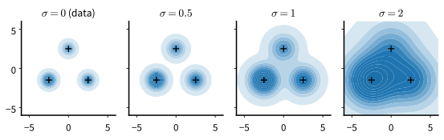

# Denoising and the Score
:label:`sec_diffusion-denoising`

The previous chapter ended with a fact about squared error: a network trained by squared error learns the conditional mean of its target given its input, and where the input leaves the target ambiguous, that mean averages the possibilities. A denoiser is such a network. Shown a noisy photograph, it returns the average of all clean photographs that could have produced it. For the one-step generators of :numref:`chap_gans` that average was a defect. Here it is the starting point, because diffusion and flow models are trained by this same regression: add noise to a training example and ask the network for the clean example back.

What does a denoiser know about the data it was trained on? The noise filter of a camera app, trained on millions of photographs, restores edges and faces in a grainy picture. Fed pure static, it does not return static: it sharpens whatever faint structure it finds into the kinds of shapes that photographs contain. Statisticians answered the question long before deep learning. Herbert Robbins and Koichi Miyasawa showed, and :citet:`Efron.2011` popularized as *Tweedie's formula*, that the best denoiser moves the noisy point along the gradient of the log-density of the noisy data, a gradient called the *score*. A denoiser and a score are therefore one object, and :citet:`Vincent.2011` showed that training a denoiser by regression fits the score.

This matters because a density needs a normalizer, an integral over all possible inputs that nobody can compute for images, while a score needs none and is enough to draw samples. We fix a small distribution on which everything can be computed exactly, show that a denoiser is a posterior mean and why no normalizer appears, measure what a denoiser trained at one noise level can and cannot do, and train a first denoiser on images.

```{.python .input #denoising-denoising-score-matching}
%%tab pytorch
%matplotlib inline
from d2l import torch as d2l
import math
import torch
from torch import nn
```

```{.python .input #denoising-denoising-score-matching}
%%tab jax
%matplotlib inline
from d2l import jax as d2l
import math
import jax
from jax import numpy as jnp
from flax import nnx
import optax
```

## The Running Example

We want one distribution on which every quantity of the chapter can be computed exactly, at every noise level, so that each learned field and each sampler can be checked against the truth. A mixture of Gaussians in the plane qualifies. Ours has three components with means $(-2.5, -1.5)$, $(2.5, -1.5)$ and $(0, 2.5)$, mixture weights $\pi_k = 0.5, 0.3, 0.2$, and a common standard deviation $s = 0.5$ per coordinate. The modes are far apart compared with their width, so the density has deep valleys between them, and the unequal weights give a sampler something to get wrong. Every later section of the chapter uses this mixture.

The *score* of a density $p$ is the gradient of its logarithm, $\nabla \log p(\mathbf{x})$, a vector field that points in the direction in which the density grows fastest. For the mixture $p(\mathbf{x}) = \sum_k \pi_k\, \mathcal{N}(\mathbf{x}; \boldsymbol\mu_k, s^2\mathbf{I})$ it reads

$$
\nabla \log p(\mathbf{x}) = \sum_k r_k(\mathbf{x})\, \frac{\boldsymbol\mu_k - \mathbf{x}}{s^2},
\qquad
r_k(\mathbf{x}) = \frac{\pi_k\, \mathcal{N}(\mathbf{x}; \boldsymbol\mu_k, s^2\mathbf{I})}{p(\mathbf{x})}.
$$
:eqlabel:`eq_diffusion-mixture-score`

Each component pulls the point toward its own mean, and the pulls are averaged with the *responsibilities* $r_k(\mathbf{x})$, the posterior probabilities that $\mathbf{x}$ was drawn from component $k$ (:numref:`fig_diffusion-score-field`). The weights $\pi_k$ enter only through the responsibilities. Near a mode one responsibility is close to one whatever the weights are, so the score there is that of a single Gaussian. The weights change the score only in the valleys, where few points lie, a fact that will matter below.


:label:`fig_diffusion-score-field`

Adding Gaussian noise of standard deviation $\sigma$ to a draw adds $\sigma^2$ to the variance of each component, so the noised distribution is the same mixture with $s^2$ replaced by $s^2 + \sigma^2$.

`GaussianMixture` holds the running example: a mixture of isotropic Gaussians whose density, score and posterior mean are available in closed form at every noise level $\mathbf{x}_t = \alpha \mathbf{x}_0 + \sigma \boldsymbol\epsilon$. Later sections need the scale $\alpha$; in this section the noisy point is $\mathbf{x}_0 + \sigma\boldsymbol\epsilon$, and we always pass $\alpha = 1$.

```{.python .input #denoising-the-running-example-1}
%%tab pytorch
class GaussianMixture:  #@save
    """A mixture of isotropic Gaussians, exact at every noise level."""
    def __init__(self, means, weights, std, device=None):
        self.means = torch.tensor(means, dtype=torch.float32, device=device)
        self.weights = torch.tensor(weights, dtype=torch.float32,
                                    device=device)
        self.std = std

    @staticmethod
    def three_modes(device=None):
        """The chapter's running example, with mode weights 0.5/0.3/0.2."""
        return GaussianMixture([[-2.5, -1.5], [2.5, -1.5], [0.0, 2.5]],
                               [0.5, 0.3, 0.2], 0.5, device)

    def sample(self, n):
        """n draws from the mixture."""
        k = torch.multinomial(self.weights, n, replacement=True)
        return self.means[k] + self.std * torch.randn(
            n, self.means.shape[1], device=self.means.device)

    def _modes(self, x, alpha, sigma):
        """Per-mode log densities, offsets x - alpha mu_k and variance."""
        a, s = (torch.as_tensor(v, dtype=x.dtype, device=x.device)
                .reshape(-1, 1, 1) for v in (alpha, sigma))
        var = (a * self.std) ** 2 + s ** 2
        r = x[:, None] - a * self.means
        log_p = (torch.log(self.weights) - (r ** 2).sum(-1) / (2 * var[..., 0])
                 - x.shape[1] / 2 * torch.log(2 * torch.pi * var[..., 0]))
        return log_p, r, var

    def log_prob(self, x, alpha=1.0, sigma=0.0):
        """log p(x) for x = alpha x0 + sigma eps."""
        return torch.logsumexp(self._modes(x, alpha, sigma)[0], 1)

    def score(self, x, alpha=1.0, sigma=0.0):
        """The gradient of log p(x) for x = alpha x0 + sigma eps."""
        log_p, r, var = self._modes(x, alpha, sigma)
        return -(torch.softmax(log_p, 1)[..., None] * r / var).sum(1)

    def posterior_mean(self, x, alpha, sigma):
        """E[x0 | x]; finite at alpha = 0 and at sigma = 0."""
        log_p, r, var = self._modes(x, alpha, sigma)
        gain = (torch.as_tensor(alpha, dtype=x.dtype, device=x.device)
                .reshape(-1, 1, 1) * self.std ** 2 / var)
        return (torch.softmax(log_p, 1)[..., None]
                * (self.means + gain * r)).sum(1)

    def velocity(self, x, t):
        """E[eps - x0 | x_t] on the linear path x_t = (1 - t) x0 + t eps."""
        log_p, r, var = self._modes(x, 1 - t, t)
        s = torch.as_tensor(t, dtype=x.dtype,
                            device=x.device).reshape(-1, 1, 1)
        eps = s * r / var                       # E[eps | x_t, mode k]
        x0 = self.means + (1 - s) * self.std ** 2 / var * r  # E[x0 | ...]
        return (torch.softmax(log_p, 1)[..., None] * (eps - x0)).sum(1)
```

```{.python .input #denoising-the-running-example-1}
%%tab jax
class GaussianMixture:  #@save
    """A mixture of isotropic Gaussians, exact at every noise level."""
    def __init__(self, means, weights, std):
        self.means = jnp.array(means, dtype=jnp.float32)
        self.weights = jnp.array(weights, dtype=jnp.float32)
        self.std = std

    @staticmethod
    def three_modes():
        """The chapter's running example, with mode weights 0.5/0.3/0.2."""
        return GaussianMixture([[-2.5, -1.5], [2.5, -1.5], [0.0, 2.5]],
                               [0.5, 0.3, 0.2], 0.5)

    def sample(self, key, n):
        """n draws from the mixture."""
        k1, k2 = jax.random.split(key)
        k = jax.random.choice(k1, len(self.weights), (n,), p=self.weights)
        return self.means[k] + self.std * jax.random.normal(
            k2, (n, self.means.shape[1]))

    def _modes(self, x, alpha, sigma):
        """Per-mode log densities, offsets x - alpha mu_k and variance."""
        a, s = (jnp.asarray(v, x.dtype).reshape(-1, 1, 1)
                for v in (alpha, sigma))
        var = (a * self.std) ** 2 + s ** 2
        r = x[:, None] - a * self.means
        log_p = (jnp.log(self.weights) - (r ** 2).sum(-1) / (2 * var[..., 0])
                 - x.shape[1] / 2 * jnp.log(2 * jnp.pi * var[..., 0]))
        return log_p, r, var

    def log_prob(self, x, alpha=1.0, sigma=0.0):
        """log p(x) for x = alpha x0 + sigma eps."""
        return jax.nn.logsumexp(self._modes(x, alpha, sigma)[0], 1)

    def score(self, x, alpha=1.0, sigma=0.0):
        """The gradient of log p(x) for x = alpha x0 + sigma eps."""
        log_p, r, var = self._modes(x, alpha, sigma)
        return -(jax.nn.softmax(log_p, 1)[..., None] * r / var).sum(1)

    def posterior_mean(self, x, alpha, sigma):
        """E[x0 | x]; finite at alpha = 0 and at sigma = 0."""
        log_p, r, var = self._modes(x, alpha, sigma)
        gain = (jnp.asarray(alpha, x.dtype).reshape(-1, 1, 1)
                * self.std ** 2 / var)
        return (jax.nn.softmax(log_p, 1)[..., None]
                * (self.means + gain * r)).sum(1)

    def velocity(self, x, t):
        """E[eps - x0 | x_t] on the linear path x_t = (1 - t) x0 + t eps."""
        log_p, r, var = self._modes(x, 1 - t, t)
        s = jnp.asarray(t, x.dtype).reshape(-1, 1, 1)
        eps = s * r / var                       # E[eps | x_t, mode k]
        x0 = self.means + (1 - s) * self.std ** 2 / var * r  # E[x0 | ...]
        return (jax.nn.softmax(log_p, 1)[..., None] * (eps - x0)).sum(1)
```

Two statistics score a set of points against the mixture: the mean negative log-likelihood under the true density, and a summary of the mode weights (each point counted at its nearest mean), the fraction of strays farther than three standard deviations from every mean, and the mean squared distance of the rest.

```{.python .input #denoising-the-running-example-3}
%%tab pytorch
@d2l.add_to_class(GaussianMixture)  #@save
def nll(self, x):
    """Mean negative log-likelihood of clean points, in nats."""
    return -self.log_prob(x).mean()

@d2l.add_to_class(GaussianMixture)  #@save
def summary(self, x):
    """Mode weights by nearest mean, stray fraction, spread of the rest."""
    d2 = ((x[:, None] - self.means) ** 2).sum(-1)
    near, k = d2.min(1)
    inside = near < (3 * self.std) ** 2
    weights = torch.bincount(k, minlength=len(self.weights)) / len(x)
    return dict(weights=[round(w, 3) for w in weights.tolist()],
                stray=1 - inside.float().mean().item(),
                spread=near[inside].mean().item())
```

```{.python .input #denoising-the-running-example-3}
%%tab jax
@d2l.add_to_class(GaussianMixture)  #@save
def nll(self, x):
    """Mean negative log-likelihood of clean points, in nats."""
    return -self.log_prob(x).mean()

@d2l.add_to_class(GaussianMixture)  #@save
def summary(self, x):
    """Mode weights by nearest mean, stray fraction, spread of the rest."""
    d2 = ((x[:, None] - self.means) ** 2).sum(-1)
    near, k = d2.min(1), d2.argmin(1)
    inside = near < (3 * self.std) ** 2
    weights = jnp.bincount(k, length=len(self.weights)) / len(x)
    return dict(weights=[round(float(w), 3) for w in weights],
                stray=1 - float(inside.mean()),
                spread=float(near[inside].mean()))
```

`scatter_panels` draws point sets side by side on shared, equal axes, with the training data in grey behind them.

```{.python .input #denoising-the-running-example-2}
%%tab pytorch, jax
def scatter_panels(samples, titles=None, data=None, lim=4.5,  #@save
                   size=3.0):
    """Scatter 2-D point sets side by side on equal, shared axes."""
    _, axes = d2l.plt.subplots(1, len(samples), squeeze=False,
                               figsize=(size * len(samples), size))
    for i, (ax, pts) in enumerate(zip(axes[0], samples)):
        if data is not None:
            ax.scatter(*d2l.numpy(data).T, s=2, c='lightgray')
        ax.scatter(*d2l.numpy(pts).T, s=2)
        ax.set(xlim=(-lim, lim), ylim=(-lim, lim), aspect='equal')
        if titles:
            ax.set_title(titles[i])
    return axes[0]
```

We draw 2,000 points, the training set of every two-dimensional experiment in this section, and score them against the mixture.

```{.python .input #denoising-the-running-example-4}
%%tab pytorch
torch.manual_seed(0)
mix = d2l.GaussianMixture.three_modes()
data = mix.sample(2000)
print(mix.summary(data), f'NLL {mix.nll(data):.3f}')
d2l.scatter_panels([data], ['2,000 draws']);
```

```{.python .input #denoising-the-running-example-4}
%%tab jax
mix = d2l.GaussianMixture.three_modes()
data = mix.sample(jax.random.key(0), 2000)
print(mix.summary(data), f'NLL {mix.nll(data):.3f}')
d2l.scatter_panels([data], ['2,000 draws']);
```

The weights come out near $0.5$, $0.3$ and $0.2$, about one percent of the points stray, and the spread is just under $2s^2 = 0.5$, because the test cuts off the outer tail of each component. A perfect sampler would print the same values. The negative log-likelihood, about $2.5$ nats per point, is the best that any model of this distribution can achieve on average.

## The Optimal Denoiser

A denoiser is trained by regression, and regression has a known answer. We state it, turn it into a statement about the score, and ask why the score is the object to learn.

### Noise and the Regression Target

Pick a noise level $\sigma > 0$, draw a clean point $\mathbf{x}_0 \sim p$ and standard Gaussian noise $\boldsymbol\epsilon \sim \mathcal{N}(\mathbf{0}, \mathbf{I})$, and form the noisy point $\tilde{\mathbf{x}} = \mathbf{x}_0 + \sigma \boldsymbol\epsilon$. Its density $p_\sigma$ is the data density blurred by a Gaussian of width $\sigma$, positive and smooth everywhere even when $p$ is not. A denoiser $D$ is trained to minimize $\mathbb{E}\|D(\tilde{\mathbf{x}}) - \mathbf{x}_0\|^2$. Squared error is minimized by the conditional mean of the target given the input, and its minimum is the average conditional variance (:numref:`chap_gans` used this fact, and :numref:`sec_mdl-denoising-score-matching` proves it). The optimal denoiser is therefore the *posterior mean* $\mathbb{E}[\mathbf{x}_0 \mid \tilde{\mathbf{x}}]$, the average of the clean points that could have produced $\tilde{\mathbf{x}}$, each weighted by how likely it is to have done so.

The same regression can aim at a different target. Given the clean point, the noisy point is Gaussian around it, and the score of this conditional density is

$$
\nabla_{\tilde{\mathbf{x}}} \log p_\sigma(\tilde{\mathbf{x}} \mid \mathbf{x}_0)
= \frac{\mathbf{x}_0 - \tilde{\mathbf{x}}}{\sigma^2}
= -\frac{\boldsymbol\epsilon}{\sigma},
$$
:eqlabel:`eq_diffusion-conditional-score`

a vector pointing from the noisy point back to the clean one. *Denoising score matching* regresses a vector field $\mathbf{s}_{\boldsymbol\theta}$ onto it :cite:`Vincent.2011`:

$$
J_{\mathrm{DSM}}(\boldsymbol\theta)
= \tfrac12\, \mathbb{E}_{\mathbf{x}_0, \boldsymbol\epsilon}
\Big\| \mathbf{s}_{\boldsymbol\theta}(\mathbf{x}_0 + \sigma \boldsymbol\epsilon) + \frac{\boldsymbol\epsilon}{\sigma} \Big\|^2.
$$
:eqlabel:`eq_diffusion-dsm`

The minimizer is again a conditional mean, now of the conditional score, and Vincent's theorem identifies it: *the score of the noised data is the posterior mean of the conditional score*,

$$
\mathbb{E}\Big[ -\frac{\boldsymbol\epsilon}{\sigma} \,\Big|\, \tilde{\mathbf{x}} \Big] = \nabla \log p_\sigma(\tilde{\mathbf{x}}).
$$
:eqlabel:`eq_diffusion-posterior-mean-score`

Every pair we generate supplies a target, and the regression on these targets fits the score of $p_\sigma$, which we never wrote down. The same section of the appendix proves the theorem in two lines of Bayes' rule, by moving the gradient outside an integral.

`TimeMLP` is the one network for every two-dimensional experiment: an MLP on the point plus sinusoidal features of a noise level or time, from `time_embedding`, which the image networks share. In this section the second input is held at the one noise level a network is trained for; from the next section on, one network sees every level.

```{.python .input #denoising-noise-and-the-regression-target}
%%tab pytorch
def time_embedding(t, dim, scale=1.0):  #@save
    """Sines and cosines of scale * t at dim / 2 geometric frequencies."""
    freqs = torch.exp(-math.log(10000) / (dim // 2)
                      * torch.arange(dim // 2, device=t.device))
    args = scale * t.float()[:, None] * freqs
    return torch.cat([args.sin(), args.cos()], 1)

class TimeMLP(nn.Module):  #@save
    """An MLP on a point x and the time features of one or more times."""
    def __init__(self, hidden=256, depth=3, *, dim=2, num_times=1,
                 time_dim=64, time_scale=1.0):
        super().__init__()
        self.time_dim, self.time_scale = time_dim, time_scale
        self.embed = nn.Sequential(nn.Linear(time_dim * num_times, hidden),
                                   nn.SiLU(), nn.Linear(hidden, hidden))
        self.inp = nn.Linear(dim, hidden)
        layers = [m for _ in range(depth - 1)
                  for m in (nn.SiLU(), nn.Linear(hidden, hidden))]
        self.body = nn.Sequential(*layers, nn.SiLU(), nn.Linear(hidden, dim))

    def forward(self, x, *ts):
        feats = [time_embedding(t, self.time_dim, self.time_scale) for t in ts]
        return self.body(self.inp(x) + self.embed(torch.cat(feats, 1)))
```

```{.python .input #denoising-noise-and-the-regression-target}
%%tab jax
def time_embedding(t, dim, scale=1.0):  #@save
    """Sines and cosines of scale * t at dim / 2 geometric frequencies."""
    freqs = jnp.exp(-math.log(10000) / (dim // 2) * jnp.arange(dim // 2))
    args = scale * jnp.asarray(t, jnp.float32)[:, None] * freqs
    return jnp.concatenate([jnp.sin(args), jnp.cos(args)], 1)

class TimeMLP(nnx.Module):  #@save
    """An MLP on a point x and the time features of one or more times."""
    def __init__(self, hidden=256, depth=3, *, dim=2, num_times=1,
                 time_dim=64, time_scale=1.0, rngs):
        self.time_dim, self.time_scale = time_dim, time_scale
        self.embed = nnx.Sequential(
            d2l.Linear(time_dim * num_times, hidden, rngs=rngs), nnx.silu,
            d2l.Linear(hidden, hidden, rngs=rngs))
        self.inp = d2l.Linear(dim, hidden, rngs=rngs)
        layers = [m for _ in range(depth - 1)
                  for m in (nnx.silu, d2l.Linear(hidden, hidden, rngs=rngs))]
        self.body = nnx.Sequential(*layers, nnx.silu,
                                   d2l.Linear(hidden, dim, rngs=rngs))

    def __call__(self, x, *ts):
        feats = [time_embedding(t, self.time_dim, self.time_scale) for t in ts]
        return self.body(self.inp(x) + self.embed(jnp.concatenate(feats, 1)))
```

`train_regression` is the one training loop of the chapter: Adam on a loss of the model and a fresh batch, constant or cosine-decayed learning rate, and `d2l.EMA` from :numref:`sec_dcgan` on the weights.

```{.python .input #gaussian-paths-experiments-on-the-running-example}
%%tab pytorch
def train_regression(model, loss_fn, batch_fn, num_steps, *,  #@save
                     lr=1e-3, cosine=False, ema_half_life=1000):
    """Adam on loss_fn(model, batch_fn()) -> (model, EMA model, losses)."""
    opt = torch.optim.Adam(model.parameters(), lr=lr)
    sched = (torch.optim.lr_scheduler.CosineAnnealingLR(opt, num_steps)
             if cosine else None)
    ema, losses = d2l.EMA(model, ema_half_life), []
    for _ in range(num_steps):
        loss = loss_fn(model, batch_fn())
        opt.zero_grad()
        loss.backward()
        opt.step()
        if sched:
            sched.step()
        ema.update(model)
        losses.append(loss.detach())
    return model, ema.model, torch.stack(losses)
```

```{.python .input #gaussian-paths-experiments-on-the-running-example}
%%tab jax
def train_regression(model, loss_fn, batch_fn, num_steps, key, *,  #@save
                     lr=1e-3, cosine=False, ema_half_life=1000):
    """Adam on loss_fn(model, batch_fn(k1), k2) -> model, EMA model, losses."""
    schedule = optax.cosine_decay_schedule(lr, num_steps) if cosine else lr
    opt = nnx.Optimizer(model, optax.adam(schedule), wrt=nnx.Param)
    ema = d2l.EMA(model, ema_half_life)

    @nnx.jit
    def run(model, opt, avg, batches, keys):
        @nnx.scan(in_axes=(nnx.Carry, 0, 0), out_axes=(nnx.Carry, 0))
        def step(carry, batch, key):
            model, opt, avg = carry
            loss, grads = nnx.value_and_grad(loss_fn)(model, batch, key)
            opt.update(model, grads)
            ema._average(avg, model, ema.decay)   # on the carried copy
            return (model, opt, avg), loss
        return step((model, opt, avg), batches, keys)[1]

    chunks = [min(500, num_steps - i)             # steps per dispatch
              for i in range(0, num_steps, 500)]
    losses = []
    for key, chunk in zip(jax.random.split(key, len(chunks)), chunks):
        k1, k2 = jax.random.split(key)            # batches drawn outside jit
        batches = jax.vmap(batch_fn)(jax.random.split(k1, chunk))
        losses.append(run(model, opt, ema.model, batches,
                          jax.random.split(k2, chunk)))
    return model, ema.model, jnp.concatenate(losses)
```

`fit_score` trains a `TimeMLP` with two hidden layers of 128 units on :eqref:`eq_diffusion-dsm`. Each step draws 256 of the 2,000 training points and fresh noise, and the network outputs the score directly. It returns the trained network as a function of the point alone, the form a sampler needs.

```{.python .input #denoising-noise-and-the-regression-target-1}
%%tab pytorch
def dsm_loss(net, x, sigma):
    """Denoising score matching at one noise level: regress onto -eps/sigma."""
    eps = torch.randn_like(x)
    s = net(x + sigma * eps, torch.full((len(x),), sigma))
    return 0.5 * ((s + eps / sigma) ** 2).sum(1).mean()

def fit_score(data, sigma, seed=1, num_steps=2000):
    """Train a score network at one noise level and return it as a function."""
    torch.manual_seed(seed)
    batch_fn = lambda: data[torch.randint(0, len(data), (256,))]
    net, _, _ = d2l.train_regression(
        d2l.TimeMLP(128, 2), lambda net, x: dsm_loss(net, x, sigma),
        batch_fn, num_steps)
    return lambda x: net(x, torch.full((len(x),), sigma)).detach()
```

```{.python .input #denoising-noise-and-the-regression-target-1}
%%tab jax
def dsm_loss(net, x, key, sigma):
    """Denoising score matching at one noise level: regress onto -eps/sigma."""
    eps = jax.random.normal(key, x.shape)
    s = net(x + sigma * eps, jnp.full((len(x),), sigma))
    return 0.5 * ((s + eps / sigma) ** 2).sum(1).mean()

def fit_score(data, sigma, seed=1, num_steps=2000):
    """Train a score network at one noise level and return it as a function."""
    batch_fn = lambda key: data[jax.random.randint(key, (256,), 0, len(data))]
    net, _, _ = d2l.train_regression(
        d2l.TimeMLP(128, 2, rngs=nnx.Rngs(seed)),
        lambda net, x, key: dsm_loss(net, x, key, sigma), batch_fn,
        num_steps, jax.random.key(seed))
    return lambda x: net(x, jnp.full((len(x),), sigma))
```

### Tweedie's Formula

The two regressions above, onto the clean point and onto $-\boldsymbol\epsilon/\sigma$, have targets related by the map $\mathbf{x}_0 \mapsto (\mathbf{x}_0 - \tilde{\mathbf{x}})/\sigma^2$, which is affine once $\tilde{\mathbf{x}}$ is given, so their minimizers, two conditional means, are related by the same map. Solving for the posterior mean gives *Tweedie's formula* :cite:`Efron.2011`,

$$
\mathbb{E}[\mathbf{x}_0 \mid \tilde{\mathbf{x}}] = \tilde{\mathbf{x}} + \sigma^2\, \nabla \log p_\sigma(\tilde{\mathbf{x}}).
$$
:eqlabel:`eq_diffusion-tweedie`

The best denoiser takes one step of size $\sigma^2$ up the score of the noisy density. :numref:`fig_mdl-dyn-tweedie` draws this step for a mixture in one dimension. Read in reverse, a denoiser, a score and a noise predictor are three scalings of one posterior mean:

$$
\hat{\mathbf{x}}_0(\tilde{\mathbf{x}}) = \tilde{\mathbf{x}} + \sigma^2\, \hat{\mathbf{s}}(\tilde{\mathbf{x}}),
\qquad
\hat{\boldsymbol\epsilon}(\tilde{\mathbf{x}}) = \frac{\tilde{\mathbf{x}} - \hat{\mathbf{x}}_0(\tilde{\mathbf{x}})}{\sigma} = -\sigma\, \hat{\mathbf{s}}(\tilde{\mathbf{x}}).
$$
:eqlabel:`eq_diffusion-three-predictions`

A network trained to output any one of the three gives the other two.

The smallest case shows what the step does. Let the data be Gaussian, $\mathcal{N}(\boldsymbol\mu, v\mathbf{I})$. Then $p_\sigma = \mathcal{N}(\boldsymbol\mu, (v + \sigma^2)\mathbf{I})$ has the score $-(\tilde{\mathbf{x}} - \boldsymbol\mu)/(v + \sigma^2)$, and Tweedie's formula gives

$$
\mathbb{E}[\mathbf{x}_0 \mid \tilde{\mathbf{x}}] = \boldsymbol\mu + \frac{v}{v + \sigma^2}\, (\tilde{\mathbf{x}} - \boldsymbol\mu).
$$

The denoiser shrinks the noisy offset from the mean by the factor $v/(v + \sigma^2)$, and the posterior variance per coordinate is $v\sigma^2/(v + \sigma^2)$. With $v = s^2 = 0.25$ and $\sigma = 0.3$ the factor is $0.74$, and the squared error per coordinate falls from $\sigma^2 = 0.09$ to $0.066$. Each component of the running example is such a Gaussian, and away from the valleys the posterior mean is this shrinkage toward the nearest mean. Over the two coordinates of a point, denoising should therefore lower the squared error from $0.18$ to about $0.13$.

The cell checks the formula twice at $\sigma = 0.3$. With the exact score of $p_\sigma$, Tweedie's step should reproduce the exact posterior mean. With the network that `fit_score` trains, it gives a learned denoiser, which we compare with the best one on 20,000 fresh noisy points.

```{.python .input #denoising-tweedie-s-formula}
%%tab pytorch
sigma = 0.3
score = fit_score(data, sigma)
x0 = mix.sample(20000)
xt = x0 + sigma * torch.randn_like(x0)
exact = mix.posterior_mean(xt, 1.0, sigma)
gap = xt + sigma ** 2 * mix.score(xt, 1.0, sigma) - exact
print(f'Tweedie with the exact score: largest gap {gap.abs().max():.1e}')
for name, x0_hat in (('noisy point', xt), ('posterior mean', exact),
                     ('Tweedie, trained score', xt + sigma ** 2 * score(xt))):
    print(f'{name}: squared error {((x0_hat - x0) ** 2).sum(1).mean():.4f}')
```

```{.python .input #denoising-tweedie-s-formula}
%%tab jax
sigma = 0.3
score = fit_score(data, sigma)
k1, k2 = jax.random.split(jax.random.key(1))
x0 = mix.sample(k1, 20000)
xt = x0 + sigma * jax.random.normal(k2, x0.shape)
exact = mix.posterior_mean(xt, 1.0, sigma)
gap = xt + sigma ** 2 * mix.score(xt, 1.0, sigma) - exact
print(f'Tweedie with the exact score: largest gap {jnp.abs(gap).max():.1e}')
for name, x0_hat in (('noisy point', xt), ('posterior mean', exact),
                     ('Tweedie, trained score', xt + sigma ** 2 * score(xt))):
    print(f'{name}: squared error {((x0_hat - x0) ** 2).sum(1).mean():.4f}')
```

With the exact score the two sides agree to single-precision rounding. The exact posterior mean lowers the squared error from $0.18$ to about $0.13$, as the Gaussian case predicted, and the denoiser built from the trained score comes within about one percent of it. A denoiser trained for two thousand steps is a nearly optimal estimator of the clean point, and by Tweedie's formula its score is a usable score. The next subsection asks why we would want the score at all.

### The Normalizer Never Appears

Why go through the score, rather than fit a density and differentiate it? The most flexible way to let a network define a density is an *energy-based model*,

$$
p_{\boldsymbol\theta}(\mathbf{x}) = \frac{\exp(-E_{\boldsymbol\theta}(\mathbf{x}))}{Z_{\boldsymbol\theta}},
\qquad
Z_{\boldsymbol\theta} = \int \exp(-E_{\boldsymbol\theta}(\mathbf{x}))\, d\mathbf{x}.
$$
:eqlabel:`eq_diffusion-ebm`

Any network with a scalar output can serve as the *energy* $E_{\boldsymbol\theta}$, and low energy means high density (:numref:`fig_diffusion-energy-density`). The normalizer $Z_{\boldsymbol\theta}$ is what makes learning meaningful. Because the total mass is fixed, raising the density on the training points lowers it elsewhere; without $Z_{\boldsymbol\theta}$ a model could raise it everywhere at once. But $Z_{\boldsymbol\theta}$ is an integral over the whole input space, and it changes with every update. The gradient of the log-likelihood contains $\nabla_{\boldsymbol\theta} \log Z_{\boldsymbol\theta} = -\mathbb{E}_{p_{\boldsymbol\theta}}[\nabla_{\boldsymbol\theta} E_{\boldsymbol\theta}]$, an expectation under the model itself, so every update needs samples from the model, which only a Markov chain can supply.


:label:`fig_diffusion-energy-density`

Estimating $Z$ directly fails in high dimensions. Importance sampling (:numref:`sec_mdl-bayes-importance`) draws points from a proposal $q$ and averages the weights $w = e^{-E}/q$, whose mean is $Z$. Take the Gaussian energy $E(\mathbf{x}) = \|\mathbf{x} - \mathbf{m}\|^2/2$ with $\mathbf{m}$ the all-ones vector in $d$ dimensions, and the proposal $q = \mathcal{N}(\mathbf{0}, \mathbf{I})$, only one standard deviation off in each coordinate. The normalized weight is $w/Z = \exp(\mathbf{m}^\top\mathbf{x} - d/2)$, a log-normal variable with mean one and $\mathbb{E}[(w/Z)^2] = e^d$, so the relative error of an average of $n$ weights is $\sqrt{(e^d - 1)/n}$. The cell compares this prediction with the estimate and with the *effective sample size* $(\sum_i w_i)^2/\sum_i w_i^2$, the number of draws that carry appreciable weight.

```{.python .input #denoising-the-normalizer-never-appears}
%%tab pytorch
torch.manual_seed(1)
n = 100_000
print(f'{"d":>3} {"estimate / Z":>13} {"predicted rel. error":>21} {"ESS":>8}')
for d in (1, 2, 4, 8, 16, 32):
    x = torch.randn(n, d)                      # proposal q = N(0, I)
    log_w = x.sum(1) - d / 2                   # log(w / Z), m = (1, ..., 1)
    log_sum = torch.logsumexp(log_w, 0)
    estimate = torch.exp(log_sum - math.log(n))
    ess = torch.exp(2 * log_sum - torch.logsumexp(2 * log_w, 0))
    print(f'{d:>3} {estimate:>13.3f} {math.sqrt((math.exp(d) - 1) / n):>21.3g}'
          f' {ess:>8.1f}')
```

```{.python .input #denoising-the-normalizer-never-appears}
%%tab jax
n = 100_000
print(f'{"d":>3} {"estimate / Z":>13} {"predicted rel. error":>21} {"ESS":>8}')
dims = (1, 2, 4, 8, 16, 32)
for d, key in zip(dims, jax.random.split(jax.random.key(1), len(dims))):
    x = jax.random.normal(key, (n, d))         # proposal q = N(0, I)
    log_w = x.sum(1) - d / 2                   # log(w / Z), m = (1, ..., 1)
    log_sum = jax.nn.logsumexp(log_w, 0)
    estimate = jnp.exp(log_sum - math.log(n))
    ess = jnp.exp(2 * log_sum - jax.nn.logsumexp(2 * log_w, 0))
    print(f'{d:>3} {estimate:>13.3f} {math.sqrt((math.exp(d) - 1) / n):>21.3g}'
          f' {ess:>8.1f}')
```

Up to $d = 8$ the estimate is close to one. At $d = 16$ the predicted relative error is about nine and only tens of draws carry weight, so a run that lands near the truth does so by luck. At $d = 32$ the estimate is typically an order of magnitude low, with a handful of effective draws: the weights that would raise the average to $Z$ belong to draws too rare to appear among $10^5$. An image has hundreds of thousands of coordinates.

The score avoids all of this. The normalizer does not depend on $\mathbf{x}$, so it vanishes from the gradient in $\mathbf{x}$:

$$
\nabla_{\mathbf{x}} \log p_{\boldsymbol\theta}(\mathbf{x}) = -\nabla_{\mathbf{x}} E_{\boldsymbol\theta}(\mathbf{x}).
$$
:eqlabel:`eq_diffusion-ebm-score`

To compare a field $\mathbf{s}$ with the data we use the *Fisher divergence*, the mean squared distance between the two fields where the data lie,

$$
D_{\mathrm{F}}(p, \mathbf{s}) = \tfrac12\, \mathbb{E}_{\mathbf{x} \sim p} \big\| \mathbf{s}(\mathbf{x}) - \nabla \log p(\mathbf{x}) \big\|^2.
$$
:eqlabel:`eq_diffusion-esm`

It contains the unknown data score, but integration by parts moves the derivative onto the model. *Hyvärinen's identity* :cite:`Hyvarinen.2005` states that for every smooth field that decays fast enough,

$$
D_{\mathrm{F}}(p, \mathbf{s}) = \mathbb{E}_{\mathbf{x} \sim p}\big[ \tfrac12 \|\mathbf{s}(\mathbf{x})\|^2 + \nabla \cdot \mathbf{s}(\mathbf{x}) \big] + C,
$$
:eqlabel:`eq_diffusion-hyvarinen`

with a constant $C$ that does not depend on $\mathbf{s}$ (proof in :numref:`sec_mdl-score-matching`). The right side is an average over data, with no normalizer and no chain. Its divergence term, the trace of a Jacobian, costs one backward pass per input dimension. Denoising removes that cost as well: by Vincent's theorem, :eqref:`eq_diffusion-dsm` is the Fisher divergence to $p_\sigma$ up to a constant, computed with one forward and one backward pass.

## Limits of a Single Noise Level

A denoiser trained at one noise level gives the score of one blurred distribution. This part measures how good that score is, what it cannot see, and what a sampler driven by it produces.

### The Loss Floor and the Noise Level

The denoising loss does not reach zero. Many clean points could have produced the same noisy one, so even the best field leaves the conditional variance of the target, and the minimum of $2 J_{\mathrm{DSM}}$ is the average of $\operatorname{tr}\operatorname{Cov}(\boldsymbol\epsilon/\sigma \mid \tilde{\mathbf{x}})$. In the Gaussian case above it equals $d\,(1/\sigma^2 - 1/(v + \sigma^2))$, and in general it grows like $d/\sigma^2$ as $\sigma$ shrinks (:numref:`sec_mdl-denoising-score-matching`). At a small noise level the target $-\boldsymbol\epsilon/\sigma$ is large and mostly noise, and a network trained on a finite sample fits it poorly. A training loss that levels off above zero is therefore expected and says nothing about underfitting by itself.

A large noise level has the opposite problem. The regression is well conditioned, but its answer is the score of $p_\sigma$, not of $p$. For one Gaussian component $\mathcal{N}(\boldsymbol\mu, s^2\mathbf{I})$ in $d$ dimensions the two scores are $-(\mathbf{x} - \boldsymbol\mu)/(s^2 + \sigma^2)$ and $-(\mathbf{x} - \boldsymbol\mu)/s^2$. Their difference is $(\mathbf{x} - \boldsymbol\mu)\, \sigma^2/(s^2(s^2 + \sigma^2))$, and averaging its squared norm over $\mathbb{E}\|\mathbf{x} - \boldsymbol\mu\|^2 = ds^2$ gives the bias

$$
\tfrac12\, \mathbb{E}_p \big\| \nabla \log p_\sigma - \nabla \log p \big\|^2 = \frac{d\, \sigma^4}{2 s^2 (s^2 + \sigma^2)^2}.
$$

The bias grows like $\sigma^4$ at first. For $s = 0.5$ and $d = 2$ it is $0.0004$ at $\sigma = 0.05$, $0.28$ at $\sigma = 0.3$ and $2.6$ at $\sigma = 1$, and because the modes of the running example are far apart, the mixture has nearly the same values. The cell trains a network at each of seven noise levels and measures its error against the score of the clean data on 20,000 test points, next to the bias of the exact smoothed score.

```{.python .input #denoising-the-loss-floor-and-the-noise-level}
%%tab pytorch
sigmas = [0.05, 0.1, 0.15, 0.2, 0.3, 0.5, 1.0]
scores = {s: fit_score(data, s) for s in sigmas}
x_test = mix.sample(20000)
def score_error(score, x, target):
    return 0.5 * ((score(x) - target) ** 2).sum(1).mean().item()
learned = [score_error(scores[s], x_test, mix.score(x_test)) for s in sigmas]
bias = [score_error(lambda x: mix.score(x, 1.0, s), x_test, mix.score(x_test))
        for s in sigmas]
print('trained at sigma:', [round(e, 3) for e in learned])
print('exact smoothed:  ', [round(e, 4) for e in bias])
d2l.plot(sigmas, [learned, bias], 'sigma', 'error against the clean score',
         legend=['network trained at sigma', 'exact score of p_sigma'],
         xscale='log', yscale='log')
```

```{.python .input #denoising-the-loss-floor-and-the-noise-level}
%%tab jax
sigmas = [0.05, 0.1, 0.15, 0.2, 0.3, 0.5, 1.0]
scores = {s: fit_score(data, s) for s in sigmas}
x_test = mix.sample(jax.random.key(2), 20000)
def score_error(score, x, target):
    return float(0.5 * ((score(x) - target) ** 2).sum(1).mean())
learned = [score_error(scores[s], x_test, mix.score(x_test)) for s in sigmas]
bias = [score_error(lambda x: mix.score(x, 1.0, s), x_test, mix.score(x_test))
        for s in sigmas]
print('trained at sigma:', [round(e, 3) for e in learned])
print('exact smoothed:  ', [round(e, 4) for e in bias])
d2l.plot(sigmas, [learned, bias], 'sigma', 'error against the clean score',
         legend=['network trained at sigma', 'exact score of p_sigma'],
         xscale='log', yscale='log')
```

The learned error traces a U. To the right it follows the bias line, within about $0.1$ from $\sigma = 0.5$ on: the networks there fit their blurred targets well, and the targets are wrong. To the left it rises again although the bias vanishes, because the targets are mostly noise; retraining with another seed moves these points by up to a factor of two. The best single level lies between $\sigma = 0.1$ and $0.2$, at an error of about $0.2$. The bias formula gives a rule of thumb: divided by the size of the clean score, $\tfrac12\mathbb{E}\|\nabla \log p\|^2 = d/(2s^2)$, it depends only on $\sigma/s$, and at $\sigma = s/3$ the relative error of the smoothed score is about ten percent. No single noise level is accurate everywhere.

### Blindness to Mode Weights

An error of $0.2$ in the Fisher divergence sounds small, but small compared with what? Compare the running example with its equal-weight copy, the same three components with weights $1/3$ each. A model with these wrong weights loses $0.07$ nats of likelihood per point, the Kullback--Leibler divergence between the two. Its score, however, differs from the true one only through the responsibilities in :eqref:`eq_diffusion-mixture-score`, and the responsibilities differ only in the valleys, where $p$ is nearly zero. The Fisher divergence, an average under $p$, barely sees the difference.

The cell computes both divergences by quadrature on a $721 \times 721$ grid. A sample average would not do: the integrand lives in the valleys, where few draws land, and repeated Monte Carlo estimates differ by more than an order of magnitude. Both mixtures are then blurred by the same noise, and the comparison is repeated.

```{.python .input #denoising-blindness-to-mode-weights}
%%tab pytorch
mix_eq = d2l.GaussianMixture([[-2.5, -1.5], [2.5, -1.5], [0.0, 2.5]],
                             [1 / 3, 1 / 3, 1 / 3], 0.5)
g = torch.linspace(-9, 9, 721)
grid = torch.stack(torch.meshgrid(g, g, indexing='ij'), -1).reshape(-1, 2)
area = (g[1] - g[0]) ** 2                      # of one grid cell
for sigma in (0.0, 0.5, 1.0):
    log_p = mix.log_prob(grid, 1.0, sigma)
    diff = mix.score(grid, 1.0, sigma) - mix_eq.score(grid, 1.0, sigma)
    fisher = area * (log_p.exp() * 0.5 * (diff ** 2).sum(1)).sum()
    kl = area * (log_p.exp()
                 * (log_p - mix_eq.log_prob(grid, 1.0, sigma))).sum()
    print(f'sigma = {sigma}: Fisher divergence {fisher:.1e}, KL {kl:.3f} nats')
```

```{.python .input #denoising-blindness-to-mode-weights}
%%tab jax
mix_eq = d2l.GaussianMixture([[-2.5, -1.5], [2.5, -1.5], [0.0, 2.5]],
                             [1 / 3, 1 / 3, 1 / 3], 0.5)
g = jnp.linspace(-9, 9, 721)
grid = jnp.stack(jnp.meshgrid(g, g, indexing='ij'), -1).reshape(-1, 2)
area = (g[1] - g[0]) ** 2                      # of one grid cell
for sigma in (0.0, 0.5, 1.0):
    log_p = mix.log_prob(grid, 1.0, sigma)
    diff = mix.score(grid, 1.0, sigma) - mix_eq.score(grid, 1.0, sigma)
    fisher = area * (jnp.exp(log_p) * 0.5 * (diff ** 2).sum(1)).sum()
    kl = area * (jnp.exp(log_p)
                 * (log_p - mix_eq.log_prob(grid, 1.0, sigma))).sum()
    print(f'sigma = {sigma}: Fisher divergence {fisher:.1e}, KL {kl:.3f} nats')
```

Between the clean mixtures the Fisher divergence is about $10^{-5}$, four orders of magnitude or more below the errors of the trained networks in the previous cell, none of which fell below $0.1$, while the KL divergence is $0.07$ nats. A score model trained near the clean data cannot learn the weights, because a field with the wrong weights fits as well as one with the right weights, far within any network's error. This blindness is a known property of the Fisher divergence (:numref:`sec_mdl-fisher-divergence`; :exref:`ex_mdl-divergences-distances-score-blindness` works out a one-dimensional case). Noise makes the weights visible. As $\sigma$ grows, the components spread into the valleys (:numref:`fig_diffusion-noise-ladder`), the responsibilities differ where $p_\sigma$ has mass, and the Fisher divergence rises to about $10^{-3}$ at $\sigma = 0.5$ and $10^{-2}$ at $\sigma = 1$, while the KL divergence barely changes.


:label:`fig_diffusion-noise-ladder`

### Sampling with a Score

A score is enough to draw samples. *Langevin dynamics* starts from any point and repeats

$$
\mathbf{x} \leftarrow \mathbf{x} + \frac{h}{2}\, \mathbf{s}(\mathbf{x}) + \sqrt{h}\, \boldsymbol\xi,
\qquad \boldsymbol\xi \sim \mathcal{N}(\mathbf{0}, \mathbf{I}),
$$
:eqlabel:`eq_diffusion-langevin`

with a small step size $h$. The drift moves the point up the log-density, and the noise keeps it from collapsing onto a mode. For the continuous-time limit of this update, $p$ is the stationary distribution whenever $\mathbf{s} = \nabla \log p$ (:numref:`sec_mdl-langevin-sampling` proves it), and a chain run long enough forgets its start. The discrete update is slightly off: for a Gaussian of variance $v$ its stationary variance is $v/(1 - h/(4v))$, about $h/4$ too large, a five percent excess for our components at $h = 0.05$.

`langevin` runs Langevin dynamics with any score function: each step moves $\mathbf{x}$ by $\tfrac{h}{2}$ times the score and adds Gaussian noise of variance $h$.

```{.python .input #denoising-sampling-with-a-score}
%%tab pytorch
@torch.no_grad()  #@save
def langevin(score_fn, x, step, num_steps):
    """Langevin steps x <- x + step / 2 * score + sqrt(step) * noise."""
    for _ in range(num_steps):
        x = x + step / 2 * score_fn(x) + step ** 0.5 * torch.randn_like(x)
    return x
```

```{.python .input #denoising-sampling-with-a-score}
%%tab jax
def langevin(score_fn, x, step, num_steps, key):  #@save
    """Langevin steps x <- x + step / 2 * score + sqrt(step) * noise."""
    def move(x, key):
        noise = jax.random.normal(key, x.shape)
        return x + step / 2 * score_fn(x) + step ** 0.5 * noise, None
    return jax.lax.scan(move, x, jax.random.split(key, num_steps))[0]
```

We run three chains of 2,000 steps at $h = 0.05$ from the same 2,000 starting points, drawn from $\mathcal{N}(\mathbf{0}, 9\mathbf{I})$ so that each mode receives about a third of them. The first uses the exact score of $p$, the second the exact score of $p_\sigma$ at $\sigma = 1$, and the third the network trained at $\sigma = 0.3$ in the previous experiment, used as if it were the score of $p$.

```{.python .input #denoising-sampling-with-a-score-1}
%%tab pytorch
torch.manual_seed(2)
x_init = 3 * torch.randn(2000, 2)
fields = {'exact score of p': mix.score,
          'exact score of p_sigma, sigma = 1': lambda x: mix.score(x, 1, 1),
          'trained at sigma = 0.3': scores[0.3]}
samples = [d2l.langevin(f, x_init, 0.05, 2000) for f in fields.values()]
print('start:', mix.summary(x_init))
for name, x in zip(fields, samples):
    print(f'{name}:', mix.summary(x))
d2l.scatter_panels(samples, list(fields), data=data);
```

```{.python .input #denoising-sampling-with-a-score-1}
%%tab jax
key, *keys = jax.random.split(jax.random.key(2), 4)
x_init = 3 * jax.random.normal(key, (2000, 2))
fields = {'exact score of p': mix.score,
          'exact score of p_sigma, sigma = 1': lambda x: mix.score(x, 1, 1),
          'trained at sigma = 0.3': scores[0.3]}
samples = [d2l.langevin(f, x_init, 0.05, 2000, k)
           for f, k in zip(fields.values(), keys)]
print('start:', mix.summary(x_init))
for name, x in zip(fields, samples):
    print(f'{name}:', mix.summary(x))
d2l.scatter_panels(samples, list(fields), data=data);
```

The exact score of $p$ sends every chain to a mode with the right spread, but the weights stay those of the start, about a third each. The chains do not cross the valleys. For the two lower modes, the valley lies about $12$ nats above the modes in $-\log p$, and the expected crossing time is of the order of a million steps at this step size (:exref:`ex_denoising-escaping-mode` computes it). The sampler is right within each mode and wrong about the weights, the same weights to which the Fisher divergence is blind.

The exact score of $p_\sigma$ at $\sigma = 1$ crosses freely, because the noise has filled the valleys, and its weights land within about $0.02$ of $0.5$, $0.3$ and $0.2$. Its samples, however, have twice the spread, and about $40\%$ of them fail the three-standard-deviation test. They are samples of $p_\sigma$, whose weights are right and whose components are wide.

The trained network does neither job reliably. Its weights depend on the seed: in some runs they stay near the start's, in others they drift, now and then close to the true values, because nothing in a field fitted near the data fixes them. Several percent of its samples stray, against one to two percent for the exact score, because the field is wrong in the valleys where no training pair landed. A small noise level is accurate near the data but cannot move between modes or see their weights; a large one moves freely and describes the wrong distribution. Langevin steps survive in modern samplers only as a correction applied at each of many noise levels.

## Denoising Images

Nothing in the denoising loss depends on the dimension of the data, so it applies to images unchanged. We use Fashion-MNIST (:numref:`sec_fashion_mnist`) with pixel values scaled to $[-1, 1]$ and noise of standard deviation $\sigma = 0.5$, which corrupts the images heavily but not beyond recognition. The network is four $3 \times 3$ convolutions with 32 channels and SiLU activations, trained for 600 steps with minibatches of 128 images. It predicts the noise $\boldsymbol\epsilon$, the third scaling in :eqref:`eq_diffusion-three-predictions`, so its output divided by $-\sigma$ is a score of the noisy images and $\tilde{\mathbf{x}} - \sigma\hat{\boldsymbol\epsilon}$ is the denoised image. That score is a field in $784$ dimensions, represented by a network without any density.

`load_fashion_mnist_pm1` returns the Fashion-MNIST training and test images scaled to $[-1, 1]$ (or as binary pixels) with their labels, and `show_gray` displays such images as a grid.

```{.python .input #denoising-denoising-images}
%%tab pytorch
def load_fashion_mnist_pm1(binary=False):  #@save
    """Fashion-MNIST (X, y, X_test, y_test), images in [-1, 1] or binary."""
    data, device = d2l.FashionMNIST(), d2l.try_gpu()  # on the GPU if any
    def prep(X):  # (n, 1, 28, 28) floats or (n, 28, 28) binary pixels
        return (X > 127).long() if binary else X[:, None].float() / 127.5 - 1
    return (prep(data.train.data).to(device), data.train.targets.to(device),
            prep(data.val.data).to(device), data.val.targets.to(device))

def show_gray(imgs, num_rows, num_cols, titles=None, scale=1.0):  #@save
    """Show images (n, 1, h, w) in [-1, 1], or binary (n, h, w), in gray."""
    imgs = imgs.detach().cpu()
    imgs = ((imgs[:, 0] + 1) / 2).clamp(0, 1) if imgs.is_floating_point() \
        else imgs.float()
    return d2l.show_images(imgs[..., None].expand(-1, -1, -1, 3), num_rows,
                           num_cols, titles, scale)
```

```{.python .input #denoising-denoising-images}
%%tab jax
def load_fashion_mnist_pm1(binary=False):  #@save
    """Fashion-MNIST (X, y, X_test, y_test), images in [-1, 1] or binary."""
    data = d2l.FashionMNIST()
    def prep(X):  # (n, 28, 28, 1) floats or (n, 28, 28) binary pixels
        return (jnp.asarray(X > 127, jnp.int32) if binary
                else jnp.asarray(X[..., None], jnp.float32) / 127.5 - 1)
    return (prep(data.train[0]), jnp.asarray(data.train[1], jnp.int32),
            prep(data.val[0]), jnp.asarray(data.val[1], jnp.int32))

def show_gray(imgs, num_rows, num_cols, titles=None, scale=1.0):  #@save
    """Show images (n, h, w, 1) in [-1, 1], or binary (n, h, w), in gray."""
    imgs = jnp.asarray(imgs)
    imgs = jnp.clip((imgs[..., 0] + 1) / 2, 0, 1) \
        if jnp.issubdtype(imgs.dtype, jnp.floating) else imgs.astype(float)
    return d2l.show_images(jnp.repeat(imgs[..., None], 3, -1), num_rows,
                           num_cols, titles, scale)
```

The noise predictor is trained with `train_regression`, like the networks on the mixture; its loss draws fresh noise for every minibatch.

```{.python .input #denoising-denoising-images-1}
%%tab pytorch
X, _, X_test, _ = d2l.load_fashion_mnist_pm1()
sigma = 0.5
torch.manual_seed(0)
net = nn.Sequential(nn.Conv2d(1, 32, 3, padding=1), nn.SiLU(),
                    nn.Conv2d(32, 32, 3, padding=1), nn.SiLU(),
                    nn.Conv2d(32, 32, 3, padding=1), nn.SiLU(),
                    nn.Conv2d(32, 1, 3, padding=1)).to(X.device)

def noise_loss(net, x):
    """Squared error of the predicted noise; the score is -net / sigma."""
    eps = torch.randn_like(x)
    return ((net(x + sigma * eps) - eps) ** 2).mean()

batch_fn = lambda: X[torch.randint(0, len(X), (128,), device=X.device)]
net, _, losses = d2l.train_regression(net, noise_loss, batch_fn, 600)
print(f'last training loss {losses[-50:].mean():.3f}')
```

```{.python .input #denoising-denoising-images-1}
%%tab jax
X, _, X_test, _ = d2l.load_fashion_mnist_pm1()
sigma = 0.5
rngs = nnx.Rngs(0)
net = nnx.Sequential(nnx.Conv(1, 32, (3, 3), rngs=rngs), nnx.silu,
                     nnx.Conv(32, 32, (3, 3), rngs=rngs), nnx.silu,
                     nnx.Conv(32, 32, (3, 3), rngs=rngs), nnx.silu,
                     nnx.Conv(32, 1, (3, 3), rngs=rngs))

def noise_loss(net, x, key):
    """Squared error of the predicted noise; the score is -net / sigma."""
    eps = jax.random.normal(key, x.shape)
    return ((net(x + sigma * eps) - eps) ** 2).mean()

batch_fn = lambda key: X[jax.random.randint(key, (128,), 0, len(X))]
net, _, losses = d2l.train_regression(net, noise_loss, batch_fn, 600,
                                      jax.random.key(0))
print(f'last training loss {losses[-50:].mean():.3f}')
```

A number means little without a reference. The natural one is the best *linear* denoiser. If the images were Gaussian with mean $\boldsymbol\mu$ and covariance $\boldsymbol\Sigma$, Tweedie's formula would give the shrinkage it gave for Gaussian data above, applied along each eigenvector of $\boldsymbol\Sigma$ with its own factor $\lambda/(\lambda + \sigma^2)$:

$$
D_{\mathrm{lin}}(\tilde{\mathbf{x}}) = \boldsymbol\mu + \boldsymbol\Sigma (\boldsymbol\Sigma + \sigma^2 \mathbf{I})^{-1} (\tilde{\mathbf{x}} - \boldsymbol\mu).
$$
:eqlabel:`eq_diffusion-wiener`

This *Wiener filter* keeps directions in which the images vary more than the noise and suppresses the others. It is the best affine denoiser for any distribution with this mean and covariance, Gaussian or not (:exref:`ex_denoising-linear-denoiser`). The cell estimates $\boldsymbol\mu$ and $\boldsymbol\Sigma$ from the 60,000 training images and compares the per-pixel squared error of the noisy input, the Wiener filter and the network on 1,000 test images. The rows of the figure show clean, noisy, Wiener and network images.

```{.python .input #denoising-denoising-images-2}
%%tab pytorch
Xf = X.reshape(len(X), -1)
mu = Xf.mean(0)
Sigma = (Xf - mu).T @ (Xf - mu) / len(Xf)      # (784, 784) pixel covariance
A = torch.linalg.solve(Sigma + sigma ** 2 * torch.eye(784, device=X.device),
                       Sigma)                  # (Sigma + sigma^2 I)^-1 Sigma
torch.manual_seed(1)
with torch.no_grad():
    x = X_test[:1000]
    xt = x + sigma * torch.randn_like(x)
    x_lin = (mu + (xt.reshape(1000, -1) - mu) @ A).reshape(x.shape)
    x_net = xt - sigma * net(xt)               # Tweedie: xt + sigma^2 * score
for name, xh in (('noisy', xt), ('Wiener', x_lin), ('network', x_net)):
    print(f'{name}: per-pixel squared error {((xh - x) ** 2).mean():.4f}')
d2l.show_gray(torch.cat([x[:8], xt[:8], x_lin[:8], x_net[:8]]), 4, 8);
```

```{.python .input #denoising-denoising-images-2}
%%tab jax
Xf = X.reshape(len(X), -1)
mu = Xf.mean(0)
Sigma = (Xf - mu).T @ (Xf - mu) / len(Xf)      # (784, 784) pixel covariance
A = jnp.linalg.solve(Sigma + sigma ** 2 * jnp.eye(784),
                     Sigma)                    # (Sigma + sigma^2 I)^-1 Sigma
x = X_test[:1000]
xt = x + sigma * jax.random.normal(jax.random.key(1), x.shape)
x_lin = (mu + (xt.reshape(1000, -1) - mu) @ A).reshape(x.shape)
x_net = xt - sigma * net(xt)                   # Tweedie: xt + sigma^2 * score
for name, xh in (('noisy', xt), ('Wiener', x_lin), ('network', x_net)):
    print(f'{name}: per-pixel squared error {((xh - x) ** 2).mean():.4f}')
d2l.show_gray(jnp.concatenate([x[:8], xt[:8], x_lin[:8], x_net[:8]]), 4, 8);
```

The noisy input has error $\sigma^2 = 0.25$ per pixel, the Wiener filter about $0.045$, and the network about $0.03$, a third less than the best linear map after only 600 steps. The network wins because the images are not Gaussian. A linear filter can only keep or suppress fixed directions of pixel space, the same for every image, and its outputs show it: blurred edges and a faint grain left on the background. The network returns a clean background and sharper edges, and keeps lettering on a sweater that the filter smears. Natural images are thought to lie near a low-dimensional set inside pixel space :cite:`Bengio.Courville.Vincent.2013`, and a convolutional network can use local shape, such as an edge or the outline of a sleeve, to decide what is signal.

Both outputs are smooth. A posterior mean averages over every clean image consistent with the noisy one, so texture that the noise destroyed comes back as its average, the blur of :numref:`chap_gans`. A denoiser returns an average, and a generator must return a draw.

## Summary

A network trained by squared error to remove Gaussian noise learns the posterior mean of the clean point. Tweedie's formula, $\mathbb{E}[\mathbf{x}_0 \mid \tilde{\mathbf{x}}] = \tilde{\mathbf{x}} + \sigma^2 \nabla \log p_\sigma(\tilde{\mathbf{x}})$, makes that denoiser a score of the noisy data, and Vincent's theorem makes the regression a way to fit the score. A score needs no normalizer, whereas a density needs an integral that importance sampling cannot estimate in high dimensions.

One noise level cannot both describe the data and sample them. At a small level the regression targets are mostly noise, the score is blind to the mode weights, and Langevin chains never cross between modes. At a large level the chains mix and find the right weights, but they sample a blurred distribution. On images, a small convolutional denoiser beats the best linear one. What if one network denoised at every noise level, and we walked from pure noise to the data through all of them? :numref:`sec_diffusion-gaussian-paths` takes that walk.

## Exercises

1. **Learning without normalization.** Consider the one-dimensional model
   $\tilde{p}(x) = \exp(-E(x))$ with $E(x) = (x - \mu)^2 / (2 \tau^2)$,
   fit to data $x_1, \ldots, x_n$ that take at least two distinct values.
    1. Maximize $\sum_i \log \tilde{p}(x_i)$ over $\mu$ and $\tau$ without
       normalizing. What does $\tilde{p}$ look like away from the data as the
       objective approaches its supremum?
    1. Repeat with the normalized model $\tilde{p} / Z$. Which term of the
       objective prevents the failure of the first part, and what is the
       maximizer?
    1. A network energy usually ends in a linear layer with an output bias
       $c$. Show that the normalized density :eqref:`eq_diffusion-ebm` does
       not depend on $c$. What does gradient ascent on
       $-\sum_i E_{\boldsymbol{\theta}}(\mathbf{x}_i)$ alone do to $c$?
   :exlabel:`ex_denoising-learning-without-normalization`
1. **Products and mixtures.** Let $p_1 = \exp(-E_1) / Z_1$ and
   $p_2 = \exp(-E_2) / Z_2$ be two energy-based models on $\mathbb{R}^d$.
    1. When $\exp(-E_1 - E_2)$ is integrable, the energy $E_1 + E_2$ defines
       the density proportional to $p_1 p_2$, a *product of experts*
       :cite:`Hinton.2002`. Compute the product of the one-dimensional
       experts $\mathcal{N}(-a, 1)$ and $\mathcal{N}(a, 1)$. For large $a$,
       where does the product place its mass, compared with each expert?
    1. Show that the score of the product is the sum of the two scores, and
       that its normalizer never has to be computed to evaluate it. Is the
       score of the mixture $(p_1 + p_2) / 2$ the average of the two scores?
       Express it with responsibilities, as in the mixture score
       :eqref:`eq_diffusion-mixture-score` of the running example.
    1. Write the energy of the mixture in terms of $E_1$, $E_2$, $Z_1$ and
       $Z_2$. Which mixture weights does the energy
       $-\log\big(\exp(-E_1) + \exp(-E_2)\big)$ produce instead?
    1. Now let $p_1$ and $p_2$ each be the distribution of a generator of the
       kind trained in :numref:`sec_basic_gan`. Which of the two combinations
       can be sampled directly from the two generators, and which cannot?
   :exlabel:`ex_denoising-products-mixtures`
1. **The log-normal weight.** In the importance-sampling experiment of this
   section, the target is $\mathcal{N}(\mathbf{m}, \mathbf{I})$ up to
   normalization and the proposal is $\mathcal{N}(\mathbf{0}, \mathbf{I})$.
    1. Derive
       $w / Z = \exp(\mathbf{m}^\top \mathbf{x} - \|\mathbf{m}\|^2 / 2)$ and
       show with the moment generating function of a Gaussian that
       $\mathbb{E}_q[w / Z] = 1$ and
       $\mathbb{E}_q[(w / Z)^2] = \exp(\|\mathbf{m}\|^2)$. Conclude that the
       relative standard error of the $n$-sample estimate is
       $\sqrt{(e^{\|\mathbf{m}\|^2} - 1) / n}$. How many samples give a
       relative error of $0.1$ when $\|\mathbf{m}\|^2 = 20$?
    1. The effective sample size $(\sum_i w_i)^2 / \sum_i w_i^2$ equals $n$
       times the squared sample mean of the weights divided by their sample
       second moment. Use the first part to predict it for large $n$ when
       $\mathbf{m}$ is the all-ones vector, and compare the prediction with
       the printed values. Why do the printed values exceed the prediction
       from $d = 8$ on? What does this imply for the effective sample size as
       a diagnostic (:numref:`sec_mdl-bayes-importance`)?
   :exlabel:`ex_denoising-log-normal-weight`
1. **Data on a line.** Let the data lie on the first coordinate axis of
   $\mathbb{R}^2$, $\mathbf{x}_0 = (u, 0)$ with $u \sim q$ for a smooth positive
   density $q$ on $\mathbb{R}$, so that $p$ has no density on $\mathbb{R}^2$.
    1. Show that
       $p_\sigma(\tilde{\mathbf{x}}) = q_\sigma(\tilde{x}_1)\, \mathcal{N}(\tilde{x}_2;\, 0, \sigma^2)$,
       where $q_\sigma$ is $q$ blurred by $\mathcal{N}(0, \sigma^2)$, and
       write the score $\nabla \log p_\sigma$.
    1. Show that the second component of the score has mean square
       $1 / \sigma^2$ under $p_\sigma$ and slope $-1 / \sigma^2$ in
       $\tilde{x}_2$. What happens to both as $\sigma \to 0$, and what does
       this mean for a network that must represent the score at a small noise
       level?
    1. Apply Tweedie's formula :eqref:`eq_diffusion-tweedie`. What does the
       optimal denoiser do to each coordinate of $\tilde{\mathbf{x}}$, and
       which geometric operation does it perform?
    1. Let the data lie on a $k$-dimensional linear subspace of
       $\mathbb{R}^d$ instead. Compute the mean square of the component of the
       score orthogonal to the subspace.
   :exlabel:`ex_denoising-data-on-a-line`
1. **Two-point data.** Let $p = \tfrac12 \delta_{-1} + \tfrac12 \delta_{+1}$
   in one dimension, noised at level $\sigma$.
    1. Compute the posterior mean $\mathbb{E}[x_0 \mid \tilde{x}]$ by Bayes'
       rule, and show that it equals
       $\tilde{x} + \sigma^2 \frac{d}{d\tilde{x}} \log p_\sigma(\tilde{x})$,
       as Tweedie's formula :eqref:`eq_diffusion-tweedie` requires.
    1. What does the optimal denoiser return for $\tilde{x} = 0$? Why is
       this the best answer under squared error even though it is not a
       possible clean value?
    1. Write the minimum of :eqref:`eq_diffusion-dsm` as
       $\frac{1}{2 \sigma^4}\, \mathbb{E}\big[\operatorname{tr} \mathrm{Cov}(\mathbf{x}_0 \mid \tilde{\mathbf{x}})\big]$,
       and show that it is positive for every data distribution that is not
       concentrated on a single point.
    1. For the two-point data, write the minimum as a one-dimensional
       integral over $\tilde{x}$ and evaluate it by quadrature for
       $\sigma \in \{0.25, 0.5, 1, 2\}$. Multiply each value by $\sigma^2$ to
       express it in the units of the noise-prediction loss. Explain why this
       rescaled floor vanishes as $\sigma \to 0$, and why it also vanishes as
       $\sigma \to \infty$.
   :exlabel:`ex_denoising-regression-identity`
1. **Bias of the smoothed score.** The text derives the bias
   $d\sigma^4 / (2 s^2 (s^2 + \sigma^2)^2)$ of the smoothed score for one
   Gaussian component.
    1. Divide it by $\tfrac12\, \mathbb{E} \|\nabla \log p\|^2 = d / (2 s^2)$
       and show that the ratio depends on $\sigma$ and $s$ only through
       $\sigma / s$. Its square root is the relative root-mean-square error
       of the smoothed score. How small must $\sigma / s$ be for this error to
       stay below $10\%$?
    1. Compare the formula with the printed bias of the mixture at the seven
       noise levels of the sweep. Where does the single-component formula
       stop describing the mixture, and why?
    1. What does the rule of the first part imply for data concentrated near
       a low-dimensional set, as in :exref:`ex_denoising-data-on-a-line`?
       Which value of $s$ applies to the directions orthogonal to the set?
   :exlabel:`ex_denoising-smoothed-score-bias`
1. **Laplace noise.** Vincent's theorem holds for any differentiable noise
   kernel; Tweedie's formula does not. Perturb one-dimensional data with
   Laplace noise, $\tilde{x} = x_0 + z$, where $z$ has density
   $k(z) = e^{-|z| / b} / (2b)$.
    1. Compute the conditional score
       $\frac{d}{d\tilde{x}} \log k(\tilde{x} - x_0)$ for $\tilde{x} \neq x_0$.
       Express the minimizer of the corresponding denoising objective in
       terms of the posterior probability $P(x_0 < \tilde{x} \mid \tilde{x})$.
    1. For the two-point data of :exref:`ex_denoising-regression-identity`,
       compute the score of the perturbed density and the posterior mean
       $\mathbb{E}[x_0 \mid \tilde{x}]$ for $|\tilde{x}| < 1$ and for
       $\tilde{x} > 1$. Show that no relation
       $\mathbb{E}[x_0 \mid \tilde{x}] = \tilde{x} + c\, \frac{d}{d\tilde{x}} \log p_k(\tilde{x})$
       with a constant $c$ holds for all $\tilde{x}$, where $p_k$ is the
       perturbed density.
    1. Which property of the Gaussian conditional score
       :eqref:`eq_diffusion-conditional-score` makes Tweedie's formula
       possible?
   :exlabel:`ex_denoising-laplace-noise`
1. [code] **The best linear denoiser.**
    1. Show that the Wiener filter :eqref:`eq_diffusion-wiener` minimizes
       $\mathbb{E}\|D(\tilde{\mathbf{x}}) - \mathbf{x}_0\|^2$ among all affine
       maps $D$ for every data distribution with mean $\boldsymbol{\mu}$ and
       covariance $\boldsymbol{\Sigma}$, and that its squared error per pixel
       is $\frac{1}{d} \sum_i \sigma^2 \lambda_i / (\lambda_i + \sigma^2)$,
       where $\lambda_1, \ldots, \lambda_d$ are the eigenvalues of
       $\boldsymbol{\Sigma}$.
    1. Compute this prediction at $\sigma = 0.5$ from `Sigma` and compare it
       with the printed error of `x_lin`.
    1. Count the eigenvalues of `Sigma` above $\sigma^2$ for
       $\sigma \in \{0.25, 0.5, 1\}$, and plot a few of the corresponding
       eigenvectors as images. What does the filter keep at each noise level?
   :exlabel:`ex_denoising-linear-denoiser`
1. [code] **Step size.** Repeat the Langevin run with the exact score of
   $p$ at the step sizes $h = 0.0005$, $0.005$, $0.05$, $0.5$ and $1.2$.
   Record the fraction of chains that remain finite, and the summary of the
   finite chains.
    1. The stationary variance of the discrete chain for a Gaussian of
       variance $v$ is $v / (1 - h/(4v))$ (:numref:`sec_mdl-langevin-sampling`).
       Apply `summary` to exact samples of a mixture whose components have this
       variance instead of $0.25$, and compare with the spread and the stray
       fraction of each run. Which runs does the formula explain, and what
       happens at $h = 1.2$?
    1. The discretization error is smallest at $h = 0.0005$. Why do the
       statistics of this run nevertheless differ most from the target?
    1. Among the runs whose chains all remain finite, which one moves the
       mode weights away from those of the start, and why?
   :exlabel:`ex_denoising-langevin-step-size`
1. [code] **Escaping a mode.** Model the valley between the two lower modes
   of the running example in one dimension by the equal mixture of
   $\mathcal{N}(-2.5, 0.25)$ and $\mathcal{N}(2.5, 0.25)$, with potential
   $U = -\log p$, wells at $a = \pm 2.5$, and the barrier at $b = 0$. When
   the barrier height $\Delta U = U(b) - U(a)$ is large compared with one,
   Kramers' formula :cite:`Kramers.1940` gives the expected time for the
   diffusion $dX = -\tfrac12 U'(X)\, dt + dW$, the continuous-time limit of
   :eqref:`eq_diffusion-langevin`, to pass from one well to the other:

   $$
   \tau \approx \frac{4 \pi}{\sqrt{U''(a)\, |U''(b)|}}\, e^{\Delta U}.
   $$

    1. Compute $\Delta U$, $U''(a)$ and $U''(b)$, and convert $\tau$ into a
       number of Langevin steps at $h = 0.05$.
    1. Mode 3 of the running example lies closer to mode 1, at a distance of
       about $4.7$. Evaluate $U = -\log p$ of the running example along the
       segment between the two means, read off the barrier height, and
       estimate the crossing time in the same way. How many of 2,000 chains
       should cross from mode 1 to mode 3 in 2,000 steps?
    1. Repeat the first part for $p_\sigma$ at $\sigma = 0.3$ and
       $\sigma = 1$, treating the result as an order of magnitude where
       $\Delta U$ is small, and use it to explain the weights of the
       $\sigma = 1$ chains.
   :exlabel:`ex_denoising-escaping-mode`
1. [code] **The empirical optimum memorizes.** Replace the data distribution
   by the empirical distribution of the $n$ training images
   $\mathbf{x}_1, \ldots, \mathbf{x}_n$ in `X`, the distribution that
   training on a finite set actually sees.
    1. Show that $p_\sigma$ is then a mixture of Gaussians centered at the
       training images, and that Tweedie's formula gives the optimal denoiser
       $D(\tilde{\mathbf{x}}) = \sum_i w_i(\tilde{\mathbf{x}})\, \mathbf{x}_i$
       with weights
       $w_i(\tilde{\mathbf{x}}) \propto \exp(-\|\tilde{\mathbf{x}} - \mathbf{x}_i\|^2 / (2 \sigma^2))$.
    1. Evaluate this denoiser on 500 noisy test images and on 500 noisy
       training images at $\sigma \in \{0.1, 0.5, 1\}$, and compare its
       per-pixel squared error with that of the noisy input and the Wiener
       filter at every level, and with the trained network at $\sigma = 0.5$.
       What does it return for a noisy test image? What would a sampler
       driven by its score produce?
    1. The network was trained on the same finite set, yet beats this
       denoiser on test images. What prevents it from reaching the empirical
       optimum? :citet:`Kamb.Ganguli.2025` and
       :citet:`Kadkhodaie.Guth.Simoncelli.ea.2024` study this question.
   :exlabel:`ex_denoising-memorization`
1. [extended] **Training an energy by persistent chains.** This problem
   trains an energy-based model :eqref:`eq_diffusion-ebm` on the running
   example by maximum likelihood, the route that this section avoids.
    1. Show that the gradient of the average log-likelihood is
       $-\mathbb{E}_{\textrm{data}}[\nabla_{\boldsymbol\theta} E_{\boldsymbol\theta}] + \mathbb{E}_{p_{\boldsymbol\theta}}[\nabla_{\boldsymbol\theta} E_{\boldsymbol\theta}]$.
    1. Let $E_{\boldsymbol\theta}$ be an MLP with two hidden layers of 64
       units plus $\|\mathbf{x}\|^2 / 8$, which keeps $\exp(-E_{\boldsymbol\theta})$
       integrable. As a reference, fit it by exact maximum likelihood to
       `data`, computing $Z_{\boldsymbol\theta}$ by quadrature on a
       $100 \times 100$ grid over $[-6, 6]^2$, and report the test negative
       log-likelihood and the mode weights of the fitted density on the grid
       (each grid point counted at its nearest mean).
    1. Now estimate the second expectation of the first part with 1,024
       persistent chains: each chain keeps its state between updates and
       takes 20 random-walk Metropolis steps per update, proposing
       $\mathbf{x}' = \mathbf{x} + 0.25\, \boldsymbol\xi$ and accepting with
       probability $\min\{1, \exp(E_{\boldsymbol\theta}(\mathbf{x}) - E_{\boldsymbol\theta}(\mathbf{x}'))\}$.
       Train for 3,000 updates and compare the negative log-likelihood and the
       grid weights with the reference. Why does the acceptance test need no
       normalizer?
    1. *Contrastive divergence* restarts the chains at the current minibatch
       in every update and runs one step :cite:`Hinton.2002`. Train this way
       and report the same numbers. Which weights does the model learn, and
       why can chains that never leave the mode they start in carry no
       information about the weights?
   :exlabel:`ex_denoising-persistent-chains`

[Discussions](https://d2l.discourse.group/t/36818)
