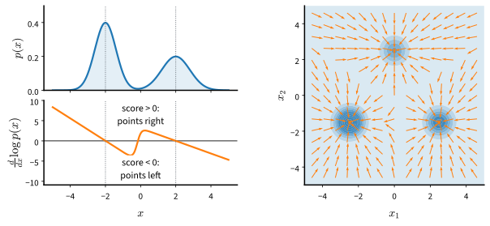
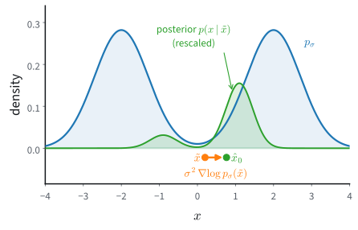
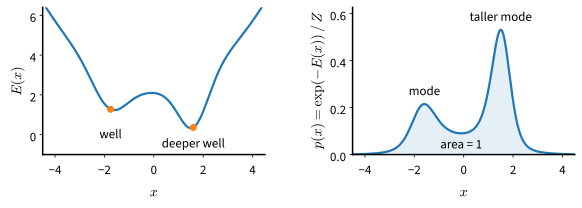

# Denoising and the Score
:label:`sec_diffusion-denoising`

The previous chapter ended with a fact about squared error: a network trained by squared error learns the conditional mean of its target given its input, and where the input leaves the target ambiguous, that mean averages the possibilities. A denoiser is such a network: shown a noisy photograph, it returns the average of all clean photographs that could have produced it. For the generators of :numref:`chap_gans` that average was a defect. Here it is the starting point, because diffusion and flow models are trained by this same regression: add noise to a training example and ask the network for the clean example back.

If a network can remove noise from a picture, does it know what pictures look like? The noise filter of a camera app, trained on millions of photographs, restores edges and faces in a grainy picture. Fed pure static, it does not return static: it sharpens whatever faint structure it finds into the kinds of shapes that photographs contain. So it knows something. Statisticians said what, long before deep learning. Herbert Robbins and Koichi Miyasawa showed that the best denoiser moves the noisy point along the gradient of the log-density of the noisy data, a gradient called the *score*. Robbins credited the result to Maurice Tweedie, and :citet:`Efron.2011` made it known as *Tweedie's formula*. A denoiser and a score are therefore one object, and :citet:`Vincent.2011` showed that training a denoiser by regression fits the score.

This matters because a density needs a normalizer, an integral over all possible inputs that nobody can compute for images, while a score needs none and is enough to draw samples. We start simple, with a distribution on which every quantity can be computed exactly. On it we show that a denoiser is a posterior mean and find out what a denoiser trained at a single noise level can and cannot do; then we denoise images.

```{.python .input #denoising-denoising-score-matching}
%%tab pytorch
import math
import numpy as np
import torch
from torch import nn
from torch.nn import functional as F
from d2l import torch as d2l
```

```{.python .input #denoising-denoising-score-matching}
%%tab jax
import math
import numpy as np
import jax
from jax import numpy as jnp
from flax import nnx
import optax
from d2l import jax as d2l
```

```{.python .input #denoising-denoising-and-the-score-1}
%%tab pytorch
torch.set_float32_matmul_precision('high')  # tf32 matmuls on tensor cores
```

## The Running Example

We want one distribution on which every quantity of the chapter is exact at every noise level, so that each learned field and sampler can be checked against the truth. A mixture of Gaussians in the plane will do. Ours has three components with means $(-2.5, -1.5)$, $(2.5, -1.5)$ and $(0, 2.5)$, mixture weights $\pi_k = 0.5, 0.3, 0.2$, and a common standard deviation $s = 0.5$ per coordinate. The modes are far apart compared with their width, so the density has deep valleys between them, and the unequal weights give a sampler something to get wrong.

The *score* of a density $p$ is the gradient of its logarithm, $\nabla \log p(\mathbf{x})$, a vector field that points in the direction in which the density grows fastest. For the mixture $p(\mathbf{x}) = \sum_k \pi_k\, \mathcal{N}(\mathbf{x}; \boldsymbol\mu_k, s^2\mathbf{I})$ it reads

$$
\nabla \log p(\mathbf{x}) = \sum_k r_k(\mathbf{x})\, \frac{\boldsymbol\mu_k - \mathbf{x}}{s^2},
\qquad
r_k(\mathbf{x}) = \frac{\pi_k\, \mathcal{N}(\mathbf{x}; \boldsymbol\mu_k, s^2\mathbf{I})}{p(\mathbf{x})}.
$$
:eqlabel:`eq_diffusion-mixture-score`

Each component pulls the point toward its own mean, and the pulls are averaged with the *responsibilities* $r_k(\mathbf{x})$, the posterior probabilities that $\mathbf{x}$ was drawn from component $k$ (:numref:`fig_diffusion-score-field`). The weights $\pi_k$ enter only through the responsibilities. Near a mode one responsibility is close to one whatever the weights are, so the weights change the score only in the valleys, where few points lie. The remark looks harmless, but it will decide what a score model can learn.


:label:`fig_diffusion-score-field`

Noise keeps a mixture of Gaussians a mixture of Gaussians. Adding Gaussian noise of standard deviation $\sigma$ to a draw adds $\sigma^2$ to the variance of each component, so $s^2$ becomes $s^2 + \sigma^2$, and the density, score and posterior mean have closed forms at every noise level. The class below evaluates all three; its argument `alpha`, a scale on the clean point, stays at one until the next section.

```{.python .input #denoising-the-running-example-1}
%%tab pytorch
class GaussianMixture:  #@save
    """A mixture of isotropic Gaussians, exact at every noise level."""
    def __init__(self, means, weights, std, device=None):
        self.means = torch.tensor(means, dtype=torch.float32, device=device)
        self.weights = torch.tensor(weights, dtype=torch.float32,
                                    device=device)
        self.std = std

    @staticmethod
    def three_modes(device=None):
        """The chapter's running example, with mode weights 0.5/0.3/0.2."""
        return GaussianMixture([[-2.5, -1.5], [2.5, -1.5], [0.0, 2.5]],
                               [0.5, 0.3, 0.2], 0.5, device)

    def sample(self, n):
        """n draws from the mixture."""
        k = torch.multinomial(self.weights, n, replacement=True)
        return self.means[k] + self.std * torch.randn(
            n, self.means.shape[1], device=self.means.device)

    def _modes(self, x, alpha, sigma):
        """Per-mode log densities, offsets x - alpha mu_k, variances, alpha."""
        a, s = (torch.as_tensor(v, dtype=x.dtype, device=x.device)
                .reshape(-1, 1, 1) for v in (alpha, sigma))
        var = (a * self.std) ** 2 + s ** 2
        r = x[:, None] - a * self.means
        log_p = (torch.log(self.weights) - (r ** 2).sum(-1) / (2 * var[..., 0])
                 - x.shape[1] / 2 * torch.log(2 * torch.pi * var[..., 0]))
        return log_p, r, var, a

    def log_prob(self, x, alpha=1.0, sigma=0.0):
        """log p(x) for x = alpha x0 + sigma eps."""
        return torch.logsumexp(self._modes(x, alpha, sigma)[0], 1)

    def score(self, x, alpha=1.0, sigma=0.0):
        """The gradient of log p(x) for x = alpha x0 + sigma eps."""
        log_p, r, var, _ = self._modes(x, alpha, sigma)
        return -(torch.softmax(log_p, 1)[..., None] * r / var).sum(1)

    def posterior_mean(self, x, alpha, sigma):
        """E[x0 | x]; finite at alpha = 0 and at sigma = 0."""
        log_p, r, var, a = self._modes(x, alpha, sigma)
        return (torch.softmax(log_p, 1)[..., None]
                * (self.means + a * self.std ** 2 / var * r)).sum(1)
```

```{.python .input #denoising-the-running-example-1}
%%tab jax
class GaussianMixture:  #@save
    """A mixture of isotropic Gaussians, exact at every noise level."""
    def __init__(self, means, weights, std):
        self.means = jnp.array(means, dtype=jnp.float32)
        self.weights = jnp.array(weights, dtype=jnp.float32)
        self.std = std

    @staticmethod
    def three_modes():
        """The chapter's running example, with mode weights 0.5/0.3/0.2."""
        return GaussianMixture([[-2.5, -1.5], [2.5, -1.5], [0.0, 2.5]],
                               [0.5, 0.3, 0.2], 0.5)

    def sample(self, key, n):
        """n draws from the mixture."""
        k1, k2 = jax.random.split(key)
        k = jax.random.choice(k1, len(self.weights), (n,), p=self.weights)
        return self.means[k] + self.std * jax.random.normal(
            k2, (n, self.means.shape[1]))

    def _modes(self, x, alpha, sigma):
        """Per-mode log densities, offsets x - alpha mu_k, variances, alpha."""
        a, s = (jnp.asarray(v, x.dtype).reshape(-1, 1, 1)
                for v in (alpha, sigma))
        var = (a * self.std) ** 2 + s ** 2
        r = x[:, None] - a * self.means
        log_p = (jnp.log(self.weights) - (r ** 2).sum(-1) / (2 * var[..., 0])
                 - x.shape[1] / 2 * jnp.log(2 * jnp.pi * var[..., 0]))
        return log_p, r, var, a

    def log_prob(self, x, alpha=1.0, sigma=0.0):
        """log p(x) for x = alpha x0 + sigma eps."""
        return jax.nn.logsumexp(self._modes(x, alpha, sigma)[0], 1)

    def score(self, x, alpha=1.0, sigma=0.0):
        """The gradient of log p(x) for x = alpha x0 + sigma eps."""
        log_p, r, var, _ = self._modes(x, alpha, sigma)
        return -(jax.nn.softmax(log_p, 1)[..., None] * r / var).sum(1)

    def posterior_mean(self, x, alpha, sigma):
        """E[x0 | x]; finite at alpha = 0 and at sigma = 0."""
        log_p, r, var, a = self._modes(x, alpha, sigma)
        return (jax.nn.softmax(log_p, 1)[..., None]
                * (self.means + a * self.std ** 2 / var * r)).sum(1)
```

Throughout the chapter, samplers on this mixture are judged by the same yardsticks: the mean negative log-likelihood of their points under the true density, and three numbers from `summary`. The *mode weights* count each point at its nearest mean. The *strays* are the fraction of points farther than $3s = 1.5$ from every mean. The *spread* is the mean squared distance of the remaining points to their nearest mean; since it ignores the strays, it can never exceed $(3s)^2 = 2.25$, and a sampler that is far too wide shows up mainly as strays.

```{.python .input #denoising-the-running-example-3}
%%tab pytorch
@d2l.add_to_class(GaussianMixture)  #@save
def nll(self, x):
    """Mean negative log-likelihood of clean points, in nats."""
    return -self.log_prob(x).mean()

@d2l.add_to_class(GaussianMixture)  #@save
def summary(self, x):
    """Mode weights by nearest mean, stray fraction, spread of the rest."""
    d2 = ((x[:, None] - self.means) ** 2).sum(-1)
    near, k = d2.min(1)
    inside = near < (3 * self.std) ** 2
    weights = torch.bincount(k, minlength=len(self.weights)) / len(x)
    return dict(weights=[round(w, 3) for w in weights.tolist()],
                stray=round(1 - inside.float().mean().item(), 4),
                spread=round(near[inside].mean().item(), 3))
```

```{.python .input #denoising-the-running-example-3}
%%tab jax
@d2l.add_to_class(GaussianMixture)  #@save
def nll(self, x):
    """Mean negative log-likelihood of clean points, in nats."""
    return -self.log_prob(x).mean()

@d2l.add_to_class(GaussianMixture)  #@save
def summary(self, x):
    """Mode weights by nearest mean, stray fraction, spread of the rest."""
    d2 = ((x[:, None] - self.means) ** 2).sum(-1)
    near, k = d2.min(1), d2.argmin(1)
    inside = near < (3 * self.std) ** 2
    weights = jnp.bincount(k, length=len(self.weights)) / len(x)
    return dict(weights=[round(float(w), 3) for w in weights],
                stray=round(1 - float(inside.mean()), 4),
                spread=round(float(near[inside].mean()), 3))
```

```{.python .input #denoising-the-running-example-2}
%%tab pytorch, jax
def scatter_panels(samples, titles=None, data=None, lim=4.5,  #@save
                   size=3.0):
    """Scatter 2-D point sets side by side on equal, shared axes."""
    _, axes = d2l.plt.subplots(1, len(samples), squeeze=False,
                               figsize=(size * len(samples), size))
    for i, (ax, pts) in enumerate(zip(axes[0], samples)):
        if data is not None:
            ax.scatter(*d2l.numpy(data).T, s=2, c='lightgray')
        ax.scatter(*d2l.numpy(pts).T, s=2)
        ax.set(xlim=(-lim, lim), ylim=(-lim, lim), aspect='equal')
        if titles:
            ax.set_title(titles[i])
    return axes[0]
```

What should a perfect sampler print? The weights $0.5$, $0.3$ and $0.2$, up to sampling noise. In two dimensions the squared distance of a Gaussian draw from its mean is exponentially distributed with mean $2s^2 = 0.5$, so a fraction $e^{-(3s)^2/(2s^2)} = e^{-4.5} \approx 1\%$ of the points stray, and the spread of the rest is a little below $0.5$. We check this on 2,000 draws, the training set of the section's two-dimensional experiments.

```{.python .input #denoising-the-running-example-4}
%%tab pytorch
torch.manual_seed(0)
mix = d2l.GaussianMixture.three_modes()
data = mix.sample(2000)
print(mix.summary(data), f'NLL {mix.nll(data):.3f}')
d2l.scatter_panels([data], ['2,000 draws']);
```

```{.python .input #denoising-the-running-example-4}
%%tab jax
mix = d2l.GaussianMixture.three_modes()
data = mix.sample(jax.random.key(0), 2000)
print(mix.summary(data), f'NLL {mix.nll(data):.3f}')
d2l.scatter_panels([data], ['2,000 draws']);
```

The draws print what we predicted. These are the values every sampler on the mixture aims for. The negative log-likelihood needs a word of care. About $2.5$ nats per point is the entropy of the mixture: no density model scores fresh data lower on average, and the points of a correct sampler score about this much under $p$. For a sampler it is a target, not a bound to beat: points crowded at the modes score less, and points in the valleys more.

## The Optimal Denoiser

The regression of the opening has two natural targets, the clean point and a vector that points to it. The identity that links their minimizers is the most important result of this section.

### Noise and the Regression Target

Pick a noise level $\sigma > 0$, draw a clean point $\mathbf{x}_0 \sim p$ and standard Gaussian noise $\boldsymbol\epsilon \sim \mathcal{N}(\mathbf{0}, \mathbf{I})$, and form the noisy point $\tilde{\mathbf{x}} = \mathbf{x}_0 + \sigma \boldsymbol\epsilon$. Its density $p_\sigma$ is the data density blurred by a Gaussian of width $\sigma$, positive and smooth everywhere even when $p$ is not. A denoiser $D$ is trained to minimize $\mathbb{E}\|D(\tilde{\mathbf{x}}) - \mathbf{x}_0\|^2$. Squared error is minimized by the conditional mean of the target given the input, the fact recalled at the start of this section (:numref:`sec_gan_beyond`), so the optimal denoiser is the *posterior mean* $\mathbb{E}[\mathbf{x}_0 \mid \tilde{\mathbf{x}}]$: the average of the clean points that could have produced $\tilde{\mathbf{x}}$, each weighted by how likely it is to have done so.

The same regression can aim at a different target. Given the clean point, the noisy point is Gaussian around it, and the score of this conditional density is

$$
\nabla_{\tilde{\mathbf{x}}} \log p_\sigma(\tilde{\mathbf{x}} \mid \mathbf{x}_0)
= \frac{\mathbf{x}_0 - \tilde{\mathbf{x}}}{\sigma^2}
= -\frac{\boldsymbol\epsilon}{\sigma},
$$
:eqlabel:`eq_diffusion-conditional-score`

a vector pointing from the noisy point back to the clean one. *Denoising score matching* regresses a vector field $\mathbf{s}_{\boldsymbol\theta}$ onto it :cite:`Vincent.2011`:

$$
J_{\mathrm{DSM}}(\boldsymbol\theta)
= \tfrac12\, \mathbb{E}_{\mathbf{x}_0, \boldsymbol\epsilon}
\Big\| \mathbf{s}_{\boldsymbol\theta}(\mathbf{x}_0 + \sigma \boldsymbol\epsilon) + \frac{\boldsymbol\epsilon}{\sigma} \Big\|^2.
$$
:eqlabel:`eq_diffusion-dsm`

The minimizer is again a conditional mean, now of the conditional score, and Vincent's theorem identifies it: *the score of the noised data is the posterior mean of the conditional score*,

$$
\mathbb{E}\Big[ -\frac{\boldsymbol\epsilon}{\sigma} \,\Big|\, \tilde{\mathbf{x}} \Big] = \nabla \log p_\sigma(\tilde{\mathbf{x}}).
$$
:eqlabel:`eq_diffusion-posterior-mean-score`

The regression on per-pair targets therefore fits the score of $p_\sigma$, which we never wrote down. The theorem is two lines of Bayes' rule (:numref:`sec_mdl-denoising-score-matching`), and it is the reason this chapter can train generators by regression at all: we cannot evaluate the score of the data, but we can evaluate the score of the noise we added ourselves.

### Tweedie's Formula

The two regressions, onto the clean point and onto $-\boldsymbol\epsilon/\sigma$, have targets related by the map $\mathbf{x}_0 \mapsto (\mathbf{x}_0 - \tilde{\mathbf{x}})/\sigma^2$, which is affine once $\tilde{\mathbf{x}}$ is given, so their minimizers, two conditional means, are related by the same map. Solving for the posterior mean gives *Tweedie's formula* :cite:`Efron.2011`,

$$
\mathbb{E}[\mathbf{x}_0 \mid \tilde{\mathbf{x}}] = \tilde{\mathbf{x}} + \sigma^2\, \nabla \log p_\sigma(\tilde{\mathbf{x}}).
$$
:eqlabel:`eq_diffusion-tweedie`

The best denoiser takes one step of size $\sigma^2$ up the score of the noisy density (:numref:`fig_mdl-dyn-tweedie`). A denoiser, a score and a noise predictor are therefore three ways of writing one posterior mean:

$$
\hat{\mathbf{x}}_0(\tilde{\mathbf{x}}) = \tilde{\mathbf{x}} + \sigma^2\, \hat{\mathbf{s}}(\tilde{\mathbf{x}}),
\qquad
\hat{\boldsymbol\epsilon}(\tilde{\mathbf{x}}) = \frac{\tilde{\mathbf{x}} - \hat{\mathbf{x}}_0(\tilde{\mathbf{x}})}{\sigma} = -\sigma\, \hat{\mathbf{s}}(\tilde{\mathbf{x}}).
$$
:eqlabel:`eq_diffusion-three-predictions`

A network trained to output any one of the three gives the other two.

The smallest case shows what the step does. Let the data be Gaussian, $\mathcal{N}(\boldsymbol\mu, v\mathbf{I})$. Then $p_\sigma = \mathcal{N}(\boldsymbol\mu, (v + \sigma^2)\mathbf{I})$ has the score $-(\tilde{\mathbf{x}} - \boldsymbol\mu)/(v + \sigma^2)$, and Tweedie's formula gives

$$
\mathbb{E}[\mathbf{x}_0 \mid \tilde{\mathbf{x}}] = \boldsymbol\mu + \frac{v}{v + \sigma^2}\, (\tilde{\mathbf{x}} - \boldsymbol\mu).
$$

The denoiser shrinks the noisy offset from the mean by the factor $v/(v + \sigma^2)$, and the posterior variance per coordinate is $v\sigma^2/(v + \sigma^2)$. With $v = s^2 = 0.25$ and $\sigma = 0.3$ the factor is $0.74$, and the squared error per coordinate falls from $\sigma^2 = 0.09$ to $0.066$. Away from the valleys the posterior mean of the running example is this shrinkage toward the nearest mean, so over the two coordinates of a point denoising should lower the squared error from $0.18$ to about $0.13$.

### A Trained Score

Does a learned score reach this best denoiser? To find out we need a network, and the chapter uses one small MLP for all its two-dimensional experiments. Besides the point it reads sines and cosines of the noise level (from the next section on, of a time $t \in [0, 1]$ along a path from data to noise). Here the level is fixed and these features do nothing. From the next section on, one network serves every level and must tell nearby levels apart, so the frequencies run from 1 to 64 radians per unit of $t$, and the fastest features complete about ten periods on $[0, 1]$. The positional encodings of :numref:`sec_positional-information`, built for positions in the thousands, would be nearly constant or linear on this interval. The few-step generators of :numref:`sec_diffusion-few-step` lower the frequencies again, for a reason given there.

```{.python .input #denoising-noise-and-the-regression-target}
%%tab pytorch
def time_embedding(t, dim, freqs=(1.0, 64.0)):  #@save
    """Sines and cosines of t at dim / 2 frequencies, geometric from freqs[0]
    to freqs[1] radians per unit of t (t in [0, 1])."""
    f = torch.exp(torch.linspace(math.log(freqs[0]), math.log(freqs[1]),
                                 dim // 2, device=t.device))
    args = t.float()[:, None] * f
    return torch.cat([args.sin(), args.cos()], 1)

class TimeMLP(nn.Module):  #@save
    """An MLP on a point x and the time features of one or more times;
    time_freqs: see time_embedding."""
    def __init__(self, hidden=256, depth=3, *, dim=2, num_times=1,
                 time_dim=64, time_freqs=(1.0, 64.0)):
        super().__init__()
        self.time_dim, self.time_freqs = time_dim, time_freqs
        self.embed = d2l.make_mlp([time_dim * num_times, hidden, hidden],
                                  nn.SiLU())
        self.inp = nn.Linear(dim, hidden)
        self.body = nn.Sequential(  # depth layers, each after a SiLU
            nn.SiLU(), d2l.make_mlp([hidden] * depth + [dim], nn.SiLU()))

    def forward(self, x, *ts):
        feats = [time_embedding(t, self.time_dim, self.time_freqs) for t in ts]
        return self.body(self.inp(x) + self.embed(torch.cat(feats, 1)))
```

```{.python .input #denoising-noise-and-the-regression-target}
%%tab jax
def time_embedding(t, dim, freqs=(1.0, 64.0)):  #@save
    """Sines and cosines of t at dim / 2 frequencies, geometric from freqs[0]
    to freqs[1] radians per unit of t (t in [0, 1])."""
    f = jnp.exp(jnp.linspace(math.log(freqs[0]), math.log(freqs[1]), dim // 2))
    args = jnp.asarray(t, jnp.float32)[:, None] * f
    return jnp.concatenate([jnp.sin(args), jnp.cos(args)], 1)

class TimeMLP(nnx.Module):  #@save
    """An MLP on a point x and the time features of one or more times;
    time_freqs: see time_embedding."""
    def __init__(self, hidden=256, depth=3, *, dim=2, num_times=1,
                 time_dim=64, time_freqs=(1.0, 64.0), rngs):
        self.time_dim, self.time_freqs = time_dim, time_freqs
        self.embed = d2l.make_mlp([time_dim * num_times, hidden, hidden],
                                  nnx.silu, rngs=rngs)
        self.inp = d2l.Linear(dim, hidden, rngs=rngs)
        self.body = nnx.Sequential(  # depth layers, each after a SiLU
            nnx.silu,
            d2l.make_mlp([hidden] * depth + [dim], nnx.silu, rngs=rngs))

    def __call__(self, x, *ts):
        feats = [time_embedding(t, self.time_dim, self.time_freqs) for t in ts]
        return self.body(self.inp(x) + self.embed(jnp.concatenate(feats, 1)))
```

One training loop serves the whole chapter: Adam on a fresh minibatch with fresh noise at every step. It also keeps a moving average of the weights, which matters from :numref:`sec_diffusion-images` on; its docstring lists the other options.

```{.python .input #gaussian-paths-experiments-on-the-running-example}
%%tab pytorch
def train_regression(model, loss_fn, batch_fn, num_steps, *,  #@save
                     lr=1e-3, cosine=False, ema_half_life=1000,
                     compiled=True):
    """Adam on loss_fn(model, batch_fn()) -> (model, EMA model, losses).

    The learning rate is constant or, with cosine=True, decays to zero along
    a cosine. The EMA model averages the weights (d2l.EMA): the weights of
    ema_half_life updates ago count half as much as the current ones. On a
    GPU, Adam is fused into one kernel and, with compiled=True, the loss and
    its gradient run as CUDA graphs: the networks of this chapter are so
    small that launching their kernels one at a time would cost more time
    than running them."""
    params = list(model.parameters())
    opt = torch.optim.Adam(params, lr=lr, fused=params[0].is_cuda)
    sched = (torch.optim.lr_scheduler.CosineAnnealingLR(opt, num_steps)
             if cosine else None)
    if compiled and params[0].is_cuda:  # loss and gradient as CUDA graphs
        loss_fn = torch.compile(loss_fn, mode='reduce-overhead',
                                dynamic=False)
    ema, losses = d2l.EMA(model, ema_half_life), []
    for _ in range(num_steps):
        loss = loss_fn(model, batch_fn())
        opt.zero_grad()
        loss.backward()
        opt.step()
        if sched:
            sched.step()
        ema.update(model)
        losses.append(loss.detach().clone())  # the graph reuses its output
    return model, ema.model, torch.stack(losses)
```

```{.python .input #gaussian-paths-experiments-on-the-running-example}
%%tab jax
def train_regression(model, loss_fn, batch_fn, num_steps, key, *,  #@save
                     lr=1e-3, cosine=False, ema_half_life=1000, chunk=500):
    """Adam on loss_fn(model, batch_fn(k1), k2) -> model, EMA model, losses.

    The learning rate is constant or, with cosine=True, decays to zero along
    a cosine. The EMA model averages the weights (d2l.EMA): the weights of
    ema_half_life updates ago count half as much as the current ones. Each
    chunk of updates is one jitted scan, a single dispatch to the device:
    the networks of this chapter are so small that dispatching their
    updates one at a time would cost more time than running them."""
    schedule = optax.cosine_decay_schedule(lr, num_steps) if cosine else lr
    opt = nnx.Optimizer(model, optax.adam(schedule), wrt=nnx.Param)
    ema = d2l.EMA(model, ema_half_life)

    @nnx.jit
    def run(model, opt, avg, batches, keys):
        @nnx.scan(in_axes=(nnx.Carry, 0, 0), out_axes=(nnx.Carry, 0))
        def step(carry, batch, key):
            model, opt, avg = carry
            loss, grads = nnx.value_and_grad(loss_fn)(model, batch, key)
            opt.update(model, grads)
            ema.average(avg, model, ema.decay)    # on the carried copy
            return (model, opt, avg), loss
        return step((model, opt, avg), batches, keys)[1]

    chunks = [min(chunk, num_steps - i)           # steps per jitted dispatch
              for i in range(0, num_steps, chunk)]
    losses = []
    for key, n in zip(jax.random.split(key, len(chunks)), chunks):
        k1, k2 = jax.random.split(key)            # batches drawn outside jit
        batches = jax.vmap(batch_fn)(jax.random.split(k1, n))
        losses.append(run(model, opt, ema.model, batches,
                          jax.random.split(k2, n)))
    return model, ema.model, jnp.concatenate(losses)
```

For the mixture, a network with two hidden layers of 128 units minimizes :eqref:`eq_diffusion-dsm` for 2,000 steps, each on 256 of the 2,000 training points with fresh noise, and we keep the trained score as a function of the point alone.

```{.python .input #denoising-noise-and-the-regression-target-1}
%%tab pytorch
def dsm_loss(net, x, sigma):
    """Denoising score matching at one noise level: regress onto -eps/sigma."""
    eps = torch.randn_like(x)
    s = net(x + sigma * eps, torch.full((len(x),), sigma))
    return 0.5 * ((s + eps / sigma) ** 2).sum(1).mean()

def fit_score(data, sigma, seed=1, num_steps=2000):
    """Train a score network at one noise level and return it as a function."""
    torch.manual_seed(seed)
    batch_fn = lambda: data[torch.randint(0, len(data), (256,))]
    net, _, _ = d2l.train_regression(
        d2l.TimeMLP(128, 2), lambda net, x: dsm_loss(net, x, sigma),
        batch_fn, num_steps)
    return lambda x: net(x, torch.full((len(x),), sigma)).detach()
```

```{.python .input #denoising-noise-and-the-regression-target-1}
%%tab jax
def dsm_loss(net, x, key, sigma):
    """Denoising score matching at one noise level: regress onto -eps/sigma."""
    eps = jax.random.normal(key, x.shape)
    s = net(x + sigma * eps, jnp.full((len(x),), sigma))
    return 0.5 * ((s + eps / sigma) ** 2).sum(1).mean()

def fit_score(data, sigma, seed=1, num_steps=2000):
    """Train a score network at one noise level and return it as a function."""
    batch_fn = lambda key: data[jax.random.randint(key, (256,), 0, len(data))]
    net, _, _ = d2l.train_regression(
        d2l.TimeMLP(128, 2, rngs=nnx.Rngs(seed)),
        lambda net, x, key: dsm_loss(net, x, key, sigma), batch_fn,
        num_steps, jax.random.key(seed))
    return lambda x: net(x, jnp.full((len(x),), sigma))
```

At $\sigma = 0.3$ we noise 20,000 fresh points and compare three guesses of the clean point: the noisy point itself, the exact posterior mean, and Tweedie's step with the trained score.

```{.python .input #denoising-tweedie-s-formula}
%%tab pytorch
sigma = 0.3
score = fit_score(data, sigma)
x0 = mix.sample(20000)
xt = x0 + sigma * torch.randn_like(x0)
exact = mix.posterior_mean(xt, 1.0, sigma)
for name, x0_hat in (('noisy point', xt), ('posterior mean', exact),
                     ('Tweedie, trained score', xt + sigma ** 2 * score(xt))):
    print(f'{name}: squared error {((x0_hat - x0) ** 2).sum(1).mean():.4f}')
```

```{.python .input #denoising-tweedie-s-formula}
%%tab jax
sigma = 0.3
score = fit_score(data, sigma)
k1, k2 = jax.random.split(jax.random.key(1))
x0 = mix.sample(k1, 20000)
xt = x0 + sigma * jax.random.normal(k2, x0.shape)
exact = mix.posterior_mean(xt, 1.0, sigma)
for name, x0_hat in (('noisy point', xt), ('posterior mean', exact),
                     ('Tweedie, trained score', xt + sigma ** 2 * score(xt))):
    print(f'{name}: squared error {((x0_hat - x0) ** 2).sum(1).mean():.4f}')
```

The exact posterior mean lowers the squared error from $0.18$ to about $0.13$, as the Gaussian case predicted, and Tweedie's step with the trained score comes within about one percent of it. After 2,000 steps on 2,000 points the network is a nearly optimal denoiser, and therefore a usable score.

As a score it is a little less good than that sounds. The score enters the denoiser multiplied by $\sigma^2 = 0.09$, and in expectation the excess error of Tweedie's step over the posterior mean is exactly $\sigma^4$ times the mean squared error of the score; the cross term vanishes because the error of the posterior mean averages to zero given $\tilde{\mathbf{x}}$. The gap of about $0.001$ thus stands for a score error $\tfrac12\mathbb{E}\|\hat{\mathbf{s}} - \nabla \log p_\sigma\|^2$ of about $0.06$. A denoiser can look nearly perfect while its score is visibly off, and the score is what a sampler follows.

### Scores and Normalizers

Why learn a score rather than a density? A network with a scalar output $E_{\boldsymbol\theta}$, called the *energy*, defines a density through an *energy-based model*,

$$
p_{\boldsymbol\theta}(\mathbf{x}) = \frac{\exp(-E_{\boldsymbol\theta}(\mathbf{x}))}{Z_{\boldsymbol\theta}},
\qquad
Z_{\boldsymbol\theta} = \int \exp(-E_{\boldsymbol\theta}(\mathbf{x}))\, d\mathbf{x}.
$$
:eqlabel:`eq_diffusion-ebm`

The normalizer is what makes learning meaningful: since the total mass is fixed, raising the density on the training points lowers it elsewhere. Unfortunately $Z_{\boldsymbol\theta}$ is an integral over the whole input space that changes with every update, and the gradient of the log-likelihood contains $\nabla_{\boldsymbol\theta} \log Z_{\boldsymbol\theta} = -\mathbb{E}_{p_{\boldsymbol\theta}}[\nabla_{\boldsymbol\theta} E_{\boldsymbol\theta}]$, an expectation that has to be estimated by sampling from the model, in practice with a Markov chain. The score does not see $Z_{\boldsymbol\theta}$ at all, because $Z_{\boldsymbol\theta}$ does not depend on $\mathbf{x}$: $\nabla_{\mathbf{x}} \log p_{\boldsymbol\theta} = -\nabla_{\mathbf{x}} E_{\boldsymbol\theta}$.

A field $\mathbf{s}$ is compared with the data by the *Fisher divergence*, the mean squared distance between the two fields where the data lie:

$$
D_{\mathrm{F}}(p, \mathbf{s}) = \tfrac12\, \mathbb{E}_{\mathbf{x} \sim p} \big\| \mathbf{s}(\mathbf{x}) - \nabla \log p(\mathbf{x}) \big\|^2.
$$
:eqlabel:`eq_diffusion-esm`

It contains the unknown data score, which *Hyvärinen's identity* :cite:`Hyvarinen.2005` removes by integration by parts: up to a constant, $D_{\mathrm{F}}$ equals $\mathbb{E}_{p}[\tfrac12\|\mathbf{s}\|^2 + \nabla \cdot \mathbf{s}]$, an average over data with no normalizer and no chain (:numref:`sec_mdl-score-matching`). Its second term, $\nabla \cdot \mathbf{s}$, the trace of the Jacobian of $\mathbf{s}$, costs one backward pass per input dimension, too many for images. Denoising removes that cost as well: by Vincent's theorem, :eqref:`eq_diffusion-dsm` is the Fisher divergence to $p_\sigma$ up to a constant.

## Limits of a Single Noise Level

A denoiser trained at one noise level gives the score of one blurred distribution, $p_\sigma$. To sample $p$ we want the score of $p$, so the first question is which $\sigma$ to choose.

### Choosing the Noise Level

A small noise level has two problems. The first is statistical. For data with a smooth density, such as the running example, the target $-\boldsymbol\epsilon/\sigma$ grows like $1/\sigma$ while the score it averages to stays bounded, so at small $\sigma$ the target is mostly noise and the network fits it poorly. Even the exact score leaves the variance of the target around its conditional mean in the loss, and in $d$ dimensions this floor grows like $d/\sigma^2$ as $\sigma$ shrinks (:numref:`sec_mdl-denoising-score-matching`). A denoising loss that levels off well above zero is therefore no sign of a bad network.

The second problem matters most for images, which are believed to lie near a low-dimensional set inside pixel space :cite:`Bengio.Courville.Vincent.2013`. Let us take the extreme case of data on a line in the plane. Noise thickens the line into a band across which $p_\sigma$ is a Gaussian of variance $\sigma^2$, so the score across the band is $-\tilde{x}_2/\sigma^2$ at distance $\tilde{x}_2$ from the line (Exercise :exref:`ex_denoising-data-on-a-line`). Its slope, $-1/\sigma^2$, grows without bound as $\sigma \to 0$. Across the band the target $-\epsilon_2/\sigma$ equals this score exactly, so the trouble is not noise there: the network must represent a field that turns into a cliff across the data set, while along it the targets are mostly noise.

A large noise level has the opposite problem. The regression is well conditioned, but its answer is the score of $p_\sigma$, not of $p$. For one Gaussian component $\mathcal{N}(\boldsymbol\mu, s^2\mathbf{I})$ in $d$ dimensions the two scores are $-(\mathbf{x} - \boldsymbol\mu)/(s^2 + \sigma^2)$ and $-(\mathbf{x} - \boldsymbol\mu)/s^2$, and averaging the squared norm of their difference over $p$ gives the bias

$$
\tfrac12\, \mathbb{E}_p \big\| \nabla \log p_\sigma - \nabla \log p \big\|^2 = \frac{d\, \sigma^4}{2 s^2 (s^2 + \sigma^2)^2}.
$$

The bias grows like $\sigma^4$ at first. For $s = 0.5$ and $d = 2$ it is $0.0004$ at $\sigma = 0.05$, $0.28$ at $\sigma = 0.3$ and $2.6$ at $\sigma = 1$, and the well-separated mixture has nearly the same values. Divided by the size of the clean score, $\tfrac12 \mathbb{E}_p\|\nabla \log p\|^2 = d/(2s^2)$, it becomes $(\sigma^2/(s^2 + \sigma^2))^2$, which depends only on $\sigma/s$. The smoothed score stays within $10\%$ of the clean one, in root-mean-square terms, while $\sigma < s/3 \approx 0.17$, so we should expect the bias to start to matter near there.

Between the two problems there should be a best level. We train a network at each of seven levels from $0.05$ to $1$, with two seeds, and estimate the Fisher divergence :eqref:`eq_diffusion-esm` of each from the clean score on 20,000 test points, next to the bias of the exact smoothed score.

```{.python .input #denoising-the-loss-floor-and-the-noise-level}
%%tab pytorch
sigmas, seeds = [0.05, 0.1, 0.15, 0.2, 0.3, 0.5, 1.0], (1, 2)
scores = {(sg, seed): fit_score(data, sg, seed)
          for seed in seeds for sg in sigmas}
x_test = mix.sample(20000)
target = mix.score(x_test)                     # the clean score
def score_error(score, x, target):
    return 0.5 * ((score(x) - target) ** 2).sum(1).mean().item()
learned = {seed: [score_error(scores[sg, seed], x_test, target)
                  for sg in sigmas] for seed in seeds}
bias = [score_error(lambda x: mix.score(x, 1.0, sg), x_test, target)
        for sg in sigmas]
for seed in seeds:
    print(f'trained, seed {seed}:', [round(e, 3) for e in learned[seed]])
print('exact smoothed: ', [round(e, 4) for e in bias])
d2l.plot(sigmas, [*learned.values(), bias], 'sigma',
         'error against the clean score', xscale='log', yscale='log',
         legend=[f'network, seed {seed}' for seed in seeds]
         + ['exact score of p_sigma'])
```

```{.python .input #denoising-the-loss-floor-and-the-noise-level}
%%tab jax
sigmas, seeds = [0.05, 0.1, 0.15, 0.2, 0.3, 0.5, 1.0], (1, 2)
scores = {(sg, seed): fit_score(data, sg, seed)
          for seed in seeds for sg in sigmas}
x_test = mix.sample(jax.random.key(2), 20000)
target = mix.score(x_test)                     # the clean score
def score_error(score, x, target):
    return float(0.5 * ((score(x) - target) ** 2).sum(1).mean())
learned = {seed: [score_error(scores[sg, seed], x_test, target)
                  for sg in sigmas] for seed in seeds}
bias = [score_error(lambda x: mix.score(x, 1.0, sg), x_test, target)
        for sg in sigmas]
for seed in seeds:
    print(f'trained, seed {seed}:', [round(e, 3) for e in learned[seed]])
print('exact smoothed: ', [round(e, 4) for e in bias])
d2l.plot(sigmas, [*learned.values(), bias], 'sigma',
         'error against the clean score', xscale='log', yscale='log',
         legend=[f'network, seed {seed}' for seed in seeds]
         + ['exact score of p_sigma'])
```

The learned error traces a U. To the right it follows the bias line, within about $0.1$ from $\sigma = 0.5$ on: the networks fit their blurred targets well, and the targets are wrong. To the left it rises again although the bias vanishes, because the targets are mostly noise, and the second seed changes some errors there by half or more. The best level lies between $\sigma = 0.1$ and $0.2$, a fifth to two fifths of the component width and around the $s/3$ of the bias rule, at an error of about $0.15$ to $0.25$. That is the rule for a single level: measure $\sigma$ in units of the scale of the data, and take it as small as the network can still fit.

### Blindness to Mode Weights

An error of $0.2$ in the Fisher divergence sounds small, but small compared with what? Compare the running example with its equal-weight copy. A model with these wrong weights loses $0.07$ nats of likelihood per point, their Kullback--Leibler divergence. Its score, however, differs from the true one only through the responsibilities in :eqref:`eq_diffusion-mixture-score`, which differ only in the valleys, where $p$ is nearly zero, so the Fisher divergence, an average under $p$, barely sees the difference.

We compute both divergences by quadrature on a $721 \times 721$ grid rather than by sampling, because the Fisher integrand lives in the valleys, where few Monte Carlo draws land, and then repeat the comparison with both mixtures blurred by the same noise.

```{.python .input #denoising-blindness-to-mode-weights}
%%tab pytorch
mix_eq = d2l.GaussianMixture(mix.means.tolist(), [1 / 3] * 3, mix.std)
g = torch.linspace(-9, 9, 721)
grid = torch.stack(torch.meshgrid(g, g, indexing='ij'), -1).reshape(-1, 2)
area = (g[1] - g[0]) ** 2                      # of one grid cell
for sigma in (0.0, 0.5, 1.0):
    log_p = mix.log_prob(grid, 1.0, sigma)
    diff = mix.score(grid, 1.0, sigma) - mix_eq.score(grid, 1.0, sigma)
    fisher = area * (log_p.exp() * 0.5 * (diff ** 2).sum(1)).sum()
    kl = area * (log_p.exp()
                 * (log_p - mix_eq.log_prob(grid, 1.0, sigma))).sum()
    print(f'sigma = {sigma}: Fisher divergence {fisher:.1e}, KL {kl:.3f} nats')
```

```{.python .input #denoising-blindness-to-mode-weights}
%%tab jax
mix_eq = d2l.GaussianMixture(mix.means.tolist(), [1 / 3] * 3, mix.std)
g = jnp.linspace(-9, 9, 721)
grid = jnp.stack(jnp.meshgrid(g, g, indexing='ij'), -1).reshape(-1, 2)
area = (g[1] - g[0]) ** 2                      # of one grid cell
for sigma in (0.0, 0.5, 1.0):
    log_p = mix.log_prob(grid, 1.0, sigma)
    diff = mix.score(grid, 1.0, sigma) - mix_eq.score(grid, 1.0, sigma)
    fisher = area * (jnp.exp(log_p) * 0.5 * (diff ** 2).sum(1)).sum()
    kl = area * (jnp.exp(log_p)
                 * (log_p - mix_eq.log_prob(grid, 1.0, sigma))).sum()
    print(f'sigma = {sigma}: Fisher divergence {fisher:.1e}, KL {kl:.3f} nats')
```

Between the clean mixtures the Fisher divergence is about $10^{-5}$, four orders of magnitude below the errors of the trained networks, none of which fell below $0.1$, while the KL divergence is $0.07$ nats. A score model trained near the clean data therefore cannot learn the weights: a field with the wrong weights fits as well as one with the right weights (:numref:`sec_mdl-fisher-divergence`; Exercise :exref:`ex_mdl-divergences-distances-score-blindness` of :numref:`sec_mdl-scores`). A score can be excellent near the data and still know nothing about how often each mode occurs.

Noise makes the weights visible. As $\sigma$ grows, the components spread into the valleys (:numref:`fig_diffusion-noise-ladder`), the responsibilities differ where $p_\sigma$ has mass, and the Fisher divergence rises to about $10^{-3}$ at $\sigma = 0.5$ and $10^{-2}$ at $\sigma = 1$, while the KL divergence barely changes. Even at $\sigma = 1$ this Fisher divergence is more than ten times smaller than any error in the sweep, so noise alone does not make the weights easy to learn. What it changes first is that chains can cross the valleys.


:label:`fig_diffusion-noise-ladder`

### Sampling with a Score

A score is enough to draw samples, and the simplest way to do it is more than a century old. Paul Langevin wrote down an equation of this kind in 1908 for a particle in a fluid, pushed by a force and kicked at random by the molecules around it. In discrete form, *Langevin dynamics* starts from any point and repeats

$$
\mathbf{x} \leftarrow \mathbf{x} + \frac{h}{2}\, \mathbf{s}(\mathbf{x}) + \sqrt{h}\, \boldsymbol\xi,
\qquad \boldsymbol\xi \sim \mathcal{N}(\mathbf{0}, \mathbf{I}),
$$
:eqlabel:`eq_diffusion-langevin`

with a small step size $h$. The drift moves the point up the log-density, and the noise keeps it from collapsing onto a mode. In the continuous-time limit, $p$ is the stationary distribution whenever $\mathbf{s} = \nabla \log p$ (:numref:`sec_mdl-langevin-sampling`), and a chain run long enough forgets its start. The discrete update is slightly off: for a Gaussian of variance $v$ its stationary variance is $v/(1 - h/(4v))$, a five percent excess for our components at $h = 0.05$. Nothing in the update refers to a density, so any vector field can drive it, including a trained one that is not the gradient of anything.

```{.python .input #denoising-sampling-with-a-score}
%%tab pytorch
@torch.no_grad()  #@save
def langevin(score_fn, x, step, num_steps):
    """Langevin steps x <- x + step / 2 * score + sqrt(step) * noise."""
    for _ in range(num_steps):
        x = x + step / 2 * score_fn(x) + step ** 0.5 * torch.randn_like(x)
    return x
```

```{.python .input #denoising-sampling-with-a-score}
%%tab jax
def langevin(score_fn, x, step, num_steps, key):  #@save
    """Langevin steps x <- x + step / 2 * score + sqrt(step) * noise."""
    def move(x, key):
        noise = jax.random.normal(key, x.shape)
        return x + step / 2 * score_fn(x) + step ** 0.5 * noise, None
    return jax.lax.scan(move, x, jax.random.split(key, num_steps))[0]
```

We start 2,000 chains from $\mathcal{N}(\mathbf{0}, 9\mathbf{I})$, so that each mode receives about a third of them, and run 2,000 steps at $h = 0.05$ with four fields: the exact score of $p$, the exact score of $p_\sigma$ at $\sigma = 1$, and the two networks of the sweep trained at $\sigma = 0.3$, used as if they were the score of $p$.

With the exact score of $p$, should the chains end with the weights $0.5$, $0.3$ and $0.2$? They should, if 2,000 steps are long enough for a chain to forget its start. The chains at $\sigma = 1$ should sample $p_\sigma$, whose components have variance $s^2 + \sigma^2 = 1.25$ per coordinate, five times that of $p$. The calculation for the perfect sampler, with $2 \cdot 1.25$ in place of $2s^2$, predicts $e^{-2.25/2.5} \approx 41\%$ strays and a spread near $1$, only about twice the data's.

```{.python .input #denoising-sampling-with-a-score-1}
%%tab pytorch
torch.manual_seed(2)
x_init = 3 * torch.randn(2000, 2)
fields = {'p': mix.score,                     # exact scores of p, p_1, p_0.3
          'p_1': lambda x: mix.score(x, 1, 1),
          'p_0.3': lambda x: mix.score(x, 1, 0.3),
          'net 0.3, seed 1': scores[0.3, 1],   # trained at sigma = 0.3
          'net 0.3, seed 2': scores[0.3, 2]}
samples = [d2l.langevin(f, x_init, 0.05, 2000) for f in fields.values()]
print(f'{"start":>15}:', mix.summary(x_init))
print(f'{"data":>15}:', mix.summary(data))
for name, x in zip(fields, samples):
    print(f'{name:>15}:', mix.summary(x))
d2l.scatter_panels(samples, list(fields), data=data, size=2.3);
```

```{.python .input #denoising-sampling-with-a-score-1}
%%tab jax
fields = {'p': mix.score,                     # exact scores of p, p_1, p_0.3
          'p_1': lambda x: mix.score(x, 1, 1),
          'p_0.3': lambda x: mix.score(x, 1, 0.3),
          'net 0.3, seed 1': scores[0.3, 1],   # trained at sigma = 0.3
          'net 0.3, seed 2': scores[0.3, 2]}
key, *keys = jax.random.split(jax.random.key(2), len(fields) + 1)
x_init = 3 * jax.random.normal(key, (2000, 2))
samples = [d2l.langevin(f, x_init, 0.05, 2000, k)
           for f, k in zip(fields.values(), keys)]
print(f'{"start":>15}:', mix.summary(x_init))
print(f'{"data":>15}:', mix.summary(data))
for name, x in zip(fields, samples):
    print(f'{name:>15}:', mix.summary(x))
d2l.scatter_panels(samples, list(fields), data=data, size=2.3);
```

The exact score of $p$ sends every chain to a mode with the right spread, but the weights stay those of the start, about a third each. The chains do not cross the valleys. These lie 10 to 12 nats above the modes in $-\log p$, and the expected crossing time is of the order of a million steps at this step size (Exercise :exref:`ex_denoising-escaping-mode`); 2,000 steps are not nearly long enough. The sampler is right within each mode and wrong about the weights, the same weights to which the Fisher divergence is blind.

The exact score of $p_\sigma$ at $\sigma = 1$ crosses freely, because the noise has filled the valleys, and its weights land within about $0.02$ of $0.5$, $0.3$ and $0.2$. Its strays and spread come out as predicted: these are good samples of the wrong distribution. The truncated spread understates the error; a variance five times too large shows up as a spread only twice the data's, and as about $40\%$ strays.

The trained networks do neither job well. Each is the score it was trained to be, that of $p_{0.3}$, not that of $p$. The components of $p_{0.3}$ have variance $0.25 + 0.09 = 0.34$, and the calculation for the perfect sampler, now with $2 \cdot 0.34$ in place of $2s^2$, predicts about $4\%$ strays and a spread near $0.6$. Both runs print a spread above $0.6$ and four to seven percent strays: as wide as $p_{0.3}$, or a little wider.

Their chains also cross the valleys, more than the field they imitate would allow. The barriers of $p_{0.3}$ are lower than those of $p$ but still 7 to 9 nats high, so in 2,000 steps the exact score of $p_{0.3}$ would move only a small fraction of the chains (part 3 of Exercise :exref:`ex_denoising-escaping-mode` asks how small). The mass that moves must move along errors of the learned field between the modes, where few noisy training points land. In both runs the heaviest mode gains on its starting third but stays below its weight of $0.5$, and the two networks split the rest differently. Crossings that depend on the errors of the field cannot be trusted to deliver the weights, and even a run that landed on the right ones would prove nothing.

Blindness and stuck chains have one cause: the weights live in the valleys, where the data seldom go and the chains seldom cross. One noise level either mixes or is sharp, never both. A chain that started at a large level and lowered it as it went might have both. That is the idea the rest of the chapter builds on, and Langevin steps survive in modern samplers mainly as a correction at each of many such levels.

## Denoising Images

Does any of this survive outside the plane? Nothing in the denoising loss depends on the dimension of the data, so it applies to images unchanged. What we lose is the yardstick: the posterior mean of images cannot be computed, so we compare the network with the best denoiser we can compute, a linear one. We use Fashion-MNIST (:numref:`sec_fashion_mnist`) with pixel values scaled to $[-1, 1]$, loaded and shown by two small helpers, and noise of standard deviation $\sigma = 0.5$. The network is four $3 \times 3$ convolutions with 32 channels and SiLU activations, trained by the same loop as the score network for 600 steps with minibatches of 128 images and fresh noise for each. We train it twice, from two seeds, so that whatever it achieves comes with a second run beside it. It predicts the noise $\boldsymbol\epsilon$, so by :eqref:`eq_diffusion-three-predictions` its output divided by $-\sigma$ is a score of the noisy images in $784$ dimensions, obtained without ever writing down a density, and $\tilde{\mathbf{x}} - \sigma\hat{\boldsymbol\epsilon}$ is the denoised image.

```{.python .input #denoising-denoising-images}
%%tab pytorch
def load_fashion_mnist_pm1(binary=False):  #@save
    """Fashion-MNIST (X, y, X_test, y_test), images in [-1, 1] or binary."""
    data, device = d2l.FashionMNIST(), d2l.try_gpu()  # on the GPU if any
    def prep(X):  # (n, 1, 28, 28) floats or (n, 28, 28) binary pixels
        return (X > 127).long() if binary else X[:, None].float() / 127.5 - 1
    return (prep(data.train.data).to(device), data.train.targets.to(device),
            prep(data.val.data).to(device), data.val.targets.to(device))

def show_gray(imgs, num_rows, num_cols, titles=None, scale=1.0):  #@save
    """Show images (n, 1, h, w) in [-1, 1], or binary (n, h, w), in gray."""
    imgs = imgs.detach().cpu()
    imgs = ((imgs[:, 0] + 1) / 2).clamp(0, 1) if imgs.is_floating_point() \
        else imgs.float()
    return d2l.show_images(imgs[..., None].expand(-1, -1, -1, 3), num_rows,
                           num_cols, titles, scale)
```

```{.python .input #denoising-denoising-images}
%%tab jax
def load_fashion_mnist_pm1(binary=False):  #@save
    """Fashion-MNIST (X, y, X_test, y_test), images in [-1, 1] or binary."""
    data = d2l.FashionMNIST()
    def prep(X):  # (n, 28, 28, 1) floats or (n, 28, 28) binary pixels
        return (jnp.asarray(X > 127, jnp.int32) if binary
                else jnp.asarray(X[..., None], jnp.float32) / 127.5 - 1)
    return (prep(data.train[0]), jnp.asarray(data.train[1], jnp.int32),
            prep(data.val[0]), jnp.asarray(data.val[1], jnp.int32))

def show_gray(imgs, num_rows, num_cols, titles=None, scale=1.0):  #@save
    """Show images (n, h, w, 1) in [-1, 1], or binary (n, h, w), in gray."""
    imgs = jnp.asarray(imgs)
    imgs = jnp.clip((imgs[..., 0] + 1) / 2, 0, 1) \
        if jnp.issubdtype(imgs.dtype, jnp.floating) else imgs.astype(float)
    return d2l.show_images(jnp.repeat(imgs[..., None], 3, -1), num_rows,
                           num_cols, titles, scale)
```

```{.python .input #denoising-denoising-images-1}
%%tab pytorch
X, _, X_test, _ = d2l.load_fashion_mnist_pm1()
sigma = 0.5
def noise_loss(net, x, sigma):
    """Squared error of the predicted noise; the score is -net / sigma."""
    eps = torch.randn_like(x)
    return ((net(x + sigma * eps) - eps) ** 2).mean()

batch_fn = lambda: X[torch.randint(0, len(X), (128,), device=X.device)]
nets = {}
for seed in (0, 1):
    torch.manual_seed(seed)
    net = nn.Sequential(nn.Conv2d(1, 32, 3, padding=1), nn.SiLU(),
                        nn.Conv2d(32, 32, 3, padding=1), nn.SiLU(),
                        nn.Conv2d(32, 32, 3, padding=1), nn.SiLU(),
                        nn.Conv2d(32, 1, 3, padding=1)).to(X.device)
    nets[seed], _, losses = d2l.train_regression(
        net, lambda net, x: noise_loss(net, x, sigma), batch_fn, 600)
    print(f'seed {seed}: last training loss {losses[-50:].mean():.3f}')
```

```{.python .input #denoising-denoising-images-1}
%%tab jax
X, _, X_test, _ = d2l.load_fashion_mnist_pm1()
sigma = 0.5
def noise_loss(net, x, key, sigma):
    """Squared error of the predicted noise; the score is -net / sigma."""
    eps = jax.random.normal(key, x.shape)
    return ((net(x + sigma * eps) - eps) ** 2).mean()

batch_fn = lambda key: X[jax.random.randint(key, (128,), 0, len(X))]
nets = {}
for seed in (0, 1):
    rngs = nnx.Rngs(seed)
    net = nnx.Sequential(nnx.Conv(1, 32, (3, 3), rngs=rngs), nnx.silu,
                         nnx.Conv(32, 32, (3, 3), rngs=rngs), nnx.silu,
                         nnx.Conv(32, 32, (3, 3), rngs=rngs), nnx.silu,
                         nnx.Conv(32, 1, (3, 3), rngs=rngs))
    nets[seed], _, losses = d2l.train_regression(
        net, lambda net, x, key: noise_loss(net, x, key, sigma), batch_fn,
        600, jax.random.key(seed))
    print(f'seed {seed}: last training loss {losses[-50:].mean():.3f}')
```

The loss, the squared error of the predicted noise per pixel, levels off near $0.12$ for both seeds, far above zero. Times $\sigma^2 = 0.25$ it is the squared error of the denoised image, about $0.03$ per pixel; the test below confirms this on images the network has not seen.

Now the reference, the best *linear* denoiser. If the images were Gaussian with mean $\boldsymbol\mu$ and covariance $\boldsymbol\Sigma$, Tweedie's formula would give the shrinkage of the Gaussian case above, along each eigenvector of $\boldsymbol\Sigma$ with its own factor $\lambda/(\lambda + \sigma^2)$:

$$
D_{\mathrm{lin}}(\tilde{\mathbf{x}}) = \boldsymbol\mu + \boldsymbol\Sigma (\boldsymbol\Sigma + \sigma^2 \mathbf{I})^{-1} (\tilde{\mathbf{x}} - \boldsymbol\mu).
$$
:eqlabel:`eq_diffusion-wiener`

This *Wiener filter* keeps directions in which the images vary more than the noise and suppresses the others; it is the best affine denoiser for any distribution with this mean and covariance (Exercise :exref:`ex_denoising-linear-denoiser`). We estimate $\boldsymbol\mu$ and $\boldsymbol\Sigma$ from the 60,000 training images and compare the per-pixel squared error of the noisy input, the Wiener filter and both networks on 1,000 test images; beside each average the cell prints its standard error over the images. The rows of the figure show clean images, their noisy versions, the filter's output and that of the first network.

```{.python .input #denoising-denoising-images-2}
%%tab pytorch
Xf = X.reshape(len(X), -1)
mu = Xf.mean(0)
Sigma = (Xf - mu).T @ (Xf - mu) / len(Xf)      # (784, 784) pixel covariance
A = torch.linalg.solve(Sigma + sigma ** 2 * torch.eye(784, device=X.device),
                       Sigma)                  # (Sigma + sigma^2 I)^-1 Sigma
torch.manual_seed(1)
with torch.no_grad():
    x = X_test[:1000]
    xt = x + sigma * torch.randn_like(x)
    x_lin = (mu + (xt.reshape(1000, -1) - mu) @ A).reshape(x.shape)
    x_net = {seed: xt - sigma * net(xt)        # Tweedie: xt + sigma^2 * score
             for seed, net in nets.items()}
outputs = {'noisy': xt, 'Wiener': x_lin,
           **{f'network, seed {seed}': xh for seed, xh in x_net.items()}}
for name, xh in outputs.items():               # error of each of 1,000 images
    err = ((xh - x) ** 2).flatten(1).mean(1)
    print(f'{name:>16}: per-pixel squared error {err.mean():.4f} '
          f'(standard error {err.std() / math.sqrt(len(err)):.4f})')
d2l.show_gray(torch.cat([x[:8], xt[:8], x_lin[:8], x_net[0][:8]]), 4, 8);
```

```{.python .input #denoising-denoising-images-2}
%%tab jax
Xf = X.reshape(len(X), -1)
mu = Xf.mean(0)
Sigma = (Xf - mu).T @ (Xf - mu) / len(Xf)      # (784, 784) pixel covariance
A = jnp.linalg.solve(Sigma + sigma ** 2 * jnp.eye(784),
                     Sigma)                    # (Sigma + sigma^2 I)^-1 Sigma
x = X_test[:1000]
xt = x + sigma * jax.random.normal(jax.random.key(1), x.shape)
x_lin = (mu + (xt.reshape(1000, -1) - mu) @ A).reshape(x.shape)
x_net = {seed: xt - sigma * net(xt)            # Tweedie: xt + sigma^2 * score
         for seed, net in nets.items()}
outputs = {'noisy': xt, 'Wiener': x_lin,
           **{f'network, seed {seed}': xh for seed, xh in x_net.items()}}
for name, xh in outputs.items():               # error of each of 1,000 images
    err = ((xh - x) ** 2).reshape(len(x), -1).mean(1)
    print(f'{name:>16}: per-pixel squared error {err.mean():.4f} '
          f'(standard error {err.std() / math.sqrt(len(err)):.4f})')
d2l.show_gray(jnp.concatenate([x[:8], xt[:8], x_lin[:8], x_net[0][:8]]), 4, 8);
```

The noisy input has error $\sigma^2 = 0.25$ per pixel, the Wiener filter about $0.045$, and both networks about $0.03$, some $30\%$ less than the best linear map after only 600 steps. The gap of about $0.014$ is some thirty standard errors of these averages, which are $0.0004$ to $0.0005$, and more than twenty times the difference between the two networks, at most $0.0006$: this is not a lucky run. The network wins because the images are not Gaussian. A linear filter keeps or suppresses the same directions of pixel space for every image, and its outputs show blurred edges and a faint grain on the background. The network in the last row returns a clean background and sharper edges, and keeps lettering on a pullover that the filter smears. The optimal denoiser moves a noisy point toward the thin set the data occupy; for data on a line it projects onto the line (Exercise :exref:`ex_denoising-data-on-a-line`). A linear filter can only shrink toward one flat subspace, the same for every image. The set of garments is curved, and a convolutional network can follow its curvature from local shape.

Both outputs are smooth. A posterior mean averages over every clean image consistent with the noisy one, so texture that the noise destroyed comes back as its average, the blur of :numref:`sec_gan_beyond`. A denoiser returns an average, and a generator must return a draw.

## Summary

A network trained by squared error to remove Gaussian noise learns the posterior mean of the clean point, and Tweedie's formula turns it into the score of the noisy data. Vincent's theorem makes the regression a way to fit that score without evaluating the score of the data, and a score, unlike a density, needs no normalizer and still suffices to draw samples. On images, a small convolutional denoiser beats the best linear one.

One noise level cannot both describe the data and sample them: at a small level the targets are mostly noise, the field steepens across a thin data set, the score is blind to the mode weights, and Langevin chains do not cross between modes. At a large level the chains mix and find the right weights, but they sample a blurred distribution. :numref:`sec_diffusion-gaussian-paths` uses every noise level at once.

## Exercises

1. **Learning without normalization.** Consider the one-dimensional model
   $\tilde{p}(x) = \exp(-E(x))$ with $E(x) = (x - \mu)^2 / (2 \tau^2)$,
   fit to data $x_1, \ldots, x_n$ that take at least two distinct values.
    1. Maximize $\sum_i \log \tilde{p}(x_i)$ over $\mu$ and $\tau$ without
       normalizing. What does $\tilde{p}$ look like away from the data as the
       objective approaches its supremum?
    1. Repeat with the normalized model $\tilde{p} / Z$. Which term of the
       objective prevents the failure of the first part, and what is the
       maximizer?
    1. A network energy usually ends in a linear layer with an output bias
       $c$. Show that the normalized density :eqref:`eq_diffusion-ebm` does
       not depend on $c$. What does gradient ascent on
       $-\sum_i E_{\boldsymbol{\theta}}(\mathbf{x}_i)$ alone do to $c$?
   :exlabel:`ex_denoising-learning-without-normalization`
1. [code] **Estimating the normalizer.** A direct way to compute the
   normalizer $Z = \int e^{-E(\mathbf{x})}\, d\mathbf{x}$ of an energy
   is importance sampling (:numref:`sec_mdl-bayes-importance`): draw
   $\mathbf{x}_1, \ldots, \mathbf{x}_n$ from a proposal $q$ and average the
   weights $w_i = e^{-E(\mathbf{x}_i)} / q(\mathbf{x}_i)$, whose mean is
   $Z$. Take $E(\mathbf{x}) = \|\mathbf{x} - \mathbf{m}\|^2 / 2$, so that
   the target is $\mathcal{N}(\mathbf{m}, \mathbf{I})$ up to normalization,
   and the proposal $q = \mathcal{N}(\mathbf{0}, \mathbf{I})$.
    1. Derive
       $w / Z = \exp(\mathbf{m}^\top \mathbf{x} - \|\mathbf{m}\|^2 / 2)$ and
       show with the moment generating function of a Gaussian that
       $\mathbb{E}_q[w / Z] = 1$ and
       $\mathbb{E}_q[(w / Z)^2] = \exp(\|\mathbf{m}\|^2)$. Conclude that the
       relative standard error of the $n$-sample estimate is
       $\sqrt{(e^{\|\mathbf{m}\|^2} - 1) / n}$. How many samples give a
       relative error of $0.1$ when $\|\mathbf{m}\|^2 = 20$?
    1. Let $\mathbf{m}$ be the all-ones vector in $d$ dimensions, so that
       the proposal is only one standard deviation off in each coordinate.
       With $n = 10^5$, estimate $Z$ for $d \in \{2, 4, 8, 16, 32\}$, report
       the ratio of the estimate to the true $Z = (2\pi)^{d/2}$ and the
       *effective sample size* $(\sum_i w_i)^2 / \sum_i w_i^2$, and compare
       both with the predictions of the first part (the effective sample size
       should be close to $n\, e^{-\|\mathbf{m}\|^2}$). Why does it exceed its prediction once
       $d$ is large, and what does this imply for it as a diagnostic?
    1. An image has hundreds of thousands of coordinates. What do your
       results say about estimating the normalizer of an energy-based model
       of images, and about training one by maximum likelihood?
   :exlabel:`ex_denoising-log-normal-weight`
1. **Data on a line.** Let the data lie on the first coordinate axis of
   $\mathbb{R}^2$, $\mathbf{x}_0 = (u, 0)$ with $u \sim q$ for a smooth positive
   density $q$ on $\mathbb{R}$, so that $p$ has no density on $\mathbb{R}^2$.
    1. Show that
       $p_\sigma(\tilde{\mathbf{x}}) = q_\sigma(\tilde{x}_1)\, \mathcal{N}(\tilde{x}_2;\, 0, \sigma^2)$,
       where $q_\sigma$ is $q$ blurred by $\mathcal{N}(0, \sigma^2)$, and
       write the score $\nabla \log p_\sigma$.
    1. Show that the second component of the score has mean square
       $1 / \sigma^2$ under $p_\sigma$ and slope $-1 / \sigma^2$ in
       $\tilde{x}_2$. What happens to both as $\sigma \to 0$, and what does
       this mean for a network that must represent the score at a small noise
       level?
    1. Apply Tweedie's formula :eqref:`eq_diffusion-tweedie`. What does the
       optimal denoiser do to each coordinate of $\tilde{\mathbf{x}}$, and
       which geometric operation does it perform?
    1. Let the data lie on a $k$-dimensional linear subspace of
       $\mathbb{R}^d$ instead. Compute the mean square of the component of the
       score orthogonal to the subspace.
   :exlabel:`ex_denoising-data-on-a-line`
1. **Two-point data and the loss floor.** Let
   $p = \tfrac12 \delta_{-1} + \tfrac12 \delta_{+1}$ in one dimension,
   noised at level $\sigma$.
    1. Compute the posterior mean $\mathbb{E}[x_0 \mid \tilde{x}]$ by Bayes'
       rule, and show that it equals
       $\tilde{x} + \sigma^2 \frac{d}{d\tilde{x}} \log p_\sigma(\tilde{x})$,
       as Tweedie's formula :eqref:`eq_diffusion-tweedie` requires.
    1. What does the optimal denoiser return for $\tilde{x} = 0$? Why is
       this the best answer under squared error even though it is not a
       possible clean value?
    1. Write the minimum of :eqref:`eq_diffusion-dsm` as
       $\frac{1}{2 \sigma^4}\, \mathbb{E}\big[\operatorname{tr} \textrm{Cov}(\mathbf{x}_0 \mid \tilde{\mathbf{x}})\big]$,
       and show that it is positive for every data distribution that is not
       concentrated on a single point.
    1. For the two-point data, write the minimum as a one-dimensional
       integral over $\tilde{x}$ and evaluate it by quadrature for
       $\sigma \in \{0.25, 0.5, 1, 2\}$. Multiply each value by $2\sigma^2$ to
       express it in the units of the noise-prediction loss. Explain why this
       rescaled floor vanishes as $\sigma \to 0$, and why it also vanishes as
       $\sigma \to \infty$.
   :exlabel:`ex_denoising-regression-identity`
1. **Laplace noise.** ● Vincent's theorem holds for any noise kernel whose
   logarithm is differentiable almost everywhere; Tweedie's formula does not. Perturb one-dimensional data with
   Laplace noise, $\tilde{x} = x_0 + z$, where $z$ has density
   $k(z) = e^{-|z| / b} / (2b)$.
    1. Compute the conditional score
       $\frac{d}{d\tilde{x}} \log k(\tilde{x} - x_0)$ for $\tilde{x} \neq x_0$.
       Express the minimizer of the corresponding denoising objective in
       terms of the posterior probability $P(x_0 < \tilde{x} \mid \tilde{x})$.
    1. For the two-point data of Exercise :exref:`ex_denoising-regression-identity`,
       compute the score of the perturbed density and the posterior mean
       $\mathbb{E}[x_0 \mid \tilde{x}]$ for $|\tilde{x}| < 1$ and for
       $\tilde{x} > 1$. Show that no relation
       $\mathbb{E}[x_0 \mid \tilde{x}] = \tilde{x} + c\, \frac{d}{d\tilde{x}} \log p_k(\tilde{x})$
       with a constant $c$ holds for all $\tilde{x}$, where $p_k$ is the
       perturbed density.
    1. Which property of the Gaussian conditional score
       :eqref:`eq_diffusion-conditional-score` makes Tweedie's formula
       possible?
   :exlabel:`ex_denoising-laplace-noise`
1. [code] **The best linear denoiser.**
    1. Show that the Wiener filter :eqref:`eq_diffusion-wiener` minimizes
       $\mathbb{E}\|D(\tilde{\mathbf{x}}) - \mathbf{x}_0\|^2$ among all affine
       maps $D$ for every data distribution with mean $\boldsymbol{\mu}$ and
       covariance $\boldsymbol{\Sigma}$, and that its squared error per pixel
       is $\frac{1}{d} \sum_i \sigma^2 \lambda_i / (\lambda_i + \sigma^2)$,
       where $\lambda_1, \ldots, \lambda_d$ are the eigenvalues of
       $\boldsymbol{\Sigma}$.
    1. Compute this prediction at $\sigma = 0.5$ from `Sigma` and compare it
       with the printed error of `x_lin`.
    1. Count the eigenvalues of `Sigma` above $\sigma^2$ for
       $\sigma \in \{0.25, 0.5, 1\}$, and plot a few of the corresponding
       eigenvectors as images. What does the filter keep at each noise level?
   :exlabel:`ex_denoising-linear-denoiser`
1. [code] **Step size.** Repeat the Langevin run with the exact score of
   $p$ at the step sizes $h = 0.0005$, $0.005$, $0.05$, $0.5$ and $1.2$.
   Record the fraction of chains that remain finite, and the summary of the
   finite chains.
    1. The stationary variance of the discrete chain for a Gaussian of
       variance $v$ is $v / (1 - h/(4v))$ (:numref:`sec_mdl-langevin-sampling`).
       Apply `summary` to exact samples of a mixture whose components have this
       variance instead of $0.25$, and compare with the spread and the stray
       fraction of each run. Which runs does the formula explain, and what
       happens at $h = 1.2$?
    1. The discretization error is smallest at $h = 0.0005$. Why do the
       statistics of this run nevertheless differ most from the target?
    1. Among the runs whose chains all remain finite, which one moves the
       mode weights away from those of the start, and why?
   :exlabel:`ex_denoising-langevin-step-size`
1. [code] **Escaping a mode.** ● Model the valley between the two lower modes
   of the running example in one dimension by the equal mixture of
   $\mathcal{N}(-2.5, 0.25)$ and $\mathcal{N}(2.5, 0.25)$, with potential
   $U = -\log p$, wells at $a = \pm 2.5$, and the barrier at $b = 0$. When
   the barrier height $\Delta U = U(b) - U(a)$ is large compared with one,
   Kramers' formula :cite:`Kramers.1940` gives the expected time for the
   diffusion $dX = -\tfrac12 U'(X)\, dt + dW$, the continuous-time limit of
   :eqref:`eq_diffusion-langevin`, to pass from one well to the other:

   $$
   \tau \approx \frac{4 \pi}{\sqrt{U''(a)\, |U''(b)|}}\, e^{\Delta U}.
   $$

    1. Compute $\Delta U$, $U''(a)$ and $U''(b)$, and convert $\tau$ into a
       number of Langevin steps at $h = 0.05$.
    1. Mode 3 of the running example lies about $4.7$ from mode 1 (and from
       mode 2), closer than the $5$ between the two lower modes. Evaluate $U = -\log p$ of the running example along the
       segment between the two means, read off the barrier height, and
       estimate the crossing time in the same way. How many of 2,000 chains
       should cross from mode 1 to mode 3 in 2,000 steps?
    1. Repeat the first part for $p_\sigma$ at $\sigma = 0.3$ and
       $\sigma = 1$, treating the result as an order of magnitude where
       $\Delta U$ is small, and use it to explain the weights of the
       $\sigma = 1$ chains. How many of 2,000 chains should cross in 2,000
       steps at $\sigma = 0.3$? Compare with the weights of the chains
       driven by the networks trained at $\sigma = 0.3$. What does the
       comparison say about the learned field between the modes?
   :exlabel:`ex_denoising-escaping-mode`
1. [code] **A denoiser at the wrong noise level.** The networks of this
   section saw only the noise level $\sigma = 0.5$ in training; use the
   first.
    1. Noise 1,000 test images at
       $\sigma' \in \{0.1, 0.25, 0.5, 0.75, 1\}$ and denoise them with
       $\tilde{\mathbf{x}} - \sigma' \hat{\boldsymbol\epsilon}$. Plot the
       per-pixel squared error against $\sigma'$ for the network, for the
       Wiener filter built for $\sigma = 0.5$, for the Wiener filter
       recomputed at each $\sigma'$, and for the noisy input. Where does the
       network beat the matched Wiener filter, and on which side of $0.5$
       does it fail? Explain with Tweedie's formula why the best denoiser
       depends on the noise level, and name the input that would let one
       network serve every level.
    1. Retrain the network at $\sigma = 10$, where the input is nearly pure
       noise. Compare its error with that of the Wiener filter at
       $\sigma = 10$ and with $\mathrm{tr}(\boldsymbol\Sigma)/784$, the error
       of always returning the mean image $\boldsymbol\mu$. Show that an
       error $\delta$ in $\hat{\boldsymbol\epsilon}$ becomes an error
       $\sigma\delta$ in the denoised image, and use this to explain what you
       measure. Which quantity would you rather have the network predict at
       this noise level?

    *Adapted from Berkeley CS180/280A,
    [Project 5B](https://cal-cs180.github.io/fa25/hw/proj5/partb.html)
    (Fall 2025), Sections 1.2.2–1.2.3.*
   :exlabel:`ex_denoising-wrong-noise-level`

[Discussions](https://d2l.discourse.group/t/36818)

<!-- slides -->

::: {.slide}
::: {.cover}
[Dive into Deep Learning · §17.1]{.kicker}

Denoising and the Score<br>
**the posterior mean · Tweedie's formula · scores without normalizers · what one noise level cannot do · garments**
:::
:::

::: {.slide title="Trained Only to Remove Noise, a Denoiser Returns the Average Clean Image"}
[The problem]{.kicker}

::: {.cols .vc}
::: {.col .fig .big}
@!denoising-denoising-images-2
:::

::: {.col}
- Rows: clean garments; noise $\sigma = 0.5$; best linear filter; a
  four-layer convnet.
- Squared error per pixel: 0.25, about 0.045, about 0.03 (two seeds).

::: {.d2l-note .warn}
If a network can remove noise, does it know what pictures look like?
:::
:::
:::
:::

::: {.slide title="By the End of This Deck You Can"}
[Goals]{.kicker}

- show that the best denoiser is the posterior mean of the clean point;
- turn a denoiser into a score and a noise predictor by Tweedie's formula;
- explain why a score needs no normalizer while a density does;
- predict what one noise level gets wrong: noisy targets, a steep field,
  blind mode weights, chains stuck in their mode.

**The idea:** fitting a denoiser by regression fits the score, the gradient
of the log-density. **Running example:** three Gaussians in the plane.
:::

::: {.slide title="The First Section Builds the Object Every Later One Uses"}
[You are here]{.kicker}

::: {.cols .vc}
::: {.col}
| section | asks |
|---|---|
| **Denoising and the Score** | **what a denoiser knows about the data** |
| Gaussian Paths | which path from data to noise, and what trains the network |
| Sampling by Integration | how to follow the learned field from noise to data |
| Diffusion for Images | network, guidance, a quality score |
| Samplers, Inversion and Editing | which steps to skip; running backwards |
| Likelihood, Weighting, Design Space | which choices of the regression matter |
| Latent Diffusion and Transformers | diffusing a compressed code |
| Few-Step Generation | why one step fails, and the fixes |
| Discrete Diffusion | what noise is for a token |
:::

::: {.col .narrow}
- **Uses:** squared error learns a conditional mean; Bayes' rule;
  Fashion-MNIST.
- **Skips:** many noise levels at once (next deck).
:::
:::
:::

::: {.slide title="Three Gaussians Make Every Quantity Exact at Every Noise Level"}
[Running example]{.kicker}

::: {.cols .vc}
::: {.col}
Means $(-2.5, -1.5)$, $(2.5, -1.5)$, $(0, 2.5)$; weights
$\pi_k = 0.5, 0.3, 0.2$; width $s = 0.5$.

$$\nabla \log p(\mathbf{x}) = \sum_k r_k(\mathbf{x})\,
\frac{\boldsymbol\mu_k - \mathbf{x}}{s^2}$$

$r_k$: the posterior probability of component $k$. The *score*
$\nabla \log p$ points uphill in density.
:::

::: {.col .fig}

:::
:::

::: {.d2l-note}
Noise of level $\sigma$ keeps it a mixture: $s^2 \to s^2 + \sigma^2$. The
weights enter only through $r_k$, which differ only in the valleys.
:::
:::

::: {.slide title="A Perfect Sampler Prints Weights 0.5/0.3/0.2, 1% Strays, Spread Just under 0.5"}
[Running example]{.kicker}

::: {.cols .vc}
::: {.col .fig}
@!denoising-the-running-example-4
:::

::: {.col}
- **Weights:** each point counted at its nearest mean.
- **Strays:** farther than $3s = 1.5$ from every mean;
  $e^{-4.5} \approx 1\%$.
- **Spread:** mean squared distance of the rest to their mean; below
  $2s^2 = 0.5$, capped at $2.25$.
:::
:::

::: {.d2l-note}
2,000 draws, the training set; NLL about 2.5 nats per point, the entropy.
For a sampler a target, not a bound: crowding the modes scores lower.
:::
:::

::: {.slide title="Squared Error Learns the Posterior Mean"}
[I. The denoiser]{.kicker}

$$\tilde{\mathbf{x}} = \mathbf{x}_0 + \sigma \boldsymbol\epsilon,
\qquad
D^\star = \arg\min_D\, \mathbb{E}\,\|D(\tilde{\mathbf{x}}) - \mathbf{x}_0\|^2$$

$$D^\star(\tilde{\mathbf{x}}) = \mathbb{E}[\mathbf{x}_0 \mid \tilde{\mathbf{x}}]$$

- Pointwise in $\tilde{\mathbf{x}}$, a squared error is smallest at the
  mean.
- The answer averages every clean point that could have produced
  $\tilde{\mathbf{x}}$, weighted by how likely it is.
:::

::: {.slide title="Regressing onto −ε/σ Fits the Score of the Noised Data"}
[II. Denoising score matching]{.kicker}

Given $\mathbf{x}_0$, $\tilde{\mathbf{x}}$ is Gaussian around it, with score
$(\mathbf{x}_0 - \tilde{\mathbf{x}})/\sigma^2 = -\boldsymbol\epsilon/\sigma$.

$$J_{\mathrm{DSM}}(\boldsymbol\theta) = \tfrac12\, \mathbb{E}\,
\Big\| \mathbf{s}_{\boldsymbol\theta}(\mathbf{x}_0 + \sigma\boldsymbol\epsilon)
+ \frac{\boldsymbol\epsilon}{\sigma} \Big\|^2$$

Vincent: the minimizer is
$\mathbb{E}[-\boldsymbol\epsilon/\sigma \mid \tilde{\mathbf{x}}]
= \nabla \log p_\sigma(\tilde{\mathbf{x}})$.

::: {.d2l-note}
We cannot evaluate the score of the data, but we can evaluate the score of
the noise we added.
:::
:::

::: {.slide title="Tweedie: the Best Denoiser Takes One Step of σ² up the Score"}
[III. Tweedie's formula]{.kicker}

::: {.cols .vc}
::: {.col}
$$\mathbb{E}[\mathbf{x}_0 \mid \tilde{\mathbf{x}}]
= \tilde{\mathbf{x}} + \sigma^2\, \nabla \log p_\sigma(\tilde{\mathbf{x}})$$

Three ways of writing one posterior mean:

$$\hat{\mathbf{x}}_0 = \tilde{\mathbf{x}} + \sigma^2 \hat{\mathbf{s}},
\qquad
\hat{\boldsymbol\epsilon} = -\sigma\, \hat{\mathbf{s}}$$
:::

::: {.col .fig}

:::
:::

::: {.d2l-note}
A network trained to output any one of the three gives the other two.
:::
:::

::: {.slide title="For Gaussian Data the Step Shrinks toward the Mean by v/(v + σ²)"}
[Worked example]{.kicker}

Data $\mathcal{N}(\boldsymbol\mu, v\mathbf{I})$:
$\;\mathbb{E}[\mathbf{x}_0 \mid \tilde{\mathbf{x}}] = \boldsymbol\mu +
\frac{v}{v + \sigma^2}(\tilde{\mathbf{x}} - \boldsymbol\mu)$, posterior
variance $\frac{v\sigma^2}{v + \sigma^2}$ per coordinate.

| $v = s^2 = 0.25$, $\sigma = 0.3$ | value |
|---|---|
| shrinkage factor $v/(v + \sigma^2)$ | 0.74 |
| error per coordinate, before → after | 0.09 → 0.066 |
| per point (two coordinates) | 0.18 → about 0.13 |

Away from the valleys, the mixture's denoiser is this shrinkage toward the
nearest mean.
:::

::: {.slide title="A Trained Score Denoises within About 1% of the Best Denoiser"}
[Evidence]{.kicker}

@!denoising-tweedie-s-formula

- 20,000 fresh points at $\sigma = 0.3$.
- Squared error 0.18 → about 0.13, as the Gaussian case predicted.
- Network: two hidden layers of 128 units, 2,000 Adam steps; Tweedie's step
  with its score comes within about 1% of the posterior mean.
- The score enters times $\sigma^2$: the gap of about 0.001 is a score error
  $\tfrac12\mathbb{E}\|\hat{\mathbf{s}} - \nabla\log p_\sigma\|^2$ of
  about 0.06.
:::

::: {.slide title="Check: Convert a Noise Prediction"}
[Check]{.kicker}

At $\sigma = 0.5$ a noise predictor returns
$\hat{\boldsymbol\epsilon} = (0.6, -0.3)$ for
$\tilde{\mathbf{x}} = (1, 1)$. What are the score and the denoised point?

::: {.fragment .fade-up}
- Score: $\hat{\mathbf{s}} = -\hat{\boldsymbol\epsilon}/\sigma = (-1.2, 0.6)$.
- Denoised: $\tilde{\mathbf{x}} - \sigma\hat{\boldsymbol\epsilon} = (0.7, 1.15)$.
- Check: $\tilde{\mathbf{x}} + \sigma^2\hat{\mathbf{s}} = (1, 1) + 0.25\,(-1.2, 0.6) = (0.7, 1.15)$.
:::
:::

::: {.slide title="A Density Needs a Normalizer That Changes with Every Update"}
[Why a score]{.kicker}

::: {.cols .vc}
::: {.col}
$$p_{\boldsymbol\theta}(\mathbf{x}) = \frac{e^{-E_{\boldsymbol\theta}(\mathbf{x})}}{Z_{\boldsymbol\theta}},
\qquad Z_{\boldsymbol\theta} = \int e^{-E_{\boldsymbol\theta}(\mathbf{x})}\, d\mathbf{x}$$

- Any scalar network can be the *energy* $E$: low energy, high density.
- $\nabla_{\boldsymbol\theta} \log Z_{\boldsymbol\theta} =
  -\mathbb{E}_{p_{\boldsymbol\theta}}[\nabla_{\boldsymbol\theta} E_{\boldsymbol\theta}]$:
  an average under the model, estimated by sampling it, usually with a
  Markov chain.
:::

::: {.col .fig}

:::
:::

::: {.d2l-note .warn}
Maximum likelihood needs samples from the model at every update.
:::
:::

::: {.slide title="The Score Drops the Normalizer, and Denoising Drops the Data Score"}
[Why a score]{.kicker}

$\nabla_{\mathbf{x}} \log p_{\boldsymbol\theta}(\mathbf{x}) = -\nabla_{\mathbf{x}} E_{\boldsymbol\theta}(\mathbf{x})$:
$Z$ does not depend on $\mathbf{x}$.

| objective | needs |
|---|---|
| Fisher divergence $\tfrac12\mathbb{E}_p\|\mathbf{s} - \nabla\log p\|^2$ | the unknown data score |
| Hyvärinen: $\mathbb{E}_p[\tfrac12\|\mathbf{s}\|^2 + \nabla\cdot\mathbf{s}]$ | data, and a Jacobian trace: one backward pass per dimension |
| denoising score matching | data and noise; no Jacobian |

All three agree up to a constant (the last for $p_\sigma$).
:::

::: {.slide title="Small σ Gives Noisy Targets; Large σ Gives the Wrong Score"}
[Limits of one level]{.kicker}

- **Small $\sigma$:** the target $-\boldsymbol\epsilon/\sigma$ grows like
  $1/\sigma$; for smooth data the score it averages to stays bounded.
- **Large $\sigma$:** bias for one component
  $\mathcal{N}(\boldsymbol\mu, s^2\mathbf{I})$ in $d$ dimensions:

$$\tfrac12\, \mathbb{E}_p\|\nabla\log p_\sigma - \nabla\log p\|^2
= \frac{d\,\sigma^4}{2 s^2 (s^2 + \sigma^2)^2}$$

With $s = 0.5$, $d = 2$: 0.0004 at $\sigma = 0.05$, 0.28 at $0.3$, 2.6
at $1$.

::: {.d2l-note}
Relative to the clean score the bias depends only on $\sigma/s$: within
10% RMS while $\sigma < s/3$.
:::
:::

::: {.slide title="Near a Thin Data Set the Score Steepens Like 1/σ²"}
[Limits of one level]{.kicker}

Data on the line $x_2 = 0$; noise thickens it into a band of width
$\sigma$:

$$p_\sigma(\tilde{\mathbf{x}}) = q_\sigma(\tilde{x}_1)\,
\mathcal{N}(\tilde{x}_2; 0, \sigma^2),
\qquad
\partial_{\tilde{x}_2} \log p_\sigma = -\frac{\tilde{x}_2}{\sigma^2}$$

- $q_\sigma$: the density along the line, blurred.
- Slope $-1/\sigma^2$ across the band: a cliff as $\sigma \to 0$.
- Images are believed to lie near a low-dimensional set in pixel space.

::: {.d2l-note .warn}
At small $\sigma$ the network must represent a cliff across the data set,
and along it learn from targets that are mostly noise.
:::
:::

::: {.slide title="Check: The Bias at σ = 0.5"}
[Check]{.kicker}

With $s = 0.5$ and $d = 2$, what is the bias of the exact smoothed score at
$\sigma = 0.5$? Does it grow faster or slower than $\sigma^4$ from here on?

::: {.fragment .fade-up}
- $\dfrac{2 \cdot 0.0625}{2 \cdot 0.25 \cdot 0.5^2} = \dfrac{0.125}{0.125} = 1.0$
  (the experiment prints about 1.0).
- Slower: once $\sigma \gg s$ the bias tends to $d/(2s^2) = 4$, the full
  size of the clean score.
:::
:::

::: {.slide title="The Learned Error Traces a U, Best between σ = 0.1 and 0.2"}
[Evidence]{.kicker}

@!denoising-the-loss-floor-and-the-noise-level

- Right: within about 0.1 of the bias from $\sigma = 0.5$ on; the fit is
  good, the target wrong.
- Left: targets mostly noise; the second seed changes some errors by half
  or more.
- Best level: $\sigma$ a fifth to two fifths of $s$, around the $s/3$ of
  the bias rule; error about 0.15 to 0.25.
:::

::: {.slide title="The Fisher Divergence Cannot See the Mode Weights"}
[Limits of one level]{.kicker}

Compare the mixture with its equal-weight copy, by quadrature on a
$721 \times 721$ grid:

@!denoising-blindness-to-mode-weights

::: {.cols .vc}
::: {.col}
- Clean: Fisher about $10^{-5}$, four orders below any network's error;
  KL $0.07$ nats.
- Noise fills the valleys: Fisher about $10^{-3}$ at $\sigma = 0.5$ and
  $10^{-2}$ at $\sigma = 1$; KL barely moves.
- Even at $\sigma = 1$: over ten times below any network's error. Noise
  first lets chains cross.
:::

::: {.col .fig .big}

:::
:::
:::

::: {.slide title="Langevin Dynamics Samples with Nothing but a Score"}
[Sampling]{.kicker}

$$\mathbf{x} \leftarrow \mathbf{x} + \frac{h}{2}\, \mathbf{s}(\mathbf{x})
+ \sqrt{h}\, \boldsymbol\xi,
\qquad \boldsymbol\xi \sim \mathcal{N}(\mathbf{0}, \mathbf{I})$$

- Paul Langevin (1908): a particle in a fluid, pushed by a force and kicked
  by molecules.
- Drift climbs the log-density; noise keeps the point from collapsing onto
  a mode.
- If $\mathbf{s} = \nabla\log p$ and $h \to 0$: $p$ is stationary.
- Finite $h$: variance $v/(1 - h/(4v))$, 5% too wide for our components at
  $h = 0.05$.
:::

::: {.slide title="With the Exact Score, Every Chain Stays in the Mode Where It Started"}
[Evidence]{.kicker}

@!denoising-sampling-with-a-score-1

2,000 steps at $h = 0.05$ from $\mathcal{N}(\mathbf{0}, 9\mathbf{I})$:
about a third start near each mode.
:::

::: {.slide title="Blurred Chains Find the Weights; Trained Chains Find Neither"}
[Limits of one level]{.kicker}

| field | weights | width |
|---|---|---|
| exact score of $p$ | a third each, as at the start | right; 1–2% stray |
| exact score of $p_\sigma$, $\sigma = 1$ | within about 0.02 of 0.5, 0.3, 0.2 | variance ×5; ~41% stray, spread about 1 |
| trained at $\sigma = 0.3$, two seeds | heaviest mode gains, stays below 0.5 | that of $p_{0.3}$, as predicted: spread above 0.6, 4–7% stray |

- The barriers of $p$ are 10–12 nats high: a million steps to cross.
- Trained chains cross along the field's errors: no evidence about the
  weights.

::: {.d2l-note .warn}
The weights live in the valleys, where the data seldom go and chains seldom
cross. One level either mixes or is sharp, never both.
:::
:::

::: {.slide title="On Garments a Convnet Beats the Best Linear Denoiser by About 30%"}
[Images]{.kicker}

$$D_{\mathrm{lin}}(\tilde{\mathbf{x}}) = \boldsymbol\mu + \boldsymbol\Sigma
(\boldsymbol\Sigma + \sigma^2\mathbf{I})^{-1}(\tilde{\mathbf{x}} -
\boldsymbol\mu)$$

| $\sigma = 0.5$, per pixel | squared error |
|---|---|
| noisy input | 0.25 |
| Wiener filter, 784 × 784 covariance | about 0.045 |
| four $3 \times 3$ convolutions, 600 steps, two seeds | about 0.03 each |

Gap 0.014; standard errors at most 0.0005, seeds at most 0.0006 apart.
Training loss about 0.12; times $\sigma^2 = 0.25$ it is the 0.03 above.
The convnet follows the curved set of garments; a linear filter projects
onto one flat subspace.

::: {.d2l-note}
Both outputs are smooth: a denoiser returns an average; a generator must
return a draw.
:::
:::

::: {.slide title="Check: Pick a Noise Level"}
[Check]{.kicker}

You may train one score network at one $\sigma$. Which $\sigma$ gives
Langevin samples the right mode weights, and which gives the right spread?
Why can no single $\sigma$ give both?

::: {.fragment .fade-up}
- Weights: large $\sigma$ (about 1): noise fills the valleys, chains cross.
- Spread: small $\sigma$: the score of $p_\sigma$ is close to that of $p$.
- At small $\sigma$ the valleys are empty, so the field there is neither
  learned nor crossed; at large $\sigma$ the samples come from $p_\sigma$.
:::
:::

::: {.slide title="Wrap-up"}
[Wrap-up]{.kicker}

- Best denoiser = posterior mean; Tweedie: $\hat{\mathbf{x}}_0 =
  \tilde{\mathbf{x}} + \sigma^2 \nabla\log p_\sigma$; trained within about
  1% of it.
- A score needs no $Z$; denoising needs no data score and no Jacobian.
- One level: error U-shaped, best about 0.15 to 0.25; blind to weights
  (Fisher about $10^{-5}$ against KL 0.07 nats); exact chains do not cross
  in 2,000 steps.
- Garments: about 0.045 (Wiener) against about 0.03 (convnet, two seeds).

**Next:** every noise level at once, on one path from data to noise.
:::
