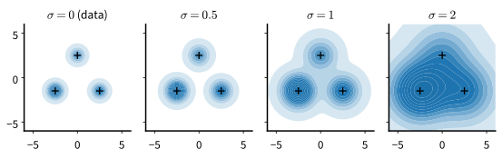

# Denoising and the Score
:label:`sec_diffusion-denoising`

A network trained by squared error learns the conditional expectation of its target given its input (:numref:`sec_gan_beyond`). When we corrupt a clean data point $\mathbf{x}_0 \sim p$ with isotropic Gaussian noise $\sigma \boldsymbol\epsilon$ to form $\tilde{\mathbf{x}} = \mathbf{x}_0 + \sigma \boldsymbol\epsilon$, the optimal least-squares denoiser is therefore the posterior mean $\mathbb{E}[\mathbf{x}_0 \mid \tilde{\mathbf{x}}]$. By *Tweedie's formula* :cite:`Robbins.1956,Miyasawa.1961,Efron.2011`, this posterior mean is directly determined by the gradient of the log-density of the noised data, $\nabla_{\tilde{\mathbf{x}}} \log p_\sigma(\tilde{\mathbf{x}})$, known as the *score* function. Moreover, :citet:`Vincent.2011` showed that regressing a network onto the score of the Gaussian perturbation kernel fits $\nabla_{\tilde{\mathbf{x}}} \log p_\sigma(\tilde{\mathbf{x}})$ without requiring access to the underlying data density $p$.

Learning the score rather than the density itself sidesteps the intractable normalizing constant required by energy-based models, while still providing the vector field needed to generate samples via gradient-based MCMC such as Langevin dynamics. In this section, we first introduce a two-dimensional Gaussian mixture on which the density, score, and posterior mean are exact at every noise level. We use this benchmark to verify Tweedie's formula, examine why a score model trained at any single noise level $\sigma$ cannot simultaneously resolve local mode structure and global mode weights, and finally apply single-level denoising to Fashion-MNIST images.

```{.python .input #denoising-denoising-score-matching}
%%tab pytorch
import math
import numpy as np
import torch
from torch import nn
from torch.nn import functional as F
from d2l import torch as d2l
```

```{.python .input #denoising-denoising-score-matching}
%%tab jax
import math
import numpy as np
import jax
from jax import numpy as jnp
from flax import nnx
import optax
from d2l import jax as d2l
```

```{.python .input #denoising-denoising-and-the-score-1}
%%tab pytorch
torch.set_float32_matmul_precision('high')  # tf32 matmuls on tensor cores
```

## The Running Example

We want one distribution on which every quantity of the chapter is exact at every noise level, so that each learned field and sampler can be checked against the truth. A mixture of Gaussians in the plane will do. Ours has three components with means $(-2.5, -1.5)$, $(2.5, -1.5)$ and $(0, 2.5)$, mixture weights $\pi_k = 0.5, 0.3, 0.2$, and a common standard deviation $s = 0.5$ per coordinate. The modes are far apart compared with their width, so the density has deep valleys between them, and the unequal weights give a sampler something to get wrong.

The *score* of a density $p$ is the gradient of its logarithm, $\nabla \log p(\mathbf{x})$, a vector field that points in the direction in which the density grows fastest. For the mixture $p(\mathbf{x}) = \sum_k \pi_k\, \mathcal{N}(\mathbf{x}; \boldsymbol\mu_k, s^2\mathbf{I})$ it reads

$$
\begin{aligned}
\nabla \log p(\mathbf{x}) &= \sum_k r_k(\mathbf{x})\, \frac{\boldsymbol\mu_k - \mathbf{x}}{s^2}, \\
r_k(\mathbf{x}) &= \frac{\pi_k\, \mathcal{N}(\mathbf{x}; \boldsymbol\mu_k, s^2\mathbf{I})}{p(\mathbf{x})}.
\end{aligned}
$$
:eqlabel:`eq_diffusion-mixture-score`

Each component pulls the point toward its own mean, and the pulls are averaged with the *responsibilities* $r_k(\mathbf{x})$, the posterior probabilities that $\mathbf{x}$ was drawn from component $k$ (:numref:`fig_diffusion-score-field`). The weights $\pi_k$ enter only through the responsibilities. Near a mode one responsibility is close to one whatever the weights are, so the weights change the score only in the valleys, where few points lie. The remark looks harmless, but it will decide what a score model can learn.


:label:`fig_diffusion-score-field`

Noise keeps a mixture of Gaussians a mixture of Gaussians. Adding Gaussian noise of standard deviation $\sigma$ to a draw adds $\sigma^2$ to the variance of each component, so $s^2$ becomes $s^2 + \sigma^2$, and the density, score and posterior mean have closed forms at every noise level. The class below evaluates all three; its argument `alpha`, a scale on the clean point, stays at one until the next section.

```{.python .input #denoising-the-running-example-1}
%%tab pytorch
class GaussianMixture:  #@save
    """A mixture of isotropic Gaussians, exact at every noise level."""
    def __init__(self, means, weights, std, device=None):
        self.means = torch.tensor(means, dtype=torch.float32, device=device)
        self.weights = torch.tensor(weights, dtype=torch.float32,
                                    device=device)
        self.std = std

    @staticmethod
    def three_modes(device=None):
        """The chapter's running example, with mode weights 0.5/0.3/0.2."""
        return GaussianMixture([[-2.5, -1.5], [2.5, -1.5], [0.0, 2.5]],
                               [0.5, 0.3, 0.2], 0.5, device)

    def sample(self, n):
        """n draws from the mixture."""
        k = torch.multinomial(self.weights, n, replacement=True)
        return self.means[k] + self.std * torch.randn(
            n, self.means.shape[1], device=self.means.device)

    def _modes(self, x, alpha, sigma):
        """Per-mode log densities, offsets x - alpha mu_k, variances, alpha."""
        a, s = (torch.as_tensor(v, dtype=x.dtype, device=x.device)
                .reshape(-1, 1, 1) for v in (alpha, sigma))
        var = (a * self.std) ** 2 + s ** 2
        r = x[:, None] - a * self.means
        log_p = (torch.log(self.weights) - (r ** 2).sum(-1) / (2 * var[..., 0])
                 - x.shape[1] / 2 * torch.log(2 * torch.pi * var[..., 0]))
        return log_p, r, var, a

    def log_prob(self, x, alpha=1.0, sigma=0.0):
        """log p(x) for x = alpha x0 + sigma eps."""
        return torch.logsumexp(self._modes(x, alpha, sigma)[0], 1)

    def score(self, x, alpha=1.0, sigma=0.0):
        """The gradient of log p(x) for x = alpha x0 + sigma eps."""
        log_p, r, var, _ = self._modes(x, alpha, sigma)
        return -(torch.softmax(log_p, 1)[..., None] * r / var).sum(1)

    def posterior_mean(self, x, alpha, sigma):
        """E[x0 | x]; finite at alpha = 0 and at sigma = 0."""
        log_p, r, var, a = self._modes(x, alpha, sigma)
        return (torch.softmax(log_p, 1)[..., None]
                * (self.means + a * self.std ** 2 / var * r)).sum(1)
```

```{.python .input #denoising-the-running-example-1}
%%tab jax
class GaussianMixture:  #@save
    """A mixture of isotropic Gaussians, exact at every noise level."""
    def __init__(self, means, weights, std):
        self.means = jnp.array(means, dtype=jnp.float32)
        self.weights = jnp.array(weights, dtype=jnp.float32)
        self.std = std

    @staticmethod
    def three_modes():
        """The chapter's running example, with mode weights 0.5/0.3/0.2."""
        return GaussianMixture([[-2.5, -1.5], [2.5, -1.5], [0.0, 2.5]],
                               [0.5, 0.3, 0.2], 0.5)

    def sample(self, key, n):
        """n draws from the mixture."""
        k1, k2 = jax.random.split(key)
        k = jax.random.choice(k1, len(self.weights), (n,), p=self.weights)
        return self.means[k] + self.std * jax.random.normal(
            k2, (n, self.means.shape[1]))

    def _modes(self, x, alpha, sigma):
        """Per-mode log densities, offsets x - alpha mu_k, variances, alpha."""
        a, s = (jnp.asarray(v, x.dtype).reshape(-1, 1, 1)
                for v in (alpha, sigma))
        var = (a * self.std) ** 2 + s ** 2
        r = x[:, None] - a * self.means
        log_p = (jnp.log(self.weights) - (r ** 2).sum(-1) / (2 * var[..., 0])
                 - x.shape[1] / 2 * jnp.log(2 * jnp.pi * var[..., 0]))
        return log_p, r, var, a

    def log_prob(self, x, alpha=1.0, sigma=0.0):
        """log p(x) for x = alpha x0 + sigma eps."""
        return jax.nn.logsumexp(self._modes(x, alpha, sigma)[0], 1)

    def score(self, x, alpha=1.0, sigma=0.0):
        """The gradient of log p(x) for x = alpha x0 + sigma eps."""
        log_p, r, var, _ = self._modes(x, alpha, sigma)
        return -(jax.nn.softmax(log_p, 1)[..., None] * r / var).sum(1)

    def posterior_mean(self, x, alpha, sigma):
        """E[x0 | x]; finite at alpha = 0 and at sigma = 0."""
        log_p, r, var, a = self._modes(x, alpha, sigma)
        return (jax.nn.softmax(log_p, 1)[..., None]
                * (self.means + a * self.std ** 2 / var * r)).sum(1)
```

Throughout the chapter, samplers on this mixture are judged by the same yardsticks: the mean negative log-likelihood of their points under the true density, and three numbers from `summary`. The *mode weights* count each point at its nearest mean. The *strays* are the fraction of points farther than $3s = 1.5$ from every mean. The *spread* is the mean squared distance of the remaining points to their nearest mean; since it ignores the strays, it can never exceed $(3s)^2 = 2.25$, and a sampler that is far too wide shows up mainly as strays.

```{.python .input #denoising-the-running-example-3}
%%tab pytorch
@d2l.add_to_class(GaussianMixture)  #@save
def nll(self, x):
    """Mean negative log-likelihood of clean points, in nats."""
    return -self.log_prob(x).mean()

@d2l.add_to_class(GaussianMixture)  #@save
def summary(self, x):
    """Mode weights by nearest mean, stray fraction, spread of the rest."""
    d2 = ((x[:, None] - self.means) ** 2).sum(-1)
    near, k = d2.min(1)
    inside = near < (3 * self.std) ** 2
    weights = torch.bincount(k, minlength=len(self.weights)) / len(x)
    return dict(weights=[round(w, 3) for w in weights.tolist()],
                stray=round(1 - inside.float().mean().item(), 4),
                spread=round(near[inside].mean().item(), 3))
```

```{.python .input #denoising-the-running-example-3}
%%tab jax
@d2l.add_to_class(GaussianMixture)  #@save
def nll(self, x):
    """Mean negative log-likelihood of clean points, in nats."""
    return -self.log_prob(x).mean()

@d2l.add_to_class(GaussianMixture)  #@save
def summary(self, x):
    """Mode weights by nearest mean, stray fraction, spread of the rest."""
    d2 = ((x[:, None] - self.means) ** 2).sum(-1)
    near, k = d2.min(1), d2.argmin(1)
    inside = near < (3 * self.std) ** 2
    weights = jnp.bincount(k, length=len(self.weights)) / len(x)
    return dict(weights=[round(float(w), 3) for w in weights],
                stray=round(1 - float(inside.mean()), 4),
                spread=round(float(near[inside].mean()), 3))
```

To compare 2D point clouds visually alongside these numerical summaries,
`scatter_panels` plots one or more sample sets side by side on shared axes
(optionally overlaying a reference dataset `data` in light gray):

```{.python .input #denoising-the-running-example-2}
%%tab pytorch, jax
def scatter_panels(samples, titles=None, data=None, lim=4.5,  #@save
                   size=3.0):
    """Scatter 2-D point sets side by side on equal, shared axes."""
    _, axes = d2l.plt.subplots(1, len(samples), squeeze=False,
                               figsize=(size * len(samples), size))
    for i, (ax, pts) in enumerate(zip(axes[0], samples)):
        if data is not None:
            ax.scatter(*d2l.numpy(data).T, s=2, c='lightgray')
        ax.scatter(*d2l.numpy(pts).T, s=2)
        ax.set(xlim=(-lim, lim), ylim=(-lim, lim), aspect='equal')
        if titles:
            ax.set_title(titles[i])
    return axes[0]
```

What should a perfect sampler print? The weights $0.5$, $0.3$ and $0.2$, up to sampling noise. In two dimensions the squared distance of a Gaussian draw from its mean is exponentially distributed with mean $2s^2 = 0.5$, so a fraction $e^{-(3s)^2/(2s^2)} = e^{-4.5} \approx 1\%$ of the points stray, and the spread of the rest is a little below $0.5$. We check this on 2,000 draws, the training set of the section's two-dimensional experiments.

```{.python .input #denoising-the-running-example-4}
%%tab pytorch
torch.manual_seed(0)
mix = d2l.GaussianMixture.three_modes()
data = mix.sample(2000)
print(mix.summary(data), f'NLL {mix.nll(data):.3f}')
d2l.scatter_panels([data], ['2,000 draws']);
```

```{.python .input #denoising-the-running-example-4}
%%tab jax
mix = d2l.GaussianMixture.three_modes()
data = mix.sample(jax.random.key(0), 2000)
print(mix.summary(data), f'NLL {mix.nll(data):.3f}')
d2l.scatter_panels([data], ['2,000 draws']);
```

The draws print what we predicted. These are the values every sampler on the mixture aims for. The negative log-likelihood needs a word of care. About $2.5$ nats per point is the entropy of the mixture: no density model scores fresh data lower on average, and the points of a correct sampler score about this much under $p$. For a sampler it is a target, not a bound to beat: points crowded at the modes score less, and points in the valleys more.

## The Optimal Denoiser

The regression of the opening has two natural targets, the clean point and a vector that points to it. The identity that links their minimizers is the most important result of this section.

### Noise and the Regression Target

Pick a noise level $\sigma > 0$, draw a clean point $\mathbf{x}_0 \sim p$ and standard Gaussian noise $\boldsymbol\epsilon \sim \mathcal{N}(\mathbf{0}, \mathbf{I})$, and form the noisy point $\tilde{\mathbf{x}} = \mathbf{x}_0 + \sigma \boldsymbol\epsilon$. Its density $p_\sigma$ is the data density blurred by a Gaussian of width $\sigma$, positive and smooth everywhere even when $p$ is not. A denoiser $D$ is trained to minimize $\mathbb{E}\|D(\tilde{\mathbf{x}}) - \mathbf{x}_0\|^2$. Squared error is minimized by the conditional mean of the target given the input, the fact recalled at the start of this section (:numref:`sec_gan_beyond`), so the optimal denoiser is the *posterior mean* $\mathbb{E}[\mathbf{x}_0 \mid \tilde{\mathbf{x}}]$: the average of the clean points that could have produced $\tilde{\mathbf{x}}$, each weighted by how likely it is to have done so.

The same regression can aim at a different target. Given the clean point, the noisy point is Gaussian around it, and the score of this conditional density is

$$
\nabla_{\tilde{\mathbf{x}}} \log p_\sigma(\tilde{\mathbf{x}} \mid \mathbf{x}_0)
= \frac{\mathbf{x}_0 - \tilde{\mathbf{x}}}{\sigma^2}
= -\frac{\boldsymbol\epsilon}{\sigma},
$$
:eqlabel:`eq_diffusion-conditional-score`

a vector pointing from the noisy point back to the clean one. *Denoising score matching* regresses a vector field $\mathbf{s}_{\boldsymbol\theta}$ onto it :cite:`Vincent.2011`:

$$
\begin{aligned}
J_{\mathrm{DSM}}(\boldsymbol\theta)
&= \tfrac12\, \mathbb{E}_{\mathbf{x}_0, \boldsymbol\epsilon}
\Big\| \mathbf{s}_{\boldsymbol\theta}(\mathbf{x}_0 + \sigma \boldsymbol\epsilon) + \frac{\boldsymbol\epsilon}{\sigma} \Big\|^2.
\end{aligned}
$$
:eqlabel:`eq_diffusion-dsm`

The minimizer is again a conditional mean, now of the conditional score, and Vincent's theorem identifies it: *the score of the noised data is the posterior mean of the conditional score*,

$$
\mathbb{E}\Big[ -\frac{\boldsymbol\epsilon}{\sigma} \,\Big|\, \tilde{\mathbf{x}} \Big] = \nabla \log p_\sigma(\tilde{\mathbf{x}}).
$$
:eqlabel:`eq_diffusion-posterior-mean-score`

The proof is two lines of Bayes' rule. The noisy density is the clean one blurred by the noise, $p_\sigma(\tilde{\mathbf{x}}) = \int p(\mathbf{x}_0)\, p_\sigma(\tilde{\mathbf{x}} \mid \mathbf{x}_0)\, d\mathbf{x}_0$. Differentiate under the integral, write the gradient of the kernel as the kernel times the gradient of its logarithm, and divide by $p_\sigma(\tilde{\mathbf{x}})$:

$$
\begin{aligned}
\nabla \log p_\sigma(\tilde{\mathbf{x}})
&= \int \frac{p(\mathbf{x}_0)\, p_\sigma(\tilde{\mathbf{x}} \mid \mathbf{x}_0)}{p_\sigma(\tilde{\mathbf{x}})}\, \nabla_{\tilde{\mathbf{x}}} \log p_\sigma(\tilde{\mathbf{x}} \mid \mathbf{x}_0)\, d\mathbf{x}_0.
\end{aligned}
$$

The fraction is Bayes' rule for the posterior $p(\mathbf{x}_0 \mid \tilde{\mathbf{x}})$, so the right-hand side is the posterior mean of the conditional score, which is :eqref:`eq_diffusion-posterior-mean-score`. Nothing in the two lines used that the noise is Gaussian; the conditions under which the gradient may move inside the integral are in :numref:`sec_mdl-denoising-score-matching`.

The regression on per-pair targets therefore fits the score of $p_\sigma$, which we never wrote down. This is the reason the chapter can train generators by regression at all: we cannot evaluate the score of the data, but we can evaluate the score of the noise we added ourselves.

### Tweedie's Formula

The two regressions, onto the clean point and onto $-\boldsymbol\epsilon/\sigma$, have targets related by the map $\mathbf{x}_0 \mapsto (\mathbf{x}_0 - \tilde{\mathbf{x}})/\sigma^2$, which is affine once $\tilde{\mathbf{x}}$ is given, so their minimizers, two conditional means, are related by the same map. Solving for the posterior mean gives *Tweedie's formula* :cite:`Efron.2011`,

$$
\mathbb{E}[\mathbf{x}_0 \mid \tilde{\mathbf{x}}] = \tilde{\mathbf{x}} + \sigma^2\, \nabla \log p_\sigma(\tilde{\mathbf{x}}).
$$
:eqlabel:`eq_diffusion-tweedie`

The best denoiser takes one step of size $\sigma^2$ up the score of the noisy density (:numref:`fig_mdl-dyn-tweedie`). A denoiser, a score and a noise predictor are therefore three ways of writing one posterior mean:

$$
\begin{aligned}
\hat{\mathbf{x}}_0(\tilde{\mathbf{x}}) &= \tilde{\mathbf{x}} + \sigma^2\, \hat{\mathbf{s}}(\tilde{\mathbf{x}}), \\
\hat{\boldsymbol\epsilon}(\tilde{\mathbf{x}}) &= \frac{\tilde{\mathbf{x}} - \hat{\mathbf{x}}_0(\tilde{\mathbf{x}})}{\sigma} = -\sigma\, \hat{\mathbf{s}}(\tilde{\mathbf{x}}).
\end{aligned}
$$
:eqlabel:`eq_diffusion-three-predictions`

A network trained to output any one of the three gives the other two.

The smallest case shows what the step does. Let the data be Gaussian, $\mathcal{N}(\boldsymbol\mu, v\mathbf{I})$. Then $p_\sigma = \mathcal{N}(\boldsymbol\mu, (v + \sigma^2)\mathbf{I})$ has the score $-(\tilde{\mathbf{x}} - \boldsymbol\mu)/(v + \sigma^2)$, and Tweedie's formula gives

$$
\mathbb{E}[\mathbf{x}_0 \mid \tilde{\mathbf{x}}] = \boldsymbol\mu + \frac{v}{v + \sigma^2}\, (\tilde{\mathbf{x}} - \boldsymbol\mu).
$$

The denoiser shrinks the noisy offset from the mean by the factor $v/(v + \sigma^2)$, and the posterior variance per coordinate is $v\sigma^2/(v + \sigma^2)$. With $v = s^2 = 0.25$ and $\sigma = 0.3$ the factor is $0.74$, and the squared error per coordinate falls from $\sigma^2 = 0.09$ to $0.066$. Away from the valleys the posterior mean of the running example is this shrinkage toward the nearest mean, so over the two coordinates of a point denoising should lower the squared error from $0.18$ to about $0.13$.

### A Trained Score

Does a learned score reach this best denoiser? To find out we need a network, and the chapter uses one small MLP for all its two-dimensional experiments. Besides the point it reads sines and cosines of the noise level (from the next section on, of a time $t \in [0, 1]$ along a path from data to noise). Here the level is fixed and these features do nothing. From the next section on, one network serves every level and must tell nearby levels apart, so the frequencies run from 1 to 64 radians per unit of $t$, and the fastest features complete about ten periods on $[0, 1]$. The positional encodings of :numref:`sec_positional-information`, built for integer token positions in the thousands, would be nearly constant or linear on this $[0, 1]$ interval (in :numref:`sec_diffusion-few-step`, we will see why few-step flow-map generators lower these frequencies again).

```{.python .input #denoising-noise-and-the-regression-target}
%%tab pytorch
def time_embedding(t, dim, freqs=(1.0, 64.0)):  #@save
    """Sines and cosines of t at dim / 2 frequencies, geometric from freqs[0]
    to freqs[1] radians per unit of t (t in [0, 1])."""
    f = torch.exp(torch.linspace(math.log(freqs[0]), math.log(freqs[1]),
                                 dim // 2, device=t.device))
    args = t.float()[:, None] * f
    return torch.cat([args.sin(), args.cos()], 1)

class TimeMLP(nn.Module):  #@save
    """An MLP on a point x and the time features of one or more times;
    time_freqs: see time_embedding."""
    def __init__(self, hidden=256, depth=3, *, dim=2, num_times=1,
                 time_dim=64, time_freqs=(1.0, 64.0)):
        super().__init__()
        self.time_dim, self.time_freqs = time_dim, time_freqs
        self.embed = d2l.make_mlp([time_dim * num_times, hidden, hidden],
                                  nn.SiLU())
        self.inp = nn.Linear(dim, hidden)
        self.body = nn.Sequential(  # depth layers, each after a SiLU
            nn.SiLU(), d2l.make_mlp([hidden] * depth + [dim], nn.SiLU()))

    def forward(self, x, *ts):
        feats = [time_embedding(t, self.time_dim, self.time_freqs) for t in ts]
        return self.body(self.inp(x) + self.embed(torch.cat(feats, 1)))
```

```{.python .input #denoising-noise-and-the-regression-target}
%%tab jax
def time_embedding(t, dim, freqs=(1.0, 64.0)):  #@save
    """Sines and cosines of t at dim / 2 frequencies, geometric from freqs[0]
    to freqs[1] radians per unit of t (t in [0, 1])."""
    f = jnp.exp(jnp.linspace(math.log(freqs[0]), math.log(freqs[1]), dim // 2))
    args = jnp.asarray(t, jnp.float32)[:, None] * f
    return jnp.concatenate([jnp.sin(args), jnp.cos(args)], 1)

class TimeMLP(nnx.Module):  #@save
    """An MLP on a point x and the time features of one or more times;
    time_freqs: see time_embedding."""
    def __init__(self, hidden=256, depth=3, *, dim=2, num_times=1,
                 time_dim=64, time_freqs=(1.0, 64.0), rngs):
        self.time_dim, self.time_freqs = time_dim, time_freqs
        self.embed = d2l.make_mlp([time_dim * num_times, hidden, hidden],
                                  nnx.silu, rngs=rngs)
        self.inp = d2l.Linear(dim, hidden, rngs=rngs)
        self.body = nnx.Sequential(  # depth layers, each after a SiLU
            nnx.silu,
            d2l.make_mlp([hidden] * depth + [dim], nnx.silu, rngs=rngs))

    def __call__(self, x, *ts):
        feats = [time_embedding(t, self.time_dim, self.time_freqs) for t in ts]
        return self.body(self.inp(x) + self.embed(jnp.concatenate(feats, 1)))
```

One training loop serves the whole chapter: Adam on a fresh minibatch with fresh noise at every step. It also maintains an exponential moving average (EMA) of the weights—which will become important for image generation starting in :numref:`sec_diffusion-images`—and its docstring lists the remaining options.

```{.python .input #gaussian-paths-experiments-on-the-running-example}
%%tab pytorch
def train_regression(model, loss_fn, batch_fn, num_steps, *,  #@save
                     lr=1e-3, cosine=False, ema_half_life=1000,
                     compiled=True):
    """Adam on loss_fn(model, batch_fn()) -> (model, EMA model, losses).

    The learning rate is constant or, with cosine=True, decays to zero along
    a cosine. The EMA model averages the weights (d2l.EMA): the weights of
    ema_half_life updates ago count half as much as the current ones. On a
    GPU, Adam is fused into one kernel and, with compiled=True, the loss and
    its gradient run as CUDA graphs: the networks of this chapter are so
    small that launching their kernels one at a time would cost more time
    than running them."""
    params = list(model.parameters())
    opt = torch.optim.Adam(params, lr=lr, fused=params[0].is_cuda)
    sched = (torch.optim.lr_scheduler.CosineAnnealingLR(opt, num_steps)
             if cosine else None)
    if compiled and params[0].is_cuda:  # loss and gradient as CUDA graphs
        loss_fn = torch.compile(loss_fn, mode='reduce-overhead',
                                dynamic=False)
    ema, losses = d2l.EMA(model, ema_half_life), []
    for _ in range(num_steps):
        loss = loss_fn(model, batch_fn())
        opt.zero_grad()
        loss.backward()
        opt.step()
        if sched:
            sched.step()
        ema.update(model)
        losses.append(loss.detach().clone())  # the graph reuses its output
    return model, ema.model, torch.stack(losses)
```

```{.python .input #gaussian-paths-experiments-on-the-running-example}
%%tab jax
def train_regression(model, loss_fn, batch_fn, num_steps, key, *,  #@save
                     lr=1e-3, cosine=False, ema_half_life=1000, chunk=500):
    """Adam on loss_fn(model, batch_fn(k1), k2) -> model, EMA model, losses.

    The learning rate is constant or, with cosine=True, decays to zero along
    a cosine. The EMA model averages the weights (d2l.EMA): the weights of
    ema_half_life updates ago count half as much as the current ones. Each
    chunk of updates is one jitted scan, a single dispatch to the device:
    the networks of this chapter are so small that dispatching their
    updates one at a time would cost more time than running them."""
    schedule = optax.cosine_decay_schedule(lr, num_steps) if cosine else lr
    opt = nnx.Optimizer(model, optax.adam(schedule), wrt=nnx.Param)
    ema = d2l.EMA(model, ema_half_life)

    @nnx.jit
    def run(model, opt, avg, batches, keys):
        @nnx.scan(in_axes=(nnx.Carry, 0, 0), out_axes=(nnx.Carry, 0))
        def step(carry, batch, key):
            model, opt, avg = carry
            loss, grads = nnx.value_and_grad(loss_fn)(model, batch, key)
            opt.update(model, grads)
            ema.average(avg, model, ema.decay)    # on the carried copy
            return (model, opt, avg), loss
        return step((model, opt, avg), batches, keys)[1]

    chunks = [min(chunk, num_steps - i)           # steps per jitted dispatch
              for i in range(0, num_steps, chunk)]
    losses = []
    for key, n in zip(jax.random.split(key, len(chunks)), chunks):
        k1, k2 = jax.random.split(key)            # batches drawn outside jit
        batches = jax.vmap(batch_fn)(jax.random.split(k1, n))
        losses.append(run(model, opt, ema.model, batches,
                          jax.random.split(k2, n)))
    return model, ema.model, jnp.concatenate(losses)
```

For the mixture, a network with two hidden layers of 128 units minimizes :eqref:`eq_diffusion-dsm` for 2,000 steps, each on 256 of the 2,000 training points with fresh noise, and we keep the trained score as a function of the point alone.

```{.python .input #denoising-noise-and-the-regression-target-1}
%%tab pytorch
def dsm_loss(net, x, sigma):
    """Denoising score matching at one noise level: regress onto -eps/sigma."""
    eps = torch.randn_like(x)
    s = net(x + sigma * eps, torch.full((len(x),), sigma))
    return 0.5 * ((s + eps / sigma) ** 2).sum(1).mean()

def fit_score(data, sigma, seed=1, num_steps=2000):
    """Train a score network at one noise level and return it as a function."""
    torch.manual_seed(seed)
    batch_fn = lambda: data[torch.randint(0, len(data), (256,))]
    net, _, _ = d2l.train_regression(
        d2l.TimeMLP(128, 2), lambda net, x: dsm_loss(net, x, sigma),
        batch_fn, num_steps)
    return lambda x: net(x, torch.full((len(x),), sigma)).detach()
```

```{.python .input #denoising-noise-and-the-regression-target-1}
%%tab jax
def dsm_loss(net, x, key, sigma):
    """Denoising score matching at one noise level: regress onto -eps/sigma."""
    eps = jax.random.normal(key, x.shape)
    s = net(x + sigma * eps, jnp.full((len(x),), sigma))
    return 0.5 * ((s + eps / sigma) ** 2).sum(1).mean()

def fit_score(data, sigma, seed=1, num_steps=2000):
    """Train a score network at one noise level and return it as a function."""
    batch_fn = lambda key: data[jax.random.randint(key, (256,), 0, len(data))]
    net, _, _ = d2l.train_regression(
        d2l.TimeMLP(128, 2, rngs=nnx.Rngs(seed)),
        lambda net, x, key: dsm_loss(net, x, key, sigma), batch_fn,
        num_steps, jax.random.key(seed))
    return lambda x: net(x, jnp.full((len(x),), sigma))
```

At $\sigma = 0.3$ we noise 20,000 fresh points and compare three guesses of the clean point: the noisy point itself, the exact posterior mean, and Tweedie's step with the trained score.

```{.python .input #denoising-tweedie-s-formula}
%%tab pytorch
sigma = 0.3
score = fit_score(data, sigma)
x0 = mix.sample(20000)
xt = x0 + sigma * torch.randn_like(x0)
exact = mix.posterior_mean(xt, 1.0, sigma)
for name, x0_hat in (('noisy point', xt), ('posterior mean', exact),
                     ('Tweedie, trained score', xt + sigma ** 2 * score(xt))):
    print(f'{name}: squared error {((x0_hat - x0) ** 2).sum(1).mean():.4f}')
```

```{.python .input #denoising-tweedie-s-formula}
%%tab jax
sigma = 0.3
score = fit_score(data, sigma)
k1, k2 = jax.random.split(jax.random.key(1))
x0 = mix.sample(k1, 20000)
xt = x0 + sigma * jax.random.normal(k2, x0.shape)
exact = mix.posterior_mean(xt, 1.0, sigma)
for name, x0_hat in (('noisy point', xt), ('posterior mean', exact),
                     ('Tweedie, trained score', xt + sigma ** 2 * score(xt))):
    print(f'{name}: squared error {((x0_hat - x0) ** 2).sum(1).mean():.4f}')
```

The exact posterior mean lowers the squared error from $0.18$ to about $0.13$, as the Gaussian case predicted, and Tweedie's step with the trained score comes within about one percent of it. After 2,000 steps on 2,000 points the network is a nearly optimal denoiser, and therefore a usable score.

As a score it is a little less good than that sounds. The score enters the denoiser multiplied by $\sigma^2 = 0.09$, and in expectation the excess error of Tweedie's step over the posterior mean is exactly $\sigma^4$ times the mean squared error of the score; the cross term vanishes because the error of the posterior mean averages to zero given $\tilde{\mathbf{x}}$. The gap of about $0.001$ thus stands for a score error $\tfrac12\mathbb{E}\|\hat{\mathbf{s}} - \nabla \log p_\sigma\|^2$ of about $0.06$. A denoiser can look nearly perfect while its score is visibly off, and the score is what a sampler follows.

### Scores and Normalizers

Why learn a score rather than a density? A network with a scalar output $E_{\boldsymbol\theta}$, called the *energy*, defines a density through an *energy-based model*,

$$
p_{\boldsymbol\theta}(\mathbf{x}) = \frac{\exp(-E_{\boldsymbol\theta}(\mathbf{x}))}{Z_{\boldsymbol\theta}},
\qquad
Z_{\boldsymbol\theta} = \int \exp(-E_{\boldsymbol\theta}(\mathbf{x}))\, d\mathbf{x}.
$$
:eqlabel:`eq_diffusion-ebm`

The normalizer is what makes learning meaningful: since the total mass is fixed, raising the density on the training points lowers it elsewhere. Unfortunately $Z_{\boldsymbol\theta}$ is an integral over the whole input space that changes with every update, and the gradient of the log-likelihood contains $\nabla_{\boldsymbol\theta} \log Z_{\boldsymbol\theta} = -\mathbb{E}_{p_{\boldsymbol\theta}}[\nabla_{\boldsymbol\theta} E_{\boldsymbol\theta}]$, an expectation that has to be estimated by sampling from the model, in practice with a Markov chain. The score does not see $Z_{\boldsymbol\theta}$ at all, because $Z_{\boldsymbol\theta}$ does not depend on $\mathbf{x}$: $\nabla_{\mathbf{x}} \log p_{\boldsymbol\theta} = -\nabla_{\mathbf{x}} E_{\boldsymbol\theta}$.

A field $\mathbf{s}$ is compared with the data by the *Fisher divergence*, the mean squared distance between the two fields where the data lie:

$$
D_{\mathrm{F}}(p, \mathbf{s}) = \tfrac12\, \mathbb{E}_{\mathbf{x} \sim p} \big\| \mathbf{s}(\mathbf{x}) - \nabla \log p(\mathbf{x}) \big\|^2.
$$
:eqlabel:`eq_diffusion-esm`

It contains the unknown data score, which *Hyvärinen's identity* :cite:`Hyvarinen.2005` removes by integration by parts: up to a constant, $D_{\mathrm{F}}$ equals $\mathbb{E}_{p}[\tfrac12\|\mathbf{s}\|^2 + \nabla \cdot \mathbf{s}]$, an average over data with no normalizer and no chain (:numref:`sec_mdl-score-matching`). Its second term, $\nabla \cdot \mathbf{s}$, the trace of the Jacobian of $\mathbf{s}$, costs one backward pass per input dimension, too many for images. Denoising removes that cost as well: by Vincent's theorem, :eqref:`eq_diffusion-dsm` is the Fisher divergence to $p_\sigma$ up to a constant.

## Limits of a Single Noise Level

A denoiser trained at one noise level gives the score of one blurred distribution, $p_\sigma$. To sample $p$ we want the score of $p$, so the first question is which $\sigma$ to choose.

### Choosing the Noise Level

A small noise level has two problems. The first is statistical. For data with a smooth density, such as the running example, the target $-\boldsymbol\epsilon/\sigma$ grows like $1/\sigma$ while the score it averages to stays bounded, so at small $\sigma$ the target is mostly noise and the network fits it poorly. Even the exact score leaves the variance of the target around its conditional mean in the loss, and in $d$ dimensions this floor grows like $d/\sigma^2$ as $\sigma$ shrinks (:numref:`sec_mdl-denoising-score-matching`). A denoising loss that levels off well above zero is therefore no sign of a bad network.

The second problem matters most for images, which are believed to lie near a low-dimensional set inside pixel space :cite:`Bengio.Courville.Vincent.2013`. Let us take the extreme case of data on a line in the plane. Noise thickens the line into a band across which $p_\sigma$ is a Gaussian of variance $\sigma^2$, so the score across the band is $-\tilde{x}_2/\sigma^2$ at distance $\tilde{x}_2$ from the line (Exercise :exref:`ex_denoising-data-on-a-line`). Its slope, $-1/\sigma^2$, grows without bound as $\sigma \to 0$. Across the band the target $-\epsilon_2/\sigma$ equals this score exactly, so the trouble is not noise there: the network must represent a field that turns into a cliff across the data set, while along it the targets are mostly noise.

A large noise level has the opposite problem. The regression is well conditioned, but its answer is the score of $p_\sigma$, not of $p$. For one Gaussian component $\mathcal{N}(\boldsymbol\mu, s^2\mathbf{I})$ in $d$ dimensions the two scores are $-(\mathbf{x} - \boldsymbol\mu)/(s^2 + \sigma^2)$ and $-(\mathbf{x} - \boldsymbol\mu)/s^2$, and averaging the squared norm of their difference over $p$ gives the bias

$$
\begin{aligned}
\tfrac12\, \mathbb{E}_p \big\| \nabla \log p_\sigma - \nabla \log p \big\|^2
&= \frac{d\, \sigma^4}{2 s^2 (s^2 + \sigma^2)^2}.
\end{aligned}
$$

The bias grows like $\sigma^4$ at first. For $s = 0.5$ and $d = 2$ it is $0.0004$ at $\sigma = 0.05$, $0.28$ at $\sigma = 0.3$ and $2.6$ at $\sigma = 1$, and the well-separated mixture has nearly the same values. Divided by the size of the clean score, $\tfrac12 \mathbb{E}_p\|\nabla \log p\|^2 = d/(2s^2)$, it becomes $(\sigma^2/(s^2 + \sigma^2))^2$, which depends only on $\sigma/s$. The smoothed score stays within $10\%$ of the clean one, in root-mean-square terms, while $\sigma < s/3 \approx 0.17$, so we should expect the bias to start to matter near there.

Between the two problems there should be a best level. We train a network at each of seven levels from $0.05$ to $1$, with two seeds, and estimate the Fisher divergence :eqref:`eq_diffusion-esm` of each from the clean score on 20,000 test points, next to the bias of the exact smoothed score.

```{.python .input #denoising-the-loss-floor-and-the-noise-level}
%%tab pytorch
sigmas, seeds = [0.05, 0.1, 0.15, 0.2, 0.3, 0.5, 1.0], (1, 2)
scores = {(sg, seed): fit_score(data, sg, seed)
          for seed in seeds for sg in sigmas}
x_test = mix.sample(20000)
target = mix.score(x_test)                     # the clean score
def score_error(score, x, target):
    return 0.5 * ((score(x) - target) ** 2).sum(1).mean().item()
learned = {seed: [score_error(scores[sg, seed], x_test, target)
                  for sg in sigmas] for seed in seeds}
bias = [score_error(lambda x: mix.score(x, 1.0, sg), x_test, target)
        for sg in sigmas]
for seed in seeds:
    print(f'trained, seed {seed}:', [round(e, 3) for e in learned[seed]])
print('exact smoothed: ', [round(e, 4) for e in bias])
d2l.plot(sigmas, [*learned.values(), bias], 'sigma',
         'error against the clean score', xscale='log', yscale='log',
         legend=[f'network, seed {seed}' for seed in seeds]
         + ['exact score of p_sigma'])
```

```{.python .input #denoising-the-loss-floor-and-the-noise-level}
%%tab jax
sigmas, seeds = [0.05, 0.1, 0.15, 0.2, 0.3, 0.5, 1.0], (1, 2)
scores = {(sg, seed): fit_score(data, sg, seed)
          for seed in seeds for sg in sigmas}
x_test = mix.sample(jax.random.key(2), 20000)
target = mix.score(x_test)                     # the clean score
def score_error(score, x, target):
    return float(0.5 * ((score(x) - target) ** 2).sum(1).mean())
learned = {seed: [score_error(scores[sg, seed], x_test, target)
                  for sg in sigmas] for seed in seeds}
bias = [score_error(lambda x: mix.score(x, 1.0, sg), x_test, target)
        for sg in sigmas]
for seed in seeds:
    print(f'trained, seed {seed}:', [round(e, 3) for e in learned[seed]])
print('exact smoothed: ', [round(e, 4) for e in bias])
d2l.plot(sigmas, [*learned.values(), bias], 'sigma',
         'error against the clean score', xscale='log', yscale='log',
         legend=[f'network, seed {seed}' for seed in seeds]
         + ['exact score of p_sigma'])
```

The learned error traces a U. To the right it follows the bias line, within about $0.1$ from $\sigma = 0.5$ on: the networks fit their blurred targets well, and the targets are wrong. To the left it rises again although the bias vanishes, because the targets are mostly noise, and the second seed changes some errors there by half or more. The best level lies between $\sigma = 0.1$ and $0.2$, a fifth to two fifths of the component width and around the $s/3$ of the bias rule, at an error of about $0.15$ to $0.25$. That is the rule for a single level: measure $\sigma$ in units of the scale of the data, and take it as small as the network can still fit.

### Blindness to Mode Weights

An error of $0.2$ in the Fisher divergence sounds small, but small compared with what? Compare the running example with its equal-weight copy. A model with these wrong weights loses $0.07$ nats of likelihood per point, their Kullback--Leibler divergence. Its score, however, differs from the true one only through the responsibilities in :eqref:`eq_diffusion-mixture-score`, which differ only in the valleys, where $p$ is nearly zero, so the Fisher divergence, an average under $p$, barely sees the difference.

We compute both divergences by quadrature on a $721 \times 721$ grid rather than by sampling, because the Fisher integrand lives in the valleys, where few Monte Carlo draws land, and then repeat the comparison with both mixtures blurred by the same noise.

```{.python .input #denoising-blindness-to-mode-weights}
%%tab pytorch
mix_eq = d2l.GaussianMixture(mix.means.tolist(), [1 / 3] * 3, mix.std)
g = torch.linspace(-9, 9, 721)
grid = torch.stack(torch.meshgrid(g, g, indexing='ij'), -1).reshape(-1, 2)
area = (g[1] - g[0]) ** 2                      # of one grid cell
for sigma in (0.0, 0.5, 1.0):
    log_p = mix.log_prob(grid, 1.0, sigma)
    diff = mix.score(grid, 1.0, sigma) - mix_eq.score(grid, 1.0, sigma)
    fisher = area * (log_p.exp() * 0.5 * (diff ** 2).sum(1)).sum()
    kl = area * (log_p.exp()
                 * (log_p - mix_eq.log_prob(grid, 1.0, sigma))).sum()
    print(f'sigma = {sigma}: Fisher divergence {fisher:.1e}, KL {kl:.3f} nats')
```

```{.python .input #denoising-blindness-to-mode-weights}
%%tab jax
mix_eq = d2l.GaussianMixture(mix.means.tolist(), [1 / 3] * 3, mix.std)
g = jnp.linspace(-9, 9, 721)
grid = jnp.stack(jnp.meshgrid(g, g, indexing='ij'), -1).reshape(-1, 2)
area = (g[1] - g[0]) ** 2                      # of one grid cell
for sigma in (0.0, 0.5, 1.0):
    log_p = mix.log_prob(grid, 1.0, sigma)
    diff = mix.score(grid, 1.0, sigma) - mix_eq.score(grid, 1.0, sigma)
    fisher = area * (jnp.exp(log_p) * 0.5 * (diff ** 2).sum(1)).sum()
    kl = area * (jnp.exp(log_p)
                 * (log_p - mix_eq.log_prob(grid, 1.0, sigma))).sum()
    print(f'sigma = {sigma}: Fisher divergence {fisher:.1e}, KL {kl:.3f} nats')
```

Between the clean mixtures the Fisher divergence is about $10^{-5}$, four orders of magnitude below the errors of the trained networks, none of which fell below $0.1$, while the KL divergence is $0.07$ nats. A score model trained near the clean data therefore cannot learn the weights: a field with the wrong weights fits as well as one with the right weights (:numref:`sec_mdl-fisher-divergence`; Exercise :exref:`ex_mdl-divergences-distances-score-blindness` of :numref:`sec_mdl-scores`). A score can be excellent near the data and still know nothing about how often each mode occurs.

Noise makes the weights visible. As $\sigma$ grows, the components spread into the valleys (:numref:`fig_diffusion-noise-ladder`), the responsibilities differ where $p_\sigma$ has mass, and the Fisher divergence rises to about $10^{-3}$ at $\sigma = 0.5$ and $10^{-2}$ at $\sigma = 1$, while the KL divergence barely changes. Even at $\sigma = 1$ this Fisher divergence is more than ten times smaller than any error in the sweep, so noise alone does not make the weights easy to learn. What it changes first is that chains can cross the valleys.


:label:`fig_diffusion-noise-ladder`

### Sampling with a Score

A score is enough to draw samples, and the simplest way to do it is more than a century old. Paul Langevin wrote down an equation of this kind in 1908 for a particle in a fluid, pushed by a force and kicked at random by the molecules around it. In discrete form, *Langevin dynamics* starts from any point and repeats

$$
\mathbf{x} \leftarrow \mathbf{x} + \frac{h}{2}\, \mathbf{s}(\mathbf{x}) + \sqrt{h}\, \boldsymbol\xi,
\qquad \boldsymbol\xi \sim \mathcal{N}(\mathbf{0}, \mathbf{I}),
$$
:eqlabel:`eq_diffusion-langevin`

with a small step size $h$. The drift moves the point up the log-density, and the noise keeps it from collapsing onto a mode. In the continuous-time limit, $p$ is the stationary distribution whenever $\mathbf{s} = \nabla \log p$ (:numref:`sec_mdl-langevin-sampling`), and a chain run long enough forgets its start. The discrete update is slightly off: for a Gaussian of variance $v$ its stationary variance is $v/(1 - h/(4v))$, a five percent excess for our components at $h = 0.05$. Nothing in the update refers to a density, so any vector field can drive it, including a trained one that is not the gradient of anything.

```{.python .input #denoising-sampling-with-a-score}
%%tab pytorch
@torch.no_grad()  #@save
def langevin(score_fn, x, step, num_steps):
    """Langevin steps x <- x + step / 2 * score + sqrt(step) * noise."""
    for _ in range(num_steps):
        x = x + step / 2 * score_fn(x) + step ** 0.5 * torch.randn_like(x)
    return x
```

```{.python .input #denoising-sampling-with-a-score}
%%tab jax
def langevin(score_fn, x, step, num_steps, key):  #@save
    """Langevin steps x <- x + step / 2 * score + sqrt(step) * noise."""
    def move(x, key):
        noise = jax.random.normal(key, x.shape)
        return x + step / 2 * score_fn(x) + step ** 0.5 * noise, None
    return jax.lax.scan(move, x, jax.random.split(key, num_steps))[0]
```

We start 2,000 chains from $\mathcal{N}(\mathbf{0}, 9\mathbf{I})$, so that each mode receives about a third of them, and run 2,000 steps at $h = 0.05$ with five fields: the exact score of $p$; the exact scores of $p_\sigma$ at $\sigma = 1$ and at $\sigma = 0.3$, printed as `p_1` and `p_0.3`; and the two networks of the sweep trained at $\sigma = 0.3$, used as if they were the score of $p$. The exact field at $0.3$ is the one the networks were trained to imitate, so it tells us which of their behavior is the noise level's and which is their own.

With the exact score of $p$, should the chains end with the weights $0.5$, $0.3$ and $0.2$? They should, if 2,000 steps are long enough for a chain to forget its start. The chains at $\sigma = 1$ should sample $p_\sigma$, whose components have variance $s^2 + \sigma^2 = 1.25$ per coordinate, five times that of $p$. The calculation for the perfect sampler, with $2 \cdot 1.25$ in place of $2s^2$, predicts $e^{-2.25/2.5} \approx 41\%$ strays and a spread near $1$, only about twice the data's.

```{.python .input #denoising-sampling-with-a-score-1}
%%tab pytorch
torch.manual_seed(2)
x_init = 3 * torch.randn(2000, 2)
fields = {'p': mix.score,                     # exact scores of p, p_1, p_0.3
          'p_1': lambda x: mix.score(x, 1, 1),
          'p_0.3': lambda x: mix.score(x, 1, 0.3),
          'net 0.3, seed 1': scores[0.3, 1],   # trained at sigma = 0.3
          'net 0.3, seed 2': scores[0.3, 2]}
samples = [d2l.langevin(f, x_init, 0.05, 2000) for f in fields.values()]
print(f'{"start":>15}:', mix.summary(x_init))
print(f'{"data":>15}:', mix.summary(data))
for name, x in zip(fields, samples):
    print(f'{name:>15}:', mix.summary(x))
d2l.scatter_panels(samples, list(fields), data=data, size=2.3);
```

```{.python .input #denoising-sampling-with-a-score-1}
%%tab jax
fields = {'p': mix.score,                     # exact scores of p, p_1, p_0.3
          'p_1': lambda x: mix.score(x, 1, 1),
          'p_0.3': lambda x: mix.score(x, 1, 0.3),
          'net 0.3, seed 1': scores[0.3, 1],   # trained at sigma = 0.3
          'net 0.3, seed 2': scores[0.3, 2]}
key, *keys = jax.random.split(jax.random.key(2), len(fields) + 1)
x_init = 3 * jax.random.normal(key, (2000, 2))
samples = [d2l.langevin(f, x_init, 0.05, 2000, k)
           for f, k in zip(fields.values(), keys)]
print(f'{"start":>15}:', mix.summary(x_init))
print(f'{"data":>15}:', mix.summary(data))
for name, x in zip(fields, samples):
    print(f'{name:>15}:', mix.summary(x))
d2l.scatter_panels(samples, list(fields), data=data, size=2.3);
```

The exact score of $p$ drives every chain into a mode with the right local spread, but the mode weights remain at their initial values ($\approx 1/3$ each). Because the valleys between modes lie 10 to 12 nats above the modes in $-\log p$, the expected Kramers escape time is on the order of $10^6$ steps at $h = 0.05$ (Exercise :exref:`ex_denoising-escaping-mode`); 2,000 steps cannot mix across modes. Conversely, at $\sigma = 1$ the noise fills the valleys, allowing the chains to mix and recover the true weights ($0.5, 0.3, 0.2$), but they sample the wide distribution $p_1$ (with component variance $s^2 + \sigma^2 = 1.25$, yielding $\approx 41\%$ strays and a spread near $1$).

The networks trained at $\sigma = 0.3$ approximate the score of $p_{0.3}$ (component variance $0.34$, $\approx 4\%$ strays, and spread $\approx 0.6$). Although the exact score of $p_{0.3}$ barely mixes across its 7-to-9-nat barriers in 2,000 steps (shifting the heaviest mode by at most $0.03$), the learned networks move more mass between modes because their approximation errors in the data-sparse valleys create artificial drift channels.

Thus, a single noise level faces a fundamental trade-off: small $\sigma$ preserves sharp modes but traps chains and leaves the Fisher divergence blind to mode weights, whereas large $\sigma$ mixes rapidly across modes but samples a heavily smoothed density. :numref:`sec_diffusion-gaussian-paths` resolves this by annealing across all noise levels from coarse to fine.

## Denoising Images

Does any of this survive outside the plane? Nothing in the denoising loss depends on the dimension of the data, so it applies to images unchanged. What we lose is the yardstick: the posterior mean of images cannot be computed, so we compare the network with the best denoiser we can compute, a linear one. We use Fashion-MNIST (:numref:`sec_fashion_mnist`) with pixel values scaled to $[-1, 1]$, loaded and shown by two small helpers, and noise of standard deviation $\sigma = 0.5$. The network is four $3 \times 3$ convolutions with 32 channels and SiLU activations, trained by the same loop as the score network for 600 steps with minibatches of 128 images and fresh noise for each. We train it twice, from two seeds, so that whatever it achieves comes with a second run beside it. It predicts the noise $\boldsymbol\epsilon$, so by :eqref:`eq_diffusion-three-predictions` its output divided by $-\sigma$ is a score of the noisy images in $784$ dimensions, obtained without ever writing down a density, and $\tilde{\mathbf{x}} - \sigma\hat{\boldsymbol\epsilon}$ is the denoised image.

```{.python .input #denoising-denoising-images}
%%tab pytorch
def load_fashion_mnist_pm1(binary=False):  #@save
    """Fashion-MNIST (X, y, X_test, y_test), images in [-1, 1] or binary."""
    data, device = d2l.FashionMNIST(), d2l.try_gpu()  # on the GPU if any
    def prep(X):  # (n, 1, 28, 28) floats or (n, 28, 28) binary pixels
        return (X > 127).long() if binary else X[:, None].float() / 127.5 - 1
    return (prep(data.train.data).to(device), data.train.targets.to(device),
            prep(data.val.data).to(device), data.val.targets.to(device))

def show_gray(imgs, num_rows, num_cols, titles=None, scale=1.0):  #@save
    """Show images (n, 1, h, w) in [-1, 1], or binary (n, h, w), in gray."""
    imgs = imgs.detach().cpu()
    imgs = ((imgs[:, 0] + 1) / 2).clamp(0, 1) if imgs.is_floating_point() \
        else imgs.float()
    return d2l.show_images(imgs[..., None].expand(-1, -1, -1, 3), num_rows,
                           num_cols, titles, scale)
```

```{.python .input #denoising-denoising-images}
%%tab jax
def load_fashion_mnist_pm1(binary=False):  #@save
    """Fashion-MNIST (X, y, X_test, y_test), images in [-1, 1] or binary."""
    data = d2l.FashionMNIST()
    def prep(X):  # (n, 28, 28, 1) floats or (n, 28, 28) binary pixels
        return (jnp.asarray(X > 127, jnp.int32) if binary
                else jnp.asarray(X[..., None], jnp.float32) / 127.5 - 1)
    return (prep(data.train[0]), jnp.asarray(data.train[1], jnp.int32),
            prep(data.val[0]), jnp.asarray(data.val[1], jnp.int32))

def show_gray(imgs, num_rows, num_cols, titles=None, scale=1.0):  #@save
    """Show images (n, h, w, 1) in [-1, 1], or binary (n, h, w), in gray."""
    imgs = jnp.asarray(imgs)
    imgs = jnp.clip((imgs[..., 0] + 1) / 2, 0, 1) \
        if jnp.issubdtype(imgs.dtype, jnp.floating) else imgs.astype(float)
    return d2l.show_images(jnp.repeat(imgs[..., None], 3, -1), num_rows,
                           num_cols, titles, scale)
```

With those helpers in place, we load the $[-1, 1]$ Fashion-MNIST images, define
the noise-prediction objective `noise_loss` at $\sigma = 0.5$, and train two
seeds of the four-layer convolutional denoiser for 600 steps with
`d2l.train_regression`:

```{.python .input #denoising-denoising-images-1}
%%tab pytorch
X, _, X_test, _ = d2l.load_fashion_mnist_pm1()
sigma = 0.5
def noise_loss(net, x, sigma):
    """Squared error of the predicted noise; the score is -net / sigma."""
    eps = torch.randn_like(x)
    return ((net(x + sigma * eps) - eps) ** 2).mean()

batch_fn = lambda: X[torch.randint(0, len(X), (128,), device=X.device)]
nets = {}
for seed in (0, 1):
    torch.manual_seed(seed)
    net = nn.Sequential(nn.Conv2d(1, 32, 3, padding=1), nn.SiLU(),
                        nn.Conv2d(32, 32, 3, padding=1), nn.SiLU(),
                        nn.Conv2d(32, 32, 3, padding=1), nn.SiLU(),
                        nn.Conv2d(32, 1, 3, padding=1)).to(X.device)
    nets[seed], _, losses = d2l.train_regression(
        net, lambda net, x: noise_loss(net, x, sigma), batch_fn, 600)
    print(f'seed {seed}: last training loss {losses[-50:].mean():.3f}')
```

```{.python .input #denoising-denoising-images-1}
%%tab jax
X, _, X_test, _ = d2l.load_fashion_mnist_pm1()
sigma = 0.5
def noise_loss(net, x, key, sigma):
    """Squared error of the predicted noise; the score is -net / sigma."""
    eps = jax.random.normal(key, x.shape)
    return ((net(x + sigma * eps) - eps) ** 2).mean()

batch_fn = lambda key: X[jax.random.randint(key, (128,), 0, len(X))]
nets = {}
for seed in (0, 1):
    rngs = nnx.Rngs(seed)
    net = nnx.Sequential(nnx.Conv(1, 32, (3, 3), rngs=rngs), nnx.silu,
                         nnx.Conv(32, 32, (3, 3), rngs=rngs), nnx.silu,
                         nnx.Conv(32, 32, (3, 3), rngs=rngs), nnx.silu,
                         nnx.Conv(32, 1, (3, 3), rngs=rngs))
    nets[seed], _, losses = d2l.train_regression(
        net, lambda net, x, key: noise_loss(net, x, key, sigma), batch_fn,
        600, jax.random.key(seed))
    print(f'seed {seed}: last training loss {losses[-50:].mean():.3f}')
```

The loss, the squared error of the predicted noise per pixel, levels off near $0.12$ for both seeds, far above zero. Times $\sigma^2 = 0.25$ it is the squared error of the denoised image, about $0.03$ per pixel; the test below confirms this on images the network has not seen.

Now the reference, the best *linear* denoiser. If the images were Gaussian with mean $\boldsymbol\mu$ and covariance $\boldsymbol\Sigma$, Tweedie's formula would give the shrinkage of the Gaussian case above, along each eigenvector of $\boldsymbol\Sigma$ with its own factor $\lambda/(\lambda + \sigma^2)$:

$$
D_{\mathrm{lin}}(\tilde{\mathbf{x}}) = \boldsymbol\mu + \boldsymbol\Sigma (\boldsymbol\Sigma + \sigma^2 \mathbf{I})^{-1} (\tilde{\mathbf{x}} - \boldsymbol\mu).
$$
:eqlabel:`eq_diffusion-wiener`

This *Wiener filter* keeps directions in which the images vary more than the noise and suppresses the others; it is the best affine denoiser for any distribution with this mean and covariance (Exercise :exref:`ex_denoising-linear-denoiser`). We estimate $\boldsymbol\mu$ and $\boldsymbol\Sigma$ from the 60,000 training images and compare the per-pixel squared error of the noisy input, the Wiener filter and both networks on 1,000 test images; beside each average the cell prints its standard error over the images. The rows of the figure show clean images, their noisy versions, the filter's output and that of the first network.

```{.python .input #denoising-denoising-images-2}
%%tab pytorch
Xf = X.reshape(len(X), -1)
mu = Xf.mean(0)
Sigma = (Xf - mu).T @ (Xf - mu) / len(Xf)      # (784, 784) pixel covariance
A = torch.linalg.solve(Sigma + sigma ** 2 * torch.eye(784, device=X.device),
                       Sigma)                  # (Sigma + sigma^2 I)^-1 Sigma
torch.manual_seed(1)
with torch.no_grad():
    x = X_test[:1000]
    xt = x + sigma * torch.randn_like(x)
    x_lin = (mu + (xt.reshape(1000, -1) - mu) @ A).reshape(x.shape)
    x_net = {seed: xt - sigma * net(xt)        # Tweedie: xt + sigma^2 * score
             for seed, net in nets.items()}
outputs = {'noisy': xt, 'Wiener': x_lin,
           **{f'network, seed {seed}': xh for seed, xh in x_net.items()}}
for name, xh in outputs.items():               # error of each of 1,000 images
    err = ((xh - x) ** 2).flatten(1).mean(1)
    print(f'{name:>16}: per-pixel squared error {err.mean():.4f} '
          f'(standard error {err.std() / math.sqrt(len(err)):.4f})')
d2l.show_gray(torch.cat([x[:8], xt[:8], x_lin[:8], x_net[0][:8]]), 4, 8);
```

```{.python .input #denoising-denoising-images-2}
%%tab jax
Xf = X.reshape(len(X), -1)
mu = Xf.mean(0)
Sigma = (Xf - mu).T @ (Xf - mu) / len(Xf)      # (784, 784) pixel covariance
A = jnp.linalg.solve(Sigma + sigma ** 2 * jnp.eye(784),
                     Sigma)                    # (Sigma + sigma^2 I)^-1 Sigma
x = X_test[:1000]
xt = x + sigma * jax.random.normal(jax.random.key(1), x.shape)
x_lin = (mu + (xt.reshape(1000, -1) - mu) @ A).reshape(x.shape)
x_net = {seed: xt - sigma * net(xt)            # Tweedie: xt + sigma^2 * score
         for seed, net in nets.items()}
outputs = {'noisy': xt, 'Wiener': x_lin,
           **{f'network, seed {seed}': xh for seed, xh in x_net.items()}}
for name, xh in outputs.items():               # error of each of 1,000 images
    err = ((xh - x) ** 2).reshape(len(x), -1).mean(1)
    print(f'{name:>16}: per-pixel squared error {err.mean():.4f} '
          f'(standard error {err.std() / math.sqrt(len(err)):.4f})')
d2l.show_gray(jnp.concatenate([x[:8], xt[:8], x_lin[:8], x_net[0][:8]]), 4, 8);
```

The noisy input has a per-pixel squared error of $\sigma^2 = 0.25$, the optimal linear (Wiener) filter achieves $\approx 0.045$, and both four-layer convolutional networks reach $\approx 0.030$ ($30\%$ lower error, separated by roughly 30 standard errors). While the Wiener filter shrinks every image toward a single global linear subspace—leaving blurred edges and background grain—the convolutional network projects noisy points toward the nonlinear manifold of garment images (compare Exercise :exref:`ex_denoising-data-on-a-line`). Because the posterior mean averages over all clean images consistent with $\tilde{\mathbf{x}}$, however, fine high-frequency texture destroyed by the noise is still replaced by a smooth average. Turning a denoiser into a sharpness-preserving generator requires integrating across noise levels (:numref:`sec_diffusion-gaussian-paths` and :numref:`sec_diffusion-integration`).

## Summary

- Minimizing the squared denoising error $\mathbb{E}\|D(\tilde{\mathbf{x}}) - \mathbf{x}_0\|^2$ for $\tilde{\mathbf{x}} = \mathbf{x}_0 + \sigma\boldsymbol\epsilon$ recovers the posterior mean $\mathbb{E}[\mathbf{x}_0 \mid \tilde{\mathbf{x}}]$.
- By Vincent's theorem and Tweedie's formula, $\mathbb{E}[\mathbf{x}_0 \mid \tilde{\mathbf{x}}] = \tilde{\mathbf{x}} + \sigma^2 \nabla_{\tilde{\mathbf{x}}} \log p_\sigma(\tilde{\mathbf{x}})$, so predicting the clean point $\hat{\mathbf{x}}_0$, the noise $\hat{\boldsymbol\epsilon}$, and the score $\hat{\mathbf{s}} = -\hat{\boldsymbol\epsilon}/\sigma$ are affine reparameterizations of a single conditional expectation.
- Learning the score avoids the intractable normalizing constant $Z_{\boldsymbol\theta}$ of energy-based models and the Jacobian trace $\nabla \cdot \mathbf{s}$ of explicit score matching.
- At a single noise level $\sigma$, small $\sigma$ yields high-variance targets, steep gradients near low-dimensional data manifolds, blindness of the Fisher divergence to mode weights, and non-mixing Langevin chains; large $\sigma$ enables fast mixing and accurate mode weights but samples a heavily smoothed density $p_\sigma$.

## Exercises

1. **Learning without normalization.** Consider the one-dimensional model
   $\tilde{p}(x) = \exp(-E(x))$ with $E(x) = (x - \mu)^2 / (2 \tau^2)$,
   fit to data $x_1, \ldots, x_n$ that take at least two distinct values.
    1. Maximize $\sum_i \log \tilde{p}(x_i)$ over $\mu$ and $\tau$ without
       normalizing. What does $\tilde{p}$ look like away from the data as the
       objective approaches its supremum?
    1. Repeat with the normalized model $\tilde{p} / Z$. Which term of the
       objective prevents the failure of the first part, and what is the
       maximizer?
    1. A network energy usually ends in a linear layer with an output bias
       $c$. Show that the normalized density :eqref:`eq_diffusion-ebm` does
       not depend on $c$. What does gradient ascent on
       $-\sum_i E_{\boldsymbol{\theta}}(\mathbf{x}_i)$ alone do to $c$?
   :exlabel:`ex_denoising-learning-without-normalization`
1. [code] **Estimating the normalizer.** A direct way to compute the
   normalizer $Z = \int e^{-E(\mathbf{x})}\, d\mathbf{x}$ of an energy
   is importance sampling (:numref:`sec_mdl-bayes-importance`): draw
   $\mathbf{x}_1, \ldots, \mathbf{x}_n$ from a proposal $q$ and average the
   weights $w_i = e^{-E(\mathbf{x}_i)} / q(\mathbf{x}_i)$, whose mean is
   $Z$. Take $E(\mathbf{x}) = \|\mathbf{x} - \mathbf{m}\|^2 / 2$, so that
   the target is $\mathcal{N}(\mathbf{m}, \mathbf{I})$ up to normalization,
   and the proposal $q = \mathcal{N}(\mathbf{0}, \mathbf{I})$.
    1. Derive
       $w / Z = \exp(\mathbf{m}^\top \mathbf{x} - \|\mathbf{m}\|^2 / 2)$ and
       show with the moment generating function of a Gaussian that
       $\mathbb{E}_q[w / Z] = 1$ and
       $\mathbb{E}_q[(w / Z)^2] = \exp(\|\mathbf{m}\|^2)$. Conclude that the
       relative standard error of the $n$-sample estimate is
       $\sqrt{(e^{\|\mathbf{m}\|^2} - 1) / n}$. How many samples give a
       relative error of $0.1$ when $\|\mathbf{m}\|^2 = 20$?
    1. Let $\mathbf{m}$ be the all-ones vector in $d$ dimensions, so that
       the proposal is only one standard deviation off in each coordinate.
       With $n = 10^5$, estimate $Z$ for $d \in \{2, 4, 8, 16, 32\}$, report
       the ratio of the estimate to the true $Z = (2\pi)^{d/2}$ and the
       *effective sample size* $(\sum_i w_i)^2 / \sum_i w_i^2$, and compare
       both with the predictions of the first part (the effective sample size
       should be close to $n\, e^{-\|\mathbf{m}\|^2}$). Why does it exceed its prediction once
       $d$ is large, and what does this imply for it as a diagnostic?
    1. An image has hundreds of thousands of coordinates. What do your
       results say about estimating the normalizer of an energy-based model
       of images, and about training one by maximum likelihood?
   :exlabel:`ex_denoising-log-normal-weight`
1. **Data on a line.** Let the data lie on the first coordinate axis of
   $\mathbb{R}^2$, $\mathbf{x}_0 = (u, 0)$ with $u \sim q$ for a smooth positive
   density $q$ on $\mathbb{R}$, so that $p$ has no density on $\mathbb{R}^2$.
    1. Show that
       $p_\sigma(\tilde{\mathbf{x}}) = q_\sigma(\tilde{x}_1)\, \mathcal{N}(\tilde{x}_2;\, 0, \sigma^2)$,
       where $q_\sigma$ is $q$ blurred by $\mathcal{N}(0, \sigma^2)$, and
       write the score $\nabla \log p_\sigma$.
    1. Show that the second component of the score has mean square
       $1 / \sigma^2$ under $p_\sigma$ and slope $-1 / \sigma^2$ in
       $\tilde{x}_2$. What happens to both as $\sigma \to 0$, and what does
       this mean for a network that must represent the score at a small noise
       level?
    1. Apply Tweedie's formula :eqref:`eq_diffusion-tweedie`. What does the
       optimal denoiser do to each coordinate of $\tilde{\mathbf{x}}$, and
       which geometric operation does it perform?
    1. Let the data lie on a $k$-dimensional linear subspace of
       $\mathbb{R}^d$ instead. Compute the mean square of the component of the
       score orthogonal to the subspace.
   :exlabel:`ex_denoising-data-on-a-line`
1. **Two-point data and the loss floor.** Let
   $p = \tfrac12 \delta_{-1} + \tfrac12 \delta_{+1}$ in one dimension,
   noised at level $\sigma$.
    1. Compute the posterior mean $\mathbb{E}[x_0 \mid \tilde{x}]$ by Bayes'
       rule, and show that it equals
       $\tilde{x} + \sigma^2 \frac{d}{d\tilde{x}} \log p_\sigma(\tilde{x})$,
       as Tweedie's formula :eqref:`eq_diffusion-tweedie` requires.
    1. What does the optimal denoiser return for $\tilde{x} = 0$? Why is
       this the best answer under squared error even though it is not a
       possible clean value?
    1. Write the minimum of :eqref:`eq_diffusion-dsm` as
       $\frac{1}{2 \sigma^4}\, \mathbb{E}\big[\operatorname{tr} \textrm{Cov}(\mathbf{x}_0 \mid \tilde{\mathbf{x}})\big]$,
       and show that it is positive for every data distribution that is not
       concentrated on a single point.
    1. For the two-point data, write the minimum as a one-dimensional
       integral over $\tilde{x}$ and evaluate it by quadrature for
       $\sigma \in \{0.25, 0.5, 1, 2\}$. Multiply each value by $2\sigma^2$ to
       express it in the units of the noise-prediction loss. Explain why this
       rescaled floor vanishes as $\sigma \to 0$, and why it also vanishes as
       $\sigma \to \infty$.
   :exlabel:`ex_denoising-regression-identity`
1. [code] **The best linear denoiser.**
    1. Show that the Wiener filter :eqref:`eq_diffusion-wiener` minimizes
       $\mathbb{E}\|D(\tilde{\mathbf{x}}) - \mathbf{x}_0\|^2$ among all affine
       maps $D$ for every data distribution with mean $\boldsymbol{\mu}$ and
       covariance $\boldsymbol{\Sigma}$, and that its squared error per pixel
       is $\frac{1}{d} \sum_i \sigma^2 \lambda_i / (\lambda_i + \sigma^2)$,
       where $\lambda_1, \ldots, \lambda_d$ are the eigenvalues of
       $\boldsymbol{\Sigma}$.
    1. Compute this prediction at $\sigma = 0.5$ from `Sigma` and compare it
       with the printed error of `x_lin`.
    1. Count the eigenvalues of `Sigma` above $\sigma^2$ for
       $\sigma \in \{0.25, 0.5, 1\}$, and plot a few of the corresponding
       eigenvectors as images. What does the filter keep at each noise level?
   :exlabel:`ex_denoising-linear-denoiser`
1. [code] **Escaping a mode.** ● Model the valley between the two lower modes
   of the running example in one dimension by the equal mixture of
   $\mathcal{N}(-2.5, 0.25)$ and $\mathcal{N}(2.5, 0.25)$, with potential
   $U = -\log p$, wells at $a = \pm 2.5$, and the barrier at $b = 0$. When
   the barrier height $\Delta U = U(b) - U(a)$ is large compared with one,
   Kramers' formula :cite:`Kramers.1940` gives the expected time for the
   diffusion $dX = -\tfrac12 U'(X)\, dt + dW$, the continuous-time limit of
   :eqref:`eq_diffusion-langevin`, to pass from one well to the other:

   $$
   \tau \approx \frac{4 \pi}{\sqrt{U''(a)\, |U''(b)|}}\, e^{\Delta U}.
   $$

    1. Compute $\Delta U$, $U''(a)$ and $U''(b)$, and convert $\tau$ into a
       number of Langevin steps at $h = 0.05$.
    1. Mode 3 of the running example lies about $4.7$ from mode 1 (and from
       mode 2), closer than the $5$ between the two lower modes. Evaluate $U = -\log p$ of the running example along the
       segment between the two means, read off the barrier height, and
       estimate the crossing time in the same way. How many of 2,000 chains
       should cross from mode 1 to mode 3 in 2,000 steps?
    1. Repeat the first part for $p_\sigma$ at $\sigma = 0.3$ and
       $\sigma = 1$, treating the result as an order of magnitude where
       $\Delta U$ is small, and use it to explain the weights of the
       $\sigma = 1$ chains. How many of 2,000 chains should cross in 2,000
       steps at $\sigma = 0.3$, and does the printed row of `p_0.3` agree?
       The networks trained at $\sigma = 0.3$ move at least twice as much
       mass. What does that say about the learned field between the modes?
   :exlabel:`ex_denoising-escaping-mode`

[Discussions](https://d2l.discourse.group/t/36818)

<!-- slides -->

::: {.slide}
::: {.cover}
[Dive into Deep Learning · §17.1]{.kicker}

Denoising and the Score Function<br>**posterior mean · denoising score matching · Tweedie's formula · Fisher divergence blindness · Langevin dynamics**
:::
:::

::: {.slide title="Why Denoising Is the Gateway to Generative Modeling"}
[Motivation]{.kicker}

Removing Gaussian noise $\tilde{\mathbf{x}} = \mathbf{x}_0 + \sigma\boldsymbol\epsilon$ by least squares teaches a network the data's local geometry:

::: {.cols .vc}
::: {.col}
- **Nonlinear manifold projection:** At noise level $\sigma = 0.5$ ($\textrm{MSE} = 0.25$ per pixel), a 4-layer convnet reduces Fashion-MNIST test error to **$0.030$**—beating the optimal $784 \times 784$ linear Wiener filter ($0.045$) by $33\%$.
- **Denoising $\iff$ score estimation:** By Tweedie's formula, the optimal least-squares denoiser $\mathbb{E}[\mathbf{x}_0 \mid \tilde{\mathbf{x}}]$ is directly proportional to the gradient of the log-density $\nabla_{\tilde{\mathbf{x}}} \log p_\sigma(\tilde{\mathbf{x}})$.
- **The single-level question:** If a denoiser implicitly learns the score vector field $\nabla \log p_\sigma$, can we generate fresh images by following that field uphill from noise?
:::

::: {.col .fig}
@!denoising-denoising-images-2
:::
:::
:::

::: {.slide title="The Score Vector Field Points Uphill in Log-Density"}
[Running Benchmark: 2D Gaussian Mixture]{.kicker}

To test learned denoisers and samplers against exact ground truth, we use a three-mode Gaussian mixture in $\mathbb{R}^2$ with means $(-2.5, -1.5)$, $(2.5, -1.5)$, $(0, 2.5)$, weights $\pi_k = (0.5, 0.3, 0.2)$, and width $s = 0.5$:

::: {.cols .vc}
::: {.col}
- **Exact score field:** The score $\nabla_{\mathbf{x}} \log p(\mathbf{x})$ weights each mode's restoring pull by its posterior responsibility $r_k(\mathbf{x}) = \pi_k \mathcal{N}(\mathbf{x}; \boldsymbol\mu_k, s^2\mathbf{I}) / p(\mathbf{x})$:
  $$\nabla_{\mathbf{x}} \log p(\mathbf{x}) = \sum_{k=1}^3 r_k(\mathbf{x})\,\frac{\boldsymbol\mu_k - \mathbf{x}}{s^2}$$
- **Closed-form Gaussian convolution:** Adding isotropic noise $\sigma\boldsymbol\epsilon$ simply inflates each component variance from $s^2$ to $s^2 + \sigma^2$.
- **Where mode weights live:** Near mode $k$, $r_k(\mathbf{x}) \approx 1$ regardless of $\pi_k$; the mixture weights alter the score *only* in the low-density valleys between modes.
:::

::: {.col .fig}
{.nostretch width=100%}
:::
:::
:::

::: {.slide title="Quantitative Yardsticks on the Three-Mode Mixture" layout="tight"}
[Evaluating 2D Samplers]{.kicker}

::: {.cols .vc}
::: {.col}
- **Mode weights (`weights`):** Fraction of points assigned to each mode by nearest mean; a calibrated sampler recovers $[0.500, 0.300, 0.200]$ within binomial error ($\pm 0.011$).
- **Stray fraction (`stray`):** Points lying farther than $3s = 1.5$ from every mode center; for a 2D Gaussian, radial distance squared is exponential with tail $e^{-4.5} \approx 1.1\%$.
- **Within-mode spread (`spread`):** Mean squared distance of non-stray points to their nearest mean ($\approx 2s^2 = 0.50$, capped at $2.25$).
- **Negative log-likelihood (`NLL`):** True mixture entropy is $\approx 2.47$ nats/point (a target to match, since collapsing onto mode centers artificially lowers NLL).
:::

::: {.col}
Every 2D experiment in this chapter evaluates generated point sets against four ground-truth benchmarks on $2{,}000$ draws:

@!denoising-the-running-example-4
:::
:::
:::

::: {.slide title="Least-Squares Denoising Learns the Posterior Mean"}
[Optimal Denoising]{.kicker}

::: {.cols .vc}
::: {.col}
$$\mathbb{E}\big[\|D(\tilde{\mathbf{x}}) - \mathbf{x}_0\|^2 \,\big|\, \tilde{\mathbf{x}}\big] = \big\|D(\tilde{\mathbf{x}}) - \mathbb{E}[\mathbf{x}_0 \mid \tilde{\mathbf{x}}]\big\|^2 + \operatorname{tr}\mathrm{Cov}[\mathbf{x}_0 \mid \tilde{\mathbf{x}}]$$

- **Orthogonal decomposition:** Conditioning on $\tilde{\mathbf{x}} = \mathbf{x}_0 + \sigma\boldsymbol\epsilon$, the cross term vanishes by iterated expectation.
- **Bayes-optimal denoiser:** Pointwise in $\tilde{\mathbf{x}}$, squared error is uniquely minimized by the **posterior mean** $D^\star(\tilde{\mathbf{x}}) = \mathbb{E}[\mathbf{x}_0 \mid \tilde{\mathbf{x}}]$.
:::

::: {.col .fig}
@fig:ch17-diff-mse-posterior
:::
:::
:::

::: {.slide title="Denoising Score Matching: Vincent's Identity"}
[From Conditional to Marginal Scores]{.kicker}

::: {.cols .vc}
::: {.col}
$$J_{\mathrm{DSM}}(\boldsymbol\theta) = \frac{1}{2}\mathbb{E}_{\mathbf{x}_0, \boldsymbol\epsilon}\!\left[\Big\|\mathbf{s}_{\boldsymbol\theta}(\mathbf{x}_0 + \sigma\boldsymbol\epsilon) + \frac{\boldsymbol\epsilon}{\sigma}\Big\|^2\right]$$

- **Known conditional score:** For $p_\sigma(\tilde{\mathbf{x}} \mid \mathbf{x}_0) = \mathcal{N}(\mathbf{x}_0, \sigma^2\mathbf{I})$, the conditional score is $\nabla_{\tilde{\mathbf{x}}}\log p_\sigma(\tilde{\mathbf{x}} \mid \mathbf{x}_0) = (\mathbf{x}_0 - \tilde{\mathbf{x}})/\sigma^2 = -\boldsymbol\epsilon/\sigma$.
- **Vincent's theorem (2011):** Differentiating $p_\sigma(\tilde{\mathbf{x}}) = \int p(\mathbf{x}_0)p_\sigma(\tilde{\mathbf{x}} \mid \mathbf{x}_0)\,d\mathbf{x}_0$ shows $\nabla_{\tilde{\mathbf{x}}}\log p_\sigma(\tilde{\mathbf{x}}) = \mathbb{E}[-\boldsymbol\epsilon/\sigma \mid \tilde{\mathbf{x}}]$, so regressing onto $-\boldsymbol\epsilon/\sigma$ fits $\nabla\log p_\sigma$ exactly!
:::

::: {.col .fig}
@fig:ch17-diff-vincents-dsm
:::
:::
:::

::: {.slide title="Tweedie's Formula and the Prediction Dictionary"}
[Equivalence of Denoiser, Score, and Noise]{.kicker}

Because the conditional score $(\mathbf{x}_0 - \tilde{\mathbf{x}})/\sigma^2$ is an affine function of $\mathbf{x}_0$ at fixed $\tilde{\mathbf{x}}$, taking conditional expectations yields **Tweedie's formula**:

::: {.cols .vc}
::: {.col}
$$\mathbb{E}[\mathbf{x}_0 \mid \tilde{\mathbf{x}}] = \tilde{\mathbf{x}} + \sigma^2 \nabla_{\tilde{\mathbf{x}}} \log p_\sigma(\tilde{\mathbf{x}})$$

- **Geometric interpretation:** The optimal denoiser takes one deterministic step of step size $\sigma^2$ uphill along the score of the blurred density $p_\sigma$.
- **Three equivalent parameterizations:** Any trained predictor immediately determines the other two:
  $$\hat{\mathbf{x}}_0(\tilde{\mathbf{x}}) = \tilde{\mathbf{x}} + \sigma^2 \hat{\mathbf{s}}(\tilde{\mathbf{x}}) = \tilde{\mathbf{x}} - \sigma\hat{\boldsymbol\epsilon}(\tilde{\mathbf{x}})$$
:::

::: {.col .fig}
{.nostretch width=100%}
:::
:::
:::

::: {.slide title="Worked Example: Analytical Shrinkage on Gaussians"}
[Tweedie's Formula in Closed Form]{.kicker}

::: {.cols .vc}
::: {.col}
$$\mathbb{E}[\mathbf{x}_0 \mid \tilde{\mathbf{x}}] = \tilde{\mathbf{x}} - \frac{\sigma^2}{v + \sigma^2}(\tilde{\mathbf{x}} - \boldsymbol\mu) = \boldsymbol\mu + \frac{v}{v + \sigma^2}(\tilde{\mathbf{x}} - \boldsymbol\mu)$$

- **James–Stein / Wiener shrinkage:** For $\mathbf{x}_0 \sim \mathcal{N}(\boldsymbol\mu, v\mathbf{I})$, Tweedie's step shrinks noisy offsets toward the mode center $\boldsymbol\mu$ by the signal-to-total-variance ratio $v/(v + \sigma^2)$.
- **Quantitative test ($v = s^2 = 0.25, \sigma = 0.3$):** Shrinkage factor is $0.25/0.34 = \mathbf{0.735}$, reducing 2D point MSE by $27\%$ from $2\sigma^2 = 0.180$ to $0.132$.
:::

::: {.col .fig}
@fig:ch17-diff-gaussian-shrinkage
:::
:::
:::

::: {.slide title="Verifying Tweedie's Step with a Trained Score MLP"}
[Empirical Verification]{.kicker}

We train a 2-layer MLP (`TimeMLP(128, 2)`) on $J_{\mathrm{DSM}}$ at $\sigma = 0.3$ for $2{,}000$ Adam steps and evaluate Tweedie's formula on $20{,}000$ fresh test draws:

@denoising-tweedie-s-formula

::: {.d2l-note .warn}
**Hidden amplification of score errors:** The excess denoising MSE over the exact posterior mean is $\mathbb{E}\|\sigma^2(\hat{\mathbf{s}} - \nabla \log p_\sigma)\|^2 = \sigma^4\,\mathbb{E}\|\hat{\mathbf{s}} - \nabla \log p_\sigma\|^2$. Because $\sigma^4 = 0.0081$, a tiny $0.001$ denoising gap masks a **$0.06$ Fisher score error**!
:::
:::

::: {.slide title="Why Learn a Score Instead of an Energy Density?"}
[Sidestepping the Partition Function]{.kicker}

An energy-based model (EBM) defines a density $p_{\boldsymbol\theta}(\mathbf{x}) = \exp(-E_{\boldsymbol\theta}(\mathbf{x})) / Z_{\boldsymbol\theta}$ using a scalar network $E_{\boldsymbol\theta}(\mathbf{x})$:

::: {.cols .vc}
::: {.col}
- **Intractable normalizer $Z_{\boldsymbol\theta}$:** Ensuring total probability mass equals $1$ requires integrating over all of $\mathbb{R}^d$:
  $$Z_{\boldsymbol\theta} = \int \exp(-E_{\boldsymbol\theta}(\mathbf{x}))\,d\mathbf{x}$$
- **Costly likelihood gradients:** Maximizing $\log p_{\boldsymbol\theta}(\mathbf{x})$ requires $\nabla_{\boldsymbol\theta} \log Z_{\boldsymbol\theta} = -\mathbb{E}_{p_{\boldsymbol\theta}}[\nabla_{\boldsymbol\theta} E_{\boldsymbol\theta}]$, which demands expensive MCMC sampling inside every gradient step.
- **Score invariance:** Differentiating $\log p_{\boldsymbol\theta}(\mathbf{x})$ with respect to $\mathbf{x}$ eliminates $\log Z_{\boldsymbol\theta}$ completely: $\nabla_{\mathbf{x}} \log p_{\boldsymbol\theta}(\mathbf{x}) = -\nabla_{\mathbf{x}} E_{\boldsymbol\theta}(\mathbf{x})$.
:::

::: {.col .fig}
{.nostretch width=100%}
:::
:::
:::

::: {.slide title="Three Score-Matching Objectives Compared"}
[From Fisher Divergence to Denoising]{.kicker}

::: {.cols .vc}
::: {.col}
- **Exact Fisher divergence $D_{\mathrm{F}}(p, \mathbf{s}_{\boldsymbol\theta}) = \frac{1}{2}\mathbb{E}_p[\|\mathbf{s}_{\boldsymbol\theta} - \nabla\log p\|^2]$:** Ideal objective, but intractable because the ground-truth data score $\nabla\log p(\mathbf{x})$ is unknown.
- **Explicit Score Matching (Hyvärinen, 2005):** Eliminates $\nabla\log p$ via integration by parts, but the Jacobian divergence $\nabla \cdot \mathbf{s}_{\boldsymbol\theta}$ requires $O(d)$ backward passes.
- **Denoising Score Matching (Vincent, 2011):** Fast $O(1)$ noise regression pass in any dimension $d$, trading the Jacobian trace for a controllable smoothing bias at scale $\sigma$.
:::

::: {.col .fig .big}
@fig:ch17-diff-three-sm-losses
:::
:::
:::

::: {.slide title="The Single-Noise-Level Dilemma: Variance vs. Bias"}
[Statistical Trade-Off in σ]{.kicker}

::: {.cols .vc}
::: {.col}
$$\text{Bias}(\sigma) = \frac{1}{2}\mathbb{E}_p\big[\|\nabla \log p_\sigma - \nabla \log p\|^2\big] = \frac{d\,\sigma^4}{2s^2(s^2 + \sigma^2)^2}$$

- **Small $\sigma$ (exploding target variance):** The conditional target $-\boldsymbol\epsilon/\sigma$ has variance $d/\sigma^2 \to \infty$ as $\sigma \to 0$, inflating estimator variance and trapping chains in local modes.
- **Large $\sigma$ (smoothing bias):** Regression is well conditioned, but $\nabla\log p_\sigma$ underestimates the sharp clean score $\nabla\log p$ (bias climbs from $0.0004$ at $\sigma = 0.05$ to $2.6$ at $\sigma = 1.0$).
:::

::: {.col .fig}
@fig:ch17-diff-sigma-dilemma
:::
:::
:::

::: {.slide title="Pathological Gradients Near Low-Dimensional Manifolds"}
[Geometric Breakdown at Small σ]{.kicker}

::: {.cols .vc}
::: {.col}
$$\nabla_{\tilde{\mathbf{x}}} \log p_\sigma(\tilde{\mathbf{x}}) = \begin{bmatrix} \partial_{\tilde{x}_1} \log q_\sigma(\tilde{x}_1) \\ -\tilde{x}_2 / \sigma^2 \end{bmatrix}$$

- **Anisotropic Gaussian thickening:** For data supported on the 1D line $x_2 = 0$ inside $\mathbb{R}^2$, the tangential score $\partial_{\tilde{x}_1}\log q_\sigma$ is $O(1)$ while the normal score is $-\tilde{x}_2/\sigma^2$.
- **Manifold cliff hazard:** As $\sigma \to 0$, a network must fit an infinitely steep normal cliff (slope $-1/\sigma^2$) while averaging out $O(1/\sigma)$ noise tangential to the manifold.
:::

::: {.col .fig}
@fig:ch17-diff-manifold-cliff
:::
:::
:::

::: {.slide title="The U-Curve of Score Estimation Error Across σ" layout="tight"}
[Empirical Bias–Variance Sweep]{.kicker}

Training `TimeMLP` models across seven noise levels $\sigma \in [0.05, 1.0]$ and evaluating their Fisher divergence against the clean score $\nabla \log p$ reveals a classic U-curve:

::: {.cols .vc}
::: {.col}
- **Bias-dominated regime ($\sigma \ge 0.3$):** Both training seeds lock tightly onto the analytical smoothing bias curve—the network learns $\nabla \log p_\sigma$ accurately, but $p_\sigma \neq p$.
- **Variance-dominated regime ($\sigma \le 0.1$):** Smoothing bias vanishes, but $1/\sigma$ target noise causes test error to rebound sharply and vary widely across seeds.
- **Single-level sweet spot:** Error is minimized near $\sigma \approx s/3 \in [0.1, 0.2]$ (around $0.15$–$0.25$).
:::

::: {.col}
@!denoising-the-loss-floor-and-the-noise-level
:::
:::
:::

::: {.slide title="Why the Fisher Divergence Is Blind to Mode Weights"}
[Structural Limit of Local Scores]{.kicker}

Compare our true mixture $\pi = (0.5, 0.3, 0.2)$ against an equal-weight mixture $\pi_{\textrm{eq}} = (1/3, 1/3, 1/3)$ by 2D numerical quadrature on a $721 \times 721$ grid:

::: {.cols .vc}
::: {.col}
@!denoising-blindness-to-mode-weights

- **Four orders of magnitude below network error:** At $\sigma = 0$, the KL divergence is $0.069$ nats, yet the Fisher divergence is only **$1.2 \times 10^{-5}$** (versus $\ge 0.15$ for our best trained MLP).
- **Why:** Within each mode $k$, $\nabla \log p(\mathbf{x}) \approx (\boldsymbol\mu_k - \mathbf{x})/s^2$ is independent of $\pi_k$; the scores differ only in the empty valleys where $p(\mathbf{x}) \approx 0$.
:::

::: {.col .fig}
{.nostretch width=100%}
:::
:::
:::

::: {.slide title="Langevin Dynamics: Sampling with Only a Score Field"}
[Score-Based MCMC]{.kicker}

::: {.cols .vc}
::: {.col}
$$\mathbf{x}_{k+1} = \mathbf{x}_k + \frac{h}{2}\,\mathbf{s}(\mathbf{x}_k) + \sqrt{h}\,\boldsymbol\xi_k, \qquad \boldsymbol\xi_k \sim \mathcal{N}(\mathbf{0}, \mathbf{I})$$

- **Stationary guarantee vs. step inflation:** As $h \to 0$ with $\mathbf{s} = \nabla\log p$, uphill drift balances Brownian noise to keep $p(\mathbf{x})$ invariant (while finite $h$ inflates variance to $v/(1 - h/4v)$).
- **Kramers' barrier bottleneck:** Crossing a $\Delta U \approx 10\text{--}12$ nat valley between modes requires expected time $\tau \propto e^{\Delta U} \approx 10^6$ steps!
:::

::: {.col .fig}
@fig:ch17-diff-langevin-step
:::
:::
:::

::: {.slide title="Langevin Chains on Exact vs. Learned Score Fields"}
[Empirical Mixing Test]{.kicker}

Starting $2{,}000$ chains from $\mathcal{N}(\mathbf{0}, 9\mathbf{I})$ ($\approx 1/3$ per mode), we run $2{,}000$ Langevin steps ($h = 0.05$) across five score fields:

@!denoising-sampling-with-a-score-1
:::

::: {.slide title="Diagnosing the Single-Level Sampling Breakdown"}
[Mixing vs. Sharpness]{.kicker}

::: {.cols .vc}
::: {.col}
- **Exact clean score ($\nabla\log p$):** Produces sharp modes ($\text{spread} = 0.50, \text{strays} = 1.3\%$), but $10\text{--}12$ nat valleys trap chains in their initial $[0.34, 0.33, 0.33]$ proportions.
- **Wide blurred score ($\nabla\log p_{1.0}$):** Fills valleys to recover the true $[0.49, 0.31, 0.20]$ weights, but inflates within-mode variance $5\times$ ($\text{strays} = 41\%$).
- **Trained MLP scores ($\sigma = 0.3$):** Still blocked by $7\text{--}9$ nat barriers; inter-mode drift is driven by uncontrolled approximation errors in empty valleys.
:::

::: {.col .fig .big}
@fig:ch17-diff-single-level-table
:::
:::
:::

::: {.slide title="High-Dimensional Denoising: Convnets vs. Wiener"}
[Scaling to 784-D Garment Images]{.kicker}

::: {.cols .vc}
::: {.col}
$$D_{\mathrm{lin}}(\tilde{\mathbf{x}}) = \boldsymbol\mu + \boldsymbol\Sigma(\boldsymbol\Sigma + \sigma^2\mathbf{I})^{-1}(\tilde{\mathbf{x}} - \boldsymbol\mu)$$

- **Linear subspace vs. curved manifold ($\sigma = 0.5$ on Fashion-MNIST):** The optimal $784 \times 784$ Wiener filter shrinks each PCA component by $\lambda_i/(\lambda_i + \sigma^2)$ ($\textrm{MSE} = 0.045$), whereas our 4-layer convnet projects onto the nonlinear garment manifold ($\textrm{MSE} = 0.030$, a $30\,\mathrm{SE}$ improvement).
- **Why one-step denoising is not generation:** At high noise, $\mathbb{E}[\mathbf{x}_0 \mid \tilde{\mathbf{x}}]$ averages across compatible garments into a blur.
:::

::: {.col .fig}
@fig:ch17-diff-wiener-vs-cnn
:::
:::
:::

::: {.slide title="Concept Check: Tweedie's Formula & Noise Scales"}
[Check Your Understanding]{.kicker}

Test your intuition on three foundational score-matching calculations:

1. **Converting noise to score and clean point:** At noise level $\sigma = 0.5$, a noise-predicting network outputs $\hat{\boldsymbol\epsilon} = (0.6, -0.3)$ for noisy input $\tilde{\mathbf{x}} = (1.0, 1.0)$. What are the implied score $\hat{\mathbf{s}}(\tilde{\mathbf{x}})$ and Tweedie denoised estimate $\hat{\mathbf{x}}_0(\tilde{\mathbf{x}})$?
2. **Computing smoothing bias:** For a 2D Gaussian component of width $s = 0.5$ ($d = 2$), what is the analytical Fisher bias $\frac{1}{2}\mathbb{E}_p\|\nabla \log p_\sigma - \nabla \log p\|^2$ at $\sigma = 0.5$, and what limit does it approach as $\sigma \to \infty$?
3. **Single-level trade-off:** Why can no single noise level $\sigma$ simultaneously yield both accurate global mode weights and sharp local samples under Langevin dynamics?

::: {.d2l-note .fragment .fade-up}
**Answers:**

1. **Score:** $\hat{\mathbf{s}} = -\hat{\boldsymbol\epsilon}/\sigma = \mathbf{(-1.2, 0.6)}$. **Denoised point:** $\hat{\mathbf{x}}_0 = \tilde{\mathbf{x}} - \sigma\hat{\boldsymbol\epsilon} = \tilde{\mathbf{x}} + \sigma^2\hat{\mathbf{s}} = (1, 1) - (0.3, -0.15) = \mathbf{(0.7, 1.15)}$.
2. **Bias at $\sigma = s = 0.5$:** $\frac{d\sigma^4}{2s^2(s^2+\sigma^2)^2} = \frac{2(0.0625)}{2(0.25)(0.5)^2} = \mathbf{1.0}$. As $\sigma \to \infty$, $\nabla \log p_\sigma \to \mathbf{0}$, so the bias saturates at the full clean score norm $d/(2s^2) = \mathbf{4.0}$.
3. At small $\sigma$, low-density valleys isolate modes ($D_{\mathrm{F}}$ is blind to weights and Kramers escape takes $\sim 10^6$ steps); at large $\sigma$, valleys fill in so chains mix, but stationary samples follow the wide density $p_\sigma$.
:::
:::

::: {.slide title="Summary: Denoising, Scores, and Single-Level Limits"}
[Key Takeaways]{.kicker}

| Concept / Tool | Mathematical Form | Behavior / Complexity | Role in Generative Diffusion |
| :--- | :--- | :--- | :--- |
| **Optimal MSE Denoiser** | $D^\star(\tilde{\mathbf{x}}) = \mathbb{E}[\mathbf{x}_0 \mid \tilde{\mathbf{x}}]$ | Posterior average over clean points | Replaces adversarial game with direct regression |
| **Denoising Score Matching** | $\frac{1}{2}\mathbb{E}\big[\|\mathbf{s}_{\boldsymbol\theta}(\mathbf{x}_0 + \sigma\boldsymbol\epsilon) + \boldsymbol\epsilon/\sigma\|^2\big]$ | $O(1)$ backprop pass; no $Z_{\boldsymbol\theta}$ or Jacobian trace | Fits blurred marginal score $\nabla \log p_\sigma(\tilde{\mathbf{x}})$ |
| **Tweedie's Formula** | $\hat{\mathbf{x}}_0 = \tilde{\mathbf{x}} + \sigma^2\hat{\mathbf{s}} = \tilde{\mathbf{x}} - \sigma\hat{\boldsymbol\epsilon}$ | Affine map linking $\hat{\mathbf{x}}_0$, $\hat{\mathbf{s}}$, and $\hat{\boldsymbol\epsilon}$ | Unifies denoising, noise, and score predictors |
| **Small-$\sigma$ Regime** | Target $-\boldsymbol\epsilon/\sigma$, normal slope $-1/\sigma^2$ | Loss floor $\propto d/\sigma^2$; Kramers time $\propto e^{\Delta U}$ | Sharp local modes, but chains trap & miss weights |
| **Large-$\sigma$ Regime** | Blurred density $p_\sigma = p * \mathcal{N}(\mathbf{0}, \sigma^2\mathbf{I})$ | Score bias $\propto \sigma^4$; mode variance $s^2 + \sigma^2$ | Fast global mode mixing, but heavily blurred samples |
| **Next (§{sec_diffusion-gaussian-paths} Paths)** | $\mathbf{x}_t = \alpha_t\mathbf{x}_0 + \sigma_t\boldsymbol\epsilon$ ($t \in [0, 1]$) | Anneals from pure noise ($t=1$) to data ($t=0$) | Combines coarse-level mixing with fine-level sharpness |
:::
