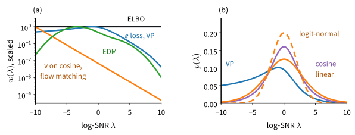
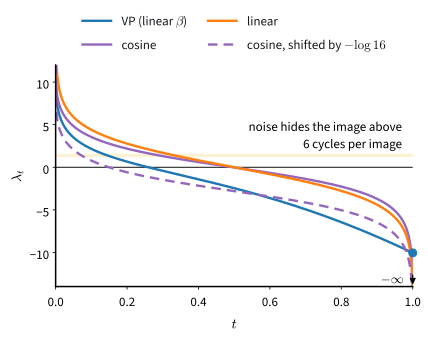

# Likelihood, Weighting and the Design Space
:label:`sec_diffusion-design-space`

In the preceding sections we trained diffusion and flow-matching models by unweighted squared error on noise or velocity targets and evaluated them by their samples. Unlike the adversarial models of :numref:`chap_gans`, diffusion models also assign probability densities to data points: :citet:`sohl2015deep` and :citet:`ho2020denoising` showed that the reverse Markov chain defines a latent-variable model whose evidence lower bound (ELBO) decomposes into a weighted sum of noise-prediction regressions across noise levels, while the probability-flow ODE defines an exact log-likelihood via the instantaneous change-of-variables formula :cite:`song2021score`.

Furthermore, :citet:`Kingma.Salimans.Poole.ea.2021` and :citet:`Kingma.Gao.2023` showed that when written in terms of the log signal-to-noise ratio $\lambda_t = \log(\alpha_t^2 / \sigma_t^2)$, every standard diffusion and flow-matching objective reduces to the same integral of the noise-prediction error weighted by a function $w(\lambda)$. Alongside this loss weighting, :citet:`Karras.Aittala.Aila.ea.2022` (EDM) identified input/output preconditioning and the training noise-level distribution as independent design axes. In this section we derive the discrete and continuous ELBO, compare exact flow likelihoods and bounds on the three-mode mixture, unify published objectives by their implied log-SNR weightings $w(\lambda)$, and run a controlled one-factor ablation on Fashion-MNIST.

```{.python .input #design-space-likelihood-weighting-and-the-design-space}
%%tab pytorch
import math
import numpy as np
import torch
from torch import nn
from torch.nn import functional as F
from d2l import torch as d2l
```

```{.python .input #design-space-likelihood-weighting-and-the-design-space}
%%tab jax
import math
import numpy as np
import jax
from jax import numpy as jnp
from flax import nnx
import optax
from d2l import jax as d2l
```

```{.python .input #design-space-likelihood-weighting-and-the-design-space-1}
%%tab pytorch
torch.set_float32_matmul_precision('high')  # tf32 matmuls on tensor cores
```

## The Likelihood Bound

Let us first write the chain of :numref:`sec_diffusion-gaussian-paths` as a generative model and bound its likelihood; the noise regression will then appear by itself.

### The Chain as a Latent-Variable Model

Step $k$ of the forward chain shrinks the current point and adds noise, $\mathbf{x}_k = \sqrt{1 - \beta_k}\, \mathbf{x}_{k-1} + \sqrt{\beta_k}\, \boldsymbol\epsilon_k$, and the steps compose into one Gaussian draw, $\mathbf{x}_k = \alpha_k \mathbf{x}_0 + \sigma_k \boldsymbol\epsilon$ with $\alpha_k^2 = \prod_{j \le k}(1 - \beta_j)$ and $\sigma_k^2 = 1 - \alpha_k^2$: the VP path at the times $t_k = k/T$. We write $q$ for the distributions of this forward chain. The generative model runs it backward through learned Gaussian steps,

$$
\begin{aligned}
p_{\boldsymbol\theta}(\mathbf{x}_{0:T}) &= p(\mathbf{x}_T) \prod_{k=1}^{T} p_{\boldsymbol\theta}(\mathbf{x}_{k-1} \mid \mathbf{x}_k), \\
p_{\boldsymbol\theta}(\mathbf{x}_{k-1} \mid \mathbf{x}_k) &= \mathcal{N}\big(\boldsymbol\mu_{\boldsymbol\theta}(\mathbf{x}_k, k),\, \nu_k \mathbf{I}\big),
\end{aligned}
$$
:eqlabel:`eq_diffusion-reverse-chain`

with $p(\mathbf{x}_T) = \mathcal{N}(\mathbf{0}, \mathbf{I})$, a mean $\boldsymbol\mu_{\boldsymbol\theta}$ computed by a network, and fixed variances $\nu_k$ ($\sigma_k$ remains the path's noise scale).

The density of $\mathbf{x}_0$ is this joint integrated over the latents $\mathbf{x}_{1:T}$, an integral over $T$ copies of the data space that we cannot compute. Any distribution $q(\mathbf{x}_{1:T} \mid \mathbf{x}_0)$ over the latents turns it into an expectation, $p_{\boldsymbol\theta}(\mathbf{x}_0) = \mathbb{E}_{q}\big[p_{\boldsymbol\theta}(\mathbf{x}_{0:T}) / q(\mathbf{x}_{1:T} \mid \mathbf{x}_0)\big]$, and since the logarithm is concave, the logarithm of an average is at least the average of the logarithms (Jensen's inequality). For the negative log-likelihood this gives an upper bound,

$$
\begin{aligned}
-\log p_{\boldsymbol\theta}(\mathbf{x}_0)
&= -\log \mathbb{E}_{q}\!\left[\frac{p_{\boldsymbol\theta}(\mathbf{x}_{0:T})}{q(\mathbf{x}_{1:T} \mid \mathbf{x}_0)}\right] \\
&\le \mathbb{E}_{q(\mathbf{x}_{1:T} \mid \mathbf{x}_0)}\!\left[-\log \frac{p_{\boldsymbol\theta}(\mathbf{x}_{0:T})}{q(\mathbf{x}_{1:T} \mid \mathbf{x}_0)}\right] =: L(\mathbf{x}_0).
\end{aligned}
$$
:eqlabel:`eq_diffusion-elbo`

This is the *evidence lower bound* (ELBO) of variational inference (:numref:`sec_mdl-latent-em-elbo`) with its sign flipped. In most latent-variable models $q$ has to be learned so that it comes close to the true posterior; here the forward chain supplies it, and nothing about it is learned. The gap in the inequality is $D_{\textrm{KL}}\big(q(\mathbf{x}_{1:T} \mid \mathbf{x}_0) \,\|\, p_{\boldsymbol\theta}(\mathbf{x}_{1:T} \mid \mathbf{x}_0)\big)$, so the bound is tight when the learned reverse chain, given $\mathbf{x}_0$, retraces the forward chain. Averaged over the data, the bound is at least the cross-entropy $\mathbb{E}_{p}[-\log p_{\boldsymbol\theta}(\mathbf{x}_0)] = H(p) + D_{\textrm{KL}}(p \,\|\, p_{\boldsymbol\theta})$, so a model that drops a mode pays on every point of it.

To compare the two chains we substitute their factorizations, the product above for $p_{\boldsymbol\theta}$ and $q(\mathbf{x}_{1:T} \mid \mathbf{x}_0) = \prod_k q(\mathbf{x}_k \mid \mathbf{x}_{k-1})$, which splits the bound into one term per step:

$$
L(\mathbf{x}_0) = \mathbb{E}_q\Big[-\log p(\mathbf{x}_T) - \sum_{k=1}^{T} \log \frac{p_{\boldsymbol\theta}(\mathbf{x}_{k-1} \mid \mathbf{x}_k)}{q(\mathbf{x}_k \mid \mathbf{x}_{k-1})}\Big].
$$
:eqlabel:`eq_diffusion-elbo-steps`

The $k$-th term cannot yet be read as a divergence, since the learned step goes from $\mathbf{x}_k$ to $\mathbf{x}_{k-1}$ and the forward step the other way. Bayes' rule turns the forward step around. By the Markov property it does not change when we also condition on $\mathbf{x}_0$, and then

$$
\begin{aligned}
q(\mathbf{x}_k \mid \mathbf{x}_{k-1}) &= q(\mathbf{x}_k \mid \mathbf{x}_{k-1}, \mathbf{x}_0) \\
&= \frac{q(\mathbf{x}_{k-1} \mid \mathbf{x}_k, \mathbf{x}_0)\, q(\mathbf{x}_k \mid \mathbf{x}_0)}{q(\mathbf{x}_{k-1} \mid \mathbf{x}_0)}.
\end{aligned}
$$

Substituted for $k \ge 2$, the ratios of marginals telescope, $\prod_{k=2}^{T} q(\mathbf{x}_{k-1} \mid \mathbf{x}_0) / q(\mathbf{x}_k \mid \mathbf{x}_0) = q(\mathbf{x}_1 \mid \mathbf{x}_0) / q(\mathbf{x}_T \mid \mathbf{x}_0)$, and the numerator cancels the forward step left over at $k = 1$. Each remaining logarithm is, in expectation, a divergence:

$$
\begin{aligned}
L(\mathbf{x}_0)
&= \underbrace{D_{\textrm{KL}}\big(q(\mathbf{x}_T \mid \mathbf{x}_0) \,\|\, p(\mathbf{x}_T)\big)}_{L_T} \\
&\quad + \sum_{k=2}^{T} \underbrace{\mathbb{E}_q\, D_{\textrm{KL}}\big(q(\mathbf{x}_{k-1} \mid \mathbf{x}_k, \mathbf{x}_0) \,\|\, p_{\boldsymbol\theta}(\mathbf{x}_{k-1} \mid \mathbf{x}_k)\big)}_{L_{k-1}} \\
&\quad + \underbrace{\mathbb{E}_q\big[-\log p_{\boldsymbol\theta}(\mathbf{x}_0 \mid \mathbf{x}_1)\big]}_{L_0}.
\end{aligned}
$$
:eqlabel:`eq_diffusion-elbo-terms`

The *prior term* $L_T$ checks that the chain ends at the Gaussian the sampler starts from, the *denoising terms* $L_{k-1}$ compare each learned step with the *forward posterior*, the reversal of step $k$ for a known clean point, and the *reconstruction term* $L_0$ scores the last step. Conditioning on $\mathbf{x}_0$ makes the forward posterior computable: as a product of two Gaussians in $\mathbf{x}_{k-1}$, the forward step and $q(\mathbf{x}_{k-1} \mid \mathbf{x}_0)$, it is Gaussian (Exercise :exref:`ex_design-space-forward-posterior` completes the square),

$$
\begin{aligned}
q(\mathbf{x}_{k-1} \mid \mathbf{x}_k, \mathbf{x}_0) &= \mathcal{N}\big(\tilde{\boldsymbol\mu}_k, \tilde\beta_k \mathbf{I}\big), \qquad
\tilde\beta_k = \frac{\beta_k\, \sigma_{k-1}^2}{\sigma_k^2}, \\
\tilde{\boldsymbol\mu}_k &= \frac{\alpha_{k-1}\beta_k}{\sigma_k^2}\, \mathbf{x}_0 + \frac{\sqrt{1 - \beta_k}\, \sigma_{k-1}^2}{\sigma_k^2}\, \mathbf{x}_k.
\end{aligned}
$$
:eqlabel:`eq_diffusion-posterior`

The mean is a weighted average of where the clean point and the noisy point put $\mathbf{x}_{k-1}$, and the variance is below the forward step's $\beta_k$: knowing both ends pins the middle down.

The prior and denoising terms compare Gaussians, so one formula evaluates them. For isotropic Gaussians in $d$ dimensions,

$$
\begin{aligned}
&D_{\textrm{KL}}\big(\mathcal{N}(\mathbf{m}_1, v_1 \mathbf{I}) \,\|\, \mathcal{N}(\mathbf{m}_2, v_2 \mathbf{I})\big) \\
&\qquad = \frac{d}{2}\Big(\frac{v_1}{v_2} - 1 - \log\frac{v_1}{v_2}\Big) + \frac{\|\mathbf{m}_1 - \mathbf{m}_2\|^2}{2 v_2},
\end{aligned}
$$
:eqlabel:`eq_diffusion-gauss-kl`

a special case of the formula of :numref:`subsec_gan_fit`. The first part charges a wrong variance, the second a wrong mean, measured in units of the second variance.

How large is each term? The smallest case can be worked by hand. Take one coordinate, data drawn from $\mathcal{N}(0, 1)$, a chain of $T = 2$ steps with $\beta_1 = \beta_2 = \tfrac12$, so that $\alpha_1^2 = \tfrac12$ and $\alpha_2^2 = \tfrac14$, and the best possible learned means. The prior term compares the chain's end $\mathcal{N}(\alpha_2 x_0, \tfrac34)$ with $\mathcal{N}(0, 1)$ and equals $x_0^2/8 + 0.019$, or $0.144$ on average: two large steps leave much of $x_0$ behind. The forward posterior of the second step has mean $\tfrac{\sqrt 2}{3}(x_0 + x_2)$ and variance $\tilde\beta_2 = \tfrac13$, and the best learned step replaces $x_0$ in that mean by its best guess from $x_2$, which is still uncertain by a variance of $\tfrac34$. With $\nu_k = \beta_k$, the forward step's own variance, the expected bound is

$$
\mathbb{E}\, L = \underbrace{0.144}_{L_2} + \underbrace{0.203}_{L_1} + \underbrace{1.072}_{L_0} = 1.419 = \tfrac12 \log(2\pi e),
$$

the true negative log-likelihood of $\mathcal{N}(0, 1)$: for Gaussian data and these variances, two steps already make the bound exact. The reconstruction term is the easiest to check. Given $x_1$, the clean point is still uncertain by a variance of $\tfrac12$, which is just $\nu_1$, so $L_0 = \tfrac12 \log(2\pi \cdot \tfrac12) + \tfrac12 = 1.072$. With $\nu_2 = \tilde\beta_2$ instead, $L_1$ grows to $0.25$ and the bound to $1.466$. The reason is worth remembering. The forward posterior knows $x_0$, so its variance is small; the learned step from $x_2$ does not, and its variance has to include that uncertainty too. At $T = 1000$ the prior term is nearly zero, each step is small, and the denoising terms carry the training signal.

### From the Bound to Weighted Regression

Each denoising term compares two Gaussians whose variances do not depend on the network, so by :eqref:`eq_diffusion-gauss-kl` only the distance between the means involves $\boldsymbol\theta$:

$$
L_{k-1} = \mathbb{E}_q\Big[\frac{1}{2\nu_k} \big\|\tilde{\boldsymbol\mu}_k(\mathbf{x}_k, \mathbf{x}_0) - \boldsymbol\mu_{\boldsymbol\theta}(\mathbf{x}_k, k)\big\|^2\Big] + \textrm{const},
$$
:eqlabel:`eq_diffusion-mean-matching`

where the constant vanishes for $\nu_k = \tilde\beta_k$: each step asks the network for the mean of the forward posterior.

The network does not have to output that mean directly. Substituting $\mathbf{x}_0 = (\mathbf{x}_k - \sigma_k \boldsymbol\epsilon)/\alpha_k$ into :eqref:`eq_diffusion-posterior` and using $\sigma_k^2 = \beta_k + (1 - \beta_k)\sigma_{k-1}^2$, the coefficients of $\mathbf{x}_k$ combine into $1/\sqrt{1 - \beta_k}$ and the mean becomes

$$
\tilde{\boldsymbol\mu}_k = \frac{1}{\sqrt{1 - \beta_k}}\Big(\mathbf{x}_k - \frac{\beta_k}{\sigma_k}\, \boldsymbol\epsilon\Big).
$$
:eqlabel:`eq_diffusion-posterior-mean-eps`

Everything here but $\boldsymbol\epsilon$ is known to a network that receives $\mathbf{x}_k$ and $k$, so we let it predict the noise and form its mean the same way,

$$
\boldsymbol\mu_{\boldsymbol\theta}(\mathbf{x}_k, k) = \frac{1}{\sqrt{1 - \beta_k}}\Big(\mathbf{x}_k - \frac{\beta_k}{\sigma_k}\, \hat{\boldsymbol\epsilon}_{\boldsymbol\theta}(\mathbf{x}_k, k)\Big),
$$
:eqlabel:`eq_diffusion-mu-theta`

and the difference of the two means is a multiple of the noise error:

$$
\begin{aligned}
L_{k-1} &= \mathbb{E}_{\mathbf{x}_0, \boldsymbol\epsilon}\Big[\frac{\beta_k^2}{2\nu_k (1 - \beta_k)\sigma_k^2}\, \big\|\boldsymbol\epsilon - \hat{\boldsymbol\epsilon}_{\boldsymbol\theta}(\alpha_k \mathbf{x}_0 + \sigma_k \boldsymbol\epsilon, k)\big\|^2\Big] \\
&\quad + \textrm{const}.
\end{aligned}
$$
:eqlabel:`eq_diffusion-lt-eps`

Each term of the bound is the noise regression of :numref:`sec_diffusion-gaussian-paths` at one level, with a weight, for $\nu_k = \tilde\beta_k$ equal to $\beta_k / (2(1 - \beta_k)\sigma_{k-1}^2)$. Over step $k$ the signal-to-noise ratio $\alpha_k^2/\sigma_k^2$ falls by the factor $\sigma_k^2 / ((1 - \beta_k)\sigma_{k-1}^2) = 1 + \beta_k/((1 - \beta_k)\sigma_{k-1}^2)$, so with $\lambda_k = \log(\alpha_k^2/\sigma_k^2)$ the weight is

$$
\frac{\beta_k}{2(1 - \beta_k)\sigma_{k-1}^2} = \tfrac12\big(e^{\lambda_{k-1} - \lambda_k} - 1\big) \approx \tfrac12(\lambda_{k-1} - \lambda_k).
$$

The bound charges every step by how much it lowers the log-SNR. The cell prints both weights along our VP chain ($T = 1000$), next to half the log-SNR step.

```{.python .input #design-space-from-the-bound-to-weighted-regression}
%%tab pytorch, jax
vp = d2l.GaussianPath.vp()
a, s = vp.grid(1000)
a, s = [float(v) for v in a[::-1]], [float(v) for v in s[::-1]]  # k = 0..T
for k in (2, 10, 100, 500, 1000):
    beta = 1 - (a[k] / a[k - 1]) ** 2
    beta_tilde = beta * s[k - 1] ** 2 / s[k] ** 2
    weight = lambda nu: beta ** 2 / (2 * nu * (1 - beta) * s[k] ** 2)
    dlam = math.log((a[k - 1] * s[k]) ** 2 / (a[k] * s[k - 1]) ** 2)
    print(f'k = {k:4d}: weight {weight(beta):.4f} (nu = beta), '
          f'{weight(beta_tilde):.4f} (nu = beta_tilde), '
          f'half log-SNR step {dlam / 2:.4f}')
```

Where the steps are small, the weight for $\nu_k = \tilde\beta_k$ equals half the log-SNR step, and the weight for $\nu_k = \beta_k$ differs from it only at the start. Both are largest at the first steps, where the log-SNR drops fastest: twice the printed half-steps gives $0.78$ at $k = 2$ and $0.157$ at $k = 10$. No grid of equal time steps escapes this. Even a constant $\beta$ lowers the log-SNR by at least $\log(k/(k-1))$ at step $k$, which is $\log 2 \approx 0.69$ at $k = 2$ and $\log(10/9) \approx 0.105$ at $k = 10$; our $\beta$ grows along the chain, and our first steps drop by more. After the first few dozen steps both weights stay near $0.01$ or below. The simple loss of :numref:`sec_diffusion-gaussian-paths`,

$$
L_{\textrm{simple}}(\boldsymbol\theta) = \mathbb{E}_{k,\, \mathbf{x}_0,\, \boldsymbol\epsilon}\, \big\|\boldsymbol\epsilon - \hat{\boldsymbol\epsilon}_{\boldsymbol\theta}(\alpha_k \mathbf{x}_0 + \sigma_k \boldsymbol\epsilon, k)\big\|^2,
$$

with $k$ uniform on $\{1, \ldots, T\}$, sets every weight to one and so neglects the least noisy steps relative to the bound. :citet:`ho2020denoising` found that it nevertheless gives better samples. Those steps hold the finest details of an image (:numref:`subsec_diffusion-design-space-scales`), which a likelihood counts in full and a viewer hardly notices.

As the steps shrink, the weighted sum becomes an integral over the log-SNR,

$$
L(\mathbf{x}_0) \to \frac12 \int_{\lambda_{\min}}^{\lambda_{\max}} \mathbb{E}_{\boldsymbol\epsilon}\big\|\boldsymbol\epsilon - \hat{\boldsymbol\epsilon}_{\boldsymbol\theta}(\mathbf{x}_\lambda, \lambda)\big\|^2\, d\lambda + L_T + L_0,
$$
:eqlabel:`eq_diffusion-elbo-continuous`

where $\mathbf{x}_\lambda$ is the point of the path with log-SNR $\lambda$ :cite:`Kingma.Salimans.Poole.ea.2021`, from $\lambda_{\max}$ at the smallest noise level to $\lambda_{\min}$ at the path's end. In words, the bound is the noise error integrated over the log-SNR with weight one, plus the two end terms. The limit needs steps small in $\lambda$, which the chain's grid lacks at the data end: from the first step to the second the log-SNR falls by more than $\log 2$, whatever $T$ is. There the chain's bound is loose (Exercise :exref:`ex_design-space-weights-of-the-bound`).

### A Number for the Mixture

Two numbers measure the likelihood of a trained network. The bound :eqref:`eq_diffusion-elbo-continuous` belongs to the stochastic reverse process. The probability-flow ODE of :numref:`sec_diffusion-integration` is a deterministic map from noise to data, and its density follows by a change of variables. For the exact field the two agree; for a trained network they need not. We train a noise predictor on the VP path with the mixture recipe of :numref:`sec_diffusion-gaussian-paths` for $20{,}000$ steps.

```{.python .input #design-space-a-number-for-the-mixture}
%%tab pytorch
device = d2l.try_gpu()
mix = d2l.GaussianMixture.three_modes(device)

torch.manual_seed(0)
_, ema, _ = d2l.train_regression(
    d2l.TimeMLP(256, 3).to(device), d2l.regression_loss(vp, 'eps'),
    lambda: mix.sample(512), 20_000, cosine=True, ema_half_life=700)
```

```{.python .input #design-space-a-number-for-the-mixture}
%%tab jax
mix = d2l.GaussianMixture.three_modes()

_, ema, _ = d2l.train_regression(
    d2l.TimeMLP(256, 3, rngs=nnx.Rngs(0)), d2l.regression_loss(vp, 'eps'),
    lambda key: mix.sample(key, 512), 20_000, jax.random.key(0),
    cosine=True, ema_half_life=700)
```

Along a trajectory of $d\mathbf{x}/dt = \mathbf{u}_t(\mathbf{x})$ the log-density changes at the rate $-\nabla \cdot \mathbf{u}_t$: where the flow spreads points apart, the density thins. This is the instantaneous change of variables of :numref:`sec_mdl-continuous-normalizing-flows`. Integrating from a data point at a small time $t_{\min}$ to $t = 1$, where the density is a standard Gaussian, gives

$$
\log p(\mathbf{x}_{t_{\min}}) = \log \mathcal{N}(\mathbf{x}_1; \mathbf{0}, \mathbf{I}) + \int_{t_{\min}}^{1} \nabla \cdot \mathbf{u}_t(\mathbf{x}_t)\, dt.
$$

`pf_nll` integrates the point and its accumulated divergence together on 100 steps that crowd toward the data, where the field changes fastest. It uses the classical fourth-order Runge--Kutta method (:numref:`sec_mdl-euler-runge-kutta`), a relative of Heun's method of :numref:`sec_diffusion-samplers` that evaluates the field four times per step. The velocity comes from the noise prediction through the conversions of :numref:`sec_diffusion-gaussian-paths`. The divergence is the trace of the $2 \times 2$ Jacobian, one forward-mode derivative per coordinate; in $d$ dimensions that is $d$ derivatives per evaluation, which is why an image needs a cheaper estimate (Exercise :exref:`ex_design-space-hutchinson`). We start at $t_{\min} = 0.001$, where the noise is about $1\%$ of the signal, and take the mixture's exact noise prediction as the reference.

```{.python .input #design-space-a-number-for-the-mixture-1}
%%tab pytorch
def eps_exact(x, t):
    """E[eps | x_t] of the mixture, from its posterior mean."""
    x0 = mix.posterior_mean(x, vp.alpha(t), vp.sigma(t))
    return vp.x0_eps('x0', x0, x, t)[1]

def pf_nll(eps_fn, path, x, t_min=1e-3, steps=100):
    """-log p(x) under the probability-flow ODE, RK4 from t_min to 1."""
    def f(x, t):                              # velocity and its divergence
        t = torch.full((len(x),), t, device=x.device)
        def u(x):                             # the velocity, by x0_eps, target
            x0, eps = path.x0_eps('eps', eps_fn(x, t), x, t)
            return path.target('velocity', x0, eps, t)
        e = torch.eye(x.shape[1], device=x.device)
        jvps = [torch.func.jvp(u, (x,), (e_i.expand_as(x),)) for e_i in e]
        return jvps[0][0], sum(j[1][:, i] for i, j in enumerate(jvps))
    ts = (t_min + (1 - t_min) * torch.linspace(0, 1, steps + 1) ** 2).tolist()
    div = torch.zeros(len(x), device=x.device)
    for ta, tb in zip(ts[:-1], ts[1:]):       # from the data to the noise
        h = tb - ta
        k1, d1 = f(x, ta)
        k2, d2 = f(x + h / 2 * k1, ta + h / 2)
        k3, d3 = f(x + h / 2 * k2, ta + h / 2)
        k4, d4 = f(x + h * k3, tb)
        x = x + h / 6 * (k1 + 2 * k2 + 2 * k3 + k4)
        div = div + h / 6 * (d1 + 2 * d2 + 2 * d3 + d4)
    return (x ** 2).sum(1) / 2 + x.shape[1] / 2 * math.log(2 * math.pi) - div
```

```{.python .input #design-space-a-number-for-the-mixture-1}
%%tab jax
def eps_exact(x, t):
    """E[eps | x_t] of the mixture, from its posterior mean."""
    x0 = mix.posterior_mean(x, vp.alpha(t), vp.sigma(t))
    return vp.x0_eps('x0', x0, x, t)[1]

def pf_nll(eps_fn, path, x, t_min=1e-3, steps=100):
    """-log p(x) under the probability-flow ODE, RK4 from t_min to 1."""
    def f(x, t):                              # velocity and its divergence
        t = jnp.full((len(x),), t)
        def u(x):                             # the velocity, by x0_eps, target
            x0, eps = path.x0_eps('eps', eps_fn(x, t), x, t)
            return path.target('velocity', x0, eps, t)
        e = jnp.eye(x.shape[1])
        jvps = [jax.jvp(u, (x,), (jnp.broadcast_to(e_i, x.shape),))
                for e_i in e]
        return jvps[0][0], sum(j[1][:, i] for i, j in enumerate(jvps))
    ts = t_min + (1 - t_min) * jnp.linspace(0, 1, steps + 1) ** 2
    def step(i, carry):                       # from the data to the noise
        x, div = carry
        ta, tb = ts[i], ts[i + 1]
        h = tb - ta
        k1, d1 = f(x, ta)
        k2, d2 = f(x + h / 2 * k1, ta + h / 2)
        k3, d3 = f(x + h / 2 * k2, ta + h / 2)
        k4, d4 = f(x + h * k3, tb)
        return (x + h / 6 * (k1 + 2 * k2 + 2 * k3 + k4),
                div + h / 6 * (d1 + 2 * d2 + 2 * d3 + d4))
    x, div = jax.lax.fori_loop(0, steps, step, (x, jnp.zeros(len(x))))
    return (x ** 2).sum(1) / 2 + x.shape[1] / 2 * math.log(2 * math.pi) - div
```

We now draw 20,000 test points from `mix` and run `pf_nll` on the first 4,000
with both the exact noise predictor `eps_exact` and the trained network `ema`,
comparing their probability-flow negative log-likelihoods against the true
`-mix.log_prob(test)`:

```{.python .input #design-space-a-number-for-the-mixture-2}
%%tab pytorch
torch.manual_seed(1)
test = mix.sample(20_000)
nll = -mix.log_prob(test)
mean_se = lambda v: f'{v.mean():.4f} +- {v.std() / math.sqrt(len(v)):.4f}'
with torch.no_grad():
    pf_exact, pf_net = (pf_nll(f, vp, test[:4000]) for f in (eps_exact, ema))
print(f'true NLL {mean_se(nll[:4000])} nats')
print(f'flow, exact field - true: {mean_se(pf_exact - nll[:4000])}')
print(f'flow, network - exact field: {mean_se(pf_net - pf_exact)}')
```

```{.python .input #design-space-a-number-for-the-mixture-2}
%%tab jax
k_test, k_bound = jax.random.split(jax.random.key(1))
test = mix.sample(k_test, 20_000)
nll = -mix.log_prob(test)
mean_se = lambda v: f'{v.mean():.4f} +- {v.std() / math.sqrt(len(v)):.4f}'
pf_exact, pf_net = (pf_nll(f, vp, test[:4000]) for f in (eps_exact, ema))
print(f'true NLL {mean_se(nll[:4000])} nats')
print(f'flow, exact field - true: {mean_se(pf_exact - nll[:4000])}')
print(f'flow, network - exact field: {mean_se(pf_net - pf_exact)}')
```

The exact field's flow reproduces the true 2.5 nats per point to about four decimals, which checks the integrator. The trained network's negative log-likelihood lies within a few thousandths of a nat of it, a paired difference with a standard error of about a thousandth. The network has learned the density, not only how to sample from it.

The bound needs its two end terms. The prior term is about $\tfrac12 \alpha_1^2 \|\mathbf{x}_0\|^2 \approx 2 \cdot 10^{-4}$ nats. The last step outputs a Gaussian around $\hat{\mathbf{x}}_0$ with the variance $e^{-\lambda_{\max}} = \sigma^2/\alpha^2$ of the smallest noise level, and since $\mathbf{x}_0 - \hat{\mathbf{x}}_0 = (\sigma/\alpha)(\hat{\boldsymbol\epsilon} - \boldsymbol\epsilon)$,

$$
L_0 = \frac{d}{2} \log\big(2\pi e^{-\lambda_{\max}}\big) + \frac12\, \mathbb{E}\big\|\boldsymbol\epsilon - \hat{\boldsymbol\epsilon}_{\boldsymbol\theta}(\mathbf{x}_{t_{\min}}, t_{\min})\big\|^2 .
$$

We can predict the split before the cell prints it. In two dimensions at a noise level of $0.01$ the first part is about $-7.3$ nats, the log-normalizer of a very narrow Gaussian. The second is about $1$, half the expected squared error of a network that cannot tell noise this small from the data's own variation, so $L_0 \approx -6.3$. If the whole bound is near 2.5 nats, the integral alone must be about $2.5 + 6.3 \approx 8.8$ nats. Neither part is a likelihood; only the sum bounds one.

`bound` estimates the integral by Monte Carlo, with $\lambda$ uniform and stratified. Pinning the bound down to $0.01$ nats takes a few million network evaluations. The difference between two predictors takes far fewer when both see the same points, levels and noise, because most of the Monte Carlo noise is then common to both and cancels (:numref:`subsec_mdl-paired-comparisons`); `bound` therefore evaluates a list of predictors on shared draws.

```{.python .input #design-space-a-number-for-the-mixture-3}
%%tab pytorch
@torch.no_grad()
def bound(eps_fns, path, x0, draws, t_min=1e-3):
    """Per-point bound on -log p(x0) for each eps(x, t), on shared draws,
    and its integral over the log-SNR alone."""
    n, d = x0.shape
    a1, s1 = (f(torch.tensor(1.0)).item() for f in (path.alpha, path.sigma))
    lam_max = path.log_snr(torch.tensor(t_min)).item()
    lam_min = 2 * math.log(a1 / s1)               # the end of the path
    scale = (lam_max - lam_min) / (2 * draws)
    prior = (((a1 * x0) ** 2).sum(1) / 2         # KL to N(0, I)
             + d / 2 * (s1 ** 2 - 1 - 2 * math.log(s1)))
    t = torch.full((n,), t_min, device=x0.device)
    eps = torch.randn_like(x0)
    x = path.sample(x0, t, eps)               # the reconstruction term
    ends = [prior + d / 2 * math.log(2 * math.pi / math.exp(lam_max))
            + ((f(x, t) - eps) ** 2).sum(1) / 2 for f in eps_fns]
    integrals = [torch.zeros(n, device=x0.device) for _ in eps_fns]
    for _ in range(draws):                    # log-SNR uniform, stratified
        u = (torch.randperm(n, device=x0.device)
             + torch.rand(n, device=x0.device)) / n
        t = path.time_at(lam_max - u * (lam_max - lam_min))
        eps = torch.randn_like(x0)
        x = path.sample(x0, t, eps)
        for i, f in enumerate(eps_fns):
            integrals[i] += scale * ((f(x, t) - eps) ** 2).sum(1)
    return [e + i for e, i in zip(ends, integrals)], integrals

(b_exact, b_net), (integral, _) = bound([eps_exact, ema], vp, test, 64)
print(f'exact field: integral {integral.mean():.2f} nats, '
      f'prior and reconstruction {(b_exact - integral).mean():.2f} nats')
print(f'bound, exact field - true: {mean_se(b_exact - nll)}')
print(f'bound, network - exact field: {mean_se(b_net - b_exact)}')
```

```{.python .input #design-space-a-number-for-the-mixture-3}
%%tab jax
def bound(eps_fns, path, x0, draws, key, t_min=1e-3):
    """Per-point bound on -log p(x0) for each eps(x, t), on shared draws,
    and its integral over the log-SNR alone."""
    n, d = x0.shape
    a1, s1 = (float(f(jnp.array(1.0))) for f in (path.alpha, path.sigma))
    lam_max = float(path.log_snr(jnp.array(t_min)))
    lam_min = 2 * math.log(a1 / s1)               # the end of the path
    scale = (lam_max - lam_min) / (2 * draws)
    prior = (((a1 * x0) ** 2).sum(1) / 2         # KL to N(0, I)
             + d / 2 * (s1 ** 2 - 1 - 2 * math.log(s1)))
    key, k_eps = jax.random.split(key)
    t, eps = jnp.full((n,), t_min), jax.random.normal(k_eps, x0.shape)
    x = path.sample(x0, t, eps)               # the reconstruction term
    ends = [prior + d / 2 * math.log(2 * math.pi / math.exp(lam_max))
            + ((f(x, t) - eps) ** 2).sum(1) / 2 for f in eps_fns]
    integrals = [jnp.zeros(n) for _ in eps_fns]
    for k in jax.random.split(key, draws):    # log-SNR uniform, stratified
        k_perm, k_u, k_eps = jax.random.split(k, 3)
        u = (jax.random.permutation(k_perm, n)
             + jax.random.uniform(k_u, (n,))) / n
        t = path.time_at(lam_max - u * (lam_max - lam_min))
        eps = jax.random.normal(k_eps, x0.shape)
        x = path.sample(x0, t, eps)
        integrals = [o + scale * ((f(x, t) - eps) ** 2).sum(1)
                     for o, f in zip(integrals, eps_fns)]
    return [e + i for e, i in zip(ends, integrals)], integrals

(b_exact, b_net), (integral, _) = bound([eps_exact, ema], vp, test, 64,
                                        k_bound)
print(f'exact field: integral {integral.mean():.2f} nats, '
      f'prior and reconstruction {(b_exact - integral).mean():.2f} nats')
print(f'bound, exact field - true: {mean_se(b_exact - nll)}')
print(f'bound, network - exact field: {mean_se(b_net - b_exact)}')
```

The cell confirms the prediction: an integral of about 8.75 nats and end terms of about $-6.3$. For the exact field the bound minus the true negative log-likelihood, paired point by point over all 20,000 test points, is zero within its standard error of $0.015$, so with the best possible predictor the continuous bound shows no gap at that precision. The network's bound lies about half a hundredth of a nat above the exact field's, a paired difference resolved to half a thousandth. Both measures agree: on the mixture this network is within half a hundredth of a nat of maximum likelihood.

### The Simple Loss against the Bound

That result does not yet answer the opening question. With capacity to spare, every weighting that covers all levels has the same minimizer, the exact noise prediction, so any of them would land this close. The weighting can matter only when the network is too small to be exact everywhere; it then decides where the error goes. We therefore train noise predictors with two weightings, the simple loss and the bound's own ($\lambda$ uniform, which `bound_loss` draws through `time_at`), at full width and with 32 hidden units, from two seeds each. Each of the eight models gets 10,000 steps, half the budget of the model above, to keep the experiment affordable. Before reading the result we can guess it. At full width the two weightings should nearly agree. At 32 units the bound-weighted model should have the lower bound, since that is what it is trained on. The simple loss spends far fewer of its draws on nearly clean points and more on the noisy levels, which every sample and every flow trajectory crosses, so it may do better there.

```{.python .input #design-space-a-number-for-the-mixture-4}
%%tab pytorch
def bound_loss(path, t_min=1e-3):
    """The noise regression with the log-SNR uniform: the bound's weighting."""
    lam_max, lam_min = (path.log_snr(torch.tensor(t)).item()
                        for t in (t_min, 1.0))
    def loss_fn(net, x0):
        u = torch.rand(len(x0), device=x0.device)
        t = path.time_at(lam_max - u * (lam_max - lam_min))
        eps = torch.randn_like(x0)
        return ((net(path.sample(x0, t, eps), t) - eps) ** 2).sum(1).mean()
    return loss_fn

losses = {'simple': d2l.regression_loss(vp, 'eps'), 'bound': bound_loss(vp)}
nets = {}
for width in (256, 32):
    for name, loss_fn in losses.items():
        for seed in (0, 1):
            torch.manual_seed(seed)
            nets[width, name, seed] = d2l.train_regression(
                d2l.TimeMLP(width, 3).to(device), loss_fn,
                lambda: mix.sample(512), 10_000, cosine=True,
                ema_half_life=700)[1]
```

```{.python .input #design-space-a-number-for-the-mixture-4}
%%tab jax
def bound_loss(path, t_min=1e-3):
    """The noise regression with the log-SNR uniform: the bound's weighting."""
    lam_max, lam_min = (float(path.log_snr(jnp.array(t)))
                        for t in (t_min, 1.0))
    def loss_fn(net, x0, key):
        k_u, k_eps = jax.random.split(key)
        u = jax.random.uniform(k_u, (len(x0),))
        t = path.time_at(lam_max - u * (lam_max - lam_min))
        eps = jax.random.normal(k_eps, x0.shape)
        return ((net(path.sample(x0, t, eps), t) - eps) ** 2).sum(1).mean()
    return loss_fn

losses = {'simple': d2l.regression_loss(vp, 'eps'), 'bound': bound_loss(vp)}
nets = {}
for width in (256, 32):
    for name, loss_fn in losses.items():
        for seed in (0, 1):
            nets[width, name, seed] = d2l.train_regression(
                d2l.TimeMLP(width, 3, rngs=nnx.Rngs(seed)), loss_fn,
                lambda key: mix.sample(key, 512), 10_000,
                jax.random.key(seed), cosine=True, ema_half_life=700)[1]
```

Each model is scored three ways: by the bound and by the flow likelihood, each as a paired difference from the exact field on the test points, and by its samples, drawn with the ancestral chain from shared noise and scored under the true density. For the samples we report their mean negative log-likelihood under the true density and the fraction of strays, points more than three standard deviations from every mode; the data themselves score about 2.47 nats and 1%.

```{.python .input #design-space-a-number-for-the-mixture-5}
%%tab pytorch
b_all, _ = bound([eps_exact, *nets.values()], vp, test, 64)
torch.manual_seed(2)
z = torch.randn(20_000, 2, device=device)        # shared by every model
rows = {}
for (width, name, _), net, b_net in zip(nets, nets.values(), b_all[1:]):
    with torch.no_grad():
        flow = pf_nll(net, vp, test[:4000])
        torch.manual_seed(3)  # the same injected noise for every model
        x = d2l.ancestral_sample(d2l.make_pred(net, vp, 'eps'), z, vp, 1000)
    rows.setdefault((width, name), []).append(
        ((b_net - b_all[0]).mean(), (flow - pf_exact).mean(), mix.nll(x),
         mix.summary(x)['stray']))
print('width loss    bound - exact  flow - exact  samples: NLL  strays'
      '   (seeds 0, 1)')
for (width, name), (r0, r1) in rows.items():
    print(f'{width:5} {name:7}' + ''.join(
        f'{v0:7.4f}{v1:7.4f}' if i < 2 else f'{v0:7.3f}{v1:7.3f}'
        for i, (v0, v1) in enumerate(zip(r0, r1))))
print(f'data {"":36}{mix.nll(test):7.3f}{mix.summary(test)["stray"]:14.3f}')
```

```{.python .input #design-space-a-number-for-the-mixture-5}
%%tab jax
b_all, _ = bound([eps_exact, *nets.values()], vp, test, 64, k_bound)
z = jax.random.normal(jax.random.key(2), (20_000, 2))  # shared by every model
rows = {}
for (width, name, _), net, b_net in zip(nets, nets.values(), b_all[1:]):
    flow = pf_nll(net, vp, test[:4000])
    x = d2l.ancestral_sample(d2l.make_pred(net, vp, 'eps'), z, vp, 1000,
                             jax.random.key(3))
    rows.setdefault((width, name), []).append(
        ((b_net - b_all[0]).mean(), (flow - pf_exact).mean(), mix.nll(x),
         mix.summary(x)['stray']))
print('width loss    bound - exact  flow - exact  samples: NLL  strays'
      '   (seeds 0, 1)')
for (width, name), (r0, r1) in rows.items():
    print(f'{width:5} {name:7}' + ''.join(
        f'{v0:7.4f}{v1:7.4f}' if i < 2 else f'{v0:7.3f}{v1:7.3f}'
        for i, (v0, v1) in enumerate(zip(r0, r1))))
print(f'data {"":36}{mix.nll(test):7.3f}{mix.summary(test)["stray"]:14.3f}')
```

At full width the weighting matters little. All four models lie within two hundredths of a nat of the exact field on both measures, and their samples cannot be told apart, with stray fractions close to the data's. Each weighting is already ahead on its own measure, though, by one to five thousandths of a nat on the bound and by half a hundredth to a hundredth on the flow. At 32 units the split grows and reaches the samples. The bound-weighted model has the lower bound, by one to two hundredths of a nat. The simple loss, which is no bound on the likelihood, nonetheless gives the better flow likelihood, its negative log-likelihood lower by one to two hundredths, and the better samples: a sample negative log-likelihood lower by two to six hundredths and fewer strays, about 1.5 to 1.8% against 2.0 to 2.3%. On this mixture, training on the bound did not give the small network its best likelihood. The likely reason is the one we guessed, where the draws go: uniform $\lambda$ on $[-10.05, 9.12]$ puts about $7/19$, more than a third, of the bound's draws above $\lambda = 2$, where the point is nearly clean, and uniform $t$ on our VP path puts about a tenth there.

So the answer to the opening question is no, with a qualification. The simple loss is not the likelihood bound but the bound's integrand under another weight. With capacity to spare the weight moves either likelihood by about a hundredth of a nat at most; with little capacity it decides between a better bound on one side and a better flow likelihood and better samples on the other.

## Objectives as Weightings

The bound weights each unit of log-SNR equally, the simple loss each step of the chain, and flow matching regresses a velocity on another path. In a common variable these are one objective with three weightings.

### The Log-SNR Form

Each of our losses draws a time $t$, forms $\mathbf{x}_t$, and takes the squared error of a target. At fixed $\mathbf{x}_t$ every target is affine in the noise prediction, with a scalar slope that depends only on $t$, so each squared error is $c(t)\, \|\hat{\boldsymbol\epsilon} - \boldsymbol\epsilon\|^2$ for a factor $c(t)$ set by the target and the path. Changing the variable from $t$ to $\lambda$ gives the form of :citet:`Kingma.Gao.2023`,

$$
\begin{aligned}
\mathcal{L}_w &= \frac12 \int_{\lambda_{\min}}^{\lambda_{\max}} w(\lambda)\, \mathbb{E}\big\|\hat{\boldsymbol\epsilon}_{\boldsymbol\theta}(\mathbf{x}_\lambda, \lambda) - \boldsymbol\epsilon\big\|^2\, d\lambda, \\
w(\lambda) &= 2\, c(t)\, p(t) \left|\frac{dt}{d\lambda}\right|,
\end{aligned}
$$
:eqlabel:`eq_diffusion-weighted-loss`

where $p(t)$ is the density of training times. A loss is thus described completely by one function, how much it cares about the noise error at each log-SNR. The bound :eqref:`eq_diffusion-elbo-continuous` is the weighting $w \equiv 1$.

The expectation inside the integral does not depend on the path: at the same $\lambda$ two paths hold the same noisy point up to scale (:numref:`sec_diffusion-gaussian-paths`), so the network faces the same prediction problem. A schedule thus enters $\mathcal{L}_w$ only through the weighting and the endpoints $\lambda_{\min}$ and $\lambda_{\max}$; for the bound, schedules with the same endpoints give the same loss :cite:`Kingma.Salimans.Poole.ea.2021`.

As the smallest worked case, take the noise loss with uniform $t$ on the linear path, $c = p = 1$. There $\sigma_t/\alpha_t = t/(1 - t) = e^{-\lambda/2}$, so $t = 1/(1 + e^{\lambda/2})$ and $|dt/d\lambda| = \tfrac18 \operatorname{sech}^2(\lambda/4)$. The weighting $w(\lambda) = \tfrac14 \operatorname{sech}^2(\lambda/4)$ is a bump centered at $\lambda = 0$, where signal and noise are equally strong, decaying like $e^{-|\lambda|/2}$ on both sides.

### Weightings of Published Objectives

The other objectives need two conversions. On the VP path the $\mathbf{v}$-target of :citet:`Salimans.Ho.2022` satisfies $\hat{\mathbf{v}} - \mathbf{v} = (\hat{\boldsymbol\epsilon} - \boldsymbol\epsilon)/\alpha_t$, so $c = 1/\alpha_t^2 = 1 + e^{-\lambda}$. The velocity on the linear path satisfies the same relation, and there $1/\alpha_t = 1 + e^{-\lambda/2}$. With uniform $t$ this gives the following weightings, each up to a constant factor (Exercise :exref:`ex_design-space-implied-weighting` derives them). The EDM row, which draws its own levels, uses the data's scale $\sigma_{\mathrm{data}}$, defined with EDM below.

| objective | path and noise levels | $w(\lambda)$ |
|---|---|---|
| bound (ELBO) | any path | $1$ |
| noise, DDPM | VP, linear $\beta$, $t$ uniform | $\lvert dt/d\lambda\rvert$ |
| noise | linear, $t$ uniform | $\operatorname{sech}^2(\lambda/4)$, a bump at $\lambda = 0$ |
| noise | cosine, $t$ uniform | $\operatorname{sech}(\lambda/2)$ |
| $\mathbf{v}$ | cosine, $t$ uniform | $e^{-\lambda/2}$ |
| velocity (flow matching) | linear, $t$ uniform | $e^{-\lambda/2}$ |
| EDM | $\log(\sigma_t/\alpha_t) \sim \mathcal{N}(-1.2, 1.2^2)$ | $\mathcal{N}(\lambda; 2.4, 2.4^2)\,(e^{-\lambda} + \sigma_{\mathrm{data}}^2)$ |

Algebra of this kind is easy to get wrong by a factor, so let us have the computer check two rows and the peak of the DDPM weighting. `weighting` computes $w(\lambda)$ for uniform $t$ without any algebra: the factor $c(t)$ is the squared slope of a target in the predicted noise, which `x0_eps` and `target` give at a fixed $\mathbf{x}_t$, and $d\lambda/dt$ comes by forward-mode differentiation, as in `rates`.

```{.python .input #design-space-weightings-of-published-objectives}
%%tab pytorch
def weighting(path, kind, lam):
    """w(lambda) = 2 c(t) |dt / dlambda| for t uniform, where c is the squared
    slope of the target in the predicted noise at a fixed x_t."""
    t = path.time_at(lam)
    x, zero, one = (torch.full((len(t), 1), v) for v in (0.0, 0.0, 1.0))
    def target(eps_hat):                       # the target that eps_hat implies
        return path.target(kind, *path.x0_eps('eps', eps_hat, x, t), t)
    c = ((target(one) - target(zero)) ** 2)[:, 0]
    dlam_dt = torch.func.jvp(path.log_snr, (t,), (torch.ones_like(t),))[1]
    return 2 * c / dlam_dt.abs()

lam = torch.linspace(-8, 8, 9)
w_u = weighting(d2l.GaussianPath.linear(), 'velocity', lam)
w_v = weighting(d2l.GaussianPath.cosine(), 'v', lam)
row = lambda name, w: print(f'{name:26}' + ''.join(f'{v:8.3f}' for v in w))
print(f'{"lambda":26}' + ''.join(f'{v:8.0f}' for v in lam.tolist()))
row('velocity, linear path', w_u.tolist())
row('  times e^(lambda / 2)', (w_u * (lam / 2).exp()).tolist())
row('v, cosine path', w_v.tolist())
row('  divided by the row above', (w_v / w_u).tolist())
fine = torch.linspace(-9, 9, 1801)
peak = fine[weighting(vp, 'eps', fine).argmax()]
print(f'noise, VP path: largest weight at lambda = {peak:.1f}')
```

```{.python .input #design-space-weightings-of-published-objectives}
%%tab jax
def weighting(path, kind, lam):
    """w(lambda) = 2 c(t) |dt / dlambda| for t uniform, where c is the squared
    slope of the target in the predicted noise at a fixed x_t."""
    t = path.time_at(lam)
    x, zero, one = (jnp.full((len(t), 1), v) for v in (0.0, 0.0, 1.0))
    def target(eps_hat):                       # the target that eps_hat implies
        return path.target(kind, *path.x0_eps('eps', eps_hat, x, t), t)
    c = ((target(one) - target(zero)) ** 2)[:, 0]
    dlam_dt = jax.jvp(path.log_snr, (t,), (jnp.ones_like(t),))[1]
    return 2 * c / jnp.abs(dlam_dt)

lam = jnp.linspace(-8, 8, 9)
w_u = weighting(d2l.GaussianPath.linear(), 'velocity', lam)
w_v = weighting(d2l.GaussianPath.cosine(), 'v', lam)
row = lambda name, w: print(f'{name:26}' + ''.join(f'{v:8.3f}' for v in w))
print(f'{"lambda":26}' + ''.join(f'{v:8.0f}' for v in lam.tolist()))
row('velocity, linear path', w_u.tolist())
row('  times e^(lambda / 2)', (w_u * jnp.exp(lam / 2)).tolist())
row('v, cosine path', w_v.tolist())
row('  divided by the row above', (w_v / w_u).tolist())
fine = jnp.linspace(-9, 9, 1801)
peak = fine[weighting(vp, 'eps', fine).argmax()]
print(f'noise, VP path: largest weight at lambda = {peak:.1f}')
```

The velocity weighting is $e^{-\lambda/2}$ to every printed digit, and the $\mathbf{v}$ weighting is the same curve times $0.64$ from $\lambda = -8$ to $4$. The constant, $0.642$ at the noisy end, is $2 \cdot 1.008/\pi$. Our cosine path is that of :citet:`Nichol.Dhariwal.2021`, $\alpha_t \propto \cos\big(\tfrac{\pi}{2}(t + 0.008)/1.008\big)$ with a small offset of $0.008$ and rescaled to start at one, so its angle advances slightly more slowly than that of $\cos\frac{\pi t}{2}$. The offset matters only where the point is nearly clean, and there the ratio falls, to $0.62$ at $\lambda = 6$ and $0.53$ at $\lambda = 8$. Up to a constant and that clean end, then, $\mathbf{v}$-prediction on the cosine path and flow matching on the linear path are the same objective :cite:`Gao.Hoogeboom.Heek.ea.2025`. The noise loss on the VP path peaks at $\lambda = -0.9$, a little on the noisy side of the point where signal and noise are equal. The velocity and noise models of :numref:`sec_diffusion-gaussian-paths` differ in their weighting, not in what they learn (:numref:`fig_diffusion-weightings`).

![Diffusion objectives as weightings of the noise error over the log signal-to-noise ratio $\lambda$. (a) $w(\lambda)$ on a logarithmic scale: the bound is flat, the noise loss on the linear-$\beta$ VP path peaks near $\lambda \approx -1$, $\mathbf{v}$-prediction and flow matching share the curve $e^{-\lambda/2}$, and EDM's weighting (with the paper's $\sigma_{\mathrm{data}} = 0.5$) is a bump. (b) The density of $\lambda$ under uniform $t$ on the three paths, and under the logit-normal times of :citet:`Esser.Kulal.Blattmann.ea.2024` on the linear path.](../img/mdl-diffusion-weightings.svg)
:label:`fig_diffusion-weightings`

Which of these weightings are likelihood bounds? Surprisingly, more than one. A weighting that is one below some level $\mu$ and zero above is the bound :eqref:`eq_diffusion-elbo-continuous` for data noised to log-SNR $\mu$: such data start the path at $\mu$, so only the levels below $\mu$ remain in their bound. A weighting that falls monotonically in $\lambda$ is a positive mixture of such steps. Such an $\mathcal{L}_w$ is therefore the bound for data augmented with Gaussian noise of a random level :cite:`Kingma.Gao.2023`. For $w = e^{-\lambda/2}$ the mixing density, $-w'(\mu) = \tfrac12 e^{-\mu/2}$, grows toward low log-SNR, so $\mathbf{v}$-prediction and flow matching are likelihood training of data noised to a random level, mostly a heavy one. They train the coarse structure that survives heavy noise and give the finest detail, which dominates a likelihood, little weight. DDPM's noise loss and EDM's weighting both peak, and they are not bounds of this kind at all.

### The Time Distribution as Importance Sampling

Training times enter :eqref:`eq_diffusion-weighted-loss` only through the product $w(\lambda) = 2c\, p\, |dt/d\lambda|$. In principle the density of training times and the weighting are separate choices: for $\lambda$ drawn from any density $p(\lambda)$ that covers the range,

$$
\mathcal{L}_w = \mathbb{E}_{\lambda \sim p}\Big[\frac{w(\lambda)}{2\, p(\lambda)}\, \mathbb{E}\big\|\hat{\boldsymbol\epsilon}_{\boldsymbol\theta}(\mathbf{x}_\lambda, \lambda) - \boldsymbol\epsilon\big\|^2\Big],
$$

the importance-sampling identity of :numref:`sec_mdl-bayes-importance`, so $p(\lambda)$ changes only the variance of the estimate. The choice still matters. Uniform $t$ on the linear-$\beta$ VP path spends almost half its draws below $\lambda = -3$ (panel (b) of :numref:`fig_diffusion-weightings`), where the bound's integrand is small: $\mathbf{x}_t$ there is nearly the noise itself, and predicting the noise from it is easy. :citet:`Nichol.Dhariwal.2021` moved to the cosine path for this reason. To estimate the bound itself, they also drew its steps by importance (Exercise :exref:`ex_design-space-weights-of-the-bound`).

In practice nobody divides by $p(\lambda)$, so a time distribution is a weighting in disguise. A common one is the *logit-normal* of :citet:`Esser.Kulal.Blattmann.ea.2024`, $t = 1/(1 + e^{-(m + s n)})$ with $n \sim \mathcal{N}(0, 1)$: the center $m$ moves the times along the path, the spread $s$ sets how tightly they cluster, and $m = 0$ concentrates them around $t = \tfrac12$. Used without division at $m = 0$, it multiplies the weighting of the loss by a bump around the middle of the path.

## The Design Space

A diffusion paper fixes a path, a target, a weighting, the training levels, a network and a sampler. :citet:`Karras.Aittala.Aila.ea.2022` separated these choices and showed that most of them can be made independently, which is what lets us compare them one at a time.

One of these choices, the target, seems to have vanished in the previous part, where every target turned into a weighting of the same noise error. The weighting view says which function a loss is minimized by. It says nothing about how hard that function is for a finite network to output, or how much an error grows when one output is converted into another. Two losses with the same weighting can therefore train different networks (the last part of Exercise :exref:`ex_design-space-implied-weighting` looks for the difference), and what the network is asked to output still matters.

### EDM's Table

In the columns of Karras et al., who call their own method EDM, three models of :numref:`tab_diffusion_models` and EDM itself read as follows:

| method | training: path, levels, weighting | network output | sampler |
|---|---|---|---|
| DDPM | VP, linear $\beta$, $t$ uniform, simple loss | noise | ancestral chain, 1,000 steps |
| NCSN | $\mathbf{x}_0 + \sigma\boldsymbol\epsilon$, geometric ladder of $\sigma$, weight $\sigma^2$ | score | annealed Langevin dynamics |
| flow matching | linear, $t$ uniform | velocity | Euler or an adaptive ODE solver |
| EDM | $\log \bar\sigma \sim \mathcal{N}(-1.2, 1.2^2)$, weight $1/c_{\mathrm{out}}^2$ | preconditioned clean image | Heun on the $\rho = 7$ grid |

NCSN :cite:`song2019generative` (:numref:`sec_mdl-score-based-generative-modeling`) never scales the data ($\alpha = 1$), the *variance-exploding* view. EDM works in these coordinates on every path, $\bar{\mathbf{x}} = \mathbf{x}/\alpha$ with noise level $\bar\sigma = \sigma/\alpha$, as `ode_sample` does.

EDM's new column is this parameterization: what the network outputs, and how its input and output are scaled. Two considerations decide it. The first is scale. The network $F$ shares its weights across noise levels, so it should see inputs and produce outputs of unit variance at every level. For data of zero mean and standard deviation $\sigma_{\mathrm{data}}$, the denoiser is

$$
\begin{aligned}
D(\bar{\mathbf{x}}; \bar\sigma) &= c_{\mathrm{skip}}\, \bar{\mathbf{x}} + c_{\mathrm{out}}\, F(c_{\mathrm{in}}\, \bar{\mathbf{x}};\, \bar\sigma), \\
c_{\mathrm{in}} &= \frac{1}{\sqrt{\bar\sigma^2 + \sigma_{\mathrm{data}}^2}}, \quad
c_{\mathrm{skip}} = \frac{\sigma_{\mathrm{data}}^2}{\bar\sigma^2 + \sigma_{\mathrm{data}}^2}, \\
c_{\mathrm{out}} &= \frac{\bar\sigma\, \sigma_{\mathrm{data}}}{\sqrt{\bar\sigma^2 + \sigma_{\mathrm{data}}^2}},
\end{aligned}
$$
:eqlabel:`eq_diffusion-edm-precond`

and trains it on $\|D - \mathbf{x}_0\|^2$ with weight $1/c_{\mathrm{out}}^2$, which gives $F$ a unit-variance target too (Exercise :exref:`ex_design-space-edm-preconditioning` derives the coefficients). At low noise the denoiser passes its input through ($c_{\mathrm{skip}} \to 1$, $c_{\mathrm{out}} \to 0$) and $F$ only corrects it; at high noise the output is $F$'s guess scaled to the data ($c_{\mathrm{skip}} \to 0$, $c_{\mathrm{out}} \to \sigma_{\mathrm{data}}$). For data that are not centered the derivation goes through with the root mean square in place of $\sigma_{\mathrm{data}}$, since every variance in it is then a second moment about zero. Karras et al. use $\sigma_{\mathrm{data}} = 0.5$ for their natural images; we measure the value on our own data below.

The scale argument also shows what goes wrong with a bare noise predictor. It turns its output into a clean image by dividing by the signal coefficient, $\hat{\mathbf{x}}_0 = (\mathbf{x}_t - \sigma_t \hat{\boldsymbol\epsilon})/\alpha_t$, and on the VP path $\alpha_1 \approx 0.007$, so near pure noise the division magnifies the noise error about 150-fold. The noise loss, nearly satisfied there by copying the input, has no reason to push its error below the one part in 150 that the division needs. EDM never divides by a small number.

The second consideration is what a finite network can represent. An image lies near a set of much lower dimension than its pixel count, while the noise fills every dimension. At high noise, where the network must produce a whole image from little signal, the clean image is the easier output, and there $c_{\mathrm{skip}} \to 0$ and $F$ predicts a scaled clean image; at low noise $F$ predicts a multiple of the noise, a small correction to its input. :citet:`Li.He.2026` take this argument to its limit: transformers on large pixel patches fail at predicting the noise or the velocity and work at predicting the clean image.

`EDM` wraps a network $F(\mathbf{x}, t)$ in this preconditioning in the coordinates of a path ($c_{\mathrm{in}} \bar{\mathbf{x}} = \mathbf{x}/n$ with $n^2 = \sigma^2 + \alpha^2 \sigma_{\mathrm{data}}^2$, finite even at $\alpha = 0$) and predicts the clean image; `edm_loss` draws the log-normal levels and applies the weight. Karras et al. also feed the network the noise level as $\tfrac14 \log \bar\sigma$. Our `EDM` passes the path's time $t$, like every other model of this chapter, so that the comparisons below change only the output.

```{.python .input #design-space-edm-s-table}
%%tab pytorch
class EDM(nn.Module):
    """Karras et al.'s preconditioned denoiser on a path; returns x0-hat."""
    def __init__(self, net, path, sigma_data=0.5):
        super().__init__()
        self.net, self.path, self.sigma_data = net, path, sigma_data

    def forward(self, x, t):
        a = self.path.alpha(t).reshape(-1, 1, 1, 1)
        s = self.path.sigma(t).reshape(-1, 1, 1, 1)
        sd = self.sigma_data
        n = torch.sqrt(s ** 2 + (a * sd) ** 2)
        return a * sd ** 2 / n ** 2 * x + s * sd / n * self.net(x / n, t)

def edm_loss(edm, x0):
    """Log-normal noise levels sigma_bar, loss weight 1 / c_out^2."""
    sigma_bar = torch.exp(-1.2 + 1.2 * torch.randn(len(x0), device=x0.device))
    t = edm.path.time_at(-2 * torch.log(sigma_bar))
    x = edm.path.sample(x0, t, torch.randn_like(x0))
    sd = edm.sigma_data
    weight = (sigma_bar ** 2 + sd ** 2) / (sigma_bar * sd) ** 2
    return (weight.reshape(-1, 1, 1, 1) * (edm(x, t) - x0) ** 2).mean()
```

```{.python .input #design-space-edm-s-table}
%%tab jax
class EDM(nnx.Module):
    """Karras et al.'s preconditioned denoiser on a path; returns x0-hat."""
    def __init__(self, net, path, sigma_data=0.5):
        self.net, self.path, self.sigma_data = net, path, sigma_data

    def __call__(self, x, t):
        a = self.path.alpha(t).reshape(-1, 1, 1, 1)
        s = self.path.sigma(t).reshape(-1, 1, 1, 1)
        sd = self.sigma_data
        n = jnp.sqrt(s ** 2 + (a * sd) ** 2)
        return a * sd ** 2 / n ** 2 * x + s * sd / n * self.net(x / n, t)

def edm_loss(edm, x0, key):
    """Log-normal noise levels sigma_bar, loss weight 1 / c_out^2."""
    k_sigma, k_eps = jax.random.split(key)
    sigma_bar = jnp.exp(-1.2 + 1.2 * jax.random.normal(k_sigma, (len(x0),)))
    t = edm.path.time_at(-2 * jnp.log(sigma_bar))
    x = edm.path.sample(x0, t, jax.random.normal(k_eps, x0.shape))
    sd = edm.sigma_data
    weight = (sigma_bar ** 2 + sd ** 2) / (sigma_bar * sd) ** 2
    return (weight.reshape(-1, 1, 1, 1) * (edm(x, t) - x0) ** 2).mean()
```

### Noise Levels and Image Scales
:label:`subsec_diffusion-design-space-scales`

What does a noise level remove from an image? Under an orthonormal two-dimensional Fourier transform, white noise of standard deviation $\sigma$ has power $\sigma^2$ at every frequency, while images concentrate their power at low frequencies; a frequency is hidden once the noise power exceeds the image's. The cell plots the power of the test images, averaged over rings of radius $r$ cycles per image, against three noise levels.

```{.python .input #design-space-noise-levels-are-scales}
%%tab pytorch
X, y, X_test, _ = d2l.load_fashion_mnist_pm1()
spec = torch.fft.fft2(X_test[:, 0], norm='ortho')  # noise: power sigma^2
k = torch.fft.fftfreq(28, 1 / 28, device=X.device)
ring = torch.sqrt(k[:, None] ** 2 + k ** 2).round().long().flatten()
power = (torch.bincount(ring, (spec.abs() ** 2).mean(0).flatten())
         / torch.bincount(ring))                  # the mean over each ring
r, power = torch.arange(1, 15), power[1:15].cpu()
d2l.plot(r, [power] + [torch.full((14,), s ** 2) for s in (0.1, 0.3, 1.0)],
         'cycles per image', 'power', xscale='log', yscale='log',
         legend=['images', 'noise, sigma = 0.1', 'sigma = 0.3', 'sigma = 1'])
for s in (0.1, 0.3, 0.5, 1.0, 2.0):
    hidden = (power < s ** 2).nonzero()
    print(f'sigma = {s}: noise dominates from', f'{r[hidden[0]].item()} cycles'
          if len(hidden) else 'no ring below 15')
```

```{.python .input #design-space-noise-levels-are-scales}
%%tab jax
X, y, X_test, _ = d2l.load_fashion_mnist_pm1()
spec = jnp.fft.fft2(X_test[..., 0], norm='ortho')  # noise: power sigma^2
k = jnp.fft.fftfreq(28, 1 / 28)
ring = jnp.round(jnp.sqrt(k[:, None] ** 2 + k ** 2)).astype(int).flatten()
power = (jnp.bincount(ring, (jnp.abs(spec) ** 2).mean(0).flatten())
         / jnp.bincount(ring))                    # the mean over each ring
r, power = jnp.arange(1, 15), power[1:15]
d2l.plot(r, [power] + [jnp.full((14,), s ** 2) for s in (0.1, 0.3, 1.0)],
         'cycles per image', 'power', xscale='log', yscale='log',
         legend=['images', 'noise, sigma = 0.1', 'sigma = 0.3', 'sigma = 1'])
for s in (0.1, 0.3, 0.5, 1.0, 2.0):
    hidden = jnp.nonzero(power < s ** 2)[0]
    print(f'sigma = {s}: noise dominates from', f'{int(r[hidden[0]])} cycles'
          if len(hidden) else 'no ring below 15')
```

The image power falls by three orders of magnitude from one to fourteen cycles per image. Noise at $\sigma = 0.1$ stays below it everywhere, $\sigma = 0.3$ hides the rings from about 9 cycles per image outward, and $\sigma = 1$ from about 4. Adding noise is thus a low-pass filter whose cutoff falls as $\sigma$ grows, and sampling runs from coarse to fine: the high-noise steps decide a garment's silhouette, the last steps its texture :cite:`Dieleman.2024`.

The same view explains why a schedule depends on the resolution. At $56 \times 56$ with the same per-pixel noise, averaging each $2 \times 2$ block recovers the $28 \times 28$ image while the four noise values average to variance $\sigma^2/4$: for the coarse structure the signal-to-noise ratio has grown fourfold, and a schedule tuned at one resolution is too easy at a higher one. :citet:`Hoogeboom.Heek.Salimans.2023` shift $\lambda_t$ down by the logarithm of the ratio of pixel counts (Exercise :exref:`ex_design-space-resolution-schedule`, :numref:`fig_diffusion-schedules`).


:label:`fig_diffusion-schedules`

Block averaging also magnifies whatever signal the end of a schedule leaves behind. Our VP path ends at $\lambda \approx -10$, where the mean of all 784 pixels has a signal-to-noise ratio of at most $784\, e^{-10} \approx 0.04$, far too little to read. Stable Diffusion's schedule stopped at a log-SNR of about $-5$ on latents of $64 \times 64$ values per channel, where the mean of a channel reaches $4096\, e^{-5} \approx 28$. The model learned to rely on the brightness that survived, and since its sampler starts from noise of mean zero, it could not generate very bright or very dark images :cite:`Lin.Liu.Li.ea.2024`.

### One-Factor Comparisons

We can now test the choices on images, one at a time. The base is the recipe of :numref:`sec_diffusion-images`, the velocity on the linear path with $t$ uniform, and each other row changes one thing:

| row | what changes against the base |
|---|---|
| `t logit-normal` | logit-normal times with $m = 0$, $s = 1$, the choice of :citet:`Esser.Kulal.Blattmann.ea.2024` |
| `t logit-normal, m = -0.5` | the same, centered at $t \approx 0.38$, nearer the data |
| `cosine path, v` | $\mathbf{v}$ on the cosine path, by the weightings table the base's objective |
| `t at EDM's levels` | EDM's log-normal noise levels, a control for the next row |
| `EDM, clean image` | EDM's preconditioned clean image, with its levels and weight |

Each model is an unconditional 64-channel `d2l.UNet`, trained for 5,000 updates, a third of the budget of :numref:`sec_diffusion-images`, from two seeds; the base, the control and EDM, whose comparison is the hardest to read, get four. All are sampled from the same 5,000 noise images by Heun's method and scored by the Fréchet distance (FD) against 5,000 test images. The sampler raises a question of fairness. EDM's own paper samples on its $\rho = 7$ grid, but for a model trained with uniform times :numref:`sec_diffusion-samplers` found that grid no better than the linear one at this budget. It may still suit a model trained at EDM's levels, which the control row lets us check. A comparison on one grid could thus favor one recipe, so every model is sampled on both, EDM's grid (49 evaluations) and the linear grid (48). The cell first measures the pixels, for EDM's $\sigma_{\mathrm{data}}$, and the floor of :numref:`subsec_diffusion-fd-reference`, the FD between two sets of real images.

```{.python .input #design-space-a-recipe-ablation}
%%tab pytorch
sigma_data = X.pow(2).mean().sqrt().item()     # root mean square of a pixel
print(f'pixels: mean {X.mean():.2f}, standard deviation {X.std():.2f}, '
      f'root mean square {sigma_data:.2f}')
cnn = d2l.fashion_feature_cnn(X, y)
f_test = d2l.fd_features(cnn, X_test[:5000])
floor = d2l.fid_score(f_test, d2l.fd_features(cnn, X_test[5000:]))
print(f'FD, real against real: {floor:.2f}')
```

```{.python .input #design-space-a-recipe-ablation}
%%tab jax
sigma_data = float(jnp.sqrt((X ** 2).mean()))  # root mean square of a pixel
print(f'pixels: mean {X.mean():.2f}, standard deviation {X.std():.2f}, '
      f'root mean square {sigma_data:.2f}')
cnn = d2l.fashion_feature_cnn(X, y)
f_test = d2l.fd_features(cnn, X_test[:5000])
floor = d2l.fid_score(f_test, d2l.fd_features(cnn, X_test[5000:]))
print(f'FD, real against real: {floor:.2f}')
```

Fashion-MNIST is mostly black background: the pixels have a mean of $-0.43$ and a root mean square of $0.83$, well above the paper's $0.5$, and the cell passes the measured value to `EDM`. Two sets of 5,000 real images score about $0.17$ against each other.

`logit_normal_loss` is `regression_loss` with logit-normal times in place of uniform ones. On the linear path $\bar\sigma = t/(1 - t)$, so $\log \bar\sigma = m + s n$: with $m = -1.2$ and $s = 1.2$ the velocity model trains at EDM's log-normal levels, and the row of that name differs from EDM's only in the parameterization and the weight. It is also a logit-normal centered further toward the data than the $m = -0.5$ row, at $t \approx 0.23$.

```{.python .input #design-space-a-recipe-ablation-1}
%%tab pytorch
def logit_normal_loss(path, kind, m=0.0, s=1.0):
    """regression_loss with logit-normal times t = sigmoid(m + s N(0, 1))."""
    def loss_fn(net, x0):
        t = torch.sigmoid(m + s * torch.randn(len(x0), device=x0.device))
        eps = torch.randn_like(x0)
        error = net(path.sample(x0, t, eps), t) - path.target(kind, x0, eps, t)
        return (error ** 2).flatten(1).sum(1).mean()
    return loss_fn

linear, cosine = d2l.GaussianPath.linear(), d2l.GaussianPath.cosine()
unet = lambda: d2l.UNet(ch=64)
recipes = {  # name: (path, kind of prediction, network, loss)
    'base: velocity, t uniform': (linear, 'velocity', unet,
                                  d2l.regression_loss(linear, 'velocity')),
    't logit-normal': (linear, 'velocity', unet,
                       logit_normal_loss(linear, 'velocity')),
    't logit-normal, m = -0.5': (linear, 'velocity', unet,
                                 logit_normal_loss(linear, 'velocity', -0.5)),
    'cosine path, v': (cosine, 'v', unet, d2l.regression_loss(cosine, 'v')),
    "t at EDM's levels": (linear, 'velocity', unet,  # ln sigma_bar = logit t
                          logit_normal_loss(linear, 'velocity', -1.2, 1.2)),
    'EDM, clean image': (linear, 'x0',
                         lambda: EDM(unet(), linear, sigma_data), edm_loss)}
grids = {'EDM grid': d2l.edm_grid(25),            # 49 network evaluations
         'linear grid': linear.sigma_bars(25)}    # 48 network evaluations
```

```{.python .input #design-space-a-recipe-ablation-1}
%%tab jax
def logit_normal_loss(path, kind, m=0.0, s=1.0):
    """regression_loss with logit-normal times t = sigmoid(m + s N(0, 1))."""
    def loss_fn(net, x0, key):
        k_t, k_eps = jax.random.split(key)
        t = jax.nn.sigmoid(m + s * jax.random.normal(k_t, (len(x0),)))
        eps = jax.random.normal(k_eps, x0.shape)
        error = net(path.sample(x0, t, eps), t) - path.target(kind, x0, eps, t)
        return (error ** 2).reshape(len(x0), -1).sum(1).mean()
    return loss_fn

linear, cosine = d2l.GaussianPath.linear(), d2l.GaussianPath.cosine()
unet = lambda seed: d2l.UNet(ch=64, rngs=nnx.Rngs(seed))
recipes = {  # name: (path, kind of prediction, network, loss)
    'base: velocity, t uniform': (linear, 'velocity', unet,
                                  d2l.regression_loss(linear, 'velocity')),
    't logit-normal': (linear, 'velocity', unet,
                       logit_normal_loss(linear, 'velocity')),
    't logit-normal, m = -0.5': (linear, 'velocity', unet,
                                 logit_normal_loss(linear, 'velocity', -0.5)),
    'cosine path, v': (cosine, 'v', unet, d2l.regression_loss(cosine, 'v')),
    "t at EDM's levels": (linear, 'velocity', unet,  # ln sigma_bar = logit t
                          logit_normal_loss(linear, 'velocity', -1.2, 1.2)),
    'EDM, clean image': (linear, 'x0',
                         lambda seed: EDM(unet(seed), linear, sigma_data),
                         edm_loss)}
grids = {'EDM grid': d2l.edm_grid(25),            # 49 network evaluations
         'linear grid': linear.sigma_bars(25)}    # 48 network evaluations
```

The loop trains each recipe, samples every model on both grids from the same noise and prints, for each row and grid, the mean FD over the seeds and then each seed's FD in parentheses. One result we can predict before the run. The $\mathbf{v}$-loss on the cosine path is the base's objective in other coordinates, so it should do no worse.

```{.python .input #design-space-a-recipe-ablation-2}
%%tab pytorch
batch_fn = lambda: X[torch.randint(0, len(X), (128,), device=X.device)]
torch.manual_seed(1)
z = torch.randn(5000, 1, 28, 28, device=device)  # the same noise for every run
four_seeds = ('base: velocity, t uniform', "t at EDM's levels",
              'EDM, clean image')         # to split EDM's gain
models, samples = {}, {}
print(f'{"FD: mean (each seed)":27} {"EDM grid":28} linear grid')
for name, (path, kind, make_net, loss_fn) in recipes.items():
    fd = {g: [] for g in grids}
    for seed in range(4 if name in four_seeds else 2):
        torch.manual_seed(seed)
        _, ema_img, _ = d2l.train_regression(make_net().to(device), loss_fn,
                                             batch_fn, 5_000)
        pred = d2l.make_pred(ema_img, path, kind)
        for g, levels in grids.items():
            x = torch.cat([d2l.heun_sample(pred, z_k, levels)
                           for z_k in z.split(1000)])
            fd[g].append(d2l.fid_score(d2l.fd_features(cnn, x), f_test))
            if seed == 0 and g == 'EDM grid':
                models[name], samples[name] = ema_img, x[:10]
    edm, lin = (f'{sum(fd[g]) / len(fd[g]):.2f} ('
                + ' '.join(f'{v:.2f}' for v in fd[g]) + ')' for g in grids)
    print(f'{name:27} {edm:28} {lin}')
```

```{.python .input #design-space-a-recipe-ablation-2}
%%tab jax
batch_fn = lambda key: X[jax.random.randint(key, (128,), 0, len(X))]
z = jax.random.normal(jax.random.key(1), (5000, 28, 28, 1))  # shared noise
four_seeds = ('base: velocity, t uniform', "t at EDM's levels",
              'EDM, clean image')         # to split EDM's gain
models, samples = {}, {}
print(f'{"FD: mean (each seed)":27} {"EDM grid":28} linear grid')
for name, (path, kind, make_net, loss_fn) in recipes.items():
    fd = {g: [] for g in grids}
    for seed in range(4 if name in four_seeds else 2):
        _, ema_img, _ = d2l.train_regression(make_net(seed), loss_fn,
                                             batch_fn, 5_000,
                                             jax.random.key(seed))
        pred = d2l.make_pred(ema_img, path, kind)
        for g, levels in grids.items():
            x = jnp.concatenate([d2l.heun_sample(pred, z[i:i + 1000], levels)
                                 for i in range(0, len(z), 1000)])
            fd[g].append(d2l.fid_score(d2l.fd_features(cnn, x), f_test))
            if seed == 0 and g == 'EDM grid':
                models[name], samples[name] = ema_img, x[:10]
    edm, lin = (f'{sum(fd[g]) / len(fd[g]):.2f} ('
                + ' '.join(f'{v:.2f}' for v in fd[g]) + ')' for g in grids)
    print(f'{name:27} {edm:28} {lin}')
```

At 5,000 updates (one-quarter the 20,000-step budget we will use for latent diffusion in :numref:`sec_diffusion-latent`), this table measures sample quality early in training across multiple seeds on two sampling grids:

1. **Sampling grid sensitivity:** Every velocity model trained on the linear path (including the control trained at EDM's noise levels) scores $0.35$–$1.3$ FD lower on the linear grid than on the EDM grid, whereas the preconditioned EDM model is insensitive to the grid choice. Training at EDM's levels does not by itself make its grid the better one.
2. **Training noise-level distribution:** Centering logit-normal training times at $m = 0$ ($t = 0.5$) degrades FD by $1.1$–$1.3$ on the EDM grid ($0.5$–$0.75$ on the linear grid) relative to uniform $t$. Shifting the logit-normal center toward the data ($m = -0.5$, $t \approx 0.38$) or using EDM's levels ($m = -1.2$, $t \approx 0.23$) eliminates this deficit.
3. **Target and preconditioning:** On the linear grid, the base velocity recipe, $\mathbf{v}$-prediction on the cosine path, and EDM achieve overlapping FD ranges across seeds.

The samples of the first seed on EDM's grid, one row per recipe in the order of the table, from the same ten noise images:

```{.python .input #design-space-a-recipe-ablation-3}
%%tab pytorch
d2l.show_gray(torch.cat(list(samples.values())), len(samples), 10);
```

```{.python .input #design-space-a-recipe-ablation-3}
%%tab jax
d2l.show_gray(jnp.concatenate(list(samples.values())), len(samples), 10);
```

In most columns all six recipes draw the same garment from the same noise, differing in detail; only in a few columns does a garment change its kind. The recipes learn nearly the same map from noise to image, as one posterior mean in different weightings should.

The per-level test loss locates the deficit of the centered logit-normal model. The cell evaluates it and the base at single noise levels, on the same 2,000 test images and noise.

```{.python .input #design-space-a-recipe-ablation-4}
%%tab pytorch
x0 = X_test[:2000]
torch.manual_seed(3)
eps = torch.randn_like(x0)
with torch.no_grad():
    for t in (0.01, 0.03, 0.1, 0.5, 0.9, 0.98):
        t = torch.full((len(x0),), t, device=device)
        x, target = linear.sample(x0, t, eps), linear.target(
            'velocity', x0, eps, t)
        loss = [((models[name](x, t) - target) ** 2).flatten(1).sum(1).mean()
                for name in ('base: velocity, t uniform', 't logit-normal')]
        print(f't = {t[0]:.2f}: loss {loss[0]:6.1f} (uniform), '
              f'{loss[1]:6.1f} (logit-normal)')
```

```{.python .input #design-space-a-recipe-ablation-4}
%%tab jax
x0 = X_test[:2000]
eps = jax.random.normal(jax.random.key(3), x0.shape)
for t in (0.01, 0.03, 0.1, 0.5, 0.9, 0.98):
    t = jnp.full((len(x0),), t)
    x, target = linear.sample(x0, t, eps), linear.target(
        'velocity', x0, eps, t)
    loss = [((models[name](x, t) - target) ** 2).reshape(len(x0), -1)
             .sum(1).mean()
             for name in ('base: velocity, t uniform', 't logit-normal')]
    print(f't = {t[0]:.2f}: loss {loss[0]:6.1f} (uniform), '
          f'{loss[1]:6.1f} (logit-normal)')
```

At $t = \tfrac12$, where most of its training times fall, the logit-normal model is slightly better than the base (a loss of 127 against 131); at $t = 0.01$ it is far worse (about 670 to 700 against 420 to 440). It draws fewer than one training time in three thousand below $t = 0.03$, where uniform times draw three in a hundred, and the last steps of every sampler use these levels to fix the fine detail. Esser et al. chose the center for the latents of much larger images; by the scale argument above, a $28 \times 28$ image decides its structure at less noise, and the shifted row moves the training levels there.

### Choosing a Recipe

For a new model, three design rules emerge from our analysis:

1. **Choose a well-conditioned target on a path that reaches pure noise ($\alpha_1 = 0$):** Velocity prediction on the linear path, $\mathbf{v}$-prediction on the cosine path, and EDM preconditioning remain well scaled at both ends of $[0, 1]$, whereas bare noise prediction divides by $\alpha_t \to 0$ when reconstructing $\hat{\mathbf{x}}_0$ at high noise.
2. **Place training levels where spatial structure forms:** For $28 \times 28$ images, uniform $t$ or a logit-normal shifted toward low noise ($m < 0$) outperforms a $t = 0.5$-centered logit-normal; as image resolution increases by a factor $r$, shift log-SNR downward by $\log r^2$ (:numref:`subsec_diffusion-design-space-scales`).
3. **Choose the loss weighting for the samples, not for the bound:** The weighting $w(\lambda) \equiv 1$ trains the likelihood bound and spends much of its effort on low-noise fine detail. Weightings that discount high log-SNR, such as $w(\lambda) = e^{-\lambda/2}$ (flow matching and $\mathbf{v}$-prediction), are the ones that have given good image samples in practice :cite:`Kingma.Gao.2023`. On our mixture the bound weighting did not even give the small network its best flow likelihood.

The chapter's default—velocity regression on the linear path with uniform $t$, integrated on the linear grid—satisfies these criteria without extra hyperparameters. In :numref:`sec_diffusion-latent` we examine how to avoid spending network evaluations on high-frequency pixel detail by moving diffusion into a learned latent space.

## Summary

- Reversing the forward noising chain defines a latent-variable model whose negative log-likelihood is bounded by the ELBO, a sum of noise-prediction errors weighted by half the per-step log-SNR drop $\tfrac12(\lambda_{k-1} - \lambda_k)$ (or $\frac12 \int \mathbb{E}\|\boldsymbol\epsilon - \hat{\boldsymbol\epsilon}_{\boldsymbol\theta}\|^2\, d\lambda$ in continuous time).
- Every standard diffusion and flow-matching objective can be written in log-SNR coordinates as $\mathcal{L}_w = \frac12 \int w(\lambda)\, \mathbb{E}\|\hat{\boldsymbol\epsilon}_{\boldsymbol\theta} - \boldsymbol\epsilon\|^2\, d\lambda$. Monotonically decreasing weightings $w(\lambda)$ correspond to likelihood bounds on noise-augmented data; in particular, flow matching on the linear path and $\mathbf{v}$-prediction on the cosine path share $w(\lambda) \propto e^{-\lambda/2}$.
- On the three-mode mixture, a trained network matches the exact oracle's negative log-likelihood within $0.005$ nats under both the continuous ELBO and the probability-flow ODE change-of-variables formula. When capacity is constrained, $w(\lambda) \equiv 1$ yields a tighter ELBO whereas unweighted noise regression yields better flow likelihoods and fewer stray samples.
- EDM preconditioning scales network inputs, skip connections, and targets to unit variance across all noise levels. Because white noise acts as a low-pass filter on natural images, higher image resolutions require shifting the log-SNR schedule toward higher noise by $2 \log r$.

## Exercises

1. [code] **The weights of the bound.** ● Let $\omega_k$ be the weight in :eqref:`eq_diffusion-lt-eps`.
    1. Compute $\omega_k$ for $\nu_k = \beta_k$ and for $\nu_k = \tilde\beta_k$ at every step $k = 2, \ldots, 1000$ of the VP chain and plot both on a logarithmic axis. What fraction of $\sum_k \omega_k$ lies on the steps $k \le 20$ for each choice? What fraction does the simple loss put there?
    1. Evaluate the chain's bound :eqref:`eq_diffusion-elbo-terms` on the mixture with the exact noise predictor, $\nu_k = \tilde\beta_k$, and the reconstruction term of the text at the noise level of step 1. Compare it with the true negative log-likelihood and with the continuous bound of the text. By the two-step example of the text, which steps would you expect to contribute most of the excess, and why?
    1. A minibatch estimate of the chain's bound draws $k$ uniformly. :citet:`Nichol.Dhariwal.2021` instead draw $k$ with probability $p_k$ proportional to the root mean square of the per-sample value of $L_{k-1}$ and divide the drawn term by $p_k$. Why does this reduce the variance of the estimate? Which steps would such a sampler draw most often on the mixture?
   :exlabel:`ex_design-space-weights-of-the-bound`
1. **The implied weighting.** Use :eqref:`eq_diffusion-weighted-loss`.
    1. Show that the velocity loss on the linear path with $t$ uniform has $w(\lambda) \propto e^{-\lambda/2}$, and that the $\mathbf{v}$-loss on the cosine path $\alpha_t = \cos\frac{\pi t}{2}$, $\sigma_t = \sin\frac{\pi t}{2}$ has the same weighting.
    1. Show that the noise loss on the cosine path with $t$ uniform has $w(\lambda) \propto \operatorname{sech}(\lambda/2)$, and compute $w$ for the noise loss and the $\mathbf{v}$-loss on the linear-$\beta$ VP path `vp`.
    1. Which of these weightings are monotone in $\lambda$? Which noise levels does the noise loss on the VP path downweight relative to the $\mathbf{v}$-loss on the same path, and by what factor at its last step?
    1. (Code.) By the first part, the $\mathbf{v}$-loss on the cosine path and the velocity loss on the linear path are one objective, yet the comparison of the text trains two different networks with them. Evaluate the two first-seed models of the comparison at single noise levels, as the last cell of the comparison does, after converting both outputs to noise predictions at the same $\lambda$ with `make_pred`. At which levels do they differ? The two paths feed the network the same point at different scales: which scale does each path's input have at $t = 1/2$, and how could the difference explain what you see?
   :exlabel:`ex_design-space-implied-weighting`
1. [code] **Likelihoods in many dimensions.** ● In $d$ dimensions the exact divergence in `pf_nll` takes $d$ forward-mode derivatives per evaluation. Replace it by the estimate $\mathbf{r}^\top (\partial \mathbf{u}/\partial \mathbf{x})\, \mathbf{r}$ of :eqref:`eq_mdl-ode-hutchinson` with one Rademacher vector $\mathbf{r}$ per step, which takes one derivative :cite:`Grathwohl.Chen.Bettencourt.ea.2018`.
    1. Show that the resulting estimate of $\log p$ is unbiased. The variance of one probe is derived in the first part of Exercise :exref:`ex_mdl-odes-solvers-hutchinson-variance` of :numref:`sec_mdl-neural-odes-cnf`; measure the standard deviation of the estimate per point on the mixture, and compare it with the gap of a few thousandths of a nat between the trained network and the exact field. How many probes per step, or how many points, does resolving that gap take?
    1. Apply the estimate to the base model of the comparison (the velocity on the linear path) on 100 test images, after adding uniform noise of the width of one gray level, $2/255$, to each pixel. Report the result in bits per dimension, $\big(-\log p(\mathbf{x})/d + \log 127.5\big)/\log 2$, which counts the bits per pixel of the 8-bit image. A density that is uniform over the 256 gray levels scores exactly 8 bits; a working model scores far less, a few bits or fewer, and a value near or above 8 usually means a missing $\log 127.5$ or a sign error. What would 15,000 updates change?
   :exlabel:`ex_design-space-hutchinson`
1. **Resolution and the schedule.** Write $\mathrm{SNR}_t = \alpha_t^2/\sigma_t^2$ for data with unit variance per pixel.
    1. Show that multiplying the data by a constant $\kappa$ multiplies the ratio of signal to noise variance in $\mathbf{x}_t$ by $\kappa^2$ at every $t$.
    1. Upsample each image to $28 r \times 28 r$ pixels by repeating every pixel in an $r \times r$ block, and noise the large image with the same schedule. Show that averaging the noisy image over the blocks gives the original image at the ratio $r^2\, \mathrm{SNR}_t$.
    1. For $r = 32$, an $896 \times 896$ image, compute $r^2\, \mathrm{SNR}_1$ for `vp`, and find the time of the $28 \times 28$ path with the same ratio. What does the result imply for an $896 \times 896$ model trained with this schedule, whose sampler starts from pure noise?
    1. Which shift of $\lambda_t$ lets the averaged large image pass through the same ratios as the $28 \times 28$ model? Compare it with the shift of :citet:`Hoogeboom.Heek.Salimans.2023`.
    1. (Code.) Upsample Fashion-MNIST to $56 \times 56$ by repeating pixels, and train the base recipe of the comparison on it twice, once on the linear path and once with $\lambda_t$ shifted by $-\log 4$, from two seeds each. Does the shift help by more than the seed spread, as the fourth part leads you to expect?
   :exlabel:`ex_design-space-resolution-schedule`
1. **The forward posterior.** Derive :eqref:`eq_diffusion-posterior`.
    1. Write

       $$q(\mathbf{x}_{k-1} \mid \mathbf{x}_k, \mathbf{x}_0) \propto q(\mathbf{x}_k \mid \mathbf{x}_{k-1})\, q(\mathbf{x}_{k-1} \mid \mathbf{x}_0)$$

       as a product of two Gaussians in $\mathbf{x}_{k-1}$, add their precisions, and combine their means in proportion to precision.
    1. Show that $\tilde\beta_k \le \beta_k$, with equality only if $\sigma_{k-1}^2 = 1$. Where in the chain is $\tilde\beta_k$ much smaller than $\beta_k$?
    1. In the two-step example of the text, let the data be $\mathcal{N}(0, a^2)$. Show that the variance $\nu_2$ that minimizes the bound is $\mathrm{Var}(x_1 \mid x_2)$, and that it equals $\tilde\beta_2$ as $a \to 0$ and $\beta_2$ at $a = 1$, the two choices of :citet:`ho2020denoising`.
   :exlabel:`ex_design-space-forward-posterior`
1. **EDM's preconditioning.** ● Let $\mathbf{x}_0$ have zero mean and per-coordinate variance $\sigma_{\mathrm{data}}^2$, independent of the noise.
    1. Choose $c_{\mathrm{in}}$ so that the input $c_{\mathrm{in}}(\mathbf{x}_0 + \bar\sigma\boldsymbol\epsilon)$ of $F$ has unit variance. Writing the training target of $F$ as $(\mathbf{x}_0 - c_{\mathrm{skip}}\, \bar{\mathbf{x}})/c_{\mathrm{out}}$, choose $c_{\mathrm{skip}}$ to minimize its variance, and then $c_{\mathrm{out}}$ to make that variance one. Check the result against :eqref:`eq_diffusion-edm-precond`. Repeat with second moments in place of variances for data whose mean is not zero, and show that $\sigma_{\mathrm{data}}$ becomes the root mean square.
    1. Show that the loss $\|D - \mathbf{x}_0\|^2 / c_{\mathrm{out}}^2$ is $\|F - \textrm{target}\|^2$, and that, written as a noise loss, it is the noise error times $(e^{-\lambda} + \sigma_{\mathrm{data}}^2)/\sigma_{\mathrm{data}}^2$.
    1. With $\log \bar\sigma \sim \mathcal{N}(-1.2, 1.2^2)$, show that EDM's weighting is $w(\lambda) \propto \mathcal{N}(\lambda; 2.4, 2.4^2)\, (e^{-\lambda} + \sigma_{\mathrm{data}}^2)$. Where is its peak? :citet:`Kingma.Gao.2023` make it monotone by holding it at its peak value for all $\lambda$ below the peak. By the theorem of the text, what does the change make of EDM's objective?
   :exlabel:`ex_design-space-edm-preconditioning`

[Discussions](https://d2l.discourse.group/t/36891)

<!-- slides -->

::: {.slide}
::: {.cover}
[Dive into Deep Learning · §17.6]{.kicker}

Likelihood, Weighting, and the Diffusion Design Space<br>**variational bound (ELBO) · log-SNR weightings w(λ) · probability-flow ODE likelihood · EDM preconditioning · resolution scaling**
:::
:::

::: {.slide title="How Does Noise Regression Relate to Maximum Likelihood?"}
[Motivation]{.kicker}

::: {.cols .vc}
::: {.col}
- **1. Variational bound (ELBO):** Sohl-Dickstein et al. (2015) and Ho et al. (2020) showed the reverse chain is a latent-variable model whose NLL is bounded by weighted noise-prediction errors.
- **2. Probability-flow ODE likelihood:** Song et al. (2021) integrated $-\nabla \cdot \mathbf{u}_t(\mathbf{x}_t)$ along the deterministic ODE trajectory for exact log-density $\log p_{\boldsymbol\theta}(\mathbf{x}_0)$.
- **3. Log-SNR weighting $w(\lambda)$:** Kingma & Gao (2023) proved every diffusion and flow objective reduces to $\frac{1}{2}\int w(\lambda)\,\mathbb{E}\|\hat{\boldsymbol\epsilon}_{\boldsymbol\theta} - \boldsymbol\epsilon\|^2\,d\lambda$.
:::

::: {.col .fig .big}
@fig:ch17-diff-three-likelihood-views
:::
:::
:::

::: {.slide title="The Reverse Chain as a Latent-Variable Model (ELBO)"}
[Variational Upper Bound on Negative Log-Likelihood]{.kicker}

::: {.cols .vc}
::: {.col}
$$-\log p_{\boldsymbol\theta}(\mathbf{x}_0) \le \mathbb{E}_{q(\mathbf{x}_{1:T} \mid \mathbf{x}_0)}\!\left[-\log \frac{p_{\boldsymbol\theta}(\mathbf{x}_{0:T})}{q(\mathbf{x}_{1:T} \mid \mathbf{x}_0)}\right] =: L(\mathbf{x}_0)$$

- **Exact Jensen gap:** The bound gap is $D_{\textrm{KL}}\big(q(\mathbf{x}_{1:T} \mid \mathbf{x}_0) \,\|\, p_{\boldsymbol\theta}(\mathbf{x}_{1:T} \mid \mathbf{x}_0)\big)$, vanishing when the reverse chain matches the true time-reversed posterior.
- **Mode-dropping penalty:** Averaged over $p(\mathbf{x}_0)$, $\mathbb{E}_p[L(\mathbf{x}_0)] \ge H(p) + D_{\textrm{KL}}(p \,\|\, p_{\boldsymbol\theta})$, charging a heavy penalty for any dropped mode.
:::

::: {.col .fig}
@fig:ch17-diff-elbo-jensen
:::
:::
:::

::: {.slide title="Telescoping the ELBO into Per-Step KL Divergences"}
[Prior, Denoising, and Reconstruction Terms]{.kicker}

::: {.cols .vc}
::: {.col}
$$L(\mathbf{x}_0) = \underbrace{D_{\textrm{KL}}(q_T \| p_T)}_{L_T \text{ (prior)}} + \sum_{k=2}^T \underbrace{\mathbb{E}_q\big[D_{\textrm{KL}}(q_{k-1|k,0} \| p_{\boldsymbol\theta})\big]}_{L_{k-1} \text{ (denoising)}} + \underbrace{\mathbb{E}_q[-\log p_{\boldsymbol\theta}(\mathbf{x}_0|\mathbf{x}_1)]}_{L_0 \text{ (recon)}}$$

- **Bayes telescoping:** Rewriting $q(\mathbf{x}_k \mid \mathbf{x}_{k-1}, \mathbf{x}_0)$ via Bayes' rule cancels intermediate marginals across $k = 2, \ldots, T$.
- **Tractable Gaussian posterior:** Conditioning on both endpoints $(\mathbf{x}_0, \mathbf{x}_k)$ makes $q(\mathbf{x}_{k-1} \mid \mathbf{x}_k, \mathbf{x}_0) = \mathcal{N}(\tilde{\boldsymbol\mu}_k, \tilde\beta_k\mathbf{I})$ an exact Gaussian with $\tilde\beta_k = \beta_k\sigma_{k-1}^2/\sigma_k^2 < \beta_k$.
:::

::: {.col .fig}
@fig:ch17-diff-elbo-telescoping
:::
:::
:::

::: {.slide title="Worked Example: Exact Two-Step ELBO on N(0, 1) Data"}
[Verifying Every Term by Hand]{.kicker}

Consider $1\text{D}$ standard normal data $x_0 \sim \mathcal{N}(0, 1)$, a $T = 2$ chain with $\beta_1 = \beta_2 = \frac{1}{2}$ ($\alpha_1^2 = \frac{1}{2}, \alpha_2^2 = \frac{1}{4}$), optimal posterior-mean predictors, and reverse variance $\nu_k = \beta_k$:

$$\mathbb{E}_{x_0}[L(x_0)] = \underbrace{0.144}_{L_2 \text{ (prior)}} + \underbrace{0.203}_{L_1 \text{ (denoising)}} + \underbrace{1.072}_{L_0 \text{ (reconstruction)}} = \mathbf{1.419\text{ nats}} = \frac{1}{2}\log(2\pi e)$$

- **Exactness in two steps:** Even with giant steps $\beta_k = 0.5$, the sum equals the exact differential entropy $\frac{1}{2}\log(2\pi e) \approx 1.419$ nats of $\mathcal{N}(0, 1)$!
- **Why $\nu_2 = \beta_2 = \frac{1}{2}$ beats $\nu_2 = \tilde\beta_2 = \frac{1}{3}$ here:** The forward posterior $q(x_1 \mid x_2, x_0)$ knows $x_0$ (so its conditional variance is $\tilde\beta_2 = \frac{1}{3}$), whereas the reverse step $p_{\boldsymbol\theta}(x_1 \mid x_2)$ does *not* know $x_0$—setting $\nu_2 = \tilde\beta_2$ underestimates the true reverse variance and inflates the bound to $1.466$ nats.
:::

::: {.slide title="From Gaussian KL to Log-SNR Weighted Regression"}
[Deriving the Continuous-Time ELBO Integral]{.kicker}

::: {.cols .vc}
::: {.col}
$$L(\mathbf{x}_0) \xrightarrow{T \to \infty} \frac{1}{2}\int_{\lambda_{\min}}^{\lambda_{\max}} \mathbb{E}_{\boldsymbol\epsilon}\big[\|\boldsymbol\epsilon - \hat{\boldsymbol\epsilon}_{\boldsymbol\theta}(\mathbf{x}_\lambda, \lambda)\|^2\big]\,d\lambda + L_T + L_0$$

- **The ELBO weight is half the log-SNR drop:** For $\nu_k = \tilde\beta_k$, each step's Gaussian KL weight simplifies to $\frac{1}{2}(e^{\lambda_{k-1} - \lambda_k} - 1) \approx \frac{1}{2}(\lambda_{k-1} - \lambda_k)$.
- **Continuous-time limit ($T \to \infty$, Kingma et al., 2021):** The Riemann sum over $\Delta\lambda_k$ converges to a schedule-invariant integral with flat weighting $w(\lambda) \equiv 1$.
:::

::: {.col .fig}
@fig:ch17-diff-elbo-logsnr-integral
:::
:::
:::

::: {.slide title="Inspecting the Discrete ELBO Weights Along the VP Chain"}
[Why DDPM Dropped the Variational Weights]{.kicker}

Evaluating the discrete ELBO weights $\omega_k$ for $\nu_k = \beta_k$ and $\nu_k = \tilde\beta_k$ alongside $\frac{1}{2}(\lambda_{k-1} - \lambda_k)$ on our $T = 1{,}000$ VP chain reveals an extreme skew toward $k \to 0$:

@!design-space-from-the-bound-to-weighted-regression

- **Massive weight spike near clean data ($k \le 10$):** Because $\sigma_k^2$ starts near zero, the log-SNR drops by $\approx 0.78$ at $k = 2$ and $\approx 0.16$ at $k = 10$, vs. $\le 0.01$ for $k \ge 100$.
- **Why $L_{\textrm{simple}}$ sets all weights to $1$:** The true ELBO spends most of its gradient budget on imperceptible low-noise pixel perturbations ($k \le 20$), whereas uniform step weighting focuses capacity on intermediate noise levels where global image structure forms.
:::

::: {.slide title="Exact Flow Likelihood vs. Continuous ELBO"}
[Measuring Learned Density Against the 2.47-Nat Truth]{.kicker}

Along any trajectory of the probability-flow ODE $d\mathbf{x}/dt = \mathbf{u}_t(\mathbf{x})$, the log-density evolves by the instantaneous change-of-variables formula $d\log p_t(\mathbf{x}_t)/dt = -\nabla \cdot \mathbf{u}_t(\mathbf{x}_t)$:

$$\log p_{\boldsymbol\theta}(\mathbf{x}_{t_{\min}}) = \log \mathcal{N}(\mathbf{x}_1; \mathbf{0}, \mathbf{I}) + \int_{t_{\min}}^1 \nabla \cdot \mathbf{u}_t(\mathbf{x}_t)\,dt$$

@!design-space-a-number-for-the-mixture-2

@!design-space-a-number-for-the-mixture-3

::: {.d2l-note}
**Within $0.005$ nats of maximum likelihood:** Integrating `pf_nll` via 100-step RK4 and estimating the stratified continuous ELBO `bound` confirm that our trained MLP matches the exact analytical mixture field within **$0.002$–$0.005$ nats**!
:::
:::

::: {.slide title="Capacity Bottleneck: ELBO Weighting vs. Simple Loss"}
[When Does the Loss Weighting Matter?]{.kicker}

With abundant capacity (`width = 256`), any positive weighting reaches the exact oracle. When capacity is constrained (`width = 32`), the weighting decides where approximation error goes:

@!design-space-a-number-for-the-mixture-5

- **At `width = 32`, each weighting wins on its own objective:** Uniform-$\lambda$ (`bound`) achieves a lower ELBO by $0.01$–$0.02$ nats because it places $>35\%$ of training draws at $\lambda > 2$ (nearly clean data).
- **Simple loss wins on flow likelihood and samples:** Uniform-$t$ (`simple`) places $90\%$ of draws in the noisy transport regime ($\lambda < 2$), yielding better exact ODE likelihoods (`flow - exact`) and fewer stray samples ($1.6\%$ vs. $2.2\%$).
:::

::: {.slide title="Unifying All Objectives via Log-SNR Weighting w(λ)"}
[The Canonical Integral Form (Kingma & Gao, 2023)]{.kicker}

::: {.cols .vc}
::: {.col}
$$\mathcal{L}_w(\boldsymbol\theta) = \frac{1}{2}\int_{\lambda_{\min}}^{\lambda_{\max}} w(\lambda)\,\mathbb{E}\big[\|\hat{\boldsymbol\epsilon}_{\boldsymbol\theta}(\mathbf{x}_\lambda, \lambda) - \boldsymbol\epsilon\|^2\big]\,d\lambda, \quad w(\lambda) = 2\,c(t)\,p(t)\,\left|\frac{dt}{d\lambda}\right|$$

- **Continuous ELBO ($w(\lambda) = 1$):** Flat across all scales; trains the likelihood bound on clean data.
- **Flow matching & cosine $\mathbf{v}$-prediction ($w(\lambda) = e^{-\lambda/2}$):** Monotonically decreasing; equals an ELBO on noise-augmented data.
- **DDPM simple, linear noise & EDM:** Bell-shaped bumps focused on perceptual mid-SNR structure (not likelihood bounds).
:::

::: {.col .fig}
@fig:ch17-diff-canonical-w-lambda
:::
:::
:::

::: {.slide title="Verifying the Flow-Matching and v-Prediction Identity"}
[Automatic Differentiation Check of w(λ)]{.kicker}

Computing $w(\lambda) = 2\,c(t)\,|dt/d\lambda|$ numerically via forward-mode AD confirms that linear-path velocity regression and cosine-path $\mathbf{v}$-prediction share the exact same $e^{-\lambda/2}$ weighting:

@!design-space-weightings-of-published-objectives

{.nostretch width=60%}
:::

::: {.slide title="Why Monotone Weightings Are Likelihood Bounds"}
[Noise-Augmented Data Interpretation & Time Sampling]{.kicker}

::: {.cols .vc}
::: {.col}
- **Step-function basis:** A step weighting $w_\mu(\lambda) = \mathbf{1}\{\lambda \le \mu\}$ is the exact continuous ELBO for data pre-corrupted to log-SNR level $\mu$.
- **Monotone decreasing $w(\lambda)$ = mixture of bounds (Kingma & Gao, 2023):** Any $w'(\lambda) \le 0$ decomposes as $\int w_\mu(\lambda)\,(-w'(\mu))\,d\mu$—an average of ELBOs over noise-augmented data!
- **Time sampling $p(t)$ as a multiplier:** Drawing $\operatorname{logit}(t) \sim \mathcal{N}(m, s^2)$ multiplies $w(\lambda)$ by a bell curve centered at $m$.
:::

::: {.col .fig .big}
@fig:ch17-diff-monotone-bounds
:::
:::
:::

::: {.slide title="The EDM Design Space and Network Preconditioning"}
[Unit-Variance Inputs, Skip Connections, and Targets]{.kicker}

::: {.cols .vc}
::: {.col}
$$D_{\boldsymbol\theta}(\bar{\mathbf{x}}; \bar\sigma) = c_{\mathrm{skip}}(\bar\sigma)\,\bar{\mathbf{x}} + c_{\mathrm{out}}(\bar\sigma)\,F_{\boldsymbol\theta}\big(c_{\mathrm{in}}(\bar\sigma)\,\bar{\mathbf{x}};\; \bar\sigma\big)$$

- **Exact unit-variance normalization (Karras et al., 2022):** With $n = \sqrt{\bar\sigma^2 + \sigma_{\mathrm{data}}^2}$, setting $c_{\mathrm{in}} = 1/n$, $c_{\mathrm{skip}} = \sigma_{\mathrm{data}}^2/n^2$, and $c_{\mathrm{out}} = \bar\sigma\sigma_{\mathrm{data}}/n$ normalizes both network inputs and training targets to unit variance across $\bar\sigma \in [0.002, 80]$.
- **Adaptive target interpolation:** Smoothly shifts $F_{\boldsymbol\theta}$ from predicting clean data $\mathbf{x}_0/\sigma_{\mathrm{data}}$ at high noise to $-\boldsymbol\epsilon$ at low noise.
:::

::: {.col .fig}
@fig:ch17-diff-edm-precond
:::
:::
:::

::: {.slide title="Implementing EDM Preconditioning and Log-Normal Loss"}
[Wrapping Any Path in Unit-Variance Coordinates]{.kicker}

In path coordinates $\mathbf{x} = \alpha\mathbf{x}_0 + \sigma\boldsymbol\epsilon$, the normalizing denominator $n = \sqrt{\sigma^2 + (\alpha\sigma_{\mathrm{data}})^2}$ stays strictly positive even when $\alpha_1 = 0$:

@-design-space-edm-s-table[1-12]
:::

::: {.slide title="Implementing EDM Preconditioning and Log-Normal Loss (cont.)"}
[Wrapping Any Path in Unit-Variance Coordinates]{.kicker}

`edm_loss` draws log-normal noise levels $\bar\sigma$ and weights each squared error by $1/c_{\mathrm{out}}^2$:

@design-space-edm-s-table[13-]
:::

::: {.slide title="Why White Noise Acts as a Spatial Low-Pass Filter" layout="tight"}
[Fourier Power Spectrum of Natural Images]{.kicker}

Under an orthonormal 2D Fourier transform (`fft2`), isotropic Gaussian noise $\sigma\boldsymbol\epsilon$ has flat expected power $\sigma^2$ across all spatial frequencies $k$, whereas natural and garment images follow a steep power-law decay:

::: {.cols .vc}
::: {.col}
- **Three orders of magnitude spectral decay:** From $k = 1$ to $14$ cycles per image on Fashion-MNIST, signal power drops $1{,}000\times$.
- **Frequency-dependent SNR cutoff:**
  - At $\sigma = 1.0$, noise buries all frequencies $k \ge 4$ cycles/image (leaving only coarse global silhouette).
  - At $\sigma = 0.3$, frequencies $k \ge 9$ cycles/image are hidden.
  - At $\sigma = 0.1$, signal dominates across all $14$ frequency rings.
:::

::: {.col}
@!design-space-noise-levels-are-scales
:::
:::
:::

::: {.slide title="Resolution Scaling and Schedule Endpoint Leakage"}
[Shifting Log-SNR by 2 log r at Higher Resolutions]{.kicker}

Because neighboring pixels are strongly correlated, increasing image resolution from $H \times W$ to $(rH) \times (rW)$ fundamentally changes the effective SNR of coarse spatial structure:

::: {.cols .vc}
::: {.col}
- **Block-averaging SNR boost ($r^2\times$):** Averaging an $r \times r$ pixel block preserves the coarse signal while dividing independent per-pixel noise variance by $r^2$—shifting the coarse log-SNR upward by $+2\log r$!
- **Resolution schedule shift (Hoogeboom et al., 2023):** To keep coarse structure forming at the same time $t$, shift the schedule downward by $\lambda_t^{(r)} = \lambda_t^{(1)} - 2\log r$ (e.g., $-\log 16 \approx -2.77$ for $4\times$ side length).
- **Endpoint brightness leakage (Lin et al., 2024):** Stopping a schedule at $\lambda_1 = -5$ on a $64 \times 64$ grid leaves channel-mean $\mathrm{SNR} = 4096\,e^{-5} \approx 28$, preventing zero-mean noise starts from generating very dark or bright images!
:::

::: {.col .fig}
{.nostretch width=100%}
:::
:::
:::

::: {.slide title="Controlled One-Factor Ablation on Fashion-MNIST"}
[Testing Time Distributions, Targets, and Grids]{.kicker}

Starting from our baseline recipe (linear-path velocity, $t \sim U(0, 1)$, 64-channel U-Net, $5{,}000$ updates), we vary one design axis per row across 2–4 training seeds and evaluate 5,000-sample Heun FD on both the EDM ($\rho = 7$) and linear grids:

@!design-space-a-recipe-ablation-2
:::

::: {.slide title="Diagnosing the Logit-Normal Low-Noise Starvation"}
[Why Centered Logit-Normal Times Hurt 28×28 Garments]{.kicker}

Why did centering logit-normal training times at $m = 0$ ($t = 0.5$) degrade FD by $+0.5$ to $+1.3$, whereas shifting the center to $m = -0.5$ ($t \approx 0.38$) or EDM's $m = -1.2$ ($t \approx 0.23$) restored top quality?

::: {.cols .vc}
::: {.col}
@!design-space-a-recipe-ablation-4

- **Starving the fine-detail regime ($t \le 0.03$):** A standard logit-normal ($m = 0, s = 1$) places $< 1/3000$ of its training draws below $t = 0.03$ (vs. $3\%$ for uniform $t$), inflating test velocity loss at $t = 0.01$ from **$430$ to $690$**!
- **Resolution dependence:** Large $512^2$ latent models need $m = 0$ because high resolution boosts coarse SNR; small $28 \times 28$ images form structure at lower noise ($m < 0$).
:::

::: {.col .fig}
@!design-space-a-recipe-ablation-3
:::
:::
:::

::: {.slide title="Choosing a Diffusion Recipe: Three Design Rules"}
[Synthesizing Our Empirical and Theoretical Findings]{.kicker}

When configuring a diffusion or flow-matching recipe on a new domain or resolution, three rules govern the design space:

1. **Choose a well-conditioned target on a path reaching pure noise ($\alpha_1 = 0$):** Velocity prediction on the linear path, $\mathbf{v}$-prediction on the cosine path, and EDM preconditioning stay well scaled at both endpoints $[0, 1]$, avoiding both $\alpha_1 \to 0$ division blow-up and brightness leakage ($\lambda_1 > -\infty$).
2. **Place training noise levels where spatial structure forms:** Small $28 \times 28$ images need uniform $t$ or a logit-normal shifted toward low noise ($m < 0$); as side resolution scales by $r$, shift the log-SNR schedule downward by $2\log r$.
3. **Choose the loss weighting $w(\lambda)$ for the samples, not for the bound:** Flat $w(\lambda) \equiv 1$ (`bound`) trains the likelihood bound; weightings that discount high log-SNR, such as $w(\lambda) = e^{-\lambda/2}$ (flow matching or $\mathbf{v}$-prediction), are the ones that give good samples in practice (Kingma & Gao, 2023). On the mixture the bound weighting did not even give the small network its best flow likelihood.
:::

::: {.slide title="Concept Check: ELBO Splits, Weightings & Resolution"}
[Check Your Understanding]{.kicker}

Test your command of the diffusion likelihood bound and design space:

1. **Why $L_0$ can be negative in continuous space:** For 2D data ($d = 2$) at minimum noise ratio $e^{-\lambda_{\max}} = \sigma_{\min}^2/\alpha_{\min}^2 = 10^{-4}$ where irreducible noise error is $\mathbb{E}\|\boldsymbol\epsilon - \hat{\boldsymbol\epsilon}\|^2 \approx 2$, what is the reconstruction term $L_0 = \frac{d}{2}\log(2\pi e^{-\lambda_{\max}}) + \frac{1}{2}\mathbb{E}\|\boldsymbol\epsilon - \hat{\boldsymbol\epsilon}\|^2$?
2. **Identifying valid likelihood bounds:** On the linear path with $t \sim U(0, 1)$, the noise loss has $w(\lambda) \propto \operatorname{sech}^2(\lambda/4)$ while the velocity loss has $w(\lambda) \propto e^{-\lambda/2}$. Which one is a valid likelihood bound on noise-augmented data, and why?

::: {.d2l-note .fragment .fade-up}
**Answers:**

1. $L_0 = \log(2\pi \times 10^{-4}) + \frac{1}{2}(2) \approx -7.37 + 1.00 = \mathbf{-6.37\text{ nats}}$ (a differential log-density term!). Added to the log-SNR integral ($\approx +8.84$ nats), the total bound is $\approx \mathbf{+2.47\text{ nats}}$.
2. **The velocity loss ($w(\lambda) \propto e^{-\lambda/2}$):** Because $e^{-\lambda/2}$ is **monotonically decreasing** in $\lambda$, it is a positive mixture of step-function ELBOs on noise-augmented data; $\operatorname{sech}^2(\lambda/4)$ peaks at $\lambda = 0$.
:::
:::

::: {.slide title="Concept Check: ELBO Splits, Weightings & Resolution (cont.)"}
[Check Your Understanding]{.kicker}

3. **Shifting schedules across resolutions:** If a log-SNR schedule $\lambda_t$ is tuned for $28 \times 28$ images, by how many log-SNR units must $\lambda_t$ be shifted for $56 \times 56$ images and for $112 \times 112$ images?

::: {.d2l-note .fragment .fade-up}
**Answer:**

3. Shift downward by $\log(r^2) = 2\log r$: for $56 \times 56$ ($r = 2$), shift by **$-\log 4 \approx -1.39$**; for $112 \times 112$ ($r = 4$), shift by **$-\log 16 \approx -2.77$**.
:::
:::

::: {.slide title="Summary: Likelihood, Weighting, and Design Space"}
[Key Takeaways]{.kicker}

| Design Axis | Mathematical Formulation | Key Theoretical / Empirical Result | Practical Design Rule |
| :--- | :--- | :--- | :--- |
| **Discrete & Continuous ELBO** | $\frac{1}{2}\int_{\lambda_{\min}}^{\lambda_{\max}} \mathbb{E}\|\boldsymbol\epsilon - \hat{\boldsymbol\epsilon}_{\boldsymbol\theta}\|^2\,d\lambda + L_T + L_0$ | Per-step weight is $\frac{1}{2}(\lambda_{k-1} - \lambda_k)$; $w(\lambda) \equiv 1$ | Tight within $0.005$ nats of exact NLL on 2D mixture |
| **Probability-Flow ODE NLL** | $\log p_1(\mathbf{x}_1) + \int_{t_{\min}}^1 \nabla \cdot \mathbf{u}_t(\mathbf{x}_t)\,dt$ | Exact log-density via Jacobian trace ($\text{RK4}$) | Use Hutchinson trace estimator $\mathbf{r}^\top(\nabla\mathbf{u}_t)\mathbf{r}$ in high-$d$ |
| **Canonical $w(\lambda)$ Weighting** | $w(\lambda) = 2\,c(t)\,p(t)\,|dt/d\lambda|$ | Flow matching & cosine $\mathbf{v}$ share $w(\lambda) \propto e^{-\lambda/2}$ | Monotone decreasing $w(\lambda)$ favors perceptual sample FD |
| **EDM Preconditioning** | $c_{\mathrm{skip}}\bar{\mathbf{x}} + c_{\mathrm{out}}F_{\boldsymbol\theta}(c_{\mathrm{in}}\bar{\mathbf{x}}; \bar\sigma)$ | Normalizes input and target variance to $1$ across $\bar\sigma$ | Measure dataset RMS $\sigma_{\mathrm{data}}$ ($0.83$ on Fashion-MNIST) |
| **Resolution Schedule Shift** | $\lambda_t^{(r)} = \lambda_t^{(1)} - 2\log r$ | $r \times r$ pooling boosts coarse SNR by $r^2$ | Shift training noise levels higher as resolution grows |
:::
