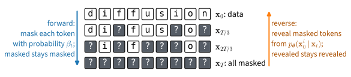

# Discrete Diffusion
:label:`sec_diffusion-discrete`

Every model in this chapter has added Gaussian noise to real numbers:
coordinates of points, pixel intensities, latents of an autoencoder. Text
is made of tokens, and the language model of :numref:`sec_gpt` writes it
one token at a time, from left to right. That takes one network evaluation
per token, one after another, so a text of 1,024 tokens costs 1,024
sequential calls. Nor can a model that looks only to the left fill a gap
using the words that follow it. Diffusion generates many positions per
evaluation, each conditioned on everything around it. Can text, code or a
quantized image be generated this way, with a likelihood bound to train
against? The noise is the obstacle. Adding a small real number to the
index of the word "cat" does not produce a slightly noisy cat.

Noise for tokens has to change values rather than nudge them.
:citet:`Hoogeboom.Nielsen.Jaini.ea.2021` and
:citet:`Austin.Johnson.Ho.ea.2021` made the noise a Markov chain on the
vocabulary, and Austin et al. found that, for text, the best chain simply
erases: it replaces tokens by a mask symbol until nothing is left.
Generation runs the erasure backward and fills in masks. The other route
keeps Gaussian noise and adds it to learned token embeddings, vectors in
which a slightly noisy cat makes sense. Masked diffusion overtook it for
language, although it has recently come back :cite:`Dieleman.2026b`; this
section follows the masks.

Does the variational bound of :numref:`sec_diffusion-design-space`
survive the switch from numbers to tokens, and what does it become? What
is lost when one network evaluation fills many masks at once, and how
much? Two tokens are enough to answer the second question exactly, on a
quantized version of the chapter's running example, and binary images
show the answer at scale. Finally, how do the left-to-right language model
of :numref:`sec_gpt` and the masked language model of
:numref:`sec_transformer` relate to a masked diffusion model? The section,
and with it the chapter, closes with a look back.

```{.python .input #discrete-diffusion}
%%tab pytorch
import math
import numpy as np
import torch
from torch import nn
from torch.nn import functional as F
from d2l import torch as d2l
```

```{.python .input #discrete-diffusion}
%%tab jax
import math
import numpy as np
import jax
from jax import numpy as jnp
from flax import nnx
import optax
from d2l import jax as d2l
```

```{.python .input #discrete-diffusion-1}
%%tab pytorch, jax
from scipy.special import ndtr, xlogy
```

```{.python .input #discrete-diffusion-2}
%%tab pytorch
torch.set_float32_matmul_precision('high')  # tf32 matmuls on tensor cores
```

## Corrupting Tokens

We ask of a forward process for tokens what the Gaussian chain of
:numref:`sec_diffusion-gaussian-paths` provided: marginals and posteriors
in closed form, and an end state that carries no information about the
data.

### Transition Matrices

First a change of notation. To match the papers on discrete diffusion,
$t = 1, \ldots, T$ is now an integer that counts steps, the role $k$
played for the Gaussian chain. The network still receives $t/T$, the time
on the chapter's clock.

Let a token take one of $K$ values, written as a one-hot row vector
$\mathbf{x} \in \{0, 1\}^K$. Noise for a token is a random change of its
value, given by *transition matrices* $\mathbf{Q}_t \in [0, 1]^{K \times K}$
whose rows sum to one: $[\mathbf{Q}_t]_{ij}$ is the probability of moving
from value $i$ to value $j$ at step $t$. These are
the row-stochastic matrices of Markov chain Monte Carlo
(:numref:`sec_mdl-bayes-mcmc`): a distribution is a row vector, multiplied
by $\mathbf{Q}_t$ from the right. Hence

$$
q(\mathbf{x}_t \mid \mathbf{x}_{t-1}) = \mathrm{Cat}(\mathbf{x}_t;\ \mathbf{x}_{t-1} \mathbf{Q}_t),
$$
:eqlabel:`eq_diffusion-discrete-forward`

where $\mathrm{Cat}(\mathbf{x}; \mathbf{p})$ is the categorical
distribution with probability vector $\mathbf{p}$, here the row of
$\mathbf{Q}_t$ selected by the current value. A sequence of $L$ tokens is
corrupted by running the chain at every position independently. Composing
two transitions multiplies their matrices, so by induction on $t$ the
marginal after $t$ steps is

$$
q(\mathbf{x}_t \mid \mathbf{x}_0) = \mathrm{Cat}(\mathbf{x}_t;\ \mathbf{x}_0 \bar{\mathbf{Q}}_t),
\qquad \bar{\mathbf{Q}}_t = \mathbf{Q}_1 \mathbf{Q}_2 \cdots \mathbf{Q}_t.
$$
:eqlabel:`eq_diffusion-discrete-marginal`

The posterior of one step given both of its ends follows from Bayes' rule
and the Markov property,

$$
q(\mathbf{x}_{t-1} \mid \mathbf{x}_t, \mathbf{x}_0)
= \frac{q(\mathbf{x}_t \mid \mathbf{x}_{t-1})\, q(\mathbf{x}_{t-1} \mid \mathbf{x}_0)}{q(\mathbf{x}_t \mid \mathbf{x}_0)}
= \mathrm{Cat}\!\left(\mathbf{x}_{t-1};\ \frac{\mathbf{x}_t \mathbf{Q}_t^\top \odot \mathbf{x}_0 \bar{\mathbf{Q}}_{t-1}}{\mathbf{x}_0 \bar{\mathbf{Q}}_t \mathbf{x}_t^\top}\right),
$$
:eqlabel:`eq_diffusion-discrete-posterior`

where $\odot$ is the elementwise product: each possible predecessor is
weighted by its probability given the start and by its probability of
leading to the observed $\mathbf{x}_t$.

A binary token that flips with probability $0.1$ at every step shows the
posterior at work. Here
$\mathbf{Q}_1 = \mathbf{Q}_2 = \left(\begin{smallmatrix} 0.9 & 0.1 \\ 0.1 & 0.9 \end{smallmatrix}\right)$.
Start from the first value, $\mathbf{x}_0 = (1, 0)$, and suppose that
after two steps the token shows the second value, $\mathbf{x}_2 = (0, 1)$.
This happens with probability $0.9 \cdot 0.1 + 0.1 \cdot 0.9 = 0.18$, the
denominator. For the middle state,
$\mathbf{x}_2 \mathbf{Q}_2^\top = (0.1, 0.9)$ and
$\mathbf{x}_0 \bar{\mathbf{Q}}_1 = (0.9, 0.1)$. Their elementwise product
is $(0.09, 0.09)$, and dividing by $0.18$ gives $(1/2, 1/2)$. The token
flipped once, and given both ends the flip is equally likely to have
happened at the first step or at the second.

### The Absorbing Kernel

The bound needs a closed form for $\bar{\mathbf{Q}}_t$, and the sampler a
known starting state. The *absorbing kernel* of
:citet:`Austin.Johnson.Ho.ea.2021` provides both. It enlarges the vocabulary by
one value, the *mask* $[\textrm{M}]$, and moves each token there with
probability $\beta_t$ at step $t$; a masked token stays masked:

$$
\mathbf{Q}_t = (1 - \beta_t)\, \mathbf{I} + \beta_t\, \mathbf{1} \mathbf{e}_{\textrm{M}}^\top,
$$
:eqlabel:`eq_diffusion-absorbing-kernel`

with $\mathbf{1}$ the all-ones column vector and $\mathbf{e}_{\textrm{M}}$
the one-hot column vector of the mask, so that every row of
$\mathbf{1} \mathbf{e}_{\textrm{M}}^\top$ puts all its mass on the mask.

Products of such matrices collapse. Write
$\mathbf{P} = \mathbf{1} \mathbf{e}_{\textrm{M}}^\top$. Since
$\mathbf{e}_{\textrm{M}}^\top \mathbf{1} = 1$, we have
$\mathbf{P}^2 = \mathbf{P}$, and therefore
$(a\mathbf{I} + b\mathbf{P})(c\mathbf{I} + d\mathbf{P}) = ac\, \mathbf{I} + (ad + bc + bd)\, \mathbf{P}$.
When $a + b = c + d = 1$ the second coefficient equals $1 - ac$, so the
coefficient of $\mathbf{I}$ multiplies along the chain. Let
$\bar{\alpha}_t = \prod_{s \leq t} (1 - \beta_s)$, the same product as for
the Gaussian chain of :numref:`sec_diffusion-gaussian-paths`. There it was
the squared weight of the clean point; here it has a more direct meaning,
the probability that a token survives $t$ steps without being masked. Then

$$
\bar{\mathbf{Q}}_t = \bar{\alpha}_t\, \mathbf{I} + (1 - \bar{\alpha}_t)\, \mathbf{1}\mathbf{e}_{\textrm{M}}^\top.
$$
:eqlabel:`eq_diffusion-discrete-qbar`

The chain never confuses one token with another; it only erases. A
schedule with $\bar{\alpha}_T = 0$ ends at the fully masked sequence
(:numref:`fig_diffusion-masking`), which carries no information about the
data, as the Gaussian chain ends at pure noise. The other common choice, the
*uniform kernel*, resamples a token uniformly from the vocabulary
:cite:`Hoogeboom.Nielsen.Jaini.ea.2021` (Exercise
:exref:`ex_discrete-diffusion-uniform-kernel`).


:label:`fig_diffusion-masking`

We use the absorbing kernel from now on. It gave the best likelihoods on
text in the comparisons of Austin et al., and its posterior is as simple
as a posterior can be. It also gives something up. In reverse the chain
only reveals, so the sampler commits to every token it writes, just as a
left-to-right model does. Chains that resample tokens, such as the uniform
kernel, and samplers that mask revealed tokens again, such as ReMDM
:cite:`Wang.Schiff.Sahoo.ea.2025`, can revise an early mistake
(:numref:`sec_diffusion-further-reading`).

## The Masked Bound

To train a reverse chain we need a loss, and the variational bound of
:numref:`sec_diffusion-design-space` offers one.

### The Same Bound, a Different Target

The reverse model is a Markov chain
$p_{\boldsymbol{\theta}}(\mathbf{x}_{t-1} \mid \mathbf{x}_t)$, started from
the all-mask sequence. :numref:`sec_diffusion-design-space` bounded the
negative log-likelihood of such a chain by

$$
-\log p_{\boldsymbol{\theta}}(\mathbf{x}_0) \leq L_{\textrm{VLB}}
= D_{\textrm{KL}}\big(q(\mathbf{x}_T \mid \mathbf{x}_0)\, \|\, p(\mathbf{x}_T)\big)
+ \sum_{t=2}^{T} \mathbb{E}_q\Big[D_{\textrm{KL}}\big(q(\mathbf{x}_{t-1} \mid \mathbf{x}_t, \mathbf{x}_0)\, \|\, p_{\boldsymbol{\theta}}(\mathbf{x}_{t-1} \mid \mathbf{x}_t)\big)\Big]
+ \mathbb{E}_q\big[-\log p_{\boldsymbol{\theta}}(\mathbf{x}_0 \mid \mathbf{x}_1)\big].
$$

This is the negative of the evidence lower bound of
:numref:`sec_mdl-latent-em-elbo`, with the forward chain as the
variational distribution. Its derivation used only the Markov property and Bayes' rule, so it holds for tokens as it stands.

What changes is the target. For Gaussian noise the network predicted the
noise, the velocity or the clean point, each an affine function of one
posterior mean $\mathbb{E}[\mathbf{x}_0 \mid \mathbf{x}_t]$
(:numref:`sec_diffusion-denoising`). For a one-hot token that posterior
mean is the vector of probabilities of the values the clean token might
have, so predicting that distribution is the discrete form of the
denoiser the chapter started from. Following
:citet:`Austin.Johnson.Ho.ea.2021`, the network outputs, for each position
$i$, a distribution
$p_{\boldsymbol{\theta}}(\mathbf{x}_0^i \mid \mathbf{x}_t)$ over the clean
values given the whole corrupted sequence, and the reverse transition
averages the true posterior over this prediction,

$$
p_{\boldsymbol{\theta}}(\mathbf{x}_{t-1} \mid \mathbf{x}_t)
= \sum_{\hat{\mathbf{x}}_0} q(\mathbf{x}_{t-1} \mid \mathbf{x}_t, \hat{\mathbf{x}}_0)\, p_{\boldsymbol{\theta}}(\hat{\mathbf{x}}_0 \mid \mathbf{x}_t),
$$
:eqlabel:`eq_diffusion-x0-parameterization`

position by position, with the prediction at an unmasked position taken
to be the observed token. For a single token, a perfect prediction makes
this the true reverse transition (Exercise
:exref:`ex_discrete-diffusion-two-forms`a). For a sequence it falls short
in one respect: positions that revert in the same step are drawn
independently of one another, whereas the true reverse transition draws
them jointly. Much of this section is about what that shortfall costs.

### The Posterior of the Absorbing Chain

**Proposition (posterior of the absorbing chain).** *Under the absorbing
kernel with $\beta_1 > 0$, so that $\bar{\alpha}_t < 1$ for every
$t \geq 1$, consider one position with clean value $\mathbf{x}_0 \neq [\textrm{M}]$.
If $\mathbf{x}_t = \mathbf{x}_0$, then $\mathbf{x}_{t-1} = \mathbf{x}_0$
with probability one. If $\mathbf{x}_t = [\textrm{M}]$, then*

$$
q(\mathbf{x}_{t-1} = \mathbf{x}_0 \mid \mathbf{x}_t = [\textrm{M}], \mathbf{x}_0) = \frac{\bar{\alpha}_{t-1} - \bar{\alpha}_t}{1 - \bar{\alpha}_t},
\qquad
q(\mathbf{x}_{t-1} = [\textrm{M}] \mid \mathbf{x}_t = [\textrm{M}], \mathbf{x}_0) = \frac{1 - \bar{\alpha}_{t-1}}{1 - \bar{\alpha}_t},
$$
:eqlabel:`eq_diffusion-masked-posterior`

*and no other value has positive probability.*

**Proof.** Evaluate :eqref:`eq_diffusion-discrete-posterior` with
:eqref:`eq_diffusion-absorbing-kernel` and
:eqref:`eq_diffusion-discrete-qbar`. The vector
$\mathbf{x}_0 \bar{\mathbf{Q}}_{t-1}$ puts mass $\bar{\alpha}_{t-1}$ on
$\mathbf{x}_0$ and $1 - \bar{\alpha}_{t-1}$ on the mask, so only these two
predecessors are possible. If $\mathbf{x}_t = \mathbf{x}_0$, the vector
$\mathbf{x}_t \mathbf{Q}_t^\top$ has the entry $1 - \beta_t$ at
$\mathbf{x}_0$ and the entry $0$ at the mask, because a mask never returns
to a token, and the posterior is a point mass. If
$\mathbf{x}_t = [\textrm{M}]$, the entries are $\beta_t$ at
$\mathbf{x}_0$ and $1$ at the mask, so the unnormalized posterior is
$\bar{\alpha}_{t-1}\beta_t$ on $\mathbf{x}_0$ and $1 - \bar{\alpha}_{t-1}$
on the mask. Their sum, $1 - \bar{\alpha}_{t-1}(1 - \beta_t) = 1 - \bar{\alpha}_t$,
is the denominator $q(\mathbf{x}_t = [\textrm{M}] \mid \mathbf{x}_0)$, and
$\bar{\alpha}_{t-1}\beta_t = \bar{\alpha}_{t-1} - \bar{\alpha}_t$.
$\blacksquare$

One step back, a masked token either stays masked or reverts to its clean
value. The reverse model :eqref:`eq_diffusion-x0-parameterization`
therefore copies the unmasked positions of $\mathbf{x}_t$ and replaces each
masked one, independently, by a draw from
$p_{\boldsymbol{\theta}}(\mathbf{x}_0^i \mid \mathbf{x}_t)$ with the
probability of reverting.

### A Weighted Cross-Entropy
:label:`subsec_diffusion-masked-ce`

The reverse model copies what is visible and fills only masks, so only the
masked positions can cost anything in the bound. The next result, found in
this form by :citet:`Sahoo.Arriola.Schiff.ea.2024` and
:citet:`Shi.Han.Wang.ea.2024`, is the central one of the section: what
they cost is a cross-entropy.

**Proposition (masked diffusion bound).** *For the absorbing kernel with
$\bar{\alpha}_0 = 1$, $\bar{\alpha}_t < 1$ for $t \geq 1$, and
$\bar{\alpha}_T = 0$, and the reverse model just described,*

$$
L_{\textrm{VLB}}
= \sum_{t=1}^{T} \frac{\bar{\alpha}_{t-1} - \bar{\alpha}_t}{1 - \bar{\alpha}_t}\;
\mathbb{E}_{q(\mathbf{x}_t \mid \mathbf{x}_0)}\Big[ \sum_{i \,:\, \mathbf{x}_t^i = [\textrm{M}]} -\log p_{\boldsymbol{\theta}}(\mathbf{x}_0^i \mid \mathbf{x}_t) \Big].
$$
:eqlabel:`eq_diffusion-masked-loss`

**Proof.** The prior term vanishes: $\bar{\alpha}_T = 0$ makes
$q(\mathbf{x}_T \mid \mathbf{x}_0)$ the point mass on the all-mask
sequence, which is also $p(\mathbf{x}_T)$. Both
$q(\mathbf{x}_{t-1} \mid \mathbf{x}_t, \mathbf{x}_0)$ and
$p_{\boldsymbol{\theta}}(\mathbf{x}_{t-1} \mid \mathbf{x}_t)$ factorize
over positions, so each divergence is a sum of per-position divergences.
At an unmasked position both distributions are the same point mass and
the divergence is zero. At a masked position write
$w_t = (\bar{\alpha}_{t-1} - \bar{\alpha}_t) / (1 - \bar{\alpha}_t)$. The
true posterior puts $1 - w_t$ on the mask and $w_t$ on $\mathbf{x}_0^i$;
the model puts $1 - w_t$ on the mask and
$w_t\, p_{\boldsymbol{\theta}}(\cdot \mid \mathbf{x}_t)$ on the tokens;
hence

$$
D_{\textrm{KL}}
= (1 - w_t) \log \frac{1 - w_t}{1 - w_t}
+ w_t \log \frac{w_t}{w_t\, p_{\boldsymbol{\theta}}(\mathbf{x}_0^i \mid \mathbf{x}_t)}
= -w_t \log p_{\boldsymbol{\theta}}(\mathbf{x}_0^i \mid \mathbf{x}_t).
$$

This accounts for $t = 2, \ldots, T$. The reconstruction term is
$\mathbb{E}[-\log p_{\boldsymbol{\theta}}(\mathbf{x}_0 \mid \mathbf{x}_1)]$.
Since $w_1 = (1 - \bar{\alpha}_1)/(1 - \bar{\alpha}_1) = 1$, the model
replaces every position masked at step $1$ by a draw from
$p_{\boldsymbol{\theta}}(\cdot \mid \mathbf{x}_1)$ and copies the rest, so
this term equals the sum of
$-\log p_{\boldsymbol{\theta}}(\mathbf{x}_0^i \mid \mathbf{x}_1)$ over the
masked positions, which is the $t = 1$ term of the sum. $\blacksquare$

This is the loss of a masked language model with two changes: the
masking rate ranges over all levels from nothing to everything instead of
staying at one value, and each level carries its own weight. Divided by
$\log 2$ and the number of tokens, the bound is a code length in bits per
token (:numref:`sec_mdl-coding-compression`), the unit in which we will
read it on images.

Under the *linear schedule* $\bar{\alpha}_t = 1 - t/T$, a fraction $t/T$
of the tokens is masked at step $t$, and $w_t = (1/T)/(t/T) = 1/t$. An
error on a heavily masked sequence counts less than the same error on a
lightly masked one. Since the number of masked positions grows in
proportion to $t$, every step carries the same expected weighted count of
masked positions, $L/T$ for $L$ tokens; the steps differ only in how hard
their masked tokens are to predict.

The sum is also a Riemann sum. Write
$\ell(\mathbf{x}_0, \mathbf{x})$ for the cross-entropy on the masked
positions of $\mathbf{x}$, the inner sum of
:eqref:`eq_diffusion-masked-loss`, and let $T \to \infty$ with
$\bar{\alpha}_t = \bar{\alpha}(t/T)$ for a decreasing function on the
chapter's clock, data at time $0$ and the all-mask sequence at time $1$.
Since $t$ now counts steps, we write $\tau = t/T$ for the time. Then
$w_t \approx -\bar{\alpha}'(\tau)/(T(1 - \bar{\alpha}(\tau)))$. Its factor
$1/T$ is the width $d\tau$ of one step, so the bound tends to

$$
\int_0^1 \frac{-\bar{\alpha}'(\tau)}{1 - \bar{\alpha}(\tau)}\, \mathbb{E}\big[\ell(\mathbf{x}_0, \mathbf{x}_\tau)\big]\, d\tau .
$$

Now substitute the masking probability $u = 1 - \bar{\alpha}(\tau)$ (in
this section $u$ is a probability, not a velocity). Since
$du = -\bar{\alpha}'(\tau)\, d\tau$, the integral becomes

$$
\int_0^1 \frac{1}{u}\, \mathbb{E}_u\big[\ell(\mathbf{x}_0, \mathbf{x})\big]\, du,
$$

where $\mathbb{E}_u$ masks each token independently with probability $u$.
For a network told the masking probability rather than the time, the
limit does not depend on the schedule, the discrete counterpart of the
schedule invariance of the Gaussian bound
(:numref:`sec_diffusion-design-space`)
:cite:`Kingma.Salimans.Poole.ea.2021`.

In fact the best network needs neither. Which positions are masked is
decided by coin flips that never look at the tokens. Once the input shows
which positions are masked and what the others hold, the time adds nothing
about the hidden tokens. The best prediction at a masked position, the
conditional of its token given the visible ones, therefore does not depend
on the time at all :cite:`Ou.Nie.Xue.ea.2025` (Exercise
:exref:`ex_discrete-diffusion-time-agnostic`).

Readers of recent papers will meet this limit in another form: a
*continuous-time Markov chain* that masks each surviving token at the rate
$-\bar{\alpha}'(\tau)/\bar{\alpha}(\tau)$
:cite:`Campbell.Benton.DeBortoli.ea.2022`, reversed with the help of ratios
of probabilities between sequences that differ in one token
:cite:`Lou.Meng.Ermon.2024`. For the absorbing kernel such a ratio is a
known function of time times the clean conditional our network predicts
:cite:`Ou.Nie.Xue.ea.2025`, so both views train the same object.

The function `masked_loss` estimates the bound with one step $t$ per
sequence, given the schedule `alpha_bar` (the values
$\bar{\alpha}_0, \ldots, \bar{\alpha}_T$) and the index `mask_id` of the mask; the
factor $T$ makes a uniformly drawn step unbiased for the sum over steps.
The sum runs over every axis after the first, so pairs of tokens and
images share the function. Our networks still receive $t/T$, to keep the
chapter's interfaces; Exercise :exref:`ex_discrete-diffusion-time-agnostic`
measures how little the trained pair model uses it.

```{.python .input #discrete-diffusion-a-weighted-cross-entropy}
%%tab pytorch
def masked_loss(model, x0, t, alpha_bar, mask_id):
    """One-draw estimate of the masked bound per sequence, in nats."""
    T = len(alpha_bar) - 1
    shape = (-1,) + (1,) * (x0.dim() - 1)      # broadcast over positions
    masked = (torch.rand(x0.shape, device=x0.device)
              < (1 - alpha_bar[t]).view(shape))  # with prob. 1 - abar_t
    logits = model(torch.where(masked, mask_id, x0), t / T)
    nll = -torch.log_softmax(logits, -1).gather(-1, x0[..., None])[..., 0]
    w = (alpha_bar[t - 1] - alpha_bar[t]) / (1 - alpha_bar[t])  # 1/t if linear
    return (T * w.view(shape) * nll * masked).flatten(1).sum(1)
```

```{.python .input #discrete-diffusion-a-weighted-cross-entropy}
%%tab jax
def masked_loss(model, x0, t, alpha_bar, mask_id, key):
    """One-draw estimate of the masked bound per sequence, in nats."""
    T = len(alpha_bar) - 1
    shape = (-1,) + (1,) * (x0.ndim - 1)       # broadcast over positions
    masked = (jax.random.uniform(key, x0.shape)
              < (1 - alpha_bar[t]).reshape(shape))  # with prob. 1 - abar_t
    logits = model(jnp.where(masked, mask_id, x0), t / T)
    nll = -jnp.take_along_axis(jax.nn.log_softmax(logits), x0[..., None],
                               -1)[..., 0]
    w = (alpha_bar[t - 1] - alpha_bar[t]) / (1 - alpha_bar[t])  # 1/t if linear
    return (T * w.reshape(shape) * nll * masked).reshape(len(x0), -1).sum(1)
```

## Sampling by Unmasking

A trained network gives a distribution at every masked position.
Generation must decide which positions to fill, and when.

### Parallel Reveals and the Independence Error

Generation starts from the all-mask sequence. At step $t$, one forward
pass yields $p_{\boldsymbol{\theta}}(\cdot \mid \mathbf{x}_t)$ at every
masked position; each masked position draws a candidate token and accepts
it with probability $w_t$. As with the Gaussian samplers of
:numref:`sec_diffusion-samplers`, we would rather not spend $T$ network
evaluations, so we choose levels $T = t_0 > t_1 > \cdots > t_S = 0$ and
jump between them. Skipping levels composes kernels, and by the collapse
shown above a product of absorbing kernels is again absorbing. The coarser
chain therefore has the marginals :eqref:`eq_diffusion-discrete-qbar` at
its levels, and the proposition applies to it unchanged: the function
`unmask` jumps from $t_k$ to $t_{k+1}$ by revealing each masked token
with probability
$(\bar{\alpha}_{t_{k+1}} - \bar{\alpha}_{t_k}) / (1 - \bar{\alpha}_{t_k})$.

The reveal decisions never look at the network, so we can say in advance
when each token appears. The probabilities of staying masked,
$(1 - \bar{\alpha}_{t_{k+1}})/(1 - \bar{\alpha}_{t_k})$, multiply along
the jumps and telescope: a token is still masked at level $t_k$ with
probability $1 - \bar{\alpha}_{t_k}$, as under the forward chain. It is
therefore revealed in jump $k$, for $k = 0, \ldots, S - 1$, with
probability
$\Delta_k = \bar{\alpha}_{t_{k+1}} - \bar{\alpha}_{t_k}$, independently of
the other positions.

```{.python .input #discrete-diffusion-parallel-reveals-and-the-independence-error}
%%tab pytorch
@torch.inference_mode()
def unmask(model, shape, steps, alpha_bar, mask_id):
    """Reveal tokens from the all-mask state in `steps` jumps."""
    T = len(alpha_bar) - 1
    levels = torch.linspace(T, 0, steps + 1).round().long().tolist()
    z = torch.full(shape, mask_id, device=alpha_bar.device)
    for t, s in zip(levels[:-1], levels[1:]):
        logits = model(z, torch.full(shape[:1], t / T, device=z.device))
        draw = torch.distributions.Categorical(logits=logits).sample()
        p = (alpha_bar[s] - alpha_bar[t]) / (1 - alpha_bar[t])  # reveal prob.
        reveal = (z == mask_id) & (torch.rand(shape, device=z.device) < p)
        z = torch.where(reveal, draw, z)
    return z
```

```{.python .input #discrete-diffusion-parallel-reveals-and-the-independence-error}
%%tab jax
@nnx.jit
def reveal(model, z, t, s, alpha_bar, mask_id, key):
    """One jump of the sampler, from level t down to level s."""
    T, (k1, k2) = len(alpha_bar) - 1, jax.random.split(key)
    draw = jax.random.categorical(k1, model(z, jnp.full(z.shape[:1], t / T)))
    p = (alpha_bar[s] - alpha_bar[t]) / (1 - alpha_bar[t])  # reveal prob.
    accept = (z == mask_id) & (jax.random.uniform(k2, z.shape) < p)
    return jnp.where(accept, draw, z)

def unmask(model, shape, steps, alpha_bar, mask_id, key):
    """Reveal tokens from the all-mask state in `steps` jumps."""
    T = len(alpha_bar) - 1
    levels = [round(l) for l in np.linspace(T, 0, steps + 1)]
    z = jnp.full(shape, mask_id)
    for t, s, k in zip(levels[:-1], levels[1:], jax.random.split(key, steps)):
        z = reveal(model, z, t, s, alpha_bar, mask_id, k)
    return z
```

The network's prediction is a product over positions. Tokens revealed in
the same jump are therefore drawn independently of one another, each from
its own predicted distribution, while tokens revealed in different jumps
are drawn one after another, each conditioned on those already revealed.
What does this independence cost? Let us start with the smallest case in
which it can cost anything: two tokens.

The chapter's running example supplies them. It is the mixture of three
Gaussians in the plane with means $(-2.5, -1.5)$, $(2.5, -1.5)$ and
$(0, 2.5)$, weights $0.5$, $0.3$ and $0.2$, and standard deviation $0.5$
(:numref:`sec_diffusion-denoising`). Quantizing the plane onto a
$32 \times 32$ grid over $[-5, 5]^2$ turns each sample into a pair of
tokens, the indices of its cell along the two axes. The table $p$ of the
pairs has three blobs, one per mode. Its marginals $p^1$ and $p^2$ have
three bumps along the first axis but only two along the second, since two
modes share a height. The product of the marginals, $p^1 \otimes p^2$,
draws the two tokens independently and puts a blob at every crossing of a
bump of one with a bump of the other: six blobs, three of them where no
data lie.

Now take an *exact* network, whose prediction at each masked position is
the true conditional of that token given the unmasked ones. With $S$
equal jumps under the linear schedule, $\Delta_k = 1/S$ for every jump,
so both tokens are revealed in the same jump with probability
$S \cdot (1/S)^2 = 1/S$, and in that event the pair comes from
$p^1 \otimes p^2$. Otherwise one token is drawn from its marginal and the
other later from its conditional, and the pair comes from $p$. The
sampler draws from the mixture

$$
\left(1 - \tfrac{1}{S}\right) p + \tfrac{1}{S}\, p^1 \otimes p^2 .
$$

In total variation, half the summed absolute difference of two
probability tables, this mixture lies $\mathrm{TV}(p^1 \otimes p^2, p)/S$
from $p$. The error falls as one over the number of steps and grows with
the dependence between the tokens.

We can predict the one-step error before computing anything. The three
phantom blobs of the product receive
$0.5 \cdot 0.2 + 0.3 \cdot 0.2 + 0.2 \cdot 0.8 = 0.32$ of the mass, and if
no blobs overlapped this would be the total variation. Cell probabilities
factorize into one-dimensional Gaussian integrals, so the cell below
computes $p$ exactly, with its entropy, the mutual information of the two
tokens, and the error of an exact network's sampler for four step counts.

```{.python .input #discrete-diffusion-parallel-reveals-and-the-independence-error-2}
%%tab pytorch, jax
mix = d2l.GaussianMixture.three_modes()
means, weights = np.float64(mix.means), np.float64(mix.weights)
K, T = 32, 32                 # vocabulary of each token; number of steps
edges = np.linspace(-5, 5, K + 1)
cdf = ndtr((edges - means[:, :, None]) / mix.std)  # (modes, axes, K + 1)
cdf[:, :, 0], cdf[:, :, -1] = 0, 1      # edge cells extend to infinity
cell = np.diff(cdf, axis=2)             # mass of each cell, per mode, axis
table = np.einsum('m,mi,mj->ij', weights, cell[:, 0], cell[:, 1])
p1, p2 = table.sum(1), table.sum(0)     # marginals of the two tokens
product = np.outer(p1, p2)
H = lambda p: -xlogy(p, p).sum()        # entropy in nats
tv = lambda p, q: np.abs(p - q).sum() / 2
mutual = H(p1) + H(p2) - H(table)
print(f'entropy {H(table):.3f} nats, mutual information {mutual:.3f} nats')
for S in (1, 2, 8, 32):
    print(f'{S:>2} steps, exact network: TV {tv(product, table) / S:.3f}')
```

The one-step sampler misplaces $0.314$ of the mass, a little less than
the predicted $0.32$ because neighboring blobs overlap slightly, and
thirty-two steps bring the error down to $0.010$.

### Confidence-Ordered Reveals

Many practical samplers do not reveal at random. MaskGIT
:cite:`Chang.Zhang.Jiang.ea.2022` and the diffusion language model LLaDA
:cite:`Nie.Zhu.You.ea.2025` draw a candidate at every masked position,
keep the candidates that are most probable under their own predicted
distributions, and mask the others again. This *confidence remasking*
chooses which tokens to reveal from the values it has drawn. Is that
better than a random order? The two-token table answers without any
training. For two tokens, confidence remasking draws both from their
marginals, $A \sim p^1$ and $B \sim p^2$, keeps the draw that is more
probable under its own marginal, and redraws the other from its
conditional given the kept one. Its output table is

$$
q(a, b) = p^1(a)\, P\big(p^2(B) \leq p^1(a)\big)\, p(b \mid a)
+ p^2(b)\, P\big(p^1(A) < p^2(b)\big)\, p(a \mid b),
$$

where the first term keeps the draw $a$ of the first token and the second
keeps the draw $b$ of the second. The cell compares this table with those
of one step, two random jumps, and a fixed order (first token from its
marginal, second from its conditional).

```{.python .input #discrete-diffusion-diffusion-language-models-in-practice}
%%tab pytorch, jax
c2 = table / p1[:, None]                # p(x2 | x1); each row sums to one
c1 = table / p2[None, :]                # p(x1 | x2); each column sums to one
keep1 = p1[:, None] >= p2[None, :]      # the draw of x1 is the likelier one
confidence = ((product * keep1).sum(1)[:, None] * c2
              + (product * ~keep1).sum(0)[None, :] * c1)
centers = (edges[:-1] + edges[1:]) / 2
grid = np.stack(np.meshgrid(centers, centers, indexing='ij'), -1)
mode = ((grid[:, :, None] - means) ** 2).sum(-1).argmin(-1)  # nearest mode
orders = {'one step': product, 'two random jumps': (product + table) / 2,
          'fixed order': p1[:, None] * c2, 'confidence': confidence}
print(f'{"order":>16} {"TV":>6} {"entropy":>8}  mass near the modes')
for name, q in orders.items():
    masses = ' '.join(f'{q[mode == k].sum():.3f}' for k in range(3))
    print(f'{name:>16} {tv(q, table):6.3f} {H(q):8.3f}  {masses}')
```

With exact conditionals, an order fixed before the tokens are drawn, left
to right or random, is exact when it reveals one token per step, as the
fixed order shows. Two random jumps reveal both tokens together half of
the time and halve the one-step error. Surprisingly, confidence
remasking, which also reveals one token per step but chooses its order
from the values it draws, lands farther from $p$ than two random jumps,
at $0.179$ against $0.157$. The formula shows why. A draw from a small
mode has a small marginal probability, so it tends to lose the comparison
and is the one redrawn, from a conditional given the winner that rarely
leads back to the small mode. The sampler seeks modes: the smallest mode
falls from $0.2$ to about $0.07$, and the entropy drops from $4.84$ to
$4.41$ nats. On text, lower entropy often reads as fluency, and with an
imperfect network it can help to reveal the easy positions first. But the
bound does not describe this sampler and cannot detect its bias. It
scores predictions under random masks, which is to say it describes the
random-order sampler.

## Trained Denoisers

So far every number came from an exact table. We now train networks,
first on the pair, where every error can be attributed, then on images.

### The Quantized Mixture

The network for the pair takes the one-hot encoding of both tokens, with
the mask as a thirty-third value at index $K$, together with the time
$t/T$, and outputs logits over the $32$ clean values at each position. The
schedule is linear with $T = 32$ steps.

```{.python .input #discrete-diffusion-the-quantized-mixture}
%%tab pytorch
class MaskedMLP(nn.Module):
    """Logits of both clean tokens of a pair, given the masked pair and t."""
    def __init__(self, K, hidden=256):
        super().__init__()
        self.K = K
        self.net = d2l.make_mlp([2 * (K + 1) + 1, hidden, hidden, 2 * K],
                                nn.SiLU())

    def forward(self, z, t):  # z: (n, 2) in {0, ..., K}, where K is the mask
        h = F.one_hot(z, self.K + 1).float().flatten(1)
        return self.net(torch.cat([h, t[:, None]], 1)).view(-1, 2, self.K)

def quantize(x):  # points in the plane to pairs of tokens in {0, ..., K - 1}
    return ((x + 5) / 10 * K).floor().long().clamp(0, K - 1)

alpha_bar = 1 - torch.arange(T + 1) / T     # the linear schedule
```

```{.python .input #discrete-diffusion-the-quantized-mixture}
%%tab jax
class MaskedMLP(nnx.Module):
    """Logits of both clean tokens of a pair, given the masked pair and t."""
    def __init__(self, K, hidden=256, *, rngs):
        self.K = K
        self.net = d2l.make_mlp([2 * (K + 1) + 1, hidden, hidden, 2 * K],
                                nnx.silu, rngs=rngs)

    def __call__(self, z, t):  # z: (n, 2) in {0, ..., K}, where K is the mask
        h = jax.nn.one_hot(z, self.K + 1).reshape(len(z), -1)
        return self.net(jnp.concatenate([h, t[:, None]], 1)).reshape(
            -1, 2, self.K)

def quantize(x):  # points in the plane to pairs of tokens in {0, ..., K - 1}
    return jnp.clip(jnp.floor((x + 5) / 10 * K), 0, K - 1).astype(jnp.int32)

alpha_bar = 1 - jnp.arange(T + 1) / T       # the linear schedule
```

We train it with `d2l.train_regression`
(:numref:`sec_diffusion-denoising`) on fresh draws from the mixture,
512 pairs per batch, each with a uniformly drawn step, with a learning rate
that decays along a cosine over 6,000 updates.

```{.python .input #discrete-diffusion-the-quantized-mixture-2}
%%tab pytorch
torch.manual_seed(0)
batch_fn = lambda: (quantize(mix.sample(512)), torch.randint(1, T + 1, (512,)))
loss_fn = lambda model, batch: masked_loss(model, *batch, alpha_bar,
                                           mask_id=K).mean()
_, pair_model, _ = d2l.train_regression(MaskedMLP(K), loss_fn, batch_fn,
                                        6000, cosine=True)
```

```{.python .input #discrete-diffusion-the-quantized-mixture-2}
%%tab jax
def batch_fn(key):
    k1, k2 = jax.random.split(key)
    return (quantize(mix.sample(k1, 512)),
            jax.random.randint(k2, (512,), 1, T + 1))

loss_fn = lambda model, batch, key: masked_loss(model, *batch, alpha_bar,
                                                mask_id=K, key=key).mean()
_, pair_model, _ = d2l.train_regression(
    MaskedMLP(K, rngs=nnx.Rngs(0)), loss_fn, batch_fn, 6000,
    jax.random.key(0), cosine=True)
```

With two positions, the expectation in the bound can be computed exactly.
At each step there are three mask patterns with at least one mask. A
pattern with $m$ masks has probability $u^m (1 - u)^{2 - m}$, where
$u = 1 - \bar{\alpha}_t$, and the 1,024 pairs are weighted by the table.
This average cannot fall below the entropy of the table, the smallest
average negative log-likelihood any model attains
(:numref:`sec_mdl-information_theory`). How close can a network come?

Let us work it out for an exact network, writing $X^1$ and $X^2$ for the
two tokens of a pair drawn from the table. The bound scores each token at
the step in which the reverse chain reveals it: the weight $w_t$ times the
probability $1 - \bar{\alpha}_t$ that the token is masked at step $t$ is
$\bar{\alpha}_{t-1} - \bar{\alpha}_t$, the probability that the reverse
chain reveals it at step $t$. When the tokens are revealed in different
steps, the first is predicted from its marginal and
the second from its conditional given the first; together they cost
$H(X^1) + H(X^2 \mid X^1) = H(X^1, X^2)$, nothing more. Two tokens
revealed in the same step are predicted independently from their
marginals and cost
$H(X^1) + H(X^2)$ instead of $H(X^1, X^2)$, an excess of the mutual
information $I(X^1; X^2)$ (:numref:`sec_mdl-mutual-information`). Under
the linear schedule each token is revealed at a given step with
probability $1/T$, so both are revealed in the same step with probability
$T \cdot (1/T)^2 = 1/T$, and an exact network attains

$$
H(X^1, X^2) + \frac{I(X^1; X^2)}{T}
$$

(Exercise :exref:`ex_discrete-diffusion-revealed-together` turns this
argument into a proof for every schedule). No network that predicts the
positions independently can go below this floor,
$4.840 + 0.479/32 \approx 4.855$ nats. As $T \to \infty$ no two tokens
are revealed in the same step, and the floor falls to the entropy.

```{.python .input #discrete-diffusion-the-quantized-mixture-3}
%%tab pytorch
@torch.inference_mode()
def exact_bound(model, table, alpha_bar, mask_id):
    """The bound averaged over the table, summed exactly over t and masks."""
    T, K = len(alpha_bar) - 1, len(table)
    pairs = torch.cartesian_prod(torch.arange(K), torch.arange(K))
    p, total = torch.tensor(table.flatten(), dtype=torch.float32), 0.0
    for t in range(1, T + 1):
        u = 1 - alpha_bar[t]
        w = (alpha_bar[t - 1] - alpha_bar[t]) / u
        for masked in torch.tensor([[1, 0], [0, 1], [1, 1]], dtype=torch.bool):
            z, m = torch.where(masked, mask_id, pairs), masked.sum()
            logp = torch.log_softmax(model(z, torch.full((K * K,), t / T)), -1)
            nll = -(logp.gather(-1, pairs[..., None])[..., 0] * masked).sum(1)
            total += u ** m * (1 - u) ** (2 - m) * w * (p @ nll)
    return float(total)

bound = exact_bound(pair_model, table, alpha_bar, mask_id=K)
print(f'exact bound {bound:.3f} nats; '
      f'entropy {H(table):.3f}, floor {H(table) + mutual / T:.3f}')
```

```{.python .input #discrete-diffusion-the-quantized-mixture-3}
%%tab jax
def exact_bound(model, table, alpha_bar, mask_id):
    """The bound averaged over the table, summed exactly over t and masks."""
    T, K = len(alpha_bar) - 1, len(table)
    pairs = jnp.stack(jnp.meshgrid(jnp.arange(K), jnp.arange(K),
                                   indexing='ij'), -1).reshape(-1, 2)
    p, total = jnp.asarray(table.flatten(), jnp.float32), 0.0
    for t in range(1, T + 1):
        u = 1 - alpha_bar[t]
        w = (alpha_bar[t - 1] - alpha_bar[t]) / u
        for masked in jnp.array([[1, 0], [0, 1], [1, 1]], dtype=bool):
            z, m = jnp.where(masked, mask_id, pairs), masked.sum()
            logp = jax.nn.log_softmax(model(z, jnp.full(K * K, t / T)))
            nll = -(jnp.take_along_axis(logp, pairs[..., None], -1)[..., 0]
                    * masked).sum(1)
            total += u ** m * (1 - u) ** (2 - m) * w * (p @ nll)
    return float(total)

bound = exact_bound(pair_model, table, alpha_bar, mask_id=K)
print(f'exact bound {bound:.3f} nats; '
      f'entropy {H(table):.3f}, floor {H(table) + mutual / T:.3f}')
```

The bound lies less than two hundredths of a nat above the entropy: the
model has learned the marginal of each token and its conditional given the
other. Almost all of the gap is the floor; the network's own excess over
the floor is of the order of a thousandth of a nat. The floor is not just
looseness of the bound: the thirty-two-step sampler of an exact network
models $(1 - 1/32)\, p + (1/32)\, p^1 \otimes p^2$ rather than $p$. The
bound and the sampler agree about what is lost.

Does the trained sampler lose the same? With two tokens its output table
can be summed instead of sampled. Each token is revealed in jump $k$ with
probability $\Delta_k$ (`pi` in the code), independently of the other.
Tokens revealed together are drawn from the network's two marginals at
that level, and a token revealed later from its
conditional given the first. `conditionals` reads these predictions from a
pair model, and `sampler_table` sums over the jumps; fed the true
marginals and conditionals, it must reproduce the exact network's errors
printed earlier.

```{.python .input #discrete-diffusion-the-quantized-mixture-4}
%%tab pytorch
@torch.inference_mode()
def conditionals(model, tau):
    """A pair model's predictions at time tau: both marginals with both
    tokens masked, then c2[a, b] = q(x2 = b | x1 = a), c1[a, b] = q(x1 = a |
    x2 = b)."""
    K = model.K                                   # also the mask index
    a, m = torch.arange(K), torch.full((K,), K)
    z = torch.cat([torch.tensor([[K, K]]),        # both masked
                   torch.stack([a, m], 1),        # x1 = a revealed
                   torch.stack([m, a], 1)])       # x2 = a revealed
    q = torch.softmax(model(z, torch.full((2 * K + 1,), tau)), -1)
    q = q.double().numpy()                        # (2K + 1, 2, K)
    return q[0, 0], q[0, 1], q[1:K + 1, 1], q[K + 1:, 0].T
```

```{.python .input #discrete-diffusion-the-quantized-mixture-4}
%%tab jax
def conditionals(model, tau):
    """A pair model's predictions at time tau: both marginals with both
    tokens masked, then c2[a, b] = q(x2 = b | x1 = a), c1[a, b] = q(x1 = a |
    x2 = b)."""
    K = model.K                                   # also the mask index
    a, m = jnp.arange(K), jnp.full(K, K)
    z = jnp.concatenate([jnp.array([[K, K]]),     # both masked
                         jnp.stack([a, m], 1),    # x1 = a revealed
                         jnp.stack([m, a], 1)])   # x2 = a revealed
    q = jax.nn.softmax(model(z, jnp.full(2 * K + 1, tau)))
    q = np.float64(q)                             # (2K + 1, 2, K)
    return q[0, 0], q[0, 1], q[1:K + 1, 1], q[K + 1:, 0].T
```

```{.python .input #discrete-diffusion-the-quantized-mixture-1}
%%tab pytorch, jax
def sampler_table(cond, steps, alpha_bar):
    """Exact output table of `unmask` on a pair; cond(t / T) returns the
    predictions at level t in the order of `conditionals`."""
    T = len(alpha_bar) - 1
    levels = [round(l) for l in np.linspace(T, 0, steps + 1)]
    pi = np.float64([float(alpha_bar[s] - alpha_bar[t])  # P(revealed in jump)
                     for t, s in zip(levels[:-1], levels[1:])])[:, None]
    q1, q2, c2, c1 = map(np.stack, zip(*[cond(t / T) for t in levels[:-1]]))
    before1 = np.cumsum(pi * q1, 0) - pi * q1     # revealed in earlier jumps
    before2 = np.cumsum(pi * q2, 0) - pi * q2
    return (np.einsum('j,ja,jb->ab', pi[:, 0] ** 2, q1, q2)   # same jump
            + np.einsum('ja,jab->ab', pi * before1, c2)       # x1 first
            + np.einsum('jb,jab->ab', pi * before2, c1))      # x2 first

exact = lambda tau: (p1, p2, c2, c1)  # the true marginals and conditionals
print('TV to the table: trained and exact network; TV between the two')
for S in (32, 8, 2, 1):
    q = sampler_table(lambda tau: conditionals(pair_model, tau), S, alpha_bar)
    q_exact = sampler_table(exact, S, alpha_bar)
    print(f'{S:>2} steps: trained {tv(q, table):.3f}, exact '
          f'{tv(q_exact, table):.3f}, between {tv(q, q_exact):.3f}')
```

The exact column reproduces $0.314/S$, and the trained sampler follows
it at every step count. The network's own error, the distance between the
trained and the exact table, is about $0.01$ for every $S$. This error
doubles the distance at thirty-two steps, $0.020$ against $0.010$, and
hardly matters at one or two. More steps cannot remove it; only a better
network can.

The panels below show 2,000 data pairs and 2,000 pairs from each sampler,
drawn with `unmask`, each placed at random inside its cell. The one-step
sampler fills the three phantom blobs, where the column of one mode
crosses the row of another.

```{.python .input #discrete-diffusion-the-quantized-mixture-5}
%%tab pytorch
torch.manual_seed(1)
pairs = [quantize(mix.sample(2000))] + [
    unmask(pair_model, (2000, 2), S, alpha_bar, mask_id=K) for S in (32, 1)]
decode = lambda z: (z + torch.rand(len(z), 2)) / K * 10 - 5  # inside cell
d2l.scatter_panels([decode(z) for z in pairs], ['data', '32 steps', '1 step']);
```

```{.python .input #discrete-diffusion-the-quantized-mixture-5}
%%tab jax
k0, k32, k1, *kc = jax.random.split(jax.random.key(1), 6)
pairs = [quantize(mix.sample(k0, 2000))] + [
    unmask(pair_model, (2000, 2), S, alpha_bar, mask_id=K, key=k)
    for S, k in ((32, k32), (1, k1))]
decode = lambda z, k: (z + jax.random.uniform(k, z.shape)) / K * 10 - 5
d2l.scatter_panels([decode(z, k) for z, k in zip(pairs, kc)],
                   ['data', '32 steps', '1 step']);
```

### Images as Binary Tokens
:label:`subsec_diffusion-binary-images`

Two tokens show the mechanism; an image shows it at scale. Masked
diffusion for images works on the discrete codes of a learned tokenizer
:cite:`Chang.Zhang.Jiang.ea.2022`. Binary pixels stand in for such codes
here because they need no tokenizer. Thresholding Fashion-MNIST at half
intensity makes every pixel a token with two values, and a masked pixel
has a third. An image is then a sequence of 784 tokens on a grid, so the
network can be the chapter's U-Net (:numref:`sec_diffusion-images`); it
takes the one-hot encoding as three input channels and returns the logits
of the clean pixel as two output channels.
The loss and the sampler are those of the pair, with a linear schedule of
$T = 100$ steps and the mask at index 2.

```{.python .input #discrete-diffusion-images-as-binary-tokens}
%%tab pytorch
X, _, X_test, _ = d2l.load_fashion_mnist_pm1(binary=True)  # (n, 28, 28)
T_img = 100                                   # steps of the image chain
alpha_bar_img = 1 - torch.arange(T_img + 1, device=X.device) / T_img

class MaskedUNet(nn.Module):
    """d2l.UNet on one-hot pixels (black, white, mask); clean-pixel logits."""
    def __init__(self):
        super().__init__()
        self.unet = d2l.UNet(in_channels=3, out_channels=2)

    def forward(self, z, t):  # z: (n, 28, 28) in {0, 1, 2}
        x = F.one_hot(z, 3).float().permute(0, 3, 1, 2)
        return self.unet(x, t).permute(0, 2, 3, 1)  # (n, 28, 28, 2)
```

```{.python .input #discrete-diffusion-images-as-binary-tokens}
%%tab jax
X, _, X_test, _ = d2l.load_fashion_mnist_pm1(binary=True)  # (n, 28, 28)
T_img = 100                                   # steps of the image chain
alpha_bar_img = 1 - jnp.arange(T_img + 1) / T_img

class MaskedUNet(nnx.Module):
    """d2l.UNet on one-hot pixels (black, white, mask); clean-pixel logits."""
    def __init__(self, *, rngs):
        self.unet = d2l.UNet(in_channels=3, out_channels=2, rngs=rngs)

    def __call__(self, z, t):  # z: (n, 28, 28) in {0, 1, 2}
        return self.unet(jax.nn.one_hot(z, 3), t)  # (n, 28, 28, 2)
```

Training takes 6,000 updates on batches of 128 images, with a constant
learning rate and a moving average of the weights with a half-life of
1,000 updates.

```{.python .input #discrete-diffusion-images-as-binary-tokens-2}
%%tab pytorch
torch.manual_seed(2)
def batch_fn():
    i = torch.randint(0, len(X), (128,), device=X.device)
    return X[i], torch.randint(1, T_img + 1, (128,), device=X.device)

loss_fn = lambda model, batch: masked_loss(  # per pixel
    model, *batch, alpha_bar_img, mask_id=2).mean() / (28 * 28)
_, unet, _ = d2l.train_regression(MaskedUNet().to(X.device), loss_fn,
                                  batch_fn, 6000)
```

```{.python .input #discrete-diffusion-images-as-binary-tokens-2}
%%tab jax
def batch_fn(key):
    k1, k2 = jax.random.split(key)
    return (X[jax.random.randint(k1, (128,), 0, len(X))],
            jax.random.randint(k2, (128,), 1, T_img + 1))

loss_fn = lambda model, batch, key: masked_loss(  # per pixel
    model, *batch, alpha_bar_img, mask_id=2, key=key).mean() / (28 * 28)
_, unet, _ = d2l.train_regression(MaskedUNet(rngs=nnx.Rngs(2)), loss_fn,
                                  batch_fn, 6000, jax.random.key(2))
```

We estimate the bound on 1,000 held-out images, with one random mask per
image and level, and compare it with the cross-entropy of a model that
treats pixels as independent, using the frequency of white at each
position in the training set.

```{.python .input #discrete-diffusion-images-as-binary-tokens-3}
%%tab pytorch
X_eval = X_test[:1000]
with torch.inference_mode():
    bound = sum(masked_loss(unet, X_eval, torch.full_like(X_eval[:, 0, 0], t),
                            alpha_bar_img, mask_id=2).mean()
                for t in range(1, T_img + 1)) / T_img
white = X.float().mean(0).clamp(1e-6, 1 - 1e-6)  # frequency of white
indep = -torch.where(X_eval == 1, white.log(), (1 - white).log()).sum((1, 2))
bits = lambda nats: f'{nats / math.log(2) / (28 * 28):.3f} bits per pixel'
print(f'bound {bits(bound)}, independent pixels {bits(indep.mean())}')
```

```{.python .input #discrete-diffusion-images-as-binary-tokens-3}
%%tab jax
X_eval, keys = X_test[:1000], jax.random.split(jax.random.key(3), T_img)
term = nnx.jit(lambda model, x0, t, key: masked_loss(
    model, x0, jnp.full(len(x0), t), alpha_bar_img, mask_id=2,
    key=key).mean())
bound = sum(term(unet, X_eval, t, k)
            for t, k in zip(range(1, T_img + 1), keys)) / T_img
white = jnp.clip(X.mean(0), 1e-6, 1 - 1e-6)  # frequency of white
indep = -jnp.where(X_eval == 1, jnp.log(white), jnp.log(1 - white)).sum((1, 2))
bits = lambda nats: f'{nats / math.log(2) / (28 * 28):.3f} bits per pixel'
print(f'bound {bits(bound)}, independent pixels {bits(indep.mean())}')
```

The bound is about 0.17 bits per pixel, against about 0.70 for
independent pixels: read as code lengths, about 135 bits for a held-out
garment instead of about 550. Independent pixels are a weak yardstick,
admittedly, since almost any model that looks at a pixel's neighbors beats
them by a wide margin. What the run does establish is the size of the
gap: a model of the dependence between pixels saves at least three
quarters of the code length of independent pixels, and the network has
learned enough of that dependence to do so. The fair rival would be a
model of the same size that reveals the pixels one at a time in raster
order. We do not train one here;
:numref:`subsec_diffusion-autoregression` reports how masked diffusion
and left-to-right models compare on text.

The sampler draws 1,000 images in a hundred steps; the grid shows the
first 48.

```{.python .input #discrete-diffusion-images-as-binary-tokens-4}
%%tab pytorch
torch.manual_seed(3)
z100 = unmask(unet, (1000, 28, 28), T_img, alpha_bar_img, mask_id=2)
d2l.show_gray(z100[:48], 6, 8, scale=0.8);
```

```{.python .input #discrete-diffusion-images-as-binary-tokens-4}
%%tab jax
z100 = unmask(unet, (1000, 28, 28), T_img, alpha_bar_img, mask_id=2,
              key=jax.random.key(4))
d2l.show_gray(z100[:48], 6, 8, scale=0.8);
```

Most samples are recognizable binary garments, rougher than the
gray-level samples of the earlier sections; about one in five is a
fragment or nearly empty. Six thousand updates leave the U-Net
undertrained, which is acceptable here: the experiment is about the bound
and the number of steps, not about the best garment. Each of the hundred
jumps reveals about eight pixels, drawn from predictions that see every
pixel revealed in earlier jumps. The next grid uses four jumps of about
200 pixels each.

```{.python .input #discrete-diffusion-images-as-binary-tokens-6}
%%tab pytorch
z4 = unmask(unet, (1000, 28, 28), 4, alpha_bar_img, mask_id=2)
d2l.show_gray(z4[:48], 6, 8, scale=0.8);
```

```{.python .input #discrete-diffusion-images-as-binary-tokens-6}
%%tab jax
z4 = unmask(unet, (1000, 28, 28), 4, alpha_bar_img, mask_id=2,
            key=jax.random.key(5))
d2l.show_gray(z4[:48], 6, 8, scale=0.8);
```

No garment survives. The first jump draws its pixels independently from
predictions for an all-mask image, which know only where garments tend to
be, and every later jump conditions on this noise. What remains is a
garment's outline, more often an average garment's than any particular
one's, filled with texture.

To measure what four steps lose, we count *speckles*, pixels that differ
from all four of their neighbors, in 1,000 images of each kind. A third
batch takes 784 jumps, one pixel per jump on average, to show what a
hundred steps still lose. The chain's hundred levels cannot carry that
many jumps: `unmask` rounds its levels to the chain's, and a jump between
two equal levels reveals nothing. These jumps therefore run on a linear
schedule of 784 levels of their own. Most of their times $k/784$ fall
between the hundred times the network was trained at (the last seven lie
below the smallest), and the number of masked pixels tells it the time in
any case.

```{.python .input #discrete-diffusion-images-as-binary-tokens-7}
%%tab pytorch
def speckles(z):
    """Per image, the fraction of interior pixels unlike all four neighbors."""
    c = z[:, 1:-1, 1:-1]
    unlike = ((c != z[:, :-2, 1:-1]) & (c != z[:, 2:, 1:-1])
              & (c != z[:, 1:-1, :-2]) & (c != z[:, 1:-1, 2:]))
    return unlike.float().mean((1, 2))

alpha_bar_784 = 1 - torch.arange(785, device=X.device) / 784  # 784 levels
z784 = unmask(unet, (1000, 28, 28), 784, alpha_bar_784, mask_id=2)
for name, z in (('data', X[:1000]), ('784 steps', z784), ('100 steps', z100),
                ('4 steps', z4)):
    per_image = speckles(z)
    print(f'{name:>9}: speckles {per_image.mean():.4f}, standard error over '
          f'the 1,000 images {per_image.std() / len(z) ** 0.5:.5f}')
```

```{.python .input #discrete-diffusion-images-as-binary-tokens-7}
%%tab jax
def speckles(z):
    """Per image, the fraction of interior pixels unlike all four neighbors."""
    c = z[:, 1:-1, 1:-1]
    unlike = ((c != z[:, :-2, 1:-1]) & (c != z[:, 2:, 1:-1])
              & (c != z[:, 1:-1, :-2]) & (c != z[:, 1:-1, 2:]))
    return unlike.mean((1, 2))

alpha_bar_784 = 1 - jnp.arange(785) / 784          # 784 levels
z784 = unmask(unet, (1000, 28, 28), 784, alpha_bar_784, mask_id=2,
              key=jax.random.key(6))
for name, z in (('data', X[:1000]), ('784 steps', z784), ('100 steps', z100),
                ('4 steps', z4)):
    per_image = speckles(z)
    print(f'{name:>9}: speckles {per_image.mean():.4f}, standard error over '
          f'the 1,000 images {per_image.std(ddof=1) / len(z) ** 0.5:.5f}')
```

<!-- WRITER: M4b: the cell now prints the speckle fraction of each set with its standard error over the 1,000 images (four lines). Dev runs: data 0.0037 (SE 0.00016); 784 steps 0.0047 PT, 0.0046-0.0048 JAX (SE 0.00016-0.00017); 100 steps 0.0075 PT, 0.0069-0.0071 JAX (SE 0.00021); 4 steps 0.0329-0.0336 (SE 0.00026-0.00027). The drop from 100 to 784 steps, 0.0021-0.0028, is about eight to ten standard errors of the difference (about 0.00027). Replace "Re-running the notebook moved ... no accident of the draw" with that reading; the multiples (about twice, about nine times, about 1.3 times, two thirds of the excess) still hold. -->

The data have about four speckles per thousand interior pixels, and the
four-step samples about nine times as many: the image counterpart of the
phantom blobs of the one-step pair. The hundred-step samples have about
twice the data's count, and there two causes mix: about eight pixels
still appear per jump, and the network is imperfect after 6,000 updates.
The 784-step row pulls them apart. More jumps shrink the independence
error and leave the network's own error where it was, as on the pair, and
one pixel per jump removes about two thirds of the hundred-step excess.
Most of what a hundred steps lose is therefore the independence error,
not the network. Re-running the notebook moved the hundred-step count by a
tenth of that drop or less, so the drop is no accident of the draw. The
rest, which leaves the 784-step samples with about 1.3 times the data's
speckles, is the network's own error plus what little independence
remains when a pixel seldom shares its jump with a neighbor; Exercise
:exref:`ex_discrete-diffusion-pairs-revealed`e separates the two.

## Where Diffusion Stands

This section has treated masked diffusion on its own terms. Its
neighbors in the book are the language models of :numref:`sec_gpt` and
:numref:`sec_transformer`, and its ancestors are the earlier sections of
this chapter.

### Diffusion and Autoregression
:label:`subsec_diffusion-autoregression`

A reader who has trained the language model of :numref:`sec_gpt` will
want to know how it relates to this one. The two-token tables answer, once
we sort samplers by the number of tokens they reveal per step.

Reveal one token per step in a fixed order, left to right, and the
sampler has the form of the language model of :numref:`sec_gpt`. Its
conditionals are the network's predictions at inputs with an unmasked
prefix and a masked rest.
On the pair this is the fixed-order row of the table of four orders, at
distance $0.000$ from $p$: with exact conditionals, a chain of one-token
reveals is exact, and its loss is the entropy.

Reveal one token per step in a uniformly random order, and the sampler is
an *order-agnostic autoregressive model* :cite:`Uria.Murray.Larochelle.2014`,
whose loss averages the negative log-likelihoods of all orders.
:citet:`Ou.Nie.Xue.ea.2025` show that this loss is the continuous-time
bound of :numref:`subsec_diffusion-masked-ce` for a network that ignores
the time (Exercise :exref:`ex_discrete-diffusion-order-agnostic` derives
it with a Beta integral). A masked diffusion model is thus trained as a
language model over all orders at once. For an exact network every order
gives the same joint likelihood, the entropy of the data, so its
continuous-time bound is tight. This is the floor of the pair seen from
the orders: as $T \to \infty$ no two tokens are revealed together, and
the excess $I/T$ vanishes.

Reveal several tokens per step, and the sampler incurs the independence
error: on the pair, $S$ jumps draw $1/S$ of the mass from the product of
the marginals, and a $T$-step bound rises by $I/T$. In exchange, $S$ network
evaluations generate $L$ tokens, where a left-to-right model needs $L$.

At the far end stands BERT :cite:`Devlin.Chang.Lee.ea.2018`, which hides
15% of the tokens of a text and predicts them from both sides; the masked
language model of :numref:`sec_transformer` does the same, masking each
byte with probability 15%. Restricted to this single masking level, the
loss :eqref:`eq_diffusion-masked-loss` becomes their masked-token
objective, the summed negative log-likelihood of the hidden tokens, up to
BERT's replacement of some masks by random or unchanged tokens. A masked
language model is thus a discrete diffusion model with one step
:cite:`Austin.Johnson.Ho.ea.2021`, though one that has seen a single
masking level; a sampler starting from the all-mask sequence would show
it inputs far from anything it was trained on.

Between these extremes sit today's diffusion language models, whose
denoiser is a transformer without the causal mask, with an extra
vocabulary entry for $[\textrm{M}]$ and no time input
:cite:`Nie.Zhu.You.ea.2025`. What do they gain? Not likelihood where data are plentiful: with fresh
data throughout, masked diffusion needs a constant factor more compute
than an autoregressive model to reach the same loss
:cite:`Nie.Zhu.Du.ea.2025`. When data are scarce and repeated many times,
it can come out ahead :cite:`Prabhudesai.Wu.Zadeh.ea.2025`, which the
authors attribute to the random masks acting as data augmentation. The
case for these models rests on parallel decoding, which writes many tokens
per network evaluation, and on infilling, which conditions on text on
both sides of a gap.

### Diffusion Models in Retrospect
:label:`subsec_diffusion-retrospect`

Apart from its further reading, the chapter ends here, and with it the
Advanced part, so let us look back once. One idea carried every section:
a network that predicts the clean point from a noisy one, at every noise
level, is a generator, and a sampler turns its predictions into data by
integrating them. For tokens the noisy point became a partly erased
sequence, the prediction a distribution over the erased values and the
integration a sequence of reveals; the bound carried over unchanged.

Each part of that answer has a drawback, and a practitioner meets all of
them. The density arrives as a bound, and the weighting that gives the
best bound is not the one that gives the best samples
(:numref:`sec_diffusion-design-space`). A regression replaces the
adversarial game of :numref:`chap_gans`, but sampling calls the network
many times: a thousand for the original DDPM chain, a few tens with a
good solver (:numref:`sec_diffusion-samplers`), and a handful only after
a second training run that distills a student
(:numref:`sec_diffusion-few-step`). A latent space makes large images
affordable but adds a second model, the autoencoder, trained first and
then frozen (:numref:`sec_diffusion-latent`). And for text, many tokens
per evaluation bring the independence error, and the sampler cannot take
back what it wrote.

Several questions remain open. Few-step students still trail their
teachers. No single weighting is known to give both the best likelihood
and the best samples. Whether the compute gap between masked diffusion
and autoregression on text persists at the largest scales is being
decided by experiments far larger than any in this book; the Language
Models part returns to diffusion language models among the architectures
it surveys (:numref:`sec_lm_architectures_fr`).

## Summary

Diffusion does not need Gaussian noise. A chain that erases tokens has
closed-form marginals and posteriors, and the variational bound becomes a
cross-entropy on the masked positions, weighted by $1/t$ under the linear
schedule; the best prediction at a mask does not depend on the time.
Tokens revealed in the same step are drawn independently. On the
quantized mixture an exact network's $S$-step sampler therefore lies
$\mathrm{TV}(p^1 \otimes p^2, p)/S$ from the data, and its bound exceeds
the entropy by $I/T$, the mutual information times the probability that
both tokens are revealed together; the trained network sat about a
thousandth of a nat above that floor. On binary Fashion-MNIST a U-Net
reached about 0.17 bits per pixel, and four steps turned its garments
into texture. A fixed order gives a left-to-right language model, a
random order an order-agnostic one, and a single masking level BERT. With
plentiful data, masked diffusion needs more compute than a left-to-right
model to reach the same likelihood, and offers parallel decoding and
infilling in return.

## Exercises

1. **The uniform kernel.** Let the forward chain use the uniform kernel
   $\mathbf{Q}_t = (1 - \beta_t)\, \mathbf{I} + \beta_t\, \tfrac{1}{K}\mathbf{1}\mathbf{1}^\top$
   with $\beta_t > 0$ at every step.
    1. Show that
       $\bar{\mathbf{Q}}_t = \bar{\alpha}_t\, \mathbf{I} + (1 - \bar{\alpha}_t)\, \tfrac{1}{K}\mathbf{1}\mathbf{1}^\top$
       and that $\mathbf{x}_t = \mathbf{x}_0$ with probability
       $\bar{\alpha}_t + (1 - \bar{\alpha}_t)/K$. A token that shows a
       value at step $t$ may therefore have been resampled. Which question
       about every position does a network have to answer under this
       kernel but not under the absorbing kernel?
    1. Derive the posterior
       $q(\mathbf{x}_{t-1} \mid \mathbf{x}_t, \mathbf{x}_0)$ from
       :eqref:`eq_diffusion-discrete-posterior`, treating the cases
       $\mathbf{x}_t = \mathbf{x}_0$ and $\mathbf{x}_t \neq \mathbf{x}_0$
       separately. Show that for $t \geq 2$ every one of the $K$ values
       has positive probability, unlike under the two-point
       posterior :eqref:`eq_diffusion-masked-posterior`.
    1. The divergence terms of the bound compare this posterior with the
       reverse model at every position. Why are they more expensive to
       evaluate than the summand of :eqref:`eq_diffusion-masked-loss`?
   :exlabel:`ex_discrete-diffusion-uniform-kernel`

1. **Weights of other schedules.** The weight of step $t$ in
   :eqref:`eq_diffusion-masked-loss` is
   $w_t = (\bar{\alpha}_{t-1} - \bar{\alpha}_t)/(1 - \bar{\alpha}_t)$.
    1. Compute $w_t$ for the schedule $\bar{\alpha}_t = 1 - (t/T)^2$ and
       compare it with the weight $1/t$ of the linear schedule.
    1. Show that a $T$-step sampling run from the all-mask sequence
       reveals a given token at step $t$ with probability
       $\bar{\alpha}_{t-1} - \bar{\alpha}_t$, independently of the other
       positions, and that this probability equals $w_t$ times the
       probability that the token is masked at step $t$ of the bound. In
       which part of a sampling run does the schedule of (a) reveal most
       of the tokens?
    1. For a network that receives the masking probability $u$, the
       continuous-time limit in :numref:`subsec_diffusion-masked-ce` is
       $\int_0^1 \frac{1}{u}\, \mathbb{E}_u[\ell]\, du$ for every
       schedule. Show that the integrand stays bounded as $u \to 0$,
       although the weight $1/u$ diverges.
    1. Training draws the time $\tau$ uniformly from $[0, 1]$. Which
       density does the masking probability $u = 1 - \bar{\alpha}(\tau)$
       then have? Why does the schedule change the variance of the
       one-sample estimate of the bound, although it leaves the limiting
       bound unchanged :cite:`Kingma.Salimans.Poole.ea.2021`?
   :exlabel:`ex_discrete-diffusion-schedule-weights`

1. [code] **Pairs revealed together.** Let the sampler use the levels
   $T = t_0 > t_1 > \cdots > t_S = 0$ under a schedule with
   $\bar{\alpha}_0 = 1$ and $\bar{\alpha}_T = 0$, and write
   $\Delta_k = \bar{\alpha}_{t_{k+1}} - \bar{\alpha}_{t_k}$ for the
   increase of $\bar{\alpha}$ in jump $k$, where $k = 0, \ldots, S - 1$.
    1. By Exercise :exref:`ex_discrete-diffusion-schedule-weights`b,
       applied to the coarser chain of the levels $t_k$, a token is
       revealed in jump $k$ with probability $\Delta_k$, independently of
       the other positions. Show that two tokens are revealed in the same
       jump with probability $\rho = \sum_k \Delta_k^2$, and that, among
       all $S$ increments that sum to one, equal increments
       $\Delta_k = 1/S$ minimize $\rho$.
    1. Show that with an exact network the sampler draws the two tokens
       of the quantized mixture from
       $(1 - \rho)\, p + \rho\, p^1 \otimes p^2$.
    1. For a sequence of $L$ tokens and equal increments, compute the
       expected number of pairs of tokens revealed in the same jump. How
       many steps keep it below one for $L = 1024$? Why does this count
       overstate the error of the sampler on text?
    1. A jump that reveals no token leaves the input of the next jump
       unchanged. A sampler whose network ignores the time, as the exact
       network does by Exercise :exref:`ex_discrete-diffusion-time-agnostic`a,
       can therefore draw the reveal decisions first and evaluate the
       network only in the jumps that reveal at least one token. Show that
       with $S$ equal jumps under the linear schedule the expected number
       of evaluations is $S\, (1 - (1 - 1/S)^L)$ for $L$ tokens. Evaluate
       it for the pair with $S = 32$, for the binary images with $S = 100$
       and $S = 784$, and for $L = S = 1024$.
    1. The 784-step samples of :numref:`subsec_diffusion-binary-images`
       keep about a third of the hundred-step excess of speckles. Show
       that with $S$ equal jumps an interior pixel shares its jump with at
       least one of its four neighbors with probability
       $1 - (1 - 1/S)^4$, and evaluate it for $S = 4$, $100$ and $784$.
       Then train `unet` for twice as many updates and count the speckles
       at 100 and at 784 jumps again. Which count falls, and what does that
       say about the share of the remaining excess that is the network's?
   :exlabel:`ex_discrete-diffusion-pairs-revealed`

1. [code] **One token at a time.** An order-agnostic autoregressive
   sampler reveals exactly one token per step. Use `pair_model` with the
   linear `alpha_bar` of the quantized mixture and the mask index `K`.
    1. The order that reveals position 1 first, from the prediction at the
       all-mask input with time input $1$, and position 2 second, from the
       prediction with time input $1/2$, defines a table over all 1,024
       pairs,

       $$q_{12}(a, b) = p_{\boldsymbol{\theta}}(\mathbf{x}_0^1 = a \mid [\textrm{M}], [\textrm{M}])\, p_{\boldsymbol{\theta}}(\mathbf{x}_0^2 = b \mid a, [\textrm{M}]),$$

       and the reverse order defines a table $q_{21}$. Compute both from
       `pair_model`, and their total variation distances to `table` and to
       each other. An exact network makes the two tables equal. What does
       their difference say about the trained network?
    1. A two-step sampler reveals one of the two positions, chosen
       uniformly at random, and then the other, with the predictions of
       (a). Show that its output table is $(q_{12} + q_{21})/2$. Compute
       its total variation distance to `table` and compare it with that of
       `sampler_table` for `pair_model` with thirty-two steps.
    1. Draw 20,000 pairs from `table` itself and compute the total
       variation distance of their empirical table to `table`. Why does
       this section compare samplers by exact tables rather than by
       samples?
   :exlabel:`ex_discrete-diffusion-one-token`

1. **Two reverse parameterizations.** ● The reverse model
   :eqref:`eq_diffusion-x0-parameterization` averages the posterior over
   the network's prediction. :citet:`Austin.Johnson.Ho.ea.2021` instead
   set

   $$p_{\boldsymbol{\theta}}(\mathbf{x}_{t-1} \mid \mathbf{x}_t) \propto \sum_{\hat{\mathbf{x}}_0} q(\mathbf{x}_{t-1}, \mathbf{x}_t \mid \hat{\mathbf{x}}_0)\, \tilde{p}_{\boldsymbol{\theta}}(\hat{\mathbf{x}}_0 \mid \mathbf{x}_t)$$

   for a network output $\tilde{p}_{\boldsymbol{\theta}}$, which
   reweights each candidate by $q(\mathbf{x}_t \mid \hat{\mathbf{x}}_0)$.
   For most kernels the two forms differ.
   Let $q(\mathbf{x}_0 \mid \mathbf{x}_t)$ and
   $q(\mathbf{x}_{t-1} \mid \mathbf{x}_t)$ denote the conditionals of the
   forward process started from the data.
    1. Take a single token. Show that if the prediction in
       :eqref:`eq_diffusion-x0-parameterization` equals
       $q(\mathbf{x}_0 \mid \mathbf{x}_t)$, the reverse model is the true
       reverse transition $q(\mathbf{x}_{t-1} \mid \mathbf{x}_t)$, for
       every kernel.
    1. Show that under the absorbing kernel the weight
       $q(\mathbf{x}_t \mid \hat{\mathbf{x}}_0)$ is the same for every
       candidate at a masked position, so that the two forms agree.
   :exlabel:`ex_discrete-diffusion-two-forms`

1. [code] **Time-agnostic predictions.** ● This section argued that under
   the absorbing kernel the best prediction at a masked position does not
   depend on $t$ :cite:`Ou.Nie.Xue.ea.2025`.
    1. Write the argument as a short proof. Which property of the
       absorbing forward process does it use? Does the same hold for the
       uniform kernel?
    1. The masked language model of :numref:`sec_transformer` masks each
       token independently with probability 15%. By (a), its exact
       predictions are those that the sampler needs at mask patterns of
       that density. For sequences of $L = 512$ tokens, find the range of
       masked fractions that such a model sees in training, say within
       three standard deviations of 15%. What fraction of the steps of a run from the all-mask sequence,
       with $S = 512$ equally spaced levels under the linear schedule, shows
       the network a masked fraction in this range?
    1. `MaskedMLP` receives the time as an input. Fix the pattern in which
       the first token is masked and the second is observed, and compute
       the predictions of `pair_model` for all 32 values of the second
       token at $t \in \{1, 16, 31\}$, that is, at time inputs $t/32$. Then
       compute two kinds of Kullback–Leibler divergence, each averaged over
       the marginal of the second token: that of the predictions at
       $t = 16$ and at $t = 31$ from those at $t = 1$, and that of the
       predictions at each $t$ from the exact conditionals of `table`
       (clamp probabilities at $10^{-12}$). What do the sizes of the two
       kinds say about the use that the trained network makes of its time
       input?
   :exlabel:`ex_discrete-diffusion-time-agnostic`

1. [code] **Floor of an exact network.** ● Let a schedule with
   $\bar{\alpha}_0 = 1$ and $\bar{\alpha}_T = 0$ have the increments
   $\Delta_t = \bar{\alpha}_{t-1} - \bar{\alpha}_t$, and consider the two
   tokens of the quantized mixture.
    1. Show that the bound :eqref:`eq_diffusion-masked-loss` of an exact
       network, averaged over the true table, is

       $$H(X^1, X^2) + I(X^1; X^2) \sum_{t=1}^{T} \Delta_t^2.$$

       Write the term of step $t$ with the three mask patterns and their
       probabilities; a telescoping sum of $(1 - \bar{\alpha}_t)^2$
       evaluates the sum over $t$. Check that the linear schedule gives
       $H(X^1, X^2) + I(X^1; X^2)/T$.
    1. Evaluate the sum for the schedule $\bar{\alpha}_t = 1 - (t/T)^2$ in
       closed form and at $T = 32$, and compare the floor with that of the
       linear schedule. Why does the choice of schedule cease to matter as
       $T \to \infty$?
    1. Write a function with the call signature of `MaskedMLP` that
       returns the logarithms of the exact conditionals computed from
       `table`, and of the marginals where both tokens are masked (clamp
       probabilities at $10^{-12}$). Pass it to `exact_bound` with each of
       the two schedules as `alpha_bar`.
    1. Train `MaskedMLP` with `masked_loss` under the schedule of (b),
       with the settings used for `pair_model`, and compare its exact bound
       with its floor and with the exact bound of `pair_model`.
   :exlabel:`ex_discrete-diffusion-revealed-together`

1. **The order-agnostic bound.** ● Let a network ignore the time, as the
   exact network does by Exercise
   :exref:`ex_discrete-diffusion-time-agnostic`a, and write
   $\ell(i, U) = -\log p_{\boldsymbol{\theta}}(\mathbf{x}_0^i \mid \mathbf{x}_0^U)$
   for its loss at position $i$ when exactly the positions in the set $U$
   are unmasked. The continuous-time limit of the bound in
   :numref:`subsec_diffusion-masked-ce`, written as an integral over the
   masking probability $u$, is then a weighted sum of the losses
   $\ell(i, U)$ over $i \notin U$. :citet:`Ou.Nie.Xue.ea.2025` show that
   it equals the expected negative log-likelihood of an order-agnostic
   autoregressive model :cite:`Uria.Murray.Larochelle.2014`,

   $$\mathbb{E}_{\sigma} \Big[ \sum_{k=1}^{L} -\log p_{\boldsymbol{\theta}}\big(\mathbf{x}_0^{\sigma(k)} \mid \mathbf{x}_0^{\sigma(1)}, \ldots, \mathbf{x}_0^{\sigma(k-1)}\big) \Big],$$

   where $\sigma$ is a uniformly random permutation of the $L$ positions.
    1. Find the weight of $\ell(i, U)$ in the integral when
       $|U| = L - m$. The Beta integral
       $\int_0^1 u^{m-1} (1 - u)^{L-m}\, du = (m-1)!\, (L-m)! / L!$
       evaluates it.
    1. Find the probability that a random order reveals the positions of
       $U$ first and position $i$ next, and conclude that the two
       expressions agree.
    1. Every order gives the same value for an exact network. Which value
       is it? Compare with Exercise
       :exref:`ex_discrete-diffusion-revealed-together`a as
       $T \to \infty$.
    1. Use Jensen's inequality to show that the expression also bounds the
       negative log-likelihood of the model that draws an order uniformly
       at random and then samples the tokens in that order. Which sampler
       of Exercise :exref:`ex_discrete-diffusion-one-token` implements this
       model for two tokens?
   :exlabel:`ex_discrete-diffusion-order-agnostic`

1. [code] **Confidence-ordered unmasking.** ● This section computed the
   output table of confidence remasking on the quantized mixture exactly.
    1. Under the rule of :citet:`Nie.Zhu.You.ea.2025`, both steps take the
       most probable value instead of a draw: in the first step the
       candidates are the modes of $p^1$ and $p^2$, the one with the higher
       probability is kept, and in the second step the other token is the
       mode of its conditional given the kept one. Which pair does this
       sampler output, and with which probability? Compute its total
       variation distance to `table`.
    1. Repeat the comparison of the four orders on a coarser grid,
       $K = 8$, on which each mode covers only a few cells. Which of the
       two errors, that of the one-step draw and that of confidence
       remasking, depends on the grid, and why?
   :exlabel:`ex_discrete-diffusion-confidence-unmasking`

1. [extended] **A masked diffusion language model.** ●●
   :citet:`Prabhudesai.Wu.Zadeh.ea.2025` report that masked diffusion
   models make better use of repeated data than autoregressive models.
   This problem repeats the data on purpose. Use the character-level
   windows `d2l.TimeMachine(batch_size=64, num_steps=128,
   tokenization='char', num_train=100000, num_val=3000)` of
   :numref:`sec_text-sequence`, whose 100,000 training windows start at
   the first 100,000 positions of *The Time Machine*; 2,000 updates on
   minibatches of 64 windows of 128 characters then pass over these
   positions about 160 times.
    1. Train the `GPT` of :numref:`sec_gpt` on these windows for 2,000
       updates with its recipe, `LMOptimizer`, and record its training and
       validation losses every 200 updates. At which update does the
       validation loss reach its minimum, and what do the two losses do
       after it?
    1. Build the denoiser as a subclass of `d2l.GPT` with `vocab_size + 1`
       tokens, the last one the mask, and a forward pass that accepts the
       time and ignores it, as this section's argument allows. (Hint: to
       drop the causal mask, override the nested class `CausalAttention`
       and call the framework's fused attention without the mask.) Train
       it with `masked_loss` and the linear `alpha_bar` of $T = 128$ steps
       for 2,000 updates.
    1. Every 200 updates, estimate its bound in bits per character on the
       validation windows, with several masks per window. Plot it next to
       the validation loss of `GPT` in bits per character. Compare the
       best value of each curve and the update at which it is reached.
       Expect the denoiser's bound to stay well above the loss of `GPT`
       at every update before `GPT` begins to overfit: the gap is the
       cost that the scaling studies measure, not a bug.
    1. Continue training the denoiser to 8,000 updates if its bound still
       falls at update 2,000. Which model begins to overfit later? How
       does training on randomly masked windows change what the denoiser
       can memorize from a window it has seen many times?
    1. Sample windows with $S \in \{128, 32, 8\}$ steps and compare them
       with samples of `GPT`. Where do the few-step samples fail? Relate
       the failures to Exercise
       :exref:`ex_discrete-diffusion-pairs-revealed`c.
   :exlabel:`ex_discrete-diffusion-language-model`

[Discussions](https://d2l.discourse.group/t/36825)

<!-- slides -->

::: {.slide}
::: {.cover}
[Dive into Deep Learning · §17.9]{.kicker}

Discrete Diffusion<br>
**noise as erasure · the bound is a weighted masked cross-entropy · parallel reveals and their cost · BERT and GPT as limits**
:::
:::

::: {.slide title="A Left-to-Right Model Spends 1,024 Network Calls on 1,024 Tokens"}
[The problem]{.kicker}

- A GPT writes one token per network call, left to right.
- Gaussian noise does not apply: the index of "cat" plus 0.3 is no
  noisy cat.

::: {.d2l-note}
Can tokens be generated many at a time, each conditioned on both sides,
with a likelihood bound to train against?
:::
:::

::: {.slide title="By the End of This Deck You Can"}
[Goals]{.kicker}

- write the forward chain on a vocabulary and its posterior;
- derive the bound of the absorbing chain as a weighted cross-entropy;
- compute the error of revealing tokens in parallel, on two tokens;
- place GPT, order-agnostic models and BERT as settings of one sampler.

**Running example:** the three-mode mixture as pairs of tokens; binary
Fashion-MNIST.

**Idea:** the noise erases tokens into a mask $[\textrm{M}]$.
:::

::: {.slide title="The Last Section Swaps Gaussian Noise for Erasure"}
[Where this fits]{.kicker}

::: {.cols .vc}
::: {.col}
| section | adds |
|---|---|
| Denoising and the Score | optimal denoiser, the mixture |
| Gaussian Paths | one regression |
| Sampling by Integration | ODE and chain samplers |
| Diffusion for Images | U-Net, guidance |
| Samplers | fewer steps, editing |
| Design Space | the variational bound |
| Latent Diffusion | latents, DiT |
| Few-Step Generation | flow maps |
| **Discrete Diffusion** | **tokens, masks** |
:::

::: {.col .narrow}
- **Uses:** the variational bound, the U-Net, the three-mode mixture.
- **Skips:** the uniform kernel in depth, rate matrices and ratio
  scores, training a text model.
:::
:::
:::

::: {.slide title="Noise on Tokens Is a Markov Chain on the Vocabulary"}
Token: one-hot row $\mathbf{x} \in \{0,1\}^K$ over a vocabulary of $K$
values. Step $t = 1, \ldots, T$
applies a row-stochastic $\mathbf{Q}_t$, $[\mathbf{Q}_t]_{ij} = P(i \to j)$:

$$q(\mathbf{x}_t \mid \mathbf{x}_{t-1}) = \mathrm{Cat}(\mathbf{x}_t;\ \mathbf{x}_{t-1}\mathbf{Q}_t),
\qquad
q(\mathbf{x}_t \mid \mathbf{x}_0) = \mathrm{Cat}(\mathbf{x}_t;\ \mathbf{x}_0\bar{\mathbf{Q}}_t)$$

with $\bar{\mathbf{Q}}_t = \mathbf{Q}_1 \cdots \mathbf{Q}_t$. A sequence of
$L$ tokens: every position independently.

::: {.d2l-note}
The network sees $t/T$: the chapter's clock, data at 0, noise at 1.
:::
:::

::: {.slide title="Given Both Ends, One Flip Is Equally Likely at Either Step"}
Bayes and Markov: $q(\mathbf{x}_{t-1} \mid \mathbf{x}_t, \mathbf{x}_0) \propto
\mathbf{x}_t\mathbf{Q}_t^\top \odot \mathbf{x}_0\bar{\mathbf{Q}}_{t-1}$
($\odot$: elementwise product).

Binary token, flip probability 0.1 per step; $\mathbf{x}_0 = (1, 0)$,
$\mathbf{x}_2 = (0, 1)$:

| term | value |
|---|---|
| $\mathbf{x}_2\mathbf{Q}_2^\top$ | $(0.1,\ 0.9)$ |
| $\mathbf{x}_0\bar{\mathbf{Q}}_1$ | $(0.9,\ 0.1)$ |
| product | $(0.09,\ 0.09)$ |
| $\div\, q(\mathbf{x}_2 \mid \mathbf{x}_0) = 0.18$ | $(\tfrac12,\ \tfrac12)$ |
:::

::: {.slide title="The Absorbing Kernel Only Erases"}
Add a mask value $[\textrm{M}]$; mask with probability $\beta_t$, stay
masked. $\mathbf{P} = \mathbf{1}\mathbf{e}_{\textrm{M}}^\top$ puts every
row's mass on $[\textrm{M}]$; since $\mathbf{P}^2 = \mathbf{P}$, products
collapse:

$$\mathbf{Q}_t = (1-\beta_t)\mathbf{I} + \beta_t\mathbf{P}
\;\Rightarrow\;
\bar{\mathbf{Q}}_t = \bar\alpha_t\mathbf{I} + (1-\bar\alpha_t)\mathbf{P},
\quad \bar\alpha_t = \textstyle\prod_{s \le t}(1-\beta_s)$$

{width=85%}

$\bar\alpha_t$: probability a token survives $t$ steps. $\bar\alpha_T = 0$:
all masked.

::: {.d2l-note}
In reverse the chain only reveals: a written token is never revised.
:::
:::

::: {.slide title="Check: What the Uniform Kernel Asks of the Network"}
[Check]{.kicker}

The uniform kernel resamples a token uniformly from $K$ values. A token
then shows its clean value with probability
$\bar\alpha_t + (1-\bar\alpha_t)/K$. What must the network decide at every
visible position that the absorbing kernel never asks?

::: {.fragment .fade-up}
::: {.d2l-note}
**Answer.** Whether the visible token is clean or was resampled. Its
posterior spreads over all $K$ values; under the absorbing kernel a
visible token is certainly clean.
:::
:::
:::

::: {.slide title="One Step Back, a Mask Stays or Reverts to Its Clean Value"}
**Proposition.** Unmasked: $\mathbf{x}_{t-1} = \mathbf{x}_0$. Masked:

$$q(\mathbf{x}_{t-1} = \mathbf{x}_0 \mid [\textrm{M}], \mathbf{x}_0) = w_t = \frac{\bar\alpha_{t-1} - \bar\alpha_t}{1 - \bar\alpha_t}$$

$$q(\mathbf{x}_{t-1} = [\textrm{M}] \mid [\textrm{M}], \mathbf{x}_0) = 1 - w_t$$

**Reverse model:** the network predicts
$p_{\boldsymbol{\theta}}(\mathbf{x}_0^i \mid \mathbf{x}_t)$ at each
position; copy unmasked tokens, replace each mask with probability $w_t$
by a draw.

[Austin et al. 2021]{.small}
:::

::: {.slide title="The Bound Is a Cross-Entropy on the Masked Positions"}
$$L_{\textrm{VLB}} = \sum_{t=1}^{T} w_t\;
\mathbb{E}_{q(\mathbf{x}_t \mid \mathbf{x}_0)}\Big[\sum_{i:\,\mathbf{x}_t^i = [\textrm{M}]} -\log p_{\boldsymbol{\theta}}(\mathbf{x}_0^i \mid \mathbf{x}_t)\Big]$$

At a masked position both sides put $1 - w_t$ on the mask, which cancels:

$$D_{\textrm{KL}} = w_t \log \frac{w_t}{w_t\, p_{\boldsymbol{\theta}}(\mathbf{x}_0^i \mid \mathbf{x}_t)} = -w_t \log p_{\boldsymbol{\theta}}(\mathbf{x}_0^i \mid \mathbf{x}_t)$$

Prior term and unmasked terms: zero.

[Sahoo et al. 2024; Shi et al. 2024]{.small}
:::

::: {.slide title="Linear Schedule: Weight 1/t, and the Schedule Drops Out"}
$\bar\alpha_t = 1 - t/T$ masks a fraction $t/T$ and gives $w_t = 1/t$:
every step carries the same weighted count, $L/T$ masked positions.

$T \to \infty$, $u = 1 - \bar\alpha$ the masking probability, $\ell$ the
cross-entropy on the masked positions, $\mathbb{E}_u$: mask each of the $L$
tokens with probability $u$:

$$L_{\textrm{VLB}} \to \int_0^1 \frac{1}{u}\, \mathbb{E}_u\big[\ell(\mathbf{x}_0, \mathbf{x})\big]\, du$$

::: {.d2l-note}
Told $u$ instead of $t$, the network's bound is the same for every
schedule, as for the Gaussian bound.
:::
:::

::: {.slide title="The Best Prediction Ignores the Time"}
- Masks are coin flips that never look at the tokens.
- Once the input shows the mask pattern and the visible tokens, $t$ adds
  nothing about the hidden ones.
- So the best prediction at a mask is $p(\mathbf{x}_0^i \mid \text{visible tokens})$, the
  same at every $t$.

**Continuous time:** each surviving token is masked at rate
$-\bar\alpha'/\bar\alpha$. Ratio ("concrete") scores between sequences
one token apart are a time factor times this same conditional.

[Ou et al. 2025; Campbell et al. 2022; Lou et al. 2024]{.small}
:::

::: {.slide title="The Loss Masks, Predicts and Weights Each Step" only="pytorch"}
The core of `masked_loss`, one step `t` per sequence:

```{.python #discrete-diffusion-slide-loss-pytorch}
u = (1 - alpha_bar[t]).view(shape)         # masking probability
masked = torch.rand(x0.shape) < u
logits = model(torch.where(masked, mask_id, x0), t / T)
logp = torch.log_softmax(logits, -1)
nll = -logp.gather(-1, x0[..., None])[..., 0]   # per position
w = (alpha_bar[t - 1] - alpha_bar[t]) / (1 - alpha_bar[t])
terms = T * w.view(shape) * nll * masked   # T: uniform t unbiased
loss = terms.flatten(1).sum(1)             # nats per sequence
```

Pairs of tokens and images share it: the sum runs over every axis after
the first.
:::

::: {.slide title="The Loss Masks, Predicts and Weights Each Step" only="jax"}
The core of `masked_loss`, one step `t` per sequence:

```{.python #discrete-diffusion-slide-loss-jax}
u = (1 - alpha_bar[t]).reshape(shape)      # masking probability
masked = jax.random.uniform(key, x0.shape) < u
logits = model(jnp.where(masked, mask_id, x0), t / T)
logp = jax.nn.log_softmax(logits)
nll = -jnp.take_along_axis(logp, x0[..., None], -1)[..., 0]
w = (alpha_bar[t - 1] - alpha_bar[t]) / (1 - alpha_bar[t])
terms = T * w.reshape(shape) * nll * masked   # T: uniform t unbiased
loss = terms.reshape(len(x0), -1).sum(1)      # nats per sequence
```

Pairs of tokens and images share it: the sum runs over every axis after
the first.
:::

::: {.slide title="The Sampler Draws Everywhere and Keeps a Random Few" only="pytorch"}
Jump from level $t$ to $s < t$: the same posterior, with
$p = (\bar\alpha_s - \bar\alpha_t)/(1 - \bar\alpha_t)$.

```{.python #discrete-diffusion-slide-reveal-pytorch}
tau = torch.full(z.shape[:1], t / T)
draw = Categorical(logits=model(z, tau)).sample()  # every position
p = (alpha_bar[s] - alpha_bar[t]) / (1 - alpha_bar[t])
reveal = (z == mask_id) & (torch.rand(z.shape) < p)
z = torch.where(reveal, draw, z)       # revealed tokens never change
```

$S$ jumps from $t = T$ (all masked) to 0: $S$ network calls. Skipped
levels compose into an absorbing kernel, so the posterior still applies.
:::

::: {.slide title="The Sampler Draws Everywhere and Keeps a Random Few" only="jax"}
Jump from level $t$ to $s < t$: the same posterior, with
$p = (\bar\alpha_s - \bar\alpha_t)/(1 - \bar\alpha_t)$.

```{.python #discrete-diffusion-slide-reveal-jax}
k1, k2 = jax.random.split(key)
tau = jnp.full(z.shape[:1], t / T)
draw = jax.random.categorical(k1, model(z, tau))   # every position
p = (alpha_bar[s] - alpha_bar[t]) / (1 - alpha_bar[t])
accept = (z == mask_id) & (jax.random.uniform(k2, z.shape) < p)
z = jnp.where(accept, draw, z)        # revealed tokens never change
```

$S$ jumps from $t = T$ (all masked) to 0: $S$ network calls. Skipped
levels compose into an absorbing kernel, so the posterior still applies.
:::

::: {.slide title="Check: Weights of a Pair under T = 32"}
[Check]{.kicker}

Linear schedule, $T = 32$, a pair of tokens ($L = 2$).

1. What are $w_1$ and $w_{32}$?
2. What is the expected weighted count of masked positions at step $t$?

::: {.fragment .fade-up}
::: {.d2l-note}
**Answer.** (1) $w_1 = 1$, $w_{32} = 1/32$. (2) $2 \cdot \tfrac{t}{32}
\cdot \tfrac1t = \tfrac1{16} = L/T$ at every step.
:::
:::
:::

::: {.slide title="Tokens Revealed Together Cost TV(p¹⊗p², p) / S"}
Pair: the three-mode mixture on a $32 \times 32$ grid, table $p$.
Marginals: three bumps in $x$, two in $y$, so $p^1 \otimes p^2$ has six
blobs; the three phantoms hold
$0.5{\cdot}0.2 + 0.3{\cdot}0.2 + 0.2{\cdot}0.8 = 0.32$. $S$ equal jumps
reveal both tokens together with probability $1/S$:

$$\big(1 - \tfrac1S\big)\, p + \tfrac1S\, p^1 \otimes p^2 .$$

TV: half the summed absolute difference of two tables.

@!discrete-diffusion-parallel-reveals-and-the-independence-error-2

Predicted 0.32 at one step; 0.314, as the blobs overlap a little.
:::

::: {.slide title="Confidence Remasking Seeks Modes"}
Draw $A \sim p^1$, $B \sim p^2$; keep the likelier, redraw the other
given it:

$$\begin{aligned}
q(a,b) = {}& p^1(a)\,P\big(p^2(B) \le p^1(a)\big)\,p(b \mid a) \\
+ {}& p^2(b)\,P\big(p^1(A) < p^2(b)\big)\,p(a \mid b)
\end{aligned}$$

@!discrete-diffusion-diffusion-language-models-in-practice

- A small-mode draw usually loses and is redrawn: smallest mode 0.2 to
  about 0.07, entropy 4.84 to 4.41 nats.
- The bound scores random orders, so it cannot see this bias.

[Chang et al. 2022; Nie et al. 2025]{.small}
:::

::: {.slide title="A Trained Pair Model Sits on the Floor of Any Factorized Network"}
Revealed apart, two tokens cost $H(X^1, X^2)$; revealed together (probability
$1/T$), $H(X^1) + H(X^2)$, an excess of $I$:

$$H(X^1, X^2) + \frac{I(X^1; X^2)}{T} = 4.840 + \frac{0.479}{32} \approx 4.855 \text{ nats}$$

MLP on one-hot pairs and $t/T$, 6,000 updates:

@!discrete-diffusion-the-quantized-mixture-3

::: {.d2l-note}
The network's own excess over the floor: about a thousandth of a nat.
:::
:::

::: {.slide title="The Trained Sampler Tracks TV/S and Adds About 0.01"}
::: {.cols .vc}
::: {.col}
Output table of `unmask` on the pair, summed exactly over the jumps in
which each token is revealed:

@!discrete-diffusion-the-quantized-mixture-1

Network's own error about 0.01 at every $S$: it doubles the distance
at 32 steps, barely matters at one. One step fills the three phantoms.
:::

::: {.col .fig}
@!discrete-diffusion-the-quantized-mixture-5
:::
:::
:::

::: {.slide title="Check: How Many Steps for TV 0.01?"}
[Check]{.kicker}

1. An exact network on the pair errs by $0.314/S$. How many steps bring it
   to 0.01?
2. The trained network's 32-step table lies 0.020 from $p$. Would 128
   steps bring it to 0.01?

::: {.fragment .fade-up}
::: {.d2l-note}
**Answer.** (1) $S \geq 32$ ($0.314/32 \approx 0.0098$). (2) No: the
network's own error, about 0.01 at every $S$, does not shrink with steps.
:::
:::
:::

::: {.slide title="Binary Garments Cost About 0.17 Bits per Pixel, Not 0.70"}
::: {.cols .vc}
::: {.col}
Pixels thresholded to black/white; $[\textrm{M}]$ is a third value. U-Net
on one-hot pixels, $T = 100$, 6,000 updates; bound on 1,000 test images:

@!discrete-diffusion-images-as-binary-tokens-3

::: {.d2l-note}
A held-out garment: about 135 bits, against about 550 coding each pixel
alone. A weak yardstick: the fair rival is a raster-order model.
:::
:::

::: {.col .narrow}
100 steps, about 8 pixels per jump:

@!discrete-diffusion-images-as-binary-tokens-4
:::
:::
:::

::: {.slide title="Four Steps Give Texture: Speckles Rise about Ninefold"}
::: {.cols .vc}
::: {.col}
Each step reveals about 200 pixels, independent of one another.

Speckle: a pixel unlike all four neighbors.

@!discrete-diffusion-images-as-binary-tokens-7

Data about 4 per 1,000; 4 steps about 9× (independence error); 100
steps about 2× (eight pixels per jump, and an imperfect network); 784
steps about 1.3×: most of the hundred-step excess was independence.
:::

::: {.col .narrow}
@!discrete-diffusion-images-as-binary-tokens-6
:::
:::
:::

::: {.slide title="GPT, Order-Agnostic Models and BERT Are Settings of One Sampler"}
| model | masking in training | tokens per call | TV to $p$, exact network |
|---|---|---|---|
| GPT | masked suffix | one, left to right | 0 |
| order-agnostic AR | all levels | one, random order | 0 |
| diffusion LM, $S$ jumps | all levels | many | $0.314/S$ |
| BERT, as one step | one level, 15% | all at once | 0.314 |

- Fresh data: AR needs a constant factor less compute for equal loss.
- Repeated data: masked diffusion can win.
- Gains: parallel decoding, infilling. Not revision.

[Uria et al. 2014; Ou et al. 2025; Nie et al. 2025; Prabhudesai et al. 2025]{.small}
:::

::: {.slide title="One Regression onto the Clean Point, and What It Leaves Open"}
[The chapter]{.kicker}

| answer | its drawback |
|---|---|
| a density | a bound; the best bound is not the best samples |
| one regression | many network calls per sample |
| a handful of steps | a second training run |
| latent space | a second model, the autoencoder |
| parallel tokens | independence error, no revision |

::: {.d2l-note}
Open: few-step quality, likelihood and samples from one weighting,
diffusion against autoregression at scale.
:::
:::

::: {.slide title="Wrap-up"}
[Wrap-up]{.kicker}

- **Erasure:** $\bar\alpha_t$ is the survival probability; a mask stays
  or reverts with probability $w_t$.
- **Bound:** $\sum_t w_t$ times the masked cross-entropy, $w_t = 1/t$ for
  the linear schedule; the best prediction ignores $t$.
- **Parallel error:** $\mathrm{TV}(p^1 \otimes p^2, p)/S$: 0.314 at one
  step, 0.010 at 32; trained network about 0.01 more.
- **Pair:** bound at the floor $4.840 + 0.479/32 \approx 4.855$ nats.
- **Garments:** about 0.17 bits per pixel against 0.70.

**Next:** diffusion language models among the architectures of the
Language Models part.
:::
