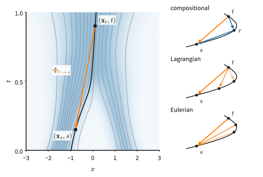

# Few-Step Generation
:label:`sec_diffusion-few-step`

Every sample from the models of this chapter costs many evaluations of a
network. :numref:`sec_diffusion-samplers` brought the thousand steps of the
ancestral chain down to about fifty, and :numref:`sec_diffusion-latent` made
each evaluation cheaper; the generator of a GAN in :numref:`chap_gans`
needed one. The obvious shortcut, a single Euler step of the
probability-flow ODE, fails even with an exact velocity field: every sample
lands on the mean of the data, the average that :numref:`sec_gan_beyond`
met in one-step students and escaped by adding a critic.

This section asks what a network must learn instead so that one or two
evaluations suffice without a critic. The answer is to learn the solution
of the ODE instead of its right-hand side. A *flow map*
takes a point at one time directly to where its trajectory is at an earlier
time. :citet:`Song.Dhariwal.Chen.ea.2023` learned the jump to the data from
the trajectories of a trained diffusion model and called the result a
consistency model. :citet:`Geng.Deng.Bai.ea.2025` learned the average
velocity over any interval with no trained model at all, from an identity
that the flow map satisfies.

A flow map keeps the bijection between noise and samples, so inversion and
editing work as in :numref:`sec_diffusion-samplers`, and training remains a
regression with one network. We look at the failure on the running example,
derive one loss for consistency models and MeanFlow, test it on the mixture
and on Fashion-MNIST, and end with the route that matches distributions
instead.

```{.python .input #few-step-few-step-generation}
%%tab pytorch
import math
import numpy as np
import torch
from torch import nn
from torch.nn import functional as F
from d2l import torch as d2l
```

```{.python .input #few-step-few-step-generation}
%%tab jax
import math
import numpy as np
import jax
from jax import numpy as jnp
from flax import nnx
import optax
from d2l import jax as d2l
```

## Why One Step Fails

A long Euler step makes two errors. It aims where the trajectory points at
its start, and it ignores how the trajectory bends on the way. Both can be
seen on the mixture with the exact field, where no network error hides
them.

### The Average Where the Data Are Not

One Euler step from pure noise sends every start to the data mean
(:numref:`sec_diffusion-gaussian-paths`), for the mixture $(-0.5, -0.7)$,
where no data lie.

More steps help, but how many are needed? `mix.velocity` evaluates the
exact field of the mixture, and `d2l.make_pred` turns it into the predictor
that `d2l.ode_sample` integrates. We run Euler's method with 1, 2, 4 and 10
steps from the same 20,000 Gaussian starts.

```{.python .input #few-step-the-average-where-the-data-are-not}
%%tab pytorch
device = d2l.try_gpu()
mix = d2l.GaussianMixture.three_modes(device)
lin = d2l.GaussianPath.linear()
pred_exact = d2l.make_pred(mix.velocity, lin, 'velocity')
torch.manual_seed(0)
z = torch.randn(20_000, 2, device=device)
euler = {n: d2l.ode_sample(pred_exact, z, lin.sigma_bars(n))
         for n in (1, 2, 4, 10)}
for n, x in euler.items():
    s = mix.summary(x)
    print(f'{n:2d} Euler steps: weights {s["weights"]}, stray {s["stray"]:.1%}')
d2l.scatter_panels([x[:2000] for x in euler.values()],
                   [f'{n} steps' for n in euler], data=mix.sample(2000),
                   size=2.4);
```

```{.python .input #few-step-the-average-where-the-data-are-not}
%%tab jax
mix = d2l.GaussianMixture.three_modes()
lin = d2l.GaussianPath.linear()
pred_exact = d2l.make_pred(mix.velocity, lin, 'velocity')
z = jax.random.normal(jax.random.key(0), (20_000, 2))
euler = {n: d2l.ode_sample(pred_exact, z, lin.sigma_bars(n))
         for n in (1, 2, 4, 10)}
for n, x in euler.items():
    s = mix.summary(x)
    print(f'{n:2d} Euler steps: weights {s["weights"]}, stray {s["stray"]:.1%}')
d2l.scatter_panels([x[:2000] for x in euler.values()],
                   [f'{n} steps' for n in euler],
                   data=mix.sample(jax.random.key(1), 2000), size=2.4);
```

One step puts every sample on the mean, farther than three standard
deviations from every mode, so all of them stray. Two steps reach the modes
but leave about a quarter of the samples between them, with weights of about
0.64/0.22/0.14 instead of 0.5/0.3/0.2: the heaviest mode gains because the
mean lies nearest to it. Four steps still leave about 6.5% of the samples
stray, and ten steps about 2%.

### Straighter Paths Help but Do Not Finish

Why do the trajectories bend at all? Each training example joins a data
point to an independently drawn noise vector by a straight segment, but the
segments of different examples cross. Where they cross, the field averages
their directions, and the trajectories, which cannot cross, bend around
each other (:numref:`sec_mdl-rectified-flow`). The curvature comes from the
pairing of noise with data, not from the loss.

*Reflow* :cite:`Liu.Gong.Liu.2022` changes the pairing. It pairs each
noise vector with the sample that a trained model reaches from it and
trains the network again on these pairs, whose segments rarely cross.
:numref:`subsec_mdl-reflow` proves that a round of reflow keeps the data
distribution and never increases the transport cost, and on two-moons data
one Euler step of the reflowed model scores as well as thirty-two steps of
the original.

Straightening does not finish the job. The reflowed model inherits the
original's errors, each round costs a training run, and on images
:citet:`Liu.Gong.Liu.2022` still followed reflow with distillation for
their one-step results. The rest of this section changes what the
network outputs instead of how the data are paired.

## Flow Maps

A velocity model says which way a trajectory points; a flow map says where
it arrives.

### The Integral of the Velocity

Run the probability-flow ODE $d\mathbf{x}_\tau / d\tau =
\mathbf{u}_\tau(\mathbf{x}_\tau)$ from a point $\mathbf{x}$ at time $t$
back to an earlier time $s \leq t$. The point where it arrives is the
*flow map* $\Phi_{t \to s}(\mathbf{x})$. For a field that is Lipschitz in
$\mathbf{x}$ the flow map is a bijection
(:numref:`sec_mdl-vector-fields-trajectories`). The sampler we want is
$\Phi_{1 \to 0}$.

Integrating the ODE along the trajectory $\mathbf{x}_\tau$ through
$\mathbf{x}_t$ writes the flow map as a displacement,

$$\Phi_{t \to s}(\mathbf{x}_t) = \mathbf{x}_t - \int_s^t \mathbf{u}_\tau(\mathbf{x}_\tau)\, d\tau = \mathbf{x}_t - (t - s)\, \bar{\mathbf{u}}(\mathbf{x}_t, s, t),$$
:eqlabel:`eq_diffusion-flow-map`

where $\bar{\mathbf{u}}(\mathbf{x}_t, s, t)$ is the *average velocity* along
the trajectory between the two times. Euler's method replaces it by the
velocity at the start, $\mathbf{u}_t(\mathbf{x}_t)$, with an error that
grows with the step (:numref:`sec_mdl-euler-runge-kutta`). Over an interval
of length zero the two agree, $\bar{\mathbf{u}}(\mathbf{x}, t, t) =
\mathbf{u}_t(\mathbf{x})$, so a network for $\bar{\mathbf{u}}$ is a velocity
model with one more input, the end time.

The smallest case shows what the average velocity knows that the velocity
does not. Let the data be one-dimensional and Gaussian with mean $m$ and
standard deviation $\varsigma$. Then $x_t$ is Gaussian with mean $(1 - t)\, m$ and
standard deviation $k_t = \sqrt{(1 - t)^2 \varsigma^2 + t^2}$, and the flow keeps
each point's standardized position $(x - (1 - t) m) / k_t$, so the flow map
is affine:

$$\Phi_{t \to s}(x) = (1 - s)\, m + \frac{k_s}{k_t} \big(x - (1 - t)\, m\big).$$

With $m = 2$ and $\varsigma = 0.5$ the full jump $\Phi_{1 \to 0}(x) = 2 + 0.5\, x$
sends standard Gaussian noise to the data $\mathcal{N}(2, 0.5^2)$, with
average velocity $\bar{u}(x, 0, 1) = 0.5\, x - 2$. The velocity at the start
is $u_1(x) = x - 2$, and its Euler step returns 2 for every $x$. The average
velocity removes only half of the noise, because half of the noise's spread
must survive as the spread of the data.

Three identities characterize the flow map, and each gives a way to train
one (:numref:`fig_diffusion-flow-map`). Let $\mathbf{x}_\tau$ be the
trajectory through $\mathbf{x}$ at time $t$, and $s \leq r \leq t$. The
*compositional* identity says that two jumps make one,
$\Phi_{r \to s}(\Phi_{t \to r}(\mathbf{x})) = \Phi_{t \to s}(\mathbf{x})$.
The *Lagrangian* identity fixes the start and moves the end: the mapped
point moves with the field, like a particle,
$\partial_s \Phi_{t \to s}(\mathbf{x}) = \mathbf{u}_s(\Phi_{t \to s}(\mathbf{x}))$.
The *Eulerian* identity fixes the end and moves the start along the
trajectory: every point of one trajectory maps to the same place,

$$\frac{d}{dt} \Phi_{t \to s}(\mathbf{x}_t) = \partial_t \Phi_{t \to s}(\mathbf{x}_t) + \nabla_{\mathbf{x}} \Phi_{t \to s}(\mathbf{x}_t)\, \mathbf{u}_t(\mathbf{x}_t) = \mathbf{0}.$$
:eqlabel:`eq_diffusion-eulerian`

In the Gaussian example all three can be checked by hand: the ratios
$k_s / k_t$ compose, and the standardized position is constant along a
trajectory.


:label:`fig_diffusion-flow-map`

Together with the condition at $s = t$, where the map is the identity and
its slope in $s$ is the velocity, each identity determines the flow map.
Composition needs only the
model at an intermediate time; progressive distillation
:cite:`Salimans.Ho.2022` and shortcut models
:cite:`Frans.Hafner.Levine.ea.2025` use it. The Lagrangian identity needs
the velocity at the output of the map. The Eulerian identity needs the
derivative along the trajectory through the input, one Jacobian-vector
product. :citet:`Boffi.Albergo.VandenEijnden.2025` sort the few-step methods
by the identity they enforce; both methods of this section are Eulerian.

### Consistency Models

The first flow-map method kept only the jump to the data. A *consistency
model* :cite:`Song.Dhariwal.Chen.ea.2023` is a network $f(\mathbf{x}, t)$
trained to output $\Phi_{t \to 0}(\mathbf{x})$ at every time. Its training
condition is that the output does not change as the input moves along a
trajectory, $\frac{d}{dt} f(\mathbf{x}_t, t) = \mathbf{0}$ with
$f(\mathbf{x}, 0) = \mathbf{x}$, the Eulerian identity
:eqref:`eq_diffusion-eulerian` at $s = 0$.

In *consistency distillation*, Song et al. let a trained diffusion model,
the *teacher*, take one ODE step between neighbouring times of a grid, and
require the student's outputs at the two points to agree, with the output
at the earlier point held fixed as the target. As the grid is refined the
difference, divided by the step, becomes the derivative above, which
:citet:`Lu.Song.2025` use directly. *Consistency training* replaces the teacher's velocity by the
conditional velocity of each example.

One evaluation of a consistency model gives a sample. A second cannot jump
from $t = 1$ to $t = 0.5$, because the model knows only where trajectories
end. It *re-noises* instead: the sample is moved back to $t = 0.5$ with
fresh noise, $\mathbf{x}_{0.5} = 0.5\, \mathbf{x}_0 + 0.5\,
\boldsymbol\epsilon'$, and mapped to the data again, from where
trajectories bend less. A flow map with both times needs no re-noising: two
evaluations are two jumps along one trajectory, and the bijection between
noise and samples survives.

### Average Velocity and the MeanFlow Identity

Writing the flow map through the average velocity
:eqref:`eq_diffusion-flow-map` turns the Eulerian identity into a
regression target. Multiply the average velocity by the length of its
interval, which gives the integral of the velocity, and differentiate in
$t$ along the trajectory with $s$ held fixed:

$$\frac{d}{dt} \Big[(t - s)\, \bar{\mathbf{u}}(\mathbf{x}_t, s, t)\Big] = \frac{d}{dt} \int_s^t \mathbf{u}_\tau(\mathbf{x}_\tau)\, d\tau = \mathbf{u}_t(\mathbf{x}_t).$$

The product rule on the left gives the *MeanFlow identity* of
:citet:`Geng.Deng.Bai.ea.2025`,

$$\bar{\mathbf{u}}(\mathbf{x}_t, s, t) = \mathbf{u}_t(\mathbf{x}_t) - (t - s)\, \frac{d}{dt} \bar{\mathbf{u}}(\mathbf{x}_t, s, t).$$
:eqlabel:`eq_diffusion-meanflow`

The average velocity is the velocity at the start, corrected by how fast
the average changes as the start slides along the trajectory. Substituting
:eqref:`eq_diffusion-flow-map` into :eqref:`eq_diffusion-eulerian` shows
that the two identities are the same. The total derivative is
$\partial_t \bar{\mathbf{u}} + (\nabla_{\mathbf{x}} \bar{\mathbf{u}})\,
\mathbf{u}_t$, the Jacobian-vector product of the network $(\mathbf{x}, t)
\mapsto \bar{\mathbf{u}}(\mathbf{x}, s, t)$ with the tangent
$(\mathbf{u}_t, 1)$, which forward-mode differentiation computes together
with the output at about the cost of a backward pass.

The identity becomes a loss by regressing the network onto its right-hand
side, computed from the network itself and held fixed. The marginal
velocity $\mathbf{u}_t$ is not available, but two substitutes are. A
teacher provides its estimate of $\mathbf{u}_t(\mathbf{x}_t)$. Without one,
the conditional velocity $\boldsymbol\epsilon - \mathbf{x}_0$ of the
training example serves, for the reason that made flow
matching work. The target is affine in the velocity, directly and through
the tangent of the Jacobian-vector product. Averaged over the examples that
could have produced $\mathbf{x}_t$, it is therefore the target with
$\mathbf{u}_t(\mathbf{x}_t)$ in place of the conditional velocity, and
squared error is minimized by that average. Writing $\mathbf{v}$ for the
velocity we use, the loss at a training point is

$$\Big\| \bar{\mathbf{u}}_{\boldsymbol\theta}(\mathbf{x}_t, s, t) - \mathrm{sg}\Big[\mathbf{v} - (t - s)\, \frac{d}{dt} \bar{\mathbf{u}}_{\boldsymbol\theta}(\mathbf{x}_t, s, t)\Big] \Big\|^2,$$
:eqlabel:`eq_diffusion-flow-map-loss`

where $\mathrm{sg}$, the *stop-gradient*, marks a quantity treated as a
constant when the loss is differentiated. It is required. Without it the
target moves with every update of the network, and training on the mixture
fails: almost every sample strays (Exercise
:exref:`ex_few-step-stop-gradient`).

The loss leaves two choices, where $\mathbf{v}$ comes from and whether
the end time $s$ is free or fixed at zero, and the methods in the
literature are the four combinations.

| velocity $\mathbf{v}$ | one time, $s = 0$ | two times, $s \leq t$ |
|---|---|---|
| a teacher's | consistency distillation | flow-map distillation :cite:`Kim.Lai.Liao.ea.2024` |
| the example's $\boldsymbol\epsilon - \mathbf{x}_0$ | consistency training | MeanFlow |
:label:`tab_diffusion-flow-map-methods`

At $s = 0$, :eqref:`eq_diffusion-flow-map` reads $f(\mathbf{x}, t) =
\mathbf{x} - t\, \bar{\mathbf{u}}(\mathbf{x}, 0, t)$, so the top-left cell
is consistency distillation in the continuous-time form of
:citet:`Lu.Song.2025`. `flow_map_error` implements
:eqref:`eq_diffusion-flow-map-loss` per example on the linear path for all
four: the network `u` computes $\bar{\mathbf{u}}$, `teacher=None` selects
the conditional velocity, and the caller chooses the times and averages.

```{.python .input #few-step-average-velocity-and-the-meanflow-identity}
%%tab pytorch
def flow_map_error(u, teacher, x0, eps, s, t):  #@save
    """Per-example squared error of the average velocity u(x_t, s, t) against
    the stop-gradient target v - (t - s) du/dt; v from teacher, or eps - x0."""
    x_t = d2l.GaussianPath.linear().sample(x0, t, eps)
    if teacher is None:
        v = eps - x0
    else:
        with torch.no_grad():
            v = teacher(x_t, t)
    u_t, du_dt = torch.func.jvp(lambda x, r: u(x, s, r), (x_t, t),
                                (v, torch.ones_like(t)))
    gap = (t - s).reshape(-1, *[1] * (x0.dim() - 1))
    target = (v - gap * du_dt).detach()
    return ((u_t - target) ** 2).flatten(1).sum(1)
```

```{.python .input #few-step-average-velocity-and-the-meanflow-identity}
%%tab jax
def flow_map_error(u, teacher, x0, eps, s, t):  #@save
    """Per-example squared error of the average velocity u(x_t, s, t) against
    the stop-gradient target v - (t - s) du/dt; v from teacher, or eps - x0."""
    x_t = d2l.GaussianPath.linear().sample(x0, t, eps)
    v = (eps - x0 if teacher is None
         else jax.lax.stop_gradient(teacher(x_t, t)))
    u_t, du_dt = jax.jvp(lambda x, r: u(x, s, r), (x_t, t),
                         (v, jnp.ones_like(t)))
    gap = (t - s).reshape(-1, *[1] * (x0.ndim - 1))
    target = jax.lax.stop_gradient(v - gap * du_dt)
    return ((u_t - target) ** 2).reshape(x0.shape[0], -1).sum(1)
```

The derivative in $t$ passes through the network's time features, which
must vary slowly. `d2l.time_embedding` uses sines and cosines of $t$ at
frequencies up to one. Diffusion code often embeds $1000\, t$, which puts
frequencies up to a thousand into $d\bar{\mathbf{u}}/dt$ and turns the
target into noise, a source of instability that :citet:`Lu.Song.2025`
report for continuous-time consistency models.

A flow map takes $\mathbf{x}_t$ to $\mathbf{x}_s$ in one jump,
$\mathbf{x}_s = \mathbf{x}_t - (t - s)\, \bar{\mathbf{u}}(\mathbf{x}_t, s,
t)$, so a few-step sampler cuts $[0, 1]$ into equal intervals and jumps
across each.

```{.python .input #few-step-average-velocity-and-the-meanflow-identity-1}
%%tab pytorch
@torch.inference_mode()
def flow_map_sample(u, x, steps, t_start=1.0):  #@save
    """Jump from x at t_start (1 is noise) to data at t = 0 in equal steps."""
    ts = torch.linspace(t_start, 0, steps + 1, device=x.device)
    for t, s in zip(ts[:-1], ts[1:]):
        x = x - (t - s) * u(x, s.expand(len(x)), t.expand(len(x)))
    return x
```

```{.python .input #few-step-average-velocity-and-the-meanflow-identity-1}
%%tab jax
def flow_map_sample(u, x, steps, t_start=1.0):  #@save
    """Jump from x at t_start (1 is noise) to data at t = 0 in equal steps."""
    ts = jnp.linspace(t_start, 0, steps + 1)
    def jump(x, ts):
        t, s = ts
        n = x.shape[0]
        return x - (t - s) * u(x, jnp.full(n, s), jnp.full(n, t)), None
    return jax.lax.scan(jump, x, (ts[:-1], ts[1:]))[0]
```

With the velocity $\mathbf{u}_t$ in place of $\bar{\mathbf{u}}$, the same
function is Euler's method, so one sampler serves the teacher and the
student.

On images the student starts as a copy of the teacher's U-Net. The gap
$t - s$ enters through its own time embedding and a linear map initialized at
zero, added to the U-Net's embedding, so that at the start
$\bar{\mathbf{u}}(\mathbf{x}, s, t) = \mathbf{v}(\mathbf{x}, t)$, the
teacher's velocity.

```{.python .input #few-step-average-velocity-and-the-meanflow-identity-2}
%%tab pytorch
class UNetFlowMap(nn.Module):  #@save
    """u(x, s, t): a copy of a velocity U-Net, plus a zero-initialized gap."""
    def __init__(self, unet):
        super().__init__()
        import copy  # the d2l library preamble does not import it
        # the teacher is an EMA copy with gradients off; the student trains
        self.unet = copy.deepcopy(unet).requires_grad_(True)
        self.gap = nn.Linear(unet.emb_dim, unet.emb_dim)
        nn.init.zeros_(self.gap.weight), nn.init.zeros_(self.gap.bias)

    def forward(self, x, s, t):
        gap = self.gap(d2l.time_embedding(t - s, self.unet.emb_dim))
        return self.unet(x, t, cond=gap)
```

```{.python .input #few-step-average-velocity-and-the-meanflow-identity-2}
%%tab jax
class UNetFlowMap(nnx.Module):  #@save
    """u(x, s, t): a copy of a velocity U-Net, plus a zero-initialized gap."""
    def __init__(self, unet, *, rngs):
        self.unet = nnx.clone(unet)
        zeros = nnx.initializers.zeros
        self.gap = nnx.Linear(unet.emb_dim, unet.emb_dim, kernel_init=zeros,
                              bias_init=zeros, rngs=rngs)

    def __call__(self, x, s, t):
        gap = self.gap(d2l.time_embedding(t - s, self.unet.emb_dim))
        return self.unet(x, t, cond=gap)
```

## Experiments

### On the Running Example

The teacher is the velocity model `TimeMLP` of
:numref:`sec_diffusion-gaussian-paths`, trained here for 20,000 steps.

```{.python .input #few-step-on-the-running-example}
%%tab pytorch
torch.manual_seed(1)
_, teacher, _ = d2l.train_regression(
    d2l.TimeMLP(256, 3).to(device), d2l.regression_loss(lin, 'velocity'),
    lambda: mix.sample(512), 20_000, cosine=True)
```

```{.python .input #few-step-on-the-running-example}
%%tab jax
_, teacher, _ = d2l.train_regression(
    d2l.TimeMLP(256, 3, rngs=nnx.Rngs(1)), d2l.regression_loss(lin, 'velocity'),
    lambda k: mix.sample(k, 512), 20_000, jax.random.key(1), cosine=True)
```

Both students are `TimeMLP`s that see the start $t$ and the interval
$t - s$. The consistency student draws $t$ uniformly, fixes $s = 0$ and uses
the teacher's velocity. The MeanFlow student draws two uniform times, takes
the smaller as $s$, and uses no teacher. Everything else is the teacher's
recipe.

```{.python .input #few-step-on-the-running-example-1}
%%tab pytorch
class MLPFlowMap(d2l.TimeMLP):
    """u(x, s, t): a TimeMLP on the start t and the interval t - s."""
    def forward(self, x, s, t):
        return super().forward(x, t, t - s)

def consistency_loss(u, x0):  # s = 0, the teacher's velocity
    t = torch.rand(len(x0), device=device)
    return d2l.flow_map_error(u, teacher, x0, torch.randn_like(x0),
                              torch.zeros_like(t), t).mean()

def meanflow_loss(u, x0):  # s < t, no teacher
    a, b = torch.rand(2, len(x0), device=device)
    return d2l.flow_map_error(u, None, x0, torch.randn_like(x0),
                              torch.minimum(a, b), torch.maximum(a, b)).mean()

students = {}
for name, loss in (('consistency', consistency_loss),
                   ('MeanFlow', meanflow_loss)):
    torch.manual_seed(2)
    _, students[name], _ = d2l.train_regression(
        MLPFlowMap(256, 3, num_times=2).to(device), loss,
        lambda: mix.sample(512), 20_000, cosine=True)
```

```{.python .input #few-step-on-the-running-example-1}
%%tab jax
class MLPFlowMap(d2l.TimeMLP):
    """u(x, s, t): a TimeMLP on the start t and the interval t - s."""
    def __call__(self, x, s, t):
        return super().__call__(x, t, t - s)

def consistency_loss(u, x0, key):  # s = 0, the teacher's velocity
    k1, k2 = jax.random.split(key)
    t = jax.random.uniform(k1, (len(x0),))
    return d2l.flow_map_error(u, teacher, x0, jax.random.normal(k2, x0.shape),
                              jnp.zeros_like(t), t).mean()

def meanflow_loss(u, x0, key):  # s < t, no teacher
    k1, k2 = jax.random.split(key)
    a, b = jax.random.uniform(k1, (2, len(x0)))
    return d2l.flow_map_error(u, None, x0, jax.random.normal(k2, x0.shape),
                              jnp.minimum(a, b), jnp.maximum(a, b)).mean()

students = {}
for name, loss in (('consistency', consistency_loss),
                   ('MeanFlow', meanflow_loss)):
    _, students[name], _ = d2l.train_regression(
        MLPFlowMap(256, 3, num_times=2, rngs=nnx.Rngs(2)), loss,
        lambda k: mix.sample(k, 512), 20_000, jax.random.key(2), cosine=True)
```

All models start from the 20,000 points of the Euler experiment. The
teacher takes fifty Euler steps, the consistency student one jump or two
with re-noising at $t = 0.5$, and the MeanFlow student one, two or four
jumps. A fresh draw from the mixture shows what a perfect sampler would
print.

```{.python .input #few-step-on-the-running-example-2}
%%tab pytorch
def renoised_sample(u, z):
    """Two evaluations of a one-time map: jump, re-noise to t = 0.5, jump."""
    x = d2l.flow_map_sample(u, z, 1)
    half = torch.full((len(z),), 0.5, device=device)
    return d2l.flow_map_sample(u, lin.sample(x, half, torch.randn_like(x)), 1,
                               t_start=0.5)

cm, mf = students['consistency'], students['MeanFlow']
samples = {'data': mix.sample(20_000),
           'teacher, 50 steps': d2l.flow_map_sample(
               lambda x, s, t: teacher(x, t), z, 50),
           'consistency, 1': d2l.flow_map_sample(cm, z, 1),
           'consistency, 2 re-noised': renoised_sample(cm, z),
           **{f'MeanFlow, {k}': d2l.flow_map_sample(mf, z, k)
              for k in (1, 2, 4)}}
for name, x in samples.items():
    s = mix.summary(x)
    print(f'{name:>24}: weights {s["weights"]}, stray {s["stray"]:.1%}, '
          f'spread {s["spread"]:.3f}')
d2l.scatter_panels([samples[k][:2000] for k in
                    ('teacher, 50 steps', 'consistency, 1', 'MeanFlow, 1')],
                   ['teacher, 50 steps', 'consistency, 1 step',
                    'MeanFlow, 1 step'], data=mix.sample(2000), size=2.4);
```

```{.python .input #few-step-on-the-running-example-2}
%%tab jax
def renoised_sample(u, z, key):
    """Two evaluations of a one-time map: jump, re-noise to t = 0.5, jump."""
    x = d2l.flow_map_sample(u, z, 1)
    half = jnp.full((len(z),), 0.5)
    return d2l.flow_map_sample(u, lin.sample(x, half, jax.random.normal(
        key, x.shape)), 1, t_start=0.5)

cm, mf = students['consistency'], students['MeanFlow']
samples = {'data': mix.sample(jax.random.key(3), 20_000),
           'teacher, 50 steps': d2l.flow_map_sample(
               lambda x, s, t: teacher(x, t), z, 50),
           'consistency, 1': d2l.flow_map_sample(cm, z, 1),
           'consistency, 2 re-noised': renoised_sample(cm, z,
                                                       jax.random.key(4)),
           **{f'MeanFlow, {k}': d2l.flow_map_sample(mf, z, k)
              for k in (1, 2, 4)}}
for name, x in samples.items():
    s = mix.summary(x)
    print(f'{name:>24}: weights {s["weights"]}, stray {s["stray"]:.1%}, '
          f'spread {s["spread"]:.3f}')
d2l.scatter_panels([samples[k][:2000] for k in
                    ('teacher, 50 steps', 'consistency, 1', 'MeanFlow, 1')],
                   ['teacher, 50 steps', 'consistency, 1 step',
                    'MeanFlow, 1 step'],
                   data=mix.sample(jax.random.key(5), 2000), size=2.4);
```

Both students reproduce the mixture in one evaluation, with weights within
about 0.015 of 0.5/0.3/0.2. The fresh draw strays about 1.1% of the time,
the tail of each Gaussian beyond three standard deviations, and the teacher
with fifty Euler steps about 1.5%. The consistency student strays
about 2% after one evaluation. The MeanFlow student, trained without a
teacher, strays about 4%, and its other samples sit closer to the mode
centers than the data do. A second evaluation, re-noised or a second jump,
brings the strays of both to the teacher's level. MeanFlow's samples stay
too tight, though: their spread is about 0.38 after two and four jumps
against 0.47 for the data, which is also why four jumps stray less often
than the data themselves.

MeanFlow's ImageNet recipe divides each example's squared error $e$ by
$(e + c)^p$, held fixed, with $p = 1$ and a small $c$, so that the gradient
is that of $\log(e + c)$. Squared error is minimized by the conditional mean
of the target, its logarithm near the most probable value. Without a
teacher the targets at a noisy point spread over the three modes, so the
weighted loss should pull the field toward the heaviest mode. We train the
MeanFlow student again with this weight.

```{.python .input #few-step-on-the-running-example-3}
%%tab pytorch
def weighted_meanflow_loss(u, x0, c=1e-3):
    """The MeanFlow loss with each squared error e divided by e + c, fixed."""
    a, b = torch.rand(2, len(x0), device=device)
    e = d2l.flow_map_error(u, None, x0, torch.randn_like(x0),
                           torch.minimum(a, b), torch.maximum(a, b))
    return (e / (e.detach() + c)).mean()

torch.manual_seed(2)
_, weighted, _ = d2l.train_regression(
    MLPFlowMap(256, 3, num_times=2).to(device), weighted_meanflow_loss,
    lambda: mix.sample(512), 20_000, cosine=True)
s = mix.summary(d2l.flow_map_sample(weighted, z, 1))
print(f'weighted MeanFlow, 1: weights {s["weights"]}, stray {s["stray"]:.1%}')
```

```{.python .input #few-step-on-the-running-example-3}
%%tab jax
def weighted_meanflow_loss(u, x0, key, c=1e-3):
    """The MeanFlow loss with each squared error e divided by e + c, fixed."""
    k1, k2 = jax.random.split(key)
    a, b = jax.random.uniform(k1, (2, len(x0)))
    e = d2l.flow_map_error(u, None, x0, jax.random.normal(k2, x0.shape),
                           jnp.minimum(a, b), jnp.maximum(a, b))
    return (e / (jax.lax.stop_gradient(e) + c)).mean()

_, weighted, _ = d2l.train_regression(
    MLPFlowMap(256, 3, num_times=2, rngs=nnx.Rngs(2)), weighted_meanflow_loss,
    lambda k: mix.sample(k, 512), 20_000, jax.random.key(2), cosine=True)
s = mix.summary(d2l.flow_map_sample(weighted, z, 1))
print(f'weighted MeanFlow, 1: weights {s["weights"]}, stray {s["stray"]:.1%}')
```

The weighted student puts more than nine samples in ten on the heaviest mode,
and few of them stray: the loss has fitted the most probable target instead
of the average one. Plain squared error recovers the weights, which is why
the other losses take the plain mean of `flow_map_error`.

### On Images

On Fashion-MNIST we distil the unconditional U-Net of
:numref:`sec_diffusion-samplers`, about 1.2 million parameters trained for
10,000 updates, through the moving average of its weights. We train it
again here.

```{.python .input #few-step-on-images}
%%tab pytorch
X, y, X_test, y_test = d2l.load_fashion_mnist_pm1()

def batch_fn():
    return X[torch.randint(0, len(X), (128,), device=X.device)]

torch.manual_seed(0)
_, teacher, _ = d2l.train_regression(d2l.UNet(ch=64).to(X.device),
                                     d2l.regression_loss(lin, 'velocity'),
                                     batch_fn, 10_000)
```

```{.python .input #few-step-on-images}
%%tab jax
X, y, X_test, y_test = d2l.load_fashion_mnist_pm1()

def batch_fn(key):
    return X[jax.random.randint(key, (128,), 0, len(X))]

_, teacher, _ = d2l.train_regression(d2l.UNet(ch=64, rngs=nnx.Rngs(0)),
                                     d2l.regression_loss(lin, 'velocity'),
                                     batch_fn, 10_000, jax.random.key(0))
```

We score 1,000 samples by the Fréchet distance (FD) of
:numref:`sec_diffusion-images` against 1,000 test images, read against the
floor of two disjoint sets of 1,000 test images.

```{.python .input #few-step-on-images-1}
%%tab pytorch
cnn = d2l.fashion_feature_cnn(X, y)
features = lambda imgs: d2l.fd_features(cnn, imgs)
f_test = features(X_test[:1000])
floor = d2l.fid_score(features(X_test[1000:2000]), f_test)
print(f'floor, 1,000 real images against 1,000 others: FD {floor:.2f}')
```

```{.python .input #few-step-on-images-1}
%%tab jax
cnn = d2l.fashion_feature_cnn(X, y)
features = lambda imgs: d2l.fd_features(cnn, imgs)
f_test = features(X_test[:1000])
floor = d2l.fid_score(features(X_test[1000:2000]), f_test)
print(f'floor, 1,000 real images against 1,000 others: FD {floor:.2f}')
```

The student is `UNetFlowMap` on the teacher's averaged weights, trained
with the teacher's velocity and both times free. Half of the pairs have
$s = t$, where the loss is the teacher's own velocity loss; the other half
draw $s < t$ as on the mixture. Starting from trained weights, it learns at
a rate of $2 \cdot 10^{-4}$ for 5,000
updates, half the teacher's 10,000.

```{.python .input #few-step-on-images-2}
%%tab pytorch
def student_loss(u, x0):
    a, b = torch.rand(2, len(x0), device=x0.device)
    s, t = torch.minimum(a, b), torch.maximum(a, b)
    # half the pairs have s = t: the plain flow-matching term
    s = torch.where(torch.rand(len(x0), device=x0.device) < 0.5, t, s)
    return d2l.flow_map_error(u, teacher, x0, torch.randn_like(x0), s,
                              t).mean()

torch.manual_seed(2)
_, student, _ = d2l.train_regression(
    d2l.UNetFlowMap(teacher).to(X.device), student_loss, batch_fn, 5_000,
    lr=2e-4, ema_half_life=500)
```

```{.python .input #few-step-on-images-2}
%%tab jax
def student_loss(u, x0, key):
    k1, k2, k3 = jax.random.split(key, 3)
    a, b = jax.random.uniform(k1, (2, len(x0)))
    s, t = jnp.minimum(a, b), jnp.maximum(a, b)
    # half the pairs have s = t: the plain flow-matching term
    s = jnp.where(jax.random.uniform(k2, (len(x0),)) < 0.5, t, s)
    return d2l.flow_map_error(u, teacher, x0, jax.random.normal(k3, x0.shape),
                              s, t).mean()

_, student, _ = d2l.train_regression(
    d2l.UNetFlowMap(teacher, rngs=nnx.Rngs(2)), student_loss, batch_fn,
    5_000, jax.random.key(2), lr=2e-4, ema_half_life=500)
```

From the same 1,000 noise images, the teacher takes 1 to 50 Euler steps
and the student 1, 2 or 4 jumps, and we plot FD against the number of
network evaluations.

```{.python .input #few-step-on-images-3}
%%tab pytorch
torch.manual_seed(3)
noise = torch.randn(1000, 1, 28, 28, device=X.device)
velocity = lambda x, s, t: teacher(x, t)
ns_teacher, ns_student = (1, 2, 4, 10, 20, 50), (1, 2, 4)
images = {('teacher', n): d2l.flow_map_sample(velocity, noise, n)
          for n in ns_teacher}
images |= {('student', n): d2l.flow_map_sample(student, noise, n)
           for n in ns_student}
fd = {key: d2l.fid_score(features(x), f_test) for key, x in images.items()}
for (name, n), v in fd.items():
    print(f'{name}, {n:2d} evaluations: FD {v:6.2f}')
d2l.plot([ns_teacher, ns_student, [1, 50]],
         [[fd['teacher', n] for n in ns_teacher],
          [fd['student', n] for n in ns_student], [floor, floor]],
         'network evaluations', 'FD',
         legend=['teacher, Euler', 'student, jumps', 'floor'],
         xscale='log', yscale='log', fmts=('o-', 's-', 'k:'))
```

```{.python .input #few-step-on-images-3}
%%tab jax
noise = jax.random.normal(jax.random.key(3), (1000, 28, 28, 1))
velocity = lambda x, s, t: teacher(x, t)
ns_teacher, ns_student = (1, 2, 4, 10, 20, 50), (1, 2, 4)
images = {('teacher', n): d2l.flow_map_sample(velocity, noise, n)
          for n in ns_teacher}
images |= {('student', n): d2l.flow_map_sample(student, noise, n)
           for n in ns_student}
fd = {key: d2l.fid_score(features(x), f_test) for key, x in images.items()}
for (name, n), v in fd.items():
    print(f'{name}, {n:2d} evaluations: FD {v:6.2f}')
d2l.plot([ns_teacher, ns_student, [1, 50]],
         [[fd['teacher', n] for n in ns_teacher],
          [fd['student', n] for n in ns_student], [floor, floor]],
         'network evaluations', 'FD',
         legend=['teacher, Euler', 'student, jumps', 'floor'],
         xscale='log', yscale='log', fmts=('o-', 's-', 'k:'))
```

The teacher's FD falls from about 150 at one Euler step and 70 to 85 at two
to 6 or 7 at ten and 2.5 to 2.8 at fifty, against a floor of about 0.8.
The student lies far below this curve at small budgets: one jump scores
about 4 to 5 times the teacher's fifty-step FD, two jumps about twice, and
four within about 1.5 times. Two evaluations of the student are worth about
fifteen Euler steps of the teacher, and one about eight.

The remaining gap at one evaluation is a matter of budget. The students in
the papers train for roughly 100,000 to 800,000 iterations at batches of
512, two to three orders of magnitude more than ours, and report one-step
FIDs about 1.4 to 1.7 times those of their teachers. Training our student longer lowers its
one-step FD only slowly.

The rows below are drawn from the same eight noise images: the teacher with
fifty and with two Euler steps, and the student with one and with two
jumps.

```{.python .input #few-step-on-images-4}
%%tab pytorch
rows = [('teacher', 50), ('teacher', 2), ('student', 1), ('student', 2)]
d2l.show_gray(torch.cat([images[r][:8].clamp(-1, 1) for r in rows]), 4, 8);
```

```{.python .input #few-step-on-images-4}
%%tab jax
rows = [('teacher', 50), ('teacher', 2), ('student', 1), ('student', 2)]
d2l.show_gray(jnp.concatenate([images[r][:8].clip(-1, 1) for r in rows]),
              4, 8);
```

The rows match column by column. Two Euler steps of the teacher draw grey
averages of garments, the collapse of the first section in pixels. The
student draws the teacher's garment from each noise image, sharp but
over-contrasted and sometimes broken after one jump and close to the
teacher's after two.

## The Other Route: Matching Distributions

A flow map regresses onto a target computed from an ODE's trajectories, so
its student can be no better than those trajectories. The distillation
methods of :numref:`sec_gan_beyond` instead train a one-step generator to
match the distribution of the data, with a critic against real images
:cite:`Sauer.Lorenz.Blattmann.ea.2023` or with the difference between the
teacher's score and that of the student's own samples
:cite:`Yin.Gharbi.Zhang.ea.2024`. Both give up the bijection, so inversion
and editing through the ODE no longer apply. They gain quality in one step,
and with real images in the loss a student can surpass its teacher
(:numref:`sec_gan-further-reading`).

Classifier-free guidance
(:numref:`sec_diffusion-images`) evaluates the network twice per step.
:citet:`Meng.Rombach.Gao.ea.2023` distil the guided velocity into one
network that takes the guidance strength as an input, which halves the cost
of every step before the number of steps is reduced (Exercise
:exref:`ex_few-step-guided-student`).

## Summary

One Euler step from noise lands on the mean of the data, and straightening
the field reduces the number of steps but not to one. A flow map learns
where a trajectory arrives instead of where it points. Differentiating its
definition along the trajectory gives the MeanFlow identity, a regression
target that needs one Jacobian-vector product and either a teacher's
velocity or each example's conditional velocity; with $s = 0$ and a teacher
it is consistency distillation. On the mixture one evaluation recovers the
mode weights; on images a short student comes within about 1.5 times the
teacher's FD in four evaluations. All of this needs a continuous path and a
velocity, which do not exist when $\mathbf{x}$ is a sequence of tokens, the subject of
:numref:`sec_diffusion-discrete`.

## Exercises

1. **One and two Euler steps.**
    1. A single step of the deterministic sampler from pure noise to $t = 0$
       returns $\mathbb{E}[\mathbf{x}_0]$ from every start, whatever the
       path (:numref:`sec_diffusion-gaussian-paths`). Does the same hold for
       one Euler step in $t$, $\mathbf{x} - \mathbf{u}_1(\mathbf{x})$, on the
       cosine path $\alpha_t = \cos\frac{\pi t}{2}$,
       $\sigma_t = \sin\frac{\pi t}{2}$? What does that step return, and
       why does an Euler step in $t$ depend on the path when a step in
       $\bar\sigma$ does not?
    1. Let the data be the two points $\pm a$ in one dimension, with equal
       probability, on the linear path. Show that
       $\mathbb{E}[x_0 \mid x_t = x] = a \tanh\big(a (1 - t) x / t^2\big)$
       and that two Euler steps of length $\tfrac12$ map a start $x$ to
       $a \tanh(a x)$. :numref:`subsec_mdl-fm-two-point` has the exact flow
       of this example.
    1. For $a = 2$, what fraction of the two-step samples lies within $0.1$
       of a data point? Where does the exact flow map $\Phi_{1 \to 0}$ send
       $x$?
   :exlabel:`ex_few-step-one-step-mean`
1. [code] **Reflow on the mixture.** ● Reflow :cite:`Liu.Gong.Liu.2022`
   retrains a velocity model on pairs of a noise vector and the sample that
   the current model produces from it.
    1. Draw 20,000 noise vectors, integrate the teacher of this section with
       fifty Euler steps, and train a new `TimeMLP` on the pairs with the
       velocity loss and the teacher's settings.
    1. Report the weights and strays of the new model at 1, 2, 4 and 10
       Euler steps, and the mean distance of its fifty-step trajectories
       from their chords, next to the same quantities for the teacher.
    1. Which of the teacher's errors does reflow remove, which does it
       inherit, and which does it add? What would a second round do to each?
   :exlabel:`ex_few-step-reflow`
1. [code] **Progressive distillation.** ● :citet:`Salimans.Ho.2022` train a
   student so that one of its steps reproduces two steps of the teacher,
   then make the student the teacher and repeat.
    1. On the mixture, start from 64 Euler steps of the teacher of this
       section and halve the number of steps six times, training each
       student for a fifth of the teacher's updates. Which identity of the
       flow map does each round enforce?
    1. Report the strays after each round, and compare the one-step student
       with the flow-map students of this section at equal total training
       steps. Where do the errors of the rounds come from?
   :exlabel:`ex_few-step-progressive`
1. [code] **Which time pairs to train on.** The MeanFlow student drew every
   pair with $s < t$, the image student half of them with $s = t$.
    1. Train the MeanFlow student on the mixture with a share of $0.25$,
       $0.5$, $0.75$ and $1$ of the pairs having $s < t$, and report the
       strays at one and two jumps. Which share serves one jump best?
    1. Replace the uniform times by a logit-normal distribution of $t$ with
       mean $-0.4$ and standard deviation $1$, which concentrates the times
       in the middle of the path. What changes, and why?
    1. Why might pairs with $s = t$ matter more on images, where the student
       starts from the teacher's weights, than on the mixture, where it
       starts from random weights?
   :exlabel:`ex_few-step-time-pairs`
1. [code] **The derivative against a difference.** ● Consistency distillation
   as published :cite:`Song.Dhariwal.Chen.ea.2023` uses a grid of
   $N = 18$ times, one Heun step of the teacher from $t_n$ to $t_{n-1}$, and
   a target held fixed at the earlier point.
    1. Write the student as $f(\mathbf{x}, t) = \mathbf{x} - t\,
       \bar{\mathbf{u}}(\mathbf{x}, 0, t)$ and show that the difference of
       its outputs at the two points, divided by $t_n - t_{n-1}$, tends to
       the Eulerian derivative :eqref:`eq_diffusion-eulerian` at $s = 0$ as
       $N$ grows.
    1. Implement the discrete loss without a Jacobian-vector product, train
       it on the mixture with the teacher of this section, and compare its
       one-step strays with those of the continuous student. Try $N = 8$
       and $N = 64$. Does a finer grid help, and why?
   :exlabel:`ex_few-step-discrete-cd`
1. [code] **The stop-gradient.** Copy `flow_map_error` into a cell and
   remove the stop-gradient on the target.
    1. Train the MeanFlow student on the mixture with this loss and report
       its one-step weights and strays. Write out the gradient of the loss
       with the target differentiated, and identify the term that the
       stop-gradient removes. What can the network change to lower this
       loss without satisfying :eqref:`eq_diffusion-meanflow`?
    1. Song et al. compute the target with a moving average of the
       student's weights instead. Implement this with `d2l.EMA` and compare.
   :exlabel:`ex_few-step-stop-gradient`
1. **The Lagrangian loss.** ● :citet:`Boffi.Albergo.VandenEijnden.2025`
   train flow maps with the Lagrangian identity.
    1. Substitute :eqref:`eq_diffusion-flow-map` into $\partial_s
       \Phi_{t \to s}(\mathbf{x}) = \mathbf{u}_s(\Phi_{t \to s}(\mathbf{x}))$
       and derive an identity for $\bar{\mathbf{u}}$ that involves the
       velocity at the output of the jump.
    1. Why can the conditional velocity $\boldsymbol\epsilon - \mathbf{x}_0$
       not serve in this identity, so that a velocity model is needed? Show
       that the flow map's own velocity $\bar{\mathbf{u}}(\cdot, s, s)$ can
       serve, so that one network trains itself.
    1. [code] Train such a student on the mixture and compare it with the
       MeanFlow student in strays and in training cost per step.
   :exlabel:`ex_few-step-lagrangian`
1. [code] **A guided student.** ● Train the class-conditional U-Net of
   :numref:`sec_diffusion-images` and distil it into a two-time student
   whose velocity $\mathbf{v}$ is the guided velocity `d2l.cfg(teacher, c,
   2.0)` for random labels $c$, with the label as an input of the student.
    1. Compare the FD and the agreement of the predicted class with the
       requested one for the teacher with fifty guided Euler steps and the
       student with one, two and four jumps.
    1. How many network evaluations does each sample cost in each case?
   :exlabel:`ex_few-step-guided-student`
1. [code] **Quality against cost.** Measure the wall-clock time per 1,000
   images and the FD of the teacher of this section with 1 to 50 Euler
   steps, with Heun's method on the crowded grid of
   :numref:`sec_diffusion-samplers`, and of the student with 1 to 4 jumps.
    1. Plot FD against time. At which FD do the curves cross?
    1. The student cost extra training. How many images must be generated
       before that training is repaid at the FD of two jumps?
   :exlabel:`ex_few-step-cost-curve`
1. [extended] **Shortcut models.** ●● A shortcut model
   :cite:`Frans.Hafner.Levine.ea.2025` conditions a velocity model on the
   step size $d$ and trains it from scratch with two losses: flow matching
   at $d = 0$, and self-consistency, which asks one step of size $2d$ to
   equal two steps of size $d$ computed by the model itself and held fixed.
    1. Which identity of the flow map does self-consistency enforce, and why
       does it need no Jacobian-vector product?
    1. Implement it on the mixture with step sizes $2^{-k}$, $k = 0, \ldots,
       6$, and compare its strays at one, two and four steps with those of
       the MeanFlow student at equal training steps.
   :exlabel:`ex_few-step-shortcut`

<!-- slides -->

::: {.slide}
::: {.cover}
[Dive into Deep Learning · §17.7]{.kicker}

Few-Step Generation<br>
**one Euler step lands on the mean · reflow · flow maps · consistency models · the MeanFlow identity · students on the mixture and on images · matching distributions**
:::
:::

::: {.slide title="A Sampler Needs Fifty Evaluations; a GAN Generator Needs One"}
[The problem]{.kicker}

- Better samplers cut the thousand-step chain to about fifty steps; latents
  made each step cheaper.
- The shortcut, one Euler step of the probability-flow ODE, fails even with
  the exact velocity: every sample lands on the data mean.

::: {.d2l-note}
What must a network learn so that one or two evaluations suffice, without a
critic?
:::
:::

::: {.slide title="By the End of This Deck You Can"}
[Goals]{.kicker}

- explain why one Euler step returns the data mean;
- write a flow map as a jump by the average velocity;
- derive the MeanFlow identity and turn it into a regression;
- place consistency models and MeanFlow in one table;
- read FD against network evaluations for a teacher and its student.

**Running examples:** the three-mode mixture (weights 0.5/0.3/0.2) with its
exact velocity field; a Fashion-MNIST U-Net teacher.
:::

::: {.slide title="Few-Step Generation Learns the ODE's Solution, Not Its Right-Hand Side"}
[Where this fits]{.kicker}

::: {.cols .vc}
::: {.col}
| section | asks |
|---|---|
| Denoising and the Score | what a denoiser knows |
| Gaussian Paths | which walk and which regression |
| Diffusion for Images | images: steer and score them |
| Samplers, Inversion and Editing | fewer steps; run backwards |
| Likelihood and the Design Space | which choices matter |
| Latent Diffusion and Transformers | a compressed code, a transformer |
| **Few-Step Generation** | **one or two evaluations** |
| Discrete Diffusion | noise for tokens |
:::

::: {.col .narrow}
- **Uses:** the linear path $\mathbf{x}_t = (1-t)\,\mathbf{x}_0 + t\,\boldsymbol\epsilon$
  (data at $t = 0$), its velocity $\mathbf{u}_t$, Euler sampling, FD.
- **Skips:** adversarial and distribution-matching distillation in
  detail.
:::
:::
:::

::: {.slide title="One Euler Step Sends Every Sample to the Mean, Where No Data Lie"}
@!few-step-the-average-where-the-data-are-not

Exact field, 20,000 starts. One step: all on the mean $(-0.5, -0.7)$. Two:
about a quarter stray, weights about 0.64/0.22/0.14. Four: about 6.5%
stray; ten: about 2%.
:::

::: {.slide title="At t = 1 the Velocity Is the Offset from the Data Mean"}
On the linear path $\mathbf{x}_1 = \boldsymbol\epsilon$, independent of
$\mathbf{x}_0$, so

$$\mathbf{u}_1(\mathbf{x}) = \mathbb{E}\big[\boldsymbol\epsilon - \mathbf{x}_0 \,\big|\, \mathbf{x}_1 = \mathbf{x}\big] = \mathbf{x} - \mathbb{E}[\mathbf{x}_0]$$

One step of length 1: $\mathbf{x} - \mathbf{u}_1(\mathbf{x}) = \mathbb{E}[\mathbf{x}_0]$
for every start.

::: {.d2l-note}
A long Euler step aims where the trajectory points at its start and
ignores how it bends.
:::
:::

::: {.slide title="Reflow Straightens the Trajectories but Does Not Finish"}
- Noise–data segments cross; the field averages them, and trajectories,
  which cannot cross, bend.
- **Reflow** retrains on pairs of noise and the model's own sample: same
  distribution, no higher transport cost.
- Two moons: one reflowed step scores like 32 original steps.

::: {.d2l-note}
But it inherits the model's errors, and each round is a training run.
:::

[Liu et al., 2022]{.small}
:::

::: {.slide title="Check: Why Does the Heaviest Mode Gain at Two Steps?"}
[Check]{.kicker}

Two Euler steps give weights about 0.64/0.22/0.14 instead of 0.5/0.3/0.2.
Why does the first mode gain?

::: {.fragment .fade-up}
::: {.d2l-note}
**Answer.** The first half-step lands halfway between each start and the
mean $(-0.5, -0.7)$, which lies nearest to the heaviest mode; the second
step then sends more points there.
:::
:::
:::

::: {.slide title="A Flow Map Says Where a Trajectory Arrives"}
::: {.cols .vc}
::: {.col}
$\Phi_{t \to s}(\mathbf{x})$: run the ODE from $\mathbf{x}$ at time $t$ back
to $s \leq t$. The sampler we want is $\Phi_{1 \to 0}$.

$$\Phi_{t \to s}(\mathbf{x}_t) = \mathbf{x}_t - (t - s)\, \bar{\mathbf{u}}(\mathbf{x}_t, s, t)$$

$\bar{\mathbf{u}}$: the **average velocity** on $[s, t]$. Since
$\bar{\mathbf{u}}(\mathbf{x}, t, t) = \mathbf{u}_t(\mathbf{x})$, it is a
velocity model with one more input.
:::

::: {.col .fig .big}

:::
:::
:::

::: {.slide title="Gaussian Data: The Average Velocity Removes Only Half the Noise"}
Data $\mathcal{N}(m, \varsigma^2)$; $x_t$ has std
$k_t = \sqrt{(1-t)^2 \varsigma^2 + t^2}$, and the flow keeps each point's
standardized position:

$$\Phi_{t \to s}(x) = (1 - s)\, m + \tfrac{k_s}{k_t}\big(x - (1 - t)\, m\big)$$

| $m = 2$, $\varsigma = 0.5$ | from $t = 1$ to $0$ |
|:--|:--|
| exact jump $\Phi_{1 \to 0}(x)$ | $2 + 0.5\, x$ |
| average velocity $\bar{u}(x, 0, 1)$ | $0.5\, x - 2$ |
| Euler, velocity $u_1(x) = x - 2$ | $2$ for every $x$ |
:::

::: {.slide title="Three Identities Pin Down the Flow Map"}
For $s \leq r \leq t$ and the trajectory $\mathbf{x}_\tau$ through
$\mathbf{x}$ at time $t$:

| identity | statement | needs |
|:--|:--|:--|
| compositional | $\Phi_{r \to s}(\Phi_{t \to r}(\mathbf{x})) = \Phi_{t \to s}(\mathbf{x})$ | the model at $r$ |
| Lagrangian | $\partial_s \Phi_{t \to s}(\mathbf{x}) = \mathbf{u}_s(\Phi_{t \to s}(\mathbf{x}))$ | the velocity at the output |
| Eulerian | $\tfrac{d}{dt} \Phi_{t \to s}(\mathbf{x}_t) = \mathbf{0}$ | one Jacobian-vector product |

::: {.d2l-note}
With the condition at $s = t$ (the identity, with slope $\mathbf{u}_t$),
each one determines the map. Both methods of this deck are Eulerian.
:::

[Boffi et al., 2025]{.small}
:::

::: {.slide title="A Consistency Model Learns Only the Jump to the Data"}
$f(\mathbf{x}, t) = \Phi_{t \to 0}(\mathbf{x})$, trained so that
$\tfrac{d}{dt} f(\mathbf{x}_t, t) = \mathbf{0}$ with $f(\mathbf{x}, 0) = \mathbf{x}$:
the Eulerian identity at $s = 0$.

- **Distillation:** a teacher's ODE step joins neighbouring grid times; the
  student's outputs there must agree.
- **Training:** the example's conditional velocity replaces the teacher.
- Two evaluations need **re-noising**:
  $\mathbf{x}_{0.5} = 0.5\, \mathbf{x}_0 + 0.5\, \boldsymbol\epsilon'$.

[Song et al., 2023]{.small}
:::

::: {.slide title="Differentiating the Integral Gives the MeanFlow Identity"}
**I.** $(t - s)\, \bar{\mathbf{u}}(\mathbf{x}_t, s, t) = \int_s^t \mathbf{u}_\tau(\mathbf{x}_\tau)\, d\tau$

**II.** $\tfrac{d}{dt}$ along the trajectory, $s$ fixed:
$\bar{\mathbf{u}} + (t - s)\, \tfrac{d}{dt}\bar{\mathbf{u}} = \mathbf{u}_t(\mathbf{x}_t)$

**III.**
$$\boxed{\bar{\mathbf{u}}(\mathbf{x}_t, s, t) = \mathbf{u}_t(\mathbf{x}_t) - (t - s)\, \tfrac{d}{dt} \bar{\mathbf{u}}(\mathbf{x}_t, s, t)}$$

$\tfrac{d}{dt}\bar{\mathbf{u}} = \partial_t \bar{\mathbf{u}} + (\nabla_{\mathbf{x}} \bar{\mathbf{u}})\, \mathbf{u}_t$:
one forward-mode Jacobian-vector product with tangent $(\mathbf{u}_t, 1)$.

[Geng et al., 2025]{.small}
:::

::: {.slide title="Check: The Identity on Gaussian Data"}
[Check]{.kicker}

With $m = 2$, $\varsigma = 0.5$, $s = 0$, $t = 1$: $\bar{u} = 0.5\, x - 2$
and $u_1 = x - 2$. What must $\tfrac{d}{dt}\bar{u}$ along the trajectory be?
Confirm it directly.

::: {.fragment .fade-up}
::: {.d2l-note}
**Answer.** $u_1 - \bar{u} = 0.5\, x$. Directly:
$\bar{u}(x_t, 0, t) = (x_t - x_0)/t$ with $x_0$ fixed along the trajectory,
so $\tfrac{d}{dt}\bar{u} = (u_t - \bar{u})/t$, which is $0.5\, x$ at $t = 1$.
:::
:::
:::

::: {.slide title="Regress onto the Right-Hand Side, Held Fixed"}
$$\Big\| \bar{\mathbf{u}}_{\boldsymbol\theta}(\mathbf{x}_t, s, t) - \mathrm{sg}\Big[\mathbf{v} - (t - s)\, \tfrac{d}{dt} \bar{\mathbf{u}}_{\boldsymbol\theta}(\mathbf{x}_t, s, t)\Big] \Big\|^2$$

- $\mathbf{v}$: a teacher's velocity, or the example's
  $\boldsymbol\epsilon - \mathbf{x}_0$. The target is affine in
  $\mathbf{v}$, so its average over examples uses $\mathbf{u}_t$.
- $\mathrm{sg}$, stop-gradient, is required: without it almost every
  sample strays.
:::

::: {.slide title="Two Choices, Four Methods from the Literature"}
| velocity $\mathbf{v}$ | one time, $s = 0$ | two times, $s \leq t$ |
|---|---|---|
| a teacher's | consistency distillation | flow-map distillation |
| the example's $\boldsymbol\epsilon - \mathbf{x}_0$ | consistency training | MeanFlow |

At $s = 0$: $f(\mathbf{x}, t) = \mathbf{x} - t\, \bar{\mathbf{u}}(\mathbf{x}, 0, t)$.

::: {.d2l-note}
Sampler: cut $[0, 1]$ into equal intervals and jump,
$\mathbf{x}_s = \mathbf{x}_t - (t - s)\, \bar{\mathbf{u}}(\mathbf{x}_t, s, t)$;
with $\mathbf{u}_t$ in place of $\bar{\mathbf{u}}$ it is Euler.
:::
:::

::: {.slide title="The Loss Is One Jacobian-Vector Product and a Detached Target" only="pytorch"}
```{.python #few-step-exercises-1}
x_t = d2l.GaussianPath.linear().sample(x0, t, eps)
v = eps - x0 if teacher is None else teacher(x_t, t)  # no grad
u_t, du_dt = torch.func.jvp(lambda x, r: u(x, s, r), (x_t, t),
                            (v, torch.ones_like(t)))
target = (v - gap * du_dt).detach()        # gap = t - s
error = ((u_t - target) ** 2).flatten(1).sum(1)
```

::: {.d2l-note}
The time embedding uses frequencies up to one: embedding $1000\,t$ would
put frequencies up to a thousand into $\tfrac{d}{dt}\bar{\mathbf{u}}$ and
turn the target into noise.
:::
:::

::: {.slide title="The Loss Is One Jacobian-Vector Product and a Detached Target" only="jax"}
```{.python #few-step-exercises-2}
x_t = d2l.GaussianPath.linear().sample(x0, t, eps)
v = eps - x0 if teacher is None else teacher(x_t, t)
v = jax.lax.stop_gradient(v)
u_t, du_dt = jax.jvp(lambda x, r: u(x, s, r), (x_t, t),
                     (v, jnp.ones_like(t)))
target = jax.lax.stop_gradient(v - gap * du_dt)  # gap = t - s
error = ((u_t - target) ** 2).reshape(len(x0), -1).sum(1)
```

::: {.d2l-note}
The time embedding uses frequencies up to one: embedding $1000\,t$ would
put frequencies up to a thousand into $\tfrac{d}{dt}\bar{\mathbf{u}}$ and
turn the target into noise.
:::
:::

::: {.slide title="On the Mixture, One Evaluation Recovers the Mode Weights"}
@!few-step-on-the-running-example-2

Weights within about 0.015 of 0.5/0.3/0.2. Strays: data about 1.1%,
teacher (50 steps) 1.5%, consistency 2%, MeanFlow 4%. A second evaluation
brings both to the teacher's level; MeanFlow's spread stays near 0.38
against the data's 0.47.
:::

::: {.slide title="Check: Fit the Most Probable Target Instead?"}
[Check]{.kicker}

MeanFlow's ImageNet recipe divides each squared error $e$ by $(e + c)$,
held fixed: the gradient of $\log(e + c)$. With no teacher, the targets at
a noisy point spread over three modes. Predict the mode weights.

::: {.fragment .fade-up}
::: {.d2l-note}
**Answer.** Squared error fits the conditional mean; the log fits near the
most probable value, so the field pulls toward the heaviest mode.
:::
:::
:::

::: {.slide title="The Log Weight Puts Nine Samples in Ten on One Mode"}
@!few-step-on-the-running-example-3

More than nine samples in ten land on the heaviest mode, and few stray: the
loss fits the most probable target, not the average.

::: {.d2l-note}
Plain squared error recovers the weights; keep the plain mean.
:::
:::

::: {.slide title="Two Student Jumps Are Worth About Fifteen Euler Steps"}
Student: the teacher U-Net plus a zero-initialized input $t - s$, trained
5,000 updates on the teacher's velocity. Floor about 0.8.

@!few-step-on-images-3

Against the teacher's fifty steps: one jump about 4 to 5 times the FD, two
about twice, four within 1.5 times.
:::

::: {.slide title="The Student Draws the Teacher's Garment from the Same Noise"}
@!few-step-on-images-4

Rows: teacher, 50 and 2 Euler steps; student, 1 and 2 jumps. Two Euler
steps draw grey averages; one jump is sharp but over-contrasted; two come
close to the teacher.

::: {.d2l-note}
Papers train two to three orders of magnitude longer and reach one-step
FIDs about 1.4 to 1.7 times their teachers'.
:::
:::

::: {.slide title="Matching Distributions Trades the Bijection for One-Step Quality"}
| route | trained against | inversion, editing | beat the teacher? |
|:--|:--|:--|:--|
| flow map | the teacher's trajectories | yes | no |
| adversarial distillation | a critic on real images | no | can |
| distribution matching | teacher's score minus student's | no | with real images |

::: {.d2l-note}
Guidance distillation takes the guidance strength as input: one
evaluation per step instead of two.
:::

[Sauer et al., 2023; Yin et al., 2024; Meng et al., 2023]{.small}
:::

::: {.slide title="Check: Which Student Keeps the Bijection at Two Evaluations?"}
[Check]{.kicker}

A consistency model, a two-time flow map trained by MeanFlow, or an
adversarially distilled generator: which still pairs each noise image with
one sample when it spends two evaluations, so that inversion and editing
work?

::: {.fragment .fade-up}
::: {.d2l-note}
**Answer.** The two-time flow map: two jumps along one trajectory. The
consistency model re-noises with fresh noise; the adversarial generator
matched distributions and gave up the ODE.
:::
:::
:::

::: {.slide title="Wrap-up"}
[Wrap-up]{.kicker}

- **One Euler step** returns $\mathbb{E}[\mathbf{x}_0]$: all strays on the
  mixture; two steps still about a quarter.
- **Flow map:** $\mathbf{x}_s = \mathbf{x}_t - (t - s)\,\bar{\mathbf{u}}$;
  MeanFlow identity $\bar{\mathbf{u}} = \mathbf{u}_t - (t - s)\tfrac{d}{dt}\bar{\mathbf{u}}$,
  one JVP and a stop-gradient.
- **Mixture:** one evaluation recovers 0.5/0.3/0.2; strays about 2%
  (consistency) and 4% (MeanFlow).
- **Images:** two jumps about 2 times the teacher's 50-step FD, worth
  about fifteen Euler steps.

**Next:** no continuous path exists for tokens; what is noise for a token?
:::
