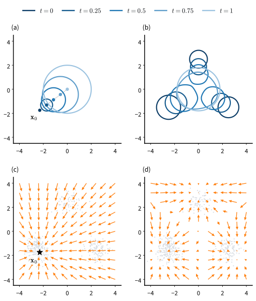

# Gaussian Paths: Diffusion and Flow Matching
:label:`sec_diffusion-gaussian-paths`

The score of the previous section could do one of two things, never both. At a small noise level it knows the shape of every mode, but Langevin chains that follow it cannot cross the valleys between the modes and keep the mode weights they started with. At a large noise level the chains find the right weights, but they sample a blurred copy of the data.

The repair suggests itself: start where the noise is heavy and the weights are easy to get right, then walk down through ever smaller noise levels to the data. The three routes of :numref:`chap_diffusion`, Ho et al.'s chain that adds noise step by step, the score models of Song and Ermon, and flow matching between noise and data, all arrive at this construction. The noise levels become the points of a *Gaussian path*: noisy copies of the data, indexed by a time $t$ that runs from the clean data at $t = 0$ to pure noise at $t = 1$. One regression trains one network to predict the clean point anywhere on the path. Whether we ask the network for the clean point, for the noise or for the direction in which the noisy point moves turns out not to matter for what it learns.

We build the path, test the walk on exact scores before any network is trained, derive the regression, and check two trained networks against the exact answers of the three-mode mixture. Drawing samples waits for the next section.

```{.python .input #gaussian-paths-gaussian-paths-diffusion-and-flow-matching}
%%tab pytorch
import math
import numpy as np
import torch
from torch import nn
from torch.nn import functional as F
from d2l import torch as d2l
```

```{.python .input #gaussian-paths-gaussian-paths-diffusion-and-flow-matching}
%%tab jax
import math
import numpy as np
import jax
from jax import numpy as jnp
from flax import nnx
import optax
from d2l import jax as d2l
```

```{.python .input #gaussian-paths-gaussian-paths-diffusion-and-flow-matching-1}
%%tab pytorch
torch.set_float32_matmul_precision('high')  # tf32 matmuls on tensor cores
```

## Paths from Data to Noise

A walk through all noise levels needs the levels in a row, each labelled by a time.

### Signal, Noise and the Log-SNR

The noisy point of the previous section, $\tilde{\mathbf{x}} = \mathbf{x}_0 + \sigma\boldsymbol\epsilon$, becomes a path once $\sigma$ grows with time. This path keeps the data at full size and lets the noise grow until the data are negligible. Its variance grows without bound, hence the name *variance-exploding* (VE) path. A network on it sees inputs whose size grows with the noise, so one set of weights has to handle inputs of size one and, in Song and Ermon's model of CIFAR-10 images, inputs fifty times larger. Most models therefore shrink the data as the noise grows, which keeps every input near unit size. A *Gaussian path* is a pair of functions $\alpha_t$ and $\sigma_t$ on $t \in [0, 1]$ that defines the noisy point

$$
\mathbf{x}_t = \alpha_t\, \mathbf{x}_0 + \sigma_t\, \boldsymbol{\epsilon},
\qquad \boldsymbol{\epsilon} \sim \mathcal{N}(\mathbf{0}, \mathbf{I}),
$$
:eqlabel:`eq_diffusion-gaussian-path`

starting from $(\alpha_0, \sigma_0) = (1, 0)$. Unlike the VE path, the two paths in common use end at pure noise, $(\alpha_1, \sigma_1) = (0, 1)$, or nearly so.

The *variance-preserving* (VP) path of DDPM :cite:`ho2020denoising` keeps $\alpha_t^2 + \sigma_t^2 = 1$, so data of unit variance keep unit variance. A rate $\beta(t) = \beta_{\min} + (\beta_{\max} - \beta_{\min})\, t$, growing linearly from $\beta_{\min} = 0.1$ to $\beta_{\max} = 20$, sets how fast it forgets the data. In each instant $dt$ the signal loses the fraction $\beta(t)\, dt$ of its variance, so the surviving fraction is the exponential of minus the integrated rate:

$$
\bar\alpha_t := \alpha_t^2 = \exp\Big(-\int_0^t \beta(r)\, dr\Big),
\qquad
\log \bar\alpha_t = -\big(0.1\, t + 9.95\, t^2\big).
$$

The numbers $0.1$ and $20$ are not arbitrary. They are DDPM's first and last step variances, $10^{-4}$ and $0.02$, multiplied by its $1{,}000$ steps, and the next subsection shows how the steps become a rate. At the end of the path $\bar\alpha_1 = e^{-10.05} \approx 4 \cdot 10^{-5}$, close enough to pure noise for any purpose. Followed through time, one point of the VP path performs an Ornstein--Uhlenbeck process, a random walk pulled toward the origin (:numref:`sec_mdl-ornstein-uhlenbeck`), on a clock that speeds up: the pull and the variance of the noise both scale with $\beta(t)$, which is two hundred times larger at the end than at the start.

The *linear* path of flow matching and rectified flow :cite:`Lipman.Chen.BenHamu.ea.2022,Liu.Gong.Liu.2022,Albergo.Boffi.VandenEijnden.2023` draws a straight line from each clean point to its noise:

$$
\alpha_t = 1 - t, \qquad \sigma_t = t.
$$
:eqlabel:`eq_diffusion-linear-path`

It is the simplest path that ends exactly at noise, and each example travels along its line at constant speed. That simplicity made it the path of the chapter's default model and of many image generators since 2024 :cite:`Esser.Kulal.Blattmann.ea.2024`.

When do two paths, at different times, tell a denoiser the same thing? What a denoiser can infer from $\mathbf{x}_t$ depends only on the ratio of signal to noise, measured as the *log-SNR* $\lambda_t = \log(\alpha_t^2 / \sigma_t^2)$. To see why, multiply a noisy point by $c = 1/(\alpha_t + \sigma_t)$. The coefficients of $c\alpha_t \mathbf{x}_0 + c\sigma_t \boldsymbol\epsilon$ add up to one, so the result is a point of the linear path, at the time $\sigma_t/(\alpha_t + \sigma_t)$, with the same ratio of signal to noise. Multiplying by a known number loses nothing, so the rescaled point carries the same information as $\mathbf{x}_t$.

Two paths, read at times of equal $\lambda$, therefore hold the same information about the clean point, and the log-SNR is a clock that all paths share. It runs from $+\infty$ at the data down to $-\infty$ at pure noise. The linear path covers all of it, and the VP path stops near $\lambda = -10$. Choosing a path thus amounts to choosing how fast this clock runs, which decides where training and sampling spend their time.

`GaussianPath` holds $\alpha_t$ and $\sigma_t$, computes the log-SNR and draws $\mathbf{x}_t$. Its constructors build the VP path, the linear path and a third path, the cosine path, which we meet below.

```{.python .input #gaussian-paths-signal-noise-and-the-log-snr-clock}
%%tab pytorch
class GaussianPath:  #@save
    """x_t = alpha(t) x0 + sigma(t) eps, data at t = 0 and noise at t = 1."""
    def __init__(self, alpha, sigma):
        self.alpha, self.sigma = alpha, sigma

    @staticmethod
    def vp(beta_min=0.1, beta_max=20.0):
        """Variance preserving, Ho et al.'s linear beta in continuous time."""
        log_abar = lambda t: -(beta_min * t + (beta_max - beta_min) * t**2 / 2)
        return GaussianPath(lambda t: torch.exp(log_abar(t) / 2),
                            lambda t: torch.sqrt(-torch.expm1(log_abar(t))))

    @staticmethod
    def linear():
        """The straight line of flow matching and rectified flow."""
        return GaussianPath(lambda t: 1 - t, lambda t: t)

    @staticmethod
    def cosine(s=0.008):
        """Variance preserving, Nichol and Dhariwal's cosine schedule."""
        c = lambda t: torch.cos(math.pi / 2 * (t + s) / (1 + s))
        g = lambda t: c(t) / c(torch.zeros_like(t))   # exactly 1 at t = 0
        # and exactly 0 at t = 1 (cos(pi/2) is not), keeping the slope
        f = lambda t: torch.where(t < 1, g(t), g(t) - g(t).detach())
        return GaussianPath(f, lambda t: torch.sqrt(1 - f(t) ** 2))

    def log_snr(self, t):
        """lambda_t = log(alpha_t^2 / sigma_t^2), falling from +inf at 0."""
        return 2 * (torch.log(self.alpha(t)) - torch.log(self.sigma(t)))

    def sample(self, x0, t, eps):
        """x_t for per-example times t of shape (n,)."""
        t = t.reshape(-1, *[1] * (x0.dim() - 1))
        return self.alpha(t) * x0 + self.sigma(t) * eps
```

```{.python .input #gaussian-paths-signal-noise-and-the-log-snr-clock}
%%tab jax
class GaussianPath:  #@save
    """x_t = alpha(t) x0 + sigma(t) eps, data at t = 0 and noise at t = 1."""
    def __init__(self, alpha, sigma):
        self.alpha, self.sigma = alpha, sigma

    @staticmethod
    def vp(beta_min=0.1, beta_max=20.0):
        """Variance preserving, Ho et al.'s linear beta in continuous time."""
        log_abar = lambda t: -(beta_min * t + (beta_max - beta_min) * t**2 / 2)
        return GaussianPath(lambda t: jnp.exp(log_abar(t) / 2),
                            lambda t: jnp.sqrt(-jnp.expm1(log_abar(t))))

    @staticmethod
    def linear():
        """The straight line of flow matching and rectified flow."""
        return GaussianPath(lambda t: 1 - t, lambda t: t)

    @staticmethod
    def cosine(s=0.008):
        """Variance preserving, Nichol and Dhariwal's cosine schedule."""
        c = lambda t: jnp.cos(math.pi / 2 * (t + s) / (1 + s))
        g = lambda t: c(t) / c(jnp.zeros_like(t))     # exactly 1 at t = 0
        # and exactly 0 at t = 1 (cos(pi/2) is not), keeping the slope
        f = lambda t: jnp.where(t < 1, g(t),
                                g(t) - jax.lax.stop_gradient(g(t)))
        return GaussianPath(f, lambda t: jnp.sqrt(1 - f(t) ** 2))

    def log_snr(self, t):
        """lambda_t = log(alpha_t^2 / sigma_t^2), falling from +inf at 0."""
        return 2 * (jnp.log(self.alpha(t)) - jnp.log(self.sigma(t)))

    def sample(self, x0, t, eps):
        """x_t for per-example times t of shape (n,)."""
        t = t.reshape(-1, *[1] * (x0.ndim - 1))
        return self.alpha(t) * x0 + self.sigma(t) * eps
```

At $t = 0.5$ the linear path holds signal and noise in equal parts, $\lambda = 0$. Where is the VP path?

```{.python .input #gaussian-paths-signal-noise-and-the-log-snr-clock-1}
%%tab pytorch
vp, linear = GaussianPath.vp(), GaussianPath.linear()
t = torch.tensor([0.1, 0.5, 0.9])
r2 = lambda v: [round(u, 2) for u in v.tolist()]
for name, path in (('vp', vp), ('linear', linear)):
    print(f'{name:>6}: alpha {r2(path.alpha(t))} sigma {r2(path.sigma(t))} '
          f'log-SNR {r2(path.log_snr(t))}')
```

```{.python .input #gaussian-paths-signal-noise-and-the-log-snr-clock-1}
%%tab jax
vp, linear = GaussianPath.vp(), GaussianPath.linear()
t = jnp.array([0.1, 0.5, 0.9])
r2 = lambda v: [round(float(u), 2) for u in v]
for name, path in (('vp', vp), ('linear', linear)):
    print(f'{name:>6}: alpha {r2(path.alpha(t))} sigma {r2(path.sigma(t))} '
          f'log-SNR {r2(path.log_snr(t))}')
```

Halfway in time the VP path is already mostly noise, with $\alpha = 0.28$ and $\lambda \approx -2.5$, and at $t = 0.9$ it keeps two percent of the signal against the linear path's ten. It crosses $\lambda = 0$ near $t = 0.26$ and so spends three quarters of its time where noise dominates (:numref:`fig_diffusion-paths`).

![Two Gaussian paths on one clock. (a) The signal coefficient $\alpha_t$ (solid) and the noise coefficient $\sigma_t$ (dashed) of the variance-preserving path, with $\beta(t)$ rising from $0.1$ to $20$, and of the linear path. (b) Their log-SNR $\lambda_t$, clipped to $[-10, 10]$. The variance-preserving path reaches the noisy regime much earlier.](../img/mdl-diffusion-paths.svg)
:label:`fig_diffusion-paths`

For small images this is wasteful. :citet:`Nichol.Dhariwal.2021` observed that on images of $32$ and $64$ pixels on a side the last stretch of DDPM's schedule contributes little, because the image is gone long before $t = 1$. Their *cosine path* sets $\alpha_t = \cos\frac{\pi t}{2}$, up to a small offset near the data, and $\sigma_t = \sin\frac{\pi t}{2}$. It is again a VP path, but its $\bar\alpha_t$ falls almost linearly through the middle and changes slowly at both ends, so less time is spent where the image has already disappeared.

::: {.callout-important title="The Clock"}
Data sit at $t = 0$ and noise at $t = 1$ throughout the book, and every sampler runs from $t = 1$ down to $0$. Flow-matching papers reverse time (:numref:`fig_mdl-dyn-time-conventions`): substitute $1 - t$ for their $t$, read their noise $\mathbf{x}_0$ as our $\boldsymbol\epsilon$ and their data $\mathbf{x}_1$ as our $\mathbf{x}_0$, and flip the sign of every velocity.
:::

Papers on diffusion write the same quantities in several notations. :numref:`tab_diffusion-notation` is for reference: it collects the symbols the chapter uses from here on and how papers write them. It can be skipped on a first reading and consulted when a paper's notation gets in the way.

:Notation of the diffusion chapter. Later sections add a few symbols of their own where they arise.
:label:`tab_diffusion-notation`

| symbol | meaning | papers write |
|:--|:--|:--|
| $t \in [0, 1]$ | time along the path: data at $0$, noise at $1$ | data at $t = 1$ in flow matching; an integer step in DDPM |
| $\mathbf{x}_0$, $\boldsymbol\epsilon$, $\mathbf{x}_t$ | a clean point, standard Gaussian noise, the noisy point | $\mathbf{x}_1$ for data, $\mathbf{x}_0$ for noise in flow matching |
| $\alpha_t$, $\sigma_t$ | signal and noise coefficients of the path | $\sqrt{\bar\alpha_t}$, $\sqrt{1 - \bar\alpha_t}$ in DDPM, whose $\alpha_t$ is $1 - \beta_t$ |
| $\bar\alpha_t = \alpha_t^2$, $\beta(t)$ | squared signal coefficient of the VP path, its rate | |
| $k$, $T$, $\beta_k$ | step of the DDPM chain, number of steps, variance added at step $k$ | $t$ for $k$ |
| $\lambda_t$ | log-SNR, $\log(\alpha_t^2 / \sigma_t^2)$ | $-\gamma(t)$ in VDM |
| $\sigma$, $\tilde\sigma_i$ | a noise level of the VE path; level $i$ of a ladder | $\sigma_i$ for $\tilde\sigma_i$ |
| $p_t$, $\nabla \log p_t$ | density of $\mathbf{x}_t$, its score | |
| $\hat{\mathbf{x}}_0$, $\hat{\boldsymbol\epsilon}$ | posterior means of $\mathbf{x}_0$ and $\boldsymbol\epsilon$ given $\mathbf{x}_t$; with a subscript $\boldsymbol\theta$, a network's predictions of them | $D_{\boldsymbol\theta}$ (a denoiser), $\boldsymbol\epsilon_{\boldsymbol\theta}$ |
| $\mathbf{u}_t$, $\mathbf{u}_{\boldsymbol\theta}$ | marginal velocity of the path; a network that predicts it | $u_t$, $v_t$ in flow matching, with the opposite sign |
| $\mathbf{v}$ | $\alpha_t \boldsymbol\epsilon - \sigma_t \mathbf{x}_0$, the target of $\mathbf{v}$-prediction | |
| $\pi_k$, $\boldsymbol\mu_k$, $s$ | weights, means and standard deviation of the mixture's components (here $k$ indexes components) | |

### The DDPM Chain

The VP path was not born as a path. :citet:`ho2020denoising` defined a Markov chain of $T$ small steps, each shrinking the point a little and adding a little noise,

$$
\mathbf{x}_k = \sqrt{1 - \beta_k}\, \mathbf{x}_{k-1} + \sqrt{\beta_k}\, \boldsymbol{\epsilon}_k,
\qquad k = 1, \ldots, T,
$$
:eqlabel:`eq_diffusion-forward`

with independent standard Gaussians $\boldsymbol\epsilon_k$ and step variances $\beta_k \in (0, 1)$. Each step maps unit variance to unit variance, and because the noises are independent Gaussians, $k$ steps compose into a single draw,

$$
\mathbf{x}_k = \sqrt{\bar\alpha_k}\, \mathbf{x}_0 + \sqrt{1 - \bar\alpha_k}\, \boldsymbol{\epsilon},
\qquad \bar\alpha_k = \prod_{j=1}^{k} (1 - \beta_j),
$$
:eqlabel:`eq_diffusion-marginal`

in which the surviving signal is the product of the factors of all steps so far (:numref:`sec_mdl-ddpm-discretized-sde` gives the induction). This closed form is why training never simulates the chain: any $\mathbf{x}_k$ is one Gaussian draw away from $\mathbf{x}_0$.

Place the steps at the times $t_k = k/T$ and choose $\beta_k = 1 - \bar\alpha_{t_k} / \bar\alpha_{t_{k-1}}$. The product telescopes to $\bar\alpha_{t_k}$, and the chain is the VP path read on a grid. On a fine grid $\beta_k \approx \beta(t_k)/T$, so the step variances and the rate are one quantity, counted per step and per unit time. :numref:`fig_diffusion-forward-reverse` shows the forward chain and the reverse chain that generation runs.


:label:`fig_diffusion-forward-reverse`

`grid` lists $\alpha$ and $\sigma$ at evenly spaced times from noise to data, the default grid of the chapter's samplers.

```{.python .input #gaussian-paths-the-chain-view}
%%tab pytorch
@d2l.add_to_class(GaussianPath)  #@save
def grid(self, steps, t_start=1.0, t_end=0.0):
    """Lists of alpha and sigma at steps + 1 even times, t_start to t_end."""
    t = torch.linspace(t_start, t_end, steps + 1, dtype=torch.float64)
    return self.alpha(t).tolist(), self.sigma(t).tolist()
```

```{.python .input #gaussian-paths-the-chain-view}
%%tab jax
@d2l.add_to_class(GaussianPath)  #@save
def grid(self, steps, t_start=1.0, t_end=0.0):
    """Arrays of alpha and sigma at steps + 1 even times, t_start to t_end."""
    with jax.ensure_compile_time_eval():         # constants, even under jit
        t = jnp.linspace(t_start, t_end, steps + 1)
        return self.alpha(t), self.sigma(t)
```

Which step variances does our path give for $T = 1000$? From $\beta_k \approx \beta(t_k)/T$ we expect about $10^{-4}$ for the first step and $0.02$ for the last. The grid lists the times from the noise end, so its first entries belong to the last step.

```{.python .input #gaussian-paths-the-chain-view-1}
%%tab pytorch, jax
a, _ = vp.grid(1000)
print(f'beta_1 = {1 - (a[-2] / a[-1]) ** 2:.1e}, '
      f'beta_T = {1 - (a[0] / a[1]) ** 2:.4f}, alpha_bar_T = {a[0] ** 2:.1e}')
```

The steps grow from $1.1 \cdot 10^{-4}$ to $0.0198$, close to the linear schedule of Ho et al., which runs from $10^{-4}$ to $0.02$. After a thousand steps a factor $\sqrt{\bar\alpha_T} \approx 0.007$ of the data survives.

### Annealing through Noise Levels

Does a walk through many noise levels do what one level could not? The scores of the blurred mixture are known exactly, so we can test this before training any network, walking down the VE path of the previous section. We run the Langevin update $\mathbf{x} \leftarrow \mathbf{x} + \tfrac{h}{2}\nabla \log p(\mathbf{x}) + \sqrt{h}\,\boldsymbol\xi$ of :numref:`sec_diffusion-denoising`, with fresh Gaussian noise $\boldsymbol\xi$, down a *ladder* of ten noise levels $\tilde\sigma_i$, evenly spaced in log scale from $3$ down to $0.05$. Each level takes $100$ steps on the exact score and starts where the previous level stopped. Its step size $h_i = 0.1\, \tilde\sigma_i^2$ shrinks with the square of the level, so that the noise of each step, $\sqrt{h_i} \approx 0.3\, \tilde\sigma_i$, stays a fixed fraction of the current blur.

The control spends the same $1{,}000$ steps at the finest level, with the step size $h = 0.05$ of the previous section. That step is two hundred times larger than the ladder's at the same level, which gives the control every chance to cross a valley. Both start from the same $2{,}000$ points drawn from $\mathcal{N}(\mathbf{0}, 9\mathbf{I})$. If the idea is right, the ladder lands near the weights $0.5$, $0.3$ and $0.2$, and the control near a third each.

```{.python .input #gaussian-paths-annealing-through-noise-levels}
%%tab pytorch
torch.manual_seed(0)
device = d2l.try_gpu()
mix = d2l.GaussianMixture.three_modes(device)
x_init = 3 * torch.randn(2000, 2, device=device)
x = x_init
for s in torch.logspace(math.log10(3), math.log10(0.05), 10).tolist():
    x = d2l.langevin(lambda z: mix.score(z, 1.0, s), x, 0.1 * s ** 2, 100)
control = d2l.langevin(lambda z: mix.score(z, 1.0, 0.05), x_init, 0.05, 1000)
print('finest level only:', mix.summary(control))
print('ten levels:       ', mix.summary(x))
d2l.scatter_panels([control, x], ['finest level only', 'ten levels'],
                   data=mix.sample(2000));
```

```{.python .input #gaussian-paths-annealing-through-noise-levels}
%%tab jax
key = jax.random.key(0)
mix = d2l.GaussianMixture.three_modes()
key, k_init, k_ctrl, k_data = jax.random.split(key, 4)
x_init = 3 * jax.random.normal(k_init, (2000, 2))
x = x_init
for s in jnp.logspace(math.log10(3), math.log10(0.05), 10).tolist():
    key, k = jax.random.split(key)
    x = d2l.langevin(lambda z: mix.score(z, 1.0, s), x, 0.1 * s ** 2, 100, k)
control = d2l.langevin(lambda z: mix.score(z, 1.0, 0.05), x_init, 0.05, 1000,
                       k_ctrl)
print('finest level only:', mix.summary(control))
print('ten levels:       ', mix.summary(x))
d2l.scatter_panels([control, x], ['finest level only', 'ten levels'],
                   data=mix.sample(k_data, 2000));
```

The ladder lands within about $0.03$ of the weights, with one to two percent of strays, points far from every mode, against about one percent in the data themselves. The control has the right spread around each mode but keeps the weights of its starting points, about a third each. The proportions are decided at the coarse levels, where the smoothed density has no valleys; the fine levels only sharpen each mode. A diffusion model divides the work the same way along its path. No network took part, so this experiment tests the idea alone, and whatever goes wrong later is the fault of a network.

This *annealed Langevin dynamics* sampled the first generator of this kind, the noise-conditional score network of :citet:`song2019generative`. One network takes the noise level as an input and is trained by denoising score matching at every level of the ladder, weighted by $\tilde\sigma_i^2$ (:numref:`sec_mdl-score-based-generative-modeling`). Its levels, step sizes and step counts were set by hand, which in high dimensions is delicate (Exercise :exref:`ex_gaussian-paths-ladder-spacing`). A path replaces the ten levels by a continuum, and one network must learn them all.

## Regression onto the Marginal Field

One network is to serve every point of the path. We first decide what it should learn there, then find a regression that teaches it without knowing the answer.

### Conditional Targets and Marginal Fields

The network of the previous section learned, at one noise level, the score, and with it, through Tweedie's formula, the posterior mean of the clean point, $\hat{\mathbf{x}}_0 = \mathbb{E}[\mathbf{x}_0 \mid \mathbf{x}_t]$. At every time this one object gives the score and tells a noisy point which way to move. It depends on the whole data distribution and is unknown. Condition on the clean point as well, and the problem becomes trivial: given $\mathbf{x}_0$, the best guess of $\mathbf{x}_0$ is $\mathbf{x}_0$ itself.

A sampler will need to know which way to move a noisy point, so let us ask the network for that directly. One clean point and one draw of noise move with the *conditional velocity* $\dot{\mathbf{x}}_t = \dot\alpha_t \mathbf{x}_0 + \dot\sigma_t \boldsymbol\epsilon$, which on the linear path is the constant $\boldsymbol\epsilon - \mathbf{x}_0$. Many such points pass through a given $\mathbf{x}$ at time $t$, each heading its own way, and the cloud as a whole moves there with their average velocity,

$$
\mathbf{u}_t(\mathbf{x}) = \mathbb{E}\big[\dot\alpha_t\, \mathbf{x}_0 + \dot\sigma_t\, \boldsymbol\epsilon \,\big|\, \mathbf{x}_t = \mathbf{x}\big],
$$
:eqlabel:`eq_diffusion-marginal-velocity`

the *marginal velocity*. Where only one clean point can have produced $\mathbf{x}$, it is that point's velocity; where several can, it is their average, weighted by how likely each is.

For the mixture this field is exact. Given the mode, $\mathbf{x}_0$ and $\boldsymbol\epsilon$ are jointly Gaussian with $\mathbf{x}_t$, so their conditional means are linear in $\mathbf{x}_t$, and `velocity` averages them over the modes with the modes' posterior probabilities.

```{.python .input #gaussian-paths-conditional-targets-and-marginal-fields-1}
%%tab pytorch
@d2l.add_to_class(d2l.GaussianMixture)  #@save
def velocity(self, x, t):
    """E[eps - x0 | x_t] on the linear path x_t = (1 - t) x0 + t eps."""
    log_p, r, var, a = self._modes(x, 1 - t, t)
    eps = (1 - a) * r / var                        # E[eps | x_t, mode k]
    x0 = self.means + a * self.std ** 2 / var * r  # E[x0 | x_t, mode k]
    return (torch.softmax(log_p, 1)[..., None] * (eps - x0)).sum(1)
```

```{.python .input #gaussian-paths-conditional-targets-and-marginal-fields-1}
%%tab jax
@d2l.add_to_class(d2l.GaussianMixture)  #@save
def velocity(self, x, t):
    """E[eps - x0 | x_t] on the linear path x_t = (1 - t) x0 + t eps."""
    log_p, r, var, a = self._modes(x, 1 - t, t)
    eps = (1 - a) * r / var                        # E[eps | x_t, mode k]
    x0 = self.means + a * self.std ** 2 / var * r  # E[x0 | x_t, mode k]
    return (jax.nn.softmax(log_p, 1)[..., None] * (eps - x0)).sum(1)
```

For real data we cannot compute this field, yet we can learn it. Least squares recovers a conditional mean, so a conditional expectation is learned by regressing on the quantity inside it. This is how denoising score matching recovered the score. For the velocity the regression gives the *conditional flow matching* loss, which differs from the regression onto the unknown marginal field only by a constant $C$ that does not depend on the network:

$$
\mathbb{E}_{t,\, \mathbf{x}_0,\, \boldsymbol\epsilon}\, \big\| \mathbf{u}_{\boldsymbol\theta}(\mathbf{x}_t, t) - (\dot\alpha_t \mathbf{x}_0 + \dot\sigma_t \boldsymbol\epsilon) \big\|^2
= \mathbb{E}_{t,\, \mathbf{x}_t}\, \big\| \mathbf{u}_{\boldsymbol\theta}(\mathbf{x}_t, t) - \mathbf{u}_t(\mathbf{x}_t) \big\|^2 + C.
$$
:eqlabel:`eq_diffusion-cfm-loss`

The two sides have the same minimizer, so a network trained on per-example velocities learns the marginal one (:numref:`sec_mdl-flow-matching` gives the proof). We never need $\mathbf{u}_t$ to learn it, just as the denoiser never needed the score. :numref:`fig_diffusion-blueprint` shows both views on the mixture. With $\mathbf{x}_t = \mathbf{x}$ fixed, the conditional velocity $\boldsymbol\epsilon - \mathbf{x}_0$ of the linear path equals $(\mathbf{x} - \mathbf{x}_0)/t$, and the figure draws its negative, the direction in which a sampler moves.

![The conditional and the marginal views of the linear path on the mixture, computed exactly. (a) The conditional path of one clean point $\mathbf{x}_0$ from the heaviest mode: circles of radius $2\sigma_t$ around $\alpha_t\mathbf{x}_0$ at five times from $0$ to $1$. (b) The marginal path: contours of $p_t$ at the same times. (c) The conditional field $-(\mathbf{x} - \mathbf{x}_0)/t$ at $t = 0.5$, pointing toward that one point. (d) The marginal field $-\mathbf{u}_{0.5}(\mathbf{x})$, the posterior average of the conditional fields.](../img/mdl-diffusion-blueprint.svg)
:label:`fig_diffusion-blueprint`

`target` computes the per-example target of each kind on any path: the noise, the clean point, the score, the velocity, and a fifth target, $\mathbf{v}$, that the next subsection introduces. For the velocity, `rates` gets $\dot\alpha_t$ and $\dot\sigma_t$ by forward-mode differentiation, so no path needs its derivatives written by hand. `x0_eps` goes the other way, from a prediction of any kind back to $(\hat{\mathbf{x}}_0, \hat{\boldsymbol\epsilon})$, and the next subsection derives the relations it inverts.

```{.python .input #gaussian-paths-four-targets-one-oracle}
%%tab pytorch
@d2l.add_to_class(GaussianPath)  #@save
def rates(self, t):
    """The time derivatives (alpha'(t), sigma'(t)), by forward-mode AD."""
    ones = torch.ones_like(t)
    return (torch.func.jvp(self.alpha, (t,), (ones,))[1],
            torch.func.jvp(self.sigma, (t,), (ones,))[1])

@d2l.add_to_class(GaussianPath)  #@save
def target(self, kind, x0, eps, t):
    """The regression target of a kind: eps, x0, v, score or velocity."""
    t = t.reshape(-1, *[1] * (x0.dim() - 1))
    a, s = self.alpha(t), self.sigma(t)
    if kind == 'eps': return eps
    if kind == 'x0': return x0
    if kind == 'v': return a * eps - s * x0
    if kind == 'score': return -eps / s
    if kind != 'velocity': raise ValueError(f'unknown kind {kind!r}')
    da, ds = self.rates(t)                      # velocity = d x_t / dt
    return da * x0 + ds * eps

@d2l.add_to_class(GaussianPath)  #@save
def x0_eps(self, kind, out, x, t):
    """The (x0, eps) that a prediction `out` of a kind implies at (x, t)."""
    t = t.reshape(-1, *[1] * (x.dim() - 1))
    a, s = self.alpha(t), self.sigma(t)
    if kind == 'eps': return (x - s * out) / a, out
    if kind == 'x0': return out, (x - a * out) / s
    if kind == 'v': return ((a * x - s * out) / (a**2 + s**2),
                            (s * x + a * out) / (a**2 + s**2))
    if kind == 'score': return (x + s ** 2 * out) / a, -s * out
    if kind != 'velocity': raise ValueError(f'unknown kind {kind!r}')
    da, ds = self.rates(t)
    det = a * ds - s * da
    return (ds * x - s * out) / det, (a * out - da * x) / det
```

```{.python .input #gaussian-paths-four-targets-one-oracle}
%%tab jax
@d2l.add_to_class(GaussianPath)  #@save
def rates(self, t):
    """The time derivatives (alpha'(t), sigma'(t)), by forward-mode AD."""
    ones = jnp.ones_like(t)
    return (jax.jvp(self.alpha, (t,), (ones,))[1],
            jax.jvp(self.sigma, (t,), (ones,))[1])

@d2l.add_to_class(GaussianPath)  #@save
def target(self, kind, x0, eps, t):
    """The regression target of a kind: eps, x0, v, score or velocity."""
    t = t.reshape(-1, *[1] * (x0.ndim - 1))
    a, s = self.alpha(t), self.sigma(t)
    if kind == 'eps': return eps
    if kind == 'x0': return x0
    if kind == 'v': return a * eps - s * x0
    if kind == 'score': return -eps / s
    if kind != 'velocity': raise ValueError(f'unknown kind {kind!r}')
    da, ds = self.rates(t)                      # velocity = d x_t / dt
    return da * x0 + ds * eps

@d2l.add_to_class(GaussianPath)  #@save
def x0_eps(self, kind, out, x, t):
    """The (x0, eps) that a prediction `out` of a kind implies at (x, t)."""
    t = t.reshape(-1, *[1] * (x.ndim - 1))
    a, s = self.alpha(t), self.sigma(t)
    if kind == 'eps': return (x - s * out) / a, out
    if kind == 'x0': return out, (x - a * out) / s
    if kind == 'v': return ((a * x - s * out) / (a**2 + s**2),
                            (s * x + a * out) / (a**2 + s**2))
    if kind == 'score': return (x + s ** 2 * out) / a, -s * out
    if kind != 'velocity': raise ValueError(f'unknown kind {kind!r}')
    da, ds = self.rates(t)
    det = a * ds - s * da
    return (ds * x - s * out) / det, (a * out - da * x) / det
```

The method now fits in one cell. Each step draws $512$ fresh points from the mixture, with a time and a noise for each, and regresses `TimeMLP`, the small network of the previous section that reads the point and sinusoidal features of the time, onto the conditional velocity of the linear path. Training runs $40{,}000$ Adam steps with a cosine-decayed learning rate and keeps a moving average of the weights, with a half-life of $700$ steps. The averaged weights smooth out the noise of the last steps, and they are the ones we evaluate below. Since every batch is new, there is no training set to memorize, unlike the fixed $2{,}000$ points of the previous section (Exercise :exref:`ex_gaussian-paths-memorization` asks what happens when there is). Each network trains in a minute or two on one GPU.

```{.python .input #gaussian-paths-conditional-targets-and-marginal-fields}
%%tab pytorch
def regression_loss(path, kind):  #@save
    """Squared error of net(x_t, t) against the target of a kind, t ~ U(0, 1)."""
    def loss_fn(net, x0):
        t = torch.rand(len(x0), device=x0.device)
        eps = torch.randn_like(x0)
        error = net(path.sample(x0, t, eps), t) - path.target(kind, x0, eps, t)
        return (error ** 2).flatten(1).sum(1).mean()  # ||error||^2 per example
    return loss_fn

torch.manual_seed(1)
num_steps = 40_000
net_v, ema_v, losses_v = d2l.train_regression(
    d2l.TimeMLP(256, 3).to(device), regression_loss(linear, 'velocity'),
    lambda: mix.sample(512), num_steps, cosine=True, ema_half_life=700)
d2l.plot(torch.arange(100) * num_steps // 100,
         losses_v.reshape(100, -1).mean(1).cpu(), 'step', 'loss')
```

```{.python .input #gaussian-paths-conditional-targets-and-marginal-fields}
%%tab jax
def regression_loss(path, kind):  #@save
    """Squared error of net(x_t, t) against the target of a kind, t ~ U(0, 1)."""
    def loss_fn(net, x0, key):
        k_t, k_eps = jax.random.split(key)
        t = jax.random.uniform(k_t, (len(x0),))
        eps = jax.random.normal(k_eps, x0.shape)
        error = net(path.sample(x0, t, eps), t) - path.target(kind, x0, eps, t)
        return (error ** 2).reshape(len(x0), -1).sum(1).mean()  # per example
    return loss_fn

num_steps = 40_000
net_v, ema_v, losses_v = d2l.train_regression(
    d2l.TimeMLP(256, 3, rngs=nnx.Rngs(1)), regression_loss(linear, 'velocity'),
    lambda k: mix.sample(k, 512), num_steps, jax.random.key(1), cosine=True,
    ema_half_life=700)
d2l.plot(jnp.arange(100) * num_steps // 100,
         losses_v.reshape(100, -1).mean(1), 'step', 'loss')
```

Each point of the curve averages $400$ steps. The loss levels off near $5$ within a few thousand steps, far above zero. Is the network stuck? We will see that no network can do much better.

### Equivalent Targets

DDPM's network predicts the noise, and others predict the clean point. Does the choice change what the network learns? At a fixed $\mathbf{x}_t$ these are not different quantities. Taking the posterior mean of both sides of :eqref:`eq_diffusion-gaussian-path` gives $\mathbf{x}_t = \alpha_t \hat{\mathbf{x}}_0 + \sigma_t \hat{\boldsymbol\epsilon}$ with $\hat{\boldsymbol\epsilon} = \mathbb{E}[\boldsymbol\epsilon \mid \mathbf{x}_t]$, so each determines the other.

The score is a third view of the same object. Tweedie's formula of the previous section says that $\mathbb{E}[\mathbf{x}_0 \mid \tilde{\mathbf{x}}] = \tilde{\mathbf{x}} + \sigma^2 \nabla \log p_\sigma(\tilde{\mathbf{x}})$ for $\tilde{\mathbf{x}} = \mathbf{x}_0 + \sigma\boldsymbol\epsilon$. We apply it with $\alpha_t \mathbf{x}_0$ in the role of the clean point and $\sigma_t$ as the noise level. Then $\alpha_t \hat{\mathbf{x}}_0 = \mathbf{x}_t + \sigma_t^2 \nabla \log p_t(\mathbf{x}_t)$, and the score is

$$
\nabla \log p_t(\mathbf{x}_t) = \frac{\alpha_t \hat{\mathbf{x}}_0 - \mathbf{x}_t}{\sigma_t^2} = -\frac{\hat{\boldsymbol\epsilon}}{\sigma_t}.
$$
:eqlabel:`eq_diffusion-score-eps`

The score points from $\mathbf{x}_t$ toward the scaled posterior mean, and it is the noise prediction divided by $-\sigma_t$.

The marginal velocity :eqref:`eq_diffusion-marginal-velocity` is $\dot\alpha_t \hat{\mathbf{x}}_0 + \dot\sigma_t \hat{\boldsymbol\epsilon}$, and eliminating $\hat{\mathbf{x}}_0$ between it and the score gives the score–velocity identity

$$
\mathbf{u}_t(\mathbf{x}) = \frac{\dot\alpha_t}{\alpha_t}\, \mathbf{x} - \Big(\sigma_t \dot\sigma_t - \sigma_t^2 \frac{\dot\alpha_t}{\alpha_t}\Big) \nabla \log p_t(\mathbf{x}).
$$
:eqlabel:`eq_diffusion-score-velocity`

On the linear path, where $\dot\alpha_t = -1$ and $\dot\sigma_t = 1$, it reads

$$
\mathbf{u}_t(\mathbf{x}) = \hat{\boldsymbol\epsilon} - \hat{\mathbf{x}}_0 = -\frac{\mathbf{x} + t\, \nabla \log p_t(\mathbf{x})}{1 - t}.
$$
:eqlabel:`eq_diffusion-linear-dictionary`

The velocity is a known multiple of the point plus a known multiple of the score, both fixed by the path. A velocity model is a score model in disguise.

Many image models use a fifth target, *$\mathbf{v}$-prediction* :cite:`Salimans.Ho.2022`, with $\mathbf{v} = \alpha_t \boldsymbol\epsilon - \sigma_t \mathbf{x}_0$. On a VP path we may write $\alpha_t = \cos\phi_t$ and $\sigma_t = \sin\phi_t$, and then $\mathbf{v} = d\mathbf{x}_t/d\phi_t$ is the velocity per unit of angle instead of per unit of time. On the cosine path without its small offset, $\phi_t = \pi t/2$, and $\mathbf{v}$ is $2/\pi$ times the velocity (Exercise :exref:`ex_gaussian-paths-v-to-velocity`). Salimans and Ho introduced it for samplers with very few steps, which query the network mostly at low signal-to-noise ratio. There a noise prediction yields the clean point only after division by a small $\alpha_t$, while $\mathbf{v}$ yields it without any division.

All five targets are affine functions of $\mathbf{x}_t$ and one posterior mean, with coefficients that depend only on the path and the time. We call the exact posterior mean the *oracle*, the predictor a perfect network would learn whatever its target, and the conversions between targets the *dictionary*. :numref:`tab_mdl-score-noise-velocity` lists the dictionary in full, and `target` and `x0_eps` implement it. A network trained on one target therefore defines all of them, and so does a network trained on another path, read at the time of equal log-SNR.

Let us watch the dictionary at one point. For the mixture, `oracle` returns the exact $\hat{\mathbf{x}}_0$ and $\hat{\boldsymbol\epsilon}$, so any loss or sampler can use it in place of a network. At the point $(0.5, -0.5)$ of the VP path at $t = 0.5$, where $\alpha = 0.28$ and $\sigma = 0.96$, we print every target. The last line rescales the point by $1/(\alpha + \sigma)$ onto the linear path at equal log-SNR, $t = 0.773$, and evaluates the exact field `velocity` there, a different formula at a different point. It should return $\hat{\boldsymbol\epsilon} - \hat{\mathbf{x}}_0$, which the first two lines let us compute in advance.

```{.python .input #gaussian-paths-four-targets-one-oracle-3}
%%tab pytorch
def oracle(x, alpha, sigma):
    """The exact posterior means (x0_hat, eps_hat) of the mixture at x."""
    x0_hat = mix.posterior_mean(x, alpha, sigma)
    a, s = (torch.as_tensor(v, device=x.device).reshape(-1, 1)
            for v in (alpha, sigma))
    return x0_hat, (x - a * x0_hat) / s

x = torch.tensor([[0.5, -0.5]], device=device)   # one noisy point
t = torch.tensor([0.5], device=device)           # VP: alpha 0.28, sigma 0.96
x0_hat, eps_hat = oracle(x, vp.alpha(t), vp.sigma(t))
for kind in ('x0', 'eps', 'score', 'v', 'velocity'):
    print(f'{kind:>8} on vp:', r2(vp.target(kind, x0_hat, eps_hat, t)[0]))
c = 1 / (vp.alpha(t) + vp.sigma(t))     # linear path, same alpha / sigma
print(f'velocity on linear at t = {(c * vp.sigma(t)).item():.3f}:',
      r2(mix.velocity(c * x, c * vp.sigma(t))[0]),
      ' eps_hat - x0_hat:', r2((eps_hat - x0_hat)[0]))
```

```{.python .input #gaussian-paths-four-targets-one-oracle-3}
%%tab jax
def oracle(x, alpha, sigma):
    """The exact posterior means (x0_hat, eps_hat) of the mixture at x."""
    x0_hat = mix.posterior_mean(x, alpha, sigma)
    a, s = (jnp.reshape(jnp.asarray(v), (-1, 1)) for v in (alpha, sigma))
    return x0_hat, (x - a * x0_hat) / s

x = jnp.array([[0.5, -0.5]])                     # one noisy point
t = jnp.array([0.5])                             # VP: alpha 0.28, sigma 0.96
x0_hat, eps_hat = oracle(x, vp.alpha(t), vp.sigma(t))
for kind in ('x0', 'eps', 'score', 'v', 'velocity'):
    print(f'{kind:>8} on vp:', r2(vp.target(kind, x0_hat, eps_hat, t)[0]))
c = 1 / (vp.alpha(t) + vp.sigma(t))     # linear path, same alpha / sigma
print(f'velocity on linear at t = {float((c * vp.sigma(t))[0]):.3f}:',
      r2(mix.velocity(c * x, c * vp.sigma(t))[0]),
      ' eps_hat - x0_hat:', r2((eps_hat - x0_hat)[0]))
```

The clean point is predicted at $(0.29, -0.98)$, inside the triangle of the three means $(-2.5, -1.5)$, $(2.5, -1.5)$ and $(0, 2.5)$ and near none of them, because at $\alpha = 0.28$ the posterior still spreads over all three modes. The score is the noise prediction divided by $-0.96$, and the field of the linear path returns $(0.15, 0.75) = \hat{\boldsymbol\epsilon} - \hat{\mathbf{x}}_0$. Five targets on two paths come from one posterior mean.

Which target should we train, then? A network that reached the oracle would not care. A real network does not reach it, and two practical facts decide. First, a noise predictor says nothing about the clean point at pure noise, where $\hat{\mathbf{x}}_0 = (\mathbf{x}_t - \sigma_t \hat{\boldsymbol\epsilon})/\alpha_t$ divides by zero, so it belongs on a path whose $\alpha_t$ stays positive, such as VP. Second, the targets weigh the times differently. On the linear path the velocity loss is the noise loss weighted by $1/(1 - t)^2$ and the clean-point loss weighted by $1/t^2$ (Exercise :exref:`ex_gaussian-paths-prediction-targets`), so equal squared errors in the velocity mean small errors of the noise near the noise end and small errors of the clean point near the data. In practice three pairs dominate: the velocity on the linear path, $\mathbf{v}$ on a cosine path and the noise on a VP path. None of the three is wrong, and the dictionary converts between them.

DDPM's *simple loss* :cite:`ho2020denoising` regresses onto the noise,

$$
L_{\textrm{simple}}(\boldsymbol\theta) = \mathbb{E}_{t,\, \mathbf{x}_0,\, \boldsymbol\epsilon}\, \big\| \boldsymbol\epsilon - \boldsymbol\epsilon_{\boldsymbol\theta}(\alpha_t \mathbf{x}_0 + \sigma_t \boldsymbol\epsilon,\, t) \big\|^2 .
$$
:eqlabel:`eq_diffusion-simple-loss`

The per-example score, that of the conditional density $\mathcal{N}(\alpha_t \mathbf{x}_0, \sigma_t^2 \mathbf{I})$ of $\mathbf{x}_t$ given $\mathbf{x}_0$, is $-\boldsymbol\epsilon/\sigma_t$, so the simple loss is denoising score matching at every level, weighted by $\sigma_t^2$ (:numref:`sec_mdl-ddpm-discretized-sde`). Ho et al. derived it from a variational bound on the likelihood and then dropped the bound's weights over $t$, because the samples looked better without them. Our second model makes DDPM's choice, the noise target on the VP path, and changes nothing else.

```{.python .input #gaussian-paths-four-targets-one-oracle-2}
%%tab pytorch
torch.manual_seed(2)
net_eps, ema_eps, losses_eps = d2l.train_regression(
    d2l.TimeMLP(256, 3).to(device), regression_loss(vp, 'eps'),
    lambda: mix.sample(512), num_steps, cosine=True, ema_half_life=700)
```

```{.python .input #gaussian-paths-four-targets-one-oracle-2}
%%tab jax
net_eps, ema_eps, losses_eps = d2l.train_regression(
    d2l.TimeMLP(256, 3, rngs=nnx.Rngs(2)), regression_loss(vp, 'eps'),
    lambda k: mix.sample(k, 512), num_steps, jax.random.key(2), cosine=True,
    ema_half_life=700)
```

If both networks trained well, the dictionary says that they hold the same posterior mean despite their different paths and targets. The loss floor lets us check.

### The Loss Floor

Why did the velocity loss level off near $5$? A target contains the noise of its own example, which no network can predict from $\mathbf{x}_t$. Even the oracle keeps the conditional variance of the target, averaged over the path. This *loss floor*, which the previous section met at one noise level, is the constant $C$ of :eqref:`eq_diffusion-cfm-loss`. Once $\mathbf{x}_t$ is fixed, the noise is $(\mathbf{x}_t - \alpha_t \mathbf{x}_0)/\sigma_t$, so every target is $c_t \mathbf{x}_0$ plus a function of $\mathbf{x}_t$, and its floor at time $t$ is

$$
c_t^2\; \mathbb{E}\, \textrm{tr}\, \textrm{Cov}[\mathbf{x}_0 \mid \mathbf{x}_t].
$$

The clean point has $c_t = 1$, the noise $c_t = -\alpha_t/\sigma_t$, the velocity of the linear path $c_t = -1/t$. The targets differ only in how much they magnify one posterior variance.

Near the data we can predict the number. At $t = 0.1$ the modes are still far apart compared with the noise, so the posterior is that of a single Gaussian mode, with variance $s^2 \sigma_t^2 / (\alpha_t^2 s^2 + \sigma_t^2)$ per coordinate. Multiplied by $c_t^2$ and summed over the two coordinates, it gives the noise floor $2\alpha_t^2 s^2/(\alpha_t^2 s^2 + \sigma_t^2)$ and the velocity floor $2 s^2/(\alpha_t^2 s^2 + \sigma_t^2)$ of the linear path, where $\sigma_t = t$. With $s = 0.5$, the VP path ($\alpha = 0.95$, $\sigma = 0.32$) has a noise floor of about $1.37$, and the linear path ($\alpha = 0.9$, $\sigma = 0.1$) a velocity floor of $2.35$.

The cell measures each floor on a million draws, at three times and averaged over $t$, with its standard error. Any network's loss splits into the floor plus the mean squared distance between its prediction and the oracle's, because the oracle's error is uncorrelated with every function of $\mathbf{x}_t$. The cell therefore measures the excess of the averaged network over the floor directly, as that distance (net-floor), and prints the training loss of the last $1{,}000$ steps beside it. The last line reads the velocity network as a noise predictor on the VP path: `eps_from_velocity` moves each point to the linear path at equal log-SNR, asks the velocity network there, and converts its answer to $\hat{\boldsymbol\epsilon}$ with `x0_eps`.

```{.python .input #gaussian-paths-the-loss-floor}
%%tab pytorch
@torch.no_grad()
def floor_and_excess(path, kind, net, x0, eps, t):
    """The floor E||target - E[target | x_t]||^2 with its standard error, and
    the network's loss minus the floor, E||net(x_t, t) - E[target | x_t]||^2."""
    x = path.sample(x0, t, eps)
    best = path.target(kind, *oracle(x, path.alpha(t), path.sigma(t)), t)
    err = ((path.target(kind, x0, eps, t) - best) ** 2).sum(1)
    out = torch.cat([net(x[i:i + 100_000], t[i:i + 100_000])  # in chunks
                     for i in range(0, len(x), 100_000)])
    return (err.mean().item(), err.std().item() / math.sqrt(len(err)),
            ((out - best) ** 2).sum(1).mean().item())

def eps_from_velocity(x, t):
    """ema_v as a noise predictor on the VP path, read at the linear-path
    time with the same alpha / sigma (the same posterior mean)."""
    c = 1 / (vp.alpha(t) + vp.sigma(t))
    t_lin, x_lin = c * vp.sigma(t), c[:, None] * x
    return linear.x0_eps('velocity', ema_v(x_lin, t_lin), x_lin, t_lin)[1]

n = 1_000_000
x0, eps = mix.sample(n), torch.randn(n, 2, device=device)
times = [torch.full((n,), t, device=device) for t in (0.1, 0.5, 0.9)]
times.append(torch.rand(n, device=device))             # t ~ U(0, 1)
print('target, path      t=0.1  t=0.5  t=0.9  t~U(0,1)    s.e.  trained'
      '  net-floor')
for name, path, kind, net, losses in (
        ('noise, vp', vp, 'eps', ema_eps, losses_eps),
        ('velocity, linear', linear, 'velocity', ema_v, losses_v)):
    rows = [floor_and_excess(path, kind, net, x0, eps, t) for t in times]
    print(f'{name:16}' + ''.join(f'{r[0]:7.3f}' for r in rows[:3])
          + f'{rows[3][0]:10.3f}{rows[3][1]:8.4f}'
          + f'{losses[-1000:].mean().item():9.3f}{rows[3][2]:11.4f}')
floor, _, gap = floor_and_excess(vp, 'eps', eps_from_velocity, x0, eps,
                                 times[3])
print(f'velocity net read as a noise model on vp: loss {floor + gap:.3f},'
      f' net-floor {gap:.4f}')
```

```{.python .input #gaussian-paths-the-loss-floor}
%%tab jax
def floor_and_excess(path, kind, net, x0, eps, t):
    """The floor E||target - E[target | x_t]||^2 with its standard error, and
    the network's loss minus the floor, E||net(x_t, t) - E[target | x_t]||^2."""
    x = path.sample(x0, t, eps)
    best = path.target(kind, *oracle(x, path.alpha(t), path.sigma(t)), t)
    err = ((path.target(kind, x0, eps, t) - best) ** 2).sum(1)
    out = jnp.concatenate([net(x[i:i + 100_000], t[i:i + 100_000])  # chunks
                           for i in range(0, len(x), 100_000)])
    return (float(err.mean()), float(err.std()) / math.sqrt(len(err)),
            float(((out - best) ** 2).sum(1).mean()))

def eps_from_velocity(x, t):
    """ema_v as a noise predictor on the VP path, read at the linear-path
    time with the same alpha / sigma (the same posterior mean)."""
    c = 1 / (vp.alpha(t) + vp.sigma(t))
    t_lin, x_lin = c * vp.sigma(t), c[:, None] * x
    return linear.x0_eps('velocity', ema_v(x_lin, t_lin), x_lin, t_lin)[1]

n = 1_000_000
key, k_x0, k_eps, k_t = jax.random.split(key, 4)
x0, eps = mix.sample(k_x0, n), jax.random.normal(k_eps, (n, 2))
times = [jnp.full((n,), t) for t in (0.1, 0.5, 0.9)]
times.append(jax.random.uniform(k_t, (n,)))            # t ~ U(0, 1)
print('target, path      t=0.1  t=0.5  t=0.9  t~U(0,1)    s.e.  trained'
      '  net-floor')
for name, path, kind, net, losses in (
        ('noise, vp', vp, 'eps', ema_eps, losses_eps),
        ('velocity, linear', linear, 'velocity', ema_v, losses_v)):
    rows = [floor_and_excess(path, kind, net, x0, eps, t) for t in times]
    print(f'{name:16}' + ''.join(f'{r[0]:7.3f}' for r in rows[:3])
          + f'{rows[3][0]:10.3f}{rows[3][1]:8.4f}'
          + f'{float(losses[-1000:].mean()):9.3f}{rows[3][2]:11.4f}')
floor, _, gap = floor_and_excess(vp, 'eps', eps_from_velocity, x0, eps,
                                 times[3])
print(f'velocity net read as a noise model on vp: loss {floor + gap:.3f},'
      f' net-floor {gap:.4f}')
```

The floors at $t = 0.1$ land within $0.01$ of the prediction. Along the path they move in opposite directions. The noise floor is largest near the data, where a little noise and the spread of a mode look alike, and falls to $0.002$ at $t = 0.9$. The velocity floor rises to about $9$ at $t = 0.9$. It does not keep rising to the end: the posterior variance grows toward the noise, but the factor $1/t^2$ that the velocity puts on it falls to one, and at $t = 1$ the floor is the total variance of the data (Exercise :exref:`ex_gaussian-paths-loss-floor` finds its peak). Averaged over the path the floors differ by an order of magnitude, $0.54$ against $4.9$, only because the targets are scaled differently.

Each network sits on its floor. Measured directly, the excess is $0.0002$ for the noise network and $0.001$ for the velocity network, a few hundredths of a percent of each floor and below the floors' own standard errors. No training loss could tell these networks from the oracle. The training losses agree with the floors to within a few thousandths, and the velocity loss even lands a little below its floor, which only the sampling error of an average over random draws can do. Read as a noise model, the velocity network has the noise floor's loss, $0.540$, and the same excess as the network trained for the job. The two networks learned the same posterior mean.

A score target would divide the noise floor by $\sigma_t^2$, without bound near the data (Exercise :exref:`ex_mdl-score-matching-diffusion-flow-bayes-risk-floor` of :numref:`sec_mdl-score-matching-diffusion-flow`), which is why score networks are trained with the weight $\sigma_t^2$ that makes them noise predictors. Losses of different targets cannot be compared; predictors trained on different targets can, through the dictionary.

Two networks now hold the posterior mean at every point of the path as well as the data allow, and neither has drawn a single sample. Turning the field into samples is the work of :numref:`sec_diffusion-integration`.

## Summary

One noise level sees either the modes of the data or their weights. A Gaussian path $\mathbf{x}_t = \alpha_t \mathbf{x}_0 + \sigma_t \boldsymbol\epsilon$ joins the data at $t = 0$ to noise at $t = 1$ through every level; the VP, linear and VE paths are choices of the pair, and the log-SNR is a clock they share. On exact scores, a walk down ten noise levels recovers the mode weights, which are decided at the coarse levels. One regression onto per-example targets trains one network along the whole path, because least squares recovers the posterior mean. The clean point, the noise, the score, the velocity and $\mathbf{v}$ are affine functions of that mean, so one trained network defines them all, and the choice among them decides only how the loss weighs the times and whether a conversion divides by zero. Each target's loss has a floor set by the posterior variance, and on the mixture both trained networks sit on their floors and hold the same posterior mean.

## Exercises

1. **From $\mathbf{v}$ to the velocity.** At the point $\mathbf{x} = (0.5, -0.5)$ of the VP path at $t = 0.5$, where $\alpha_t = 0.28$ and $\sigma_t = 0.96$, the text printed the exact prediction $\hat{\mathbf{v}} = (-0.15, 0.88)$.
    1. On a VP path $\alpha_t^2 + \sigma_t^2 = 1$. Show that $\hat{\mathbf{x}}_0 = \alpha_t \mathbf{x} - \sigma_t \hat{\mathbf{v}}$ and $\hat{\boldsymbol\epsilon} = \sigma_t \mathbf{x} + \alpha_t \hat{\mathbf{v}}$, and recover the printed $\hat{\mathbf{x}}_0$ and $\hat{\boldsymbol\epsilon}$ by hand. Rounding the inputs to two digits costs about $0.01$.
    1. Write $\alpha_t = \cos\phi_t$ and $\sigma_t = \sin\phi_t$. Show that the velocity is $\mathbf{u}_t = \dot\phi_t\, \mathbf{v}$, so that $\mathbf{v}$ is the velocity per unit of angle, and deduce the factor $2/\pi$ of the cosine path.
    1. For the VP path of this section show that $\dot\phi_t = \beta(t)\, \alpha_t / (2 \sigma_t)$. Evaluate it at $t = 0.5$ and recover the printed velocity $(-0.22, 1.29)$ from $\hat{\mathbf{v}}$, to within the rounding of the first part.
   :exlabel:`ex_gaussian-paths-v-to-velocity`
1. **The marginal of the linear path.** The linear path :eqref:`eq_diffusion-linear-path` joins a draw $\mathbf{x}_0$ of the mixture, with weights $\pi_k$, means $\boldsymbol\mu_k$ and standard deviation $s = 0.5$ per coordinate, to independent noise $\boldsymbol\epsilon$.
    1. Show that $p_t$ is the mixture with weights $\pi_k$, means $(1 - t)\boldsymbol\mu_k$ and per-coordinate variance $(1 - t)^2 s^2 + t^2$. Derive :eqref:`eq_diffusion-linear-dictionary` from :eqref:`eq_diffusion-score-velocity`.
    1. Show from :eqref:`eq_diffusion-marginal-velocity` that $\mathbf{u}_t(\mathbf{x}) \to \mathbf{x} - \mathbb{E}[\mathbf{x}_0]$ as $t \to 1$. A sampler that follows the field from $t = 1$ to $t = 0$ in one straight step moves each start $\mathbf{x}$ to $\mathbf{x} - \mathbf{u}_1(\mathbf{x})$. Where does it send every start?
    1. A straight step of half the length, $\mathbf{x} \leftarrow \mathbf{x} - \tfrac12 \mathbf{u}_1(\mathbf{x})$, ends at $t = 1/2$. Show that it maps $\mathcal{N}(\mathbf{0}, \mathbf{I})$ to $\mathcal{N}(\mathbb{E}[\mathbf{x}_0]/2, \mathbf{I}/4)$, and compare the center and the width of this cloud with those of $p_{1/2}$. Which mode should samples drawn with two such steps overweight, and why?
   :exlabel:`ex_gaussian-paths-linear-marginal`
1. **Velocity, noise and clean-point targets.** On the linear path, take the posterior mean of $\mathbf{x}_t = (1 - t)\mathbf{x}_0 + t\boldsymbol\epsilon$.
    1. Show that the marginal velocity equals both $(\mathbf{x} - \hat{\mathbf{x}}_0)/t$ and $(\hat{\boldsymbol\epsilon} - \mathbf{x})/(1 - t)$.
    1. By the first part, an error in $\hat{\mathbf{x}}_0$ reaches the velocity divided by $t$, and an error in $\hat{\boldsymbol\epsilon}$ divided by $1 - t$. Near which end of the path is each prediction a poor source of the velocity, and how does this explain why a noise model is never queried at $\alpha = 0$? (Exercise :exref:`ex_mdl-flow-matching-transport-target-conditioning` of :numref:`sec_mdl-flow-matching-transport` works out the propagation of errors between all targets on the cosine path.)
    1. Show that the velocity loss of $\mathbf{u}_{\boldsymbol\theta} = (\mathbf{x} - \hat{\mathbf{x}}_{0,\boldsymbol\theta})/t$ equals the clean-point loss $\mathbb{E}\|\hat{\mathbf{x}}_{0,\boldsymbol\theta} - \mathbf{x}_0\|^2$ weighted by $1/t^2$, and the velocity loss of $\mathbf{u}_{\boldsymbol\theta} = (\hat{\boldsymbol\epsilon}_{\boldsymbol\theta} - \mathbf{x})/(1 - t)$ equals the noise loss weighted by $1/(1 - t)^2$. Which times does flow matching emphasize relative to each of the two unweighted losses?
   :exlabel:`ex_gaussian-paths-prediction-targets`
1. [code] **The loss floor.** Use `oracle` and `floor_and_excess`.
    1. Plot the floor of the velocity target on the linear path and of the noise target on the VP path against $t$ on a grid in $(0, 1)$. Where is each largest? The printed training loss is a mean over $1{,}000$ minibatches of $512$ points; estimate its standard error from `losses_v`, and compare it with the gap between the printed training loss and the floor.
    1. Let $\boldsymbol\Sigma$ be the covariance matrix of the mixture, with eigenvalues $\kappa_1, \kappa_2$. For Gaussian data with this covariance, show that the velocity floor on the linear path at time $t$ is $\sum_i \kappa_i / \big((1 - t)^2 \kappa_i + t^2\big)$. Add this curve to the plot, and explain why it cannot lie below the floor of the mixture. Why do the two floors agree at both ends of the path?
    1. The score target $-\boldsymbol\epsilon/\sigma_t$ has the floor of the noise target divided by $\sigma_t^2$. Evaluate it on the VP path at $t = 0.01$, $0.1$ and $0.5$, and explain why no network is trained on this target with $t$ uniform on $(0, 1)$.
    1. The noise model's training loss is about a tenth of the velocity model's. Is it the better model? At the VP times $t \in \{0.1, 0.5, 0.9\}$ measure each network's error against the oracle in a common unit, $\mathbb{E}\|\hat{\mathbf{x}}_0 - \hat{\mathbf{x}}_0^\star\|^2$, where $\hat{\mathbf{x}}_0^\star$ comes from `oracle`. Convert `ema_eps` with `vp.x0_eps`, and `ema_v` with `eps_from_velocity` followed by $\hat{\mathbf{x}}_0 = (\mathbf{x}_t - \sigma_t \hat{\boldsymbol\epsilon})/\alpha_t$. Use the factors $c_t$ of the text to explain why the raw losses differ so much. Which comparison ranks the two models: the raw losses, their excesses over the floors, or the errors in a common unit?

    *Part (d) is adapted from CMU 10-799, [Homework 2](https://kellyyutonghe.github.io/10799S26/assets/pdf/hw2.pdf) (Spring 2026), Question 3(a).*
   :exlabel:`ex_gaussian-paths-loss-floor`
1. **Ladder spacing in high dimensions.** ● Let the data be a single point at the origin of $\mathbb{R}^d$, so that $p_{\tilde\sigma} = \mathcal{N}(\mathbf{0}, \tilde\sigma^2 \mathbf{I})$, and let the ladder be geometric with ratio $q = \tilde\sigma_{i-1}/\tilde\sigma_i > 1$.
    1. Show that $r = \|\mathbf{x}\|$ for $\mathbf{x} \sim p_{\tilde\sigma}$ satisfies $\mathbb{E}[r^2] = d\tilde\sigma^2$ and $\textrm{Var}[r^2] = 2d\tilde\sigma^4$, and conclude that $r$ is approximately $\mathcal{N}(\tilde\sigma\sqrt d, \tilde\sigma^2/2)$ for large $d$.
    1. A chain that leaves level $i - 1$ with a sample of $p_{\tilde\sigma_{i-1}}$ enters level $i$ at a radius that lies, with high probability, in $\tilde\sigma_{i-1}(\sqrt d \pm 3/\sqrt 2)$. Show that $p_{\tilde\sigma_i}$ puts the mass $\Phi\big(\sqrt{2d}(q - 1) + 3q\big) - \Phi\big(\sqrt{2d}(q - 1) - 3q\big)$ on this interval, where $\Phi$ is the standard normal distribution function. Why does a mass near zero mean that the chain starts the level where the network has seen almost no training inputs?
    1. :citet:`Song.Ermon.2020` choose $q$ so that this mass is about one half. Solve for $q$ at $d = 3072$, the dimension of CIFAR-10 images, and count the levels from $\tilde\sigma = 50$ down to $0.01$. Compare with the $232$ levels of their CIFAR-10 model.
    1. The top level must also be coarse enough to merge the modes. Two equal Gaussian components at $\pm\mu$ with variance $v$ have a single mode exactly when $\mu^2 \le v$ (Exercise :exref:`ex_mdl-fokker-planck-probability-flow-mode-merging` of :numref:`sec_mdl-fokker-planck-probability-flow`). Use this criterion on the two lower modes of the mixture to estimate the noise level at which they merge, and compare it with the ladder's top level of $3$.
   :exlabel:`ex_gaussian-paths-ladder-spacing`
1. [code] **The exact optimum memorizes.** A finite training set is itself a distribution, a mixture of point masses, and its exact velocity field is known. :citet:`Bertrand.Gagneux.Massias.ea.2025` take as their starting point that following this field from noise reproduces the training points, and ask why trained networks generalize instead.
    1. Draw $64$ points from the mixture and train `TimeMLP(256, 3)` with `regression_loss(linear, 'velocity')` on batches drawn from these points only.
    1. `d2l.GaussianMixture(points.tolist(), [1/64] * 64, 0.0)` is the empirical distribution (in PyTorch, also pass the `device`), and its `velocity` method is the exact field for $t > 0$. Follow it and the trained network from the same $2{,}000$ standard Gaussian starts, with $100$ straight steps $\mathbf{x} \leftarrow \mathbf{x} - \mathbf{u}_t(\mathbf{x})/100$ at $t = 1, 0.99, \ldots, 0.01$. For both sets of samples, plot the histogram of the distance to the nearest training point.
    1. Which field reproduces the training set, and which produces new points? Bertrand et al. argue that the noise in the regression targets is not what makes the network generalize. Repeat the first two parts with $1{,}024$ training points, and describe how the two histograms change.
   :exlabel:`ex_gaussian-paths-memorization`

<!-- slides -->

::: {.slide}
::: {.cover}
[Dive into Deep Learning · §17.2]{.kicker}

Gaussian Paths: Diffusion and Flow Matching<br>
**a path through every noise level · one clock · a ladder on exact scores · one regression · equivalent targets · the loss floor**
:::
:::

::: {.slide title="One Noise Level Either Keeps the Wrong Mode Weights or Blurs the Modes"}
[The problem]{.kicker}

- Three Gaussian modes in the plane, weights 0.5/0.3/0.2, standard deviation
  0.5; the score of every blurred version is known exactly.
- Langevin dynamics on the exact score: sharp modes, but the weights of its
  starting points, about a third each.
- At noise level 1: the right weights, but twice the spread, and about 40% of
  the samples lie far from every mode.

::: {.d2l-note}
Can one network denoise at every level, and a walk from noise to data pass
through all of them?
:::
:::

::: {.slide title="By the End of This Deck You Can"}
[Goals]{.kicker}

- compute $\alpha_t$, $\sigma_t$ and the log-SNR of the VP and linear paths;
- read DDPM's chain as the VP path on a grid;
- derive the regression that learns the marginal velocity from per-example
  targets;
- convert among noise, clean-point, score, $\mathbf{v}$ and velocity predictions,
  and say which target to train on which path;
- predict a target's loss floor and check a trained network against it.

**Running example:** the three-mode mixture, where the posterior mean is
exact. **Idea:** one regression along a path from data to noise.
:::

::: {.slide title="This Deck Turns One Denoiser into a Network for Every Noise Level"}
[Where this fits]{.kicker}

::: {.cols .vc}
::: {.col}
| section | asks |
|---|---|
| Denoising and the Score | what a denoiser knows about the data |
| **Gaussian Paths** | **which path from data to noise, and what trains the network** |
| Sampling by Integration | how to follow the learned field from noise to data |
| Diffusion for Images | network, guidance, a quality score |
| Samplers, Inversion and Editing | which steps to skip; running backwards |
| Likelihood, Weighting, Design Space | which choices of the regression matter |
| Latent Diffusion and Transformers | diffusing a compressed code |
| Few-Step Generation | why one step fails, and the fixes |
| Discrete Diffusion | what noise is for a token |
:::

::: {.col .narrow}
- **Uses:** Tweedie's formula, denoising score matching, Langevin dynamics.
- **Skips:** sampling (next section), images, likelihood.
:::
:::
:::

::: {.slide title="A Gaussian Path Shrinks the Data as the Noise Grows"}
[The path]{.kicker}

$$\mathbf{x}_t = \alpha_t\, \mathbf{x}_0 + \sigma_t\, \boldsymbol{\epsilon}, \qquad \boldsymbol{\epsilon} \sim \mathcal{N}(\mathbf{0}, \mathbf{I}), \qquad t \in [0, 1]$$

::: {.cols .vc}
::: {.col}
- **VE:** $\alpha_t = 1$, $\sigma_t$ grows (the previous section's noise).
- **VP** (DDPM): $\alpha_t^2 + \sigma_t^2 = 1$, $\bar\alpha_t = \alpha_t^2 = e^{-\int_0^t \beta}$, rate $\beta(t)$ from 0.1 to 20.
- **Linear** (flow matching): $\alpha_t = 1 - t$, $\sigma_t = t$.
:::

::: {.col .fig .big}

:::
:::

[Data at $t = 0$, noise at $t = 1$; every sampler runs from 1 down to 0.]{.small}
:::

::: {.slide title="Equal Log-SNR Means the Same Noisy Point up to a Scale"}
[The clock]{.kicker}

$$\lambda_t = \log \frac{\alpha_t^2}{\sigma_t^2}, \qquad c = \frac{1}{\alpha_t + \sigma_t}: \quad c\,\mathbf{x}_t = c\alpha_t\, \mathbf{x}_0 + c\sigma_t\, \boldsymbol\epsilon$$

- The coefficients $c\alpha_t$ and $c\sigma_t$ add up to one: a point of the
  linear path at $t' = \sigma_t / (\alpha_t + \sigma_t)$, same ratio.
- Knowing $c\,\mathbf{x}_t$ is knowing $\mathbf{x}_t$.

::: {.d2l-note}
Paths at equal $\lambda$ hold the same information about $\mathbf{x}_0$:
$\lambda$ is the clock all paths share.
:::
:::

::: {.slide title="Halfway in Time the VP Path Is Already Mostly Noise"}
@!gaussian-paths-signal-noise-and-the-log-snr-clock-1

- $t = 0.5$: VP has $\alpha = 0.28$ and $\lambda \approx -2.5$; linear
  has $\alpha = 0.5$ and $\lambda = 0$.
- $t = 0.9$: VP keeps 2% of the signal, linear 10%.

::: {.d2l-note}
The VP path loses most of the signal early. Nichol and Dhariwal's cosine path
($\alpha_t \approx \cos\frac{\pi t}{2}$) spreads the loss more evenly, so less
time is spent where small images have already vanished.
:::
:::

::: {.slide title="Training Never Runs the Chain: Every Step Is One Gaussian Draw Away"}
{width=72%}

$$\mathbf{x}_k = \sqrt{1 - \beta_k}\, \mathbf{x}_{k-1} + \sqrt{\beta_k}\, \boldsymbol{\epsilon}_k
\;\Longrightarrow\;
\mathbf{x}_k = \sqrt{\bar\alpha_k}\, \mathbf{x}_0 + \sqrt{1 - \bar\alpha_k}\, \boldsymbol{\epsilon}$$

With $\bar\alpha_k = \prod_{j \le k} (1 - \beta_j)$ and $\beta_k = 1 -
\bar\alpha_{t_k} / \bar\alpha_{t_{k-1}} \approx \beta(t_k)/T$ on $t_k = k/T$,
DDPM's chain is the VP path on a grid of $T = 1000$ steps:

@!gaussian-paths-the-chain-view-1

[Ho et al.'s linear schedule: steps from about $10^{-4}$ to 0.02; $\sqrt{\bar\alpha_T} \approx 0.007$ of the data survives.]{.small}
:::

::: {.slide title="Check: When Is the VP Path Half Signal, Half Noise?"}
[Check]{.kicker}

Signal and noise have equal variance where $\lambda_t = 0$. Find this time
for the VP path, $\log \bar\alpha_t = -(0.1\, t + 9.95\, t^2)$, and for the
linear path.

::: {.fragment .fade-up}
::: {.d2l-note}
**Answer.** VP: $\bar\alpha_t = \tfrac12$, so $9.95\, t^2 + 0.1\, t = \log 2
\approx 0.693$ and $t \approx 0.26$. Linear: $1 - t = t$ at $t = 0.5$. The
VP path spends about three quarters of its time where noise dominates.
:::
:::
:::

::: {.slide title="Ten Noise Levels Find the Weights That One Level Keeps Wrong"}
[The ladder]{.kicker}

@!gaussian-paths-annealing-through-noise-levels

$\mathbf{x} \leftarrow \mathbf{x} + \tfrac{h}{2}\nabla \log p_{\tilde\sigma}(\mathbf{x}) + \sqrt{h}\,\boldsymbol\xi$
on exact scores, no network; 2,000 starts from $\mathcal{N}(\mathbf{0}, 9\mathbf{I})$.

::: {.d2l-note}
Ten levels from 3 to 0.05, 100 steps each with $h_i = 0.1\tilde\sigma_i^2$:
within about 0.03 of 0.5/0.3/0.2. 1,000 steps at 0.05: about a third each.
Coarse levels set the weights, fine levels sharpen.
:::
:::

::: {.slide title="Regressing on Per-Example Velocities Learns the Marginal Velocity"}
[The regression]{.kicker}

- One point moves with the *conditional velocity*
  $\dot\alpha_t \mathbf{x}_0 + \dot\sigma_t \boldsymbol{\epsilon}$ (dots are
  time derivatives); on the linear path $\boldsymbol{\epsilon} - \mathbf{x}_0$.
- The cloud moves with the average over all points that pass through $\mathbf{x}$:

$$\mathbf{u}_t(\mathbf{x}) = \mathbb{E}\big[\dot\alpha_t\, \mathbf{x}_0 + \dot\sigma_t\, \boldsymbol{\epsilon} \,\big|\, \mathbf{x}_t = \mathbf{x}\big]$$

- Least squares recovers a conditional mean, so for a constant $C$:

$$\mathbb{E}\, \big\| \mathbf{u}_{\boldsymbol\theta}(\mathbf{x}_t, t) - (\dot\alpha_t \mathbf{x}_0 + \dot\sigma_t \boldsymbol{\epsilon}) \big\|^2
= \mathbb{E}\, \big\| \mathbf{u}_{\boldsymbol\theta}(\mathbf{x}_t, t) - \mathbf{u}_t(\mathbf{x}_t) \big\|^2 + C$$

::: {.d2l-note}
Same minimizer: *conditional flow matching* learns the marginal field
without ever computing it.
:::
:::

::: {.slide title="Conditional Paths Are Straight; the Marginal Field Averages Them"}
::: {.cols .vc}
::: {.col}
Linear path on the mixture, computed exactly.

- (a) One clean point $\mathbf{x}_0$: circles of radius $2\sigma_t$ around
  $\alpha_t \mathbf{x}_0$, $t$ from 0 to 1.
- (b) The marginal density $p_t$ at the same times.
- (c) The conditional field at $t = 0.5$ points at $\mathbf{x}_0$.
- (d) The marginal field, their posterior average, points at the modes.
:::

::: {.col .fig}
{height=530px}
:::
:::
:::

::: {.slide title="The Loss Is Five Lines and Levels Off near 5" only="pytorch"}
```
t = torch.rand(len(x0), device=x0.device)
eps = torch.randn_like(x0)
x_t = path.sample(x0, t, eps)        # noisy point
target = path.target('velocity', x0, eps, t)
loss = ((net(x_t, t) - target) ** 2).sum(1).mean()
```

::: {.cols .vc}
::: {.col}
A small MLP with a time input; 40,000 Adam steps, 512 fresh mixture points
each; a minute or two on one GPU.

The loss levels off near 5, far above zero. Is the network stuck? The loss
floor will say no.
:::

::: {.col}
@!gaussian-paths-conditional-targets-and-marginal-fields
:::
:::
:::

::: {.slide title="The Loss Is Five Lines and Levels Off near 5" only="jax"}
```
t = jax.random.uniform(k_t, (len(x0),))
eps = jax.random.normal(k_eps, x0.shape)
x_t = path.sample(x0, t, eps)        # noisy point
target = path.target('velocity', x0, eps, t)
loss = ((net(x_t, t) - target) ** 2).sum(1).mean()
```

::: {.cols .vc}
::: {.col}
A small MLP with a time input; 40,000 Adam steps, 512 fresh mixture points
each; a minute or two on one GPU.

The loss levels off near 5, far above zero. Is the network stuck? The loss
floor will say no.
:::

::: {.col}
@!gaussian-paths-conditional-targets-and-marginal-fields
:::
:::
:::

::: {.slide title="Five Targets Are Affine Functions of One Posterior Mean"}
Posterior mean of the path: $\mathbf{x}_t = \alpha_t \hat{\mathbf{x}}_0 + \sigma_t \hat{\boldsymbol{\epsilon}}$, with $\hat{\mathbf{x}}_0 = \mathbb{E}[\mathbf{x}_0 \mid \mathbf{x}_t]$.

| target | from $(\hat{\mathbf{x}}_0, \hat{\boldsymbol{\epsilon}})$ |
|:--|:--|
| noise $\boldsymbol{\epsilon}$ | $\hat{\boldsymbol{\epsilon}}$ |
| clean point $\mathbf{x}_0$ | $\hat{\mathbf{x}}_0$ |
| score $\nabla \log p_t$ | $-\hat{\boldsymbol{\epsilon}} / \sigma_t = (\alpha_t \hat{\mathbf{x}}_0 - \mathbf{x}_t) / \sigma_t^2$ |
| velocity $\mathbf{u}_t$ | $\dot\alpha_t \hat{\mathbf{x}}_0 + \dot\sigma_t \hat{\boldsymbol{\epsilon}}$; linear path: $\hat{\boldsymbol{\epsilon}} - \hat{\mathbf{x}}_0$ |
| $\mathbf{v}$ | $\alpha_t \hat{\boldsymbol{\epsilon}} - \sigma_t \hat{\mathbf{x}}_0$ |

::: {.d2l-note}
The exact posterior mean is the *oracle*; the conversions are the
*dictionary*. A network trained on any target defines all of them.
:::
:::

::: {.slide title="Check: Which Linear-Path Time Matches the VP Path at t = 0.5?"}
[Check]{.kicker}

At $t = 0.5$ the VP path has $\alpha = 0.28$ and $\sigma = 0.96$. At which
time does the linear path have the same log-SNR, and by what factor must a
VP point be scaled to land on it?

::: {.fragment .fade-up}
::: {.d2l-note}
**Answer.** Equal ratio: $t/(1 - t) = 0.96/0.28$, so $t = 0.96/1.24 \approx 0.77$
(the cell prints 0.773 from the unrounded values). Scale by
$1/(\alpha + \sigma) = 0.81$; then the coefficients are about $0.23$ and $0.77$,
which add up to one.
:::
:::
:::

::: {.slide title="At One Point, Five Targets on Two Paths Come from One Posterior Mean"}
Mixture, VP path at $t = 0.5$, point $(0.5, -0.5)$; exact posterior means.

@!gaussian-paths-four-targets-one-oracle-3

- $\hat{\mathbf{x}}_0$ lies between the three means: the posterior still
  spreads over all modes.
- The exact field of the linear path at the matched time equals
  $\hat{\boldsymbol\epsilon} - \hat{\mathbf{x}}_0$ of the VP point.
:::

::: {.slide title="DDPM's Noise Regression Is Score Matching Weighted by the Noise Variance"}
| model | target and path |
|:--|:--|
| noise-conditional score network (2019) | score at ten levels, weight $\tilde\sigma^2$ (the noise, unweighted), VE path |
| DDPM (2020) | $\boldsymbol{\epsilon}$, VP path |
| flow matching, rectified flow (2022) | $\boldsymbol{\epsilon} - \mathbf{x}_0$, linear path |
| $\mathbf{v}$-prediction (2022) | $\mathbf{v}$, cosine path |

- The per-example score is $-\boldsymbol{\epsilon}/\sigma_t$, so DDPM's simple loss is score matching with the weight $\sigma_t^2$:

$$\|\boldsymbol{\epsilon} - \boldsymbol{\epsilon}_{\boldsymbol\theta}\|^2 = \sigma_t^2\, \big\| (-\boldsymbol{\epsilon}/\sigma_t) - (-\boldsymbol{\epsilon}_{\boldsymbol\theta}/\sigma_t) \big\|^2$$

- Our second network makes DDPM's choice, noise on the VP path; nothing else changes.
:::

::: {.slide title="The Targets Share One Optimum but Weigh the Times Differently"}
[Which target to train]{.kicker}

| prediction | clean point from it | at the noise end |
|:--|:--|:--|
| noise, VP path | $\hat{\mathbf{x}}_0 = (\mathbf{x}_t - \sigma_t \hat{\boldsymbol{\epsilon}})/\alpha_t$ | divides by $\alpha_t \to 0$ |
| $\mathbf{v}$, cosine path | $\hat{\mathbf{x}}_0 = \alpha_t \mathbf{x}_t - \sigma_t \hat{\mathbf{v}}$ | no division |
| velocity, linear path | $\hat{\mathbf{x}}_0 = \mathbf{x}_t - t\, \hat{\mathbf{u}}$ | no division |

- Linear path: the velocity loss is the noise loss weighted by $1/(1 - t)^2$
  and the clean-point loss weighted by $1/t^2$.
- Many image generators since 2024: velocity on the linear path (this
  chapter); $\mathbf{v}$ on a cosine path and noise on VP remain common.

::: {.d2l-note}
A network that reached the oracle would not care; a real one does.
:::
:::

::: {.slide title="Every Target's Floor Is One Posterior Variance, Magnified"}
[The floor]{.kicker}

Fix $\mathbf{x}_t$: $\boldsymbol\epsilon = (\mathbf{x}_t - \alpha_t \mathbf{x}_0)/\sigma_t$, so a target is $c_t \mathbf{x}_0 + f(\mathbf{x}_t)$ and

$$\text{floor}(t) = c_t^2\; \mathbb{E}\, \textrm{tr}\, \textrm{Cov}[\mathbf{x}_0 \mid \mathbf{x}_t]$$

| target | $c_t$ | predicted at $t = 0.1$ (one mode, $s = 0.5$) |
|:--|:--|:--|
| clean point | $1$ | |
| noise, VP | $-\alpha_t/\sigma_t$ | $1.37$ |
| velocity, linear | $-1/t$ | $2.35$ |

::: {.d2l-note}
The targets differ only in how much they magnify one posterior variance.
:::
:::

::: {.slide title="Both Networks Sit on Their Floors and Hold the Same Posterior Mean"}
Floor $\mathbb{E}\, \|\text{target} - \mathbb{E}[\text{target} \mid \mathbf{x}_t]\|^2$,
exact through the oracle; net-floor $= \mathbb{E}\|\text{net} - \text{oracle}\|^2$.

@!gaussian-paths-the-loss-floor

- Floors about 0.54 and 4.9: different scales, so compare predictors, never
  losses.
- Excess 0.0002 and 0.001, below the floors' standard errors; the converted
  velocity net sits on the noise floor.
:::

::: {.slide title="Check: Where Does the Noise Floor Go at Each End?"}
[Check]{.kicker}

On the VP path, which value does the floor of the noise target approach as
$t \to 1$, and as $t \to 0$? Two coordinates; each mode has standard
deviation 0.5.

::: {.fragment .fade-up}
::: {.d2l-note}
**Answer.** $t \to 1$: $\mathbf{x}_t \approx \boldsymbol{\epsilon}$, so
$\hat{\boldsymbol{\epsilon}} \approx \mathbf{x}_t$ and the floor goes to 0
(0.002 at $t = 0.9$). $t \to 0$: the small noise hides in the spread of a
mode, $\hat{\boldsymbol{\epsilon}} \to \mathbf{0}$, and the floor goes to
$\mathbb{E}\|\boldsymbol{\epsilon}\|^2 = 2$ (about 1.4 at $t = 0.1$).
:::
:::
:::

::: {.slide title="Wrap-up"}
[Wrap-up]{.kicker}

- **Path:** $\mathbf{x}_t = \alpha_t \mathbf{x}_0 + \sigma_t \boldsymbol{\epsilon}$,
  data at 0, noise at 1; log-SNR is the shared clock (VP at $t = 0.5$:
  $\alpha = 0.28$, $\lambda \approx -2.5$).
- **Chain:** DDPM is the VP path on a grid, steps from $1.1 \cdot 10^{-4}$
  to 0.02.
- **Ladder:** coarse levels set the weights, within about 0.03 of
  0.5/0.3/0.2; fine levels sharpen.
- **Regression:** per-example targets learn the posterior mean; five targets
  convert affinely, across paths too.
- **Choice:** velocity on the linear path or $\mathbf{v}$ on a cosine path;
  the noise needs $\alpha_t > 0$.
- **Floors:** about 0.54 (noise) and 4.9 (velocity); each network within
  0.001 of its floor.

**Next:** following the learned field from noise to data.
:::
