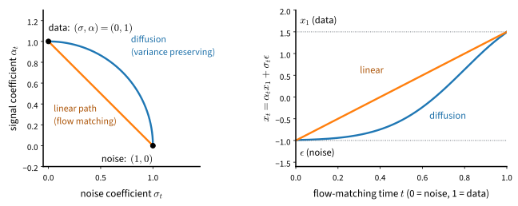
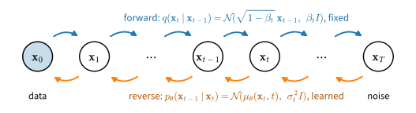
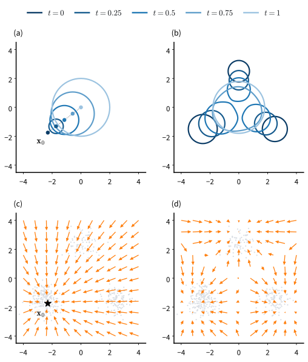

# Gaussian Paths: Diffusion and Flow Matching
:label:`sec_diffusion-gaussian-paths`

The previous section ended with a dilemma. At a small noise level a denoiser is accurate near the data, but Langevin chains driven by its score cannot cross the empty valleys between the modes and keep the mode weights they started with; at a large noise level the chains find the right weights but sample a blurred copy of the data. Suppose that one network denoised at every noise level, and that we walked from pure noise down to the data through all of them. How is such a walk defined, which regression trains the network, and how do we take the steps?

Underneath the three routes by which the literature reached the answer (:numref:`chap_diffusion`) is one object: a Gaussian path from the data at $t = 0$ to pure noise at $t = 1$, the posterior mean of the clean point along it, learned by one regression, and a sampler that integrates the differential equation this posterior mean defines.

Current image, video and audio generators are trained this way. We define the path, derive the regression and its equivalent targets, sample with and without noise, and check the learned models against the exact ones.

```{.python .input #gaussian-paths-gaussian-paths-diffusion-and-flow-matching}
%%tab pytorch
import math
import numpy as np
import torch
from torch import nn
from torch.nn import functional as F
from d2l import torch as d2l
```

```{.python .input #gaussian-paths-gaussian-paths-diffusion-and-flow-matching}
%%tab jax
import math
import numpy as np
import jax
from jax import numpy as jnp
from flax import nnx
import optax
from d2l import jax as d2l
```

```{.python .input #gaussian-paths-gaussian-paths-diffusion-and-flow-matching-1}
%%tab pytorch
torch.set_float32_matmul_precision('high')  # tf32 matmuls on tensor cores
```

## One Path from Data to Noise

A walk through all noise levels needs the levels indexed by a time, which this part defines and tests on the mixture.

### Signal, Noise and the Log-SNR Clock

We let the data shrink as the noise grows. A *Gaussian path* is a pair of functions $\alpha_t$ and $\sigma_t$ on $t \in [0, 1]$ that defines the noisy point

$$
\mathbf{x}_t = \alpha_t\, \mathbf{x}_0 + \sigma_t\, \boldsymbol{\epsilon},
\qquad \boldsymbol{\epsilon} \sim \mathcal{N}(\mathbf{0}, \mathbf{I}),
$$
:eqlabel:`eq_diffusion-gaussian-path`

with $(\alpha_0, \sigma_0) = (1, 0)$ and $(\alpha_1, \sigma_1) = (0, 1)$, or nearly so. The *variance-preserving* (VP) path keeps $\alpha_t^2 + \sigma_t^2 = 1$, so data of unit variance keep unit variance; it is the Ornstein--Uhlenbeck process of :numref:`sec_mdl-ornstein-uhlenbeck`. We write $\bar\alpha_t := \alpha_t^2$ and use the continuous form of the schedule of :citet:`ho2020denoising`, $\log \bar\alpha_t = -\big(\beta_{\min} t + (\beta_{\max} - \beta_{\min})\, t^2/2\big)$ with $\beta_{\min} = 0.1$ and $\beta_{\max} = 20$. The *linear* path of flow matching and rectified flow :cite:`Lipman.Chen.BenHamu.ea.2022,Liu.Gong.Liu.2022,Albergo.Boffi.VandenEijnden.2023` draws a straight line from the data to the noise,

$$
\alpha_t = 1 - t, \qquad \sigma_t = t.
$$
:eqlabel:`eq_diffusion-linear-path`

What a denoiser can infer from $\mathbf{x}_t$ depends only on the ratio of signal to noise, measured on a log scale as the *log-SNR* $\lambda_t = \log(\alpha_t^2 / \sigma_t^2)$. It falls monotonically from $+\infty$ at the data to $-\infty$ at the noise, a clock that all paths share: at times of equal $\lambda$, two paths hold the same noisy point up to a scale factor (:exref:`ex_gaussian-paths-same-ratio-same-flow`). The VP path reaches $\bar\alpha_1 = e^{-10.05} \approx 4 \cdot 10^{-5}$ at $t = 1$, close enough to pure noise (:numref:`fig_diffusion-paths`).

::: {.callout-important title="One clock"}
Data sit at $t = 0$ and noise at $t = 1$ throughout the book (:numref:`sec_mdl-flow-matching-transport`), and every sampler runs from $t = 1$ down to $0$. Flow-matching papers reverse time (:numref:`fig_mdl-dyn-time-conventions`): substitute $1 - t$ for their $t$, read their noise $\mathbf{x}_0$ as our $\boldsymbol\epsilon$ and their data $\mathbf{x}_1$ as our $\mathbf{x}_0$, and flip the sign of every velocity.
:::

![Two Gaussian paths on one clock. (a) The signal coefficient $\alpha_t$ (solid) and the noise coefficient $\sigma_t$ (dashed) of the variance-preserving path, with $\beta$ from $0.1$ to $20$, and of the linear path. (b) Their log-SNR $\lambda_t$, clipped to $[-10, 10]$. The variance-preserving path reaches the noisy regime much earlier.](../img/mdl-diffusion-paths.svg)
:label:`fig_diffusion-paths`

`GaussianPath` holds the two functions $\alpha_t$ and $\sigma_t$, the log-SNR and a draw of $\mathbf{x}_t$; `vp`, `linear` and `cosine` build the paths of this section.

```{.python .input #gaussian-paths-signal-noise-and-the-log-snr-clock}
%%tab pytorch
class GaussianPath:  #@save
    """x_t = alpha(t) x0 + sigma(t) eps, data at t = 0 and noise at t = 1."""
    def __init__(self, alpha, sigma):
        self.alpha, self.sigma = alpha, sigma

    @staticmethod
    def vp(beta_min=0.1, beta_max=20.0):
        """Variance preserving, Ho et al.'s linear beta in continuous time."""
        log_abar = lambda t: -(beta_min * t + (beta_max - beta_min) * t**2 / 2)
        return GaussianPath(lambda t: torch.exp(log_abar(t) / 2),
                            lambda t: torch.sqrt(-torch.expm1(log_abar(t))))

    @staticmethod
    def linear():
        """The straight line of flow matching and rectified flow."""
        return GaussianPath(lambda t: 1 - t, lambda t: t)

    @staticmethod
    def cosine(s=0.008):
        """Variance preserving, Nichol and Dhariwal's cosine schedule."""
        c = lambda t: torch.cos(math.pi / 2 * (t + s) / (1 + s))
        g = lambda t: c(t) / c(torch.zeros_like(t))   # exactly 1 at t = 0
        # and exactly 0 at t = 1 (cos(pi/2) is not), keeping the slope
        f = lambda t: torch.where(t < 1, g(t), g(t) - g(t).detach())
        return GaussianPath(f, lambda t: torch.sqrt(1 - f(t) ** 2))

    def log_snr(self, t):
        """lambda_t = log(alpha_t^2 / sigma_t^2), falling from +inf at 0."""
        return 2 * (torch.log(self.alpha(t)) - torch.log(self.sigma(t)))

    def sample(self, x0, t, eps):
        """x_t for per-example times t of shape (n,)."""
        t = t.reshape(-1, *[1] * (x0.dim() - 1))
        return self.alpha(t) * x0 + self.sigma(t) * eps
```

```{.python .input #gaussian-paths-signal-noise-and-the-log-snr-clock}
%%tab jax
class GaussianPath:  #@save
    """x_t = alpha(t) x0 + sigma(t) eps, data at t = 0 and noise at t = 1."""
    def __init__(self, alpha, sigma):
        self.alpha, self.sigma = alpha, sigma

    @staticmethod
    def vp(beta_min=0.1, beta_max=20.0):
        """Variance preserving, Ho et al.'s linear beta in continuous time."""
        log_abar = lambda t: -(beta_min * t + (beta_max - beta_min) * t**2 / 2)
        return GaussianPath(lambda t: jnp.exp(log_abar(t) / 2),
                            lambda t: jnp.sqrt(-jnp.expm1(log_abar(t))))

    @staticmethod
    def linear():
        """The straight line of flow matching and rectified flow."""
        return GaussianPath(lambda t: 1 - t, lambda t: t)

    @staticmethod
    def cosine(s=0.008):
        """Variance preserving, Nichol and Dhariwal's cosine schedule."""
        c = lambda t: jnp.cos(math.pi / 2 * (t + s) / (1 + s))
        g = lambda t: c(t) / c(jnp.zeros_like(t))     # exactly 1 at t = 0
        # and exactly 0 at t = 1 (cos(pi/2) is not), keeping the slope
        f = lambda t: jnp.where(t < 1, g(t),
                                g(t) - jax.lax.stop_gradient(g(t)))
        return GaussianPath(f, lambda t: jnp.sqrt(1 - f(t) ** 2))

    def log_snr(self, t):
        """lambda_t = log(alpha_t^2 / sigma_t^2), falling from +inf at 0."""
        return 2 * (jnp.log(self.alpha(t)) - jnp.log(self.sigma(t)))

    def sample(self, x0, t, eps):
        """x_t for per-example times t of shape (n,)."""
        t = t.reshape(-1, *[1] * (x0.ndim - 1))
        return self.alpha(t) * x0 + self.sigma(t) * eps
```

We print both coefficients and the log-SNR at three times.

```{.python .input #gaussian-paths-signal-noise-and-the-log-snr-clock-1}
%%tab pytorch
vp, linear = GaussianPath.vp(), GaussianPath.linear()
t = torch.tensor([0.1, 0.5, 0.9])
r2 = lambda v: [round(u, 2) for u in v.tolist()]
for name, path in (('vp', vp), ('linear', linear)):
    print(f'{name:>6}: alpha {r2(path.alpha(t))} sigma {r2(path.sigma(t))} '
          f'log-SNR {r2(path.log_snr(t))}')
```

```{.python .input #gaussian-paths-signal-noise-and-the-log-snr-clock-1}
%%tab jax
vp, linear = GaussianPath.vp(), GaussianPath.linear()
t = jnp.array([0.1, 0.5, 0.9])
r2 = lambda v: [round(float(u), 2) for u in v]
for name, path in (('vp', vp), ('linear', linear)):
    print(f'{name:>6}: alpha {r2(path.alpha(t))} sigma {r2(path.sigma(t))} '
          f'log-SNR {r2(path.log_snr(t))}')
```

Halfway along in time the VP path is already mostly noise, with $\bar\alpha = 0.079$ and $\lambda \approx -2.5$ against $\lambda = 0$ on the linear path, and at $t = 0.9$ it keeps less than two percent of the signal against ten percent.

### The Chain View

The forward process of :citet:`ho2020denoising` is a Markov chain of $T$ small steps, each shrinking the current point and adding a little noise,

$$
\mathbf{x}_k = \sqrt{1 - \beta_k}\, \mathbf{x}_{k-1} + \sqrt{\beta_k}\, \boldsymbol{\epsilon}_k,
\qquad k = 1, \ldots, T,
$$
:eqlabel:`eq_diffusion-forward`

with independent standard Gaussians $\boldsymbol\epsilon_k$ and a variance schedule $\beta_k \in (0, 1)$. Each step preserves unit variance, and because the noises are independent Gaussians, consecutive steps compose into one: the marginal of every step is a single draw,

$$
\mathbf{x}_k = \sqrt{\bar\alpha_k}\, \mathbf{x}_0 + \sqrt{1 - \bar\alpha_k}\, \boldsymbol{\epsilon},
\qquad \bar\alpha_k = \prod_{j=1}^{k} (1 - \beta_j),
$$
:eqlabel:`eq_diffusion-marginal`

which :numref:`sec_mdl-ddpm-discretized-sde` proves by induction. With $\beta_k = 1 - \bar\alpha_{t_k} / \bar\alpha_{t_{k-1}}$ the DDPM step is the exact transition of the VP path from $t_{k-1}$ to $t_k$, so the chain is the VP path read on the grid $t_k = k/T$. Training never simulates the chain, because any $\mathbf{x}_k$ is one Gaussian draw away from $\mathbf{x}_0$. :numref:`fig_diffusion-forward-reverse` shows the forward chain and the reverse chain that generation runs.


:label:`fig_diffusion-forward-reverse`

`grid` evaluates the path at even times from noise down to data, the grid every sampler steps along; a start time below 1 begins partway along the path.

```{.python .input #gaussian-paths-the-chain-view}
%%tab pytorch
@d2l.add_to_class(GaussianPath)  #@save
def grid(self, steps, t_start=1.0, t_end=0.0):
    """Lists of alpha and sigma at steps + 1 even times, t_start to t_end."""
    t = torch.linspace(t_start, t_end, steps + 1, dtype=torch.float64)
    return self.alpha(t).tolist(), self.sigma(t).tolist()
```

```{.python .input #gaussian-paths-the-chain-view}
%%tab jax
@d2l.add_to_class(GaussianPath)  #@save
def grid(self, steps, t_start=1.0, t_end=0.0):
    """Arrays of alpha and sigma at steps + 1 even times, t_start to t_end."""
    with jax.ensure_compile_time_eval():         # constants, even under jit
        t = jnp.linspace(t_start, t_end, steps + 1)
        return self.alpha(t), self.sigma(t)
```

Which schedule does our VP path define on a grid of $T = 1000$ steps? The grid lists the times from the noise end, so its first entries belong to the last step of the chain.

```{.python .input #gaussian-paths-the-chain-view-1}
%%tab pytorch, jax
a, _ = vp.grid(1000)
print(f'beta_1 = {1 - (a[-2] / a[-1]) ** 2:.1e}, '
      f'beta_T = {1 - (a[0] / a[1]) ** 2:.4f}, alpha_bar_T = {a[0] ** 2:.1e}')
```

The steps grow from about $10^{-4}$ at the data to $0.02$ at the noise, the linear schedule of :citet:`ho2020denoising`, and after a thousand steps only a factor $\sqrt{\bar\alpha_T} \approx 0.007$ of the data survives.

### Annealing through Noise Levels

Does a walk through many noise levels do what one level could not? Because the scores of the smoothed mixture are known exactly, we can test this before training any network. We run the Langevin sampler :eqref:`eq_diffusion-langevin` down a *ladder* of noise levels: ten levels $\tilde\sigma_i$ spaced evenly in log scale from $3$ down to $0.05$, each with $100$ steps of size $h_i = 0.1\, \tilde\sigma_i^2$ on the exact score of $p_{\tilde\sigma_i}$, starting where the previous level stopped. The control spends the same $1{,}000$ steps at the finest level, with the step size $h = 0.05$ of the previous section. Both start from the same $2{,}000$ points drawn from $\mathcal{N}(\mathbf{0}, 9\mathbf{I})$.

```{.python .input #gaussian-paths-annealing-through-noise-levels}
%%tab pytorch
torch.manual_seed(0)
device = d2l.try_gpu()
mix = d2l.GaussianMixture.three_modes(device)
x_init = 3 * torch.randn(2000, 2, device=device)
x = x_init
for s in torch.logspace(math.log10(3), math.log10(0.05), 10).tolist():
    x = d2l.langevin(lambda z: mix.score(z, 1.0, s), x, 0.1 * s ** 2, 100)
control = d2l.langevin(lambda z: mix.score(z, 1.0, 0.05), x_init, 0.05, 1000)
print('finest level only:', mix.summary(control))
print('ten levels:       ', mix.summary(x))
d2l.scatter_panels([control, x], ['finest level only', 'ten levels'],
                   data=mix.sample(2000));
```

```{.python .input #gaussian-paths-annealing-through-noise-levels}
%%tab jax
key = jax.random.key(0)
mix = d2l.GaussianMixture.three_modes()
key, k_init, k_ctrl, k_data = jax.random.split(key, 4)
x_init = 3 * jax.random.normal(k_init, (2000, 2))
x = x_init
for s in jnp.logspace(math.log10(3), math.log10(0.05), 10).tolist():
    key, k = jax.random.split(key)
    x = d2l.langevin(lambda z: mix.score(z, 1.0, s), x, 0.1 * s ** 2, 100, k)
control = d2l.langevin(lambda z: mix.score(z, 1.0, 0.05), x_init, 0.05, 1000,
                       k_ctrl)
print('finest level only:', mix.summary(control))
print('ten levels:       ', mix.summary(x))
d2l.scatter_panels([control, x], ['finest level only', 'ten levels'],
                   data=mix.sample(k_data, 2000));
```

The ladder lands within about $0.03$ of the weights $0.5/0.3/0.2$, with one to two percent of the points straying between the modes. The control has the right spread around each mode but keeps the weights of its starting points, about a third each. The proportions are decided at the coarse levels, where the smoothed density has no valleys; the fine levels only sharpen each mode. A diffusion model divides the work the same way along its path.

This *annealed Langevin dynamics* sampled the first generator of this kind :cite:`song2019generative`, one network that takes the noise level as input, trained by denoising score matching at every level of the ladder with weights $\tilde\sigma_i^2$ (:numref:`sec_mdl-score-based-generative-modeling`, :exref:`ex_mdl-score-matching-diffusion-flow-annealing`). Its levels, step sizes and step counts were designed by hand (:exref:`ex_gaussian-paths-ladder-spacing`). The path replaces the ladder by a continuum of levels, and a sampler that the path determines replaces the hand-tuned Langevin steps.

## One Regression

One network is to serve every point of the path. What should it learn at a noisy point, which regression teaches it, and how do the targets of the literature relate?

### Conditional Targets and Marginal Fields

The object to learn is again the posterior mean of the clean point, $\hat{\mathbf{x}}_0 = \mathbb{E}[\mathbf{x}_0 \mid \mathbf{x}_t]$, which gave the score by Tweedie's formula :eqref:`eq_diffusion-tweedie` and also tells a noisy point which way to move. It depends on the whole data distribution and is unknown, but its conditional version is trivial: given $\mathbf{x}_0$, the best guess of $\mathbf{x}_0$ is $\mathbf{x}_0$ itself.

The same holds for motion along the path. A single noisy point moves along $\mathbf{x}_t = \alpha_t \mathbf{x}_0 + \sigma_t \boldsymbol\epsilon$ with the *conditional velocity* $\dot{\mathbf{x}}_t = \dot\alpha_t \mathbf{x}_0 + \dot\sigma_t \boldsymbol\epsilon$, which on the linear path is $\boldsymbol\epsilon - \mathbf{x}_0$. The whole cloud of noisy points moves at $\mathbf{x}$ with the average velocity of the points that pass there,

$$
\mathbf{u}_t(\mathbf{x}) = \mathbb{E}\big[\dot\alpha_t\, \mathbf{x}_0 + \dot\sigma_t\, \boldsymbol\epsilon \,\big|\, \mathbf{x}_t = \mathbf{x}\big],
$$
:eqlabel:`eq_diffusion-marginal-velocity`

the *marginal velocity*. Where only one clean point can have produced $\mathbf{x}$, it is that point's velocity; where several can, it is their average, weighted by how likely each is.

A field defined as a conditional expectation is learned by regressing on the quantity inside it, because least squares recovers the conditional mean; this is how denoising score matching recovered the score. For the velocity it gives the *conditional flow matching* loss, which differs from the regression onto the unknown marginal field only by a constant $C$ that does not depend on the network:

$$
\mathbb{E}_{t,\, \mathbf{x}_0,\, \boldsymbol\epsilon}\, \big\| \mathbf{v}_{\boldsymbol\theta}(\mathbf{x}_t, t) - (\dot\alpha_t \mathbf{x}_0 + \dot\sigma_t \boldsymbol\epsilon) \big\|^2
= \mathbb{E}_{t,\, \mathbf{x}_t}\, \big\| \mathbf{v}_{\boldsymbol\theta}(\mathbf{x}_t, t) - \mathbf{u}_t(\mathbf{x}_t) \big\|^2 + C.
$$
:eqlabel:`eq_diffusion-cfm-loss`

The two sides have the same minimizer, so a network trained on the per-example velocity learns the marginal one (:numref:`sec_mdl-flow-matching`). :numref:`fig_diffusion-blueprint` shows both views.

![The conditional and the marginal views of the linear path on the mixture, computed exactly. (a) The conditional path of one clean point $\mathbf{x}_0$ from the heaviest mode: circles of radius $2\sigma_t$ around $\alpha_t\mathbf{x}_0$ at five times from $0$ to $1$. (b) The marginal path: contours of $p_t$ at the same times. (c) The conditional field $-(\mathbf{x} - \mathbf{x}_0)/t$ at $t = 0.5$, pointing toward that one point. (d) The marginal field $-\mathbf{u}_{0.5}(\mathbf{x})$, the posterior average of the conditional fields.](../img/mdl-diffusion-blueprint.svg)
:label:`fig_diffusion-blueprint`

`target` gives the per-example regression target of a kind on any path. For `'velocity'` it is the conditional velocity, with $\dot\alpha_t$ and $\dot\sigma_t$ from forward-mode differentiation (`rates`); `x0_eps` turns a prediction of any kind back into the pair $(\hat{\mathbf{x}}_0, \hat{\boldsymbol\epsilon})$.

```{.python .input #gaussian-paths-four-targets-one-oracle}
%%tab pytorch
@d2l.add_to_class(GaussianPath)  #@save
def rates(self, t):
    """The time derivatives (alpha'(t), sigma'(t)), by forward-mode AD."""
    ones = torch.ones_like(t)
    return (torch.func.jvp(self.alpha, (t,), (ones,))[1],
            torch.func.jvp(self.sigma, (t,), (ones,))[1])

@d2l.add_to_class(GaussianPath)  #@save
def target(self, kind, x0, eps, t):
    """The regression target of a kind: eps, x0, v, score or velocity."""
    t = t.reshape(-1, *[1] * (x0.dim() - 1))
    a, s = self.alpha(t), self.sigma(t)
    if kind == 'eps': return eps
    if kind == 'x0': return x0
    if kind == 'v': return a * eps - s * x0
    if kind == 'score': return -eps / s
    if kind != 'velocity': raise ValueError(f'unknown kind {kind!r}')
    da, ds = self.rates(t)                      # velocity = d x_t / dt
    return da * x0 + ds * eps

@d2l.add_to_class(GaussianPath)  #@save
def x0_eps(self, kind, out, x, t):
    """The (x0, eps) that a prediction `out` of a kind implies at (x, t)."""
    t = t.reshape(-1, *[1] * (x.dim() - 1))
    a, s = self.alpha(t), self.sigma(t)
    if kind == 'eps': return (x - s * out) / a, out
    if kind == 'x0': return out, (x - a * out) / s
    if kind == 'v': return ((a * x - s * out) / (a**2 + s**2),
                            (s * x + a * out) / (a**2 + s**2))
    if kind == 'score': return (x + s ** 2 * out) / a, -s * out
    if kind != 'velocity': raise ValueError(f'unknown kind {kind!r}')
    da, ds = self.rates(t)
    det = a * ds - s * da
    return (ds * x - s * out) / det, (a * out - da * x) / det
```

```{.python .input #gaussian-paths-four-targets-one-oracle}
%%tab jax
@d2l.add_to_class(GaussianPath)  #@save
def rates(self, t):
    """The time derivatives (alpha'(t), sigma'(t)), by forward-mode AD."""
    ones = jnp.ones_like(t)
    return (jax.jvp(self.alpha, (t,), (ones,))[1],
            jax.jvp(self.sigma, (t,), (ones,))[1])

@d2l.add_to_class(GaussianPath)  #@save
def target(self, kind, x0, eps, t):
    """The regression target of a kind: eps, x0, v, score or velocity."""
    t = t.reshape(-1, *[1] * (x0.ndim - 1))
    a, s = self.alpha(t), self.sigma(t)
    if kind == 'eps': return eps
    if kind == 'x0': return x0
    if kind == 'v': return a * eps - s * x0
    if kind == 'score': return -eps / s
    if kind != 'velocity': raise ValueError(f'unknown kind {kind!r}')
    da, ds = self.rates(t)                      # velocity = d x_t / dt
    return da * x0 + ds * eps

@d2l.add_to_class(GaussianPath)  #@save
def x0_eps(self, kind, out, x, t):
    """The (x0, eps) that a prediction `out` of a kind implies at (x, t)."""
    t = t.reshape(-1, *[1] * (x.ndim - 1))
    a, s = self.alpha(t), self.sigma(t)
    if kind == 'eps': return (x - s * out) / a, out
    if kind == 'x0': return out, (x - a * out) / s
    if kind == 'v': return ((a * x - s * out) / (a**2 + s**2),
                            (s * x + a * out) / (a**2 + s**2))
    if kind == 'score': return (x + s ** 2 * out) / a, -s * out
    if kind != 'velocity': raise ValueError(f'unknown kind {kind!r}')
    da, ds = self.rates(t)
    det = a * ds - s * da
    return (ds * x - s * out) / det, (a * out - da * x) / det
```

The method fits in one cell. Each step draws $512$ fresh points from the mixture and a time and a noise for each, and regresses `TimeMLP` onto the conditional velocity of the linear path, for $40{,}000$ Adam steps with a cosine-decayed learning rate; `train_regression` also returns a moving average of the weights with a half-life of $700$ steps.

```{.python .input #gaussian-paths-conditional-targets-and-marginal-fields}
%%tab pytorch
def regression_loss(path, kind):  #@save
    """Squared error of net(x_t, t) against the target of a kind, t ~ U(0, 1)."""
    def loss_fn(net, x0):
        t = torch.rand(len(x0), device=x0.device)
        eps = torch.randn_like(x0)
        error = net(path.sample(x0, t, eps), t) - path.target(kind, x0, eps, t)
        return (error ** 2).flatten(1).sum(1).mean()  # ||error||^2 per example
    return loss_fn

torch.manual_seed(1)
num_steps = 40_000
net_v, ema_v, losses_v = d2l.train_regression(
    d2l.TimeMLP(256, 3).to(device), regression_loss(linear, 'velocity'),
    lambda: mix.sample(512), num_steps, cosine=True, ema_half_life=700)
d2l.plot(torch.arange(100) * num_steps // 100,
         losses_v.reshape(100, -1).mean(1).cpu(), 'step', 'loss')
```

```{.python .input #gaussian-paths-conditional-targets-and-marginal-fields}
%%tab jax
def regression_loss(path, kind):  #@save
    """Squared error of net(x_t, t) against the target of a kind, t ~ U(0, 1)."""
    def loss_fn(net, x0, key):
        k_t, k_eps = jax.random.split(key)
        t = jax.random.uniform(k_t, (len(x0),))
        eps = jax.random.normal(k_eps, x0.shape)
        error = net(path.sample(x0, t, eps), t) - path.target(kind, x0, eps, t)
        return (error ** 2).reshape(len(x0), -1).sum(1).mean()  # per example
    return loss_fn

num_steps = 40_000
net_v, ema_v, losses_v = d2l.train_regression(
    d2l.TimeMLP(256, 3, rngs=nnx.Rngs(1)), regression_loss(linear, 'velocity'),
    lambda k: mix.sample(k, 512), num_steps, jax.random.key(1), cosine=True,
    ema_half_life=700)
d2l.plot(jnp.arange(100) * num_steps // 100,
         losses_v.reshape(100, -1).mean(1), 'step', 'loss')
```

Each point of the curve averages $400$ steps. The loss falls within a few thousand steps and levels off near $5$, far above zero; we will see that no network can do much better.

### Four Targets, One Oracle

The network above predicts a velocity; DDPM's predicts the noise, and others predict the clean point. At a fixed $\mathbf{x}_t$ these are not different quantities. Taking the posterior mean of :eqref:`eq_diffusion-gaussian-path` gives $\mathbf{x}_t = \alpha_t \hat{\mathbf{x}}_0 + \sigma_t \hat{\boldsymbol\epsilon}$, so $\hat{\boldsymbol\epsilon} = \mathbb{E}[\boldsymbol\epsilon \mid \mathbf{x}_t]$ and $\hat{\mathbf{x}}_0$ determine each other, and Tweedie's formula for the kernel $\mathcal{N}(\alpha_t \mathbf{x}_0, \sigma_t^2 \mathbf{I})$ gives the score, as in :eqref:`eq_diffusion-three-predictions`:

$$
\nabla \log p_t(\mathbf{x}_t) = \frac{\alpha_t \hat{\mathbf{x}}_0 - \mathbf{x}_t}{\sigma_t^2} = -\frac{\hat{\boldsymbol\epsilon}}{\sigma_t}.
$$
:eqlabel:`eq_diffusion-score-eps`

The marginal velocity :eqref:`eq_diffusion-marginal-velocity` is $\dot\alpha_t \hat{\mathbf{x}}_0 + \dot\sigma_t \hat{\boldsymbol\epsilon}$, and eliminating $\hat{\mathbf{x}}_0$ between it and the score gives the score–velocity identity

$$
\mathbf{u}_t(\mathbf{x}) = \frac{\dot\alpha_t}{\alpha_t}\, \mathbf{x} - \Big(\sigma_t \dot\sigma_t - \sigma_t^2 \frac{\dot\alpha_t}{\alpha_t}\Big) \nabla \log p_t(\mathbf{x}),
$$
:eqlabel:`eq_diffusion-score-velocity`

with multiples fixed by the path. On the linear path it reads

$$
\mathbf{u}_t(\mathbf{x}) = \hat{\boldsymbol\epsilon} - \hat{\mathbf{x}}_0 = -\frac{\mathbf{x} + t\, \nabla \log p_t(\mathbf{x})}{1 - t}.
$$
:eqlabel:`eq_diffusion-linear-dictionary`

A fifth target, $\mathbf{v} = \alpha_t \boldsymbol\epsilon - \sigma_t \mathbf{x}_0$, was introduced by :citet:`Salimans.Ho.2022` as *$v$-prediction*; on the cosine path $\alpha_t = \cos\frac{\pi t}{2}$, $\sigma_t = \sin\frac{\pi t}{2}$ it equals $2/\pi$ times the velocity. All of these are affine functions of one posterior mean, the *oracle* that a perfect network would learn, so a network trained on any of them defines all of them (:numref:`tab_mdl-score-noise-velocity` collects the conversions). The named models of the literature are choices of path and target (:numref:`tab_diffusion_models`).

DDPM's training loss, which :citet:`ho2020denoising` called the *simple loss*, is

$$
L_{\textrm{simple}}(\boldsymbol\theta) = \mathbb{E}_{t,\, \mathbf{x}_0,\, \boldsymbol\epsilon}\, \big\| \boldsymbol\epsilon - \boldsymbol\epsilon_{\boldsymbol\theta}(\alpha_t \mathbf{x}_0 + \sigma_t \boldsymbol\epsilon,\, t) \big\|^2 .
$$
:eqlabel:`eq_diffusion-simple-loss`

Since the conditional score of the kernel is $-\boldsymbol\epsilon/\sigma_t$, the simple loss is denoising score matching :eqref:`eq_diffusion-dsm` at every level, weighted by $\sigma_t^2$ (:numref:`sec_mdl-ddpm-discretized-sde`). Ho et al. derived it from a variational bound on the log-likelihood; with one particular weighting over $t$ the regression is such a bound (:numref:`sec_diffusion-design-space`).

`target` and `x0_eps` above implement these conversions. `make_pred` wraps a trained network as the pair $(\hat{\mathbf{x}}_0, \hat{\boldsymbol\epsilon})$ at any $(\alpha, \sigma)$, by querying it at the time of its own path with the same log-SNR, which `time_at` finds by bisection. An $\boldsymbol\epsilon$-predictor has no $\hat{\mathbf{x}}_0 = (\mathbf{x} - \sigma\hat{\boldsymbol\epsilon})/\alpha$ at pure noise, $\alpha = 0$, so samplers that start there on the linear and cosine paths need another kind; an $\boldsymbol\epsilon$-model samples on the VP path, whose $\alpha$ stays positive.

```{.python .input #gaussian-paths-four-targets-one-oracle-1}
%%tab pytorch
@d2l.add_to_class(GaussianPath)  #@save
def time_at(self, log_snr):
    """The time with a given log-SNR, by bisection (lambda_t falls in t)."""
    lo, hi = torch.zeros_like(log_snr), torch.ones_like(log_snr)
    for _ in range(50):
        mid = (lo + hi) / 2
        later = self.log_snr(mid) > log_snr      # the answer lies after mid
        lo, hi = torch.where(later, mid, lo), torch.where(later, hi, mid)
    return (lo + hi) / 2

def make_pred(net, path, kind):  #@save
    """pred(x, alpha, sigma) -> (x0, eps) from net(x, t) of a kind on path."""
    def pred(x, alpha, sigma):
        log_snr = 2 * math.log(alpha / sigma) if alpha > 0 else -math.inf
        t = path.time_at(torch.tensor(log_snr, dtype=torch.float64))
        x = x * (path.sigma(t).item() / sigma)  # the same point on our path
        t = torch.full((len(x),), t.item(), device=x.device)
        return path.x0_eps(kind, net(x, t), x, t)
    return pred
```

```{.python .input #gaussian-paths-four-targets-one-oracle-1}
%%tab jax
@d2l.add_to_class(GaussianPath)  #@save
def time_at(self, log_snr):
    """The time with a given log-SNR, by bisection (lambda_t falls in t)."""
    def halve(_, interval):
        lo, hi = interval
        mid = (lo + hi) / 2
        later = self.log_snr(mid) > log_snr      # the answer lies after mid
        return jnp.where(later, mid, lo), jnp.where(later, hi, mid)
    lo, hi = jax.lax.fori_loop(0, 50, halve, (jnp.zeros_like(log_snr),
                                              jnp.ones_like(log_snr)))
    return (lo + hi) / 2

def make_pred(net, path, kind):  #@save
    """pred(x, alpha, sigma) -> (x0, eps) from net(x, t) of a kind on path."""
    def pred(x, alpha, sigma):
        log_snr = jnp.where(alpha > 0, 2 * jnp.log(alpha / sigma), -jnp.inf)
        t = path.time_at(jnp.asarray(log_snr, jnp.float32))
        x = x * (path.sigma(t) / sigma)         # the same point on our path
        t = jnp.full((len(x),), t)
        return path.x0_eps(kind, net(x, t), x, t)
    return pred
```

The second model makes DDPM's choice, the noise target on the VP path, and changes nothing else.

```{.python .input #gaussian-paths-four-targets-one-oracle-2}
%%tab pytorch
torch.manual_seed(2)
net_eps, ema_eps, losses_eps = d2l.train_regression(
    d2l.TimeMLP(256, 3).to(device), regression_loss(vp, 'eps'),
    lambda: mix.sample(512), num_steps, cosine=True, ema_half_life=700)
```

```{.python .input #gaussian-paths-four-targets-one-oracle-2}
%%tab jax
net_eps, ema_eps, losses_eps = d2l.train_regression(
    d2l.TimeMLP(256, 3, rngs=nnx.Rngs(2)), regression_loss(vp, 'eps'),
    lambda k: mix.sample(k, 512), num_steps, jax.random.key(2), cosine=True,
    ema_half_life=700)
```

The two networks differ in path and target, but by the dictionary they should hold the same posterior mean, which the last part of the section checks.

### The Loss Floor

The velocity model's loss levelled off near $5$ for the reason of :numref:`sec_diffusion-denoising`: a target contains the noise of its own example, so even the oracle keeps the conditional variance of the target given $\mathbf{x}_t$, now averaged over the path. For the mixture this floor is exact. The function `oracle` takes $\hat{\mathbf{x}}_0$ from `GaussianMixture.posterior_mean` and $\hat{\boldsymbol\epsilon}$ from $\mathbf{x}_t = \alpha_t \hat{\mathbf{x}}_0 + \sigma_t \hat{\boldsymbol\epsilon}$; every target is the same affine function of them, and any sampler can use `oracle` in place of a network.

```{.python .input #gaussian-paths-the-loss-floor}
%%tab pytorch
def oracle(x, alpha, sigma):
    """The exact posterior means (x0_hat, eps_hat) of the mixture at x."""
    x0_hat = mix.posterior_mean(x, alpha, sigma)
    a, s = (torch.as_tensor(v, device=x.device).reshape(-1, 1)
            for v in (alpha, sigma))
    return x0_hat, (x - a * x0_hat) / s

def loss_floor(path, kind, x0, eps, t):
    """E||target - E[target | x_t]||^2 over the draws (x0, eps, t)."""
    x = path.sample(x0, t, eps)
    best = path.target(kind, *oracle(x, path.alpha(t), path.sigma(t)), t)
    return ((path.target(kind, x0, eps, t) - best) ** 2).sum(1).mean().item()

n = 1_000_000
x0, eps = mix.sample(n), torch.randn(n, 2, device=device)
times = [torch.full((n,), t, device=device) for t in (0.1, 0.5, 0.9)]
times.append(torch.rand(n, device=device))             # t ~ U(0, 1)
print('target, path      t=0.1  t=0.5  t=0.9  t~U(0,1)  trained')
for name, path, kind, losses in (('noise, vp', vp, 'eps', losses_eps),
        ('velocity, linear', linear, 'velocity', losses_v)):
    floors = [loss_floor(path, kind, x0, eps, t) for t in times]
    print(f'{name:16}' + ''.join(f'{f:7.3f}' for f in floors[:3])
          + f'{floors[3]:10.3f}{losses[-1000:].mean().item():9.3f}')
```

```{.python .input #gaussian-paths-the-loss-floor}
%%tab jax
def oracle(x, alpha, sigma):
    """The exact posterior means (x0_hat, eps_hat) of the mixture at x."""
    x0_hat = mix.posterior_mean(x, alpha, sigma)
    a, s = (jnp.reshape(jnp.asarray(v), (-1, 1)) for v in (alpha, sigma))
    return x0_hat, (x - a * x0_hat) / s

def loss_floor(path, kind, x0, eps, t):
    """E||target - E[target | x_t]||^2 over the draws (x0, eps, t)."""
    x = path.sample(x0, t, eps)
    best = path.target(kind, *oracle(x, path.alpha(t), path.sigma(t)), t)
    return float(((path.target(kind, x0, eps, t) - best) ** 2).sum(1).mean())

n = 1_000_000
key, k_x0, k_eps, k_t = jax.random.split(key, 4)
x0, eps = mix.sample(k_x0, n), jax.random.normal(k_eps, (n, 2))
times = [jnp.full((n,), t) for t in (0.1, 0.5, 0.9)]
times.append(jax.random.uniform(k_t, (n,)))            # t ~ U(0, 1)
print('target, path      t=0.1  t=0.5  t=0.9  t~U(0,1)  trained')
for name, path, kind, losses in (('noise, vp', vp, 'eps', losses_eps),
        ('velocity, linear', linear, 'velocity', losses_v)):
    floors = [loss_floor(path, kind, x0, eps, t) for t in times]
    print(f'{name:16}' + ''.join(f'{f:7.3f}' for f in floors[:3])
          + f'{floors[3]:10.3f}{float(losses[-1000:].mean()):9.3f}')
```

Each training loss sits at its floor. The floors differ by an order of magnitude, about $0.5$ for the noise and about $5$ for the velocity, because the targets are scaled differently. The noise floor is largest near the data, where noise and the spread of a mode look alike; the velocity floor, $\mathrm{Var}(\mathbf{x}_0 \mid \mathbf{x}_t)/t^2$ summed over coordinates, grows toward the noise end, where the clean point is hardest to guess. A score target would divide the noise floor by $\sigma_t^2$, without bound near the data (:exref:`ex_mdl-score-matching-diffusion-flow-bayes-risk-floor`). Losses of different targets cannot be compared; predictors trained on different targets can, through the dictionary.

## Sampling by Integration

The marginal velocity carries the noise distribution to the data distribution, so we sample by following it, along deterministic trajectories or with fresh noise at every step.

### The Probability-Flow ODE and Euler's Method

The pair $(p_t, \mathbf{u}_t)$ satisfies the continuity equation (:numref:`sec_mdl-flow-matching`): the marginal velocity moves the density $p_t$ of $\mathbf{x}_t$ along the path. A point drawn from $p_1 = \mathcal{N}(\mathbf{0}, \mathbf{I})$ and carried backward in time by the ordinary differential equation

$$
\frac{d\mathbf{x}}{dt} = \mathbf{u}_t(\mathbf{x}), \qquad \textrm{from } t = 1 \textrm{ down to } t = 0,
$$
:eqlabel:`eq_diffusion-flow-ode`

is therefore a draw from $p_t$ at every time, and from the data at $t = 0$. This *probability-flow ODE* is the deterministic twin of the diffusion process (:numref:`sec_mdl-probability-flow-ode`). We build it up from the smallest case, as :citet:`Nakkiran.Bradley.Zhou.ea.2025` do.

Let the data be one point $\mathbf{x}_0$. On the linear path a point at $\mathbf{x}$ carries the noise $\boldsymbol\epsilon = (\mathbf{x} - (1 - t)\mathbf{x}_0)/t$ and moves with velocity $\boldsymbol\epsilon - \mathbf{x}_0 = (\mathbf{x} - \mathbf{x}_0)/t$. Every trajectory is a straight line into $\mathbf{x}_0$, and a single step of length one from $t = 1$, $\mathbf{x} \leftarrow \mathbf{x} - \mathbf{u}_1(\mathbf{x}) = \mathbf{x}_0$, is exact. With two data points the field is the posterior-weighted average of two such straight fields, and the trajectories bend where the posterior switches from one point to the other (:numref:`subsec_mdl-fm-two-point`).

Any distribution is a mixture of point masses, with straight conditional paths and a curved marginal flow. At $t = 1$ the point is pure noise, so the posterior equals the prior and $\mathbf{u}_1(\mathbf{x}) = \mathbf{x} - \mathbb{E}[\mathbf{x}_0]$: one step of length one sends every start to the mean of the data (:numref:`sec_mdl-ddim-guidance`). For our mixture that mean is $(-0.5, -0.7)$, between the modes, where no data lie.

Euler's method (:numref:`sec_mdl-euler-runge-kutta`) follows the curve in $K$ straight steps, $\mathbf{x} \leftarrow \mathbf{x} - \mathbf{u}_t(\mathbf{x})/K$ at $t = 1, 1 - 1/K, \ldots, 1/K$. We run it with the learned field from $2{,}000$ standard Gaussian starts.

```{.python .input #gaussian-paths-the-probability-flow-ode-and-euler-s-method}
%%tab pytorch
@torch.no_grad()
def euler(net, x, steps):
    """Euler's method on dx/dt = net(x, t), from t = 1 down to t = 0."""
    for k in range(steps, 0, -1):
        x = x - net(x, torch.full((len(x),), k / steps, device=x.device)) / steps
    return x

torch.manual_seed(3)
x_T = torch.randn(2000, 2, device=device)
print(mix.summary(euler(ema_v, x_T, 100)))
```

```{.python .input #gaussian-paths-the-probability-flow-ode-and-euler-s-method}
%%tab jax
def euler(net, x, steps):
    """Euler's method on dx/dt = net(x, t), from t = 1 down to t = 0."""
    for k in range(steps, 0, -1):
        x = x - net(x, jnp.full((len(x),), k / steps)) / steps
    return x

key, k_T = jax.random.split(key)
x_T = jax.random.normal(k_T, (2000, 2))
print(mix.summary(euler(ema_v, x_T, 100)))
```

A hundred steps put the samples on the three modes. The library's sampler takes the same steps in other coordinates: along every Gaussian path, $\bar{\mathbf{x}} = \mathbf{x}/\alpha_t$ and the noise-to-signal ratio $\bar\sigma = \sigma_t/\alpha_t$ obey $d\bar{\mathbf{x}}/d\bar\sigma = \hat{\boldsymbol\epsilon}$ :cite:`Karras.Aittala.Aila.ea.2022`, a form that serves every path and predictor.

`ode_sample` takes Euler steps of this equation through a list of levels $\bar\sigma$, here the path's grid in $t$ from `sigma_bars`; second-order steps and other grids wait for :numref:`sec_diffusion-samplers`.

```{.python .input #samplers-second-order-and-the-step-grid}
%%tab pytorch
@d2l.add_to_class(GaussianPath)  #@save
def sigma_bars(self, steps):
    """sigma_bar = sigma / alpha on the grid of steps; inf where alpha = 0."""
    a, s = self.grid(steps)
    return [s_k / a_k if a_k > 0 else math.inf for a_k, s_k in zip(a, s)]

def pred_bar(pred, xb, r):  #@save
    """pred at x = alpha x_bar for sigma_bar = r; at r = inf, x_bar is noise."""
    if math.isinf(r):
        return pred(xb, 0.0, 1.0)
    a = 1 / math.sqrt(1 + r ** 2)
    return pred(xb * a, a, r * a)

@torch.no_grad()  #@save
def ode_sample(pred, x, sigma_bars):
    """Euler (= DDIM) on d x_bar / d sigma_bar = eps, from x to data; x is the
    noisy point at the first level, unit-variance scale (noise if inf)."""
    r0 = sigma_bars[0]
    xb = x if math.isinf(r0) else x * math.sqrt(1 + r0 ** 2)  # x / alpha
    for r_t, r_s in zip(sigma_bars[:-1], sigma_bars[1:]):
        x0, eps = pred_bar(pred, xb, r_t)
        xb = x0 + r_s * eps                    # the Euler (= DDIM) step
    return xb
```

```{.python .input #samplers-second-order-and-the-step-grid}
%%tab jax
@d2l.add_to_class(GaussianPath)  #@save
def sigma_bars(self, steps):
    """sigma_bar = sigma / alpha on the grid of steps; inf where alpha = 0."""
    a, s = self.grid(steps)
    with jax.ensure_compile_time_eval():         # constants, even under jit
        return s / a

def pred_bar(pred, xb, r):  #@save
    """pred at x = alpha x_bar for sigma_bar = r; at r = inf, x_bar is noise."""
    finite = jnp.isfinite(r)
    a = jnp.where(finite, 1 / jnp.sqrt(1 + r ** 2), 0.0)
    return pred(xb * jnp.where(finite, a, 1.0), a,
                jnp.where(finite, r * a, 1.0))

def ode_sample(pred, x, sigma_bars):  #@save
    """Euler (= DDIM) on d x_bar / d sigma_bar = eps, from x to data; x is the
    noisy point at the first level, unit-variance scale (noise if inf)."""
    with jax.ensure_compile_time_eval():         # the grid is a constant
        r = jnp.asarray(sigma_bars)
        from_inf = bool(jnp.isinf(r[0]))
    def step(xb, r):
        r_t, r_s = r
        x0, eps = pred_bar(pred, xb, r_t)
        return x0 + r_s * eps, None              # the Euler (= DDIM) step
    xb = x if from_inf else x * jnp.sqrt(1 + r[0] ** 2)  # x / alpha
    return jax.lax.scan(step, xb, (r[:-1], r[1:]))[0]
```

How many steps does the flow need? We integrate the wrapped velocity network from the same starts with one, ten and a hundred steps, and check that a hundred steps of `ode_sample` reproduce the loop above.

```{.python .input #gaussian-paths-the-probability-flow-ode-and-euler-s-method-1}
%%tab pytorch
pred_v = make_pred(ema_v, linear, 'velocity')
samples = [ode_sample(pred_v, x_T, linear.sigma_bars(steps))
           for steps in (1, 10, 100)]
print('one step: mean', [round(v, 3) for v in samples[0].mean(0).tolist()],
      'std', [round(v, 3) for v in samples[0].std(0).tolist()])
for steps, x in zip((10, 100), samples[1:]):
    print(f'{steps} steps:', mix.summary(x))
print('largest difference to the loop:',
      (samples[2] - euler(ema_v, x_T, 100)).abs().max().item())
d2l.scatter_panels(samples, ['1 step', '10 steps', '100 steps'],
                   data=mix.sample(2000));
```

```{.python .input #gaussian-paths-the-probability-flow-ode-and-euler-s-method-1}
%%tab jax
pred_v = make_pred(ema_v, linear, 'velocity')
samples = [ode_sample(pred_v, x_T, linear.sigma_bars(steps))
           for steps in (1, 10, 100)]
print('one step: mean', [round(v, 3) for v in samples[0].mean(0).tolist()],
      'std', [round(v, 3) for v in samples[0].std(0).tolist()])
for steps, x in zip((10, 100), samples[1:]):
    print(f'{steps} steps:', mix.summary(x))
print('largest difference to the loop:',
      float(jnp.abs(samples[2] - euler(ema_v, x_T, 100)).max()))
key, k_data = jax.random.split(key)
d2l.scatter_panels(samples, ['1 step', '10 steps', '100 steps'],
                   data=mix.sample(k_data, 2000));
```

One step lands every start on the data mean $(-0.5, -0.7)$, with almost no spread, as the point-mass argument predicts. Ten steps recover the three modes with weights within about $0.03$ of the targets, but about three percent of the samples stray between the modes. A hundred steps bring the strays down to about one percent, and the library's sampler agrees with the loop to within $10^{-3}$. The extra steps follow the curvature of the marginal flow.

### The Reverse SDE and the Ancestral Chain

DDPM runs the reverse chain of :numref:`fig_diffusion-forward-reverse` instead, one stochastic step at a time. The reversal of a small forward step is nearly Gaussian :cite:`sohl2015deep`, and given the clean point it is exactly Gaussian: for $s < t$, $q(\mathbf{x}_s \mid \mathbf{x}_t, \mathbf{x}_0)$ has a mean linear in $\mathbf{x}_t$ and $\mathbf{x}_0$. Ho et al.'s *ancestral* step replaces $\mathbf{x}_0$ by $\hat{\mathbf{x}}_0$ in that mean and adds fresh noise with the variance $\beta = 1 - \bar\alpha_t / \bar\alpha_s$ of the forward step. On the VP path, written with the score, it reads

$$
\mathbf{x}_s = \frac{\mathbf{x}_t + \beta\, \nabla \log p_t(\mathbf{x}_t)}{\sqrt{1 - \beta}} + \sqrt{\beta}\, \mathbf{z},
\qquad \mathbf{z} \sim \mathcal{N}(\mathbf{0}, \mathbf{I}).
$$
:eqlabel:`eq_diffusion-ancestral-score`

With $1/\sqrt{1 - \beta} \approx 1 + \beta/2$, the step splits to first order into two:

$$
\mathbf{x}_s \approx \Big[ \mathbf{x}_t + \tfrac{\beta}{2} \nabla \log p_t(\mathbf{x}_t) + \sqrt{\beta}\, \mathbf{z} \Big] + \tfrac{\beta}{2} \big( \mathbf{x}_t + \nabla \log p_t(\mathbf{x}_t) \big).
$$

The bracket is a Langevin step of size $h = \beta$, which leaves $p_t$ in place and pulls stray points back toward it, and the second term is one Euler step of the probability-flow ODE from $t$ back to $s$, since on the VP path $\mathbf{u}_t = -\tfrac12 \beta(t)\, (\mathbf{x} + \nabla \log p_t)$ and $\beta \approx \beta(t)\, (t - s)$.

In continuous time the reversal is exact, by a theorem of :citet:`Anderson.1982`. A forward process $d\mathbf{x} = \mathbf{f}\, dt + g\, d\mathbf{W}$ is reversed, from $t = 1$ down to $0$, by

$$
d\mathbf{x} = \big[ \mathbf{f} - g^2 \nabla \log p_t(\mathbf{x}) \big]\, dt + g\, d\bar{\mathbf{W}},
\qquad\textrm{which has the same marginals as}\qquad
\frac{d\mathbf{x}}{dt} = \mathbf{f} - \tfrac12 g^2 \nabla \log p_t(\mathbf{x}),
$$
:eqlabel:`eq_diffusion-reverse`

where $\bar{\mathbf{W}}$ is a Brownian motion run backward. For the VP path, $\mathbf{f} = -\tfrac12 \beta(t)\mathbf{x}$ and $g^2 = \beta(t)$, the right-hand ODE is the flow we just integrated, and the ancestral step is, to first order, the Euler--Maruyama step (:numref:`sec_mdl-euler-maruyama`) of the SDE. Between the two lies a family of samplers with the same marginals: the more noise a sampler injects, the larger the score correction in its drift (:numref:`sec_mdl-time-reversal`, :numref:`fig_mdl-dyn-lambda-family`).

`ancestral_sample` takes this step on any path with any predictor `pred(x, alpha, sigma) -> (x0, eps)`, with the noise variance $\sigma_t^2 - (\alpha_t/\alpha_s)^2 \sigma_s^2$ of the forward step from $s$ to $t$.

```{.python .input #gaussian-paths-the-reverse-sde-and-the-ancestral-chain}
%%tab pytorch
@torch.no_grad()  #@save
def ancestral_sample(pred, x, path, steps, *, t_start=1.0):
    """Ho et al.'s sampler from x at t_start (1 is noise) to data at t = 0."""
    a, s = path.grid(steps, t_start)
    for i in range(steps):
        x0, eps = pred(x, a[i], s[i])
        ratio = s[i + 1] * a[i] / (a[i + 1] * s[i])
        x = a[i + 1] * x0 + s[i + 1] * ratio * eps      # the posterior mean
        if s[i + 1] > 0:                                # no noise at t = 0
            var = s[i] ** 2 - (a[i] / a[i + 1] * s[i + 1]) ** 2  # forward step
            x = x + math.sqrt(var) * torch.randn_like(x)
    return x
```

```{.python .input #gaussian-paths-the-reverse-sde-and-the-ancestral-chain}
%%tab jax
def ancestral_sample(pred, x, path, steps, key, *, t_start=1.0):  #@save
    """Ho et al.'s sampler from x at t_start (1 is noise) to data at t = 0."""
    a, s = path.grid(steps, t_start)
    a_t, s_t, a_s, s_s = a[:-1], s[:-1], a[1:], s[1:]
    ratio = s_s * a_t / (a_s * s_t)
    var = jnp.maximum(s_t ** 2 - (a_t / a_s * s_s) ** 2, 0)  # forward step
    noise = jnp.where(s_s > 0, jnp.sqrt(var), 0)             # none at t = 0
    def step(x, inputs):
        a_t, s_t, a_s, c_eps, c_noise, key = inputs
        x0, eps = pred(x, a_t, s_t)
        x = a_s * x0 + c_eps * eps                      # the posterior mean
        return x + c_noise * jax.random.normal(key, x.shape), None
    return jax.lax.scan(step, x, (a_t, s_t, a_s, s_s * ratio, noise,
                                  jax.random.split(key, steps)))[0]
```

We run two hundred steps of the chain with the noise model, from the same $2{,}000$ starts as the flow.

```{.python .input #gaussian-paths-the-reverse-sde-and-the-ancestral-chain-1}
%%tab pytorch
pred_eps = make_pred(ema_eps, vp, 'eps')
print(mix.summary(ancestral_sample(pred_eps, x_T, vp, 200)))
```

```{.python .input #gaussian-paths-the-reverse-sde-and-the-ancestral-chain-1}
%%tab jax
pred_eps = make_pred(ema_eps, vp, 'eps')
key, k_anc = jax.random.split(key)
print(mix.summary(ancestral_sample(pred_eps, x_T, vp, 200, k_anc)))
```

The chain recovers the three modes with the right weights, up to the sampling error of $2{,}000$ points, and about as few strays as the flow at a hundred steps; :citet:`ho2020denoising` ran a thousand steps, but in two dimensions two hundred suffice. Either sampler can use either network through `make_pred`.

## Experiments on the Running Example

Neither network ever saw the exact posterior. We compare each with the oracle in its predictions, its samples, and through the dictionary.

### The Learned Predictor against the Optimal One

The loss of any predictor splits into the floor and a gap that training can still reduce, $\mathbb{E}\|\boldsymbol\epsilon - \hat{\boldsymbol\epsilon}_{\boldsymbol\theta}\|^2 = \mathbb{E}\|\boldsymbol\epsilon - \boldsymbol\epsilon^\star\|^2 + \mathbb{E}\|\hat{\boldsymbol\epsilon}_{\boldsymbol\theta} - \boldsymbol\epsilon^\star\|^2$, with $\boldsymbol\epsilon^\star$ the oracle's noise prediction. We evaluate all three for the noise model on $20{,}000$ fresh points at four times of the VP path.

```{.python .input #gaussian-paths-the-learned-predictor-against-the-optimal-one}
%%tab pytorch
def sq(u, w):
    """Mean squared distance between two batches of points."""
    return ((u - w) ** 2).sum(1).mean().item()

torch.manual_seed(4)
x0, eps = mix.sample(20_000), torch.randn(20_000, 2, device=device)
print('   t     gap   floor    loss')
with torch.no_grad():
    for t in (0.1, 0.3, 0.5, 0.7):
        tt = torch.full((len(x0),), t, device=device)
        x = vp.sample(x0, tt, eps)
        eps_hat = ema_eps(x, tt)
        eps_star = oracle(x, vp.alpha(tt), vp.sigma(tt))[1]
        print(f'{t:4} {sq(eps_hat, eps_star):7.4f} {sq(eps, eps_star):7.4f}'
              f' {sq(eps, eps_hat):7.4f}')
```

```{.python .input #gaussian-paths-the-learned-predictor-against-the-optimal-one}
%%tab jax
def sq(u, w):
    """Mean squared distance between two batches of points."""
    return float(((u - w) ** 2).sum(1).mean())

key, k_x0, k_eps = jax.random.split(key, 3)
x0, eps = mix.sample(k_x0, 20_000), jax.random.normal(k_eps, (20_000, 2))
print('   t     gap   floor    loss')
for t in (0.1, 0.3, 0.5, 0.7):
    tt = jnp.full((len(x0),), t)
    x = vp.sample(x0, tt, eps)
    eps_hat = ema_eps(x, tt)
    eps_star = oracle(x, vp.alpha(tt), vp.sigma(tt))[1]
    print(f'{t:4} {sq(eps_hat, eps_star):7.4f} {sq(eps, eps_star):7.4f}'
          f' {sq(eps, eps_hat):7.4f}')
```

The loss column equals the floor plus the gap, to within the Monte Carlo error. The gap is below a thousandth at every time, on a target with unit variance per coordinate, and small next to the floor at every printed time: the network is close to the oracle wherever the data put their mass.

### Samples from Both Samplers

A sampler accumulates the errors of all its steps. We draw $20{,}000$ samples with two hundred ancestral steps of the noise model and a hundred Euler steps of the velocity model, and repeat both with the oracle in place of the network. At this sample size a mode weight carries a standard error of about $0.0035$.

```{.python .input #gaussian-paths-samples-from-both-samplers}
%%tab pytorch
torch.manual_seed(5)
x_T = torch.randn(20_000, 2, device=device)
runs = {'data': mix.sample(20_000),
        'ancestral, network': ancestral_sample(pred_eps, x_T, vp, 200),
        'ancestral, oracle': ancestral_sample(oracle, x_T, vp, 200),
        'Euler, network': ode_sample(pred_v, x_T, linear.sigma_bars(100)),
        'Euler, oracle': ode_sample(oracle, x_T, linear.sigma_bars(100))}
for name, x in runs.items():
    print(f'{name:>18}:', mix.summary(x))
d2l.scatter_panels([runs[k][:2000] for k in runs],
                   list(runs), lim=4.5, size=2.4);
```

```{.python .input #gaussian-paths-samples-from-both-samplers}
%%tab jax
key, k_T, k_data, k_net, k_oracle = jax.random.split(key, 5)
x_T = jax.random.normal(k_T, (20_000, 2))
runs = {'data': mix.sample(k_data, 20_000),
        'ancestral, network': ancestral_sample(pred_eps, x_T, vp, 200, k_net),
        'ancestral, oracle': ancestral_sample(oracle, x_T, vp, 200, k_oracle),
        'Euler, network': ode_sample(pred_v, x_T, linear.sigma_bars(100)),
        'Euler, oracle': ode_sample(oracle, x_T, linear.sigma_bars(100))}
for name, x in runs.items():
    print(f'{name:>18}:', mix.summary(x))
d2l.scatter_panels([runs[k][:2000] for k in runs],
                   list(runs), lim=4.5, size=2.4);
```

The ancestral chain with the network recovers the weights $0.5/0.3/0.2$ within sampling error, and Euler with the network matches them to within about $0.01$. Every sampler, network or oracle, strays about as often as the data themselves, about one percent, the share of a Gaussian beyond three standard deviations. Both samplers recover the mode weights, which no single noise level could.

### The Dictionary Checked

If both networks learned the posterior mean, each should match the linear-path velocity that :eqref:`eq_diffusion-linear-dictionary` computes from the exact score of $p_t$ (`mix.score` with $\alpha = 1 - t$ and $\sigma = t$). For the noise model, `make_pred` returns $(\hat{\mathbf{x}}_0, \hat{\boldsymbol\epsilon})$, whose difference is the linear-path velocity. We stop at $t = 0.95$, because a noise model has no clean-point estimate at $\alpha = 0$.

```{.python .input #gaussian-paths-the-dictionary-checked}
%%tab pytorch
print('   t  E|u|^2  velocity net  noise net')
with torch.no_grad():
    for t in (0.2, 0.5, 0.8, 0.95):
        tt = torch.full((len(x0),), t, device=device)
        x = linear.sample(x0, tt, eps)
        u = -(x + t * mix.score(x, 1 - t, t)) / (1 - t)  # from the score
        x0_hat, eps_hat = pred_eps(x, 1 - t, t)
        print(f'{t:4} {sq(u, 0):7.2f} {sq(ema_v(x, tt), u):13.4f}'
              f' {sq(eps_hat - x0_hat, u):10.4f}')
```

```{.python .input #gaussian-paths-the-dictionary-checked}
%%tab jax
print('   t  E|u|^2  velocity net  noise net')
for t in (0.2, 0.5, 0.8, 0.95):
    tt = jnp.full((len(x0),), t)
    x = linear.sample(x0, tt, eps)
    u = -(x + t * mix.score(x, 1 - t, t)) / (1 - t)  # from the score
    x0_hat, eps_hat = pred_eps(x, 1 - t, t)
    print(f'{t:4} {sq(u, 0):7.2f} {sq(ema_v(x, tt), u):13.4f}'
          f' {sq(eps_hat - x0_hat, u):10.4f}')
```

The velocity network differs from the field computed from the score by less than a quarter of a percent of the field's mean squared norm, which ranges from about $8$ at $t = 0.2$ to about $1$ at $t = 0.8$. The noise network, converted through two paths and a change of time, stays within about one percent, with its largest error at $t = 0.95$, where the conversion divides by a small $\alpha$. No score was learned, and no velocity appears in the noise model's loss.

## Summary

A Gaussian path connects the data to noise through every noise level, and a walk down it settles the mode weights at coarse levels and the details at fine ones. One regression onto per-example targets trains one network along the whole path, because least squares recovers the posterior mean; the score, noise, clean point, $v$ and velocity are affine functions of it, and the models of the literature differ only in path, target and sampler (:numref:`tab_diffusion_models`). Samples come from the probability-flow ODE or the ancestral chain. On the mixture both learned models sit at their loss floors, agree through the dictionary, and recover the mode weights.

:The models of this chapter: the target and path that train the network, and the sampler that produces data.
:label:`tab_diffusion_models`

| model | target and path | sampler | where |
|:--|:--|:--|:--|
| denoising score model | the noise, at one level | Langevin dynamics | :numref:`sec_diffusion-denoising` |
| noise-conditional score network | the noise at each level of a ladder, weighted by $\tilde\sigma^2$ | annealed Langevin dynamics | here, :exref:`ex_gaussian-paths-ncsn` |
| DDPM | $\boldsymbol\epsilon$ on the VP path | the ancestral chain or the probability-flow ODE | here, :numref:`sec_diffusion-images` |
| flow matching, rectified flow | $\boldsymbol\epsilon - \mathbf{x}_0$ on the linear path | Euler steps on the probability-flow ODE | here, :numref:`sec_diffusion-samplers` |
| $v$-prediction | $\mathbf{v}$ on the cosine path | either, through the dictionary | :numref:`sec_diffusion-design-space` |
| masked diffusion | the clean tokens of a partly masked sequence, by a weighted cross-entropy | iterative unmasking | :numref:`sec_diffusion-discrete` |

Nothing in this section used the fact that $\mathbf{x}$ had two coordinates. An image has thousands, and its pixels are strongly correlated; the next question is what network, and what changes to training and sampling, a path through image space needs.

## Exercises

1. **The marginal of the linear path.** The linear path :eqref:`eq_diffusion-linear-path` joins a draw $\mathbf{x}_0$ of the mixture, with weights $\pi_k$, means $\boldsymbol\mu_k$ and standard deviation $s = 0.5$ per coordinate, to independent noise $\boldsymbol\epsilon$.
    1. Show that $p_t$ is the mixture with weights $\pi_k$, means $(1 - t)\boldsymbol\mu_k$ and per-coordinate variance $(1 - t)^2 s^2 + t^2$. Derive :eqref:`eq_diffusion-linear-dictionary` from :eqref:`eq_diffusion-score-velocity`.
    1. Show from :eqref:`eq_diffusion-marginal-velocity` that $\mathbf{u}_t(\mathbf{x}) \to \mathbf{x} - \mathbb{E}[\mathbf{x}_0]$ as $t \to 1$, and conclude where one Euler step from $t = 1$ to $t = 0$ sends every start.
    1. With two Euler steps the first ends at $t = 1/2$. Show that it maps $\mathcal{N}(\mathbf{0}, \mathbf{I})$ to $\mathcal{N}(\mathbb{E}[\mathbf{x}_0]/2, \mathbf{I}/4)$, and compare the center and the width of this cloud with those of $p_{1/2}$. Which mode should the two-step samples overweight, and why?
   :exlabel:`ex_gaussian-paths-linear-marginal`
1. **Velocity, noise and clean-point targets.** On the linear path, take the posterior mean of $\mathbf{x}_t = (1 - t)\mathbf{x}_0 + t\boldsymbol\epsilon$.
    1. Show that the marginal velocity equals both $(\mathbf{x} - \hat{\mathbf{x}}_0)/t$ and $(\hat{\boldsymbol\epsilon} - \mathbf{x})/(1 - t)$.
    1. By the first part, an error in $\hat{\mathbf{x}}_0$ reaches the velocity divided by $t$, and an error in $\hat{\boldsymbol\epsilon}$ divided by $1 - t$. Near which end of the path is each prediction a poor source of the velocity, and how does this explain why a noise model is never queried at $\alpha = 0$? (:exref:`ex_mdl-flow-matching-transport-target-conditioning` works out the propagation of errors between all targets on the cosine path.)
    1. Show that the velocity loss of $\mathbf{v}_{\boldsymbol\theta} = (\mathbf{x} - \hat{\mathbf{x}}_{0,\boldsymbol\theta})/t$ equals the clean-point loss $\mathbb{E}\|\hat{\mathbf{x}}_{0,\boldsymbol\theta} - \mathbf{x}_0\|^2$ weighted by $1/t^2$, and the velocity loss of $\mathbf{v}_{\boldsymbol\theta} = (\hat{\boldsymbol\epsilon}_{\boldsymbol\theta} - \mathbf{x})/(1 - t)$ equals the noise loss weighted by $1/(1 - t)^2$. Which times does flow matching emphasize relative to each of the two unweighted losses?
   :exlabel:`ex_gaussian-paths-prediction-targets`
1. [code] **The loss floor.** Use `oracle` and `loss_floor`.
    1. Plot the floor of the velocity target on the linear path and of the noise target on the VP path against $t$ on a grid in $(0, 1)$. Where is each largest? The printed training loss is a mean over $1{,}000$ minibatches of $512$ points; estimate its standard error from `losses_v`, and decide whether a printed loss below the floor would be a contradiction.
    1. Let $\boldsymbol\Sigma$ be the covariance matrix of the mixture, with eigenvalues $\kappa_1, \kappa_2$. For Gaussian data with this covariance, show that the velocity floor on the linear path at time $t$ is $\sum_i \kappa_i / \big((1 - t)^2 \kappa_i + t^2\big)$. Add this curve to the plot, and explain why it cannot lie below the floor of the mixture. Why do the two floors agree at both ends of the path?
    1. The score target $-\boldsymbol\epsilon/\sigma_t$ has the floor of the noise target divided by $\sigma_t^2$. Evaluate it on the VP path at $t = 0.01$, $0.1$ and $0.5$, and explain why no network is trained on this target with $t$ uniform on $(0, 1)$.
    1. The noise model's training loss is about a tenth of the velocity model's. Is it the better model? Wrap `ema_eps` and `ema_v` with `make_pred`, and at the noise levels of the linear path at $t \in \{0.1, 0.5, 0.9\}$ measure each network's gap to the oracle in a common unit, $\mathbb{E}\|\hat{\mathbf{x}}_0 - \hat{\mathbf{x}}_0^\star\|^2$, where $\hat{\mathbf{x}}_0^\star$ comes from `oracle`. Use the weights of Exercise :exref:`ex_gaussian-paths-prediction-targets`c, and the factor $\alpha_t^2/\sigma_t^2$ that turns a clean-point error into a noise error, to explain why the raw losses differ so much. Which comparison ranks the two models: the raw losses, or each loss's excess over its own floor?

    *Part (d) is adapted from CMU 10-799, [Homework 2](https://kellyyutonghe.github.io/10799S26/assets/pdf/hw2.pdf) (Spring 2026), Question 3(a).*
   :exlabel:`ex_gaussian-paths-loss-floor`
1. **The ancestral step to first order, for Gaussian data.** ● Let the data be $\mathcal{N}(\mathbf{0}, s^2 \mathbf{I})$, so that on the DDPM chain $q_k = \mathcal{N}(\mathbf{0}, v_k \mathbf{I})$ with $v_k = \bar\alpha_k s^2 + 1 - \bar\alpha_k$.
    1. Show that one ancestral step :eqref:`eq_diffusion-ancestral-score` with the exact score and step variance $\beta_k$ maps $q_k$ to $\mathcal{N}\big(\mathbf{0}, (v_{k-1} + \delta_k)\mathbf{I}\big)$ with $\delta_k = \beta_k^2 (1/v_k - 1)/(1 - \beta_k)$.
    1. For which data is the step exact? Is the variance too large or too small for data narrower than the standard Gaussian, such as one component of the mixture, $s = 0.5$?
    1. How does the error accumulated over the chain change when the schedule is refined to twice as many steps with half the $\beta_k$?
   :exlabel:`ex_gaussian-paths-ancestral-first-order`
1. **Step size and Gaussian reversal.** ● The ancestral chain uses Gaussian transitions, which are justified for small steps. This problem measures how small. Write $\sigma_{t|s}^2 = \sigma_t^2 - (\alpha_t/\alpha_s)^2 \sigma_s^2$ for the variance of the forward step from $s$ to $t > s$.
    1. Show that the exact reversal is the mixture $q(\mathbf{x}_s \mid \mathbf{x}_t) = \mathbb{E}_{\mathbf{x}_0 \mid \mathbf{x}_t}\big[q(\mathbf{x}_s \mid \mathbf{x}_t, \mathbf{x}_0)\big]$ and that its covariance is $\tau^2 \mathbf{I} + c^2\, \mathrm{Cov}[\mathbf{x}_0 \mid \mathbf{x}_t]$, where $\tau^2 = \sigma_{t|s}^2 \sigma_s^2/\sigma_t^2$ is the variance of $q(\mathbf{x}_s \mid \mathbf{x}_t, \mathbf{x}_0)$ and $c = \alpha_s \sigma_{t|s}^2/\sigma_t^2$ is the coefficient of $\mathbf{x}_0$ in its mean.
    1. Let the data be $\pm 1$ with equal probability in one dimension, and let $x_t = 0$. Show that the reversal is the equal mixture of $\mathcal{N}(\pm c, \tau^2)$, which is bimodal exactly when $\zeta^2 = c^2/\tau^2$ exceeds one, and that $\zeta^2 = \alpha_s^2 \sigma_{t|s}^2 / (\sigma_t^2 \sigma_s^2)$. How does $\zeta$ shrink as the step $t - s$ is refined?
    1. Evaluate $\zeta$ on the VP path from $t = 0.5$ to $s = 0.495$, $0.45$ and $0.3$, and for one step from $t = 0.3$ to $s = 0$. Which reversals are bimodal? What does a Gaussian transition with the optimal mean produce at $x_t = 0$ in the last case, and what should it produce?
   :exlabel:`ex_gaussian-paths-gaussian-reversal`
1. [code] **Commitment time.** ● When along the path does a sample decide its mode? :citet:`Biroli.Bonnaire.deBortoli.ea.2024` measure this by cloning: start at a point of $q_t$, run two copies of the reverse chain with independent noise, and record whether they end in the same mode.
    1. Draw $2{,}000$ clean points, noise them to $\mathbf{x}_t$ on the VP path for $t = 0.9, 0.7, 0.5, 0.4, 0.3, 0.2, 0.1$, and run two copies of `ancestral_sample(pred_eps, x_t, vp, steps, t_start=t)` from each with about $200\, t$ steps. Plot the fraction $\varphi(t)$ of pairs whose ends have the same nearest mean. Which value does $\varphi$ approach as $t \to 1$, and why?
    1. Let $\Lambda$ be the largest eigenvalue of the covariance of the data. Biroli et al. define the speciation time by $\bar\alpha_t \Lambda = 1$, where the signal along the top principal direction stops dominating the noise. Compute it for the mixture and compare it with your curve and with the ladder of this section, whose coarse levels decided the mode weights. :exref:`ex_mdl-flow-matching-transport-late-decisions` and :exref:`ex_mdl-fokker-planck-probability-flow-mode-merging` work out the same question for two modes in one dimension.
   :exlabel:`ex_gaussian-paths-commitment-time`
1. **Same ratio, same flow.** ● Let two Gaussian paths have coefficients related by $\alpha^B_t = c_t\, \alpha^A_t$ and $\sigma^B_t = c_t\, \sigma^A_t$ for a smooth positive function $c_t$, so that they have the same log-SNR at every time.
    1. Show that $p^B_t(\mathbf{y}) = c_t^{-d}\, p^A_t(\mathbf{y}/c_t)$, and use :eqref:`eq_diffusion-score-velocity` to show that $\mathbf{u}^B_t(\mathbf{y}) = (\dot c_t / c_t)\, \mathbf{y} + c_t\, \mathbf{u}^A_t(\mathbf{y}/c_t)$. Conclude that the trajectories of the probability-flow ODE are related by $\mathbf{y}_t = c_t\, \mathbf{x}_t$.
    1. Let $\tau(t)$ be increasing. Show that the path $p_{\tau(t)}$ is generated by the field $\dot\tau(t)\, \mathbf{u}_{\tau(t)}$, with the same trajectories as $\mathbf{u}$.
    1. Find the change of time $\tau(t)$ for which the cosine path $(\cos\frac{\pi\tau}{2}, \sin\frac{\pi\tau}{2})$ at time $\tau(t)$ has the log-SNR of the linear path at time $t$, and show that $c_t = 1/\sqrt{(1 - t)^2 + t^2}$. Where along the path is the rescaling largest?
    1. What does the probability-flow ODE of the cosine path do to data distributed as $\mathcal{N}(\mathbf{0}, \mathbf{I})$, and why? What does that of the linear path do to the same data?
   :exlabel:`ex_gaussian-paths-same-ratio-same-flow`
1. **Ladder spacing in high dimensions.** ● Let the data be a single point at the origin of $\mathbb{R}^d$, so that $p_{\tilde\sigma} = \mathcal{N}(\mathbf{0}, \tilde\sigma^2 \mathbf{I})$, and let the ladder be geometric with ratio $q = \tilde\sigma_{i-1}/\tilde\sigma_i > 1$.
    1. Show that $r = \|\mathbf{x}\|$ for $\mathbf{x} \sim p_{\tilde\sigma}$ satisfies $\mathbb{E}[r^2] = d\tilde\sigma^2$ and $\mathrm{Var}[r^2] = 2d\tilde\sigma^4$, and conclude that $r$ is approximately $\mathcal{N}(\tilde\sigma\sqrt d, \tilde\sigma^2/2)$ for large $d$.
    1. A chain that leaves level $i - 1$ with a sample of $p_{\tilde\sigma_{i-1}}$ enters level $i$ at a radius that lies, with high probability, in $\tilde\sigma_{i-1}(\sqrt d \pm 3/\sqrt 2)$. Show that $p_{\tilde\sigma_i}$ puts the mass $\Phi\big(\sqrt{2d}(q - 1) + 3q\big) - \Phi\big(\sqrt{2d}(q - 1) - 3q\big)$ on this interval, where $\Phi$ is the standard normal distribution function. Why does a mass near zero mean that the chain starts the level where the network has seen almost no training inputs?
    1. :citet:`Song.Ermon.2020` choose $q$ so that this mass is about one half. Solve for $q$ at $d = 3072$, the dimension of CIFAR-10 images, and count the levels from $\tilde\sigma = 50$ down to $0.01$. Compare with the $232$ levels of their CIFAR-10 model.
    1. The top level must also be coarse enough to merge the modes. Two equal Gaussian components at $\pm\mu$ with variance $v$ have a single mode exactly when $\mu^2 \le v$ (:exref:`ex_mdl-fokker-planck-probability-flow-mode-merging`). Use this criterion on the two lower modes of the mixture to estimate the noise level at which they merge, and compare it with the ladder's top level of $3$.
   :exlabel:`ex_gaussian-paths-ladder-spacing`
1. [code] **The exact optimum memorizes.** A finite training set is itself a distribution, a mixture of point masses, and its exact velocity field is known. :citet:`Bertrand.Gagneux.Massias.ea.2025` take as their starting point that integrating this field reproduces the training points, and ask why trained networks generalize instead.
    1. Draw $64$ points from the mixture and train `TimeMLP(256, 3)` with `regression_loss(linear, 'velocity')` on batches drawn from these points only.
    1. `d2l.GaussianMixture(points, [1/64] * 64, 0.0)` is the empirical distribution, and its `velocity` method is the exact field for $t > 0$. Integrate it and the trained network with `euler` from the same $2{,}000$ starts. For both sets of samples, plot the histogram of the distance to the nearest training point.
    1. Which sampler reproduces the training set, and which produces new points? Bertrand et al. argue that the noise in the regression targets is not what makes the network generalize. Repeat the first two parts with $1{,}024$ training points, and describe how the two histograms change.
   :exlabel:`ex_gaussian-paths-memorization`
1. [extended] **A noise-conditional score network on the mixture.** ●● Train the model of :citet:`song2019generative` on the running example and compare it with the samplers of this section.
    1. Train one `TimeMLP` on the ten levels of the ladder, with the level's log-noise $\log\tilde\sigma_i$ as its time input, by denoising score matching weighted by $\tilde\sigma_i^2$: the loss of level $i$ is $\mathbb{E}\|\tilde\sigma_i\, \mathbf{s}_{\boldsymbol\theta}(\mathbf{x}_0 + \tilde\sigma_i \boldsymbol\epsilon, \tilde\sigma_i) + \boldsymbol\epsilon\|^2$. Why does the weight make the levels comparable?
    1. Run annealed Langevin dynamics with the learned scores, $100$ steps per level as in the text, and compare the summary with the exact-score ladder.
    1. The ladder used $1{,}000$ network evaluations. Compare it with `ancestral_sample` and `ode_sample` at the same number of evaluations, and with fewer. Which hand-chosen quantities of the ladder does the path make unnecessary?
   :exlabel:`ex_gaussian-paths-ncsn`

<!-- slides -->

::: {.slide}
::: {.cover}
[Dive into Deep Learning · §17.2]{.kicker}

Gaussian Paths: Diffusion and Flow Matching<br>
**one clock from data to noise · a ladder of noise levels · one regression · five targets, one oracle · the flow ODE and the ancestral chain**
:::
:::

::: {.slide title="One Noise Level Either Keeps the Wrong Mode Weights or Blurs the Modes"}
[The problem]{.kicker}

- Three Gaussian modes in the plane, weights 0.5/0.3/0.2, standard deviation
  0.5; the score of every noised version is known exactly.
- Langevin dynamics at noise level 0.05: sharp modes, but the weights of its
  starting points, about a third each.
- At a large noise level: the right weights, but a blurred copy of the data.

::: {.d2l-note}
Can one network denoise at every level, and a walk from noise to data pass
through all of them?
:::
:::

::: {.slide title="By the End of This Deck You Can"}
[Goals]{.kicker}

- compute $\alpha_t$, $\sigma_t$ and the log-SNR of the VP and linear paths;
- derive the regression that learns the marginal velocity from per-example
  targets;
- convert among noise, clean-point, score, $v$ and velocity predictions;
- sample by Euler steps on the flow ODE and by the ancestral chain;
- check a trained network against the exact posterior mean.

**Running example:** the three-mode mixture, where the posterior mean is
exact. **Idea:** one regression along a path from data to noise, then an
integrator.
:::

::: {.slide title="This Deck Turns One Denoiser into a Generator"}
[Where this fits]{.kicker}

::: {.cols .vc}
::: {.col}
| section | asks |
|---|---|
| Denoising and the Score | what a denoiser knows about the data |
| **Gaussian Paths** | **how to walk from noise to data, and what trains the walk** |
| Diffusion for Images | network, guidance, a quality score |
| Samplers, Inversion and Editing | which steps to skip; running backwards |
| Likelihood, Weighting, Design Space | which choices of the regression matter |
| Latent Diffusion and Transformers | diffusing a compressed code |
| Few-Step Generation | why one step fails, and the fixes |
| Discrete Diffusion | what noise is for a token |
:::

::: {.col .narrow}
- **Uses:** Tweedie's formula, denoising score matching, Langevin dynamics.
- **Skips:** images, fast samplers, likelihood.
:::
:::
:::

::: {.slide title="A Gaussian Path Shrinks the Data as the Noise Grows"}
[The path]{.kicker}

$$\mathbf{x}_t = \alpha_t\, \mathbf{x}_0 + \sigma_t\, \boldsymbol{\epsilon}, \qquad \boldsymbol{\epsilon} \sim \mathcal{N}(\mathbf{0}, \mathbf{I}), \qquad t \in [0, 1]$$

::: {.cols .vc}
::: {.col}
- **VP:** $\alpha_t^2 + \sigma_t^2 = 1$, $\log \bar\alpha_t = -(0.1\, t + 9.95\, t^2)$ for $\bar\alpha_t = \alpha_t^2$.
- **Linear** (flow matching): $\alpha_t = 1 - t$, $\sigma_t = t$.
- Right: the log-SNR $\lambda_t = \log(\alpha_t^2 / \sigma_t^2)$.
:::

::: {.col .fig .big}

:::
:::

[One clock: data at $t = 0$, noise at $t = 1$; every sampler runs from 1 down to 0.]{.small}
:::

::: {.slide title="Halfway in Time the VP Path Is Already Mostly Noise"}
Equal log-SNR means the same noisy point up to a scale factor, so $\lambda_t$
is the clock that all paths share.

@!gaussian-paths-signal-noise-and-the-log-snr-clock-1

- $t = 0.5$: VP has $\bar\alpha = 0.079$ and $\lambda \approx -2.5$; linear
  has $\lambda = 0$.
- $t = 0.9$: VP keeps under 2% of the signal, linear 10%.
:::

::: {.slide title="Training Never Runs the Chain: Every Step Is One Gaussian Draw Away"}
{width=72%}

$$\mathbf{x}_k = \sqrt{1 - \beta_k}\, \mathbf{x}_{k-1} + \sqrt{\beta_k}\, \boldsymbol{\epsilon}_k
\;\Longrightarrow\;
\mathbf{x}_k = \sqrt{\bar\alpha_k}\, \mathbf{x}_0 + \sqrt{1 - \bar\alpha_k}\, \boldsymbol{\epsilon}$$

With $\bar\alpha_k = \prod_{j \le k} (1 - \beta_j)$ and $\beta_k = 1 -
\bar\alpha_{t_k} / \bar\alpha_{t_{k-1}}$ on $t_k = k/T$, DDPM's chain is the
VP path read on a grid of $T = 1000$ steps:

@!gaussian-paths-the-chain-view-1

[Ho et al.'s linear schedule: steps from about $10^{-4}$ to 0.02; $\sqrt{\bar\alpha_T} \approx 0.007$ of the data survives.]{.small}
:::

::: {.slide title="Check: When Is the VP Path Half Signal, Half Noise?"}
[Check]{.kicker}

Signal and noise have equal variance where $\lambda_t = 0$. Find this time
for the VP path, $\log \bar\alpha_t = -(0.1\, t + 9.95\, t^2)$, and for the
linear path.

::: {.fragment .fade-up}
::: {.d2l-note}
**Answer.** VP: $\bar\alpha_t = \tfrac12$, so $9.95\, t^2 + 0.1\, t = \log 2
\approx 0.693$ and $t \approx 0.26$. Linear: $1 - t = t$ at $t = 0.5$. The
VP path spends about three quarters of its time where noise dominates.
:::
:::
:::

::: {.slide title="Ten Noise Levels Find the Weights That One Level Keeps Wrong"}
[The ladder]{.kicker}

@!gaussian-paths-annealing-through-noise-levels

::: {.d2l-note}
Exact scores, 2,000 starts from $\mathcal{N}(\mathbf{0}, 9\mathbf{I})$. Ten
levels from 3 down to 0.05, 100 Langevin steps each, land within about 0.03
of 0.5/0.3/0.2; 1,000 steps at 0.05 keep about a third each. Coarse levels
set the weights, fine levels sharpen; a path makes the ladder continuous.
:::
:::

::: {.slide title="Regressing on Per-Example Velocities Learns the Marginal Velocity"}
[One regression]{.kicker}

- One point moves with the *conditional velocity*
  $\dot\alpha_t \mathbf{x}_0 + \dot\sigma_t \boldsymbol{\epsilon}$; on the
  linear path $\boldsymbol{\epsilon} - \mathbf{x}_0$.
- The cloud moves with the average over all points that pass through $\mathbf{x}$:

$$\mathbf{u}_t(\mathbf{x}) = \mathbb{E}\big[\dot\alpha_t\, \mathbf{x}_0 + \dot\sigma_t\, \boldsymbol{\epsilon} \,\big|\, \mathbf{x}_t = \mathbf{x}\big]$$

- Least squares recovers a conditional mean, so for a constant $C$:

$$\mathbb{E}\, \big\| \mathbf{v}_{\boldsymbol\theta}(\mathbf{x}_t, t) - (\dot\alpha_t \mathbf{x}_0 + \dot\sigma_t \boldsymbol{\epsilon}) \big\|^2
= \mathbb{E}\, \big\| \mathbf{v}_{\boldsymbol\theta}(\mathbf{x}_t, t) - \mathbf{u}_t(\mathbf{x}_t) \big\|^2 + C$$

::: {.d2l-note}
Same minimizer: *conditional flow matching* learns the marginal field.
:::
:::

::: {.slide title="Conditional Paths Are Straight; the Marginal Field Averages Them"}
::: {.cols .vc}
::: {.col}
Linear path on the mixture, computed exactly.

- (a) One clean point $\mathbf{x}_0$: circles of radius $2\sigma_t$ around
  $\alpha_t \mathbf{x}_0$, $t$ from 0 to 1.
- (b) The marginal density $p_t$ at the same times.
- (c) The conditional field at $t = 0.5$ points at $\mathbf{x}_0$.
- (d) The marginal field, their posterior average, points at the modes.
:::

::: {.col .fig}
{height=530px}
:::
:::
:::

::: {.slide title="The Loss Is Five Lines and Levels Off near 5" only="pytorch"}
```
t = torch.rand(len(x0), device=x0.device)
eps = torch.randn_like(x0)
x_t = path.sample(x0, t, eps)        # noisy point
target = path.target('velocity', x0, eps, t)
loss = ((net(x_t, t) - target) ** 2).sum(1).mean()
```

::: {.cols .vc}
::: {.col}
A small MLP with a time input; 40,000 Adam steps, 512 fresh mixture points
each.
:::

::: {.col}
@!gaussian-paths-conditional-targets-and-marginal-fields
:::
:::
:::

::: {.slide title="The Loss Is Five Lines and Levels Off near 5" only="jax"}
```
t = jax.random.uniform(k_t, (len(x0),))
eps = jax.random.normal(k_eps, x0.shape)
x_t = path.sample(x0, t, eps)        # noisy point
target = path.target('velocity', x0, eps, t)
loss = ((net(x_t, t) - target) ** 2).sum(1).mean()
```

::: {.cols .vc}
::: {.col}
A small MLP with a time input; 40,000 Adam steps, 512 fresh mixture points
each.
:::

::: {.col}
@!gaussian-paths-conditional-targets-and-marginal-fields
:::
:::
:::

::: {.slide title="Five Targets Are Affine Functions of One Posterior Mean"}
The posterior mean of the path: $\mathbf{x}_t = \alpha_t \hat{\mathbf{x}}_0 + \sigma_t \hat{\boldsymbol{\epsilon}}$, with $\hat{\mathbf{x}}_0 = \mathbb{E}[\mathbf{x}_0 \mid \mathbf{x}_t]$.

| target | from $(\hat{\mathbf{x}}_0, \hat{\boldsymbol{\epsilon}})$ |
|:--|:--|
| noise $\boldsymbol{\epsilon}$ | $\hat{\boldsymbol{\epsilon}}$ |
| clean point $\mathbf{x}_0$ | $\hat{\mathbf{x}}_0$ |
| score $\nabla \log p_t$ | $-\hat{\boldsymbol{\epsilon}} / \sigma_t = (\alpha_t \hat{\mathbf{x}}_0 - \mathbf{x}_t) / \sigma_t^2$ |
| velocity $\mathbf{u}_t$ | $\dot\alpha_t \hat{\mathbf{x}}_0 + \dot\sigma_t \hat{\boldsymbol{\epsilon}}$; linear path: $\hat{\boldsymbol{\epsilon}} - \hat{\mathbf{x}}_0$ |
| $\mathbf{v}$ | $\alpha_t \hat{\boldsymbol{\epsilon}} - \sigma_t \hat{\mathbf{x}}_0$ |

::: {.d2l-note}
The posterior mean is the *oracle*: a network trained on any target defines
all of them.
:::
:::

::: {.slide title="Named Models Differ Only in Path, Target and Sampler"}
| model | target, path | sampler |
|:--|:--|:--|
| noise-conditional score network (2019) | noise at ten levels, weight $\tilde\sigma^2$ | annealed Langevin |
| DDPM (2020) | $\boldsymbol{\epsilon}$, VP path | ancestral chain or flow ODE |
| flow matching, rectified flow (2022) | $\boldsymbol{\epsilon} - \mathbf{x}_0$, linear path | Euler on the flow ODE |
| $v$-prediction (2022) | $\mathbf{v}$, cosine path | either |

- DDPM's simple loss $\mathbb{E}\|\boldsymbol{\epsilon} - \boldsymbol{\epsilon}_{\boldsymbol\theta}(\mathbf{x}_t, t)\|^2$ is denoising score matching weighted by $\sigma_t^2$: the per-example score is $-\boldsymbol{\epsilon}/\sigma_t$.
- Our second network makes DDPM's choice, noise on the VP path; nothing else changes.
:::

::: {.slide title="Each Loss Sits at Its Floor, the Variance No Network Removes"}
Floor: $\mathbb{E}\, \|\text{target} - \mathbb{E}[\text{target} \mid \mathbf{x}_t]\|^2$,
exact for the mixture through the oracle.

@!gaussian-paths-the-loss-floor

- Noise about 0.5, velocity about 5: the targets have different scales, so
  compare predictors, never losses.
- Velocity floor $\mathrm{Var}(\mathbf{x}_0 \mid \mathbf{x}_t) / t^2$: largest
  near the noise, where the clean point is hardest to guess.
:::

::: {.slide title="Check: Where Does the Noise Floor Go at Each End?"}
[Check]{.kicker}

On the VP path, which value does the floor of the noise target approach as
$t \to 1$, and as $t \to 0$? Two coordinates; each mode has standard
deviation 0.5.

::: {.fragment .fade-up}
::: {.d2l-note}
**Answer.** $t \to 1$: $\mathbf{x}_t \approx \boldsymbol{\epsilon}$, so
$\hat{\boldsymbol{\epsilon}} \approx \mathbf{x}_t$ and the floor goes to 0
(0.002 at $t = 0.9$). $t \to 0$: the small noise hides in the spread of a
mode, $\hat{\boldsymbol{\epsilon}} \to \mathbf{0}$, and the floor goes to
$\mathbb{E}\|\boldsymbol{\epsilon}\|^2 = 2$ (about 1.4 at $t = 0.1$).
:::
:::
:::

::: {.slide title="The Flow ODE Carries Noise to Data; Euler Steps Follow It"}
[Sampling]{.kicker}

$$\frac{d\mathbf{x}}{dt} = \mathbf{u}_t(\mathbf{x}) \textrm{ from } t = 1 \textrm{ to } 0,
\qquad \textrm{Euler: } \mathbf{x} \leftarrow \mathbf{x} - \tfrac{1}{K}\, \mathbf{u}_t(\mathbf{x})$$

- One data point: $\mathbf{u}_t(\mathbf{x}) = (\mathbf{x} - \mathbf{x}_0)/t$,
  straight lines; one step is exact.
- Many points: straight conditional paths, a curved marginal flow.
- At $t = 1$ the posterior is the prior, $\mathbf{u}_1(\mathbf{x}) = \mathbf{x} - \mathbb{E}[\mathbf{x}_0]$.

::: {.d2l-note}
One step sends every start to the data mean $(-0.5, -0.7)$, between the
modes.
:::
:::

::: {.slide title="One Step Collapses to the Mean; a Hundred Recover the Modes"}
@!gaussian-paths-the-probability-flow-ode-and-euler-s-method-1

One step: the mean $(-0.5, -0.7)$, almost no spread. Ten steps: weights
within about 0.03, about 3% strays. A hundred: about 1% strays.
:::

::: {.slide title="The Ancestral Step Is a Langevin Step Plus an Euler Step"}
DDPM's step on the VP path from $t$ to $s < t$, with
$\beta = 1 - \bar\alpha_t / \bar\alpha_s$ and $\mathbf{z} \sim \mathcal{N}(\mathbf{0}, \mathbf{I})$:

$$\mathbf{x}_s = \frac{\mathbf{x}_t + \beta\, \nabla \log p_t(\mathbf{x}_t)}{\sqrt{1 - \beta}} + \sqrt{\beta}\, \mathbf{z}$$

To first order in $\beta$:

$$\mathbf{x}_s \approx \underbrace{\mathbf{x}_t + \tfrac{\beta}{2} \nabla \log p_t + \sqrt{\beta}\, \mathbf{z}}_{\textrm{Langevin step: keeps } p_t}
+ \underbrace{\tfrac{\beta}{2} \big(\mathbf{x}_t + \nabla \log p_t\big)}_{\textrm{Euler step of the flow ODE}}$$

::: {.d2l-note}
The Langevin part pulls stray points back toward $p_t$.
:::
:::

::: {.slide title="The Reverse SDE and the Flow ODE Share Their Marginals"}
Forward $d\mathbf{x} = \mathbf{f}\, dt + g\, d\mathbf{W}$; for VP,
$\mathbf{f} = -\tfrac12 \beta(t)\, \mathbf{x}$, $g^2 = \beta(t)$. From
$t = 1$ down to 0 (Anderson, 1982):

$$d\mathbf{x} = \big[\mathbf{f} - g^2 \nabla \log p_t(\mathbf{x})\big]\, dt + g\, d\bar{\mathbf{W}}
\qquad \textrm{and} \qquad
\frac{d\mathbf{x}}{dt} = \mathbf{f} - \tfrac12 g^2 \nabla \log p_t(\mathbf{x})$$

- Ancestral chain: Euler--Maruyama on the left, to first order.
- Flow sampler: Euler on the right.
- Between them, a family: the more noise injected, the larger the score
  correction in the drift.
:::

::: {.slide title="Network and Oracle Sample Alike with Both Samplers"}
[Experiments]{.kicker}

@!gaussian-paths-samples-from-both-samplers

::: {.d2l-note}
200 ancestral steps (noise model), 100 Euler steps (velocity model), and the
same with the exact posterior mean. Weights within about 0.01, strays about
1% everywhere, as in the data.
:::
:::

::: {.slide title="The Noise Network Sits within a Thousandth of the Oracle"}
Loss = floor + gap, with $\boldsymbol{\epsilon}^\star$ the oracle's prediction:

$$\mathbb{E}\|\boldsymbol{\epsilon} - \hat{\boldsymbol{\epsilon}}_{\boldsymbol\theta}\|^2
= \mathbb{E}\|\boldsymbol{\epsilon} - \boldsymbol{\epsilon}^\star\|^2
+ \mathbb{E}\|\hat{\boldsymbol{\epsilon}}_{\boldsymbol\theta} - \boldsymbol{\epsilon}^\star\|^2$$

@!gaussian-paths-the-learned-predictor-against-the-optimal-one

The gap stays below 0.001 at every time, on a target of unit variance per
coordinate.
:::

::: {.slide title="Two Networks, Two Targets, One Velocity Field"}
Reference: the linear-path velocity from the exact score,
$\mathbf{u} = -(\mathbf{x} + t\, \nabla \log p_t) / (1 - t)$. The noise
network enters through $\hat{\boldsymbol{\epsilon}} - \hat{\mathbf{x}}_0$
and a change of time.

@!gaussian-paths-the-dictionary-checked

Velocity network: under 0.25% of $\mathbb{E}\|\mathbf{u}\|^2$. Noise network:
within about 1%, worst at $t = 0.95$. Neither learned a score.
:::

::: {.slide title="Check: Why Is the Converted Noise Network Worst near the Noise?"}
[Check]{.kicker}

On the linear path $\hat{\mathbf{x}}_0 = (\mathbf{x} - t\,
\hat{\boldsymbol{\epsilon}}) / (1 - t)$. If $\hat{\boldsymbol{\epsilon}}$ is
off by $\boldsymbol{\delta}$, how far off is the velocity
$\hat{\boldsymbol{\epsilon}} - \hat{\mathbf{x}}_0$ at $t = 0.95$?

::: {.fragment .fade-up}
::: {.d2l-note}
**Answer.** $\hat{\boldsymbol{\epsilon}} - \hat{\mathbf{x}}_0 =
(\hat{\boldsymbol{\epsilon}} - \mathbf{x}) / (1 - t)$, so the error is
$\boldsymbol{\delta} / (1 - t) = 20\, \boldsymbol{\delta}$. At $\alpha = 0$
it is unbounded: a noise model is never asked for $\hat{\mathbf{x}}_0$ at
pure noise.
:::
:::
:::

::: {.slide title="Wrap-up"}
[Wrap-up]{.kicker}

- **Path:** $\mathbf{x}_t = \alpha_t \mathbf{x}_0 + \sigma_t \boldsymbol{\epsilon}$,
  data at 0, noise at 1; log-SNR is the shared clock (VP at $t = 0.5$:
  $\lambda \approx -2.5$).
- **Ladder:** coarse levels set the weights, within about 0.03 of
  0.5/0.3/0.2; fine levels sharpen.
- **Regression:** per-example targets learn the posterior mean; five targets
  convert affinely; losses sit at floors of about 0.5 and 5.
- **Sampling:** one Euler step lands on the mean, a hundred recover the
  modes; the ancestral step is Langevin plus Euler.
- **Check:** both networks match the exact velocity field within about 1%.

**Next:** the same regression on 784-pixel images, with a U-Net, guidance
and a quality score.
:::
