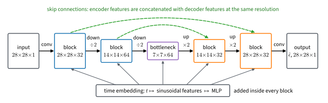
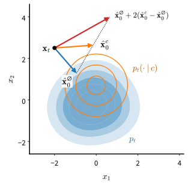

# Diffusion for Images
:label:`sec_diffusion-images`

The model of the last section drew points in the plane, and nothing in it
used the number two. The regression onto the velocity, the Euler steps that
integrate it and the ancestral chain apply unchanged to a $28 \times 28$
image, a point in 784 dimensions. Most readers have used a system that turns
a text prompt into a picture, and some have moved a slider that makes the
picture follow the prompt more closely. What changes when $\mathbf{x}$ is an
image? Four things: the network that maps a noisy image and a time to a
prediction, the recipe that trains it, the way a label steers it, and the
number that tells us whether its samples are good, now that "it looks right"
has to be judged over thousands of images.

Each of the four has an origin. :citet:`ho2020denoising` took the U-Net of
:citet:`Ronneberger.Fischer.Brox.2015`, a segmentation network whose skip
connections carry fine detail past a coarse bottleneck, and gave it the noise
level as an extra input. :citet:`Dhariwal.Nichol.2021` and then
:citet:`Ho.Salimans.2022` found that pushing each prediction further in the
direction that a label adds makes samples more typical of the label and less
varied; this *guidance* is what the prompt slider controls.
:citet:`Heusel.Ramsauer.Unterthiner.ea.2017` proposed to compare generated
and real images through the statistics of their features under a trained
network, the measurement that image generation papers report.

Every image generator is built from these four parts, and the Image Models
part scales each of them up. Here we make each one work on Fashion-MNIST,
with a model that trains in a few minutes on one GPU.

```{.python .input #image-diffusion-diffusion-models-for-images}
%%tab pytorch
import math
import numpy as np
import torch
from torch import nn
from torch.nn import functional as F
from d2l import torch as d2l
```

```{.python .input #image-diffusion-diffusion-models-for-images}
%%tab jax
import math
import numpy as np
import jax
from jax import numpy as jnp
from flax import nnx
import optax
from d2l import jax as d2l
```

## The Denoising U-Net

### Skips, Resolutions and the Time Embedding

The network of :numref:`sec_diffusion-gaussian-paths`, `TimeMLP`, took a
point and a time and returned a point of the same size. An image network
keeps this contract: a noisy image $\mathbf{x}_t$ and the time $t$ in, a
prediction of the same shape out, here the velocity. Convolutions suit
images, but a stack of $3 \times 3$ convolutions at full resolution makes
each output pixel depend on a small window of the input, while at high noise
the network must decide from the whole image whether a blurred blob is a
shoe or a bag.

The U-Net works at several resolutions. An encoder halves the resolution
twice, from $28 \times 28$ to $14 \times 14$ to $7 \times 7$, doubling the
channels on the way, so that a $3 \times 3$ convolution at the bottom sees
most of the image; a decoder upsamples back to $28 \times 28$. The
bottleneck alone would lose fine detail, the edge of a sleeve or the stripes
on a sneaker, so the decoder at each resolution also receives the encoder's
features at that resolution, concatenated to its own. These *skip
connections* give the network its U shape (:numref:`fig_diffusion-unet`);
the fully convolutional networks of :numref:`sec_fcn` have the same encoder
and decoder without them.


:label:`fig_diffusion-unet`

One network denoises at every noise level, and the right prediction depends
strongly on the level, so the time enters every block. `d2l.time_embedding`
of :numref:`sec_diffusion-denoising` maps $t$ to sines and cosines at
geometrically spaced frequencies, like the positional encodings of
:numref:`sec_positional-information`; a two-layer MLP turns these into one
vector, and each block adds a learned projection of it to its feature maps,
one bias per channel.

Each block applies two $3 \times 3$ convolutions with group normalization,
adds a projection of the conditioning embedding between them, and keeps a
residual connection around both. Group normalization computes its statistics
over groups of channels within one image, so unlike batch normalization it
does not mix the statistics of images at different noise levels.

:begin_tab:`jax`
`d2l.Conv` is `nnx.Conv` with weights and biases drawn from $U(-a, a)$,
$a = 1/\sqrt{\textrm{fan-in}}$, as `d2l.Linear` does for dense layers.
With Flax's default initialization this U-Net learns markedly more slowly
in its first few thousand updates.
:end_tab:

```{.python .input #image-diffusion-skips-resolutions-and-the-time-embedding-1}
%%tab pytorch
class UNetBlock(nn.Module):  #@save
    """Two 3x3 convolutions with group norm, a residual, and an embedding."""
    def __init__(self, c_in, c_out, emb_dim=None):
        super().__init__()
        self.norm1 = nn.GroupNorm(8, c_in)
        self.conv1 = nn.Conv2d(c_in, c_out, 3, padding=1)
        self.emb = nn.Linear(emb_dim, c_out) if emb_dim else None
        self.norm2 = nn.GroupNorm(8, c_out)
        self.conv2 = nn.Conv2d(c_out, c_out, 3, padding=1)
        self.skip = (nn.Conv2d(c_in, c_out, 1) if c_in != c_out
                     else nn.Identity())

    def forward(self, x, emb=None):
        h = self.conv1(F.silu(self.norm1(x)))
        if self.emb is not None:
            h = h + self.emb(emb)[:, :, None, None]
        h = self.conv2(F.silu(self.norm2(h)))
        return h + self.skip(x)
```

```{.python .input #image-diffusion-skips-resolutions-and-the-time-embedding-1}
%%tab jax
class Conv(nnx.Conv):  #@save
    """nnx.Conv (kernel_size a tuple), all weights from U(+-1/sqrt(fan_in))."""
    def __init__(self, in_features, out_features, kernel_size, *, rngs,
                 **kwargs):
        a = (in_features * math.prod(kernel_size)) ** -0.5
        init = lambda key, shape, dtype=jnp.float32: jax.random.uniform(
            key, shape, dtype, -a, a)
        super().__init__(in_features, out_features, kernel_size,
                         kernel_init=init, bias_init=init, rngs=rngs,
                         **kwargs)

class UNetBlock(nnx.Module):  #@save
    """Two 3x3 convolutions with group norm, a residual, and an embedding."""
    def __init__(self, c_in, c_out, emb_dim=None, *, rngs):
        norm = lambda c: nnx.GroupNorm(c, num_groups=8, epsilon=1e-5,
                                       use_fast_variance=False, rngs=rngs)
        self.norm1, self.norm2 = norm(c_in), norm(c_out)
        self.conv1 = d2l.Conv(c_in, c_out, (3, 3), rngs=rngs)
        self.emb = d2l.Linear(emb_dim, c_out, rngs=rngs) if emb_dim else None
        self.conv2 = d2l.Conv(c_out, c_out, (3, 3), rngs=rngs)
        self.skip = (d2l.Conv(c_in, c_out, (1, 1), rngs=rngs)
                     if c_in != c_out else None)

    def __call__(self, x, emb=None):
        h = self.conv1(nnx.silu(self.norm1(x)))
        if self.emb is not None:
            h = h + self.emb(emb)[:, None, None, :]
        h = self.conv2(nnx.silu(self.norm2(h)))
        return h + (x if self.skip is None else self.skip(x))
```

In the U-Net, two stride-2 convolutions go down to $7 \times 7$, and
nearest-neighbor up-sampling to the size of each skip comes back.

```{.python .input #image-diffusion-skips-resolutions-and-the-time-embedding-2}
%%tab pytorch
class UNet(nn.Module):  #@save
    """A small U-Net on time t, a label y (num_classes = null), and cond."""
    def __init__(self, ch=64, num_classes=None, in_channels=1,
                 out_channels=1, emb_dim=128):
        super().__init__()
        self.emb_dim, self.num_classes = emb_dim, num_classes
        self.label_emb = (nn.Embedding(num_classes + 1, emb_dim)
                          if num_classes else None)
        self.emb_mlp = d2l.make_mlp([emb_dim] * 3, nn.SiLU())
        self.inc = nn.Conv2d(in_channels, ch, 3, padding=1)
        self.down1 = UNetBlock(ch, ch, emb_dim)                   # 28 x 28
        self.pool1 = nn.Conv2d(ch, ch, 3, stride=2, padding=1)    # 14 x 14
        self.down2 = UNetBlock(ch, 2 * ch, emb_dim)
        self.pool2 = nn.Conv2d(2 * ch, 2 * ch, 3, stride=2, padding=1)  # 7 x 7
        self.mid = UNetBlock(2 * ch, 2 * ch, emb_dim)
        self.up1 = UNetBlock(4 * ch, ch, emb_dim)                 # 14 x 14
        self.up0 = UNetBlock(2 * ch, ch, emb_dim)                 # 28 x 28
        self.outc = nn.Sequential(nn.GroupNorm(8, ch), nn.SiLU(),
                                  nn.Conv2d(ch, out_channels, 3, padding=1))

    def forward(self, x, t, y=None, cond=None):
        emb = d2l.time_embedding(t, self.emb_dim)
        if y is not None:
            emb = emb + self.label_emb(y)
        if cond is not None:
            emb = emb + cond
        emb = self.emb_mlp(emb)
        up = lambda h, skip: torch.cat([F.interpolate(
            h, size=skip.shape[-2:], mode='nearest-exact'), skip], 1)
        h1 = self.down1(self.inc(x), emb)
        h2 = self.down2(self.pool1(h1), emb)
        h = self.mid(self.pool2(h2), emb)
        h = self.up1(up(h, h2), emb)  # skip connection
        h = self.up0(up(h, h1), emb)  # skip connection
        return self.outc(h)
```

```{.python .input #image-diffusion-skips-resolutions-and-the-time-embedding-2}
%%tab jax
class UNet(nnx.Module):  #@save
    """A small U-Net (NHWC) on time t, a label y (num_classes = null), cond."""
    def __init__(self, ch=64, num_classes=None, in_channels=1,
                 out_channels=1, emb_dim=128, *, rngs):
        self.emb_dim, self.num_classes = emb_dim, num_classes
        init = nnx.initializers.normal(1.0)  # N(0, 1), as in PyTorch
        self.label_emb = (nnx.Embed(num_classes + 1, emb_dim, rngs=rngs,
                                    embedding_init=init)
                          if num_classes else None)
        self.emb_mlp = d2l.make_mlp([emb_dim] * 3, nnx.silu, rngs=rngs)
        conv = lambda a, b, **kw: d2l.Conv(a, b, (3, 3), rngs=rngs, **kw)
        self.inc = conv(in_channels, ch)
        self.down1 = UNetBlock(ch, ch, emb_dim, rngs=rngs)        # 28 x 28
        self.pool1 = conv(ch, ch, strides=2, padding=1)           # 14 x 14
        self.down2 = UNetBlock(ch, 2 * ch, emb_dim, rngs=rngs)
        self.pool2 = conv(2 * ch, 2 * ch, strides=2, padding=1)   # 7 x 7
        self.mid = UNetBlock(2 * ch, 2 * ch, emb_dim, rngs=rngs)
        self.up1 = UNetBlock(4 * ch, ch, emb_dim, rngs=rngs)      # 14 x 14
        self.up0 = UNetBlock(2 * ch, ch, emb_dim, rngs=rngs)      # 28 x 28
        self.norm = nnx.GroupNorm(ch, num_groups=8, epsilon=1e-5,
                                  use_fast_variance=False, rngs=rngs)
        self.outc = conv(ch, out_channels)

    def __call__(self, x, t, y=None, cond=None):
        emb = d2l.time_embedding(t, self.emb_dim)
        if y is not None:
            emb = emb + self.label_emb(y)
        if cond is not None:
            emb = emb + cond
        emb = self.emb_mlp(emb)
        up = lambda h, skip: jnp.concatenate([jax.image.resize(
            h, h.shape[:1] + skip.shape[1:3] + h.shape[3:], 'nearest'),
            skip], -1)
        h1 = self.down1(self.inc(x), emb)
        h2 = self.down2(self.pool1(h1), emb)
        h = self.mid(self.pool2(h2), emb)
        h = self.up1(up(h, h2), emb)  # skip connection
        h = self.up0(up(h, h1), emb)  # skip connection
        return self.outc(nnx.silu(self.norm(h)))
```

We build the network with 64 channels at full resolution and ten classes,
and check that a batch of noisy images, times and labels keeps its shape.

```{.python .input #image-diffusion-skips-resolutions-and-the-time-embedding-3}
%%tab pytorch
torch.manual_seed(0)
dev = d2l.try_gpu()
net = UNet(ch=64, num_classes=10).to(dev)
x, t = torch.randn(8, 1, 28, 28, device=dev), torch.rand(8, device=dev)
c = torch.arange(8, device=dev)
print(f'output {tuple(net(x, t, c).shape)}, {d2l.num_params(net):,} parameters')
```

```{.python .input #image-diffusion-skips-resolutions-and-the-time-embedding-3}
%%tab jax
net = UNet(ch=64, num_classes=10, rngs=nnx.Rngs(0))
k1, k2 = jax.random.split(jax.random.key(0))
x, t = jax.random.normal(k1, (8, 28, 28, 1)), jax.random.uniform(k2, (8,))
c = jnp.arange(8)
print(f'output {net(x, t, c).shape}, {d2l.num_params(net):,} parameters')
```

The network has about 1.2 million parameters, a thirtieth of the 35.7
million of the CIFAR-10 model of :citet:`ho2020denoising`.

### Conditioning on a Class

A class label is one more input, and the U-Net already has a place for such
inputs: the embedding that every block adds to its features. A table with
one learned vector per class supplies the label's vector, which is added to
the time features before the MLP. The table has one extra row, the *null
label* $\varnothing$ (index 10 here), which stands for "no class given".

During training we replace each label by the null label with probability
$0.1$, a step called *label dropout*. The one network then learns two
predictions: $\mathbf{u}_{\boldsymbol{\theta}}(\mathbf{x}_t, t, c)$, the
velocity of the images of class $c$, and
$\mathbf{u}_{\boldsymbol{\theta}}(\mathbf{x}_t, t, \varnothing)$, the
velocity of all of Fashion-MNIST, trained on one example in ten.
:citet:`Ho.Salimans.2022` found dropout rates of $0.1$ and $0.2$ to work
better than $0.5$: the unconditional prediction needs only enough data to
serve as a baseline for the conditional one
(:numref:`subsec_diffusion-images-guided`).

A sampler needs a field of $(\mathbf{x}, t)$ alone. `cfg` turns the
conditional network into one: it evaluates the network with the requested
labels $c$ and with the null label in one doubled batch and returns
$\mathbf{u}_\varnothing + \gamma(\mathbf{u}_c - \mathbf{u}_\varnothing)$.
With $\gamma = 1$ this is the conditional prediction $\mathbf{u}_c$, with
$\gamma = 0$ the unconditional one; until the guidance experiment we use
$\gamma = 1$.

```{.python .input #image-diffusion-classifier-free-guidance}
%%tab pytorch
def cfg(net, c, gamma):  #@save
    """Classifier-free guidance: (x, t) -> u + gamma (u_c - u), u unlabeled."""
    null = torch.full_like(c, net.num_classes)
    def guided(x, t):
        out_c, out = net(torch.cat([x, x]), torch.cat([t, t]),
                         torch.cat([c, null])).chunk(2)
        return out + gamma * (out_c - out)
    return guided
```

```{.python .input #image-diffusion-classifier-free-guidance}
%%tab jax
def cfg(net, c, gamma):  #@save
    """Classifier-free guidance: (x, t) -> u + gamma (u_c - u), u unlabeled."""
    null = jnp.full_like(c, net.num_classes)
    def guided(x, t):
        out_c, out = jnp.split(net(jnp.concatenate([x, x]),
                                   jnp.concatenate([t, t]),
                                   jnp.concatenate([c, null])), 2)
        return out + gamma * (out_c - out)
    return guided
```

## The Training Recipe

### One Trainer

The loss is that of :numref:`sec_diffusion-gaussian-paths` with images in
place of points: draw a clean image $\mathbf{x}_0$ in $[-1, 1]$ with its
label, a time $t$ uniform on $[0, 1]$ and noise $\boldsymbol{\epsilon}$,
form $\mathbf{x}_t = (1 - t)\, \mathbf{x}_0 + t\, \boldsymbol{\epsilon}$ on
the linear path, and regress the network's output onto the conditional
velocity $\boldsymbol{\epsilon} - \mathbf{x}_0$. The only addition is label
dropout, which `batch_fn` applies to each batch of 128 images.

```{.python .input #image-diffusion-one-trainer-1}
%%tab pytorch
X, y, X_test, y_test = d2l.load_fashion_mnist_pm1()
path = d2l.GaussianPath.linear()

def batch_fn():
    i = torch.randint(0, len(X), (128,), device=X.device)
    drop = torch.rand(128, device=X.device) < 0.1   # label dropout
    return X[i], torch.where(drop, 10, y[i])        # 10 is the null label

def loss_fn(net, batch):
    x0, c = batch
    t, eps = torch.rand(len(x0), device=x0.device), torch.randn_like(x0)
    x_t = path.sample(x0, t, eps)
    return ((net(x_t, t, c) - path.target('velocity', x0, eps, t)) ** 2).mean()
```

```{.python .input #image-diffusion-one-trainer-1}
%%tab jax
X, y, X_test, y_test = d2l.load_fashion_mnist_pm1()
path = d2l.GaussianPath.linear()

def batch_fn(key):
    k1, k2 = jax.random.split(key)
    i = jax.random.randint(k1, (128,), 0, len(X))
    drop = jax.random.uniform(k2, (128,)) < 0.1     # label dropout
    return X[i], jnp.where(drop, 10, y[i])          # 10 is the null label

def loss_fn(net, batch, key):
    x0, c = batch
    k1, k2 = jax.random.split(key)
    t, eps = jax.random.uniform(k1, (len(x0),)), jax.random.normal(k2, x0.shape)
    x_t = path.sample(x0, t, eps)
    return ((net(x_t, t, c) - path.target('velocity', x0, eps, t)) ** 2).mean()
```

`d2l.train_regression` of :numref:`sec_diffusion-denoising` runs Adam on
this loss and returns the trained network, a moving average of its weights
and the losses. We use a constant learning rate of $10^{-3}$ without warm-up
for 15,000 updates, a few minutes on one GPU. Diffusion papers use a rate of
$2 \cdot 10^{-4}$ after a warm-up :cite:`ho2020denoising`, but for runs
about fifty times longer than ours; at our budget the smaller rate learns
too slowly, whichever target the network predicts.

```{.python .input #image-diffusion-one-trainer-2}
%%tab pytorch
num_steps = 15_000
net, ema, losses = d2l.train_regression(net, loss_fn, batch_fn, num_steps)
d2l.plot(torch.arange(100, num_steps + 1, 100),
         losses.reshape(-1, 100).mean(1).cpu(), 'update', 'loss', yscale='log')
```

```{.python .input #image-diffusion-one-trainer-2}
%%tab jax
num_steps = 15_000
net, ema, losses = d2l.train_regression(net, loss_fn, batch_fn, num_steps,
                                        jax.random.key(0))
d2l.plot(jnp.arange(100, num_steps + 1, 100),
         losses.reshape(-1, 100).mean(1), 'update', 'loss', yscale='log')
```

The loss, averaged over blocks of 100 updates, falls quickly over the first
thousand updates and slowly after that. It levels off well above zero
because its floor is the conditional variance of the velocity target
(:numref:`sec_diffusion-gaussian-paths`): at large $t$ many clean images are
consistent with one noisy image.

To sample, `d2l.make_pred` turns the network into a predictor of the clean
image and the noise, and `d2l.ode_sample` integrates the probability-flow
ODE from $t = 1$ to $t = 0$ with 50 Euler steps. `generate` draws $n$
images, the $i$-th of class $i \bmod 10$, in chunks, starting from the same
noise at every call so that two calls differ only in what we change between
them.

```{.python .input #image-diffusion-one-trainer-3}
%%tab pytorch
euler50 = lambda pred, x: d2l.ode_sample(pred, x, path.sigma_bars(50))

def generate(model, gamma, sampler=euler50, n=5000, chunk=500):
    """n samples from fixed noise; the i-th requests class i % 10."""
    gen = torch.Generator(dev).manual_seed(0)
    z = torch.randn(n, 1, 28, 28, device=dev, generator=gen)
    c = torch.arange(n, device=z.device) % 10
    out = [sampler(d2l.make_pred(cfg(model, c_k, gamma), path, 'velocity'), z_k)
           for z_k, c_k in zip(z.split(chunk), c.split(chunk))]
    return torch.cat(out).clamp(-1, 1)

names = d2l.FashionMNIST().text_labels(range(10))
d2l.show_gray(generate(ema, 1.0, n=40), 4, 10, titles=names + [''] * 30);
```

```{.python .input #image-diffusion-one-trainer-3}
%%tab jax
euler50 = lambda pred, x, key: d2l.ode_sample(pred, x, path.sigma_bars(50))

@nnx.jit(static_argnums=5)  # the sampler is a Python function: one trace each
def sample_chunk(model, gamma, c, z, key, sampler):
    return sampler(d2l.make_pred(cfg(model, c, gamma), path, 'velocity'), z, key)

def generate(model, gamma, sampler=euler50, n=5000, chunk=500):
    """n samples from fixed noise; the i-th requests class i % 10."""
    kz, ks = jax.random.split(jax.random.key(0))
    z, c = jax.random.normal(kz, (n, 28, 28, 1)), jnp.arange(n) % 10
    out = [sample_chunk(model, gamma, c[i:i + chunk], z[i:i + chunk],
                        jax.random.fold_in(ks, i), sampler)
           for i in range(0, n, chunk)]
    return jnp.concatenate(out).clip(-1, 1)

names = d2l.FashionMNIST().text_labels(range(10))
d2l.show_gray(generate(ema, 1.0, n=40), 4, 10, titles=names + [''] * 30);
```

Each column holds four samples of one class. Most are recognizable members
of the requested class, with varied shapes, prints and shades; some are
malformed, and shirts, pullovers and coats are hard to tell apart, as among
real images.

### The Moving Average

We sampled from `ema`, a moving average of the weights, not from the weights
of the last update. With a constant learning rate the iterates of Adam do
not settle: each update carries the noise of its minibatch, so the iterates
wander in a cloud around a good region, and an average of recent iterates
lies nearer its center :cite:`Polyak.Juditsky.1992`. `d2l.EMA` of
:numref:`sec_dcgan` keeps the exponential moving average

$$\bar{\boldsymbol{\theta}} \leftarrow \delta\, \bar{\boldsymbol{\theta}} + (1 - \delta)\, \boldsymbol{\theta}, \qquad \delta = 2^{-1/h},$$

after every update, so that the weights of $h$ updates ago count half as
much as the current ones; $h$ is the *half-life*. We use $h = 1000$.

The half-life has to suit the run. Too short, and the average keeps the
noise of the last steps; too long, and it reaches back to early weights
still far from the good region. :citet:`ho2020denoising` use $\delta =
0.9999$, a half-life of about 7,000 updates, in a run of 800,000 updates; a
fraction of that budget needs a proportionally shorter half-life.

## Measuring Sample Quality

### Fréchet Distance in Learned Features

A grid of forty samples shows whether samples look plausible. It cannot tell
whether 5,000 of them have the right variety, whether there are too many
bags and too few sandals, or which of two models that both look fine is
better. For that we need a number that compares the distribution of the
samples with that of real images.

Pixels are the wrong space for such a comparison: shifting a sneaker by two
pixels moves the image far in Euclidean distance without changing what it
shows. We therefore compare images in the feature space of a classifier,
where images of similar content lie close together. The *Fréchet distance*
(FD) of :citet:`Heusel.Ramsauer.Unterthiner.ea.2017` fits Gaussians
$\mathcal{N}(\boldsymbol{\mu}_p, \boldsymbol{\Sigma}_p)$ and
$\mathcal{N}(\boldsymbol{\mu}_q, \boldsymbol{\Sigma}_q)$ to the features of
real and generated images and reports the squared Wasserstein-2 distance
between them, derived in :numref:`sec_dcgan`:

$$\mathrm{FD} = \|\boldsymbol{\mu}_p - \boldsymbol{\mu}_q\|^2 + \mathrm{tr}\Big(\boldsymbol{\Sigma}_p + \boldsymbol{\Sigma}_q - 2\big(\boldsymbol{\Sigma}_p^{1/2} \boldsymbol{\Sigma}_q \boldsymbol{\Sigma}_p^{1/2}\big)^{1/2}\Big).$$
:eqlabel:`eq_diffusion-fd`

The first term grows when the average sample differs from the average real
image, for example when one class is generated too often; the second when
the spread differs, for example when all generated coats look alike. Both
vanish only if the two Gaussians coincide.

Published scores, called FID, use the features of an Inception network
trained on ImageNet. As in :numref:`sec_dcgan`, we train our own instead:
`d2l.FeatureCNN` (:numref:`subsec_utils_feature_cnn`), a small convolutional
classifier with 128 features, trained on Fashion-MNIST for 15 epochs with
the gray channel repeated three times. Because the feature network is our
own, we call the score FD and never compare it with published values.
`fashion_feature_cnn` trains it, and `fd_features` computes the features of
images, 1,000 at a time; the network's head assigns each image a class.

```{.python .input #image-diffusion-fr-chet-distance-in-learned-features-1}
%%tab pytorch
def fashion_feature_cnn(X, y):  #@save
    """The feature network that judges Fashion-MNIST samples in this chapter."""
    cnn = d2l.FeatureCNN(resolution=28).to(X.device)
    d2l.train_feature_cnn(cnn, X.expand(-1, 3, -1, -1), y)
    return cnn

def fd_features(cnn, imgs):  #@save
    """Features of gray images (n, 1, 28, 28) in [-1, 1], on the CPU."""
    rgb = lambda x: x.clamp(-1, 1).expand(-1, 3, -1, -1)
    return d2l.batched(lambda x: cnn.features(rgb(x)), imgs).cpu()

cnn = fashion_feature_cnn(X, y)
f_test = fd_features(cnn, X_test)
c_test = cnn.head(f_test.to(dev)).argmax(1)
print(f'test accuracy {(c_test == y_test).float().mean():.3f}')
```

```{.python .input #image-diffusion-fr-chet-distance-in-learned-features-1}
%%tab jax
def fashion_feature_cnn(X, y):  #@save
    """The feature network that judges Fashion-MNIST samples in this chapter."""
    cnn = d2l.FeatureCNN(resolution=28, rngs=nnx.Rngs(0))
    d2l.train_feature_cnn(cnn, jnp.repeat(X, 3, -1), y)
    return cnn

@nnx.jit  #@save
def gray_features(cnn, x):
    """Features of gray images (n, 28, 28, 1), clipped to [-1, 1]."""
    return cnn.features(jnp.repeat(jnp.clip(x, -1, 1), 3, -1))

def fd_features(cnn, imgs):  #@save
    """Features of gray images (n, 28, 28, 1) in [-1, 1]."""
    return d2l.batched(lambda x: gray_features(cnn, x), imgs)

cnn = fashion_feature_cnn(X, y)
f_test = fd_features(cnn, X_test)
c_test = cnn.head(f_test).argmax(1)
print(f'test accuracy {(c_test == y_test).mean():.3f}')
```

The feature network classifies more than 90% of the test images correctly,
so its features separate the classes. `fd_and_agreement` computes the FD of
a set of samples against reference features, together with the fraction of
samples assigned to the requested class. We score 5,000 samples against the
first 5,000 test images.

```{.python .input #image-diffusion-fr-chet-distance-in-learned-features-2}
%%tab pytorch
def fd_and_agreement(cnn, imgs, f_ref):
    """FD to the reference features, and the fraction of samples that the
    feature network assigns to the requested class i % 10."""
    f = fd_features(cnn, imgs)
    cls = cnn.head(f.to(imgs.device)).argmax(1)
    agree = (cls == torch.arange(len(imgs), device=cls.device) % 10)
    return d2l.fid_score(f, f_ref), agree.float().mean().item()

fd_ema, _ = fd_and_agreement(cnn, generate(ema, 1.0), f_test[:5000])
print(f'FD of 5,000 samples: {fd_ema:.2f}')
```

```{.python .input #image-diffusion-fr-chet-distance-in-learned-features-2}
%%tab jax
def fd_and_agreement(cnn, imgs, f_ref):
    """FD to the reference features, and the fraction of samples that the
    feature network assigns to the requested class i % 10."""
    f = fd_features(cnn, imgs)
    agree = (cnn.head(f).argmax(1) == jnp.arange(len(imgs)) % 10).mean()
    return d2l.fid_score(f, f_ref), float(agree)

fd_ema, _ = fd_and_agreement(cnn, generate(ema, 1.0), f_test[:5000])
print(f'FD of 5,000 samples: {fd_ema:.2f}')
```

The samples score an FD of about 1. Whether that is small or large depends
on the feature network and the number of images; the next subsection
supplies a scale.

### Reading the Number

Two sets of real images also have a positive FD: their sample means and
covariances differ by chance, and the trace term of :eqref:`eq_diffusion-fd`
is biased upward, by roughly $1/n$ for $n$ images per set. We therefore
compute a *floor*, the FD between two disjoint sets of real test images of
the size we score. Next to it we print the kernel inception distance (KID)
of :citet:`Binkowski.Sutherland.Arbel.ea.2018`, an unbiased estimate of the
squared maximum mean discrepancy with a cubic kernel on the same features
(:numref:`sec_dcgan`), whose expected value for two sets of real images is
zero at every $n$.

```{.python .input #image-diffusion-reading-the-number-1}
%%tab pytorch, jax
for n in (1000, 5000):
    f_a, f_b = f_test[:n], f_test[5000:5000 + n]
    print(f'real against real, {n} images each: FD '
          f'{d2l.fid_score(f_a, f_b):.2f}, KID {d2l.kid_score(f_a, f_b):.5f}')
```

At 5,000 images per set the floor is about 0.2, and at 1,000 it is about 1,
about six times larger. KID has no such bias: it lies within a few
hundredths of zero at 1,000 images, and within a few thousandths at 5,000,
which is also how far it scatters between other disjoint pairs of real sets.
An FD can therefore be compared only with FDs from the same number of images, and
the samples' FD of about 1 at 5,000 images is five to six times the floor:
the gap is the error of our model after 15,000 updates.

With a scale in hand we can ask how much the moving average helps, and
whether a thousand-step sampler beats fifty Euler steps. The reference is
the ancestral chain of :numref:`sec_diffusion-gaussian-paths`, run with
1,000 steps on the variance-preserving grid of :citet:`ho2020denoising`
through `make_pred`.

```{.python .input #image-diffusion-reading-the-number-2}
%%tab pytorch
vp = d2l.GaussianPath.vp()
ancestral1000 = lambda pred, x: d2l.ancestral_sample(pred, x, vp, 1000)
fd_raw, _ = fd_and_agreement(cnn, generate(net, 1.0), f_test[:5000])
fd_anc, _ = fd_and_agreement(cnn, generate(ema, 1.0, ancestral1000),
                             f_test[:5000])
print(f'FD, Euler 50: average {fd_ema:.2f}, last weights {fd_raw:.2f}; '
      f'chain with 1,000 steps, average {fd_anc:.2f}')
```

```{.python .input #image-diffusion-reading-the-number-2}
%%tab jax
vp = d2l.GaussianPath.vp()
ancestral1000 = lambda pred, x, key: d2l.ancestral_sample(pred, x, vp, 1000,
                                                          key)
fd_raw, _ = fd_and_agreement(cnn, generate(net, 1.0), f_test[:5000])
fd_anc, _ = fd_and_agreement(cnn, generate(ema, 1.0, ancestral1000),
                             f_test[:5000])
print(f'FD, Euler 50: average {fd_ema:.2f}, last weights {fd_raw:.2f}; '
      f'chain with 1,000 steps, average {fd_anc:.2f}')
```

The weights of the last update are no better than their average and often
much worse: over training runs that differ only in the random seed, the average
scored an FD of about 1 every time, the last weights anywhere from 1 to 3.5.
The thousand-step chain scores about 0.1 lower than fifty Euler steps,
within the spread between training runs, so at this sample size twenty times
the evaluations give no measurable improvement. We measure with fifty Euler
steps from now on.

## Guidance

### Bayes' Rule on Scores

Conditioning on a class looks like a new problem, but for scores it reduces
to a sum. Bayes' rule at time $t$ reads $p_t(\mathbf{x} \mid c) =
p_t(\mathbf{x})\, p_t(c \mid \mathbf{x}) / p(c)$, where $p_t(c \mid
\mathbf{x})$ is the probability that a noisy image $\mathbf{x}$ at time $t$
came from a clean image of class $c$, and $p(c)$ drops out of the gradient
of the logarithm:

$$\nabla_{\mathbf{x}} \log p_t(\mathbf{x} \mid c) = \nabla_{\mathbf{x}} \log p_t(\mathbf{x}) + \nabla_{\mathbf{x}} \log p_t(c \mid \mathbf{x}).$$
:eqlabel:`eq_diffusion-bayes-score`

The score of the class is the score of all the data plus the gradient of a
classifier's log-probability. *Classifier guidance*
:cite:`Dhariwal.Nichol.2021` supplies the second term with a separate
classifier $p_{\boldsymbol{\phi}}(c \mid \mathbf{x}, t)$ and multiplies it
by a *guidance scale* $\gamma$:

$$\tilde{\mathbf{s}}(\mathbf{x}, t) = \nabla_{\mathbf{x}} \log p_t(\mathbf{x}) + \gamma\, \nabla_{\mathbf{x}} \log p_{\boldsymbol{\phi}}(c \mid \mathbf{x}, t).$$
:eqlabel:`eq_diffusion-classifier-guidance`

With $\gamma = 1$ this is Bayes' rule; :citet:`Dhariwal.Nichol.2021` found
that samples matched their classes much better with $\gamma > 1$. The
classifier must be trained on noisy images, since the sampler evaluates its
gradient at $\mathbf{x}_t$, where a classifier of clean images gives
meaningless gradients. The appendix treats the rule on a one-dimensional
mixture (:numref:`sec_mdl-ddim-guidance`); exercise
:exref:`ex_image-diffusion-clean-classifier-guide` runs it on our images.

### Classifier-Free Guidance
:label:`subsec_diffusion-images-guided`

Classifier guidance needs a second network trained on noisy images, with
its own errors. :citet:`Ho.Salimans.2022` read
:eqref:`eq_diffusion-bayes-score` from right to left instead:

$$\nabla_{\mathbf{x}} \log p_t(c \mid \mathbf{x}) = \nabla_{\mathbf{x}} \log p_t(\mathbf{x} \mid c) - \nabla_{\mathbf{x}} \log p_t(\mathbf{x}).$$

The classifier's gradient is the difference between the conditional and the
unconditional score, and a network trained with label dropout provides both.
Substituting its two scores $\mathbf{s}_c$ and $\mathbf{s}_\varnothing$ into
:eqref:`eq_diffusion-classifier-guidance` gives the guided score
$\tilde{\mathbf{s}} = \mathbf{s}_\varnothing + \gamma(\mathbf{s}_c -
\mathbf{s}_\varnothing)$: classifier guidance with the classifier implicit
in the network.

Our network predicts velocities, not scores, but at a fixed point
$(\mathbf{x}, t)$ the velocity is an affine function of the score. On the
linear path the dictionary of :numref:`sec_diffusion-gaussian-paths` gives

$$\mathbf{u}_t(\mathbf{x}) = -\frac{\mathbf{x} + t\, \nabla_{\mathbf{x}} \log p_t(\mathbf{x})}{1 - t}.$$

The term $-\mathbf{x}/(1-t)$ does not depend on the label, and the weights
$1 - \gamma$ and $\gamma$ sum to one, so it passes through the combination
unchanged, and the guided velocity is the same combination of the two
velocities:

$$\tilde{\mathbf{u}}(\mathbf{x}, t) = \mathbf{u}_{\boldsymbol{\theta}}(\mathbf{x}, t, \varnothing) + \gamma \big(\mathbf{u}_{\boldsymbol{\theta}}(\mathbf{x}, t, c) - \mathbf{u}_{\boldsymbol{\theta}}(\mathbf{x}, t, \varnothing)\big).$$
:eqlabel:`eq_diffusion-cfg`

This is what `cfg` computes, and the same argument holds for every target of
the dictionary (exercise :exref:`ex_image-diffusion-equivalent-guidance`).
:citet:`Ho.Salimans.2022` write the rule as $(1 + w)\, \mathbf{u}_c - w\,
\mathbf{u}_\varnothing$, so their $w$ is our $\gamma - 1$.
:numref:`fig_diffusion-guidance` draws the rule on the running example: for
$\gamma > 1$ the guided prediction lies on the line through the
unconditional and the conditional one, beyond the conditional one.

![Classifier-free guidance on the three-mode mixture at one noise level. From a noisy point $\mathbf{x}_t$, arrows point to the posterior mean $\hat{\mathbf{x}}_0^{\varnothing}$ of all the data, to the posterior mean $\hat{\mathbf{x}}_0^{c}$ given the top mode, and to the guided prediction $\hat{\mathbf{x}}_0^{\varnothing} + \gamma(\hat{\mathbf{x}}_0^{c} - \hat{\mathbf{x}}_0^{\varnothing})$ at $\gamma = 2$, beyond $\hat{\mathbf{x}}_0^{c}$. Contours show the noised density and the noised density of the top mode.](../img/mdl-diffusion-guidance.svg)
:label:`fig_diffusion-guidance`

What does $\gamma$ do to the samples? We generate 5,000 samples at each of
six scales from the same noise and report the FD, which measures how well
the samples cover the distribution of real images, and the *class
agreement*, the fraction of samples that the feature network assigns to the
requested class.

```{.python .input #image-diffusion-classifier-free-guidance-1}
%%tab pytorch, jax
for gamma in (0.0, 1.0, 1.5, 2.0, 3.0, 4.0):
    fd, agree = fd_and_agreement(cnn, generate(ema, gamma), f_test[:5000])
    print(f'gamma {gamma:.1f}: FD {fd:5.2f}, class agreement {agree:.3f}')
```

At $\gamma = 0$ the label plays no part, and the agreement is at chance,
10%. The FD of about 3 is three times that of the conditional model: the
unconditional prediction covers all ten classes and was trained on only one
example in ten. At $\gamma = 1$ the FD is about 1 and about 90% of the
samples are assigned their requested class, about as high as this classifier
can confirm, since it classifies only a little more than 90% of real test
images correctly.

Guidance beyond $\gamma = 1$ trades variety for typicality. At $\gamma =
1.5$ the FD stays near its minimum, about 1, while the agreement
rises to about 96%; the FDs at $\gamma = 1$ and $1.5$ differ by less than
the spread between training runs. At $\gamma = 2$ the agreement reaches
about 98% and the FD has roughly doubled. At $\gamma = 3$ and $4$ the
agreement exceeds 99%, more than the feature network achieves on real
images, while the FD climbs to about 3.5 and then to about 5: the guided samples
are the class's prototypes, easier to classify than real ones, without the
ambiguous examples that real data contain. The grids show the samples from
the noise of the first grid at $\gamma = 0$ and at $\gamma = 4$.

```{.python .input #image-diffusion-classifier-free-guidance-2}
%%tab pytorch, jax
for gamma in (0.0, 4.0):
    d2l.show_gray(generate(ema, gamma, n=40), 4, 10, titles=names + [''] * 30)
```

At $\gamma = 0$ the columns no longer follow their labels. At $\gamma = 4$
each image is a clear member of its class, but the four samples of a column
resemble one another more than at $\gamma = 1$, with stronger contrast and
fewer unusual shapes.

### Guidance as a Tilt

Which distribution does the guided sampler follow? The guided score
$\nabla \log p_t(\mathbf{x}) + \gamma\, \nabla \log p_t(c \mid \mathbf{x})$
is the gradient of the logarithm of the *tilted* density

$$\tilde{p}_t(\mathbf{x}) \propto p_t(\mathbf{x})\, p_t(c \mid \mathbf{x})^{\gamma} \propto p_t(\mathbf{x})^{1 - \gamma}\, p_t(\mathbf{x} \mid c)^{\gamma}.$$

For $\gamma > 1$ the classifier's probability is raised to a power, which
shifts mass toward the images about which the classifier is most certain;
equivalently, part of the unconditional density is divided out, which pushes
samples away from regions that the class shares with the others. This is the
sharpening that the experiment measured.

The tilted densities are in general not the noised versions of any clean
distribution. A density obtained by adding Gaussian noise of variance
$\sigma_t^2$ cannot curve more sharply than the noise itself: no eigenvalue
of $-\nabla^2 \log p_t$ exceeds $1/\sigma_t^2$. Raising a probability to a
power $\gamma > 1$ can break this bound, and on the mixture of the appendix
it does so at most noise levels for our scales
(:numref:`sec_mdl-ddim-guidance`, exercise
:exref:`ex_mdl-score-matching-diffusion-flow-guided-marginals`). The guided
sampler therefore follows fields that no data distribution generates. Two
remedies keep most of the gain in agreement at a smaller loss of variety:
guidance only in a middle range of noise levels
:cite:`Kynkaanniemi.Aittala.Karras.ea.2024`, and guidance by a weaker
version of the model in place of the unconditional prediction
:cite:`Karras.Aittala.Kynkaanniemi.ea.2024`; exercises
:exref:`ex_image-diffusion-guidance-interval` and
:exref:`ex_image-diffusion-autoguidance` try both.

## Summary

An image diffusion model is the model of
:numref:`sec_diffusion-gaussian-paths` with a U-Net in place of the
multilayer perceptron: an encoder and a decoder at three resolutions, skip
connections that carry detail past the bottleneck, and the time and the
label added inside every block. Trained for 15,000 updates and sampled from
a moving average of its weights, a network of 1.2 million parameters
produces recognizable Fashion-MNIST images. The Fréchet distance in the
features of a trained classifier turns sample quality into a number, read
against the floor of two sets of real images of the same size. Label dropout
makes one network both conditional and unconditional, and classifier-free
guidance extrapolates from the second through the first by a scale $\gamma$,
trading variety, measured by the FD, for typicality, measured by class
agreement.

Fifty Euler steps scored about as well as a thousand ancestral steps, at a
twentieth of the cost. Which steps can be skipped, how few are enough, and
which sampler should take them is the subject of
:numref:`sec_diffusion-samplers`.

## Exercises

1. **Equivalent guidance rules.** Suppose that the network's two velocities
   are exact, so that, by the dictionary of
   :numref:`sec_diffusion-gaussian-paths`, they are affine functions of the
   scores $\nabla \log p_t(\mathbf{x} \mid c)$ and
   $\nabla \log p_t(\mathbf{x})$, and that the classifier is the exact class
   posterior $p_t(c \mid \mathbf{x})$ of the noisy images.
    1. Show that classifier guidance
       :eqref:`eq_diffusion-classifier-guidance` at scale $\gamma$ and
       classifier-free guidance :eqref:`eq_diffusion-cfg` at the same
       $\gamma$ produce the same guided velocity.
    1. Every target of the dictionary (the noise, the clean image, the score,
       $\mathbf{v}$ and the velocity) is, at a fixed $(\mathbf{x}, t)$, an
       affine function $a(\mathbf{x}, t) + b(t)\, \hat{\mathbf{x}}_0$ of the
       posterior mean $\hat{\mathbf{x}}_0$. Show that applying the rule to
       any one target and converting gives the same guided prediction as
       applying it to any other. Which property of the weights $1 - \gamma$
       and $\gamma$ does the argument use?
    1. Would the rule still be the same for every target if a network
       predicted $\hat{\mathbf{x}}_0$ clipped to $[-1, 1]$?
   :exlabel:`ex_image-diffusion-equivalent-guidance`
1. [code] **The floor of the Fréchet distance.** The floor printed in this
   section depends on the number $n$ of images per set.
    1. Compute the FD and the KID between disjoint sets of test images for
       $n \in \{250, 500, 1000, 2500, 5000\}$, with as many disjoint pairs per
       $n$ as the test set allows, up to five. Plot the FD against $1/n$. Is
       it close to a line, and where does the line meet $1/n = 0$?
    1. Compare the mean and the spread of the KID with those of the FD at
       each $n$. Which of the two would you report for a set of 500
       samples?
    1. The samples of `generate(ema, 1.0)` scored an FD of about 1 at
       $n = 5000$. Predict their FD at $n = 1000$ from your line, and check
       the prediction.
   :exlabel:`ex_image-diffusion-fd-floor`
1. [code] **A clean classifier as guide.** ● Classifier guidance needs a
   classifier of noisy images, but one can also steer with a classifier of
   clean images applied to the network's estimate of the clean image.
    1. Report the accuracy of the feature network `cnn` on test images noised
       to $\mathbf{x}_t$ at $t \in \{0.25, 0.5, 0.75\}$ of the linear path.
       Why can its gradient at $\mathbf{x}_t$ not serve in
       :eqref:`eq_diffusion-classifier-guidance`?
    1. Use the posterior mean $\hat{\mathbf{x}}_0(\mathbf{x}_t)$ of the
       unconditional prediction (`cfg(ema, c, 0.0)`) as the classifier's
       input instead, and add
       $\gamma\, \nabla_{\mathbf{x}_t} \log p_{\textrm{cnn}}(c \mid \hat{\mathbf{x}}_0(\mathbf{x}_t))$
       to the unconditional score, converted to a velocity with the
       dictionary. Sample 1,000 images at $\gamma \in \{1, 3, 10\}$ with
       50 Euler steps.
    1. Score the samples with `fd_and_agreement`. The class agreement is
       now measured by the same network that steered the sampler. Train a
       second `d2l.FeatureCNN` with another seed and score the samples with
       it as well. What does the comparison say about using a classifier
       both to guide and to evaluate?
   :exlabel:`ex_image-diffusion-clean-classifier-guide`
1. [code] **Guidance in a limited interval.**
   :citet:`Kynkaanniemi.Aittala.Karras.ea.2024` apply guidance only within
   an interval of noise levels and use $\gamma = 1$ elsewhere. They measure
   the noise level by $\bar\sigma_t = \sigma_t / \alpha_t$ and found
   $0.28 < \bar\sigma_t \leq 2.9$ best for one of their ImageNet models.
    1. Find the times $t$ of the linear path at which $\bar\sigma_t$ equals
       $0.28$ and $2.9$.
    1. Write a version of `cfg` that applies the scale $\gamma$ only for
       $t$ in a given interval. At $\gamma = 4$, compute the FD and the class
       agreement of 5,000 samples for guidance in the high-noise interval,
       the middle interval and the low-noise interval, and compare with
       guidance at every step and with $\gamma = 1$.
    1. Which interval accounts for most of the gain in agreement, and which
       for most of the rise in FD? Relate the answer to the time at which a
       sample commits to its class (exercise
       :exref:`ex_gaussian-paths-commitment-time`).
   :exlabel:`ex_image-diffusion-guidance-interval`
1. [extended] **Autoguidance.** ●● :citet:`Karras.Aittala.Kynkaanniemi.ea.2024`
   guide a conditional model with a weaker version of itself in place of its
   unconditional prediction,
   $\tilde{\mathbf{u}} = \mathbf{u}_{\textrm{weak}}(\mathbf{x}, t, c) + \gamma\big(\mathbf{u}_{\boldsymbol{\theta}}(\mathbf{x}, t, c) - \mathbf{u}_{\textrm{weak}}(\mathbf{x}, t, c)\big)$.
    1. Treat each network as the exact velocity of its own densities
       $p_{\boldsymbol{\theta}, t}(\mathbf{x} \mid c)$ and
       $p_{\textrm{weak}, t}(\mathbf{x} \mid c)$. Show that the guided field
       is the velocity of a density proportional to
       $p_{\boldsymbol{\theta}, t}(\mathbf{x} \mid c)\, \big(p_{\boldsymbol{\theta}, t}(\mathbf{x} \mid c) / p_{\textrm{weak}, t}(\mathbf{x} \mid c)\big)^{\gamma - 1}$,
       and write classifier-free guidance in the same form. Which images
       does each ratio favor? Use the answer to explain why classifier-free
       guidance reduces the variety within a class while autoguidance need
       not.
    1. Build two weak models: the moving average of the weights after 2,500
       of the 15,000 updates, and a `UNet(ch=16, num_classes=10)` trained for
       2,500 updates with the same recipe. Plot the FD against the class
       agreement for autoguidance with each weak model at
       $\gamma \in \{1.5, 2, 3, 4\}$, and for classifier-free guidance at
       the scales of the experiment.
    1. Which sampler reaches a given agreement at the lower FD, and which
       weak model guides better? Relate the answer to the requirement of
       :citet:`Karras.Aittala.Kynkaanniemi.ea.2024` that the weak model make
       the same kinds of errors as the main one.
   :exlabel:`ex_image-diffusion-autoguidance`
1. [code] **Skip connections.** Write a variant of `UNet` without its two
   skip connections, in which `up1` and `up0` receive only the upsampled
   features, so that their input widths shrink to `2 * ch` and `ch`.
    1. Before training, predict at which times $t$ the skip connections
       matter most and at which they hardly matter.
    1. Train both networks for 5,000 updates. For 1,000 test images,
       compute the squared error of the clean image implied by each
       network's velocity, $\hat{\mathbf{x}}_0 = \mathbf{x}_t - t\, \hat{\mathbf{u}}$,
       at $t \in \{0.1, 0.3, 0.5, 0.7, 0.9\}$, and plot both curves.
    1. Compare the FD of 5,000 samples of each network. Does the error
       curve of (b) predict the difference?
   :exlabel:`ex_image-diffusion-skip-connections`
1. **Conditional scores of the mixture.** ● Let the data be the three-mode
   mixture of :numref:`sec_diffusion-denoising`, with weights $\pi_k$, means
   $\boldsymbol{\mu}_k$ and standard deviation $s$ per coordinate, and let the
   label of a point be the component $k$ that generated it. Add noise as in
   :numref:`sec_diffusion-denoising`,
   $\tilde{\mathbf{x}} = \mathbf{x}_0 + \sigma\boldsymbol{\epsilon}$, and
   write $v = s^2 + \sigma^2$.
    1. Show that the class posterior $p_\sigma(k \mid \tilde{\mathbf{x}})$ is
       a softmax over the logits
       $\ell_k(\tilde{\mathbf{x}}) = \log \pi_k + \boldsymbol{\mu}_k^\top \tilde{\mathbf{x}} / v - \|\boldsymbol{\mu}_k\|^2 / (2 v)$,
       which are affine in $\tilde{\mathbf{x}}$, and that the conditional score
       :eqref:`eq_diffusion-bayes-score` for label $k$ is
       $(\boldsymbol{\mu}_k - \tilde{\mathbf{x}}) / v$.
    1. Merge the components with weights $0.3$ and $0.2$ into one class $B$.
       Write the gradient of $\log p_\sigma(B \mid \tilde{\mathbf{x}})$ in
       terms of the responsibilities of the components. Where in the plane is
       it small? In which proportions should samples of class $B$ fall into
       its two components?
    1. A classifier fitted to clean points approximates the posterior at
       $\sigma = 0$. Show that its logits differ from those at level
       $\sigma$ by the factor $v / s^2$ on every term except $\log \pi_k$,
       which at $\sigma = 3$ is $37$. What does using its gradient at a
       coarse level amount to, in terms of the tilted density of this
       section?
   :exlabel:`ex_image-diffusion-mixture-conditional`
1. [code] **The rate of label dropout.** Train the conditional model with
   label dropout at rates $0.1$, $0.2$ and $0.5$. For each, report the FD of
   5,000 samples at $\gamma = 0$, and the FD and class agreement at
   $\gamma = 1$ and $\gamma = 1.5$. Which predictions improve and which
   degrade as the rate grows? Explain the result by how many updates each
   of the two predictions receives.
   :exlabel:`ex_image-diffusion-label-dropout`
1. [code] **KID against FD.** Compute the KID of the samples of every guidance
   scale of the experiment, at $n = 5000$ and at $n = 1000$.
    1. Do KID and FD rank the six scales in the same order?
    1. Compute both scores for ten disjoint subsets of 500 samples at
       $\gamma = 1$ and $\gamma = 1.5$. Can either score tell the two scales
       apart at this sample size?
   :exlabel:`ex_image-diffusion-kid`
1. [code] **Thresholding the predicted image.** ● The guided velocity implies a
   clean image $\hat{\mathbf{x}}_0 = \mathbf{x}_t - t\, \tilde{\mathbf{u}}$
   on the linear path. :citet:`saharia2022photorealistic` trace the
   saturated samples of large guidance scales to predictions
   $\hat{\mathbf{x}}_0$ outside the range of the data.
    1. For $\gamma \in \{1, 4, 16\}$, record at every Euler step the fraction
       of pixels of $\hat{\mathbf{x}}_0$ outside $[-1, 1]$ and plot it
       against $t$. Where along the path does the prediction leave the
       range, and how does $\gamma$ change this?
    1. *Static thresholding* clips $\hat{\mathbf{x}}_0$ to $[-1, 1]$ before
       the step; *dynamic thresholding* sets, for each image, $m$ to the
       larger of $1$ and the 99.5th percentile of $|\hat{\mathbf{x}}_0|$,
       clips to $[-m, m]$ and divides by $m$. Rewrite the Euler step to form
       the velocity from a thresholded $\hat{\mathbf{x}}_0$, and implement
       both.
    1. Define the *saturation* of a set of images as the fraction of its
       pixels equal to $1$ after clamping. Compare saturation, FD and class
       agreement of the three samplers at $\gamma \in \{4, 8, 16\}$.
   :exlabel:`ex_image-diffusion-thresholding`

[Discussions](https://d2l.discourse.group/t/36822)

<!-- slides -->

::: {.slide}
::: {.cover}
[Dive into Deep Learning · §17.3]{.kicker}

Diffusion for Images<br>
**a U-Net with time and label · label dropout · the weight average · the Fréchet distance and its floor · classifier-free guidance**
:::
:::

::: {.slide title="The Regression Never Used the Number Two; a Garment Has 784"}
[The problem]{.kicker}

- The velocity regression, Euler steps and the ancestral chain apply
  unchanged to a $28 \times 28$ image.
- Four things change: the network, the training recipe, steering by a label,
  and a number for sample quality.
- At high noise, telling a shoe from a bag takes the whole image; a
  $3 \times 3$ convolution sees 9 pixels.

::: {.d2l-note}
Which network sees the whole image, and which number says whether 5,000
samples are right?
:::
:::

::: {.slide title="By the End of This Deck You Can"}
[Goals]{.kicker}

- build a U-Net that takes a noisy image, a time and a label;
- train it with label dropout and sample from a weight average;
- compute a Fréchet distance and read it against the floor of two real sets;
- derive classifier-free guidance from Bayes' rule on scores;
- predict what the guidance scale does to variety and typicality.

**Running example:** Fashion-MNIST in $[-1, 1]$; a U-Net of 1.2 million
parameters, 15,000 updates, a few minutes on one GPU. **Idea:** the
two-dimensional model with a U-Net in place of the MLP.
:::

::: {.slide title="This Deck Takes the Regression from Points to Images"}
[Where this fits]{.kicker}

::: {.cols .vc}
::: {.col}
| section | asks |
|---|---|
| Denoising and the Score | what a denoiser knows about the data |
| Gaussian Paths | how to walk from noise to data, and what trains the walk |
| **Diffusion for Images** | **network, guidance, a quality score** |
| Samplers, Inversion and Editing | which steps to skip; running backwards |
| Likelihood, Weighting, Design Space | which choices of the regression matter |
| Latent Diffusion and Transformers | diffusing a compressed code |
| Few-Step Generation | why one step fails, and the fixes |
| Discrete Diffusion | what noise is for a token |
:::

::: {.col .narrow}
- **Uses:** the linear path, the velocity regression, Euler and ancestral
  samplers.
- **Skips:** fast samplers, latent spaces, transformers, text prompts.
:::
:::
:::

::: {.slide title="Skip Connections Carry Detail Past a 7×7 Bottleneck"}
[The U-Net]{.kicker}

{width=75%}

- Down $28 \to 14 \to 7$, channels $64 \to 128$: a $3 \times 3$ convolution
  at $7 \times 7$ sees most of the image.
- Skips concatenate encoder features to the decoder: the edge of a sleeve
  survives the bottleneck.
:::

::: {.slide title="The Time Enters Every Block as One Bias per Channel" only="pytorch"}
Time (sinusoids) and label embeddings are summed, passed through an MLP, and
projected into each block:

```
def forward(self, x, emb):
    h = self.conv1(F.silu(self.norm1(x)))
    h = h + self.emb(emb)[:, :, None, None]   # one bias per channel
    h = self.conv2(F.silu(self.norm2(h)))
    return h + self.skip(x)                   # residual
```

@!image-diffusion-skips-resolutions-and-the-time-embedding-3

[Group norm: statistics within one image, so images at different noise levels never mix. Size: a thirtieth of DDPM's 35.7M-parameter CIFAR-10 model.]{.small}
:::

::: {.slide title="The Time Enters Every Block as One Bias per Channel" only="jax"}
Time (sinusoids) and label embeddings are summed, passed through an MLP, and
projected into each block:

```
def __call__(self, x, emb):
    h = self.conv1(nnx.silu(self.norm1(x)))
    h = h + self.emb(emb)[:, None, None, :]   # one bias per channel
    h = self.conv2(nnx.silu(self.norm2(h)))
    return h + (x if self.skip is None else self.skip(x))  # residual
```

@!image-diffusion-skips-resolutions-and-the-time-embedding-3

[Group norm: statistics within one image, so images at different noise levels never mix. Size: a thirtieth of DDPM's 35.7M-parameter CIFAR-10 model.]{.small}
:::

::: {.slide title="Check: How Deep Must a Plain Convolution Stack Be?"}
[Check]{.kicker}

Each $3 \times 3$ convolution widens a pixel's view by 2 pixels. How many are
needed to span 28 pixels at full resolution, and to span the 7 positions of
the bottleneck?

::: {.fragment .fade-up}
::: {.d2l-note}
**Answer.** $1 + 2k \geq 28$: $k = 14$ at $28 \times 28$. $1 + 2k \geq 7$:
$k = 3$ at $7 \times 7$, where each position stands for a $4 \times 4$ patch.
Two halvings let a shallow network decide from the whole image.
:::
:::
:::

::: {.slide title="Label Dropout Trains the Conditional and Unconditional Field Together" only="pytorch"}
[Conditioning]{.kicker}

A label table with ten classes and a null label $\varnothing$ (index 10);
each training label becomes $\varnothing$ with probability 0.1:

```
drop = torch.rand(128, device=X.device) < 0.1   # label dropout
return X[i], torch.where(drop, 10, y[i])        # 10 is the null label
```

One network, two fields: $\mathbf{u}_{\boldsymbol\theta}(\mathbf{x}_t, t, c)$,
and $\mathbf{u}_{\boldsymbol\theta}(\mathbf{x}_t, t, \varnothing)$ trained on
one example in ten.

[Rates of 0.1 and 0.2 worked better than 0.5 (Ho and Salimans, 2022).]{.small}
:::

::: {.slide title="Label Dropout Trains the Conditional and Unconditional Field Together" only="jax"}
[Conditioning]{.kicker}

A label table with ten classes and a null label $\varnothing$ (index 10);
each training label becomes $\varnothing$ with probability 0.1:

```
drop = jax.random.uniform(k2, (128,)) < 0.1   # label dropout
return X[i], jnp.where(drop, 10, y[i])        # 10 is the null label
```

One network, two fields: $\mathbf{u}_{\boldsymbol\theta}(\mathbf{x}_t, t, c)$,
and $\mathbf{u}_{\boldsymbol\theta}(\mathbf{x}_t, t, \varnothing)$ trained on
one example in ten.

[Rates of 0.1 and 0.2 worked better than 0.5 (Ho and Salimans, 2022).]{.small}
:::

::: {.slide title="Our Recipe Runs a Fiftieth of DDPM's Updates"}
[The recipe]{.kicker}

| | here | Ho et al. (2020) |
|:--|:--|:--|
| path, target | linear, velocity $\boldsymbol{\epsilon} - \mathbf{x}_0$ | VP, noise $\boldsymbol{\epsilon}$ |
| network | U-Net, 1.2M parameters | U-Net, 35.7M |
| Adam | $10^{-3}$, constant, no warm-up | $2 \cdot 10^{-4}$ after a warm-up |
| updates | 15,000, batch 128 | 800,000 |
| weight average | half-life 1,000 updates | half-life about 7,000 |

::: {.d2l-note}
At our budget the smaller learning rate learns too slowly, whichever target
the network predicts.
:::
:::

::: {.slide title="The Loss Falls within a Thousand Updates, Then Levels Off above Zero"}
@!image-diffusion-one-trainer-2

- Each point averages 100 updates; log scale.
- The floor is the conditional variance of the velocity target: at large $t$
  many clean images fit one noisy image.
:::

::: {.slide title="Fifty Euler Steps Draw Garments of the Requested Class"}
@!image-diffusion-one-trainer-3

Each column: four samples of one class, from the weight average. Varied
shapes, prints and shades; some malformed; shirts, pullovers and coats hard
to tell apart, as among real images.
:::

::: {.slide title="The Weight Average Sits Nearer the Center of the Wandering Iterates"}
$$\bar{\boldsymbol\theta} \leftarrow \delta\, \bar{\boldsymbol\theta} + (1 - \delta)\, \boldsymbol\theta, \qquad \delta = 2^{-1/h}$$

- At a constant learning rate, minibatch noise keeps Adam's iterates in a
  cloud; their average lies nearer its center.
- Half-life $h$: the weights of $h$ updates ago count half. Here $h = 1000$.
- Too short keeps the noise; too long remembers early weights. Ho et al.:
  $\delta = 0.9999$, $h \approx 7{,}000$ in 800,000 updates.

[Polyak and Juditsky, 1992]{.small}
:::

::: {.slide title="Compare Image Sets as Gaussians in a Classifier's Features"}
[Measuring quality]{.kicker}

Pixels fail: a sneaker shifted by two pixels is far away. Fit
$\mathcal{N}(\boldsymbol\mu_p, \boldsymbol\Sigma_p)$ and
$\mathcal{N}(\boldsymbol\mu_q, \boldsymbol\Sigma_q)$ to features of real and
generated images:

$$\mathrm{FD} = \|\boldsymbol\mu_p - \boldsymbol\mu_q\|^2 + \mathrm{tr}\Big(\boldsymbol\Sigma_p + \boldsymbol\Sigma_q - 2\big(\boldsymbol\Sigma_p^{1/2} \boldsymbol\Sigma_q \boldsymbol\Sigma_p^{1/2}\big)^{1/2}\Big)$$

- Mean term: a wrong mix of classes. Trace term: a wrong spread, all coats
  alike.
- Features of our own 128-feature CNN: we call it FD and never compare it
  with published FID.

@!image-diffusion-fr-chet-distance-in-learned-features-1
:::

::: {.slide title="Two Real Sets Already Differ: The FD Floor Depends on n"}
@!image-diffusion-reading-the-number-1

- FD floor: about 0.2 at 5,000 images, about 1 at 1,000; the trace term
  is biased upward by roughly $1/n$.
- KID, an unbiased squared MMD with a cubic kernel: within a few hundredths
  of zero at 1,000, a few thousandths at 5,000.

::: {.d2l-note}
Compare FDs only at equal numbers of images.
:::
:::

::: {.slide title="The Weight Average Scores About 1; Neither the Last Weights nor 1,000 Steps Beat It"}
@!image-diffusion-reading-the-number-2

- Weight average: about 1 in every training run, five to six times the floor
  of 0.2; the gap is the model's error.
- Last weights: anywhere from 1 to 3.5 across seeds.
- Ancestral chain with 1,000 steps: about 0.1 lower, within the spread
  between runs; twenty times the evaluations, no measurable gain.
:::

::: {.slide title="Check: Which Model Is Better?"}
[Check]{.kicker}

Same feature network. Model A scores an FD of 0.9 on 1,000 samples; model B
scores 0.9 on 5,000 samples. Which is closer to the data?

::: {.fragment .fade-up}
::: {.d2l-note}
**Answer.** A sits at the floor of two real sets of 1,000 (about 1): at
that size it cannot be told from real data. B is five times its floor of
0.2. A is likely better; to be sure, score both at the same size. B is our
model.
:::
:::
:::

::: {.slide title="Bayes' Rule Turns a Class Condition into a Sum of Scores"}
[Guidance]{.kicker}

$$\nabla_{\mathbf{x}} \log p_t(\mathbf{x} \mid c) = \nabla_{\mathbf{x}} \log p_t(\mathbf{x}) + \nabla_{\mathbf{x}} \log p_t(c \mid \mathbf{x})$$

The prior $p(c)$ drops out of the gradient. *Classifier guidance* uses a
classifier of noisy images, scaled by $\gamma$:

$$\tilde{\mathbf{s}}(\mathbf{x}, t) = \nabla_{\mathbf{x}} \log p_t(\mathbf{x}) + \gamma\, \nabla_{\mathbf{x}} \log p_{\boldsymbol\phi}(c \mid \mathbf{x}, t)$$

- $\gamma = 1$ is Bayes' rule; $\gamma > 1$ matched classes much better.
- Cost: a second network, trained on noisy images.

[Dhariwal and Nichol, 2021]{.small}
:::

::: {.slide title="Classifier-Free Guidance Reads Bayes' Rule Backwards"}
$$\nabla \log p_t(c \mid \mathbf{x}) = \mathbf{s}_c - \mathbf{s}_\varnothing
\quad \Longrightarrow \quad
\tilde{\mathbf{s}} = \mathbf{s}_\varnothing + \gamma\, (\mathbf{s}_c - \mathbf{s}_\varnothing)$$

- Label dropout supplies both scores; the classifier is implicit.
- On the linear path $\mathbf{u}_t = -(\mathbf{x} + t\, \mathbf{s}) / (1 - t)$.
  The weights $1 - \gamma$ and $\gamma$ sum to one, so $-\mathbf{x}/(1 - t)$
  passes through:

$$\tilde{\mathbf{u}}(\mathbf{x}, t) = \mathbf{u}_{\boldsymbol\theta}(\mathbf{x}, t, \varnothing) + \gamma\, \big(\mathbf{u}_{\boldsymbol\theta}(\mathbf{x}, t, c) - \mathbf{u}_{\boldsymbol\theta}(\mathbf{x}, t, \varnothing)\big)$$

[Ho and Salimans (2022) write $(1 + w)\, \mathbf{u}_c - w\, \mathbf{u}_\varnothing$, so $w = \gamma - 1$.]{.small}
:::

::: {.slide title="The Guided Prediction Overshoots the Conditional One" only="pytorch"}
::: {.cols .vc}
::: {.col}
```
null = torch.full_like(c, net.num_classes)
def guided(x, t):  # one doubled batch
    x2 = torch.cat([x, x])
    t2 = torch.cat([t, t])
    c2 = torch.cat([c, null])
    out_c, out = net(x2, t2, c2).chunk(2)
    return out + gamma * (out_c - out)
```

Three-mode mixture, $\gamma = 2$: the guided clean-point estimate lies on the
line through $\hat{\mathbf{x}}_0^{\varnothing}$ and
$\hat{\mathbf{x}}_0^{c}$, beyond $\hat{\mathbf{x}}_0^{c}$.
:::

::: {.col .narrow}

:::
:::
:::

::: {.slide title="The Guided Prediction Overshoots the Conditional One" only="jax"}
::: {.cols .vc}
::: {.col}
```
null = jnp.full_like(c, net.num_classes)
def guided(x, t):  # one doubled batch
    x2 = jnp.concatenate([x, x])
    t2 = jnp.concatenate([t, t])
    c2 = jnp.concatenate([c, null])
    out_c, out = jnp.split(net(x2, t2, c2), 2)
    return out + gamma * (out_c - out)
```

Three-mode mixture, $\gamma = 2$: the guided clean-point estimate lies on the
line through $\hat{\mathbf{x}}_0^{\varnothing}$ and
$\hat{\mathbf{x}}_0^{c}$, beyond $\hat{\mathbf{x}}_0^{c}$.
:::

::: {.col .narrow}

:::
:::
:::

::: {.slide title="Check: Predict the Guidance Sweep"}
[Check]{.kicker}

We sample 5,000 images at $\gamma = 0, 1, 1.5, 2, 3, 4$ and record the FD
and the *class agreement*: the share the feature network assigns to the
requested class. What is the agreement at $\gamma = 0$? Does the FD keep
falling as $\gamma$ grows?

::: {.fragment .fade-up}
::: {.d2l-note}
**Answer.** At $\gamma = 0$ the label plays no part: chance, 10%. The FD is
lowest near $\gamma = 1$ to $1.5$ and then rises: overshooting removes
variety.
:::
:::
:::

::: {.slide title="Guidance Trades Variety for Typicality"}
@!image-diffusion-classifier-free-guidance-1

- $\gamma = 0$: FD about 3; the unconditional field saw one example in ten.
- $\gamma = 1$ to 1.5: FD near its minimum, about 1; agreement from about
  90% to about 96%.
- $\gamma \geq 2$: agreement 98% and up, past the classifier's accuracy on
  real images (a little over 90%), while the FD climbs several-fold:
  prototypes, without the ambiguous examples of real data.
:::

::: {.slide title="Guidance Samples a Tilted Density That No Data Distribution Produces"}
$$\tilde{p}_t(\mathbf{x}) \propto p_t(\mathbf{x})\, p_t(c \mid \mathbf{x})^{\gamma} \propto p_t(\mathbf{x})^{1 - \gamma}\, p_t(\mathbf{x} \mid c)^{\gamma}$$

- $\gamma > 1$ moves mass to images the classifier is surest of, and divides
  out regions the class shares with others.
- Noise of variance $\sigma_t^2$ caps curvature: no eigenvalue of
  $-\nabla^2 \log p_t$ exceeds $1/\sigma_t^2$. A power $\gamma > 1$ can break
  the cap.
- Remedies: guide only at middle noise levels, or guide with a weaker model.

[Kynkäänniemi et al., 2024; Karras et al., 2024]{.small}
:::

::: {.slide title="Wrap-up"}
[Wrap-up]{.kicker}

- **Network:** a U-Net, $28 \to 14 \to 7$ with skips; time and label added
  in every block; 1.2 million parameters.
- **Recipe:** linear path, velocity target, label dropout 0.1, Adam at
  $10^{-3}$ for 15,000 updates, weight average with half-life 1,000.
- **Measure:** FD in our own classifier's features; floor about 0.2 at 5,000
  images, samples about 1; 1,000 chain steps no better than 50 Euler steps.
- **Guidance:** $\mathbf{u}_\varnothing + \gamma(\mathbf{u}_c - \mathbf{u}_\varnothing)$;
  agreement from 10% to about 90% to above 99%; FD lowest near
  $\gamma = 1$ to 1.5.

**Next:** fifty steps matched a thousand. Which steps can a sampler skip, and
how few are enough?
:::
