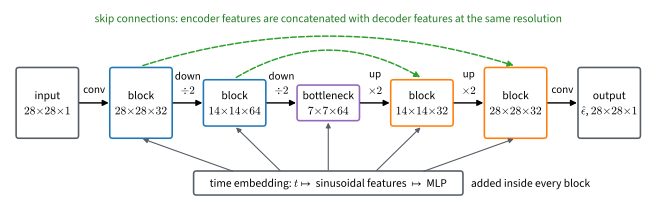
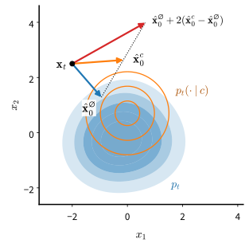

# Diffusion for Images
:label:`sec_diffusion-images`

The model of the last section drew points in the plane, and nothing in it
used the number two. The regression onto the velocity, the Euler steps that
integrate it and the ancestral chain apply unchanged to a $28 \times 28$
image, a point in 784 dimensions. Most readers have used a system that turns
a text prompt into a picture, and some have moved a slider that makes the
picture follow the prompt more closely. What changes when $\mathbf{x}$ is an
image? Four things: the network that maps a noisy image and a time to a
prediction, the recipe that trains it, the way a label steers it, and the
number that tells us whether its samples are good, now that "it looks right"
has to be judged over thousands of images.

Each of the four has an origin. :citet:`ho2020denoising` took the U-Net of
:citet:`Ronneberger.Fischer.Brox.2015`, a segmentation network whose skip
connections carry fine detail past a coarse bottleneck, and gave it the noise
level as an extra input. :citet:`Dhariwal.Nichol.2021` and then
:citet:`Ho.Salimans.2022` found that pushing each prediction further in the
direction that a label adds makes samples more typical of the label and less
varied; this *guidance* is what the prompt slider controls.
:citet:`Heusel.Ramsauer.Unterthiner.ea.2017` proposed to compare generated
and real images through the statistics of their features under a trained
network, the measurement that image generation papers report.

We build all four on Fashion-MNIST, with a network small enough to train on
one GPU. The largest systems differ from it in scale, in the network and in
what they condition on, but they rest on the same four ideas.

:begin_tab:`pytorch`
The cell after the imports lets float32 matrix products run on the GPU's tensor cores
in TF32, a format with a shorter mantissa, which speeds up training.
:end_tab:

```{.python .input #image-diffusion-diffusion-models-for-images}
%%tab pytorch
import math
import numpy as np
import torch
from torch import nn
from torch.nn import functional as F
from d2l import torch as d2l
```

```{.python .input #image-diffusion-diffusion-models-for-images}
%%tab jax
import math
import numpy as np
import jax
from jax import numpy as jnp
from flax import nnx
import optax
from d2l import jax as d2l
```

```{.python .input #image-diffusion-diffusion-for-images-1}
%%tab pytorch
torch.set_float32_matmul_precision('high')  # tf32 matmuls on tensor cores
```

## The Denoising U-Net

### Skips, Resolutions and the Time Embedding

The network of :numref:`sec_diffusion-gaussian-paths`, `TimeMLP`, took a
point and a time and returned a point of the same size. An image network
keeps this contract: a noisy image $\mathbf{x}_t$ and the time $t$ in, a
prediction of the same shape out, here the velocity. Convolutions suit
images, but a stack of $3 \times 3$ convolutions at full resolution makes
each output pixel depend on a small window of the input, while at high noise
the network must decide from the whole image whether a blurred blob is a
shoe or a bag.

The U-Net works at several resolutions. An encoder halves the resolution
twice, from $28 \times 28$ to $14 \times 14$ to $7 \times 7$, and doubles the
channels once, from 64 to 128, so that a $3 \times 3$ convolution at the
bottom sees most of the image; a decoder upsamples back to $28 \times 28$.
The bottleneck alone would lose fine detail, the edge of a sleeve or the
stripes on a sneaker, so the decoder at each resolution also receives the
encoder's features at that resolution, concatenated to its own. These *skip
connections* give the network its U shape (:numref:`fig_diffusion-unet`).
Ronneberger et al. designed it to segment structures in microscope images,
a task that asks for one label per pixel: an output of the size of the input
that depends both on the whole image and on the detail at each pixel. A
denoiser asks for the same.


:label:`fig_diffusion-unet`

One network denoises at every noise level, and the best prediction changes
with the level: near $t = 0$ the clean image is almost the input, at $t = 1$
it can only be guessed as an average over many images. The time therefore
enters every block. `d2l.time_embedding` of :numref:`sec_diffusion-denoising`
maps $t$ to sines and cosines at 64 frequencies, spaced geometrically from 1
to 64 radians per unit of time. This is the construction of the positional
encodings of :numref:`sec_positional-information`, with frequencies chosen
for times between 0 and 1 instead of positions up to thousands, so that
nearby noise levels get clearly different features. A two-layer MLP turns
them into one vector, and each block adds a learned projection of that
vector to its feature maps, one bias per channel.

Each block applies two $3 \times 3$ convolutions with group normalization,
adds a projection of the conditioning embedding between them, and keeps a
residual connection around both. Group normalization computes its statistics
over groups of channels within one image, so unlike batch normalization it
does not mix the statistics of images at different noise levels.

:begin_tab:`jax`
`d2l.Conv` is `nnx.Conv` with weights and biases drawn from $U(-a, a)$,
$a = 1/\sqrt{\textrm{fan-in}}$, as `d2l.Linear` does for dense layers, in
place of Flax's default of LeCun-normal weights and zero biases.
:end_tab:

```{.python .input #image-diffusion-skips-resolutions-and-the-time-embedding-1}
%%tab pytorch
class UNetBlock(nn.Module):  #@save
    """Two 3x3 convolutions with group norm, a residual, and an embedding."""
    def __init__(self, c_in, c_out, emb_dim=None):
        super().__init__()
        self.norm1 = nn.GroupNorm(8, c_in)
        self.conv1 = nn.Conv2d(c_in, c_out, 3, padding=1)
        self.emb = nn.Linear(emb_dim, c_out) if emb_dim else None
        self.norm2 = nn.GroupNorm(8, c_out)
        self.conv2 = nn.Conv2d(c_out, c_out, 3, padding=1)
        self.skip = (nn.Conv2d(c_in, c_out, 1) if c_in != c_out
                     else nn.Identity())

    def forward(self, x, emb=None):
        h = self.conv1(F.silu(self.norm1(x)))
        if self.emb is not None:
            h = h + self.emb(emb)[:, :, None, None]
        h = self.conv2(F.silu(self.norm2(h)))
        return h + self.skip(x)
```

```{.python .input #image-diffusion-skips-resolutions-and-the-time-embedding-1}
%%tab jax
class Conv(nnx.Conv):  #@save
    """nnx.Conv (kernel_size a tuple), all weights from U(+-1/sqrt(fan_in))."""
    def __init__(self, in_features, out_features, kernel_size, *, rngs,
                 **kwargs):
        a = (in_features * math.prod(kernel_size)) ** -0.5
        init = lambda key, shape, dtype=jnp.float32: jax.random.uniform(
            key, shape, dtype, -a, a)
        super().__init__(in_features, out_features, kernel_size,
                         kernel_init=init, bias_init=init, rngs=rngs,
                         **kwargs)

class UNetBlock(nnx.Module):  #@save
    """Two 3x3 convolutions with group norm, a residual, and an embedding."""
    def __init__(self, c_in, c_out, emb_dim=None, *, rngs):
        norm = lambda c: nnx.GroupNorm(c, num_groups=8, epsilon=1e-5,
                                       use_fast_variance=False, rngs=rngs)
        self.norm1, self.norm2 = norm(c_in), norm(c_out)
        self.conv1 = d2l.Conv(c_in, c_out, (3, 3), rngs=rngs)
        self.emb = d2l.Linear(emb_dim, c_out, rngs=rngs) if emb_dim else None
        self.conv2 = d2l.Conv(c_out, c_out, (3, 3), rngs=rngs)
        self.skip = (d2l.Conv(c_in, c_out, (1, 1), rngs=rngs)
                     if c_in != c_out else None)

    def __call__(self, x, emb=None):
        h = self.conv1(nnx.silu(self.norm1(x)))
        if self.emb is not None:
            h = h + self.emb(emb)[:, None, None, :]
        h = self.conv2(nnx.silu(self.norm2(h)))
        return h + (x if self.skip is None else self.skip(x))
```

The U-Net goes down to $7 \times 7$ with two stride-2 convolutions and back
up by nearest-neighbor up-sampling to the size of each skip.

```{.python .input #image-diffusion-skips-resolutions-and-the-time-embedding-2}
%%tab pytorch
class UNet(nn.Module):  #@save
    """A small U-Net on an image x (n, c, h, w), times t (n,) and labels y.

    y = num_classes is the null label. cond (n, emb_dim), if given, is added
    to the time features; the flow map of the few-step section passes the
    embedding of its step size there. time_freqs: see time_embedding."""
    def __init__(self, ch=64, num_classes=None, in_channels=1,
                 out_channels=1, emb_dim=128, time_freqs=(1.0, 64.0)):
        super().__init__()
        self.emb_dim, self.num_classes = emb_dim, num_classes
        self.time_freqs = time_freqs
        self.label_emb = (nn.Embedding(num_classes + 1, emb_dim)
                          if num_classes else None)
        self.emb_mlp = d2l.make_mlp([emb_dim] * 3, nn.SiLU())
        self.inc = nn.Conv2d(in_channels, ch, 3, padding=1)
        self.down1 = UNetBlock(ch, ch, emb_dim)                   # 28 x 28
        self.pool1 = nn.Conv2d(ch, ch, 3, stride=2, padding=1)    # 14 x 14
        self.down2 = UNetBlock(ch, 2 * ch, emb_dim)
        self.pool2 = nn.Conv2d(2 * ch, 2 * ch, 3, stride=2, padding=1)  # 7 x 7
        self.mid = UNetBlock(2 * ch, 2 * ch, emb_dim)
        self.up1 = UNetBlock(4 * ch, ch, emb_dim)                 # 14 x 14
        self.up0 = UNetBlock(2 * ch, ch, emb_dim)                 # 28 x 28
        self.outc = nn.Sequential(nn.GroupNorm(8, ch), nn.SiLU(),
                                  nn.Conv2d(ch, out_channels, 3, padding=1))

    def forward(self, x, t, y=None, cond=None):
        emb = d2l.time_embedding(t, self.emb_dim, self.time_freqs)
        if y is not None:
            emb = emb + self.label_emb(y)
        if cond is not None:
            emb = emb + cond
        emb = self.emb_mlp(emb)
        up = lambda h, skip: torch.cat([F.interpolate(
            h, size=skip.shape[-2:], mode='nearest-exact'), skip], 1)
        h1 = self.down1(self.inc(x), emb)
        h2 = self.down2(self.pool1(h1), emb)
        h = self.mid(self.pool2(h2), emb)
        h = self.up1(up(h, h2), emb)  # skip connection
        h = self.up0(up(h, h1), emb)  # skip connection
        return self.outc(h)
```

```{.python .input #image-diffusion-skips-resolutions-and-the-time-embedding-2}
%%tab jax
class UNet(nnx.Module):  #@save
    """A small U-Net on an image x (n, h, w, c), times t (n,) and labels y.

    y = num_classes is the null label. cond (n, emb_dim), if given, is added
    to the time features; the flow map of the few-step section passes the
    embedding of its step size there. time_freqs: see time_embedding."""
    def __init__(self, ch=64, num_classes=None, in_channels=1,
                 out_channels=1, emb_dim=128, time_freqs=(1.0, 64.0), *,
                 rngs):
        self.emb_dim, self.num_classes = emb_dim, num_classes
        self.time_freqs = time_freqs
        init = nnx.initializers.normal(1.0)  # N(0, 1), as in PyTorch
        self.label_emb = (nnx.Embed(num_classes + 1, emb_dim, rngs=rngs,
                                    embedding_init=init)
                          if num_classes else None)
        self.emb_mlp = d2l.make_mlp([emb_dim] * 3, nnx.silu, rngs=rngs)
        conv = lambda a, b, **kw: d2l.Conv(a, b, (3, 3), rngs=rngs, **kw)
        self.inc = conv(in_channels, ch)
        self.down1 = UNetBlock(ch, ch, emb_dim, rngs=rngs)        # 28 x 28
        self.pool1 = conv(ch, ch, strides=2, padding=1)           # 14 x 14
        self.down2 = UNetBlock(ch, 2 * ch, emb_dim, rngs=rngs)
        self.pool2 = conv(2 * ch, 2 * ch, strides=2, padding=1)   # 7 x 7
        self.mid = UNetBlock(2 * ch, 2 * ch, emb_dim, rngs=rngs)
        self.up1 = UNetBlock(4 * ch, ch, emb_dim, rngs=rngs)      # 14 x 14
        self.up0 = UNetBlock(2 * ch, ch, emb_dim, rngs=rngs)      # 28 x 28
        self.norm = nnx.GroupNorm(ch, num_groups=8, epsilon=1e-5,
                                  use_fast_variance=False, rngs=rngs)
        self.outc = conv(ch, out_channels)

    def __call__(self, x, t, y=None, cond=None):
        emb = d2l.time_embedding(t, self.emb_dim, self.time_freqs)
        if y is not None:
            emb = emb + self.label_emb(y)
        if cond is not None:
            emb = emb + cond
        emb = self.emb_mlp(emb)
        up = lambda h, skip: jnp.concatenate([jax.image.resize(
            h, h.shape[:1] + skip.shape[1:3] + h.shape[3:], 'nearest'),
            skip], -1)
        h1 = self.down1(self.inc(x), emb)
        h2 = self.down2(self.pool1(h1), emb)
        h = self.mid(self.pool2(h2), emb)
        h = self.up1(up(h, h2), emb)  # skip connection
        h = self.up0(up(h, h1), emb)  # skip connection
        return self.outc(nnx.silu(self.norm(h)))
```

Where does such a network keep its parameters, and where does it compute?
A $3 \times 3$ convolution has the same weights at any resolution but runs
once per pixel, so the same layer costs sixteen times as much at
$28 \times 28$ as at $7 \times 7$. We build the network with 64 channels
at full resolution and ten classes, and count both at each resolution.

```{.python .input #image-diffusion-skips-resolutions-and-the-time-embedding-3}
%%tab pytorch
torch.manual_seed(0)
dev = d2l.try_gpu()
net = UNet(ch=64, num_classes=10).to(dev)
levels = {28: ['inc', 'down1', 'up0', 'outc'], 14: ['pool1', 'down2', 'up1'],
          7: ['pool2', 'mid']}  # the blocks whose output has each size
for side, names in levels.items():
    params = [p for n in names for p in getattr(net, n).parameters()]
    kernels = sum(p.numel() for p in params if p.dim() == 4)  # convolutions
    print(f'{side} x {side}: {sum(p.numel() for p in params):,} parameters, '
          f'{kernels * side ** 2 / 1e6:.0f}M multiply-adds per image')
print(f'total: {d2l.num_params(net):,} parameters')
```

```{.python .input #image-diffusion-skips-resolutions-and-the-time-embedding-3}
%%tab jax
net = UNet(ch=64, num_classes=10, rngs=nnx.Rngs(0))
levels = {28: ['inc', 'down1', 'up0', 'norm', 'outc'],
          14: ['pool1', 'down2', 'up1'], 7: ['pool2', 'mid']}
for side, names in levels.items():  # the blocks whose output has each size
    params = [p for n in names
              for p in jax.tree.leaves(nnx.state(getattr(net, n), nnx.Param))]
    kernels = sum(p.size for p in params if p.ndim == 4)  # convolutions
    print(f'{side} x {side}: {sum(p.size for p in params):,} parameters, '
          f'{kernels * side ** 2 / 1e6:.0f}M multiply-adds per image')
print(f'total: {d2l.num_params(net):,} parameters')
```

The two lower levels hold four fifths of the parameters and cost two fifths
of the arithmetic; the full-resolution level holds a sixth of the parameters
and costs more than half. At $7 \times 7$ the bottleneck has 38% of the
weights for 8% of the multiply-adds. Depth at low resolution is cheap, which
is why a U-Net puts its widest layers at the bottom. One evaluation of the
network costs about a quarter of a billion multiply-adds, a number to keep
in mind when we count how many evaluations a sample takes.

This is a deliberately bare U-Net. Its 1.2 million parameters are a
thirtieth of the 35.7 million of the CIFAR-10 model of
:citet:`ho2020denoising`. That model works at four resolutions with two
residual blocks at each and adds self-attention at $16 \times 16$ and
dropout; its released code also sets the last convolution of every block to
zero at initialization, so that each block starts as its skip path. We use
none of these, and the samples below are still recognizable garments. Since
2024, most new large image generators have replaced the U-Net by a
transformer on patches of a compressed image, conditioned on a text prompt
rather than a class (:numref:`sec_diffusion-latent`); the rest of this
section carries over unchanged.

### Conditioning on a Class

A class label is one more input, and the U-Net already has a place for such
inputs: the embedding that every block adds to its features. A table with
one learned vector per class supplies the label's vector, which is added to
the time features before the MLP. The table has one extra row, the *null
label* $\varnothing$ (index 10 here), which stands for "no class given".

During training we replace each label by the null label with probability
$0.1$, a step called *label dropout*. The one network then learns two
predictions: $\mathbf{u}_{\boldsymbol{\theta}}(\mathbf{x}_t, t, c)$, the
velocity of the images of class $c$, and
$\mathbf{u}_{\boldsymbol{\theta}}(\mathbf{x}_t, t, \varnothing)$, the
velocity of all of Fashion-MNIST, trained on one example in ten. Why teach
a network to ignore the label it is given? Guidance, at the end of this
section (:numref:`subsec_diffusion-images-guided`), needs the prediction
without a label as a baseline for the one with it, and label dropout
supplies it in the same network at almost no cost.
:citet:`Ho.Salimans.2022` found dropout rates of $0.1$ and $0.2$ to work
better than $0.5$: a baseline needs less data than the predictions it
serves.

A sampler integrates a field of $(\mathbf{x}, t)$ alone. `conditional` fixes
the labels $c$ of a batch and turns the network into the field
$(\mathbf{x}, t) \mapsto \mathbf{u}_{\boldsymbol{\theta}}(\mathbf{x}, t, c)$.

```{.python .input #image-diffusion-conditioning-on-a-class}
%%tab pytorch, jax
def conditional(net, c):  #@save
    """The field (x, t) -> net(x, t, c) with the labels c fixed."""
    return lambda x, t: net(x, t, c)
```

## Training and Sampling

### The Loss and the Cost

The loss is that of :numref:`sec_diffusion-gaussian-paths` with images in
place of points. We draw a clean image $\mathbf{x}_0$ in $[-1, 1]$ with its
label, a time $t$ uniform on $[0, 1]$ and noise $\boldsymbol{\epsilon}$,
and form $\mathbf{x}_t = (1 - t)\, \mathbf{x}_0 + t\, \boldsymbol{\epsilon}$
on the linear path. The network's output is regressed onto the conditional
velocity $\boldsymbol{\epsilon} - \mathbf{x}_0$, with the squared error
averaged over the pixels. The only addition is label dropout, which
`batch_fn` applies to each batch of 128 images.

```{.python .input #image-diffusion-one-trainer-1}
%%tab pytorch
X, y, X_test, y_test = d2l.load_fashion_mnist_pm1()
path = d2l.GaussianPath.linear()

def batch_fn():
    i = torch.randint(0, len(X), (128,), device=X.device)
    drop = torch.rand(128, device=X.device) < 0.1   # label dropout
    return X[i], torch.where(drop, 10, y[i])        # 10 is the null label

def loss_fn(net, batch):
    x0, c = batch
    t, eps = torch.rand(len(x0), device=x0.device), torch.randn_like(x0)
    x_t = path.sample(x0, t, eps)
    return ((net(x_t, t, c) - path.target('velocity', x0, eps, t)) ** 2).mean()
```

```{.python .input #image-diffusion-one-trainer-1}
%%tab jax
X, y, X_test, y_test = d2l.load_fashion_mnist_pm1()
path = d2l.GaussianPath.linear()

def batch_fn(key):
    k1, k2 = jax.random.split(key)
    i = jax.random.randint(k1, (128,), 0, len(X))
    drop = jax.random.uniform(k2, (128,)) < 0.1     # label dropout
    return X[i], jnp.where(drop, 10, y[i])          # 10 is the null label

def loss_fn(net, batch, key):
    x0, c = batch
    k1, k2 = jax.random.split(key)
    t, eps = jax.random.uniform(k1, (len(x0),)), jax.random.normal(k2, x0.shape)
    x_t = path.sample(x0, t, eps)
    return ((net(x_t, t, c) - path.target('velocity', x0, eps, t)) ** 2).mean()
```

`d2l.train_regression` of :numref:`sec_diffusion-denoising` runs Adam on
this loss and returns the trained network, a moving average of its weights
and the losses. We use a constant learning rate of $10^{-3}$ for 15,000
updates; :citet:`ho2020denoising` trained with $2 \cdot 10^{-4}$ for 800,000
updates, more than fifty times as many.

Training is the cheaper part of this section. It passes
$15{,}000 \times 128 \approx 1.9$ million images forward and backward
through the network. The samples we draw below, some with a thousand steps
each, take about 20 million evaluations: three and a half times the arithmetic of
training, counting a backward pass as two forward ones. Drawing samples
from a diffusion model can cost more than teaching it to draw them, and much
of the rest of this chapter is about cutting that cost. On an RTX 4090 the section runs in less than an hour; on a CPU it
would take many hours. A reader without a GPU can score 1,000 samples
instead of 5,000 and read the result against the reference value at 1,000
images, which we compute below.

```{.python .input #image-diffusion-one-trainer-2}
%%tab pytorch
num_steps = 15_000
net, ema, losses = d2l.train_regression(net, loss_fn, batch_fn, num_steps)
d2l.plot(torch.arange(100, num_steps + 1, 100),
         losses.reshape(-1, 100).mean(1).cpu(), 'update', 'loss', yscale='log')
```

```{.python .input #image-diffusion-one-trainer-2}
%%tab jax
num_steps = 15_000
net, ema, losses = d2l.train_regression(net, loss_fn, batch_fn, num_steps,
                                        jax.random.key(0))
d2l.plot(jnp.arange(100, num_steps + 1, 100),
         losses.reshape(-1, 100).mean(1), 'update', 'loss', yscale='log')
```

The loss per pixel, averaged over blocks of 100 updates, falls from about
0.5 to about 0.2, most of the way within the first thousand updates. It
levels off well above zero because its floor is the conditional variance of
the velocity target (:numref:`sec_diffusion-gaussian-paths`): at large $t$
many clean images are consistent with one noisy image.

### Samples and Predictions

To sample, `d2l.make_pred` of :numref:`sec_diffusion-integration` turns a
field into a predictor of the clean image and the noise, and
`d2l.ode_sample` integrates the probability-flow ODE from $t = 1$ to $t = 0$,
here with 50 Euler steps. `generate` takes the field as an argument,
`conditional` by default; guidance will pass another. It draws $n$ images,
the $i$-th of class $i \bmod 10$, in chunks. Its initial noise comes from a
seed, 0 unless we say otherwise, so two calls with the same seed differ only
in what we change between them.

```{.python .input #image-diffusion-one-trainer-3}
%%tab pytorch
euler50 = lambda pred, x: d2l.ode_sample(pred, x, path.sigma_bars(50))

def generate(model, field=conditional, sampler=euler50, n=5000, chunk=500,
             seed=0):
    """n samples of field(model, c) from the noise of a seed; the i-th
    requests class i % 10."""
    gen = torch.Generator(dev).manual_seed(seed)
    z = torch.randn(n, 1, 28, 28, device=dev, generator=gen)
    c = torch.arange(n, device=z.device) % 10
    out = [sampler(d2l.make_pred(field(model, c_k), path, 'velocity'), z_k)
           for z_k, c_k in zip(z.split(chunk), c.split(chunk))]
    return torch.cat(out).clamp(-1, 1)

names = d2l.FashionMNIST().text_labels(range(10))
d2l.show_gray(generate(ema, n=40), 4, 10, titles=names + [''] * 30);
```

```{.python .input #image-diffusion-one-trainer-3}
%%tab jax
euler50 = lambda pred, x, key: d2l.ode_sample(pred, x, path.sigma_bars(50))

@nnx.jit(static_argnums=(1, 5))  # Python functions: one trace for each
def sample_chunk(model, field, c, z, key, sampler):
    return sampler(d2l.make_pred(field(model, c), path, 'velocity'), z, key)

def generate(model, field=conditional, sampler=euler50, n=5000, chunk=500,
             seed=0):
    """n samples of field(model, c) from the noise of a seed; the i-th
    requests class i % 10."""
    kz, ks = jax.random.split(jax.random.key(seed))
    z, c = jax.random.normal(kz, (n, 28, 28, 1)), jnp.arange(n) % 10
    out = [sample_chunk(model, field, c[i:i + chunk], z[i:i + chunk],
                        jax.random.fold_in(ks, i), sampler)
           for i in range(0, n, chunk)]
    return jnp.concatenate(out).clip(-1, 1)

names = d2l.FashionMNIST().text_labels(range(10))
d2l.show_gray(generate(ema, n=40), 4, 10, titles=names + [''] * 30);
```

Each column holds four samples of one class. Most are recognizable members
of the requested class, with varied shapes, prints and shades; some are
malformed, and shirts, pullovers and coats are hard to tell apart, as among
real images.

A sampler asks the network the same question at every level of noise: which
clean image lies behind this one? To see what it can still answer at each
level, the first row below noises one test image, an ankle boot, at six
times on the linear path. The second row shows the clean image
$\hat{\mathbf{x}}_0 = \mathbf{x}_t - t\, \mathbf{u}_{\boldsymbol{\theta}}(\mathbf{x}_t, t, c)$
that the network implies at each of them, given the label. We can predict
both ends of the second row. At $t = 0$ the input is the image. At $t = 1$
it is pure noise, and a network trained with squared error predicts the
posterior mean (:numref:`sec_diffusion-denoising`) given what is left, the
label: the average training image of the class. The first two printed rows
give the root-mean-square distance per pixel of each $\hat{\mathbf{x}}_0$
from the image and from that average.

The third row turns to the sampler itself. It starts from fresh noise and
takes the 50 Euler steps of `euler50` toward an ankle boot, and at
$t = 1, 0.8, \ldots, 0.2$ it records the clean image that the network
implies along the way. The column $t = 0$ holds the finished sample, and the
last printed row gives the distance of each prediction from it.

```{.python .input #image-diffusion-one-trainer-4}
%%tab pytorch
torch.manual_seed(0)
ts = torch.linspace(0, 1, 6, device=dev)
x0, c = X_test[:1].expand(6, -1, -1, -1), y_test[:1].expand(6)
x_t = path.sample(x0, ts, torch.randn_like(x0[:1]).expand_as(x0))
with torch.no_grad():
    x0_hat = path.x0_eps('velocity', ema(x_t, ts, c), x_t, ts)[0]
rms = lambda a, b: ((a - b) ** 2).mean((1, 2, 3)).sqrt().tolist()
for name, ref in (('image', x0), ('class mean', X[y == c[0]].mean(0))):
    print(f'RMS from the {name}:', ' '.join(f'{e:.2f}' for e in rms(x0_hat, ref)))
x, grid, traj = torch.randn_like(x0[:1]), torch.linspace(1, 0, 51), []
with torch.no_grad():  # one sample of the class: 50 Euler steps from noise
    for i in range(50):
        t = grid[i].item()
        u = ema(x, torch.full((1,), t, device=dev), c[:1])
        if i % 10 == 0:                        # t = 1.0, 0.8, ..., 0.2
            traj.append(x - t * u)             # its predicted clean image
        x = x + (grid[i + 1].item() - t) * u
traj = torch.cat([x] + traj[::-1])             # from t = 0 (the sample) to 1
print('RMS from the sample:', ' '.join(f'{e:.2f}' for e in rms(traj, x)))
d2l.show_gray(torch.cat([x_t, x0_hat, traj]), 3, 6,
              titles=[f't = {t:.1f}' for t in ts.tolist()] + [''] * 12);
```

```{.python .input #image-diffusion-one-trainer-4}
%%tab jax
ts = jnp.linspace(0, 1, 6)
x0, c = jnp.repeat(X_test[:1], 6, 0), jnp.repeat(y_test[:1], 6)
eps = jax.random.normal(jax.random.key(1), x0[:1].shape)
x_t = path.sample(x0, ts, jnp.repeat(eps, 6, 0))
x0_hat = path.x0_eps('velocity', ema(x_t, ts, c), x_t, ts)[0]
rms = lambda a, b: jnp.sqrt(((a - b) ** 2).mean((1, 2, 3))).tolist()
for name, ref in (('image', x0), ('class mean', X[y == c[0]].mean(0))):
    print(f'RMS from the {name}:', ' '.join(f'{e:.2f}' for e in rms(x0_hat, ref)))
x = jax.random.normal(jax.random.key(2), x0[:1].shape)
grid, traj = jnp.linspace(1, 0, 51), []
for i in range(50):  # one sample of the class: 50 Euler steps from noise
    t = float(grid[i])
    u = ema(x, jnp.full((1,), t), c[:1])
    if i % 10 == 0:                            # t = 1.0, 0.8, ..., 0.2
        traj.append(x - t * u)                 # its predicted clean image
    x = x + (float(grid[i + 1]) - t) * u
traj = jnp.concatenate([x] + traj[::-1])       # from t = 0 (the sample) to 1
print('RMS from the sample:', ' '.join(f'{e:.2f}' for e in rms(traj, x)))
d2l.show_gray(jnp.concatenate([x_t, x0_hat, traj]), 3, 6,
              titles=[f't = {t:.1f}' for t in ts.tolist()] + [''] * 12);
```

Both ends come out as predicted: at $t = 1$ the prediction lies within 0.07
of the average ankle boot and more than 0.4 from the image. In between, the
network sees better than our eyes. At $t = 0.6$ the boot is hard to find in
the noise, yet the prediction still has its outline and lies less than 0.2
from this boot against more than 0.4 from the average one. Detail
disappears first and the outline last.

A sampler visits the levels in the opposite order, and the third row shows
what that order does. At $t = 1$ the prediction is the blurred average
boot, 0.3 to 0.4 away from the sample it will become. By $t = 0.6$ it lies within 0.12 to 0.14 of that sample and
already has its final outline, while the image it is computed from is
still six parts noise to four parts boot. The remaining steps sharpen the
edges and add shading and texture. A sample settles its shape early and its
surface late; Exercise :exref:`ex_image-diffusion-guidance-interval` puts
this to use.

### The Moving Average

We sampled from `ema`, a moving average of the weights, not from the weights
of the last update. With a constant learning rate the iterates of Adam do
not settle: each update carries the noise of its minibatch, so the iterates
wander in a cloud around a good region, and an average of recent iterates
lies nearer its center :cite:`Polyak.Juditsky.1992`. `d2l.EMA` of
:numref:`sec_dcgan` keeps an exponential moving average. After every update
it moves the average a small step toward the current weights,

$$\bar{\boldsymbol{\theta}} \leftarrow \bar{\boldsymbol{\theta}} + \big(1 - 2^{-1/n_{1/2}}\big)\, (\boldsymbol{\theta} - \bar{\boldsymbol{\theta}}),$$

so that the weights of $n_{1/2}$ updates ago count half as much as the
current ones; $n_{1/2}$ is the *half-life*. We use $n_{1/2} = 1000$, which
closes 0.07% of the gap at each update. Papers and libraries specify the
*decay* $2^{-1/n_{1/2}}$ instead, here 0.9993, so it helps to translate.

The half-life has to suit the run. Too short, and the average keeps the
noise of the last steps; too long, and it reaches back to early weights
still far from the good region. :citet:`ho2020denoising` use a decay of
0.9999, a half-life of about 7,000 updates in a run of 800,000. How much the
average helps is the first thing we measure once we have a measure.

## Measuring Sample Quality

### Fréchet Distance in Learned Features

A grid of forty samples shows whether samples look plausible. It cannot tell
whether 5,000 of them have the right variety, whether there are too many
bags and too few sandals, or which of two models that both look fine is
better. For that we need a number that compares the distribution of the
samples with that of real images.

Pixels are the wrong space for such a comparison: shifting a sneaker by two
pixels moves the image far in Euclidean distance without changing what it
shows. We therefore compare images in the feature space of a classifier,
where images of similar content lie close together. The *Fréchet distance*
(FD) of :citet:`Heusel.Ramsauer.Unterthiner.ea.2017` fits Gaussians
$\mathcal{N}(\boldsymbol{\mu}_p, \boldsymbol{\Sigma}_p)$ and
$\mathcal{N}(\boldsymbol{\mu}_q, \boldsymbol{\Sigma}_q)$ to the features of
real and generated images and reports the squared Wasserstein-2 distance
between them, given in :numref:`sec_dcgan`:

$$\mathrm{FD} = \|\boldsymbol{\mu}_p - \boldsymbol{\mu}_q\|^2 + \mathrm{tr}\Big(\boldsymbol{\Sigma}_p + \boldsymbol{\Sigma}_q - 2\big(\boldsymbol{\Sigma}_p^{1/2} \boldsymbol{\Sigma}_q \boldsymbol{\Sigma}_p^{1/2}\big)^{1/2}\Big).$$
:eqlabel:`eq_diffusion-fd`

The first term grows when the average sample differs from the average real
image, for example when one class is generated too often; the second when
the spread differs, for example when all generated coats look alike. Both
vanish only if the two Gaussians coincide.

Published scores, called FID, use the features of an Inception network
trained on ImageNet. As in :numref:`sec_dcgan`, we train our own instead:
`d2l.FeatureCNN` (:numref:`subsec_utils_feature_cnn`), a small convolutional
classifier with 128 features, trained on Fashion-MNIST for 15 epochs with
the gray channel repeated three times. Because the feature network is our
own, we call the score FD and never compare it with published values.
`fashion_feature_cnn` trains it, and `fd_features` computes the features of
images, 1,000 at a time; the network's head assigns each image a class.

```{.python .input #image-diffusion-fr-chet-distance-in-learned-features-1}
%%tab pytorch
def fashion_feature_cnn(X, y):  #@save
    """The feature network that judges Fashion-MNIST samples in this chapter."""
    cnn = d2l.FeatureCNN(resolution=28).to(X.device)
    d2l.train_feature_cnn(cnn, X.expand(-1, 3, -1, -1), y)
    return cnn

def fd_features(cnn, imgs):  #@save
    """Features of gray images (n, 1, 28, 28) in [-1, 1], on the CPU."""
    rgb = lambda x: x.clamp(-1, 1).expand(-1, 3, -1, -1)
    return d2l.batched(lambda x: cnn.features(rgb(x)), imgs).cpu()

cnn = fashion_feature_cnn(X, y)
f_test = fd_features(cnn, X_test)
c_test = cnn.head(f_test.to(dev)).argmax(1)
print(f'test accuracy {(c_test == y_test).float().mean():.3f}')
```

```{.python .input #image-diffusion-fr-chet-distance-in-learned-features-1}
%%tab jax
def fashion_feature_cnn(X, y):  #@save
    """The feature network that judges Fashion-MNIST samples in this chapter."""
    cnn = d2l.FeatureCNN(resolution=28, rngs=nnx.Rngs(0))
    d2l.train_feature_cnn(cnn, jnp.repeat(X, 3, -1), y)
    return cnn

@nnx.jit  #@save
def gray_features(cnn, x):
    """Features of gray images (n, 28, 28, 1), clipped to [-1, 1]."""
    return cnn.features(jnp.repeat(jnp.clip(x, -1, 1), 3, -1))

def fd_features(cnn, imgs):  #@save
    """Features of gray images (n, 28, 28, 1) in [-1, 1]."""
    return d2l.batched(lambda x: gray_features(cnn, x), imgs)

cnn = fashion_feature_cnn(X, y)
f_test = fd_features(cnn, X_test)
c_test = cnn.head(f_test).argmax(1)
print(f'test accuracy {(c_test == y_test).mean():.3f}')
```

The feature network classifies about 93% of the test images correctly, so
its features separate the classes. `fd_and_agreement` computes the FD of a
set of samples against reference features, together with their *class
agreement*, the fraction of samples that the feature network assigns to the
requested class. We score 5,000 samples against the first 5,000 test
images.

```{.python .input #image-diffusion-fr-chet-distance-in-learned-features-2}
%%tab pytorch
def fd_and_agreement(cnn, imgs, f_ref):
    """FD to the reference features, and the fraction of samples that the
    feature network assigns to the requested class i % 10."""
    f = fd_features(cnn, imgs)
    cls = cnn.head(f.to(imgs.device)).argmax(1)
    agree = (cls == torch.arange(len(imgs), device=cls.device) % 10)
    return d2l.fid_score(f, f_ref), agree.float().mean().item()

fd_ema, agree_ema = fd_and_agreement(cnn, generate(ema), f_test[:5000])
print(f'5,000 samples: FD {fd_ema:.2f}, class agreement {agree_ema:.3f}')
```

```{.python .input #image-diffusion-fr-chet-distance-in-learned-features-2}
%%tab jax
def fd_and_agreement(cnn, imgs, f_ref):
    """FD to the reference features, and the fraction of samples that the
    feature network assigns to the requested class i % 10."""
    f = fd_features(cnn, imgs)
    agree = (cnn.head(f).argmax(1) == jnp.arange(len(imgs)) % 10).mean()
    return d2l.fid_score(f, f_ref), float(agree)

fd_ema, agree_ema = fd_and_agreement(cnn, generate(ema), f_test[:5000])
print(f'5,000 samples: FD {fd_ema:.2f}, class agreement {agree_ema:.3f}')
```

The samples score an FD of about 0.8, and the feature network assigns
nearly 90% of them to the class they asked for. Is an FD of 0.8 good? The
number depends on the feature network and on the number of images, and by
itself it says nothing; the next subsection supplies a scale.

### A Reference Value for the Fréchet Distance
:label:`subsec_diffusion-fd-reference`

Two sets of real images also have a positive FD. Their sample means and
covariances differ by chance, and the plug-in estimate of
:eqref:`eq_diffusion-fd` is biased upward, mostly in the trace term, by an
amount roughly proportional to $1/n$ for $n$ images per set. To see how
large this is, we score five disjoint sets of real training images against
the first $n$ test images, the reference set of the samples, at
$n = 1{,}000$ and at $n = 5{,}000$. We call the result the *reference value*
of the FD at that size. If the bias goes as $1/n$, the value at 5,000 images
should be about a fifth of that at 1,000. Next to it we print the kernel
inception distance (KID) of :citet:`Binkowski.Sutherland.Arbel.ea.2018`,
an unbiased estimate of the squared maximum mean discrepancy with a cubic
kernel on the same features (:numref:`sec_dcgan`), whose expected value for
two sets of real images is zero at every $n$.

```{.python .input #image-diffusion-reading-the-number-1}
%%tab pytorch, jax
f_real = fd_features(cnn, X[:25_000])  # five disjoint sets of 5,000
for n in (1000, 5000):
    sets = [f_real[i * n:(i + 1) * n] for i in range(5)]
    fd = np.array([float(d2l.fid_score(f, f_test[:n])) for f in sets])
    kid = np.array([float(d2l.kid_score(f, f_test[:n])) for f in sets])
    print(f'{n:,} real images, five sets: FD {fd.mean():.2f} '
          f'({fd.min():.2f} to {fd.max():.2f}), KID {kid.mean():.4f} '
          f'({kid.min():.4f} to {kid.max():.4f})')
```

The prediction holds: the reference value is a little under 0.9 at 1,000
images and about 0.17 at 5,000, five times smaller. KID has no such bias,
but it is noisy: at 1,000 images its five values spread over a few
hundredths on both sides of zero, so that one value alone says little, and
at 5,000 over a few thousandths. Papers report the FD, so this chapter does
too, and corrects for its bias by comparison rather than by formula.

The rest of the chapter compares FDs only at the same number of images and
with the same feature network. It treats two FDs of 5,000 images that differ
by less than about 0.05, the spread of the five real sets, as equal; at
1,000 images that spread is 0.15 to 0.2.

Our samples, at about 0.8, lie about five times above the reference value
at 5,000 images; the gap is the error of our model. Yet they score lower
than two sets of 1,000 real images do against each other. A Fréchet
distance without its number of images is meaningless.

With a scale in hand we can ask how much the moving average helps, and
whether a thousand-step sampler beats fifty Euler steps. The thousand-step
sampler is the ancestral chain of :numref:`sec_diffusion-integration`, run
on the variance-preserving path of :citet:`ho2020denoising`. Our network
was trained on the linear path, but that does not matter: `make_pred` finds
the time on the network's own path with the same signal-to-noise ratio and
rescales, so any trained network serves any path. The comparison is paired:
all three samplers start from the same initial noise, so differences between
noise draws do not enter it, and we repeat it for three draws.

```{.python .input #image-diffusion-reading-the-number-2}
%%tab pytorch
vp = d2l.GaussianPath.vp()
ancestral1000 = lambda pred, x: d2l.ancestral_sample(pred, x, vp, 1000)
```

```{.python .input #image-diffusion-reading-the-number-2}
%%tab jax
vp = d2l.GaussianPath.vp()
ancestral1000 = lambda pred, x, key: d2l.ancestral_sample(pred, x, vp, 1000,
                                                          key)
```

```{.python .input #image-diffusion-reading-the-number-3}
%%tab pytorch, jax
for seed in range(3):  # three draws of the initial noise
    fd = [fd_and_agreement(cnn, generate(model, sampler=sampler, seed=seed),
                           f_test[:5000])[0]
          for model, sampler in ((ema, euler50), (net, euler50),
                                 (ema, ancestral1000))]
    print(f'noise {seed}: Euler 50 average {fd[0]:.2f}, last weights '
          f'{fd[1]:.2f} ({fd[1] - fd[0]:+.2f}); chain with 1,000 steps '
          f'{fd[2]:.2f} ({fd[2] - fd[0]:+.2f})')
```

On this network the weights of the last update are worse than their average
in every draw, by 0.4 to 0.6, more than ten times as much as the average
moves between draws. How much worse depends on where the last update
happened to land in its cloud, and another training run would land
elsewhere. An average over the last few thousand updates depends much less
on such luck, which is the reason to sample from it. The thousand-step
chain scores 0.1 to 0.2 lower than fifty Euler steps, again in every draw.
It changes the path, the sampler and the number of steps at once, so it
measures the combination, not any one of the three. That is a modest gain for twenty times the
evaluations, and from here on we measure with fifty Euler steps.

## Guidance

### Bayes' Rule on Scores

Our conditional samples already belong to their classes nearly 90% of the
time. Some do not: shirts, pullovers and coats were hard to tell apart. The slider
of the introduction asks for more, a sampler that follows the label more
closely than the trained network does. To see where such a sampler could
come from, let us look at what a label does to a score. Bayes' rule at time
$t$ reads $p_t(\mathbf{x} \mid c) =
p_t(\mathbf{x})\, p_t(c \mid \mathbf{x}) / p(c)$, where $p_t(c \mid
\mathbf{x})$ is the probability that a noisy image $\mathbf{x}$ at time $t$
came from a clean image of class $c$, and $p(c)$ drops out of the gradient
of the logarithm:

$$\nabla_{\mathbf{x}} \log p_t(\mathbf{x} \mid c) = \nabla_{\mathbf{x}} \log p_t(\mathbf{x}) + \nabla_{\mathbf{x}} \log p_t(c \mid \mathbf{x}).$$
:eqlabel:`eq_diffusion-bayes-score`

The score of the class is the score of all the data plus the gradient of a
classifier's log-probability. *Classifier guidance*
:cite:`Dhariwal.Nichol.2021` supplies the second term with a separate
classifier $p_{\boldsymbol{\phi}}(c \mid \mathbf{x}, t)$ and multiplies it
by a *guidance scale* $\gamma$:

$$\tilde{\mathbf{s}}(\mathbf{x}, t) = \nabla_{\mathbf{x}} \log p_t(\mathbf{x}) + \gamma\, \nabla_{\mathbf{x}} \log p_{\boldsymbol{\phi}}(c \mid \mathbf{x}, t).$$
:eqlabel:`eq_diffusion-classifier-guidance`

With $\gamma = 1$ this is Bayes' rule; :citet:`Dhariwal.Nichol.2021` found
that samples matched their classes much better with $\gamma > 1$. The
classifier must be trained on noisy images, since the sampler evaluates its
gradient at $\mathbf{x}_t$, where a classifier of clean images gives
meaningless gradients. The appendix treats the rule on a one-dimensional
mixture (:numref:`sec_mdl-ddim-guidance`); Exercise
:exref:`ex_image-diffusion-clean-classifier-guide` runs it on our images.

### Classifier-Free Guidance
:label:`subsec_diffusion-images-guided`

Classifier guidance needs a second network trained on noisy images, with
its own errors. :citet:`Ho.Salimans.2022` read
:eqref:`eq_diffusion-bayes-score` from right to left instead:

$$\nabla_{\mathbf{x}} \log p_t(c \mid \mathbf{x}) = \nabla_{\mathbf{x}} \log p_t(\mathbf{x} \mid c) - \nabla_{\mathbf{x}} \log p_t(\mathbf{x}).$$

The classifier's gradient is the difference between the conditional and the
unconditional score, and a network trained with label dropout provides both.
Substituting its two scores $\mathbf{s}_c$ and $\mathbf{s}_\varnothing$ into
:eqref:`eq_diffusion-classifier-guidance` gives the guided score
$\tilde{\mathbf{s}} = \mathbf{s}_\varnothing + \gamma(\mathbf{s}_c -
\mathbf{s}_\varnothing)$: classifier guidance with the classifier implicit
in the network.

Our network predicts velocities, not scores, but at a fixed point
$(\mathbf{x}, t)$ the velocity is an affine function of the score. On the
linear path the dictionary of :numref:`sec_diffusion-gaussian-paths` gives

$$\mathbf{u}_t(\mathbf{x}) = -\frac{\mathbf{x} + t\, \nabla_{\mathbf{x}} \log p_t(\mathbf{x})}{1 - t}.$$

The term $-\mathbf{x}/(1-t)$ does not depend on the label, and the weights
$1 - \gamma$ and $\gamma$ sum to one, so it passes through the combination
unchanged, and the guided velocity is the same combination of the two
velocities:

$$\tilde{\mathbf{u}}(\mathbf{x}, t) = \mathbf{u}_{\boldsymbol{\theta}}(\mathbf{x}, t, \varnothing) + \gamma \big(\mathbf{u}_{\boldsymbol{\theta}}(\mathbf{x}, t, c) - \mathbf{u}_{\boldsymbol{\theta}}(\mathbf{x}, t, \varnothing)\big).$$
:eqlabel:`eq_diffusion-cfg`

`cfg` computes this rule. It evaluates the network on one doubled batch,
the images once with their labels and once with the null label, so a guided
sample costs two evaluations per step. At $\gamma = 1$ the rule reduces to
the conditional field, and `cfg` returns `conditional(net, c)` without the
second half of the batch.

```{.python .input #image-diffusion-classifier-free-guidance}
%%tab pytorch
def cfg(net, c, gamma):  #@save
    """Classifier-free guidance: (x, t) -> u + gamma (u_c - u), u unlabeled.

    gamma is a Python number; at gamma = 1 this is conditional(net, c)."""
    if gamma == 1:
        return d2l.conditional(net, c)
    null = torch.full_like(c, net.num_classes)
    def guided(x, t):  # one doubled batch: labeled, then unlabeled
        out_c, out = net(torch.cat([x, x]), torch.cat([t, t]),
                         torch.cat([c, null])).chunk(2)
        return out + gamma * (out_c - out)
    return guided
```

```{.python .input #image-diffusion-classifier-free-guidance}
%%tab jax
def cfg(net, c, gamma):  #@save
    """Classifier-free guidance: (x, t) -> u + gamma (u_c - u), u unlabeled.

    gamma is a Python number; at gamma = 1 this is conditional(net, c)."""
    if gamma == 1:
        return d2l.conditional(net, c)
    null = jnp.full_like(c, net.num_classes)
    def guided(x, t):  # one doubled batch: labeled, then unlabeled
        out_c, out = jnp.split(net(jnp.concatenate([x, x]),
                                   jnp.concatenate([t, t]),
                                   jnp.concatenate([c, null])), 2)
        return out + gamma * (out_c - out)
    return guided
```

The affine argument holds for every target of the dictionary (Exercise
:exref:`ex_image-diffusion-equivalent-guidance`). :citet:`Ho.Salimans.2022`
write the rule as $(1 + w)\, \mathbf{u}_c - w\, \mathbf{u}_\varnothing$, so
their $w$ is our $\gamma - 1$. :numref:`fig_diffusion-guidance` draws the
rule on the running example: for $\gamma > 1$ the guided prediction lies on
the line through the unconditional and the conditional one, beyond the
conditional one.

![Classifier-free guidance on the three-mode mixture at one noise level. From a noisy point $\mathbf{x}_t$, arrows point to the posterior mean $\hat{\mathbf{x}}_0^{\varnothing}$ of all the data, to the posterior mean $\hat{\mathbf{x}}_0^{c}$ given the top mode, and to the guided prediction $\hat{\mathbf{x}}_0^{\varnothing} + \gamma(\hat{\mathbf{x}}_0^{c} - \hat{\mathbf{x}}_0^{\varnothing})$ at $\gamma = 2$, beyond $\hat{\mathbf{x}}_0^{c}$. Contours show the noised density and the noised density of the top mode.](../img/mdl-diffusion-guidance.svg)
:label:`fig_diffusion-guidance`

To see what $\gamma$ does to the samples, we generate 5,000 samples at each
of seven scales from the same noise. The FD measures how well they cover the
distribution of real images, the class agreement how well they follow their
labels.

```{.python .input #image-diffusion-classifier-free-guidance-1}
%%tab pytorch, jax
guided = lambda gamma: lambda net, c: cfg(net, c, gamma)
samples = {gamma: generate(ema, guided(gamma))
           for gamma in (0.0, 1.0, 1.25, 1.5, 2.0, 3.0, 4.0)}
for gamma, imgs in samples.items():
    fd, agree = fd_and_agreement(cnn, imgs, f_test[:5000])
    print(f'gamma {gamma:.2f}: FD {fd:5.2f}, class agreement {agree:.3f}')
```

At $\gamma = 0$ the label plays no part, and the agreement is at chance,
10%. The FD rises to 2.7 to 2.8, more than three times its value with the
label. The row $\gamma = 1$ repeats the first measurement, as it should with
the same noise: nearly 90% agreement, close to the 93% that the classifier
achieves on real test images.

Two causes could raise the FD at $\gamma = 0$: the sampler may produce the
classes in the wrong proportions, or it may produce images of each class
that differ from real ones. The next cell gives two clues and then a
measurement. It prints the mean term
$\|\boldsymbol{\mu}_p - \boldsymbol{\mu}_q\|^2$ of :eqref:`eq_diffusion-fd`
beside the whole FD, and the share of each class among the unguided samples
beside its share among the test images, both as the feature network
classifies them. Then it imposes the first cause alone on real images: it
draws 5,000 real training images, with their true labels, in the class
proportions of the unguided samples, and scores them beside 5,000 real
images in the even mix.

```{.python .input #image-diffusion-classifier-free-guidance-3}
%%tab pytorch
for gamma in (0.0, 1.0):
    f = fd_features(cnn, samples[gamma])
    mean_term = ((f.mean(0) - f_test[:5000].mean(0)) ** 2).sum()
    print(f'gamma {gamma:.1f}: mean term {mean_term:.2f} of FD '
          f'{d2l.fid_score(f, f_test[:5000]):.2f}')
share = lambda cls: torch.bincount(cls, minlength=10) / len(cls)
cls = cnn.head(fd_features(cnn, samples[0.0]).to(dev)).argmax(1)
for name, s_test, s_0 in zip(names, share(c_test), share(cls)):
    print(f'{name:>11}: test images {s_test:.3f}, gamma 0 {s_0:.3f}')
# real training images, 5,000 in the class mix of the gamma = 0 samples
counts, y_real = torch.bincount(cls, minlength=10).tolist(), y[:25_000].cpu()
mixed = torch.cat([torch.nonzero(y_real == k)[:n, 0]
                   for k, n in enumerate(counts)])
for name, f in (('uniform', f_real[:5000]), ('gamma 0', f_real[mixed])):
    mean_term = ((f.mean(0) - f_test[:5000].mean(0)) ** 2).sum()
    print(f'real images, {name} class mix: mean term {mean_term:.2f} of FD '
          f'{d2l.fid_score(f, f_test[:5000]):.2f}')
```

```{.python .input #image-diffusion-classifier-free-guidance-3}
%%tab jax
for gamma in (0.0, 1.0):
    f = fd_features(cnn, samples[gamma])
    mean_term = ((f.mean(0) - f_test[:5000].mean(0)) ** 2).sum()
    print(f'gamma {gamma:.1f}: mean term {mean_term:.2f} of FD '
          f'{d2l.fid_score(f, f_test[:5000]):.2f}')
share = lambda cls: jnp.bincount(cls, length=10) / len(cls)
cls = cnn.head(fd_features(cnn, samples[0.0])).argmax(1)
for name, s_test, s_0 in zip(names, share(c_test), share(cls)):
    print(f'{name:>11}: test images {s_test:.3f}, gamma 0 {s_0:.3f}')
# real training images, 5,000 in the class mix of the gamma = 0 samples
counts, y_real = jnp.bincount(cls, length=10).tolist(), np.asarray(y[:25_000])
mixed = np.concatenate([np.flatnonzero(y_real == k)[:n]
                        for k, n in enumerate(counts)])
for name, f in (('uniform', f_real[:5000]), ('gamma 0', f_real[mixed])):
    mean_term = ((f.mean(0) - f_test[:5000].mean(0)) ** 2).sum()
    print(f'real images, {name} class mix: mean term {mean_term:.2f} of FD '
          f'{d2l.fid_score(f, f_test[:5000]):.2f}')
```

The class mix is off. Without the label the sampler makes too many
pullovers and too few sandals: pullovers are 13 to 14% of its samples and
sandals 6 to 7%, where each class makes up 10% of the test images. From
$\gamma = 1$ to $\gamma = 0$ the mean term grows by about 0.5 and the rest of
the FD by about 1.4 to 1.5. This split alone does not separate the two
causes, since a wrong mix of classes changes the spread of the features as
well as their mean, and images that look wrong move the mean too.

The last two lines measure the first cause by itself. Real images in the unguided mix score
0.4 to 0.5 against 0.19 for real images in the even mix: the wrong mix by
itself raises the FD by 0.2 to 0.3, several times the spread of the
reference value, yet only a tenth to a sixth of the rise of about 1.9 that
we are trying to explain. Its mean term grows by 0.1 to 0.2, against about
0.5 for the samples. A mix that is off by at most about four points per
class is a small change to ten nearly equal classes, and the FD treats it as
one.
The rest of the rise lies in how the unguided images look.

We dwell on a scale that nobody samples at because the unconditional
prediction is the base from which guidance extrapolates. Written as
$\mathbf{u}_c + (\gamma - 1)(\mathbf{u}_c - \mathbf{u}_\varnothing)$, the
rule of :eqref:`eq_diffusion-cfg` passes every error of
$\mathbf{u}_\varnothing$ into every guided sample, with weight
$1 - \gamma$. A plausible cause of those errors is that the unconditional
prediction must cover all ten classes and was trained on only one example
in ten; Exercise :exref:`ex_image-diffusion-label-dropout` tests it.

Guidance beyond $\gamma = 1$ trades variety for typicality, but the first
step comes free. At $\gamma = 1.25$ the agreement rises by about five
points, to 93 to 94%, while the FD stays where it was at $\gamma = 1$,
within the spread of the reference value
(:numref:`subsec_diffusion-fd-reference`); the two scales tie for the
lowest FD. Then the trade starts. At $\gamma = 1.5$ the agreement rises to
96% while the FD rises by about 0.3, several times that spread. At
$\gamma = 2$ the agreement reaches 98%
and the FD is about two and a half times its value at $\gamma = 1$. At
$\gamma = 3$ and $4$ the agreement exceeds 99%, more than the feature
network achieves on real images, while the FD climbs to about 4 and then to
between 5.5 and 6: the guided samples are the class's prototypes, easier to
classify than real ones, without the ambiguous examples that real data
contain. The grids show the samples from the noise of the first grid at
$\gamma = 0$ and at $\gamma = 4$.

```{.python .input #image-diffusion-classifier-free-guidance-2}
%%tab pytorch, jax
for gamma in (0.0, 4.0):
    d2l.show_gray(generate(ema, guided(gamma), n=40), 4, 10,
                  titles=names + [''] * 30)
```

At $\gamma = 0$ the columns no longer follow their labels: shoes, garments
and bags share a column. More of the images are malformed than in the first
grid, smeared or caught halfway between two kinds of object. Here is the
part of the rise that the class mix could not explain: without the label
the sampler does not merely pick the wrong classes, it also draws them
worse. At $\gamma = 4$ each image is a clear member of its class, but the
four samples of a column resemble one another more than at $\gamma = 1$,
with stronger contrast and fewer unusual shapes.

If every scale from 1.5 up makes the FD worse, why does every
text-to-image system guide, and by far more than 1.5? Part of the answer
lies at mild scales. :citet:`Ho.Salimans.2022` found on ImageNet that a
small weight, $w$ of 0.1 to 0.3 (our $\gamma$ of 1.1 to 1.3), gives a lower
FID than no guidance, and that larger weights trade FID for typicality as
ours do. Our FD at 5,000 images shows no such dip at $\gamma = 1.25$, but
no cost either: mild guidance buys agreement for nothing that the FD can
see at this sample size. The larger part of the answer is that the FD and
a person looking at a picture disagree
about what a good sample is. The FD judges a set and rewards variety; the
person judges one image and rewards a clear, typical instance of what was
asked for. The slider lets the user choose between the two, and the FD
records faithfully what is given up.

### The Distribution a Guided Sampler Follows

At $\gamma = 1$ the sampler draws from the class and at $\gamma = 0$ from
all images; at any other scale the rule of :eqref:`eq_diffusion-cfg` was
never derived from a distribution. Let us look for one anyway. The guided
score $\nabla \log p_t(\mathbf{x}) + \gamma\, \nabla \log p_t(c \mid \mathbf{x})$
is the gradient of the logarithm of the *tilted* density

$$\tilde{p}_t(\mathbf{x}) \propto p_t(\mathbf{x})\, p_t(c \mid \mathbf{x})^{\gamma} \propto p_t(\mathbf{x})^{1 - \gamma}\, p_t(\mathbf{x} \mid c)^{\gamma}.$$

For $\gamma > 1$ the classifier's probability is raised to a power, which
shifts mass toward the images about which the classifier is most certain;
equivalently, part of the unconditional density is divided out, which pushes
samples away from regions that the class shares with the others.

How large is this effect? The smallest case answers it in closed form. Let
the images of class $c$ be distributed as
$\mathcal{N}(\boldsymbol{\mu}_c, s^2\mathbf{I})$, and caricature all images
together by one broader Gaussian $\mathcal{N}(\mathbf{0}, S^2\mathbf{I})$,
$S^2 > s^2$. This is the boldest assumption of the section, since a mixture
of ten classes is no Gaussian; it is also the one that makes every answer
exact. The logarithm of a Gaussian is a quadratic, so the tilt of the
clean images, $\gamma \log p(\mathbf{x} \mid c) + (1 - \gamma) \log
p(\mathbf{x})$ up to a constant, is again the logarithm of a Gaussian.
Collecting its quadratic and linear terms gives the inverse variance $1/v$
and the mean,

$$\frac{1}{v} = \frac{\gamma}{s^2} - \frac{\gamma - 1}{S^2}, \qquad \textrm{mean} = \frac{\gamma v}{s^2}\, \boldsymbol{\mu}_c.$$

The class's inverse variance is counted $\gamma$ times and that of all images
subtracted $\gamma - 1$ times. For $\gamma > 1$ the result exceeds $1/s^2$ by
$(\gamma - 1)(1/s^2 - 1/S^2) > 0$, and the factor in front of
$\boldsymbol{\mu}_c$ exceeds one: guidance narrows the class and pushes it
away from the mean of all images. In one dimension, with $\mu_c = 1$,
$s = 0.5$ and $S^2 = 2$, the scale $\gamma = 4$ shrinks the standard
deviation of the class from 0.5 to 0.26 and moves its mean from 1 to 1.10.
This is the trade of variety for typicality, in a formula.

Does the guided sampler at least end at this narrower Gaussian? No, and the
difference is large. In one dimension the guided velocity of this example
is affine in $x$ at every $t$, so the probability-flow ODE carries a
Gaussian to a Gaussian, and its mean and variance can be integrated exactly.
It turns out that the sampler overshoots the tilt itself: started from pure
noise at $\gamma = 4$, it ends with mean 1.23 and standard deviation 0.02,
a class shrunk more than twentyfold, to less than a tenth of the width of
the tilted Gaussian.

The tilt at $t = 0$ is not the distribution the sampler follows, because the
tilted densities at $t > 0$ are not the noised versions of it, nor of any
other clean distribution. A density obtained by adding Gaussian noise of
variance $\sigma_t^2$ cannot curve more sharply than the noise itself: no
eigenvalue of $-\nabla^2 \log p_t$ exceeds $1/\sigma_t^2$
(:numref:`sec_mdl-denoising-score-matching` has the proof). On the linear
path $\sigma_t = t$, and the two Gaussians stay Gaussian, with variances
$(1 - t)^2 s^2 + t^2$ and $(1 - t)^2 S^2 + t^2$. The same calculation as at
$t = 0$ shows that the tilt breaks the bound near $t = 1$ whenever
$\gamma > S^2/(S^2 - s^2)$, which is $8/7$ in our example. At
$\gamma = 1.5$ it does so for every $t$ above 0.47, and at $\gamma = 4$ for
every $t$ above 0.24 (Exercise :exref:`ex_image-diffusion-gaussian-guidance`).
Over much of its path the guided sampler follows fields that pull harder
than any noised distribution can, and their pull compounds from step to
step. The appendix finds the same for two classes in one dimension
(:numref:`sec_mdl-ddim-guidance`).

Since the trouble lies at high noise,
:citet:`Kynkaanniemi.Aittala.Karras.ea.2024` switch guidance off there and
guide only in a middle range of noise levels, which keeps most of the gain
in agreement at a smaller loss of variety; Exercise
:exref:`ex_image-diffusion-guidance-interval` tries it on our model.
:citet:`Karras.Aittala.Kynkaanniemi.ea.2024` change the base instead:
they replace the unconditional prediction by a smaller or less trained
version of the conditional model, whose errors resemble those of the model
being guided, so that extrapolating away from it removes errors rather than
variety.

All of this is expensive. Each guided sample above cost a hundred network
evaluations, fifty steps of a doubled batch, and the thousand-step chain did
only a little better than fifty steps. How few evaluations are enough is
the question of :numref:`sec_diffusion-samplers`.

## Summary

Nothing in the regression or the samplers depends on the dimension, so what
an image model adds is a network that sees both the whole image and each
pixel. A U-Net does both, with skip connections that carry detail past a
coarse bottleneck and the time and the label added inside every block. Ours
has 1.2 million parameters; trained for 15,000 updates and sampled from a
moving average of its weights, it draws recognizable Fashion-MNIST garments,
and drawing them costs more arithmetic than training did. The Fréchet
distance in a trained classifier's features turns sample quality into a
number that means something only beside the distance between real sets of
the same size, and our samples lie about five times above it. Label dropout
makes one network both conditional and unconditional, and classifier-free
guidance extrapolates from the second through the first by a scale
$\gamma$, so every error of the unconditional prediction enters every guided
sample. Without the label our FD more than triples, and the wrong class mix
explains only a tenth to a sixth of the rise. A mild scale raises the class
agreement at no cost the FD can see; larger ones trade variety, measured by
the FD, for typicality, measured by class agreement. Practice guides hard
because a person judges one picture and the FD judges the set. The guided sampler follows the scores of tilted
densities that, at high noise, curve more sharply than any noised
distribution can; on Gaussian classes it ends far narrower than even the
tilt.

## Exercises

1. **Equivalent guidance rules.** Suppose that the network's two velocities
   are exact, so that, by the dictionary of
   :numref:`sec_diffusion-gaussian-paths`, they are affine functions of the
   scores $\nabla \log p_t(\mathbf{x} \mid c)$ and
   $\nabla \log p_t(\mathbf{x})$, and that the classifier is the exact class
   posterior $p_t(c \mid \mathbf{x})$ of the noisy images.
    1. Show that classifier guidance
       :eqref:`eq_diffusion-classifier-guidance` at scale $\gamma$ and
       classifier-free guidance :eqref:`eq_diffusion-cfg` at the same
       $\gamma$ produce the same guided velocity.
    1. Every target of the dictionary (the noise, the clean image, the score,
       $\mathbf{v}$ and the velocity) is, at a fixed $(\mathbf{x}, t)$, an
       affine function $a(\mathbf{x}, t) + b(t)\, \hat{\mathbf{x}}_0$ of the
       posterior mean $\hat{\mathbf{x}}_0$. Show that applying the rule to
       any one target and converting gives the same guided prediction as
       applying it to any other. Which property of the weights $1 - \gamma$
       and $\gamma$ does the argument use?
    1. Would the rule still be the same for every target if a network
       predicted $\hat{\mathbf{x}}_0$ clipped to $[-1, 1]$?
   :exlabel:`ex_image-diffusion-equivalent-guidance`
1. [code] **The reference value of the Fréchet distance.** The reference
   value printed in this section depends on the number $n$ of images per
   set.
    1. Compute the FD and the KID of five disjoint sets of real training
       images against `f_test[:n]`, as in this section, for
       $n \in \{250, 500, 1000, 2500, 5000\}$. Plot
       the FD against $1/n$. Is it close to a line, and where does the line
       meet $1/n = 0$?
    1. Compare the mean and the spread of the KID with those of the FD at
       each $n$. Which of the two would you report for a set of 500
       samples?
    1. The samples of `generate(ema)` scored an FD of about 0.8 at
       $n = 5000$. Predict their FD at $n = 1000$ from your line, and check
       the prediction.
    1. The FDs at $\gamma = 1$ and $\gamma = 1.5$ differ by about 0.3 at
       $n = 5000$. Score ten disjoint subsets of 500 samples at each of the
       two scales with both FD and KID. Can either score tell the two scales
       apart at this sample size?
   :exlabel:`ex_image-diffusion-fd-floor`
1. [code] **What the Fréchet distance sees.** Corrupt the first 5,000 test
   images in controlled ways and score each corrupted set against the
   features of the other 5,000, `f_test[5000:]`: (i) remove one class and
   fill the set back to 5,000 with images of the other classes; (ii) double
   the share of one class at the expense of the others; (iii) blur every
   image with a Gaussian of standard deviation $0.5$ or $1$ pixel; (iv) add
   Gaussian noise of standard deviation $0.05$; (v) replace 10% of the
   images by the mean image of their class.
    1. Tabulate the FD and the KID of each set next to the reference value
       at 5,000 images. Which of these corruptions gives an FD of about 0.8,
       the score of our model?
    1. Is the FD more sensitive to a missing class or to a blur? What does
       the answer imply for reading the FD of a model as a measure of its
       variety or of the quality of its images?
    1. The text found that the class mix of the unguided samples, at most
       about four points off per class, raises the FD of real images by
       only 0.2 to 0.3. Raise the share of one class in (ii) step by step
       from 10% to 50%. How far must the mix drift before it alone costs
       the rise of about 1.9 from $\gamma = 1$ to $\gamma = 0$, if it does
       at all, and how does its FD split between the mean term and the
       rest?
   :exlabel:`ex_image-diffusion-what-fd-sees`
1. [code] **A clean classifier as guide.** ● Classifier guidance needs a
   classifier of noisy images, but one can also steer with a classifier of
   clean images applied to the network's estimate of the clean image.
    1. Report the accuracy of the feature network `cnn` on test images noised
       to $\mathbf{x}_t$ at $t \in \{0.25, 0.5, 0.75\}$ of the linear path.
       How do these accuracies explain why the text asks for a classifier
       trained on noisy images?
    1. Use the posterior mean $\hat{\mathbf{x}}_0(\mathbf{x}_t)$ of the
       unconditional prediction (`cfg(ema, c, 0.0)`) as the classifier's
       input instead, and add
       $\gamma\, \nabla_{\mathbf{x}_t} \log p_{\textrm{cnn}}(c \mid \hat{\mathbf{x}}_0(\mathbf{x}_t))$
       to the unconditional score, converted to a velocity with the
       dictionary. Sample 1,000 images at $\gamma \in \{1, 3, 10\}$ with
       50 Euler steps.
    1. Score the samples with `fd_and_agreement`. The class agreement is
       now measured by the same network that steered the sampler. Train a
       second `d2l.FeatureCNN` with another seed and score the samples with
       it as well. What does the comparison say about using a classifier
       both to guide and to evaluate?
   :exlabel:`ex_image-diffusion-clean-classifier-guide`
1. [code] **Guidance in a limited interval.**
   :citet:`Kynkaanniemi.Aittala.Karras.ea.2024` apply guidance only within
   an interval of noise levels and use $\gamma = 1$ elsewhere. They measure
   the noise level by $\bar\sigma_t = \sigma_t / \alpha_t$ and found
   $0.28 < \bar\sigma_t \leq 2.9$ best for one of their ImageNet models.
    1. Find the times $t$ of the linear path at which $\bar\sigma_t$ equals
       $0.28$ and $2.9$.
    1. Write a version of `cfg` that applies the scale $\gamma$ only for
       $t$ in a given interval. At $\gamma = 4$, compute the FD and the class
       agreement of 5,000 samples for guidance in the high-noise interval,
       the middle interval and the low-noise interval, and compare with
       guidance at every step and with $\gamma = 1$.
    1. Which interval accounts for most of the gain in agreement, and which
       for most of the rise in FD? Relate the answer to the time at which a
       sample commits to its class, Exercise
       :exref:`ex_gaussian-paths-commitment-time` of
       :numref:`sec_diffusion-integration`, and to the third row of the
       strip of predictions in this section. Exercise
       :exref:`ex_mdl-score-matching-diffusion-flow-guidance-levels` of
       :numref:`sec_mdl-score-matching-diffusion-flow` asks the same question
       for two classes in one dimension.
   :exlabel:`ex_image-diffusion-guidance-interval`
1. [code] **Skip connections.** Write a variant of `UNet` without its two
   skip connections, in which `up1` and `up0` receive only the upsampled
   features, so that their input widths shrink to `2 * ch` and `ch`.
    1. Before training, predict at which times $t$ the skip connections
       matter most and at which they hardly matter.
    1. Train both networks for 5,000 updates. For 1,000 test images,
       compute the squared error of the clean image implied by each
       network's velocity, $\hat{\mathbf{x}}_0 = \mathbf{x}_t - t\, \hat{\mathbf{u}}$,
       at $t \in \{0.1, 0.3, 0.5, 0.7, 0.9\}$, and plot both curves.
    1. Compare the FD of 5,000 samples of each network. Does the error
       curve of (b) predict the difference?
   :exlabel:`ex_image-diffusion-skip-connections`
1. [code] **The rate of label dropout.** Train the conditional model with
   label dropout at rates $0.1$, $0.2$ and $0.5$. For each, report the FD of
   5,000 samples at $\gamma = 0$, and the FD and class agreement at
   $\gamma = 1$ and $\gamma = 1.5$. Which predictions improve and which
   degrade as the rate grows? Explain the result by how many updates each
   of the two predictions receives.
   :exlabel:`ex_image-diffusion-label-dropout`
1. [code] **Diagnosing a broken trainer.** Each of four bugs leaves the code
   running: (i) the images are scaled to $[0, 1]$ instead of $[-1, 1]$ in
   `batch_fn`; (ii) `loss_fn` passes $1000\, t$ to the network, as code that
   counts DDPM's 1,000 steps does, while the sampler still passes $t$;
   (iii) `loss_fn` draws the noise once and reuses it for every minibatch;
   (iv) label dropout substitutes class 0 instead of the null label.
    1. Before running anything, predict for each bug how it shows in the
       training loss and in the samples.
    1. Inject each bug, train for 3,000 updates, and tabulate the final
       loss, the FD and the class agreement at $\gamma = 1.5$ next to those
       of the correct trainer at 3,000 updates. Where were your predictions
       wrong, and why?
    1. Which bugs leave the loss curve looking normal? Why can no training
       loss detect an error that lies in how the sampler uses the network?

    *Adapted from CMU 10-799,
    [Homework 1](https://kellyyutonghe.github.io/10799S26/assets/pdf/hw1.pdf),
    Question 5, and
    [Homework 2](https://kellyyutonghe.github.io/10799S26/assets/pdf/hw2.pdf),
    Question 3 (Spring 2026).*
   :exlabel:`ex_image-diffusion-broken-trainer`
1. [code] **Thresholding the predicted image.** ● The guided velocity implies a
   clean image $\hat{\mathbf{x}}_0 = \mathbf{x}_t - t\, \tilde{\mathbf{u}}$
   on the linear path. :citet:`saharia2022photorealistic` trace the
   saturated samples of large guidance scales to predictions
   $\hat{\mathbf{x}}_0$ outside the range of the data.
    1. For $\gamma \in \{1, 4, 16\}$, record at every Euler step the fraction
       of pixels of $\hat{\mathbf{x}}_0$ outside $[-1, 1]$ and plot it
       against $t$. Where along the path does the prediction leave the
       range, and how does $\gamma$ change this?
    1. *Static thresholding* clips $\hat{\mathbf{x}}_0$ to $[-1, 1]$ before
       the step; *dynamic thresholding* sets, for each image, $m$ to the
       larger of $1$ and the 99.5th percentile of $|\hat{\mathbf{x}}_0|$,
       clips to $[-m, m]$ and divides by $m$. Rewrite the Euler step to form
       the velocity from a thresholded $\hat{\mathbf{x}}_0$, and implement
       both.
    1. Define the *saturation* of a set of images as the fraction of its
       pixels equal to $1$ after clamping. Compare saturation, FD and class
       agreement of the three samplers at $\gamma \in \{4, 8, 16\}$.
   :exlabel:`ex_image-diffusion-thresholding`
1. **Guidance on Gaussian classes.** ● Take the Gaussian classes of this
   section: class $c$ distributed as
   $\mathcal{N}(\boldsymbol{\mu}_c, s^2 \mathbf{I})$ and all images as
   $\mathcal{N}(\mathbf{0}, S^2 \mathbf{I})$ with $S^2 > s^2$, noised on the
   linear path.
    1. Derive the inverse variance and the mean of the tilted Gaussian at
       $t = 0$ given in the text. Then show that at every $t$ the guided
       score $\gamma \nabla \log p_t(\mathbf{x} \mid c) + (1 - \gamma) \nabla \log p_t(\mathbf{x})$
       is the score of a Gaussian, find its variance, and show that it falls
       below $t^2$ near $t = 1$ exactly when $\gamma > S^2/(S^2 - s^2)$.
    1. In one dimension, with $\mu_c = 1$, $s^2 = 0.25$ and $S^2 = 2$, the
       guided velocity is affine in $x$ at every $t$. Write down the ODEs
       for the mean and the variance, integrate them from
       $\mathcal{N}(0, 1)$ at $t = 0.999$ to $t = 0$ for
       $\gamma \in \{1, 2, 4\}$, and check the text's endpoint at
       $\gamma = 4$ (mean 1.23, standard deviation 0.02). Compare each
       endpoint with the tilted Gaussian at $t = 0$, and explain the
       difference with the bound of the text.
    1. The truncation trick of Exercise
       :exref:`ex_conditional-biggan-s-truncation-trick` of
       :numref:`sec_gan_conditional`, applied to the
       generator $\boldsymbol{\mu}_c + s \mathbf{z}$, and sampling from
       $p(\mathbf{x} \mid c)^{1/T}$ at a temperature $T < 1$ also narrow the
       class. Which of the three methods moves the class mean as well, and
       why?
   :exlabel:`ex_image-diffusion-gaussian-guidance`

[Discussions](https://d2l.discourse.group/t/36822)

<!-- slides -->

::: {.slide}
::: {.cover}
[Dive into Deep Learning · §17.4]{.kicker}

Diffusion for Images<br>
**a U-Net with time and label · label dropout · the weight average · the Fréchet distance and its reference value · classifier-free guidance**
:::
:::

::: {.slide title="The Regression Never Used the Number Two; a Garment Has 784"}
[The problem]{.kicker}

- The velocity regression, Euler steps and the ancestral chain apply
  unchanged to a $28 \times 28$ image.
- Four things change: the network, the training recipe, steering by a label,
  and a number for sample quality.
- At high noise, telling a shoe from a bag takes the whole image; a
  $3 \times 3$ convolution sees 9 pixels.

::: {.d2l-note}
Which network sees the whole image, and which number says whether 5,000
samples are right?
:::
:::

::: {.slide title="By the End of This Deck You Can"}
[Goals]{.kicker}

- build a U-Net that takes a noisy image, a time and a label;
- train it with label dropout and sample from a weight average;
- compute a Fréchet distance and read it against two real sets of equal size;
- derive classifier-free guidance from Bayes' rule on scores;
- predict what the guidance scale does to variety and typicality, and say
  why practice guides anyway.

**Running example:** Fashion-MNIST in $[-1, 1]$; a U-Net of 1.2 million
parameters, 15,000 updates. **Idea:** the two-dimensional model with a U-Net
in place of the MLP.
:::

::: {.slide title="This Deck Takes the Regression from Points to Images"}
[Where this fits]{.kicker}

::: {.cols .vc}
::: {.col}
| section | asks |
|---|---|
| Denoising and the Score | what a denoiser knows about the data |
| Gaussian Paths | what trains a walk from noise to data |
| Sampling by Integration | how to take the walk |
| **Diffusion for Images** | **network, guidance, a quality score** |
| Samplers, Inversion and Editing | which steps to skip; running backwards |
| Likelihood, Weighting, Design Space | which choices of the regression matter |
| Latent Diffusion and Transformers | diffusing a compressed code |
| Few-Step Generation | why one step fails, and the fixes |
| Discrete Diffusion | what noise is for a token |
:::

::: {.col .narrow}
- **Uses:** the linear path, the velocity regression, Euler and ancestral
  samplers.
- **Skips:** fast samplers, latent spaces, transformers, text prompts.
:::
:::
:::

::: {.slide title="Skip Connections Carry Detail Past a 7×7 Bottleneck"}
[The U-Net]{.kicker}

{width=75%}

- Down $28 \to 14 \to 7$, channels $64 \to 128$: a $3 \times 3$ convolution
  at $7 \times 7$ sees most of the image.
- Skips concatenate encoder features to the decoder: the edge of a sleeve
  survives the bottleneck.
- Time: sines and cosines at 1 to 64 rad per unit $t$, plus the label
  vector, through an MLP, added in every block as one bias per channel.
:::

::: {.slide title="Parameters Sit at Low Resolution, Arithmetic at 28×28"}
A $3 \times 3$ convolution has $9cc'$ weights at any resolution but runs once
per pixel: the same layer costs 16 times more at $28 \times 28$ than at
$7 \times 7$.

@!image-diffusion-skips-resolutions-and-the-time-embedding-3

- $14 \times 14$ and $7 \times 7$: four fifths of the parameters, two fifths
  of the multiply-adds.
- $28 \times 28$: a sixth of the parameters, more than half of the
  multiply-adds.

[Bare on purpose: DDPM's CIFAR-10 U-Net has 35.7M parameters, four resolutions, attention at 16×16, dropout.]{.small}
:::

::: {.slide title="Check: How Deep Must a Plain Convolution Stack Be?"}
[Check]{.kicker}

Each $3 \times 3$ convolution widens a pixel's view by 2 pixels. How many are
needed to span 28 pixels at full resolution, and to span the 7 positions of
the bottleneck?

::: {.fragment .fade-up}
::: {.d2l-note}
**Answer.** $1 + 2k \geq 28$: $k = 14$ at $28 \times 28$. $1 + 2k \geq 7$:
$k = 3$ at $7 \times 7$, where each position stands for a $4 \times 4$ patch.
Two halvings let a shallow network decide from the whole image.
:::
:::
:::

::: {.slide title="Label Dropout Trains the Conditional and Unconditional Field Together" only="pytorch"}
[Conditioning]{.kicker}

A label table with ten classes and a null label $\varnothing$ (index 10);
each training label becomes $\varnothing$ with probability 0.1:

```
drop = torch.rand(128, device=X.device) < 0.1   # label dropout
return X[i], torch.where(drop, 10, y[i])        # 10 is the null label
```

One network, two fields: $\mathbf{u}_{\boldsymbol\theta}(\mathbf{x}_t, t, c)$,
and $\mathbf{u}_{\boldsymbol\theta}(\mathbf{x}_t, t, \varnothing)$ trained on
one example in ten. Guidance needs the second as its base.

[Rates of 0.1 and 0.2 worked better than 0.5 (Ho and Salimans, 2022).]{.small}
:::

::: {.slide title="Label Dropout Trains the Conditional and Unconditional Field Together" only="jax"}
[Conditioning]{.kicker}

A label table with ten classes and a null label $\varnothing$ (index 10);
each training label becomes $\varnothing$ with probability 0.1:

```
drop = jax.random.uniform(k2, (128,)) < 0.1   # label dropout
return X[i], jnp.where(drop, 10, y[i])        # 10 is the null label
```

One network, two fields: $\mathbf{u}_{\boldsymbol\theta}(\mathbf{x}_t, t, c)$,
and $\mathbf{u}_{\boldsymbol\theta}(\mathbf{x}_t, t, \varnothing)$ trained on
one example in ten. Guidance needs the second as its base.

[Rates of 0.1 and 0.2 worked better than 0.5 (Ho and Salimans, 2022).]{.small}
:::

::: {.slide title="A Small Recipe, and Sampling Still Costs More Than Training"}
[The recipe]{.kicker}

| | here | Ho et al. (2020) |
|:--|:--|:--|
| path, target | linear, velocity $\boldsymbol{\epsilon} - \mathbf{x}_0$ | VP, noise $\boldsymbol{\epsilon}$ |
| network | U-Net, 1.2M parameters | U-Net, 35.7M |
| Adam | $10^{-3}$, constant | $2 \cdot 10^{-4}$ |
| updates | 15,000, batch 128 | 800,000 |
| weight average | half-life 1,000 updates | half-life about 7,000 |

- Training: 1.9M images forward and backward.
- Sampling in this section: about 20M network evaluations, three and a half
  times the arithmetic of training.
:::

::: {.slide title="Fifty Euler Steps Draw Garments of the Requested Class"}
@!image-diffusion-one-trainer-3

Each column: four samples of one class, from the weight average. Varied
shapes, prints and shades; some malformed; shirts, pullovers and coats hard
to tell apart, as among real images.
:::

::: {.slide title="Check: What Does the Network Predict from Pure Noise?"}
[Check]{.kicker}

At $t = 1$ the input $\mathbf{x}_1$ is pure noise. The network was trained
with squared error and is told the label "ankle boot". What clean image
$\hat{\mathbf{x}}_0$ does it return?

::: {.fragment .fade-up}
::: {.d2l-note}
**Answer.** The posterior mean given what it knows, which is only the label:
the average training image of ankle boots, a blurred boot.
:::
:::
:::

::: {.slide title="The Prediction Keeps the Outline Long after the Noise Hides It"}
@!image-diffusion-one-trainer-4

- Rows: a test image noised to $t = 0, \ldots, 1$; the clean image the
  network implies; the same along one 50-step sample (sample at $t = 0$).
- Noising: at $t = 1$ within 0.07 of the class average; detail goes first,
  the outline last.
- Sampling: by $t = 0.6$ within 0.12–0.14 of the sample, outline in place.
  Shape early, surface late.
:::

::: {.slide title="The Weight Average Sits Nearer the Center of the Wandering Iterates"}
$$\bar{\boldsymbol\theta} \leftarrow \bar{\boldsymbol\theta} + \big(1 - 2^{-1/n_{1/2}}\big)\, (\boldsymbol\theta - \bar{\boldsymbol\theta})$$

- At a constant learning rate, minibatch noise keeps Adam's iterates in a
  cloud; their average lies nearer its center.
- Half-life $n_{1/2}$: the weights of $n_{1/2}$ updates ago count half. Here
  $n_{1/2} = 1000$, a decay $2^{-1/n_{1/2}} = 0.9993$ in library terms.
- Too short keeps the noise; too long remembers early weights. Ho et al.:
  decay 0.9999, a half-life of about 7,000 in 800,000 updates.

[Polyak and Juditsky, 1992]{.small}
:::

::: {.slide title="Compare Image Sets as Gaussians in a Classifier's Features"}
[Measuring quality]{.kicker}

Pixels fail: a sneaker shifted by two pixels is far away. Fit
$\mathcal{N}(\boldsymbol\mu_p, \boldsymbol\Sigma_p)$ and
$\mathcal{N}(\boldsymbol\mu_q, \boldsymbol\Sigma_q)$ to features of real and
generated images:

$$\mathrm{FD} = \|\boldsymbol\mu_p - \boldsymbol\mu_q\|^2 + \mathrm{tr}\Big(\boldsymbol\Sigma_p + \boldsymbol\Sigma_q - 2\big(\boldsymbol\Sigma_p^{1/2} \boldsymbol\Sigma_q \boldsymbol\Sigma_p^{1/2}\big)^{1/2}\Big)$$

- Mean term: e.g. a wrong mix of classes. Trace term: e.g. a wrong spread,
  all coats alike.
- Features of our own 128-feature CNN: we call it FD and never compare it
  with published FID.

@!image-diffusion-fr-chet-distance-in-learned-features-1
:::

::: {.slide title="Two Real Sets Already Differ: Under 0.9 at 1,000 Images, Under 0.2 at 5,000"}
@!image-diffusion-reading-the-number-1

- Five disjoint real sets per size. The plug-in FD is biased upward, and the
  bias shrinks roughly as $1/n$: five times the images, a fifth of the value.
- KID, an unbiased squared MMD with a cubic kernel, scatters around zero, by
  as much as a few hundredths at 1,000 images.

::: {.d2l-note}
Compare FDs only at equal $n$. At 5,000 images, differences below about
0.05 cannot be read.
:::
:::

::: {.slide title="The Weight Average Wins in Every Draw; 1,000 Steps Gain 0.1 to 0.2"}
@!image-diffusion-reading-the-number-3

- Same initial noise for all three samplers; three draws.
- Our samples: about 0.8, five times the reference value of about 0.17.
- Last weights: 0.4 to 0.6 worse, more than ten times the draw-to-draw
  spread.
- 1,000 ancestral steps (VP path, through `make_pred`): lower in every draw,
  for twenty times the evaluations.
:::

::: {.slide title="Check: Which Model Is Better?"}
[Check]{.kicker}

Same feature network. Model A scores an FD of 0.85 on 1,000 samples; model B
scores 0.8 on 5,000 samples. Which is closer to the data?

::: {.fragment .fade-up}
::: {.d2l-note}
**Answer.** A sits at the reference value of 1,000 real images (a little
under 0.9): at that size it cannot be told from real data. B is five times its
reference value of about 0.17. A is likely better; to be sure, score both at the
same size. B is our model.
:::
:::
:::

::: {.slide title="Bayes' Rule Turns a Class Condition into a Sum of Scores"}
[Guidance]{.kicker}

$$\nabla_{\mathbf{x}} \log p_t(\mathbf{x} \mid c) = \nabla_{\mathbf{x}} \log p_t(\mathbf{x}) + \nabla_{\mathbf{x}} \log p_t(c \mid \mathbf{x})$$

The prior $p(c)$ drops out of the gradient. *Classifier guidance* uses a
classifier of noisy images, scaled by $\gamma$:

$$\tilde{\mathbf{s}}(\mathbf{x}, t) = \nabla_{\mathbf{x}} \log p_t(\mathbf{x}) + \gamma\, \nabla_{\mathbf{x}} \log p_{\boldsymbol\phi}(c \mid \mathbf{x}, t)$$

- $\gamma = 1$ is Bayes' rule; $\gamma > 1$ matched classes much better.
- Cost: a second network, trained on noisy images.

[Dhariwal and Nichol, 2021]{.small}
:::

::: {.slide title="Classifier-Free Guidance Reads Bayes' Rule Backwards"}
$$\nabla \log p_t(c \mid \mathbf{x}) = \mathbf{s}_c - \mathbf{s}_\varnothing
\quad \Longrightarrow \quad
\tilde{\mathbf{s}} = \mathbf{s}_\varnothing + \gamma\, (\mathbf{s}_c - \mathbf{s}_\varnothing)$$

- Label dropout supplies both scores; the classifier is implicit.
- On the linear path $\mathbf{u}_t = -(\mathbf{x} + t\, \mathbf{s}) / (1 - t)$.
  The weights $1 - \gamma$ and $\gamma$ sum to one, so $-\mathbf{x}/(1 - t)$
  passes through:

$$\tilde{\mathbf{u}}(\mathbf{x}, t) = \mathbf{u}_{\boldsymbol\theta}(\mathbf{x}, t, \varnothing) + \gamma\, \big(\mathbf{u}_{\boldsymbol\theta}(\mathbf{x}, t, c) - \mathbf{u}_{\boldsymbol\theta}(\mathbf{x}, t, \varnothing)\big)$$

[Ho and Salimans (2022) write $(1 + w)\, \mathbf{u}_c - w\, \mathbf{u}_\varnothing$, so $w = \gamma - 1$.]{.small}
:::

::: {.slide title="The Guided Prediction Overshoots the Conditional One" only="pytorch"}
::: {.cols .vc}
::: {.col}
```
if gamma == 1:  # the conditional field
    return d2l.conditional(net, c)
null = torch.full_like(c, net.num_classes)
def guided(x, t):  # one doubled batch
    out_c, out = net(torch.cat([x, x]), torch.cat([t, t]),
                     torch.cat([c, null])).chunk(2)
    return out + gamma * (out_c - out)
```

Three-mode mixture, $\gamma = 2$: the guided clean-point estimate lies on the
line through $\hat{\mathbf{x}}_0^{\varnothing}$ and
$\hat{\mathbf{x}}_0^{c}$, beyond $\hat{\mathbf{x}}_0^{c}$.
:::

::: {.col .narrow}

:::
:::
:::

::: {.slide title="The Guided Prediction Overshoots the Conditional One" only="jax"}
::: {.cols .vc}
::: {.col}
```
if gamma == 1:  # the conditional field
    return d2l.conditional(net, c)
null = jnp.full_like(c, net.num_classes)
def guided(x, t):  # one doubled batch
    out_c, out = jnp.split(net(jnp.concatenate([x, x]),
                               jnp.concatenate([t, t]),
                               jnp.concatenate([c, null])), 2)
    return out + gamma * (out_c - out)
```

Three-mode mixture, $\gamma = 2$: the guided clean-point estimate lies on the
line through $\hat{\mathbf{x}}_0^{\varnothing}$ and
$\hat{\mathbf{x}}_0^{c}$, beyond $\hat{\mathbf{x}}_0^{c}$.
:::

::: {.col .narrow}

:::
:::
:::

::: {.slide title="Check: Predict the Guidance Sweep"}
[Check]{.kicker}

We sample 5,000 images at $\gamma = 0, 1, 1.25, 1.5, 2, 3, 4$ and record
the FD and the *class agreement*: the share the feature network assigns to
the requested class. What is the agreement at $\gamma = 0$? Does the FD keep
falling as $\gamma$ grows?

::: {.fragment .fade-up}
::: {.d2l-note}
**Answer.** At $\gamma = 0$ the label plays no part: chance, 10%. The FD is
lowest at $\gamma = 1$ and $1.25$, a tie, and rises from $1.5$ on:
overshooting removes variety.
:::
:::
:::

::: {.slide title="Guidance Trades Variety for Typicality"}
@!image-diffusion-classifier-free-guidance-1

- $\gamma = 1$: FD about 0.8, agreement nearly 90% (real images: 93%).
  $\gamma = 1.25$: same FD, agreement 93–94%.
- $\gamma = 1.5$: agreement 96%, FD up by about 0.3. $\gamma \geq 3$: above
  99%, FD 4 to 6: prototypes, without the ambiguous examples of real data.
- Why guide hard anyway? The FD judges the set and rewards variety; a person
  judges one picture and rewards a clear instance of the request.

[Ho and Salimans (2022): on ImageNet a small $w$ of 0.1 to 0.3 lowered the FID; ours at $\gamma = 1.25$ holds it level.]{.small}
:::

::: {.slide title="Without the Label, the FD Triples and the Class Mix Drifts"}
FD of 5,000 samples, split into its two terms:

| | $\gamma = 1$ | $\gamma = 0$ |
|:--|:--|:--|
| whole FD | about 0.8 | 2.7 to 2.8 |
| mean term | about 0.3 | 0.7 to 0.9 |
| trace term | about 0.5 | about 2 |

- Unguided: pullovers 13 to 14% of samples, sandals 6 to 7%; real: 10% each.
- Real images in that mix: FD 0.2 to 0.3 higher, a tenth to a sixth of the
  rise. The rest is how the unguided images look.
- Guidance extrapolates from $\mathbf{u}_\varnothing$: its errors enter
  every guided sample with weight $1 - \gamma$.
:::

::: {.slide title="The Tilt Halves the Class at γ = 4; the Sampler Shrinks It Twentyfold"}
Class $\mathcal{N}(\mu_c, s^2)$ among all images $\mathcal{N}(0, S^2)$; the
tilt $p^{1-\gamma}\, p(\cdot \mid c)^{\gamma}$ is Gaussian:

$$\frac{1}{v} = \frac{\gamma}{s^2} - \frac{\gamma - 1}{S^2}, \qquad \textrm{mean} = \frac{\gamma v}{s^2}\, \mu_c$$

- $\gamma > 1$: narrower than the class, pushed away from the other images.
- $\mu_c = 1$, $s = 0.5$, $S^2 = 2$, $\gamma = 4$: width 0.5 to 0.26, mean
  1 to 1.10.
- The guided probability-flow ODE, integrated exactly from pure noise, ends
  at width 0.02 and mean 1.23: far narrower than the tilt.
:::

::: {.slide title="Guided Densities Curve More Sharply Than Noise Allows"}
- Noise of variance $\sigma_t^2$ caps curvature: no eigenvalue of
  $-\nabla^2 \log p_t$ exceeds $1/\sigma_t^2$ (linear path: $\sigma_t = t$).
- Gaussian classes: the tilt breaks the cap near $t = 1$ once
  $\gamma > S^2 / (S^2 - s^2) = 8/7$; at $\gamma = 4$ for all $t > 0.24$.
- So the sampler follows fields that pull harder than any noised
  distribution can, and the pull compounds.
- Remedies: switch guidance off at high noise; or guide away from a weaker
  version of the model instead of the unconditional prediction.

[Kynkäänniemi et al., 2024; Karras et al., 2024]{.small}
:::

::: {.slide title="Check: Guidance on Gaussian Classes at γ = 2"}
[Check]{.kicker}

Class $\mathcal{N}(1, 0.5^2)$, all images $\mathcal{N}(0, 2)$, $\gamma = 2$.
Is the tilted class wider or narrower than 0.5? Is its mean above or below
1? And where does the guided sampler end?

::: {.fragment .fade-up}
::: {.d2l-note}
**Answer.** $1/v = 2/0.25 - 1/2 = 7.5$: width 0.37, narrower. Mean
$2v/0.25 = 1.07$, pushed away from 0. The sampler ends narrower still, at
width 0.18 and mean 1.23.
:::
:::
:::

::: {.slide title="Wrap-up"}
[Wrap-up]{.kicker}

- **Network:** a U-Net, $28 \to 14 \to 7$ with skips; time and label added
  in every block; 1.2 million parameters.
- **Recipe:** linear path, velocity target, label dropout 0.1, Adam at
  $10^{-3}$ for 15,000 updates, weight average with half-life 1,000.
- **Measure:** FD in our classifier's features; samples about 0.8 against
  about 0.17 for real sets of 5,000; last weights 0.4 to 0.6 worse.
- **Guidance:** $\mathbf{u}_\varnothing + \gamma(\mathbf{u}_c - \mathbf{u}_\varnothing)$;
  agreement 10% at $\gamma = 0$, nearly 90% at 1, 93–94% at 1.25 for the
  same FD, above 99% from 3; on Gaussian classes the sampler ends narrower
  than the tilt.

**Next:** fifty steps came close to a thousand. Which steps can a sampler skip, and
how few are enough?
:::
