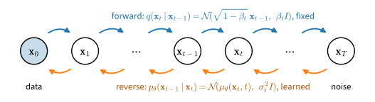
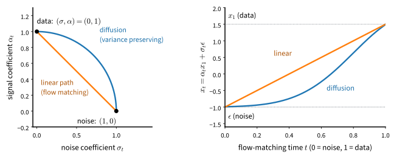
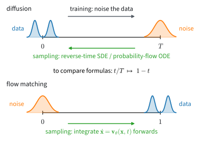
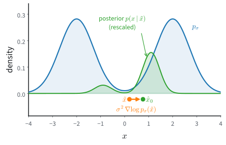
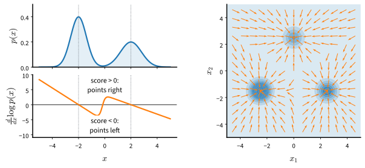

# Diffusion Models
:label:`chap_diffusion`

The adversarial generators of :numref:`chap_gans` required a second network—a discriminator or critic—because a generator mapping noise to data has no direct regression target. Diffusion and flow-matching models construct a regression target by progressively corrupting each training example with Gaussian noise. Reversing a small Gaussian noise step requires estimating the conditional expectation of the clean data given the noisy observation.

This perspective unites three lines of work: non-equilibrium thermodynamics and denoising diffusion probabilistic models (DDPM) :cite:`sohl2015deep,ho2020denoising`, score-based generative modeling :cite:`song2019generative,song2021score`, and flow matching or stochastic interpolants :cite:`Lipman.Chen.BenHamu.ea.2022,Liu.Gong.Liu.2022,Albergo.Boffi.VandenEijnden.2023`. In all three formulations, a single neural network learns to predict the clean data (or equivalently the added noise, the score $\nabla_{\mathbf{x}} \log p_t(\mathbf{x})$, or the velocity along the path) at every noise level $t \in [0, 1]$, and a numerical sampler integrates those predictions from pure noise at $t = 1$ back to data at $t = 0$.

Replacing the adversarial minimax objective with regression resolves three limitations of GANs: training requires only a single network optimized by squared error, the weighted regression loss provides a variational bound on the log-likelihood (and an exact log-likelihood via the probability-flow ODE), and the likelihood objective penalizes missing modes. Throughout this chapter, our default formulation regresses the velocity along the linear path $\mathbf{x}_t = (1 - t)\mathbf{x}_0 + t\boldsymbol\epsilon$ :cite:`Esser.Kulal.Blattmann.ea.2024`, alongside DDPM's noise predictor on the variance-preserving path.

The first three sections develop the complete mathematical and algorithmic core on a two-dimensional mixture of three Gaussians, where the true density, score, posterior mean, and velocity field are available in closed form. :numref:`sec_diffusion-images` moves to Fashion-MNIST images, introducing the time-conditioned U-Net, Fréchet distance evaluation, and classifier-free guidance. The next four sections examine the sampler (:numref:`sec_diffusion-samplers`), the likelihood bound and design space (:numref:`sec_diffusion-design-space`), latent diffusion and transformer backbones (:numref:`sec_diffusion-latent`), and few-step distillation via flow maps (:numref:`sec_diffusion-few-step`). Finally, :numref:`sec_diffusion-discrete` extends diffusion to discrete tokens by replacing Gaussian noise with token masking. Longer mathematical proofs appear in :numref:`chap_mdl-dynamics`, and external tutorials, courses, and reference implementations are collected in :numref:`sec_diffusion-further-reading`.

```toc
:maxdepth: 2

denoising
gaussian-paths
integration
image-diffusion
samplers
design-space
latent-diffusion
few-step
discrete-diffusion
further-reading
```

<!-- slides -->

::: {.slide}
::: {.cover}
[Dive into Deep Learning · §17]{.kicker}

Diffusion models<br>
**regression onto the clean point · data at t = 0, noise at t = 1 · samplers that integrate · nine sections**
:::
:::

::: {.slide title="A Generator Has No Target to Copy; Adding Noise Makes One"}
[The problem]{.kicker}

{width=85%}

- A classifier is fitted to the label that comes with each example; a
  generator's image must come out of noise, and no example says which image.
- Noise a training example in many small steps (a thousand for DDPM); learn
  to undo each step by regression.

::: {.d2l-note .warn}
Regression onto what, and how can fitting a target produce something new?
:::
:::

::: {.slide title="Regression Answers Three of the Game's Four Limits"}
[Why diffusion]{.kicker}

| limit of the adversarial game | answer in this chapter |
|---|---|
| no density | a likelihood bound, and an exact likelihood by an ODE |
| two networks and a tuned penalty | one network, one regression |
| no cost for a missing mode | bound $\geq H(p) + D_{\textrm{KL}}(p\,\|\,p_{\boldsymbol\theta})$: a dropped mode costs on each of its points |

The fourth limit, instability at scale, needs far larger models than
$28 \times 28$ garments to test.

::: {.d2l-note}
The target of the regression is computed from each training example: no
critic, no game.
:::
:::

::: {.slide title="By the End of This Chapter You Can"}
[Goals]{.kicker}

- convert a denoiser into a score, a noise predictor and a velocity;
- train one network along a path from data to noise by one regression, and
  sample it by an ODE or a chain;
- read the loss as a weighted likelihood bound;
- pick a sampler and step count, a weighting, a backbone, and a latent space
  or pixels;
- cut sampling to a few steps, and diffuse tokens by masking.

**The idea:** one network predicts the clean point from a noisy one at
every noise level; a sampler integrates its predictions from noise to data.
:::

::: {.slide title="From a Learned Comparison to a Fixed Regression Target"}
[Where this fits]{.kicker}

::: {.cols .vc}
::: {.col}
| chapter or part | the model learns from |
|---|---|
| Basics | the likelihood of observed data |
| Generative Adversarial Networks | a critic that compares samples with data |
| **Diffusion Models** | **regression onto the clean point at every noise level** |
:::

::: {.col .narrow}
- **Uses:** squared error learns a conditional mean; the Fréchet distance;
  U-Nets; transformers on image patches.
- **Skips:** text-to-image and video at scale; long proofs (the optional
  appendix on dynamics).
:::
:::
:::

::: {.slide title="The Clock Runs from Data at t = 0 to Noise at t = 1"}
[Notation]{.kicker}

::: {.cols .vc}
::: {.col}
$$\mathbf{x}_t = \alpha_t \mathbf{x}_0 + \sigma_t \boldsymbol\epsilon,
\qquad \boldsymbol\epsilon \sim \mathcal{N}(\mathbf{0}, \mathbf{I})$$

- Variance-preserving (VP): $\alpha_t^2 + \sigma_t^2 = 1$.
- Linear (flow matching): $\alpha_t = 1 - t$, $\sigma_t = t$.
- Log signal-to-noise ratio $\lambda_t = \log(\alpha_t^2/\sigma_t^2)$ falls
  from $+\infty$ to $-\infty$.
:::

::: {.col .fig .big}

:::
:::

::: {.d2l-note}
Every sampler runs from $t = 1$ down to $t = 0$.
:::
:::

::: {.slide title="The Default: Regress a Velocity on the Linear Path, Then Integrate Back"}
[The chapter's model]{.kicker}

On the linear path a training point moves with velocity
$\boldsymbol\epsilon - \mathbf{x}_0$. The network $\mathbf{u}_{\boldsymbol\theta}$
regresses onto it:

$$\min_{\boldsymbol\theta}\ \mathbb{E}_{t,\, \mathbf{x}_0,\, \boldsymbol\epsilon}
\big\|\mathbf{u}_{\boldsymbol\theta}(\mathbf{x}_t, t) - (\boldsymbol\epsilon - \mathbf{x}_0)\big\|^2$$

Sampling integrates $d\mathbf{x}/dt = \mathbf{u}_{\boldsymbol\theta}(\mathbf{x}, t)$
from noise at $t = 1$ to $t = 0$, for instance by Euler steps.

::: {.d2l-note}
DDPM's noise predictor on the VP path is the second model: another target,
the same information.
:::
:::

::: {.slide title="Flow-Matching Papers Run the Clock the Other Way"}
[Notation]{.kicker}

::: {.cols .vc}
::: {.col .fig .big}

:::

::: {.col}
To read such a paper:

- replace its $t$ by $1 - t$;
- its noise $\mathbf{x}_0$ by our $\boldsymbol\epsilon$;
- its data $\mathbf{x}_1$ by our $\mathbf{x}_0$;
- flip the sign of every velocity.
:::
:::
:::

::: {.slide title="Check: Read the Clock"}
[Check]{.kicker}

1. On the linear path at $t = 0.5$, what are $\alpha_t$, $\sigma_t$ and
   $\lambda_t$?
2. A flow-matching paper evaluates its network at its $t = 0.8$. Which of
   our times is that: mostly data or mostly noise?

::: {.fragment .fade-up}
1. $\alpha = \sigma = 0.5$, so $\lambda = 0$: signal and noise are equal.
2. Our $t = 0.2$: $\alpha = 0.8$, $\sigma = 0.2$,
   $\lambda = \log 16 \approx 2.8$, mostly data.
:::
:::

::: {.slide title="The Posterior Mean Gives the Clean Point, the Noise, the Score and the Velocity"}
[The object]{.kicker}

::: {.cols .vc}
::: {.col}
$\hat{\mathbf{x}}_0 = \mathbb{E}[\mathbf{x}_0 \mid \mathbf{x}_t]$, the
average clean point that could have produced $\mathbf{x}_t$, and
$\hat{\boldsymbol\epsilon} = \mathbb{E}[\boldsymbol\epsilon \mid \mathbf{x}_t]$;
$p_t$ is the density of $\mathbf{x}_t$:

$$\mathbf{x}_t = \alpha_t \hat{\mathbf{x}}_0 + \sigma_t \hat{\boldsymbol\epsilon},
\qquad
\nabla \log p_t(\mathbf{x}_t) = -\frac{\hat{\boldsymbol\epsilon}}{\sigma_t}$$

On the linear path the velocity is
$\mathbf{u}_t = \hat{\boldsymbol\epsilon} - \hat{\mathbf{x}}_0$.
:::

::: {.col .fig}

:::
:::

::: {.d2l-note}
A network trained on any one target defines all the others.
:::
:::

::: {.slide title="Three Sections Build the Model; Four Each Change One Choice"}
[Chapter map]{.kicker}

| movement | sections |
|---|---|
| the whole model, on the mixture | Denoising and the Score · Gaussian Paths · Sampling by Integration |
| images, and how to judge them | Diffusion for Images |
| one choice each, with a recommendation | Samplers, Inversion and Editing (which sampler, how many steps) · Likelihood, Weighting and the Design Space (which objective) · Latent Diffusion and Transformers (which space, which network) · Few-Step Generation (one to four evaluations) |
| another kind of noise | Discrete Diffusion (erasure, for tokens) |

::: {.d2l-note}
Stop after the first row and you understand diffusion models.
:::
:::

::: {.slide title="A Mixture Where Everything Is Exact, Then Garments"}
[Running examples]{.kicker}

::: {.cols .vc}
::: {.col}
- **Three Gaussians in the plane**, weights 0.5, 0.3, 0.2, width
  $s = 0.5$: density, score and posterior mean exact at every noise level;
  no model beats about 2.5 nats per point.
- **Fashion-MNIST**, $28 \times 28$ in $[-1, 1]$: pixels, then
  $7 \times 7 \times 4$ latents; each section trains its own models.
- **Tokens:** the mixture quantized, and binary garments.
:::

::: {.col .fig}

:::
:::
:::

::: {.slide title="What the Chapter Measures"}
[Results ahead]{.kicker}

| section | result |
|---|---|
| Denoising | Tweedie's step with a trained score: within about 1% of the best denoiser |
| Images | the 1,000-step DDPM chain: FD 15 to 25% lower than 50 Euler steps |
| Samplers | Heun (a second-order ODE solver), even steps on the linear path: the chain's FD in about 20 evaluations |
| Likelihood | network within half a hundredth of a nat of the exact field (true value about 2.5 nats per point) |
| Latents | at this scale, the best pixel model beats every latent one |
| Few-Step | a distilled student in four evaluations: FD 1.4 to 1.5 times that of 50 teacher steps |
| Discrete | binary garments: 0.17 bits per pixel, 0.70 for independent pixels |

FD: Fréchet distance between generated and real images in a classifier's
features; lower is better. Differences smaller than its measured noise are
not read.
:::

::: {.slide title="Check: Which Section Answers Each Symptom?"}
[Check]{.kicker}

1. Langevin chains that follow the exact score of the data keep the mode
   weights they started with.
2. A thousand network evaluations per image are too slow.
3. You asked for a sneaker and got a random garment.
4. The data are tokens, not real numbers.

::: {.fragment .fade-up}
1. Gaussian Paths: walk through every noise level, coarse to fine.
2. Samplers (about twenty to fifty evaluations), then Few-Step (one to
   four).
3. Diffusion for Images: classifier-free guidance.
4. Discrete Diffusion: masking as noise.
:::
:::

::: {.slide title="Wrap-up"}
[Wrap-up]{.kicker}

- A generator has no target; noising a training example creates one.
- The clock: $\mathbf{x}_t = \alpha_t \mathbf{x}_0 + \sigma_t
  \boldsymbol\epsilon$, data at $t = 0$, noise at $t = 1$, samplers run
  from 1 to 0.
- Default: a velocity on the linear path, integrated back by an ODE.
- One posterior mean gives clean point, noise, score and velocity.
- Nine sections: three build the model, one moves it to images, four change
  one choice each, one changes the noise.

**Next:** what a denoiser learns, and what one noise level cannot do.
:::
