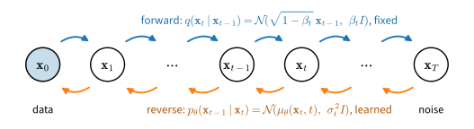
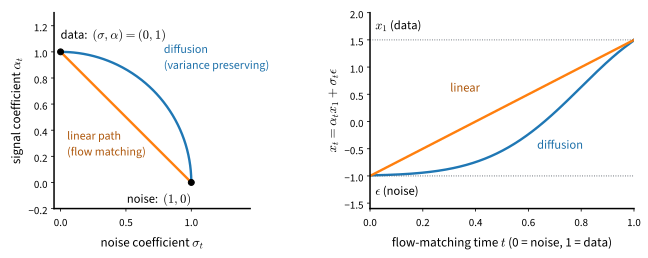
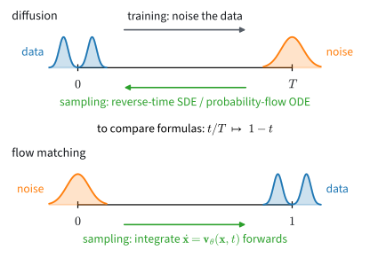
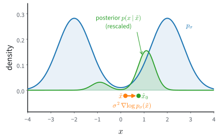
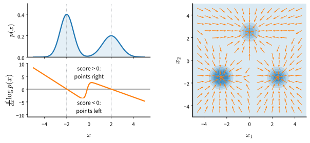

# Diffusion Models
:label:`chap_diffusion`

The generators of :numref:`chap_gans` learned to draw garments and sprites through a game between two networks, and that chapter closed with four limits the game leaves in place: no density, two networks and a tuned penalty, no cost for a missing mode, and instability at scale. It pointed instead to diffusion and flow models, trained by regression on a target computed from each training example. A classifier regresses onto a given label; a generator has nothing to copy, and its image must come out of noise. Regression onto what, then, and how can fitting a target produce something new?

The idea came from physics: in non-equilibrium thermodynamics, structure such as a drop of ink in water is destroyed by many small random steps, and a small step's reversal has the same simple form. :citet:`sohl2015deep` noised images in the same way and trained a network to undo each step; :citet:`ho2020denoising` made the undoing a regression onto the added noise and matched the sample quality of adversarial training. Others reached the same model from the gradient of the log-density :cite:`song2019generative` and from the velocity of a path between noise and data :cite:`Lipman.Chen.BenHamu.ea.2022,Liu.Gong.Liu.2022,Albergo.Boffi.VandenEijnden.2023`. All routes arrive at one network that predicts the clean point from a noisy one at every noise level, and a sampler that integrates its predictions.

What does a network that removes noise know about the data (:numref:`sec_diffusion-denoising`)? How do we walk from noise to data, and which regression trains the walk (:numref:`sec_diffusion-gaussian-paths`)? What changes for images, and how do we steer and judge them (:numref:`sec_diffusion-images`)? Which sampling steps can we skip, and what does a sampler do when run backwards (:numref:`sec_diffusion-samplers`)? Is the regression maximum likelihood, and which of its choices matter (:numref:`sec_diffusion-design-space`)? Why do current systems diffuse a compressed code with a transformer (:numref:`sec_diffusion-latent`)? Why does a single step fail, and what fixes it (:numref:`sec_diffusion-few-step`)? What is noise for a token (:numref:`sec_diffusion-discrete`)?

Along the way the four limits of the game find answers: a density, one regression instead of two networks, a loss under which every missing mode costs, and a transformer trained stably at scale. The mathematics lives in :numref:`chap_mdl-dynamics`, to which the chapter points instead of repeating it; image generation at scale, text-to-image and video belong to a later part of this book.

```toc
:maxdepth: 2

denoising
gaussian-paths
image-diffusion
samplers
design-space
latent-diffusion
few-step
discrete-diffusion
further-reading
```

## Resources and Further Reading {.unnumbered}

These resources accompany particular sections; :numref:`sec_diffusion-further-reading` turns to the methods the chapter does not teach.

- [*The Principles of Diffusion Models*](https://arxiv.org/abs/2510.21890) :cite:`Lai.Song.Kim.ea.2025` derives diffusion models along the variational, score-based and flow-based routes and shows where they meet.
- The [notes, lectures and labs](https://diffusion.csail.mit.edu/) of MIT's course 6.S184 :cite:`Holderrieth.Erives.2025` teach flow matching, latent spaces with transformer backbones, and discrete diffusion, with labs that build each model from scratch.
- The [*Flow Matching Guide and Code*](https://arxiv.org/abs/2412.06264) :cite:`Lipman.Havasi.Holderrieth.ea.2024` and its [library](https://github.com/facebookresearch/flow_matching) give the training loop of :numref:`sec_diffusion-gaussian-paths` in full, with proofs.
- [*Step-by-Step Diffusion*](https://arxiv.org/abs/2406.08929) :cite:`Nakkiran.Bradley.Zhou.ea.2025` builds the deterministic sampler up from a single point mass and derives the samplers of :numref:`sec_diffusion-samplers` without stochastic calculus.
- [*Diffusion Meets Flow Matching*](https://diffusionflow.github.io/) :cite:`Gao.Hoogeboom.Heek.ea.2025` shows with interactive figures that diffusion and flow samplers are one algorithm under a change of schedule, and that the weighting matters more than the schedule.
- Sander Dieleman's [blog](https://sander.ai/) explains how noise acts on image frequencies :cite:`Dieleman.2024`, why generators work in a latent space :cite:`Dieleman.2025`, what flow maps learn :cite:`Dieleman.2026`, and how continuous and discrete diffusion compete for language :cite:`Dieleman.2026b`.
- The [official DDPM implementation](https://github.com/hojonathanho/diffusion) of :citet:`ho2020denoising` and the [score SDE implementation](https://github.com/yang-song/score_sde_pytorch) of :citet:`song2021score` contain the full-scale networks and samplers that the small models of :numref:`sec_diffusion-images` imitate.
- The [MDLM repository](https://github.com/kuleshov-group/mdlm) of :citet:`Sahoo.Arriola.Schiff.ea.2024` trains the masked diffusion language model of :numref:`sec_diffusion-discrete`.
- The [*Deep Generative Models* course](https://kuleshov-group.github.io/dgm-website/) :cite:`Kuleshov.2023` and Yang Song's [blog post](https://yang-song.net/blog/2021/score/) :cite:`Song.2021` tell the score-based history behind :numref:`sec_diffusion-denoising`.
- Lilian Weng's [*What Are Diffusion Models?*](https://lilianweng.github.io/posts/2021-07-11-diffusion-models/) :cite:`Weng.2021` and the [tutorial](https://arxiv.org/abs/2208.11970) of :citet:`Luo.2022` work through the variational algebra that :numref:`sec_diffusion-design-space` compresses.

<!-- slides -->

::: {.slide}
::: {.cover}
[Dive into Deep Learning · §17]{.kicker}

Diffusion models<br>
**regress onto the clean point · one clock from data to noise · samplers that integrate · eight sections**
:::
:::

::: {.slide title="A Generator Has No Target to Copy; Adding Noise Makes One"}
[The problem]{.kicker}

{width=85%}

- A classifier regresses onto a given label; a generator's image must come
  out of noise, and no example says which image.
- Noise a training example in many small steps (a thousand for DDPM); learn
  to undo each step by regression.

::: {.d2l-note .warn}
Regression onto what, and how can fitting a target produce something new?
:::
:::

::: {.slide title="Regression Answers the Four Limits the Game Left Open"}
[Why diffusion]{.kicker}

| limit of the adversarial game | answer in this chapter |
|---|---|
| no density | a likelihood bound, and an exact likelihood by an ODE |
| two networks and a tuned penalty | one network, one regression |
| no cost for a missing mode | a loss under which every missing mode costs |
| unstable at scale | a transformer trained stably at scale |

::: {.d2l-note}
The target of the regression is computed from each training example: no
critic, no game.
:::
:::

::: {.slide title="By the End of This Chapter You Can"}
[Goals]{.kicker}

- convert a denoiser into a score, a noise predictor and a velocity;
- train one network along a Gaussian path from data to noise by one
  regression, and sample it by an ODE or a chain;
- read the loss as a weighted likelihood bound, and compare paths, targets
  and weightings;
- train, guide and score image models in pixels and in latents;
- cut sampling to a few steps, and diffuse tokens by masking.

**The idea:** one network predicts the clean point from a noisy one at
every noise level; a sampler integrates its predictions from noise to data.
:::

::: {.slide title="From a Learned Comparison to a Fixed Regression Target"}
[Where this fits]{.kicker}

::: {.cols .vc}
::: {.col}
| chapter or part | the model learns from |
|---|---|
| Basics | the likelihood of observed data |
| Generative Adversarial Networks | a critic that compares samples with data |
| **Diffusion Models** | **regression onto the clean point at every noise level** |
:::

::: {.col .narrow}
- **Uses:** squared error learns a conditional mean; Gaussians; ODEs, SDEs
  and Langevin dynamics from the appendix on dynamics; U-Nets;
  transformers.
- **Skips:** text-to-image and video at scale (a later part); proofs (the
  appendix).
:::
:::
:::

::: {.slide title="One Clock: Data at t = 0, Noise at t = 1"}
[Notation]{.kicker}

::: {.cols .vc}
::: {.col}
$$\mathbf{x}_t = \alpha_t \mathbf{x}_0 + \sigma_t \boldsymbol\epsilon,
\qquad \boldsymbol\epsilon \sim \mathcal{N}(\mathbf{0}, \mathbf{I})$$

- Variance-preserving (VP): $\alpha_t^2 + \sigma_t^2 = 1$.
- Linear (flow matching): $\alpha_t = 1 - t$, $\sigma_t = t$.
- Log-SNR $\lambda_t = \log(\alpha_t^2/\sigma_t^2)$ falls from $+\infty$
  to $-\infty$.
:::

::: {.col .fig}

:::
:::

::: {.d2l-note}
Every sampler runs from $t = 1$ down to $t = 0$.
:::
:::

::: {.slide title="Flow-Matching Papers Run the Clock the Other Way"}
[Notation]{.kicker}

{width=60%}

To read such a paper: replace its $t$ by $1 - t$, its noise
$\mathbf{x}_0$ by our $\boldsymbol\epsilon$, its data $\mathbf{x}_1$ by our
$\mathbf{x}_0$, and flip the sign of every velocity.
:::

::: {.slide title="Check: Read the Clock"}
[Check]{.kicker}

1. On the linear path at $t = 0.5$, what are $\alpha_t$, $\sigma_t$ and
   $\lambda_t$?
2. A flow-matching paper evaluates its network at its $t = 0.8$. Which of
   our times is that: mostly data or mostly noise?

::: {.fragment .fade-up}
1. $\alpha = \sigma = 0.5$, so $\lambda = 0$: signal and noise are equal.
2. Our $t = 0.2$: $\alpha = 0.8$, $\sigma = 0.2$,
   $\lambda = \log 16 \approx 2.8$, mostly data.
:::
:::

::: {.slide title="One Posterior Mean Gives the Clean Point, the Noise, the Score and the Velocity"}
[The object]{.kicker}

::: {.cols .vc}
::: {.col}
$\hat{\mathbf{x}}_0 = \mathbb{E}[\mathbf{x}_0 \mid \mathbf{x}_t]$, the
average clean point that could have produced $\mathbf{x}_t$:

$$\mathbf{x}_t = \alpha_t \hat{\mathbf{x}}_0 + \sigma_t \hat{\boldsymbol\epsilon},
\qquad
\nabla \log p_t(\mathbf{x}_t) = -\frac{\hat{\boldsymbol\epsilon}}{\sigma_t}$$

On the linear path the velocity is
$\mathbf{u}_t = \hat{\boldsymbol\epsilon} - \hat{\mathbf{x}}_0$.
:::

::: {.col .fig}

:::
:::

::: {.d2l-note}
A network trained on any one target defines all the others.
:::
:::

::: {.slide title="Eight Sections, One Question Each"}
[Chapter map]{.kicker}

| section | question |
|---|---|
| Denoising and the Score | what does a network that removes noise know about the data? |
| Gaussian Paths | how do we walk from noise to data, and which regression trains the walk? |
| Diffusion for Images | what changes for images, and how do we steer and judge them? |
| Samplers, Inversion and Editing | which steps can we skip; what does a sampler do run backwards? |
| Likelihood and the Design Space | is the regression maximum likelihood; which choices matter? |
| Latent Diffusion and Transformers | why diffuse a compressed code with a transformer? |
| Few-Step Generation | why does a single step fail, and what fixes it? |
| Discrete Diffusion | what is noise for a token? |
:::

::: {.slide title="A Mixture Where Everything Is Exact, Then Garments"}
[Running examples]{.kicker}

::: {.cols .vc}
::: {.col}
- **Three Gaussians in the plane**, weights 0.5, 0.3, 0.2, width
  $s = 0.5$: density, score and posterior mean exact at every noise level;
  no model beats about 2.5 nats per point.
- **Fashion-MNIST**, $28 \times 28$ in $[-1, 1]$: pixels, then
  $7 \times 7 \times 4$ latents.
- **Tokens:** the mixture quantized, and binary garments.
:::

::: {.col .fig}

:::
:::
:::

::: {.slide title="What the Chapter Measures"}
[Results ahead]{.kicker}

| section | result |
|---|---|
| Denoising | a trained score denoises within about 1% of the best denoiser |
| Diffusion for Images | 50 Euler steps score about as well as 1,000 chain steps |
| Design Space | the bound comes within about 0.01 of the true 2.5 nats |
| Few-Step | four evaluations come within about 1.5 times the teacher's FD |
| Discrete | binary garments at about 0.17 bits per pixel |

FD: Fréchet distance between generated and real images in a classifier's
features; lower is better.
:::

::: {.slide title="Check: Which Section Answers Each Symptom?"}
[Check]{.kicker}

1. Langevin chains driven by a well-trained score keep the mode weights
   they started with.
2. A thousand network evaluations per image are too slow.
3. You asked for a sneaker and got a random garment.
4. The data are tokens, not real numbers.

::: {.fragment .fade-up}
1. Gaussian Paths: walk through every noise level, coarse to fine.
2. Samplers (about fifty steps), then Few-Step (one to four).
3. Diffusion for Images: classifier-free guidance.
4. Discrete Diffusion: masking as noise.
:::
:::

::: {.slide title="Wrap-up"}
[Wrap-up]{.kicker}

- A generator has no target; noising a training example creates one.
- One clock: $\mathbf{x}_t = \alpha_t \mathbf{x}_0 + \sigma_t
  \boldsymbol\epsilon$, data at $t = 0$, noise at $t = 1$, samplers run
  from 1 to 0.
- One posterior mean gives clean point, noise, score and velocity.
- Eight sections; the three-mode mixture and Fashion-MNIST carry them.

**Next:** what a denoiser learns, and what one noise level cannot do.
:::
