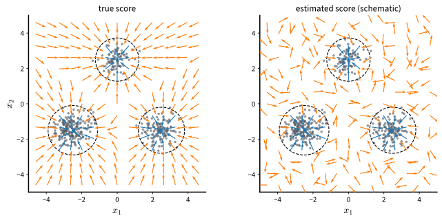

# Sampling with Langevin Dynamics
:label:`sec_diffusion-langevin`

A learned score is a vector field that points toward the data. To turn it
into samples, follow it. Gradient ascent on $\log p$ would climb to a mode
and stop there; adding the right amount of noise at each step turns the
climb into a Markov chain whose stationary distribution approaches $p$ as
the step size shrinks. This
sampler, Langevin dynamics, needs nothing but the score, so it applies to
the models of the last two sections directly. This section defines it, tests
it on the running example with the true score and with learned scores, and
identifies two ways in which it fails: the chain does not move between
separated modes, and the learned score is unreliable where the data are
absent. Gaussian smoothing addresses both at a price, which motivates the
multi-scale approach of the next section. The presentation follows lecture 12
of :citet:`Kuleshov.2023`.

```{.python .input #langevin-sampling-with-langevin-dynamics}
%%tab pytorch
%matplotlib inline
from d2l import torch as d2l
import torch
```

```{.python .input #langevin-sampling-with-langevin-dynamics}
%%tab jax
%matplotlib inline
from d2l import jax as d2l
import jax
from jax import numpy as jnp
from flax import nnx
import optax
```

## The Langevin Update

Langevin dynamics is the Markov chain

$$
\mathbf{x}_{k+1} = \mathbf{x}_k + \frac{\alpha}{2}\, \nabla_{\mathbf{x}} \log p(\mathbf{x}_k) + \sqrt{\alpha}\, \boldsymbol{\xi}_k,
\qquad \boldsymbol{\xi}_k \sim \mathcal{N}(\mathbf{0}, I),
$$
:eqlabel:`eq_diffusion-langevin`

started from an arbitrary initial state $\mathbf{x}_0$ (here the subscript
counts Langevin steps) and run with a step size $\alpha > 0$. Each step is a
gradient ascent step on $\log p$ with step size $\alpha / 2$ followed by a
Gaussian perturbation of variance $\alpha$. The gradient step concentrates
the chain where the density is high; the noise keeps it from collapsing to a
mode, and the balance between the two spreads the chains in proportion to
the density. The ratio between the two makes $p$ the target: the update
is the Euler--Maruyama discretization (:numref:`sec_mdl-euler-maruyama`) of
the stochastic differential equation
$d\mathbf{X} = \tfrac12 \nabla \log p(\mathbf{X})\, dt + d\mathbf{W}$, and
:numref:`sec_mdl-score-matching-diffusion-flow` proves from the
Fokker--Planck equation that $p$ is a stationary density of this equation
(:eqref:`eq_mdl-langevin`). Under mild conditions the continuous-time process
converges to $p$ from any starting point :cite:`Roberts.Tweedie.1996`. Under
conditions that include a globally Lipschitz score, the discrete chain with
a fixed $\alpha$ converges instead to a distribution
that differs from $p$ by a discretization error, which vanishes as
$\alpha \to 0$ with the number of steps growing correspondingly
:cite:`Durmus.Moulines.2017`, and for targets whose tails are lighter than
Gaussian it need not converge at all even though the diffusion does
:cite:`Roberts.Tweedie.1996`. The latter paper also analyzes the
*Metropolis-adjusted* variant, which treats the Langevin move as the
proposal of a Metropolis--Hastings step and accepts or rejects it, which
removes the discretization bias at the cost of an acceptance test.
Score-based models use the unadjusted chain :eqref:`eq_diffusion-langevin`,
because it needs the score and nothing else.

The chain is a gradient-informed relative of the random walk of
:numref:`sec_diffusion-ebm-training`. Where Metropolis--Hastings proposed a
blind step and corrected it by an acceptance test, Langevin dynamics takes a
step that already points toward higher density. For an energy-based model
the score is $-\nabla E_{\boldsymbol{\theta}}$, so the chain runs on the
energy alone. For a score model, substitute
$\mathbf{s}_{\boldsymbol{\theta}}$ for the score in
:eqref:`eq_diffusion-langevin`; the chain then samples approximately from
$p$, to the extent that $\mathbf{s}_{\boldsymbol{\theta}}$ approximates its
score.
This is the basic generative procedure of :citet:`song2019generative`,
who then anneal it over noise levels as :numref:`sec_diffusion-annealed`
describes: estimate the score by score matching, then sample by Langevin
dynamics.

The implementation runs many chains in parallel, one per row, and returns
their final states. The helper reports the statistics that the running
example lets us check: the fraction of chains that end nearest to each
component mean, which should match the weights $0.5$, $0.3$, $0.2$; the mean
squared distance to that mean over chains that lie within three standard
deviations of it; and the fraction of *stray* chains that end more than
three standard deviations from every mean. Exact samples of the mixture do
not give a spread of $2 \times 0.25 = 0.5$ and a stray fraction of zero under
this statistic: the truncation lowers the spread to $0.47$, and the tail of a
two-dimensional Gaussian beyond three standard deviations holds a fraction
$e^{-9/2} \approx 0.011$ of its mass. The cells therefore print the
statistic of the training sample as the target.

```{.python .input #langevin-the-langevin-update}
%%tab pytorch
torch.manual_seed(0)
mix = d2l.GaussianMixture(means=[[-2.5, -1.5], [2.5, -1.5], [0.0, 2.5]],
                          weights=[0.5, 0.3, 0.2], std=0.5)
data = mix.sample(2000)

def langevin(score, x, steps, step_size):
    """Unadjusted Langevin dynamics, one chain per row of x."""
    with torch.no_grad():
        for _ in range(steps):
            x = (x + 0.5 * step_size * score(x)
                 + step_size ** 0.5 * torch.randn_like(x))
    return x

def summarize(x):
    """Mode weights, within-mode spread, and the fraction of stray chains."""
    d2 = ((x[:, None, :] - mix.means[None]) ** 2).sum(-1)
    weights = [round(w, 3) for w in
               (torch.bincount(d2.argmin(1), minlength=3) / len(x)).tolist()]
    nearest = d2.min(1).values
    inside = nearest < (3 * mix.std) ** 2
    return (f'mode weights {weights}, spread {nearest[inside].mean():.2f}, '
            f'stray {1 - inside.float().mean():.3f}')
```

```{.python .input #langevin-the-langevin-update}
%%tab jax
key = jax.random.PRNGKey(0)
mix = d2l.GaussianMixture(means=[[-2.5, -1.5], [2.5, -1.5], [0.0, 2.5]],
                          weights=[0.5, 0.3, 0.2], std=0.5)
key, subkey = jax.random.split(key)
data = mix.sample(subkey, 2000)

@nnx.jit
def langevin_step(score, x, key, step_size):
    return (x + 0.5 * step_size * score(x)
            + step_size ** 0.5 * jax.random.normal(key, x.shape))

def langevin(score, x, key, steps, step_size):
    """Unadjusted Langevin dynamics, one chain per row of x."""
    for _ in range(steps):
        key, subkey = jax.random.split(key)
        x = langevin_step(score, x, subkey, step_size)
    return x

def summarize(x):
    """Mode weights, within-mode spread, and the fraction of stray chains."""
    d2 = ((x[:, None, :] - mix.means[None]) ** 2).sum(-1)
    weights = [round(float(w), 3) for w in
               jnp.bincount(d2.argmin(1), length=3) / len(x)]
    nearest = d2.min(1)
    inside = nearest < (3 * mix.std) ** 2
    return (f'mode weights {weights}, spread {nearest[inside].mean():.2f}, '
            f'stray {1 - inside.mean():.3f}')

class TrueScore(nnx.Module):  # the closed-form score as a jittable module
    def __init__(self, sigma=0.0):
        self.sigma = sigma

    def __call__(self, x):
        return mix.score(x, sigma=self.sigma)
```

## Two Failures on the Running Example

### Sampling with the True Score
:label:`subsec_diffusion-langevin-true-score`

The first experiment removes all estimation error: the chain uses the exact
score of the mixture. Two thousand chains start from a broad Gaussian
centered at the origin and run with step size $0.05$ for two hundred and
then two thousand steps. A third run starts every chain inside the first
mode.

```{.python .input #langevin-sampling-with-the-true-score-1}
%%tab pytorch
torch.manual_seed(1)
x_init = 3 * torch.randn(2000, 2)
print(f'target (2000 samples of the mixture): {summarize(data)}')
for steps in (200, 2000):
    print(f'true score, {steps:>4d} steps:   '
          f'{summarize(langevin(mix.score, x_init, steps, 0.05))}')
x_one = mix.means[0] + mix.std * torch.randn(2000, 2)
print(f'true score, start in mode 1: '
      f'{summarize(langevin(mix.score, x_one, 2000, 0.05))}')
```

```{.python .input #langevin-sampling-with-the-true-score-1}
%%tab jax
key, k1, k2 = jax.random.split(key, 3)
x_init = 3 * jax.random.normal(k1, (2000, 2))
true_score = TrueScore()
print(f'target (2000 samples of the mixture): {summarize(data)}')
for steps in (200, 2000):
    key, subkey = jax.random.split(key)
    print(f'true score, {steps:>4d} steps:   '
          f'{summarize(langevin(true_score, x_init, subkey, steps, 0.05))}')
x_one = mix.means[0] + mix.std * jax.random.normal(k2, (2000, 2))
key, subkey = jax.random.split(key)
print(f'true score, start in mode 1: '
      f'{summarize(langevin(true_score, x_one, subkey, 2000, 0.05))}')
```

Within each mode the chain is correct: the spread matches the target's to
within the discretization bias, and the stray fraction is close to that of
exact samples, one to two percent. Between modes it is stuck. After two
hundred steps the three modes hold roughly equal fractions of the chains,
which is where the broad initialization sent them, and after ten times as
many steps the fractions are unchanged. Of the chains started inside one
mode, all but a few out of two thousand remain there. Nothing is wrong
with the score: given enough steps, the chain would reach the right
weights up to its discretization bias. The two lower
modes are ten standard deviations apart and the upper one about nine and a
half from each, and to cross from one to another a chain must climb against
the gradient to the floor of the valley between them, about five standard
deviations from either mode, where the density is smaller than at the modes
by a factor between about $e^{-10}$ and $e^{-12}$. The noise term
occasionally pushes a chain outward, but the gradient term pulls it back
long before it reaches the valley. The expected waiting time for a crossing
exceeds the run by orders of magnitude (exercise
:exref:`ex_langevin-escaping-mode` estimates it), so the weights the chain
reports are the weights of its initialization. This *slow
mixing* is the same defect that the random-walk sampler showed, and the
gradient does not cure it :cite:`song2019generative`. The trajectories below
show the mechanism: chains started far out
fall quickly into whichever basin they begin in and then wander inside it.

```{.python .input #langevin-sampling-with-the-true-score-2}
%%tab pytorch
torch.manual_seed(2)
x, path = 3 * torch.randn(8, 2), []
with torch.no_grad():
    for _ in range(300):
        path.append(x)
        x = x + 0.5 * 0.05 * mix.score(x) + 0.05 ** 0.5 * torch.randn_like(x)
path = torch.stack(path)  # (steps, chains, 2)
axis = torch.linspace(-6, 6, 121)
grid = torch.stack(torch.meshgrid(axis, axis, indexing='ij'), -1).reshape(-1, 2)
d2l.set_figsize((4.5, 4.5))
d2l.plt.contourf(axis, axis, torch.exp(mix.log_prob(grid)).reshape(121, 121).T,
                 levels=12, cmap='Blues')
for i in range(8):
    d2l.plt.plot(path[:, i, 0], path[:, i, 1], lw=0.8)
    d2l.plt.plot(path[0, i, 0], path[0, i, 1], 'ko', ms=3)
d2l.plt.xlabel('$x_1$'), d2l.plt.ylabel('$x_2$');
```

```{.python .input #langevin-sampling-with-the-true-score-2}
%%tab jax
key, subkey = jax.random.split(key)
x, path = 3 * jax.random.normal(subkey, (8, 2)), []
for _ in range(300):
    path.append(x)
    key, subkey = jax.random.split(key)
    x = langevin_step(true_score, x, subkey, 0.05)
path = jnp.stack(path)  # (steps, chains, 2)
axis = jnp.linspace(-6, 6, 121)
grid = jnp.stack(jnp.meshgrid(axis, axis, indexing='ij'), -1).reshape(-1, 2)
d2l.set_figsize((4.5, 4.5))
d2l.plt.contourf(axis, axis, jnp.exp(mix.log_prob(grid)).reshape(121, 121).T,
                 levels=12, cmap='Blues')
for i in range(8):
    d2l.plt.plot(path[:, i, 0], path[:, i, 1], lw=0.8)
    d2l.plt.plot(path[0, i, 0], path[0, i, 1], 'ko', ms=3)
d2l.plt.xlabel('$x_1$'), d2l.plt.ylabel('$x_2$');
```

### Sampling with a Learned Score
:label:`subsec_diffusion-langevin-learned-score`

A learned score adds a second problem. :numref:`sec_diffusion-score-matching`
measured the relative error of a score matching estimate and found it under
ten percent where the data are and ten to twenty percent far below the
modes in density. A chain started from noise spends its first steps in
those low-density regions.
:numref:`fig_diffusion-low-density` sketches the situation: inside the region
that holds the data, the estimated field agrees with the truth; outside it,
the arrows have no reason to be right, and a chain that begins outside is
steered by them until it happens to reach the region where the estimate is
trustworthy.


:label:`fig_diffusion-low-density`

For images the problem is more severe than the sketch suggests. Under the
manifold hypothesis the data concentrate near a low-dimensional set, so
almost all of pixel space is a low-density region, the score there is
undefined or ill-conditioned, and a chain initialized from noise has to
traverse this region before any learned estimate becomes reliable
:cite:`song2019generative`. In two dimensions the effect is milder, and the
experiment measures how much of it survives. We train the score network by
sliced score matching, as in :numref:`sec_diffusion-score-matching`, and run
the same chains as before.

```{.python .input #langevin-sampling-with-a-learned-score}
%%tab pytorch
def sliced_score_matching_loss(score, x):
    x = x.clone().requires_grad_(True)
    v = torch.randn_like(x)
    s = score(x)
    jv = torch.autograd.grad((s * v).sum(), x, create_graph=True)[0]
    return ((v * jv).sum(1) + 0.5 * (s * v).sum(1) ** 2).mean()

def train(loss_fn, steps=2000, lr=1e-3, seed=1):
    torch.manual_seed(seed)
    score = d2l.ScoreNet()
    optimizer = torch.optim.Adam(score.parameters(), lr=lr)
    for step in range(steps):
        x = data[torch.randint(0, len(data), (256,))]
        loss = loss_fn(score, x)
        optimizer.zero_grad(), loss.backward(), optimizer.step()
    return score

score_data = train(sliced_score_matching_loss)
print(f'learned score of the data: '
      f'{summarize(langevin(score_data, x_init, 2000, 0.05))}')
```

```{.python .input #langevin-sampling-with-a-learned-score}
%%tab jax
def sliced_score_matching_loss(score, x, v):
    f = lambda q: score(q[None])[0]
    s, jv = jax.vmap(lambda q, u: jax.jvp(f, (q,), (u,)))(x, v)
    return ((v * jv).sum(1) + 0.5 * (s * v).sum(1) ** 2).mean()

@nnx.jit
def sliced_step(score, optimizer, x, v):
    loss, grads = nnx.value_and_grad(sliced_score_matching_loss)(score, x, v)
    optimizer.update(score, grads)
    return loss

def train(step_fn, key, steps=2000, lr=1e-3, seed=1):
    score = d2l.ScoreNet(rngs=nnx.Rngs(seed))
    optimizer = nnx.Optimizer(score, optax.adam(lr), wrt=nnx.Param)
    for step in range(steps):
        key, k1, k2 = jax.random.split(key, 3)
        x = data[jax.random.randint(k1, (256,), 0, len(data))]
        step_fn(score, optimizer, x, jax.random.normal(k2, x.shape))
    return score

key, k1, k2 = jax.random.split(key, 3)
score_data = train(sliced_step, k1)
print(f'learned score of the data: '
      f'{summarize(langevin(score_data, x_init, k2, 2000, 0.05))}')
```

The learned score reproduces the within-mode spread, and its mode weights
are still wrong: they are set by where the field steers the chains from
their initialization, not by the data, and they differ from the true
field's because the two fields steer differently far from the modes. The
stray fraction, a few percent, is comparable to the exact field's: almost
every chain still reaches a basin, so along the paths the chains take the
learned field points roughly inward. This experiment cannot separate
estimation error from the one percent of strays that exact samples have. The image case, in which the region where
the estimate is unreliable is almost all of pixel space, is the one that
the next section addresses.

## Gaussian Smoothing and Its Price
:label:`subsec_diffusion-langevin-smoothing`

Both failures share a cause: the empty regions between and around the
modes. Perturbing the data with Gaussian noise fills them.
:numref:`sec_diffusion-denoising` showed that the score of the perturbed
distribution $p_\sigma$ can be learned everywhere the noisy samples reach,
and that at a large $\sigma$ the learned field is organized across the whole
plotted region. Between the modes of $p_\sigma$ the density is no longer negligible,
so a chain can cross. The experiment trains scores of $p_\sigma$ by denoising
score matching at two noise levels and runs the chains on each, together
with the true score of $p_\sigma$ for comparison. The reference statistics
now describe the perturbed distribution, whose components have variance
$0.25 + \sigma^2$ per coordinate; the cells print the statistic of exact
samples of $p_\sigma$ as the target. Because the statistic keeps only chains
within three *data* standard deviations of a mean, it truncates the wider
distribution, and at $\sigma = 1$ a large fraction of exact samples counts
as stray.

```{.python .input #langevin-gaussian-smoothing-and-its-price-1}
%%tab pytorch
def denoising_loss(score, x, sigma):
    eps = torch.randn_like(x)
    return 0.5 * ((score(x + sigma * eps) + eps / sigma) ** 2).sum(1).mean()

samples = {}
for sigma in (0.3, 1.0):
    print(f'sigma = {sigma}: target (p_sigma samples): '
          f'{summarize(data + sigma * torch.randn_like(data))}')
    score_sigma = train(lambda s, x: denoising_loss(s, x, sigma))
    samples[sigma] = langevin(score_sigma, x_init, 2000, 0.05)
    print(f'sigma = {sigma}: learned score of p_sigma: {summarize(samples[sigma])}')
    smoothed = lambda x: mix.score(x, sigma=sigma)
    print(f'sigma = {sigma}: true score of p_sigma:    '
          f'{summarize(langevin(smoothed, x_init, 2000, 0.05))}')
```

```{.python .input #langevin-gaussian-smoothing-and-its-price-1}
%%tab jax
def denoising_loss(score, x, eps, sigma):
    return 0.5 * ((score(x + sigma * eps) + eps / sigma) ** 2).sum(1).mean()

@nnx.jit
def denoising_step(score, optimizer, x, eps, sigma):
    loss, grads = nnx.value_and_grad(denoising_loss)(score, x, eps, sigma)
    optimizer.update(score, grads)
    return loss

samples = {}
for sigma in (0.3, 1.0):
    key, k1, k2, k3, k4 = jax.random.split(key, 5)
    print(f'sigma = {sigma}: target (p_sigma samples): '
          f'{summarize(data + sigma * jax.random.normal(k4, data.shape))}')
    step_fn = lambda s, o, x, e: denoising_step(s, o, x, e, sigma)
    score_sigma = train(step_fn, k1)
    samples[sigma] = langevin(score_sigma, x_init, k2, 2000, 0.05)
    print(f'sigma = {sigma}: learned score of p_sigma: {summarize(samples[sigma])}')
    print(f'sigma = {sigma}: true score of p_sigma:    '
          f'{summarize(langevin(TrueScore(sigma), x_init, k3, 2000, 0.05))}')
```

At $\sigma = 1$ the chains mix: the mode weights come out near
$0.5$, $0.3$, $0.2$ with the learned score and with the true one, because
the perturbed density has no deep valleys left for the chain to be trapped
by. The samples, however, are samples of $p_\sigma$, whose components have
five times the variance of the data's: even the truncated spread doubles,
and about forty percent of the chains end beyond three data standard
deviations from every mean, as the target line for $p_\sigma$ shows. At
$\sigma = 0.3$ the spread matches that of $p_\sigma$, about a quarter above
the data's, but the valleys are still deep enough that the weights remain
wrong.
The panels compare the two sets of samples with the data.

```{.python .input #langevin-gaussian-smoothing-and-its-price-2}
%%tab pytorch
fig, axes = d2l.plt.subplots(1, 3, figsize=(10.5, 3.6))
panels = [('data', data), ('samples, sigma = 0.3', samples[0.3]),
          ('samples, sigma = 1.0', samples[1.0])]
for ax, (title, pts) in zip(axes, panels):
    ax.scatter(pts[:1000, 0], pts[:1000, 1], s=3)
    ax.set_xlim(-6, 6), ax.set_ylim(-6, 6), ax.set_aspect('equal')
    ax.set_title(title)
fig.tight_layout()
```

```{.python .input #langevin-gaussian-smoothing-and-its-price-2}
%%tab jax
fig, axes = d2l.plt.subplots(1, 3, figsize=(10.5, 3.6))
panels = [('data', data), ('samples, sigma = 0.3', samples[0.3]),
          ('samples, sigma = 1.0', samples[1.0])]
for ax, (title, pts) in zip(axes, panels):
    ax.scatter(pts[:1000, 0], pts[:1000, 1], s=3)
    ax.set_xlim(-6, 6), ax.set_ylim(-6, 6), ax.set_aspect('equal')
    ax.set_title(title)
fig.tight_layout()
```

The trade-off is now explicit. A large noise level gives a chain that
mixes and a score that is reliable wherever the noisy data reach, at the
cost of sampling a
blurred version of the data. A small noise level preserves the data but
restores both failures, so no single $\sigma$ serves. The resolution is to
use several: run the chain at a large noise level until it has found the
right proportions, then decrease the noise and continue, so that each level
hands the next a starting point that is likely to lie where the finer score
is well estimated. Making this idea precise requires a score model
conditioned on the noise level, which is the subject of the next section.

## Summary

Langevin dynamics :eqref:`eq_diffusion-langevin` samples from a density
using only its score: a gradient step with step size $\alpha / 2$ followed
by Gaussian noise of variance $\alpha$ leaves $p$ stationary in the
continuous-time limit, and the discretized chain approaches $p$ up to a
discretization bias that vanishes with the step size. Substituting a
learned score gives a generative model
without a normalizer, a Markov chain inside training, or a second network.

On the running example the chain reproduced each mode's spread to within
the discretization bias but almost never moved between them, so the mode
weights
reflected the initialization after two thousand steps as after two hundred.
With a learned score the same happened, with mode weights that were wrong
in a different way and a stray fraction comparable to that of exact
samples. Smoothing the data with noise of scale $\sigma = 1$
restored approximately correct mode weights with both the learned and the
true score,
because the perturbed density has no deep valleys, but the samples were
those of the blurred distribution. Sharp samples and correct proportions
require different noise levels, and the next section uses a ladder of them.

## Exercises

1. **Stationarity in one dimension.** For the Gaussian target
   $p(x) \propto e^{-x^2 / (2 \nu)}$ with variance $\nu$, the Langevin update
   :eqref:`eq_diffusion-langevin` is linear:

   $$
   x_{k+1} = \left(1 - \frac{\alpha}{2 \nu}\right) x_k + \sqrt{\alpha}\, \xi_k.
   $$

    1. Find the step sizes for which the chain has a stationary
       distribution, and compute its variance as a function of $\alpha$ and
       $\nu$. Show that the variance exceeds $\nu$, and expand the excess to
       first order in $\alpha$.
    1. Each component of the running example has variance $\nu = 0.25$ per
       coordinate. At which step size is the stationary variance of an
       isolated component ten percent too large, and from which step size on
       does the chain diverge?
   :exlabel:`ex_langevin-stationarity`

1. **Light tails.** The target $p(x) \propto e^{-x^4 / 4}$ in one dimension
   has the score $-x^3$, which grows faster than linearly, and the Langevin
   update :eqref:`eq_diffusion-langevin` reads
   $x_{k+1} = x_k - \tfrac{\alpha}{2} x_k^3 + \sqrt{\alpha}\, \xi_k$.
    1. Show that for $|x_k| > 2 / \sqrt{\alpha}$ the update without its noise
       term returns a point farther from the origin than $x_k$, and that far
       beyond this threshold $|x_k|$ grows faster than any geometric
       sequence.
    1. Chains start from $\mathcal{N}(0, 9)$, the one-dimensional analogue of
       `x_init`. Neglecting the noise, estimate the fraction of chains that
       diverge at $\alpha = 0.05$ and at $\alpha = 0.2$.
    1. Explain why no fixed $\alpha > 0$ makes this chain converge to a
       stationary distribution, although the continuous-time diffusion
       converges to $p$ from every starting point.
    1. The analysis of :citet:`Durmus.Moulines.2017` assumes a globally
       Lipschitz score $s$, $|s(x) - s(y)| \le L\, |x - y|$ for all $x$ and $y$.
       Show that under this assumption the update without its noise term
       satisfies
       $|x_{k+1}| \le (1 + \alpha L / 2)\, |x_k| + \tfrac{\alpha}{2}\, |s(0)|$,
       so that the growth of part (a) cannot occur, and that the score $-x^3$
       violates the assumption.

1. [code] **Step size.** Repeat the two-thousand-step run with the true score
   in :numref:`subsec_diffusion-langevin-true-score` at the step sizes
   $\alpha = 0.0005$, $0.005$, $0.05$, $0.5$, and $1.2$. Record the fraction
   of chains that remain finite, and the mode weights, the spread, and the
   stray fraction of the finite chains; `summarize` assigns a row of
   non-finite values to the first mean.
    1. Apply `summarize` to exact samples of a mixture whose components have
       the stationary variance of problem :exref:`ex_langevin-stationarity`a
       instead of $0.25$, and compare the result with the spread and the
       stray fraction of each run. Which runs does the stationary variance
       explain, and what happens at $\alpha = 1.2$?
    1. The discretization bias is smallest at $\alpha = 0.0005$. Why do the
       statistics of this run nevertheless differ from the target?
    1. Among the runs whose chains all remain finite, which one moves the
       mode weights away from those of the initialization, and why?
   :exlabel:`ex_langevin-step-size`

1. [code] **Score error along the chain.**
   :numref:`sec_diffusion-score-matching` measured the error of a learned
   score on a grid, grouped by density. Measure it instead at the states
   that the sampler visits. Run the chains with `score_data` from `x_init`
   as in :numref:`subsec_diffusion-langevin-learned-score`, and at steps $0$,
   $10$, $50$, $200$, and $2000$ compute the mean squared difference between
   `score_data` and `mix.score` over the chain states, divided by the mean
   squared norm of `mix.score` there.
    1. How does this relative error evolve over the run? Relate the result to
       :numref:`fig_diffusion-low-density`.
    1. Retrain the model on the first $200$ points of `data`, and repeat the
       measurement and the summary statistics. By how much does the relative
       error grow, and how much do the mode weights, the spread, and the
       stray fraction change? What does the comparison say about these
       statistics as a test of a learned score?

1. [code] **A denoising step at the end.** The chains `samples[1.0]` of
   :numref:`subsec_diffusion-langevin-smoothing` sample the blurred
   distribution $p_\sigma$ at $\sigma = 1$. Tweedie's formula
   :eqref:`eq_diffusion-tweedie` maps each of them to the posterior mean of
   the clean point by adding $\sigma^2$ times the score of $p_\sigma$.
    1. Consider a single component $\mathcal{N}(\boldsymbol{\mu}, 0.25\, I)$
       in two dimensions, perturbed at $\sigma = 1$. Compute the expected
       squared distance between $\mathbb{E}[\mathbf{x} \mid \tilde{\mathbf{x}}]$
       and $\boldsymbol{\mu}$, and compare it with the value $0.5$ for clean
       samples.
    1. Apply the formula once to `samples[1.0]`, with the learned score of
       $p_\sigma$ that `score_sigma` holds after the loop, and report the
       summary statistics. Which defects of the blurred samples does the step
       remove, which defect does it introduce, and why are the results not
       samples of the data distribution?

1. [code] **Metropolis adjustment.** ● Treat the Langevin move as the
   proposal

   $$
   Q(\mathbf{x}' \mid \mathbf{x}) = \mathcal{N}\left(\mathbf{x}';\ \mathbf{x} + \tfrac{\alpha}{2} \nabla_{\mathbf{x}} \log p(\mathbf{x}),\ \alpha I\right)
   $$

   of the Metropolis--Hastings test :eqref:`eq_diffusion-mh-accept`. This
   proposal is not symmetric, so the two values of $Q$ in the test do not
   cancel. The test also needs the density ratio
   $p(\mathbf{x}') / p(\mathbf{x})$, which `mix.log_prob` supplies for the
   running example and a score model does not.
    1. Implement the adjusted chain for the running example with
       `mix.log_prob` and `mix.score`, and run it from `x_init` for $2000$
       steps at $\alpha = 0.05$, $0.5$, and $1.2$. Report the acceptance rate
       and the summary statistics, and compare them with the unadjusted runs
       of problem :exref:`ex_langevin-step-size` at the same step sizes.
    1. Compare the mode weights of the adjusted chain with those of the
       unadjusted chain at the step size found in problem
       :exref:`ex_langevin-step-size`c, and explain the difference. Is the
       movement of the unadjusted weights evidence that this chain samples
       $p$ more faithfully?
    1. On a standard Gaussian target in $d = 2, 8, 32, 128$ dimensions, find
       for each $d$ the step size whose acceptance rate is about $0.574$, the
       asymptotically optimal rate of :citet:`Roberts.Rosenthal.1998`, and
       fit a power law $\alpha \propto d^{-\kappa}$. Exercise
       :exref:`ex_energy-training-acceptance-dimension` of
       :numref:`sec_diffusion-ebm-training` measures the corresponding power
       law for the random-walk proposal of `metropolis_hastings`
       :cite:`Roberts.Gelman.Gilks.1997`, whose step size is the standard
       deviation of the proposal. How does the number of steps needed
       to move each coordinate by a distance of order one, the width of the
       target, grow with $d$ for each of the two samplers?

1. **Escaping a mode.** ● Model the valley between the two lower modes of
   the running example in one dimension by the equal mixture of
   $\mathcal{N}(-2.5, 0.25)$ and $\mathcal{N}(2.5, 0.25)$, with potential
   $U = -\log p$, well bottoms at $a = \pm 2.5$, and the barrier top at
   $b = 0$. When the barrier height $\Delta U = U(b) - U(a)$ is large
   compared with one, Kramers' formula :cite:`Kramers.1940` gives the
   expected time for the diffusion $dX = -\tfrac12 U'(X)\, dt + dW$, the
   continuous-time limit of :eqref:`eq_diffusion-langevin`, to pass from one
   well to the other:

   $$
   \tau \approx \frac{4 \pi}{\sqrt{U''(a)\, |U''(b)|}}\, e^{\Delta U}.
   $$

    1. Compute $\Delta U$, $U''(a)$, and $U''(b)$, and convert $\tau$ into a
       number of Langevin steps at $\alpha = 0.05$.
    1. Estimate how many of $2000$ chains started inside mode 1 cross to
       mode 2 during $2000$ steps. Mode 3 lies closer to mode 1, at a
       distance of $\sqrt{22.25} \approx 4.7$, and has weight $0.2$. Evaluate
       $U = -\log p$ of the running example along the segment between the
       means of modes 1 and 3, read off the barrier height, and estimate the
       number of crossings into mode 3 in the same way. Compare both
       estimates with the run started in mode 1 in
       :numref:`subsec_diffusion-langevin-true-score`.
    1. Repeat the estimate of part (a) for $p_\sigma$ at $\sigma = 0.3$ and
       $\sigma = 1$, treating the result as an order of magnitude where
       $\Delta U$ is small, and use it to explain the mode weights in
       :numref:`subsec_diffusion-langevin-smoothing`.
   :exlabel:`ex_langevin-escaping-mode`

1. **Score errors and samples.** ● A chain that uses the field
   $\mathbf{s} = \nabla_{\mathbf{x}} \log p + \boldsymbol{\delta}$ with an
   error $\boldsymbol{\delta}$ discretizes, for small $\alpha$, the diffusion
   $d\mathbf{X} = \tfrac12 \mathbf{s}(\mathbf{X})\, dt + d\mathbf{W}$. The
   Fokker--Planck equation (:numref:`sec_mdl-fokker-planck`) decides which
   errors change the stationary density of this diffusion.
    1. Let $\boldsymbol{\delta} = (c - 1) \nabla_{\mathbf{x}} \log p$ for a
       constant $c > 0$, so that the field is the true score scaled by $c$.
       Show that the stationary density is proportional to $p^c$. What do
       $c < 1$ and $c > 1$ do to the spread of each mode and to the valleys
       between the modes of the running example?
    1. Show that $p$ remains stationary whenever
       $\nabla \cdot (p\, \boldsymbol{\delta}) = 0$. For
       $p = \mathcal{N}(\mathbf{0}, I)$ in two dimensions, verify that the
       rotation field $\boldsymbol{\delta}(\mathbf{x}) = \gamma\, (-x_2, x_1)$
       qualifies, and compute the Fisher divergence
       :eqref:`eq_diffusion-esm` of $\mathbf{s}$ as a function of $\gamma$.
    1. Let $\boldsymbol{\delta} = \nabla g$ for a smooth function $g$ that
       equals $0$ near one mode, equals a constant $h$ near the others, and
       varies only in the valley between them. Show that the stationary
       density is proportional to $p\, e^{g}$, and bound the Fisher
       divergence of $\mathbf{s}$ by $\tfrac12 \sup \|\nabla g\|^2$ times the
       probability mass of the valley. The two mixtures $p_\pi$ and
       $p_{\pi'}$ of problem :exref:`ex_score-matching-mode-weights` of
       :numref:`sec_diffusion-score-matching` are an example: find, up to an
       additive constant, the function $g$ with
       $p_{\pi'} \propto p_\pi\, e^{g}$, and its value $h$ near the second
       mode. What do parts (b) and (c) together say
       about the Fisher divergence as a measure of sample quality
       :cite:`Wenliang.Kanagawa.2020`?

1. [code] **Mode weights from the score.** ●● Chains on the running example
   report the mode weights of their initialization, yet the true score
   determines the density up to its normalizer and therefore also the
   weights. This problem recovers the weights from a score field and uses
   them to correct the chains.
    1. Let $p = \sum_k \pi_k\, \mathcal{N}(\boldsymbol{\mu}_k, \rho_k^2 I)$
       have well-separated components in $d$ dimensions. Show that
       $\log p(\boldsymbol{\mu}_k) - \log p(\boldsymbol{\mu}_j)$ equals the
       line integral of the score along any path from $\boldsymbol{\mu}_j$
       to $\boldsymbol{\mu}_k$, and that it approximates
       $\log (\pi_k / \pi_j) - d \log (\rho_k / \rho_j)$. Which step of
       this argument can fail for a learned field?
    1. Compute the line integrals along the three straight segments between
       the component means, by the trapezoidal rule on a few hundred points
       per segment, for `mix.score`, for `score_data`, and for `score_sigma`,
       which after the first cell of
       :numref:`subsec_diffusion-langevin-smoothing` holds the network
       trained at $\sigma = 1$. For each field, report the weights
       $\hat{\pi}_k$ implied by the integrals from $\boldsymbol{\mu}_1$ and
       the circulation, the sum of the integrals around the triangle
       $\boldsymbol{\mu}_1 \to \boldsymbol{\mu}_2 \to \boldsymbol{\mu}_3 \to \boldsymbol{\mu}_1$.
       Which field comes closest to the true weights, and why can a score of
       $p_\sigma$ recover the weights of $p$ in this example?
    1. Rerun the two-thousand-step chains with the true score from `x_init`,
       assign each chain to its nearest mean, and resample the chains with
       probabilities proportional to $\hat{\pi}_k / f_k$, where $f_k$ is the
       fraction of chains in basin $k$. Show that the expected basin
       fractions after resampling equal $\hat{\pi}_k$ whatever the
       initialization, and that for $N$ chains the effective sample size
       $(\sum_i w_i)^2 / \sum_i w_i^2$ of
       :numref:`subsec_diffusion-limits-monte-carlo` becomes

       $$
       N_{\textrm{eff}} = N \Big/ \sum_k \frac{\hat{\pi}_k^2}{f_k}.
       $$

       Evaluate $N_{\textrm{eff}}$ with the true weights for these chains and
       for chains started from `x_one`. When does the correction fail even
       with exact weights?

<!-- slides -->

::: {.slide}
::: {.cover}
[Dive into Deep Learning · §17.5]{.kicker}

Sampling with Langevin dynamics<br>
**gradient ascent plus noise · exact in the limit, stuck in practice · the smoothing trade-off**
:::
:::

::: {.slide title="Langevin Dynamics: Follow the Score, Add Noise"}
$$\mathbf{x}_{k+1} = \mathbf{x}_k + \frac{\alpha}{2}\, \nabla_{\mathbf{x}} \log p(\mathbf{x}_k) + \sqrt{\alpha}\, \boldsymbol{\xi}_k,
\qquad \boldsymbol{\xi}_k \sim \mathcal{N}(\mathbf{0}, I)$$

- the Euler--Maruyama step of $d\mathbf{X} = \tfrac12 \nabla \log p\, dt + d\mathbf{W}$, for which $p$ is stationary;
- a discretization bias for the discrete chain that vanishes with $\alpha$; a
  Metropolis test removes it;
- needs only the score: plug in $\mathbf{s}_{\boldsymbol{\theta}}$.
:::

::: {.slide title="With the Exact Score: Right Modes, Wrong Weights"}
@langevin-sampling-with-the-true-score-1

Each mode is reproduced to within the step-size bias; the weights are those
of the initialization, after two hundred steps and after two thousand.
Crossing a valley whose floor is five standard deviations from either mode
takes far longer than any run.
:::

::: {.slide title="Chains Fall into a Basin and Stay"}
@!langevin-sampling-with-the-true-score-2

Eight chains started from noise: a quick descent, then a wander inside one
basin. The gradient does not cure slow mixing.
:::

::: {.slide title="A Learned Score Is Consulted Where It Is Worst"}
{width=78%}

A chain from noise starts outside the dashed line, where the estimate had no
data to fit. For images, almost all of pixel space is such a region.
:::

::: {.slide title="Smoothing Fixes Mixing and Blurs the Samples"}
@!langevin-gaussian-smoothing-and-its-price-2

At $\sigma = 1$ the weights are right and the samples are blurred; at
$\sigma = 0.3$ the samples are sharp and the weights are wrong.
:::

::: {.slide title="Recap"}
- Langevin dynamics turns a score into a sampler; correctness is asymptotic.
- Failure one: separated modes are not crossed, so weights reflect the start.
- Failure two: a learned score is unreliable in the empty regions the chain
  must traverse.
- At large $\sigma$, Gaussian smoothing largely removes both but samples the
  blurred distribution. Next: a ladder of noise levels.
:::
