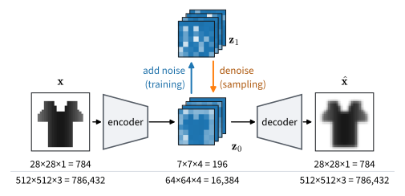
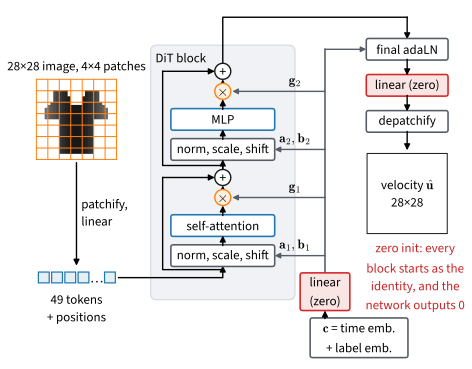

# Latent Diffusion and Transformers
:label:`sec_diffusion-latent`

The image models of this chapter draw $28 \times 28$ garments with a U-Net
that processes every pixel at each of fifty sampling steps. The
text-to-image systems that many readers have used draw pictures of a
million pixels in seconds, and the papers behind most of them describe
neither a U-Net nor a network that looks at pixels. The previous section
hinted at the reason: most pixels carry detail that a viewer hardly
notices. Why do current systems diffuse something other than pixels, why is
their network a transformer, and how does a caption steer it?

:citet:`Rombach.Blattmann.Lorenz.ea.2022` split generation into two stages.
An autoencoder compresses each image into a small grid of numbers, its
*latent*, from which a decoder restores the image with little visible loss,
and a diffusion model learns the distribution of the latents at a fraction
of the cost per step. :citet:`Peebles.Xie.2023` replaced the U-Net by a
transformer that reads the latent grid as a sequence of patches, the
*diffusion transformer* (DiT), and found that its samples improve steadily
as its computation grows.

Together the two ideas are the design of most recent image and video
generators. We train a small autoencoder on Fashion-MNIST and run the
regression of the previous sections on its latents, then build the DiT and
train it at three sizes, and close with text and video, a paragraph each.
Systems at full scale are the subject of a later part of this book.

```{.python .input #latent-diffusion-latent-diffusion-and-transformers}
%%tab pytorch
import math
import numpy as np
import torch
from torch import nn
from torch.nn import functional as F
from d2l import torch as d2l
```

```{.python .input #latent-diffusion-latent-diffusion-and-transformers}
%%tab jax
import math
import numpy as np
import jax
from jax import numpy as jnp
from flax import nnx
import optax
from d2l import jax as d2l
```

```{.python .input #latent-diffusion-latent-diffusion-and-transformers-1}
%%tab pytorch
torch.set_float32_matmul_precision('high')  # tf32 matmuls on tensor cores
```

## Why a Latent Space

### The Cost of Pixels

Every sampling step evaluates the network on the whole image. A convolution
applies its kernel at every pixel, so the cost of a U-Net grows with the
number of pixels; attention compares every position with every other, so
its cost grows with their square. A $512 \times 512$ color image holds
$512 \cdot 512 \cdot 3 = 786{,}432$ numbers.

Most of these numbers describe detail. In
:numref:`subsec_diffusion-design-space-scales` the power of Fashion-MNIST
images fell by three orders of magnitude from one to fourteen cycles per
image, and the sampler fixed the silhouette of a garment at high noise and
added its texture in the last steps. A viewer rarely notices a wrong
texture, but a missing sleeve is obvious.

Rate–distortion theory makes this precise: for each level of distortion,
the rate–distortion function gives the fewest bits per image that a code
needs (:numref:`subsec_mdl-rate-distortion`).
:citet:`Rombach.Blattmann.Lorenz.ea.2022` observed that a likelihood model
of natural images spends most of its bits on imperceptible details, at the
low-distortion end of this curve. They leave this *perceptual compression*
to an autoencoder, and the *semantic compression*, the modeling of what the
image shows, to the diffusion model. The autoencoder of Stable Diffusion
maps a $512 \times 512 \times 3$ image to a $64 \times 64 \times 4$ latent,
48 times fewer numbers. Every diffusion step works on the latent, and the
decoder runs once per sample.

The latent must keep enough information for the decoder and be easy for the
diffusion model to learn. A latent that stored every pixel would
reconstruct perfectly and be as hard to model as the pixels;
:citet:`Dieleman.2025` calls this a trade between rate, distortion and
*modelability*. Our autoencoder maps 784 numbers to a $7 \times 7$ grid
with four channels, 196 numbers (:numref:`fig_diffusion-latent-pipeline`).


:label:`fig_diffusion-latent-pipeline`

### The Autoencoder

A latent is easy to model if it has a known scale, against which the noise
of the Gaussian path is calibrated, if it has no isolated outliers, and if
nearby latents decode to similar images, so that a slightly wrong latent
still gives a plausible image. An autoencoder trained only to reconstruct
guarantees none of this.

The variational autoencoder :cite:`Kingma.Welling.2014` supplies the remedy.
The encoder outputs a mean $\boldsymbol\mu$ and a standard deviation
$\mathbf{s}$ for each of the 196 latent numbers, the latent is drawn as
$\mathbf{z} = \boldsymbol\mu + \mathbf{s} \odot \boldsymbol\xi$ with
standard normal $\boldsymbol\xi$, and the decoder maps $\mathbf{z}$ to a
reconstruction $\hat{\mathbf{x}}$. The loss adds to the reconstruction
error a term that pulls each latent number toward a standard normal:

$$\mathcal{L}(\mathbf{x}) = \frac{1}{784}\,\|\mathbf{x} - \hat{\mathbf{x}}\|^2 + \frac{\beta}{196} \sum_{j=1}^{196} \tfrac{1}{2}\left(\mu_j^2 + s_j^2 - 1 - \log s_j^2\right).$$

The sum is the Kullback–Leibler divergence from
$\mathcal{N}(\boldsymbol\mu, \mathrm{diag}(\mathbf{s}^2))$ to
$\mathcal{N}(\mathbf{0}, \mathbf{I})$, the term of the evidence lower
bound (:numref:`sec_mdl-latent-em-elbo`), and $\beta$ is its weight (not
the schedule's $\beta_k$). With $\beta = 10^{-4}$ the
reconstruction stays in charge, and the KL term only stops the encoder from
inflating its means or shrinking its standard deviations to zero. The
autoencoders of large systems add a patch critic and a perceptual loss,
because a squared error averages plausible textures into a blur
(:numref:`sec_gan_beyond`); others quantize the latent into discrete
tokens :cite:`Esser.Rombach.Ommer.2021,Chang.Zhang.Jiang.ea.2022`.

Our autoencoder stacks the residual blocks of the U-Net, without an
embedding, at widths 64 and 128; its encoder halves the resolution twice to
a $7 \times 7$ grid with a mean and a log variance per latent channel, and
its decoder mirrors it.

```{.python .input #latent-diffusion-the-autoencoder}
%%tab pytorch
class Autoencoder(nn.Module):  #@save
    """Residual convolutional autoencoder from 28x28x1 images to a 7x7
    Gaussian latent and back; returns the reconstruction and the KL term."""
    def __init__(self, latent_channels=4, ch=64, num_blocks=2):
        super().__init__()
        blocks = lambda a, b: [d2l.UNetBlock(a, b)] + [
            d2l.UNetBlock(b, b) for _ in range(num_blocks - 1)]
        down = lambda c: nn.Conv2d(c, c, 3, stride=2, padding=1)
        head = lambda a, b: [nn.GroupNorm(8, a), nn.SiLU(),
                             nn.Conv2d(a, b, 3, padding=1)]
        self.encoder = nn.Sequential(
            nn.Conv2d(1, ch, 3, padding=1), *blocks(ch, ch),
            down(ch), *blocks(ch, 2 * ch),                       # 14 x 14
            down(2 * ch), *blocks(2 * ch, 2 * ch),               # 7 x 7
            *head(2 * ch, 2 * latent_channels))  # mean and log variance
        self.decoder = nn.Sequential(
            nn.Conv2d(latent_channels, 2 * ch, 3, padding=1),
            *blocks(2 * ch, 2 * ch),
            nn.Upsample(scale_factor=2), *blocks(2 * ch, ch),    # 14 x 14
            nn.Upsample(scale_factor=2), *blocks(ch, ch),        # 28 x 28
            *head(ch, 1))

    def encode(self, x):
        mean, log_var = self.encoder(x).chunk(2, dim=1)
        return mean, log_var.clamp(-30, 20)

    def forward(self, x):
        mean, log_var = self.encode(x)
        z = mean + (0.5 * log_var).exp() * torch.randn_like(mean)
        kl = 0.5 * (mean ** 2 + log_var.exp() - 1 - log_var).mean()
        return self.decoder(z), kl
```

```{.python .input #latent-diffusion-the-autoencoder}
%%tab jax
class Autoencoder(nnx.Module):  #@save
    """Residual convolutional autoencoder from 28x28x1 images to a 7x7
    Gaussian latent and back; returns the reconstruction and the KL term."""
    def __init__(self, latent_channels=4, ch=64, num_blocks=2, *, rngs):
        blocks = lambda a, b: [d2l.UNetBlock(a, b, rngs=rngs)] + [
            d2l.UNetBlock(b, b, rngs=rngs) for _ in range(num_blocks - 1)]
        conv = lambda a, b, **kw: d2l.Conv(a, b, (3, 3), rngs=rngs, **kw)
        down = lambda c: conv(c, c, strides=2, padding=1)
        up = lambda x: jnp.repeat(jnp.repeat(x, 2, axis=1), 2, axis=2)
        head = lambda a, b: [nnx.GroupNorm(a, num_groups=8, epsilon=1e-5,
                                           use_fast_variance=False,
                                           rngs=rngs), nnx.silu, conv(a, b)]
        self.encoder = nnx.Sequential(
            conv(1, ch), *blocks(ch, ch),
            down(ch), *blocks(ch, 2 * ch),                       # 14 x 14
            down(2 * ch), *blocks(2 * ch, 2 * ch),               # 7 x 7
            *head(2 * ch, 2 * latent_channels))  # mean and log variance
        self.decoder = nnx.Sequential(
            conv(latent_channels, 2 * ch), *blocks(2 * ch, 2 * ch),
            up, *blocks(2 * ch, ch),                             # 14 x 14
            up, *blocks(ch, ch),                                 # 28 x 28
            *head(ch, 1))

    def encode(self, x):
        mean, log_var = jnp.split(self.encoder(x), 2, axis=-1)
        return mean, jnp.clip(log_var, -30, 20)

    def __call__(self, x, key):
        mean, log_var = self.encode(x)
        z = mean + jnp.exp(0.5 * log_var) * jax.random.normal(key, mean.shape)
        kl = 0.5 * (mean ** 2 + jnp.exp(log_var) - 1 - log_var).mean()
        return self.decoder(z), kl
```

We train it for 20,000 updates with `d2l.train_regression` of
:numref:`sec_diffusion-denoising`, which runs Adam on a loss and returns
the trained model, a moving average of its weights and the losses. The
learning rate decays to zero along a cosine, so the final weights need no
averaging.

```{.python .input #latent-diffusion-the-autoencoder-1}
%%tab pytorch
X, y, X_test, y_test = d2l.load_fashion_mnist_pm1()
dev = X.device

def batch_fn():
    return X[torch.randint(0, len(X), (128,), device=dev)]

def ae_loss(ae, x):
    x_hat, kl = ae(x)
    return ((x_hat - x) ** 2).mean() + 1e-4 * kl

torch.manual_seed(1)
ae, _, _ = d2l.train_regression(d2l.Autoencoder().to(dev), ae_loss, batch_fn,
                                20_000, cosine=True)
print(f'{d2l.num_params(ae) / 1e6:.2f}M parameters')
```

```{.python .input #latent-diffusion-the-autoencoder-1}
%%tab jax
X, y, X_test, y_test = d2l.load_fashion_mnist_pm1()

def batch_fn(key):
    return X[jax.random.randint(key, (128,), 0, len(X))]

def ae_loss(ae, x, key):
    x_hat, kl = ae(x, key)
    return ((x_hat - x) ** 2).mean() + 1e-4 * kl

ae, _, _ = d2l.train_regression(d2l.Autoencoder(rngs=nnx.Rngs(1)), ae_loss,
                                batch_fn, 20_000, jax.random.key(1),
                                cosine=True)
print(f'{d2l.num_params(ae) / 1e6:.2f}M parameters')
```

The first row shows eight test images, the second the decoder's output for
their latent means.

```{.python .input #latent-diffusion-the-autoencoder-2}
%%tab pytorch
with torch.no_grad():
    x_hat = ae.decoder(ae.encode(X_test[:8])[0])
d2l.show_gray(torch.cat([X_test[:8], x_hat]), 2, 8);
```

```{.python .input #latent-diffusion-the-autoencoder-2}
%%tab jax
encode = nnx.jit(lambda ae, x: ae.encode(x))      # mean and log variance
decoder = nnx.jit(lambda ae, z: ae.decoder(z))
x_hat = decoder(ae, encode(ae, X_test[:8])[0])
d2l.show_gray(jnp.concatenate([X_test[:8], x_hat]), 2, 8);
```

The reconstructions are hard to tell from the originals. To measure them we
use the Fréchet distance (FD) of :numref:`sec_diffusion-images`, the
distance between Gaussians fitted to the features that a small classifier,
`d2l.FeatureCNN`, extracts from two sets of images. Two sets of real images
differ by chance too, so we print the FD between two disjoint sets of 5,000
test images as the *floor*. All FDs in this section use 5,000 images; at
1,000 the floor is about six times higher.

```{.python .input #latent-diffusion-the-autoencoder-3}
%%tab pytorch
cnn = d2l.fashion_feature_cnn(X, y)
f_ref = d2l.fd_features(cnn, X_test[:5000])

def fd(imgs):
    """FD of images against the first 5,000 test images."""
    return d2l.fid_score(d2l.fd_features(cnn, imgs), f_ref)

print(f'floor, the other 5,000 test images: FD {fd(X_test[5000:]):.2f}')
```

```{.python .input #latent-diffusion-the-autoencoder-3}
%%tab jax
cnn = d2l.fashion_feature_cnn(X, y)
f_ref = d2l.fd_features(cnn, X_test[:5000])

def fd(imgs):
    """FD of images against the first 5,000 test images."""
    return d2l.fid_score(d2l.fd_features(cnn, imgs), f_ref)

print(f'floor, the other 5,000 test images: FD {fd(X_test[5000:]):.2f}')
```

We score the reconstructions of the other 5,000 test images.

```{.python .input #latent-diffusion-the-autoencoder-4}
%%tab pytorch
x_hat = d2l.batched(lambda x: ae.decoder(ae.encode(x)[0]), X_test[5000:])
fd_rec = fd(x_hat)
print(f'reconstructions: squared error {((x_hat - X_test[5000:]) ** 2).mean():.4f}'
      f' per pixel, FD {fd_rec:.2f}')
```

```{.python .input #latent-diffusion-the-autoencoder-4}
%%tab jax
x_hat = d2l.batched(lambda x: decoder(ae, encode(ae, x)[0]), X_test[5000:])
fd_rec = fd(x_hat)
print(f'reconstructions: squared error {((x_hat - X_test[5000:]) ** 2).mean():.4f}'
      f' per pixel, FD {fd_rec:.2f}')
```

The reconstructions score an FD of 0.6 to 0.8 against the floor of 0.17, at
a squared error of about 0.004 per pixel. This bounds every latent model
trained with this autoencoder: perfect latents would decode to
reconstructions and score the same.

We encode the training set once and print the standard deviation of the
latents, the average of the encoder's $\mathbf{s}$, and the excess kurtosis
of all latent values, which is zero for a normal distribution and large
when a few values lie far out.

```{.python .input #latent-diffusion-the-autoencoder-5}
%%tab pytorch
encoded = d2l.batched(lambda x: torch.cat(ae.encode(x), 1), X)
mu, log_var = encoded.chunk(2, dim=1)       # mean and log variance
s = (0.5 * log_var).exp()
z = mu + s * torch.randn_like(mu)
scale = 1 / z.std().item()
kurtosis = (((z - z.mean()) * scale) ** 4).mean() - 3
print(f'latent std {z.std():.2f} (scale factor {scale:.2f}), encoder std '
      f'{s.mean():.3f}, excess kurtosis {kurtosis:.2f}')
```

```{.python .input #latent-diffusion-the-autoencoder-5}
%%tab jax
encoded = d2l.batched(lambda x: jnp.concatenate(encode(ae, x), -1), X)
mu, log_var = jnp.split(encoded, 2, axis=-1)  # mean and log variance
s = jnp.exp(0.5 * log_var)
z = mu + s * jax.random.normal(jax.random.key(2), mu.shape)
scale = 1 / float(z.std())
kurtosis = (((z - z.mean()) * scale) ** 4).mean() - 3
print(f'latent std {z.std():.2f} (scale factor {scale:.2f}), encoder std '
      f'{s.mean():.3f}, excess kurtosis {kurtosis:.2f}')
```

The latents have a standard deviation slightly below one, so we multiply
them by a factor $c$ of about 1.05. The encoder's standard deviation is
0.02 to 0.03, so the KL term barely blurs each code, and the excess kurtosis
is near zero or negative: the latents have no heavy tails. A larger
$\beta$ makes them closer to normal but costs reconstruction quality
(:exref:`ex_latent-kl-weight`).

## Diffusion in the Latent Space

### The Same Regression on Latents

With the autoencoder fixed, nothing changes but the data. Each batch draws
the latents of 128 training images, $\mathbf{z}_0 = c\,(\boldsymbol\mu +
\mathbf{s} \odot \boldsymbol\xi)$, fresh from the encoder's distribution as
:citet:`Rombach.Blattmann.Lorenz.ea.2022` do. We train on the linear path
of :numref:`sec_diffusion-gaussian-paths`: we form
$\mathbf{z}_t = (1 - t)\,\mathbf{z}_0 + t\,\boldsymbol\epsilon$ and regress
the network's output onto the velocity $\boldsymbol\epsilon - \mathbf{z}_0$.

The scale factor matters because the path mixes the data with noise of unit
variance. Latents with a standard deviation of five would shift the log-SNR
at every time by $\log 25$ (:exref:`ex_latent-scale-factor`), and Stable
Diffusion multiplies its latents by 0.18215 for this reason. The network is
the U-Net of :numref:`sec_diffusion-images` with four input and output
channels, and one `loss_fn` serves images and latents.

```{.python .input #latent-diffusion-the-same-regression-on-latents-1}
%%tab pytorch
path = d2l.GaussianPath.linear()
loss_fn = d2l.regression_loss(path, 'velocity')  # for images or latents

def latent_batch_fn():
    i = torch.randint(0, len(mu), (128,), device=dev)
    return (mu[i] + s[i] * torch.randn_like(mu[i])) * scale

torch.manual_seed(3)
_, unet_latent, _ = d2l.train_regression(
    d2l.UNet(ch=64, in_channels=4, out_channels=4).to(dev), loss_fn,
    latent_batch_fn, 20_000)
```

```{.python .input #latent-diffusion-the-same-regression-on-latents-1}
%%tab jax
path = d2l.GaussianPath.linear()
loss_fn = d2l.regression_loss(path, 'velocity')  # for images or latents

def latent_batch_fn(key):
    k1, k2 = jax.random.split(key)
    i = jax.random.randint(k1, (128,), 0, len(mu))
    return (mu[i] + s[i] * jax.random.normal(k2, mu[i].shape)) * scale

_, unet_latent, _ = d2l.train_regression(
    d2l.UNet(ch=64, in_channels=4, out_channels=4, rngs=nnx.Rngs(3)),
    loss_fn, latent_batch_fn, 20_000, jax.random.key(3))
```

As a reference we train the same U-Net on pixels. Both runs take 20,000
updates, twice the budget of :numref:`sec_diffusion-samplers`, because the
transformers below need longer runs and this pixel model is their reference
too.

```{.python .input #latent-diffusion-the-same-regression-on-latents-2}
%%tab pytorch
torch.manual_seed(4)
_, unet_pixel, _ = d2l.train_regression(d2l.UNet(ch=64).to(dev), loss_fn,
                                        batch_fn, 20_000)
```

```{.python .input #latent-diffusion-the-same-regression-on-latents-2}
%%tab jax
_, unet_pixel, _ = d2l.train_regression(d2l.UNet(ch=64, rngs=nnx.Rngs(4)),
                                        loss_fn, batch_fn, 20_000,
                                        jax.random.key(4))
```

`sample` draws 5,000 samples from fixed noise with 50 Euler steps of
`d2l.ode_sample` (:numref:`sec_diffusion-gaussian-paths`), and `decode`
undoes the scale factor and decodes latents. The first row below holds
samples of the pixel model, the second decoded samples of the latent model.

```{.python .input #latent-diffusion-the-same-regression-on-latents-3}
%%tab pytorch
def sample(net, shape, n=5000):
    """n samples by 50 Euler steps from fixed noise, 1,000 at a time."""
    gen = torch.Generator(dev).manual_seed(0)
    noise = torch.randn(n, *shape, device=dev, generator=gen)
    pred = d2l.make_pred(net, path, 'velocity')
    return d2l.batched(lambda x: d2l.ode_sample(pred, x, path.sigma_bars(50)),
                       noise)

def decode(z):
    return d2l.batched(lambda z_k: ae.decoder(z_k / scale), z)

latent_shape, image_shape = (4, 7, 7), (1, 28, 28)
x_pixel = sample(unet_pixel, image_shape)
x_latent = decode(sample(unet_latent, latent_shape))
fd_pixel, fd_latent = fd(x_pixel), fd(x_latent)
print(f'FD: pixel U-Net {fd_pixel:.2f}, latent U-Net {fd_latent:.2f}')
d2l.show_gray(torch.cat([x_pixel[:8], x_latent[:8]]), 2, 8);
```

```{.python .input #latent-diffusion-the-same-regression-on-latents-3}
%%tab jax
@nnx.jit
def euler50(net, noise):
    pred = d2l.make_pred(net, path, 'velocity')
    return d2l.ode_sample(pred, noise, path.sigma_bars(50))

def sample(net, shape, n=5000):
    """n samples by 50 Euler steps from fixed noise, 1,000 at a time."""
    noise = jax.random.normal(jax.random.key(0), (n, *shape))
    return d2l.batched(lambda x: euler50(net, x), noise)

def decode(z):
    return d2l.batched(lambda z_k: decoder(ae, z_k / scale), z)

latent_shape, image_shape = (7, 7, 4), (28, 28, 1)
x_pixel = sample(unet_pixel, image_shape)
x_latent = decode(sample(unet_latent, latent_shape))
fd_pixel, fd_latent = fd(x_pixel), fd(x_latent)
print(f'FD: pixel U-Net {fd_pixel:.2f}, latent U-Net {fd_latent:.2f}')
d2l.show_gray(jnp.concatenate([x_pixel[:8], x_latent[:8]]), 2, 8);
```

Both rows show recognizable garments. The latent model scores an FD of
about 2 (2.1 to 2.4), the pixel model 1.5 to 1.6.

What did the latent model save? `train_step_gflops` counts the
floating-point operations of one training step, forward and backward on 128
inputs, in billions (GFLOP).

```{.python .input #latent-diffusion-the-same-regression-on-latents-5}
%%tab pytorch
def train_step_gflops(net, loss_fn, shape, batch_size=128):  #@save
    """GFLOP of one training step, forward and backward, on a batch of zeros
    of the given shape."""
    from torch.utils.flop_counter import FlopCounterMode  # not in the preamble
    x = torch.zeros(batch_size, *shape, device=next(net.parameters()).device)
    with FlopCounterMode(display=False) as counter:
        loss_fn(net, x).backward()
    return counter.get_total_flops() / 1e9
```

```{.python .input #latent-diffusion-the-same-regression-on-latents-5}
%%tab jax
def train_step_gflops(net, loss_fn, shape, batch_size=128):  #@save
    """GFLOP of one training step, forward and backward, on a batch of zeros
    of the given shape: XLA's estimate for the step lowered for the CPU (for
    a GPU it leaves out the convolutions)."""
    graphdef, params, rest = nnx.split(net, nnx.Param, ...)
    grad = jax.grad(lambda p, r, x, key: loss_fn(nnx.merge(graphdef, p, r),
                                                 x, key))
    args = jax.device_put((params, rest, jnp.zeros((batch_size, *shape)),
                           jax.random.key(0)), jax.devices('cpu')[0])
    return jax.jit(grad).lower(*args).cost_analysis()['flops'] / 1e9
```

```{.python .input #latent-diffusion-the-same-regression-on-latents-4}
%%tab pytorch
gflops_latent = d2l.train_step_gflops(
    d2l.UNet(ch=64, in_channels=4, out_channels=4).to(dev), loss_fn,
    latent_shape)
gflops_pixel = d2l.train_step_gflops(d2l.UNet(ch=64).to(dev), loss_fn,
                                     image_shape)
print(f'GFLOP per training step: latent U-Net {gflops_latent:.0f}, '
      f'pixel U-Net {gflops_pixel:.0f}')
```

```{.python .input #latent-diffusion-the-same-regression-on-latents-4}
%%tab jax
gflops_latent = d2l.train_step_gflops(
    d2l.UNet(ch=64, in_channels=4, out_channels=4, rngs=nnx.Rngs(0)), loss_fn,
    latent_shape)
gflops_pixel = d2l.train_step_gflops(d2l.UNet(ch=64, rngs=nnx.Rngs(0)),
                                     loss_fn, image_shape)
print(f'GFLOP per training step: latent U-Net {gflops_latent:.0f}, '
      f'pixel U-Net {gflops_pixel:.0f}')
```

The latent U-Net needs about a dozen GFLOP per step, the pixel U-Net about
200. Every evaluation of the latent network, in training
and at each sampling step, costs less than a tenth of the arithmetic.

### Reading the Result

At equal updates the latent model's FD is about 1.4 to 1.5 times the pixel
model's. It cannot fall below the reconstruction FD of 0.6 to 0.8, and it sits
well above it. The gap combines the latent model's own error with the
decoder's response to latents that no training image produced.

At $28 \times 28$ the trade is not attractive: the pixel model is cheap
anyway, and the autoencoder needs a training run of its own. At
$512 \times 512$ the factor of 48 applies to every convolution, and for a
transformer with $2 \times 2$ patches the number of tokens falls from 65,536
to 1,024, so attention, whose cost grows with their square, becomes 4,096
times cheaper. This is why most large text-to-image systems since 2022
diffuse latents, and why their autoencoder limits their quality, a limit we
measure once we have a second network to try.

## The Transformer Backbone

The U-Net builds in the assumptions of a convolutional network: nearby
pixels matter most, and the same features can appear anywhere. The vision
transformer of :numref:`sec_vision-transformer` makes fewer of them, and on
image classification it trails convolutional networks at small budgets and
overtakes them at large ones. :citet:`Peebles.Xie.2023` asked whether the
same holds for diffusion.

### Patches and Tokens

The DiT reads its input as the vision transformer does. It cuts the image
into $p \times p$ patches, maps each to a vector of width $d$ by a linear
map (a convolution with kernel size and stride $p$), adds a learned position
embedding, and passes the tokens through pre-norm transformer blocks
(:numref:`sec_transformer-block`). With $p = 4$ a $28 \times 28$ image
becomes 49 tokens of 16 pixels each; on our latents with $p = 1$, each of
the 49 grid positions is a token of four numbers.

The output differs from a classifier's. A denoiser returns a prediction of
the shape of its input, so the DiT maps every token by a final linear layer
to the values of its patch and reassembles the patches. Each token predicts
the velocity of its own patch, informed through attention by all the
others. With one token per pixel the image would have 16 times as many
tokens, and attention would cost 256 times as much.

### Adaptive Layer Norm

The transformer also needs the time $t$, and possibly a label.
:citet:`Peebles.Xie.2023` compared ways to condition it, among them
appending the condition as extra tokens, and found that the cheapest worked
best: the condition sets the normalization.

A layer norm standardizes each token and applies a learned scale and shift.
In *adaptive layer norm* a linear map computes the scale $\mathbf{a}$ and
the shift $\mathbf{b}$ from the condition $\mathbf{c}$, the sum of a time
embedding and a label embedding, and the condition also sets a *gate*
$\mathbf{g}$ on each sublayer's output. One block computes

$$
\begin{aligned}
\mathbf{X} &\leftarrow \mathbf{X} + \mathbf{g}_1 \odot \mathrm{Attention}\big(\mathrm{LN}(\mathbf{X}) \odot (1 + \mathbf{a}_1) + \mathbf{b}_1\big),\\
\mathbf{X} &\leftarrow \mathbf{X} + \mathbf{g}_2 \odot \mathrm{MLP}\big(\mathrm{LN}(\mathbf{X}) \odot (1 + \mathbf{a}_2) + \mathbf{b}_2\big),
\end{aligned}
$$

where $\mathrm{LN}$ has no scale or shift of its own and the six vectors are
one linear function of $\mathbf{c}$, shared by all tokens of an image. One
small matrix product per image thus turns each feature of each sublayer up
or down.

The linear map starts at zero, hence the name *adaLN-Zero*. All gates are
then zero, every block computes the identity, and the final layer, also
zero, outputs zero. Training starts from a network that predicts zero
velocity everywhere, and each block comes into play as its gates grow
(:numref:`fig_diffusion-dit-block`).


:label:`fig_diffusion-dit-block`

`DiTBlock` builds the block on the `ViTBlock` of
:numref:`sec_vision-transformer`, with `ada` as the linear map.

```{.python .input #latent-diffusion-adaptive-layer-norm-1}
%%tab pytorch
class DiTBlock(d2l.ViTBlock):  #@save
    """ViTBlock with adaLN-Zero: the condition c sets a shift, a scale and a
    gate for each sublayer; the gates start at zero."""
    def __init__(self, num_hiddens, mlp_num_hiddens, num_heads):
        super().__init__(num_hiddens, mlp_num_hiddens, num_heads, dropout=0.0,
                         use_bias=True)
        ln = lambda: nn.LayerNorm(num_hiddens, elementwise_affine=False,
                                  eps=1e-6)
        self.norm1, self.norm2 = ln(), ln()
        self.ada = nn.Sequential(nn.SiLU(),
                                 nn.Linear(num_hiddens, 6 * num_hiddens))
        nn.init.zeros_(self.ada[1].weight), nn.init.zeros_(self.ada[1].bias)

    def forward(self, X, c):
        shift1, scale1, gate1, shift2, scale2, gate2 = (
            self.ada(c)[:, None].chunk(6, dim=-1))
        X_mod = self.norm1(X) * (1 + scale1) + shift1
        X = X + gate1 * self.attention(X_mod, X_mod, X_mod)
        return X + gate2 * self.ffn(self.norm2(X) * (1 + scale2) + shift2)
```

```{.python .input #latent-diffusion-adaptive-layer-norm-1}
%%tab jax
class DiTBlock(d2l.ViTBlock):  #@save
    """ViTBlock with adaLN-Zero: the condition c sets a shift, a scale and a
    gate for each sublayer; the gates start at zero."""
    def __init__(self, num_hiddens, mlp_num_hiddens, num_heads, *, rngs):
        super().__init__(num_hiddens, mlp_num_hiddens, num_heads, 0.0,
                         use_bias=True, rngs=rngs)
        ln = lambda: nnx.LayerNorm(num_hiddens, epsilon=1e-6, use_scale=False,
                                   use_bias=False, rngs=rngs)
        self.norm1, self.norm2 = ln(), ln()
        zeros = nnx.initializers.zeros
        self.ada = nnx.Linear(num_hiddens, 6 * num_hiddens, kernel_init=zeros,
                              bias_init=zeros, rngs=rngs)

    def __call__(self, X, c):
        shift1, scale1, gate1, shift2, scale2, gate2 = jnp.split(
            self.ada(nnx.silu(c))[:, None], 6, axis=-1)
        X_mod = self.norm1(X) * (1 + scale1) + shift1
        X = X + gate1 * self.attention(X_mod, X_mod, X_mod)
        return X + gate2 * self.ffn(self.norm2(X) * (1 + scale2) + shift2)
```

`DiT` adds the patch embedding, the learned positions, the time and label
embeddings, and the final adaptive layer norm and linear layer.

```{.python .input #latent-diffusion-adaptive-layer-norm-2}
%%tab pytorch
class DiT(nn.Module):  #@save
    """Diffusion transformer conditioned on a time t in [0, 1] and, with
    num_classes, on a label y; label num_classes means no label."""
    def __init__(self, img_size=28, patch_size=4, num_channels=1, width=256,
                 depth=6, num_heads=4, num_classes=None):
        super().__init__()
        self.width, self.num_classes = width, num_classes
        self.p, self.g = patch_size, img_size // patch_size
        self.patch = d2l.PatchEmbedding(img_size, patch_size, width,
                                        num_channels)
        self.pos = nn.Parameter(0.02 * torch.randn(1, self.g ** 2, width))
        self.time_mlp = d2l.make_mlp([width] * 3, nn.SiLU())
        self.label_emb = (nn.Embedding(num_classes + 1, width)
                          if num_classes else None)
        self.blks = nn.ModuleList([DiTBlock(width, 4 * width, num_heads)
                                   for _ in range(depth)])
        self.ln = nn.LayerNorm(width, elementwise_affine=False, eps=1e-6)
        self.ada = nn.Sequential(nn.SiLU(), nn.Linear(width, 2 * width))
        self.out = nn.Linear(width, patch_size ** 2 * num_channels)
        for m in (self.ada[1], self.out):
            nn.init.zeros_(m.weight), nn.init.zeros_(m.bias)

    def forward(self, x, t, y=None):
        c = self.time_mlp(d2l.time_embedding(t, self.width))
        if y is not None:
            c = c + self.label_emb(y)
        X = self.patch(x) + self.pos
        for blk in self.blks:
            X = blk(X, c)
        shift, scale = self.ada(c)[:, None].chunk(2, dim=-1)
        X = self.out(self.ln(X) * (1 + scale) + shift)  # (n, g*g, p*p*c)
        n, g, p = len(x), self.g, self.p  # tokens back to pixels
        X = X.reshape(n, g, g, p, p, -1).permute(0, 5, 1, 3, 2, 4)
        return X.reshape(n, -1, g * p, g * p)
```

```{.python .input #latent-diffusion-adaptive-layer-norm-2}
%%tab jax
class DiT(nnx.Module):  #@save
    """Diffusion transformer (NHWC) conditioned on a time t in [0, 1] and,
    with num_classes, on a label y; label num_classes means no label."""
    def __init__(self, img_size=28, patch_size=4, num_channels=1, width=256,
                 depth=6, num_heads=4, num_classes=None, *, rngs):
        self.width, self.num_classes = width, num_classes
        self.p, self.g = patch_size, img_size // patch_size
        self.patch = d2l.PatchEmbedding(img_size, patch_size, width,
                                        num_channels, rngs=rngs)
        self.pos = nnx.Param(
            0.02 * rngs.params.normal((1, self.g ** 2, width)))
        self.time_mlp = d2l.make_mlp([width] * 3, nnx.silu, rngs=rngs)
        init = nnx.initializers.normal(1.0)  # N(0, 1), as in PyTorch
        self.label_emb = (nnx.Embed(num_classes + 1, width, rngs=rngs,
                                    embedding_init=init)
                          if num_classes else None)
        self.blks = nnx.List([DiTBlock(width, 4 * width, num_heads, rngs=rngs)
                              for _ in range(depth)])
        self.ln = nnx.LayerNorm(width, epsilon=1e-6, use_scale=False,
                                use_bias=False, rngs=rngs)
        zeros = nnx.initializers.zeros
        self.ada = nnx.Linear(width, 2 * width, kernel_init=zeros,
                              bias_init=zeros, rngs=rngs)
        self.out = nnx.Linear(width, patch_size ** 2 * num_channels,
                              kernel_init=zeros, bias_init=zeros, rngs=rngs)

    def __call__(self, x, t, y=None):
        c = self.time_mlp(d2l.time_embedding(t, self.width))
        if y is not None:
            c = c + self.label_emb(y)
        X = self.patch(x) + self.pos[...]
        for blk in self.blks:
            X = blk(X, c)
        shift, scale = jnp.split(self.ada(nnx.silu(c))[:, None], 2, axis=-1)
        X = self.out(self.ln(X) * (1 + scale) + shift)  # (n, g*g, p*p*c)
        n, g, p = x.shape[0], self.g, self.p  # tokens back to pixels
        X = X.reshape(n, g, g, p, p, -1).transpose(0, 1, 3, 2, 4, 5)
        return X.reshape(n, g * p, g * p, -1)
```

We build a DiT of width 256 and depth 6 with four heads, and pass eight
images and times through it.

```{.python .input #latent-diffusion-adaptive-layer-norm-3}
%%tab pytorch
dit = d2l.DiT().to(dev)       # width 256, depth 6, 4 heads, 4 x 4 patches
x, t = X[:8], torch.rand(8, device=dev)
with torch.no_grad():
    tokens, out = dit.patch(x), dit(x, t)
print('images', tuple(x.shape), '-> tokens', tuple(tokens.shape),
      '-> output', tuple(out.shape))
print(f'parameters: DiT {d2l.num_params(dit) / 1e6:.2f}M, '
      f'U-Net {d2l.num_params(d2l.UNet(ch=64)) / 1e6:.2f}M')
print('output at initialization all zero:', bool((out == 0).all()))
```

```{.python .input #latent-diffusion-adaptive-layer-norm-3}
%%tab jax
dit = d2l.DiT(rngs=nnx.Rngs(0))  # width 256, depth 6, 4 heads, 4 x 4 patches
x, t = X[:8], jax.random.uniform(jax.random.key(5), (8,))
tokens, out = dit.patch(x), dit(x, t)
print('images', x.shape, '-> tokens', tokens.shape, '-> output', out.shape)
print(f'parameters: DiT {d2l.num_params(dit) / 1e6:.2f}M, U-Net '
      f'{d2l.num_params(d2l.UNet(ch=64, rngs=nnx.Rngs(0))) / 1e6:.2f}M')
print('output at initialization all zero:', bool((out == 0).all()))
```

The DiT has 7.39 million parameters, six times as many as the U-Net, and
its untrained output is exactly zero.

### Scaling with Compute

Is the transformer better than the U-Net? At one size the question has no
general answer. :citet:`Peebles.Xie.2023` trained DiTs of four sizes with
three patch sizes each. At a fixed number of training steps, FID fell
steadily as the network's arithmetic per forward pass grew, whether it came
from a larger network or from smaller patches, and their largest model,
trained for seven million steps, set a new best FID on class-conditional
ImageNet at $256 \times 256$.

We repeat the measurement at our scale. Three DiTs grow in width and depth
together, with 64 dimensions per head as in the paper: DiT-S (width 128,
depth 4, two heads), DiT-M (the model above) and DiT-L (width 384, depth 8,
six heads). Each is trained on pixels with the U-Net's loss and recipe for
the same 20,000 updates, and we measure its size by the FLOPs per training
step.

```{.python .input #latent-diffusion-scaling-with-compute-1}
%%tab pytorch
sizes = {'DiT-S': dict(width=128, depth=4, num_heads=2),
         'DiT-M': dict(width=256, depth=6, num_heads=4),
         'DiT-L': dict(width=384, depth=8, num_heads=6)}
runs = {}
for seed, (name, size) in enumerate(sizes.items(), start=5):
    gflops = d2l.train_step_gflops(d2l.DiT(**size).to(dev), loss_fn,
                                   image_shape)
    torch.manual_seed(seed)
    net = d2l.DiT(**size).to(dev)
    _, ema, _ = d2l.train_regression(net, loss_fn, batch_fn, 20_000)
    imgs = sample(ema, image_shape)
    runs[name] = dict(params=d2l.num_params(net), gflops=gflops, fd=fd(imgs),
                      imgs=imgs[:8])
runs['U-Net'] = dict(params=d2l.num_params(d2l.UNet(ch=64)),
                     gflops=gflops_pixel, fd=fd_pixel, imgs=x_pixel[:8])
for name, run in runs.items():
    print(f'{name:6} {run["params"] / 1e6:5.2f}M parameters '
          f'{run["gflops"]:4.0f} GFLOP per step   FD {run["fd"]:.2f}')
```

```{.python .input #latent-diffusion-scaling-with-compute-1}
%%tab jax
sizes = {'DiT-S': dict(width=128, depth=4, num_heads=2),
         'DiT-M': dict(width=256, depth=6, num_heads=4),
         'DiT-L': dict(width=384, depth=8, num_heads=6)}
runs = {}
for seed, (name, size) in enumerate(sizes.items(), start=5):
    gflops = d2l.train_step_gflops(d2l.DiT(**size, rngs=nnx.Rngs(0)),
                                   loss_fn, image_shape)
    net = d2l.DiT(**size, rngs=nnx.Rngs(seed))
    _, ema, _ = d2l.train_regression(net, loss_fn, batch_fn, 20_000,
                                     jax.random.key(seed))
    imgs = sample(ema, image_shape)
    runs[name] = dict(params=d2l.num_params(net), gflops=gflops, fd=fd(imgs),
                      imgs=imgs[:8])
runs['U-Net'] = dict(params=d2l.num_params(d2l.UNet(ch=64, rngs=nnx.Rngs(0))),
                     gflops=gflops_pixel, fd=fd_pixel, imgs=x_pixel[:8])
for name, run in runs.items():
    print(f'{name:6} {run["params"] / 1e6:5.2f}M parameters '
          f'{run["gflops"]:4.0f} GFLOP per step   FD {run["fd"]:.2f}')
```

We plot FD against FLOPs per step on logarithmic axes.

```{.python .input #latent-diffusion-scaling-with-compute-2}
%%tab pytorch, jax
dits = [runs[name] for name in sizes]
d2l.plot([[run['gflops'] for run in dits], [runs['U-Net']['gflops']]],
         [[run['fd'] for run in dits], [runs['U-Net']['fd']]],
         'GFLOP per training step', 'FD (5,000 samples)',
         legend=['DiT-S, M, L', 'U-Net'], xscale='log', yscale='log',
         fmts=('o-', 'rD'))
```

FD falls with every step up in size: about 5 for DiT-S at about 30 GFLOP
per step, 1.5 to 1.7 for DiT-M at about 190, and 1.2 to 1.5 for DiT-L at
about 550.
The first sixfold increase in compute divides the FD by about three; the
next threefold increase gains less. The U-Net, at 1.5 to 1.6 and about 200
GFLOP, matches or slightly beats DiT-M, which spends the same arithmetic with six times the
parameters, and DiT-L beats it.

The rows below show the first eight samples of DiT-S, DiT-M and DiT-L, drawn
from the same noise.

```{.python .input #latent-diffusion-scaling-with-compute-3}
%%tab pytorch
d2l.show_gray(torch.cat([run['imgs'] for run in dits]), 3, 8);
```

```{.python .input #latent-diffusion-scaling-with-compute-3}
%%tab jax
d2l.show_gray(jnp.concatenate([run['imgs'] for run in dits]), 3, 8);
```

The three models mostly draw the same garment from the same noise, since
each integrates an ODE that sends a noise image to one image. DiT-S draws
it with blotches and broken outlines, and each larger model sharpens it.

At equal parameters the U-Net wins by a wide margin: DiT-S has as many
parameters and three times the FD. The convolutional assumptions are worth
much on a small budget, and the transformer overtakes the U-Net only by
growing. What makes it the backbone at scale is that it keeps improving as
it grows, by a recipe as simple as making it wider and deeper. Its
arithmetic runs as large matrix products, and the methods that train
language models at scale carry over. Our horizontal axis is compute per
update. Whether a large model trained for fewer updates beats a small one
trained for more, at equal total compute, is a separate question
(:exref:`ex_latent-total-compute`).

Does the transformer help in the latent space too? We train DiT-M on the
latents with patches of size 1, so that it sees 49 tokens and spends the
same arithmetic per step as in pixel space.

```{.python .input #latent-diffusion-scaling-with-compute-4}
%%tab pytorch
gflops = d2l.train_step_gflops(
    d2l.DiT(img_size=7, patch_size=1, num_channels=4, **sizes['DiT-M']).to(dev),
    loss_fn, latent_shape)
torch.manual_seed(8)
net = d2l.DiT(img_size=7, patch_size=1, num_channels=4,
              **sizes['DiT-M']).to(dev)
_, dit_latent, _ = d2l.train_regression(net, loss_fn, latent_batch_fn, 20_000)
print(f'latent DiT-M, {gflops:.0f} GFLOP per step: FD '
      f'{fd(decode(sample(dit_latent, latent_shape))):.2f}; latent U-Net '
      f'{fd_latent:.2f}; reconstructions {fd_rec:.2f}')
```

```{.python .input #latent-diffusion-scaling-with-compute-4}
%%tab jax
gflops = d2l.train_step_gflops(
    d2l.DiT(img_size=7, patch_size=1, num_channels=4, **sizes['DiT-M'],
            rngs=nnx.Rngs(0)), loss_fn, latent_shape)
net = d2l.DiT(img_size=7, patch_size=1, num_channels=4, **sizes['DiT-M'],
              rngs=nnx.Rngs(8))
_, dit_latent, _ = d2l.train_regression(net, loss_fn, latent_batch_fn, 20_000,
                                        jax.random.key(8))
print(f'latent DiT-M, {gflops:.0f} GFLOP per step: FD '
      f'{fd(decode(sample(dit_latent, latent_shape))):.2f}; latent U-Net '
      f'{fd_latent:.2f}; reconstructions {fd_rec:.2f}')
```

The latent DiT-M scores an FD of about 2 (1.8 to 2.3), at or a little below
the latent U-Net's, although in pixel space it reached 1.5 to 1.7. In the
latent space the backbone matters little: both land at about three
times the reconstruction FD. Both backbones, a dozen and two hundred GFLOP
per step, land at about the same FD, so the limit lies with the autoencoder, its
reconstructions and its decoder's response to slightly wrong latents
(:exref:`ex_latent-scaling-in-latents`). At our scale the best pixel model
therefore beats every latent one. At $512 \times 512$ the saving decides,
but the limit remains, which is why the design of image autoencoders, often
called *tokenizers*, has become a field of its own.

## Conditioning on Text and Beyond

### Cross-Attention and Joint Attention

A caption enters the model as a sequence of vectors. A frozen text encoder,
such as the text half of CLIP :cite:`radford2021learning` or the encoder of
T5 :cite:`raffel2020exploring`, turns the caption into one vector per
token, and the denoiser attends to them. In the U-Net of
:citet:`Rombach.Blattmann.Lorenz.ea.2022`, cross-attention layers let the
image positions query the caption vectors as keys and values.
:citet:`Esser.Kulal.Blattmann.ea.2024` instead concatenate image and
caption tokens into one sequence and attend over both, with separate
weights for each kind of token; this *multimodal DiT* (MMDiT) is the
backbone of Stable Diffusion 3. Training needs one ingredient this chapter
already has. The caption is dropped with a small probability, as the label
was in :numref:`subsec_diffusion-images-guided`, so the empty caption plays
the null label $\varnothing$, and classifier-free guidance combines the two
predictions as before, $\tilde{\mathbf{u}} =
\mathbf{u}_{\boldsymbol\theta}(\mathbf{x}, t, \varnothing) +
\gamma\,(\mathbf{u}_{\boldsymbol\theta}(\mathbf{x}, t, c) -
\mathbf{u}_{\boldsymbol\theta}(\mathbf{x}, t, \varnothing))$, with $c$ now
the caption. Esser et al. also draw the training times from the
logit-normal distribution of :numref:`sec_diffusion-design-space`.

### Video

A video is a stack of frames, and the recipe applies once the stack is
compressed. A three-dimensional autoencoder compresses space and time
together, typically eightfold along each side of a frame and fourfold or
more in time, and the transformer attends over patches that span a few
frames each. :citet:`Ho.Salimans.Gritsenko.ea.2022` trained the first video
diffusion models on pixels, :citet:`Blattmann.Dockhorn.Kulal.ea.2023`
adapted a latent image model to video, and
:citet:`Polyak.Zohar.Brown.ea.2024` trained a transformer of 30 billion
parameters on video latents. The number of tokens sets the cost: a few
seconds of video make tens of thousands of tokens, and attention over all
of them dominates training.

## Summary

Diffusion does not need to run on pixels. An autoencoder with a small KL
term compresses each image into a latent of known scale, the regression of
the previous sections runs on the latents unchanged, and the decoder turns
sampled latents back into images. Each network evaluation then costs a
fraction of a pixel model's, while the reconstructions of the autoencoder
limit the quality of the samples. The diffusion transformer reads latents
or pixels as patch tokens and lets the time set a scale, a shift and a gate
in every block, starting from the identity. At equal updates its FD fell
steadily with its compute per step, and its largest version beat the
U-Net. A caption enters as tokens through attention, and video as tokens
over space and time. However cheap each evaluation is, fifty evaluations per
sample remain fifty; the next section asks how to get by with one or two.

## Exercises

1. **The scale of the latents.** The linear path mixes the data with noise
   of unit variance.
    1. Suppose each latent value has standard deviation $\varsigma$ instead
       of one. Show that its signal-to-noise ratio at time $t$ is
       $\varsigma^2 (1 - t)^2 / t^2$, so that the log-SNR is shifted by
       $\log \varsigma^2$ at every time.
    1. At which time does a latent with $\varsigma = 5$ have the
       signal-to-noise ratio that a latent with $\varsigma = 1$ has at
       $t = \tfrac12$? What fraction of uniformly drawn training times then
       falls where the signal still dominates the noise?
    1. [code] Train the latent U-Net on latents multiplied by $5c$ instead
       of $c$, and compare the decoded FD. Relate the result to the shift
       of the schedule with resolution in :numref:`subsec_diffusion-design-space-scales`.
   :exlabel:`ex_latent-scale-factor`
1. **Tokens at high resolution.** The autoencoder of Stable Diffusion maps
   a $512 \times 512 \times 3$ image to $64 \times 64 \times 4$.
    1. How many tokens does a DiT see with patches of size 2 on the latent,
       and with patches of size 16 on the pixels? How many numbers does each
       token carry in the two cases?
    1. A DiT block of width $d$ has about $12 d^2$ weights, and a training
       step costs about six FLOPs per weight and token, plus the attention.
       Estimate the FLOPs of one training step on a batch of 256 for a DiT
       of width 1,152 and depth 28 on the latents with patch 2. How large is
       the attention part?
    1. With patch 16 on the pixels the DiT sees as many tokens as with
       patch 2 on the latents, at almost the same cost. What does the
       autoencoder provide that a linear patch embedding does not?
   :exlabel:`ex_latent-compression-arithmetic`
1. [code] **Why start at zero.** Replace the zero initialization of the
   `ada` layers in `d2l.DiTBlock` and `d2l.DiT` by the framework's default
   initialization.
    1. Print the size of the output of the untrained network for both
       initializations.
    1. Train both DiT-M models for 2,000 updates and plot their losses.
       Explain the difference through the identity at initialization.
   :exlabel:`ex_latent-zero-gate`
1. [code] **Patch size.** ● Train DiT-M with patches of size 2 on the pixels
   for 20,000 updates.
    1. How many tokens does it see, and how many FLOPs per step does
       `train_step_gflops` count? Is the increase over patch 4 what the cost of
       attention predicts?
    1. Where does its FD fall on the curve of DiT-S, DiT-M and DiT-L? Does
       FD depend on the compute per step alone, whatever produces it?
   :exlabel:`ex_latent-patch-size`
1. [code] **Large patches and the clean-image target.** ● Train `DiT` on
   pixels with `patch_size=7`, so that each of its 16 tokens carries 49
   pixel values, at width 32 with one head and at width 256, for 10,000
   updates each. Give each width two output parameterizations under the
   same velocity loss: the network outputs the velocity, or it outputs
   $\hat{\mathbf{x}}_0$ and the velocity is formed as
   $(\mathbf{x}_t - \hat{\mathbf{x}}_0)/t$, with $t$ clamped below at
   $0.05$.
    1. Report the FD of the four models in a $2 \times 2$ table.
    1. Does the clean-image output help at width 32, where a token carries
       more values than the network has channels, and does the gap close at
       width 256?
    1. Explain the result with the argument of
       :numref:`sec_diffusion-design-space`: an image lies near a set of
       much lower dimension than its pixel count, while the noise fills
       every dimension. Compare with the finding of :citet:`Li.He.2026`.
   :exlabel:`ex_latent-large-patches`
1. [code] **Width of the bottleneck.** Train autoencoders with 2, 4 and 8
   latent channels.
    1. Report the reconstruction FD of each and the decoded FD of a latent
       U-Net trained on each.
    1. Which of the two numbers moves more, and does the gap between them
       close as the latent grows? What does this suggest about the four
       channels of Stable Diffusion's autoencoder, and the 16 or more of
       later ones?
   :exlabel:`ex_latent-bottleneck`
1. [code] **The KL weight.** Train the autoencoder with
   $\beta \in \{0, 10^{-3}, 10^{-2}\}$.
    1. For each, print the latent standard deviation, the encoder's standard
       deviation, the excess kurtosis and the reconstruction FD.
    1. Train a latent U-Net on each and report the decoded FD. Which
       $\beta$ gives the best samples, and why is it not the one whose
       latents are closest to normal?
    1. With $\beta = 0$ nothing ties the scale of the latents to one. Why
       does the scale factor $c$ still make the latents usable?
   :exlabel:`ex_latent-kl-weight`
1. **Captions and guidance.** A text-to-image model is trained with the
   caption replaced by the empty caption 10% of the time.
    1. What distribution does the network learn to sample when it is given
       the empty caption? What would guidance do if the caption were never
       dropped?
    1. Guidance needs two predictions per step. Compare the cost of two
       forward passes with that of one pass on a doubled batch, for a DiT
       with cross-attention and for an MMDiT, where the empty caption also
       changes the length of the joint sequence.
   :exlabel:`ex_latent-caption-dropout`
1. **Cross-attention as a lookup.** Image tokens
   $\mathbf{Y} \in \mathbb{R}^{m \times d}$ query caption tokens
   $\mathbf{X} \in \mathbb{R}^{n \times d}$, with queries
   $\mathbf{Y}\mathbf{W}_q$, keys $\mathbf{X}\mathbf{W}_k$ and values
   $\mathbf{X}\mathbf{W}_v$.
    1. Show that each image position receives a convex combination of the
       caption's value vectors. With an empty caption of one token, show that
       every position receives the same vector, so that the unconditional
       prediction of guidance sees cross-attention as a learned constant
       shift.
    1. Suppose that the values were computed from the image instead,
       $\mathbf{V} = \mathbf{Y}\mathbf{W}_v$. What goes wrong with the shapes
       when $m \neq n$, and what would such a layer compute when $m = n$?
    1. In cross-attention the caption's keys and values do not depend on
       $\mathbf{x}_t$; in an MMDiT the caption tokens are updated by the
       image tokens in every block. For a caption of 77 tokens, 1,024 image
       tokens and 50 steps with guidance, which caption-side computations
       can a cross-attention model do once per sample, and what fraction of
       an MMDiT's token computations belongs to the caption?

    *Part (b) is adapted from CMU 10-423/623,
    [Generative AI](https://www.cs.cmu.edu/~mgormley/courses/10423/),
    Homework 4, Question 2.3 (Spring 2026).*
   :exlabel:`ex_latent-cross-attention`
1. [code] **Scaling in the latent space.** ● Train DiT-S and DiT-L on the
   latents, as DiT-M was trained above.
    1. Add the three latent models to the plot of FD against FLOPs per step,
       with the reconstruction FD as a horizontal line. Does the latent curve
       keep falling with size?
    1. Explain the shape of the latent curve through the decoder. What would
       you change to move it down?
   :exlabel:`ex_latent-scaling-in-latents`
1. [code] **Compute per step and compute in total.** ● Change the training of
   the three pixel DiTs so that each is scored after 5,000, 10,000 and
   20,000 updates.
    1. Plot FD against total training compute, the FLOPs per step times the
       number of updates, with one curve per model.
    1. At equal total compute, does the larger model reach the lower FD?
       Compare with the plot of FD against total training compute in the
       paper of Peebles and Xie, and say what longer runs could change.
    1. At 10,000 updates, does DiT-L still beat the U-Net?
   :exlabel:`ex_latent-total-compute`
1. [extended] **Latent diffusion for sprites.** ●● Adapt this section's
   autoencoder to the $64 \times 64$ color sprites of :numref:`sec_dcgan`,
   which gives a $16 \times 16 \times 4$ latent, and train a latent U-Net on
   it. Score the samples with the `d2l.FeatureCNN` of :numref:`sec_dcgan`
   and compare them with the GANs trained there. Which of the two methods
   needs more compute for the same FD?
   :exlabel:`ex_latent-sprites`

<!-- slides -->

::: {.slide}
::: {.cover}
[Dive into Deep Learning · §17.6]{.kicker}

Latent Diffusion and Transformers<br>
**the cost of pixels · a Gaussian latent · the same regression on latents · patch tokens and adaLN-Zero · scaling with compute · captions and video**
:::
:::

::: {.slide title="A 512 × 512 Image Has 786,432 Numbers, and Every Step Touches All"}
[The problem]{.kicker}

- Our U-Net processes every pixel of a $28 \times 28$ garment at each of
  fifty steps.
- Convolution cost grows with the pixels, attention cost with their square.
- Text-to-image systems draw a megapixel in seconds, mostly with neither a
  U-Net nor a network that sees pixels.

::: {.d2l-note}
What do they diffuse instead, and why is their network a transformer?
:::
:::

::: {.slide title="By the End of This Deck You Can"}
[Goals]{.kicker}

- train a variational autoencoder whose latent has a known scale;
- run the velocity regression on latents and count what it saves;
- build a transformer block that a time and a label steer;
- read FD against compute per step for three model sizes;
- say when the autoencoder, not the backbone, limits quality.

**Running example:** Fashion-MNIST, $28 \times 28$ images and a
$7 \times 7 \times 4$ latent, scored by FD on 5,000 samples.
:::

::: {.slide title="Diffusion Can Run on Any Representation of the Data"}
[Where this fits]{.kicker}

::: {.cols .vc}
::: {.col}
| section | asks |
|---|---|
| Denoising and the Score | what a denoiser knows |
| Gaussian Paths | which walk and which regression |
| Diffusion for Images | images: steer and score them |
| Samplers, Inversion and Editing | fewer steps; run backwards |
| Likelihood and the Design Space | which choices matter |
| **Latent Diffusion and Transformers** | **a compressed code, a transformer** |
| Few-Step Generation | one or two evaluations |
| Discrete Diffusion | noise for tokens |
:::

::: {.col .narrow}
- **Uses:** the linear path $\mathbf{x}_t = (1-t)\,\mathbf{x}_0 + t\,\boldsymbol\epsilon$
  (data at $t=0$), the velocity loss, the U-Net, FD, guidance.
- **Skips:** perceptual and adversarial autoencoder losses, systems at
  scale.
:::
:::
:::

::: {.slide title="Most Pixels Carry Detail a Viewer Hardly Notices"}
- Fashion-MNIST: power falls a thousandfold from 1 to 14 cycles per image.
- The sampler fixes the silhouette at high noise, texture in the last steps.
- A wrong texture goes unnoticed; a missing sleeve does not.

::: {.d2l-note}
Autoencoder: **perceptual compression**. Diffusion model: **semantic
compression**, what the image shows.
:::

[Rombach et al., 2022]{.small}
:::

::: {.slide title="Encode Once, Diffuse the Latent, Decode Once"}
{width=85%}

Ours: 784 numbers to 196. Stable Diffusion's: 786,432 to 16,384, 48 times
fewer. Every diffusion step works on the latent; the decoder runs once per
sample.
:::

::: {.slide title="A Small KL Term Gives the Latent a Known Scale"}
A modelable latent has a known scale (the noise is calibrated to it), no
outliers, and decodes nearby codes to similar images. Encoder: mean
$\boldsymbol\mu$, std $\mathbf{s}$; $\mathbf{z} = \boldsymbol\mu +
\mathbf{s} \odot \boldsymbol\xi$, $\boldsymbol\xi \sim \mathcal{N}(\mathbf{0}, \mathbf{I})$.

$$\mathcal{L}(\mathbf{x}) = \tfrac{1}{784}\|\mathbf{x} - \hat{\mathbf{x}}\|^2 + \tfrac{\beta}{196} \textstyle\sum_{j} \tfrac12\big(\mu_j^2 + s_j^2 - 1 - \log s_j^2\big)$$

::: {.d2l-note}
$\beta = 10^{-4}$: reconstruction stays in charge; the KL term only stops
means from inflating and $\mathbf{s}$ from collapsing.
:::
:::

::: {.slide title="Reconstructions Are Hard to Tell from the Originals"}
@!latent-diffusion-the-autoencoder-2

@!latent-diffusion-the-autoencoder-4

FD: Fréchet distance between Gaussians fitted to classifier features of
5,000 images. Reconstructions 0.6 to 0.8; two disjoint real sets 0.17 (the
floor). A perfect latent model would score the reconstructions' FD.
:::

::: {.slide title="The Latents Are Close to Normal: Multiply by c ≈ 1.05"}
@!latent-diffusion-the-autoencoder-5

- Standard deviation slightly below one: scale by $c$ of about 1.05.
- Encoder std 0.02 to 0.03: the KL term barely blurs each code.
- Excess kurtosis near zero or negative: no heavy tails.
:::

::: {.slide title="Check: Why Does Stable Diffusion Multiply Its Latents by 0.18215?"}
[Check]{.kicker}

Stable Diffusion multiplies its latents by 0.18215 before diffusing them.
What standard deviation did the raw latents have, and what would skipping
the factor do on a path that adds noise of unit variance?

::: {.fragment .fade-up}
::: {.d2l-note}
**Answer.** About $1 / 0.18215 \approx 5.5$. The signal's variance would
be about 30 times the intended one at every $t$, a log-SNR shift of about
$\log 30 \approx 3.4$: every time would look far less noisy than the
schedule intends.
:::
:::
:::

::: {.slide title="On Latents the Regression Is Unchanged"}
- Each batch: $\mathbf{z}_0 = c\,(\boldsymbol\mu + \mathbf{s} \odot \boldsymbol\xi)$
  for 128 training images, a fresh draw from the encoder.
- Linear path $\mathbf{z}_t = (1 - t)\,\mathbf{z}_0 + t\,\boldsymbol\epsilon$;
  regress onto the velocity $\boldsymbol\epsilon - \mathbf{z}_0$.
- Same loss function, same U-Net with four channels in and out, 20,000
  updates. Reference: the same U-Net on pixels.
:::

::: {.slide title="Latent Samples Reach an FD of About 2, Pixel Samples 1.5 to 1.6"}
@!latent-diffusion-the-same-regression-on-latents-3

Top: pixel U-Net; bottom: decoded latent U-Net; 50 Euler steps from the
same noise. Latent FD 2.1 to 2.4, pixel 1.5 to 1.6: about 1.4 to 1.5
times.
:::

::: {.slide title="A Latent Step Costs Under a Tenth of a Pixel Step"}
@!latent-diffusion-the-same-regression-on-latents-4

About a dozen GFLOP against about 200, forward and backward on 128 inputs.
The same factor applies at every sampling step.

::: {.d2l-note}
The latent FD sits well above the reconstructions' 0.6 to 0.8: the model's
own error plus the decoder's response to latents no image produced.
:::
:::

::: {.slide title="At 28 × 28 Latents Lose; at 512 × 512 They Decide"}
- $28 \times 28$: pixels are cheap anyway, the autoencoder costs a run of
  its own, and the latent FD is higher.
- $512 \times 512$: 48 times fewer numbers for every convolution.
- A transformer with $2 \times 2$ patches: $512^2 / 4 = 65{,}536$ tokens on
  pixels, $64^2 / 4 = 1{,}024$ on latents.

::: {.d2l-note}
64 times fewer tokens; attention, quadratic in tokens, is $64^2 = 4{,}096$
times cheaper.
:::
:::

::: {.slide title="A DiT Reads an Image as a Sequence of Patch Tokens"}
- $p \times p$ patches, a linear map to width $d$, learned positions,
  pre-norm transformer blocks.
- $p = 4$ on $28 \times 28$: 49 tokens of 16 pixels; $p = 1$ on our
  latent: 49 tokens of 4 numbers.
- A final linear layer maps each token to its patch's velocity.

::: {.d2l-note}
One token per pixel: 16 times the tokens, 256 times the attention.
:::

[Peebles and Xie, 2023]{.small}
:::

::: {.slide title="The Condition Sets a Scale, a Shift and a Gate per Sublayer"}
$$
\begin{aligned}
\mathbf{X} &\leftarrow \mathbf{X} + \mathbf{g}_1 \odot \mathrm{Attention}\big(\mathrm{LN}(\mathbf{X}) \odot (1 + \mathbf{a}_1) + \mathbf{b}_1\big)\\
\mathbf{X} &\leftarrow \mathbf{X} + \mathbf{g}_2 \odot \mathrm{MLP}\big(\mathrm{LN}(\mathbf{X}) \odot (1 + \mathbf{a}_2) + \mathbf{b}_2\big)
\end{aligned}
$$

- $\mathbf{c}$ = time embedding + label embedding; $\mathrm{LN}$ has no
  scale or shift of its own.
- Scales $\mathbf{a}$, shifts $\mathbf{b}$, gates $\mathbf{g}$: one linear
  function of $\mathbf{c}$, shared by all tokens.

::: {.d2l-note}
Adaptive layer norm: the cheapest conditioning Peebles and Xie compared,
and the best.
:::
:::

::: {.slide title="adaLN-Zero: Every Block Starts as the Identity"}
::: {.cols .vc}
::: {.col .fig .big}

:::

::: {.col}
- The linear map from $\mathbf{c}$ starts at zero: every gate is zero, so
  every block is the identity.
- The final linear layer starts at zero: the untrained network predicts
  zero velocity.
- Each block comes into play as its gates grow.
:::
:::
:::

::: {.slide title="The DiT Has Six Times the U-Net's Parameters and Outputs Zero"}
@!latent-diffusion-adaptive-layer-norm-3

Width 256, depth 6, four heads, $4 \times 4$ patches: 7.39 million
parameters against the U-Net's 1.20 million, and an untrained output that
is exactly zero.
:::

::: {.slide title="Check: What If Only the Blocks Start at Zero?"}
[Check]{.kicker}

The blocks' scale-shift-gate maps and the final modulation start at zero,
but the final linear layer does not. What does the untrained DiT output?

::: {.fragment .fade-up}
::: {.d2l-note}
**Answer.** Every block is the identity, so the output is the final layer
applied to the normalized patch embeddings plus positions: nonzero, and the
same at every time $t$.
:::
:::
:::

::: {.slide title="FD Falls Steadily as Compute per Step Grows"}
@!latent-diffusion-scaling-with-compute-1

Width and depth grow together, 64 dimensions per head, the U-Net's recipe
on pixels, 20,000 updates. FD about 5 at about 30 GFLOP, 1.5 to 1.7 at
about 190, 1.2 to 1.5 at about 550.

::: {.d2l-note}
Six times the compute divides FD by about three; the next threefold gains
less.
:::
:::

::: {.slide title="At Equal Parameters the U-Net Wins; the Transformer Wins by Growing"}
::: {.cols .vc}
::: {.col .fig}
@!latent-diffusion-scaling-with-compute-2
:::

::: {.col}
- DiT-S: the U-Net's parameters, three times its FD.
- U-Net, 1.5 to 1.6 at about 200 GFLOP: matches or slightly beats DiT-M;
  DiT-L beats it.
- The transformer keeps improving by width and depth, as large matrix
  products.
:::
:::

[Horizontal axis: compute per update, not in total.]{.small}
:::

::: {.slide title="In the Latent Space the Backbone Matters Little"}
@!latent-diffusion-scaling-with-compute-4

- Latent DiT-M: FD about 2 (1.8 to 2.3), at or a little below the latent
  U-Net; on pixels it reached 1.5 to 1.7.
- A dozen or 200 GFLOP per step: both near three times the reconstruction
  FD.

::: {.d2l-note}
The autoencoder sets the limit. At our scale the best pixel model beats
every latent one.
:::
:::

::: {.slide title="Captions and Video Enter as More Tokens"}
::: {.cols}
::: {.col}
**Captions.** A frozen text encoder (CLIP, T5) gives one vector per
token; the image attends to them (cross-attention) or shares one sequence
with them (MMDiT).
:::

::: {.col}
**Video.** A 3-D autoencoder, about eightfold per side and fourfold in
time. Seconds of video make tens of thousands of tokens.
:::
:::

Dropping captions at a small rate makes the empty caption $\varnothing$;
guidance is unchanged:

$$\tilde{\mathbf{u}} = \mathbf{u}_{\boldsymbol\theta}(\mathbf{x}, t, \varnothing) + \gamma\,\big(\mathbf{u}_{\boldsymbol\theta}(\mathbf{x}, t, c) - \mathbf{u}_{\boldsymbol\theta}(\mathbf{x}, t, \varnothing)\big)$$
:::

::: {.slide title="Check: How Expensive Is a 1024 × 1024 Image?"}
[Check]{.kicker}

Same autoencoder as Stable Diffusion (eightfold per side, four channels),
$2 \times 2$ patches on the latent. How many tokens, and how does attention
cost compare with $512 \times 512$?

::: {.fragment .fade-up}
::: {.d2l-note}
**Answer.** Latent $128 \times 128 \times 4$, so $64^2 = 4{,}096$ tokens:
four times as many, and sixteen times the attention cost.
:::
:::
:::

::: {.slide title="Wrap-up"}
[Wrap-up]{.kicker}

- **Autoencoder:** 784 numbers to 196; reconstructions FD 0.6 to 0.8
  against a floor of 0.17; latents scaled by $c \approx 1.05$.
- **Latent regression:** FD about 2 against 1.5 to 1.6 on pixels, at under
  a tenth of the GFLOP per step.
- **DiT:** patch tokens; adaLN-Zero starts at the identity and zero output.
- **Scaling:** FD about 5, 1.5 to 1.7, 1.2 to 1.5 at about 30, 190, 550
  GFLOP per step; DiT-L beats the U-Net.
- **In latents** both backbones land at about 2: the autoencoder limits.

**Next:** fifty evaluations per sample remain fifty. Can one or two do?
:::
