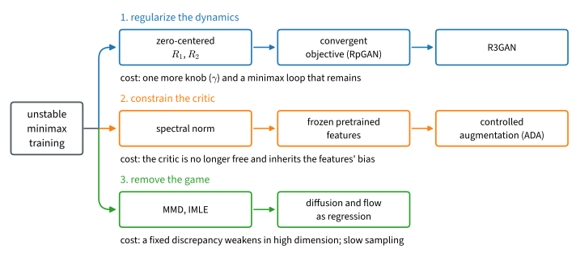

# Adversarial Losses Beyond GANs
:label:`sec_gan_beyond`

Almost every regressor in this book was trained with squared error, and for house prices or class probabilities that was the right choice. Ask a network to enlarge a thumbnail, though, and squared error fails. Many sharp photographs shrink to the same thumbnail: the same face with its hair falling slightly differently, the same lawn with its blades of grass elsewhere. Squared error rewards the prediction closest to all of them on average, their pixelwise mean, and that mean is a blur that matches none of them. The critic of this chapter asks a different question of a prediction: whether it looks like a sample from the data. Pix2pix, in the previous section, had a paired target for every input and still added a critic to its $L_1$ loss. This section asks why squared error averages, and why a learned comparison does not.

The question has outlived stand-alone GANs. Most image, video and audio generators are now trained by regression, without a two-player game, yet an adversarial loss still sits inside the one-step generators distilled from them, inside the autoencoders many of them run on, and inside many speech vocoders. We work out the averaging on a problem with one input and two answers, follow the argument into these systems, and end with what the repairs of this chapter leave unsolved.

```{.python .input #adversarial-losses-adversarial-losses-beyond-gans}
%%tab pytorch
%matplotlib inline
from d2l import torch as d2l
import torch
from torch import nn
```

```{.python .input #adversarial-losses-adversarial-losses-beyond-gans}
%%tab jax
%matplotlib inline
from d2l import jax as d2l
import jax
from jax import numpy as jnp
from flax import nnx
import optax
```

## Conditional Means and Ambiguity

Many generation problems are conditional predictions. A super-resolution network receives a low-resolution image $c$, the condition, and must produce a high-resolution image $x$, the sample. A vocoder receives a spectrogram and must produce a waveform. A one-step student receives a noise vector and must produce, in one forward pass, the image its teacher builds over many network evaluations. Before comparing losses for such problems, we ask what the usual loss rewards.

### The Conditional-Mean Decomposition

Write $g$ for the predictor and $\mu(c) = \mathbb{E}[x \mid c]$ for the conditional mean. Adding and subtracting $\mu(c)$ inside the square produces a cross term $2\,\mathbb{E}\big[(x - \mu(c))(\mu(c) - g(c))\big]$, which vanishes: given $c$, the second factor is fixed and the first has mean zero. What remains is

$$
\mathbb{E}\big[(x - g(c))^2\big]
\;=\;
\mathbb{E}\big[(x - \mu(c))^2\big] \;+\; \mathbb{E}\big[(\mu(c) - g(c))^2\big].
$$
:eqlabel:`eq_beyond_condmean`

The first term is the spread of $x$ around its mean, which no predictor can remove. The second is the squared distance from $g(c)$ to $\mu(c)$, so squared error grades a predictor by its distance to the conditional mean, and the best predictor is $g = \mu$. When $p(x \mid c)$ concentrates on one answer, the mean is that answer. When it spreads over several, the mean averages them and need not be an answer itself: the mean of many sharp images that share a thumbnail is not sharp.

An adversarial loss grades a prediction by a learned comparison instead. A critic $D(x, c)$ is trained by logistic regression to tell data pairs $(x, c) \sim p$ from pairs $(\hat x, c) \sim q$ formed with the predictor's output. As :numref:`sec_basic_gan` showed, the best such critic is the log density ratio

$$
D^\star(x, c) = \log \frac{p(x, c)}{q(x, c)}.
$$

It is strongly negative where predictions land with no data near them. The predictor raises the critic's score of its own outputs by minimizing $-\log \sigma\big(D(\hat x, c)\big)$, the non-saturating loss of :numref:`sec_basic_gan`, so a prediction in an empty region between valid answers scores low, however close it is on average to all of them. The two losses agree when $p(x \mid c)$ has one answer the predictor can reach. When it has several, squared error favors their mean and the critic favors a prediction among the data.

### Two Bands
:label:`subsec_gan_beyond_capacity`

The smallest problem that separates the two losses has one input, one output and two answers. Draw the condition $c$ uniformly from $[-1, 1]$ and set

$$
x \;=\; c + b + 0.05\,\xi,
\qquad
b \in \{-1, +1\} \textrm{ with probability } \tfrac12 \textrm{ each},
\quad \xi \sim \mathcal{N}(0, 1),
$$
:eqlabel:`eq_beyond_twoband`

with the offset $b$ drawn independently of $c$. The data form two parallel bands, $x = c \pm 1$, two units apart, forty times the noise width. The conditional mean $\mu(c) = c$ runs through the empty corridor between them, and its expected squared error is $1 + 0.05^2 \approx 1.0025$, the first term of :eqref:`eq_beyond_condmean`. A predictor that follows the band $x = c + 1$ is right for half of the data and two units off for the other half, so its expected squared error is $\tfrac12 \cdot 4 + 0.05^2 \approx 2.0025$. Squared error prefers the corridor, where no data point lies.

Both students are the same deterministic network, a perceptron with two hidden layers of 32 tanh units that maps $c$ to one prediction $\hat x = g(c)$, and both start from the same weights. The critic is a perceptron of the same size with leaky ReLU units that scores pairs $(x, c)$. Since the data distribution is known, `make_bands` draws a fresh batch at every training step.

```{.python .input #adversarial-losses-the-capacity-argument-1}
%%tab pytorch
def make_bands(n):
    """Draw n pairs (c, x) from the two bands x = c + b + 0.05 xi."""
    c = torch.rand(n, 1) * 2 - 1
    b = torch.randint(0, 2, (n, 1)) * 2.0 - 1.0
    return c, c + b + 0.05 * torch.randn(n, 1)

def mlp(sizes, act):
    layers = []
    for d_in, d_out in zip(sizes[:-1], sizes[1:]):
        layers += [nn.Linear(d_in, d_out), act()]
    return nn.Sequential(*layers[:-1])

torch.manual_seed(0)
g_mse, g_adv = mlp([1, 32, 32, 1], nn.Tanh), mlp([1, 32, 32, 1], nn.Tanh)
g_adv.load_state_dict(g_mse.state_dict())  # both students start alike
D = mlp([2, 32, 32, 1], lambda: nn.LeakyReLU(0.2))
```

```{.python .input #adversarial-losses-the-capacity-argument-1}
%%tab jax
def make_bands(key, n):
    """Draw n pairs (c, x) from the two bands x = c + b + 0.05 xi."""
    k_c, k_b, k_xi = jax.random.split(key, 3)
    c = jax.random.uniform(k_c, (n, 1), minval=-1, maxval=1)
    b = jax.random.rademacher(k_b, (n, 1), dtype=jnp.float32)
    return c, c + b + 0.05 * jax.random.normal(k_xi, (n, 1))

def mlp(sizes, act, rngs):
    layers = []
    for d_in, d_out in zip(sizes[:-1], sizes[1:]):
        # weights and biases uniform in +-1/sqrt(fan_in)
        init = lambda key, shape, dtype, bound=d_in ** -0.5: (
            jax.random.uniform(key, shape, dtype, -bound, bound))
        layers += [nnx.Linear(d_in, d_out, kernel_init=init,
                              bias_init=init, rngs=rngs), act]
    return nnx.Sequential(*layers[:-1])

rngs = nnx.Rngs(0)
g_mse = mlp([1, 32, 32, 1], nnx.tanh, rngs)
g_adv = nnx.clone(g_mse)  # both students start alike
D = mlp([2, 32, 32, 1], lambda h: nnx.leaky_relu(h, 0.2), rngs)
key_mse, key_adv, key_data = jax.random.split(jax.random.key(0), 3)
```

The first student minimizes squared error with Adam. Its learning rate decays along a cosine from 0.01 to zero over 2,000 steps, so the last steps average out the minibatch noise and the curve settles where :eqref:`eq_beyond_condmean` says it should.

```{.python .input #adversarial-losses-two-bands-1}
%%tab pytorch
def train_mse(g, num_steps=2000, batch_size=128, lr=0.01):
    opt = torch.optim.Adam(g.parameters(), lr=lr)
    sched = torch.optim.lr_scheduler.CosineAnnealingLR(opt, num_steps)
    for _ in range(num_steps):
        c, x = make_bands(batch_size)  # a fresh batch at every step
        opt.zero_grad()
        ((g(c) - x) ** 2).mean().backward()
        opt.step()
        sched.step()

train_mse(g_mse)
```

```{.python .input #adversarial-losses-two-bands-1}
%%tab jax
@nnx.jit(static_argnums=3)
def mse_step(g, opt, key, batch_size):
    c, x = make_bands(key, batch_size)  # a fresh batch at every step
    opt.update(g, nnx.grad(lambda g_: ((g_(c) - x) ** 2).mean())(g))

def train_mse(g, key, num_steps=2000, batch_size=128, lr=0.01):
    schedule = optax.cosine_decay_schedule(lr, num_steps)
    opt = nnx.Optimizer(g, optax.adam(schedule), wrt=nnx.Param)
    for k in jax.random.split(key, num_steps):
        mse_step(g, opt, k, batch_size)

train_mse(g_mse, key_mse)
```

The second student plays the log-loss game. At each step the critic takes one logistic-regression step on real pairs $(x, c)$ against predicted pairs $(\hat x, c)$, and then the student takes one step on $-\log \sigma\big(D(\hat x, c)\big)$ against the updated critic. The prediction enters the game with the data's observation noise, $\hat x = g(c) + 0.05\,\xi'$ with a fresh $\xi' \sim \mathcal{N}(0, 1)$, so the two distributions differ in where they put their mass, not in how smooth they are.

```{.python .input #adversarial-losses-two-bands-2}
%%tab pytorch
softplus = nn.functional.softplus

def train_adversarial(g, D, num_steps=8000, batch_size=128):
    opt_G = torch.optim.Adam(g.parameters(), lr=1e-3)
    opt_D = torch.optim.Adam(D.parameters(), lr=2e-3)
    for _ in range(num_steps):
        c, x = make_bands(batch_size)
        x_hat = g(c) + 0.05 * torch.randn(batch_size, 1)  # the data's noise
        real, fake = torch.cat([c, x], 1), torch.cat([c, x_hat], 1)
        loss_D = softplus(-D(real)) + softplus(D(fake.detach()))
        opt_D.zero_grad()
        loss_D.mean().backward()
        opt_D.step()
        opt_G.zero_grad()
        softplus(-D(fake)).mean().backward()
        opt_G.step()

train_adversarial(g_adv, D)
```

```{.python .input #adversarial-losses-two-bands-2}
%%tab jax
softplus = jax.nn.softplus

@nnx.jit(static_argnums=5)
def adversarial_step(g, D, opt_G, opt_D, key, batch_size):
    k_data, k_xi = jax.random.split(key)
    c, x = make_bands(k_data, batch_size)
    xi = jax.random.normal(k_xi, (batch_size, 1))  # the data's noise
    real = jnp.concatenate([c, x], 1)
    fake = lambda g_: jnp.concatenate([c, g_(c) + 0.05 * xi], 1)
    loss_D = lambda D_: (softplus(-D_(real)) + softplus(D_(fake(g)))).mean()
    opt_D.update(D, nnx.grad(loss_D)(D))
    loss_G = lambda g_: softplus(-D(fake(g_))).mean()
    opt_G.update(g, nnx.grad(loss_G)(g))

def train_adversarial(g, D, key, num_steps=8000, batch_size=128):
    opt_G = nnx.Optimizer(g, optax.adam(1e-3), wrt=nnx.Param)
    opt_D = nnx.Optimizer(D, optax.adam(2e-3), wrt=nnx.Param)
    for k in jax.random.split(key, num_steps):
        adversarial_step(g, D, opt_G, opt_D, k, batch_size)

train_adversarial(g_adv, D, key_adv)
```

Three numbers summarize each student on a grid of 201 inputs: the mean distance from its curve to the nearer band, the mean distance to the conditional mean $x = c$, and the fraction of inputs at which the curve is more than 0.25 from both bands.

```{.python .input #adversarial-losses-the-capacity-argument-2}
%%tab pytorch
cs = torch.linspace(-1, 1, 201).reshape(-1, 1)
with torch.no_grad():
    curves = {'squared error': g_mse(cs), 'adversarial': g_adv(cs)}
for name, x_hat in curves.items():
    to_band = torch.minimum((x_hat - cs - 1).abs(), (x_hat - cs + 1).abs())
    print(f'{name}: {to_band.mean():.2f} from the nearer band, '
          f'{(x_hat - cs).abs().mean():.2f} from x = c, '
          f'{(to_band > 0.25).float().mean():.0%} off the bands')
c_data, x_data = make_bands(200)
```

```{.python .input #adversarial-losses-the-capacity-argument-2}
%%tab jax
cs = jnp.linspace(-1, 1, 201).reshape(-1, 1)
curves = {'squared error': g_mse(cs), 'adversarial': g_adv(cs)}
for name, x_hat in curves.items():
    to_band = jnp.minimum(jnp.abs(x_hat - cs - 1), jnp.abs(x_hat - cs + 1))
    print(f'{name}: {to_band.mean():.2f} from the nearer band, '
          f'{jnp.abs(x_hat - cs).mean():.2f} from x = c, '
          f'{(to_band > 0.25).mean():.0%} off the bands')
c_data, x_data = make_bands(key_data, 200)
```

The plot draws both curves over a sample of the data, with the conditional mean dashed.

```{.python .input #adversarial-losses-the-capacity-argument-3}
%%tab pytorch, jax
d2l.plot([c_data, cs, cs, cs],
         [x_data, curves['squared error'], curves['adversarial'], cs],
         '$c$', '$x$', ['data', 'squared-error student',
                        'adversarial student', '$x = c$'],
         ylim=(-2.2, 3.6), fmts=('C0.', 'C2-', 'C1-', 'k--'),
         figsize=(5.5, 3.2))
```

The squared-error student lies on average within about 0.02 of the dashed line $x = c$, a little farther at the ends of the interval, as :eqref:`eq_beyond_condmean` predicts, and so about one unit from every band: everywhere it predicts a value that never occurs in the data. The adversarial student lies on a band, a few hundredths from it on average, and leaves the bands only at zero, one or two narrow crossings; other seeds change which band it follows and where it crosses, not these numbers. A curve that changes bands must pass through the corridor, since it is continuous. The adversarial loss confines that passage to a narrow interval, whereas squared error places every prediction in the corridor.

### Ambiguity and Capacity

The adversarial student does not recover the conditional distribution: a deterministic map gives one answer per input, so following one band leaves the other unrepresented. A larger network would not help. The condition $c$ carries no information about the band, so no deterministic function of $c$, however large, picks the right band more than half the time. The missing ingredient is information. Given a latent bit $z \in \{-1, +1\}$ drawn alongside $c$, a student can send each value of $z$ to one band and so produce both (Exercise :exref:`ex_adversarial-losses-latent-bit`). Generators that must produce varied outputs therefore take a latent input or keep a multi-step sampler, and they need a loss that does not reward piling every sample onto one band, the question of mode coverage that :numref:`sec_gan_relativistic` studies.

Averaging has two sources, and only one of them yields to a larger model. In the first, the input does not determine the output: the thumbnail, the two bands, and, below, the phase of a waveform. In the second, the input determines the output but the model cannot compute the map in one pass. The noise vector of a one-step student fixes its teacher's image, but a student that cannot reproduce the teacher's long computation sees several inputs as alike. Either way the best squared-error fit averages over the outputs the model cannot tell apart, and more capacity removes only the second source.

A predictor that samples $p(x \mid c)$ exactly has twice the expected error of the conditional mean, 3 dB less peak signal-to-noise ratio (Exercise :exref:`ex_adversarial-losses-perfect-sampler`). :citet:`Blau.Michaeli.2017` showed that the conflict is general: low distortion and outputs distributed like the data cannot both be reached, so a realistic output must be judged by whether it looks like data, not by its squared error.

## Adversarial Terms in Current Systems

The argument predicts where an adversarial term should survive once generators are trained by regression: wherever the output is ambiguous given what the model sees, and the model must answer in one pass. We follow that prediction into three kinds of systems.

### Denoisers as Conditional Means

Diffusion and flow models generate a sample by repeatedly evaluating a learned denoiser, often dozens or hundreds of times :cite:`ho2020denoising,Lipman.Chen.BenHamu.ea.2022`. The denoiser receives a noisy image $x_t$, a clean image $x_0$ with noise added at level $t$, and is trained by squared error to predict $x_0$. By :eqref:`eq_beyond_condmean` with $(c, x) = (x_t, x_0)$, it learns the conditional mean $\mathbb{E}[x_0 \mid x_t]$. At low noise, $x_t$ nearly determines $x_0$ and the mean is sharp. At high noise, many clean images are compatible with $x_t$, and the mean is their blurred average, the corridor of the two bands. A many-step sampler takes only a small step toward that mean, adds fresh noise, and asks again at a lower noise level, so no single average becomes the output. A one-step student has no later steps. If it is trained by squared error toward the teacher's denoised estimate at high noise, it inherits the average.

### One-Step Distillation

Distillation trains a student to approximate the teacher's distribution in one to four network evaluations. Adversarial diffusion distillation (ADD) trains a one-step student with two losses :cite:`Sauer.Lorenz.Blattmann.ea.2023`: a regression toward a frozen teacher, which denoises a noised copy of the student's output, and an adversarial loss against real images, with a critic built from frozen DINOv2 features and small trainable heads. In the reported one-step ablation, with all other settings fixed, the regression alone gives FID 315.6, the adversarial loss alone 20.8, and both together 20.6. A student fitted only to a conditional-mean target does not produce usable samples. The adversarial term supplies the sample quality, and the distillation term leaves FID nearly unchanged while raising the CLIP score, the agreement of the image with its prompt.

Distribution matching distillation (DMD) replaces the critic by two models trained by regression :cite:`Yin.Gharbi.Zhang.ea.2024`. It moves each generated sample $x'$ along the difference of two scores, the gradients of log densities, $\nabla_x \log p(x') - \nabla_x \log q(x')$, where $q$ is now the student's own distribution. Two diffusion models supply the scores on noised copies of $x'$: the frozen teacher for the data, and a second model, trained online on the student's samples, for $q$. At noise level $t$ the difference is $\nabla_x \log(p_t/q_t)$, the input gradient of the optimal log-loss critic between the noised data $p_t$ and the noised samples $q_t$. DMD therefore follows the direction a perfect critic would give, without a classifier. The loop remains coupled, since the second model trains alongside the student, but neither network maximizes what the other minimizes. Its successor DMD2 adds a critic against real images :cite:`Yin.Gharbi.Park.ea.2024`.

### Tokenizers and Vocoders

Many image generators run on an autoencoder that compresses each image into a shorter code. Widely used ones, from VQGAN to the Stable Diffusion autoencoder, add a critic that scores image patches, because the code does not fix the exact texture at each location and pixelwise losses average the plausible textures into a blur :cite:`Esser.Rombach.Ommer.2021,Rombach.Blattmann.Lorenz.ea.2022`. ViTok-v2 replaced the adversarial loss with a fixed perceptual loss on self-supervised DINOv3 features when it scaled its autoencoder to five billion parameters, reporting that adversarial losses prevented stable scaling :cite:`Hansen-Estruch.Chen.Ramanujan.ea.2026`. A perceptual loss is still squared error, but on features that change little across the textures the code leaves open, so averaging them does not blur the pixels.

Speech vocoders face the same ambiguity in phase. A spectrogram fixes the frequency content and the magnitude of each frame but not its phase. If a frame is $\sin(\omega t + \vartheta)$ with the phase $\vartheta$ uniform on $[-a, a]$, the squared-error prediction, the average over $\vartheta$, is a sine of the same frequency whose amplitude has shrunk by the factor $\sin a / a$ (Exercise :exref:`ex_adversarial-losses-phase`). With the phase entirely unknown, $a = \pi$, the prediction is silence. A critic that sees the waveform rejects the shrunken frame, which is why HiFi-GAN and the BigVGAN family train against critics :cite:`Kong.Kim.Bae.2020,Lee.Ping.Ginsburg.ea.2023`, and RAF with the paired loss of :numref:`sec_gan_relativistic` :cite:`Lee.Choi.2026`. Whether fixed perceptual features can replace the critic for audio, as they did for ViTok-v2, is open.

## The Objective without the Game

Every system above that keeps a critic inherits the training problems of the earlier sections, and ViTok-v2 shows that they can block scaling. Methods respond in three ways, and the third separates the adversarial objective from the game that usually optimizes it.

### Responses to Instability

The first response regularizes the dynamics of the game: zero-centered penalties on the critic's input gradient make training converge near the equilibrium :cite:`Mescheder.Geiger.Nowozin.2018`, as :numref:`sec_gan_convergence` derives. The second constrains the critic, by bounding its slope, by freezing its features as ADD does, or by augmenting both of its inputs. The third removes the game: a fixed discrepancy such as MMD, or, in diffusion and flow models, a regression on a closed-form target with a unique minimizer, so that training needs no equilibrium between two networks. :numref:`fig_gan_exits` compares the three.

![Three responses to unstable adversarial training, corresponding to different sources of instability: regularize the dynamics of the game, constrain the critic, or replace the game with a fixed discrepancy or regression objective. The first retains a minimax loop and a penalty weight; the second inherits the biases of its fixed features; the third may use discrepancies that weaken in high dimensions or require multi-step sampling. Adversarial losses can reappear when non-adversarial models are distilled to a few steps.](../img/mdl-gan-exits.svg)
:label:`fig_gan_exits`

### Likelihood Models as Critics

Standard adversarial training estimates $\log(p/q)$ with a separate network because the generator's density $q$ cannot be evaluated. A likelihood model can evaluate its density, and so it can compute the ratio between two versions of itself. Direct discriminative optimization (DDO) :cite:`Zheng.Chen.Chen.ea.2025` takes a pretrained likelihood model $q_\theta$, such as a diffusion model, compares real data with samples from a frozen reference copy $q_{\textrm{ref}}$, and parameterizes the critic as

$$
D_\theta(x) = \log\big(q_\theta(x)/q_{\textrm{ref}}(x)\big).
$$
:eqlabel:`eq_beyond_ddo`

For a diffusion model, which offers only a bound on its log-likelihood, the ratio is estimated from the difference of the two models' denoising losses. Training this critic by logistic regression on real against reference samples updates $q_\theta$ directly, with no discriminator network and no second player. If training reaches $q_\theta = p$, then $D_\theta = \log(p/q_{\textrm{ref}})$, the optimal critic between the data and the reference model (Exercise :exref:`ex_adversarial-losses-ddo-plays-log-loss`), so the parameterization can represent the exact solution of the game it plays.

The adversarial objective thus needs an estimate of $\log(p/q)$ or of its gradient. The convergence failures of :numref:`sec_gan_convergence` come from estimating it with a second network trained against the generator. Vocoders and ADD keep that game, ViTok-v2 drops the objective, DMD estimates the gradient with two score models, and DDO represents the ratio with the likelihood model itself.

### What Remains

The chapter began with a game whose generator could lose its gradient, whose training could circle without converging, and whose samples could collapse onto a few modes. The repairs work. The non-saturating and paired losses keep a gradient, zero-centered penalties make gradient training converge near the equilibrium (:numref:`sec_gan_convergence`), and with both, a plain convolutional generator learns to draw images (:numref:`sec_dcgan`). Four limits remain. The generator is a sampler without a density, so it cannot report how likely an image is. Training still needs two networks and a game that converges reliably only under a penalty whose weight must be chosen for the data. No likelihood term penalizes a missing mode: the guarantee against mode-dropping minima holds only for a fixed one-to-one pairing of real and generated samples (:numref:`sec_gan_relativistic`), and the evidence for coverage in training is empirical, the 1,000 modes of stacked MNIST digits counted in R3GAN's ablation (:numref:`sec_gan_convergence`). And the game can still become unstable at scale, as ViTok-v2 reported. Diffusion and flow models, the subject of :numref:`chap_diffusion`, avoid the game: they are trained by regression against closed-form targets, computed from each training example.

## Summary

Squared error measures a prediction's distance to the conditional mean, so where the input leaves the output ambiguous, or the model cannot compute the map in one pass, a regression-trained model predicts an average that need not be a valid output. A critic, whose optimum is the log density ratio, rewards predictions among the data: on two bands the squared-error student runs through the empty corridor, while the adversarial student stays on a band, though as a deterministic map it covers only one. A squared-error denoiser is a conditional mean, so a one-step student fitted to it inherits the average; autoencoders and vocoders face the same ambiguity in texture and phase, and all three keep a critic or a stand-in for one. The adversarial objective needs an estimate of $\log(p/q)$, not a two-player game, as DMD and DDO show.

## Exercises

1. **Distortion of a perfect sampler.** Let $\hat x$ be drawn from
   $p(x \mid c)$, independently of $x$ given $c$, so that the predictor
   samples the conditional distribution exactly
   :cite:`Blau.Michaeli.2017`.
    1. Use :eqref:`eq_beyond_condmean` to show that
       $\mathbb{E}\big[(x - \hat x)^2\big] = 2\, \mathbb{E}\big[(x - \mu(c))^2\big]$.
       How many decibels of peak signal-to-noise ratio,
       $10 \log_{10}\big(x_{\max}^2 / \mathbb{E}[(x - \hat x)^2]\big)$, does the
       sampler lose against the conditional mean?
    1. On the two bands :eqref:`eq_beyond_twoband`, compute the expected
       squared error of the exact sampler and rank it against the
       conditional mean (about 1.0025) and the band $x = c + 1$ (about
       2.0025). Which of the three can an optimal critic of $(x, c)$ pairs
       not distinguish from the data?
    1. A deterministic predictor can match the distribution of $x$ without
       sampling. Let $x \sim \mathcal{N}(0, 1)$ and $c = x + \tau \xi$ with
       $\xi \sim \mathcal{N}(0, 1)$ independent of $x$. Show that
       $\hat x = c / \sqrt{1 + \tau^2}$ has the distribution of $x$, and
       compute the ratio of its squared error to that of the conditional
       mean for $\tau \in \{0.1, 1, 10\}$. When is the extra error small?
   :exlabel:`ex_adversarial-losses-perfect-sampler`
1. [code] **Mean and median.** Absolute error $\mathbb{E}\big[|x - g(c)|\big]$
   is minimized by a conditional median, a value $t$ with
   $P(x \leq t \mid c) = \tfrac12$.
    1. Let the offset $b$ of :eqref:`eq_beyond_twoband` take the values
       $-1$, $0$ and $+1$ with probabilities $(\tfrac13, \tfrac13, \tfrac13)$
       or $(\tfrac14, \tfrac14, \tfrac12)$. Find the conditional mean and
       median in each case, and say whether each is a valid output.
    1. Return to two bands with $P(b = +1) = r$, and write the conditional
       mean as a function of $r$. For $r = \tfrac34$, show that the
       conditional median lies on the upper band and compute its offset from
       $c$ to two decimal places. For $r = \tfrac12$, describe the
       absolute-error risk as a function of $g(c) - c$ inside the corridor.
    1. Train the squared-error student of
       :numref:`subsec_gan_beyond_capacity` and a copy trained with absolute
       error on the data of (a) and (b), with three seeds for $r = \tfrac12$,
       and compare with your predictions. When is the conditional median a
       valid output?
   :exlabel:`ex_adversarial-losses-mean-and-median`
1. [code] **Pointwise plus adversarial.** ADD trains its student on the sum
   of an adversarial loss and a weighted pointwise distillation loss
   :cite:`Sauer.Lorenz.Blattmann.ea.2023`.
    1. Add $\kappa$ times the squared error against the observed $x$ to the
       loss of the adversarial student of :numref:`subsec_gan_beyond_capacity`.
       Train with $\kappa \in \{0.1, 1, 10, 100\}$, two seeds each, and report the mean
       distances to the nearer band and to the conditional mean. Near which
       $\kappa$ does the curve leave the bands?
    1. ADD's teacher instead denoises a noised copy of the student's output,
       and its estimate serves as a constant target. Let the teacher see the
       prediction through noise of level $\tau$,
       $\tilde x = \hat x + \tau \xi$ with $\xi \sim \mathcal{N}(0, 1)$ drawn
       fresh at every step. Show that the posterior mean of the band
       center given $\tilde x$ is
       $c + \tanh\big((\tilde x - c)/(\tau^2 + 0.05^2)\big)$, which tends to
       the center of the band nearest $\tilde x$ as $\tau \to 0$ and to the
       conditional mean $c$ as $\tau \to \infty$. Repeat the sweep of (a)
       with this target, gradient stopped, at $\tau = 0.1$ and $\tau = 2$.
       Which setting behaves like (a), and how do the sweeps relate to ADD's
       one-step ablation (distillation alone FID 315.6, adversarial alone
       20.8, both 20.6)?
   :exlabel:`ex_adversarial-losses-pointwise-plus-adversarial`
1. **Phase and the conditional mean.** Model one frame of a waveform as
   $x_t = \sin(\omega t + \vartheta)$ for $t = 0, \ldots, N - 1$, where the
   spectrogram fixes $\omega$ and the phase $\vartheta$ is uniform on
   $[-a, a]$ with $0 < a \leq \pi$.
    1. Show that the squared-error prediction $\mathbb{E}[x_t]$ has
       $\sin a / a$ times the amplitude of the valid waveforms, and evaluate
       the factor at $a = \pi/2$.
    1. Let $\omega = 2\pi k / N$ for an integer $k$ with $0 < k < N/2$. Show
       that the magnitudes of the discrete Fourier transform of $x$ do not
       depend on $\vartheta$. Which outputs minimize a loss on these
       magnitudes, such as the mel-spectrogram term of HiFi-GAN
       :cite:`Kong.Kim.Bae.2020`?
    1. Concatenate two such frames with independent phases, so that a
       magnitude loss on each frame is zero. What is wrong with the waveform
       at the boundary, and what must the input of a critic contain to
       penalize it?
   :exlabel:`ex_adversarial-losses-phase`
1. **Frozen critic features.** Projected GAN and ADD score a sample through
   a frozen pretrained feature map $\phi$ and train only a head $r$, so that
   $D(x) = r(\phi(x))$
   :cite:`Sauer.Chitta.Muller.ea.2021,Sauer.Lorenz.Blattmann.ea.2023`. Let
   $p_\phi$ and $q_\phi$ be the distributions of $\phi(x)$ under $p$ and
   $q$, and let $r$ range over all functions.
    1. Write the log-loss value
       $V(D) = \mathbb{E}_{x \sim p}[\log \sigma(D(x))] + \mathbb{E}_{x \sim q}[\log \sigma(-D(x))]$
       as an expectation over $p_\phi$ and $q_\phi$ and maximize it pointwise
       over $r$. What is the optimal head, which divergence does the maximal
       value measure, and which generators $q$ minimize it?
    1. Let $p = \mathcal{N}(0, I_2)$ on $\mathbb{R}^2$ and $\phi(x) = x_1$.
       Give a minimizer $q \neq p$.
    1. Suppose the generator is scored by the Fréchet distance of
       :numref:`sec_dcgan`, computed with the same features $\phi$. Which
       score does a minimizer from (a) reach, and what does it say about $q$?
       Relate the answer to the finding of
       :citet:`Kynkaanniemi.Karras.Aittala.ea.2023` that ImageNet-pretrained
       critics can lower Inception-based FID.
   :exlabel:`ex_adversarial-losses-frozen-features`
1. **DDO's implicit critic.** DDO :cite:`Zheng.Chen.Chen.ea.2025` plays the
   log-loss game between real data and samples of a frozen model
   $q_{\textrm{ref}}$ with the critic $D_\theta$ of :eqref:`eq_beyond_ddo`.
   It minimizes
   $J(\theta) = -\mathbb{E}_{x \sim p}[\log \sigma(D_\theta(x))] - \mathbb{E}_{x \sim q_{\textrm{ref}}}[\log \sigma(-D_\theta(x))]$
   over the parameters of $q_\theta$, starting from
   $\theta = \theta_{\textrm{ref}}$.
    1. Show in three lines that if training reaches $q_\theta = p$, this
       critic is the optimal critic between $p$ and $q_{\textrm{ref}}$.
    1. Show that at $\theta = \theta_{\textrm{ref}}$ the gradient of $J$ is
       one half of the gradient of the negative log-likelihood
       $-\mathbb{E}_{x \sim p}[\log q_\theta(x)]$. Use
       $\mathbb{E}_{x \sim q_\theta}[\nabla_\theta \log q_\theta(x)] = 0$,
       which follows from differentiating $\int q_\theta(x)\, dx = 1$.
   :exlabel:`ex_adversarial-losses-ddo-plays-log-loss`
1. [code] **A latent bit.** ● Give the student of
   :numref:`subsec_gan_beyond_capacity` a latent input $z \in \{-1, +1\}$,
   uniform and independent of $c$, so that it maps $(c, z)$ to $\hat x$. The
   critic still scores $(x, c)$ pairs.
    1. Train one such student with squared error and one adversarially, and
       find the band each value of $z$ lands on. Which loss gives the student
       an incentive to use $z$?
    1. IMLE :cite:`Li.Malik.2018` matches each data point with its nearest
       generated sample. With a binary latent, its loss is
       $\mathbb{E}\big[\min_{z} (g(c, z) - x)^2\big]$. Train a student with it
       and compare with (a). Which property of the loss forces both latent
       values into use without a critic?
    1. Now let $P(b = +1) = \tfrac34$. Which band frequencies can a student
       with a uniform binary latent represent at a given $c$? Predict, from
       the Jensen--Shannon divergence to the data, the choice of the
       adversarial student, and check by training. What must change in the
       latent input to represent $\tfrac34$?
   :exlabel:`ex_adversarial-losses-latent-bit`
1. [code] **Multi-round refinement.** ●● In practice DDO minimizes

   $$J_{\alpha, \beta}(\theta) = -\mathbb{E}_{x \sim p}\big[\log \sigma\big(\beta D_\theta(x)\big)\big] - \alpha\, \mathbb{E}_{x \sim q_{\textrm{ref}}}\big[\log \sigma\big(-\beta D_\theta(x)\big)\big]$$

   with $D_\theta$ of :eqref:`eq_beyond_ddo` and $\beta$ between 0.01 and
   0.1, over several rounds, each of which
   replaces $q_{\textrm{ref}}$ by the previous round's model
   :cite:`Zheng.Chen.Chen.ea.2025`.
    1. Let $q_\theta$ range over all densities. Minimize the integrand at
       each $x$ over $D_\theta(x)$ to show that the minimizer is proportional
       to $q_{\textrm{ref}}^{1 - 1/\beta}\, p^{1/\beta}$ and is normalized for
       exactly one value of $\alpha$. With $r_n = \log(q_n / p)$ for the
       model of round $n$, derive the recursion from $r_n$ to $r_{n+1}$ up to
       an additive constant. For which $\beta$ do the rounds converge to $p$,
       and what happens at $\beta = 0.05$?
    1. Now let the family $q_\theta$ be restricted. Generalize Exercise
       :exref:`ex_adversarial-losses-ddo-plays-log-loss`b to show that at
       $\theta = \theta_{\textrm{ref}}$ the gradient of $J_{\alpha, \beta}$
       is $\beta / 2$ times the gradient of the negative log-likelihood, for
       every $\alpha$. Conclude that every fixed point of the rounds is a
       stationary point of the likelihood.
    1. Fit the Gaussian family to
       $p = \tfrac12 \mathcal{N}(-2, 0.5^2) + \tfrac12 \mathcal{N}(2, 0.5^2)$
       by quadrature, from $q_{\textrm{ref}} = \mathcal{N}(1, 1)$ with
       $\alpha = 1$, and track the mean and standard deviation over eight
       rounds for
       $\beta \in \{1, 0.75, 0.5, 0.05\}$. Compare the threshold with (a).
       The Gaussian likelihood has one stationary point, so by (b) the rounds
       can at best reach the maximum-likelihood fit. Which features of the
       setting of :citet:`Zheng.Chen.Chen.ea.2025` must differ for their
       reported gains to be possible?
   :exlabel:`ex_adversarial-losses-multi-round-refinement`

[Discussions](https://d2l.discourse.group/t/36814)

<!-- slides -->

::: {.slide}
::: {.cover}
[Dive into Deep Learning · §16.7]{.kicker}

Adversarial losses beyond GANs<br>
**conditional means · two bands · denoisers and distillation · tokenizers and vocoders · the objective without the game**
:::
:::

::: {.slide title="Squared Error Turns Many Sharp Answers into One Blur"}
[The problem]{.kicker}

- Enlarge a thumbnail: many sharp photographs shrink to the same thumbnail.
- Squared error rewards the prediction closest to all of them on average,
  their pixelwise mean: a blur that matches none of them.
- Two bands $x = c \pm 1$: the squared-error fit runs between them, about
  **one unit** from every data point.

::: {.d2l-note .warn}
Regression trains most generators today. Why do one-step image generators,
tokenizers and vocoders still keep a critic?
:::
:::

::: {.slide title="By the End of This Deck You Can"}
[Goals]{.kicker}

- derive the conditional-mean decomposition of squared error;
- predict where a squared-error and an adversarial student land on two bands;
- tell ambiguity from limited capacity, and say which a larger model fixes;
- explain why a one-step student of a denoiser needs a critic or a stand-in;
- name what an adversarial objective needs: an estimate of $\log(p/q)$.

**The idea:** a pointwise loss averages over ambiguity, a learned comparison
does not. **Running example:** two bands, one input, two answers.
:::

::: {.slide title="The Last Deck Asks Where the Comparison Survives"}
[Where this fits]{.kicker}

::: {.cols .vc}
::: {.col}
| section | asks |
|---|---|
| Generative Adversarial Networks | what a classifier of samples computes |
| Adversarial Objectives and Divergences | which loss gives which distance |
| Relativistic Objectives | what changes when the critic ranks pairs |
| Gradient Penalties and Convergence | why training circles, and what stops it |
| Adversarial Image Generation | which network, and how to score images |
| Conditional Generation | how to ask for a class |
| **Adversarial Losses Beyond GANs** | **where a learned comparison remains** |
:::

::: {.col .narrow}
- **Uses:** $D^\star = \log(p/q)$; the non-saturating loss; zero-centered
  penalties.
- **Skips:** how diffusion models are trained; architectures.
:::
:::
:::

::: {.slide title="Squared Error Grades Distance to the Conditional Mean"}
[Conditional means]{.kicker}

For any predictor $g$ of a sample $x$ from a condition $c$, with
$\mu(c) = \mathbb{E}[x \mid c]$, the cross term vanishes given $c$:

$$\mathbb{E}\big[(x - g(c))^2\big]
= \underbrace{\mathbb{E}\big[(x - \mu(c))^2\big]}_{\textrm{no } g \textrm{ removes it}}
+ \mathbb{E}\big[(\mu(c) - g(c))^2\big]$$

- The best predictor is $g = \mu$.
- One answer per input: $\mu$ is that answer.
- Several answers: $\mu$ is their average, which need not be an answer.
:::

::: {.slide title="On Two Bands the Mean Lies Where No Data Is"}
[Two bands]{.kicker}

$c \sim U[-1, 1]$, $\;x = c + b + 0.05\,\xi$, $\;b = \pm 1$ with
probability $\tfrac12$ each, independent of $c$.

- Bands $x = c \pm 1$, forty noise widths apart; $\mu(c) = c$, in the corridor.
- Expected squared error of $\mu$: $1 + 0.05^2 \approx 1.0025$.
- Of the band $x = c + 1$: $\tfrac12 \cdot 4 + 0.05^2 \approx 2.0025$.

::: {.d2l-note}
Squared error prefers the corridor, where no data point lies.
:::
:::

::: {.slide title="A Critic Scores Whether a Prediction Lies among the Data"}
[Two bands]{.kicker}

Critic $D(x, c)$, trained by logistic regression on data pairs against
predicted pairs $(\hat x, c)$:

$$D^\star(x, c) = \log \frac{p(x, c)}{q(x, c)}$$

- The student minimizes $-\log \sigma\big(D(\hat x, c)\big)$, the
  non-saturating loss.
- $\hat x = g(c) + 0.05\,\xi'$: the data's noise, so only the location of
  mass differs.
- A prediction in the empty corridor scores low, however close it is on
  average.
:::

::: {.slide title="One Step of the Game: Critic First, Then the Student" only="pytorch"}
[Two bands]{.kicker}

```
for _ in range(num_steps):
    c, x = make_bands(batch_size)                   # a fresh batch
    x_hat = g(c) + 0.05 * torch.randn(batch_size, 1)
    real, fake = torch.cat([c, x], 1), torch.cat([c, x_hat], 1)
    loss_D = softplus(-D(real)) + softplus(D(fake.detach()))
    opt_D.zero_grad()
    loss_D.mean().backward()
    opt_D.step()
    opt_G.zero_grad()
    softplus(-D(fake)).mean().backward()
    opt_G.step()
```

Same 32-unit network for both students, same initial weights.
:::

::: {.slide title="One Step of the Game: Critic First, Then the Student" only="jax"}
[Two bands]{.kicker}

```
c, x = make_bands(k_data, batch_size)               # a fresh batch
xi = jax.random.normal(k_xi, (batch_size, 1))
real = jnp.concatenate([c, x], 1)
fake = lambda g_: jnp.concatenate([c, g_(c) + 0.05 * xi], 1)
loss_D = lambda D_: (softplus(-D_(real))
                     + softplus(D_(fake(g)))).mean()
opt_D.update(D, nnx.grad(loss_D)(D))
loss_G = lambda g_: softplus(-D(fake(g_))).mean()
opt_G.update(g, nnx.grad(loss_G)(g))
```

Same 32-unit network for both students, same initial weights.
:::

::: {.slide title="The Adversarial Student Commits to a Band"}
[Two bands]{.kicker}

@!adversarial-losses-the-capacity-argument-3

Squared error: on average within about 0.02 of $x = c$, one unit from every band.
Adversarial: a few hundredths from a band, zero to two crossings.
:::

::: {.slide title="Check: Which Predictor Fools the Critic?"}
[Check]{.kicker}

Three predictors on the two bands: the mean $\mu(c) = c$, the band
$x = c + 1$, and an exact sampler $\hat x \sim p(x \mid c)$. Rank them by
squared error. Which one can an optimal critic not tell from the data?

. . .

- Mean $\approx 1.0025$ $<$ band $\approx 2.0025$ $<$ sampler $\approx 2.005$.
- The sampler's error is twice the mean's, $10 \log_{10} 2 \approx 3$ dB less
  peak signal-to-noise ratio.
- Only the sampler matches the data; squared error ranks it last. In
  general, low distortion and realism cannot both be reached.

[Blau and Michaeli 2018]{.small}
:::

::: {.slide title="A Bigger Network Cannot Pick a Band; a Latent Bit Can"}
[Ambiguity and capacity]{.kicker}

- $c$ carries no information about the band: no deterministic $g(c)$, of any
  size, beats $\mu$ under squared error.
- Add a random latent bit $z = \pm 1$: $g(c, z)$ can send each value to one
  band.
- **Ambiguity:** the input does not fix the output (thumbnail, bands, phase).
- **Capacity:** it does, but one pass cannot compute the map (a one-step
  student of a long sampler).

::: {.d2l-note}
Squared error averages over what the model cannot tell apart. More capacity
fixes only the second case.
:::
:::

::: {.slide title="A Squared-Error Denoiser Returns the Mean of the Clean Image"}
[Current systems]{.kicker}

Train $g(x_t) \approx x_0$ by squared error, $x_t$ = $x_0$ plus noise at
level $t$. With $(c, x) = (x_t, x_0)$:

$$g^\star(x_t) = \mathbb{E}[x_0 \mid x_t]$$

- Low noise: $x_t$ nearly fixes $x_0$, the mean is sharp.
- High noise: many images fit $x_t$, the mean is a blur, the corridor.
- Many steps: move a little, re-noise, ask again; no average is the output.
- One step: a student fitted to the teacher's estimate inherits the average.
:::

::: {.slide title="In One-Step Distillation the Adversarial Term Carries the Quality"}
[Current systems]{.kicker}

ADD: regression toward a frozen teacher plus a critic on frozen DINOv2
features. One-step ablation, everything else fixed:

| loss | FID |
|:---|---:|
| distillation only | 315.6 |
| adversarial only | 20.8 |
| both | 20.6 |

::: {.d2l-note}
The regression target is a conditional mean; the critic supplies the
sample quality, distillation adds prompt alignment.
:::

[Sauer et al. 2023]{.small}
:::

::: {.slide title="DMD Follows the Gradient of the Optimal Critic"}
[Current systems]{.kicker}

Move each generated sample $x'$, noised to level $t$, along

$$\nabla_x \log p_t - \nabla_x \log q_t = \nabla_x \log \frac{p_t}{q_t}$$

- The input gradient of the optimal critic between noised data and noised
  samples.
- $\nabla \log p_t$: the frozen teacher's score; $\nabla \log q_t$: a second
  diffusion model trained online on the student's samples.
- Both scores are learned by regression: no classifier and no minimax, but
  still a coupled loop. DMD2 adds a critic against real images.

[Yin et al. 2024, DMD and DMD2]{.small}
:::

::: {.slide title="Phase and Texture Are Ambiguous, So Vocoders and Tokenizers Keep a Critic"}
[Current systems]{.kicker}

A spectrogram fixes frequency and magnitude, not phase. With
$\vartheta \sim U[-a, a]$:

$$\mathbb{E}_\vartheta\big[\sin(\omega t + \vartheta)\big] = \frac{\sin a}{a}\,\sin(\omega t)$$

- Same frequency, smaller amplitude: not a valid wave. A waveform critic
  rejects it (HiFi-GAN, BigVGAN; RAF with the paired loss).
- Tokenizers: the code leaves patch texture open, so VQGAN and the Stable
  Diffusion autoencoder add a patch critic. ViTok-v2 (5B parameters) uses a
  fixed DINOv3 feature loss instead.

[Kong et al. 2020; Lee et al. 2023; Lee and Choi 2026; Esser et al. 2021; Hansen-Estruch et al. 2026]{.small}
:::

::: {.slide title="Check: What Does a Squared-Error Vocoder Output?"}
[Check]{.kicker}

The phase of a frame is uniform on $[-\pi, \pi]$. What does the
squared-error prediction sound like? And for $[-\pi/2, \pi/2]$?

. . .

- $a = \pi$: $\sin \pi / \pi = 0$. The prediction is silence.
- $a = \pi/2$: $2/\pi \approx 0.64$ of the true amplitude.
- Every valid waveform has full amplitude; the mean is none of them.
:::

::: {.slide title="Three Answers to Instability, Each with a Cost"}
[Responses to instability]{.kicker}

{width=88%}
:::

::: {.slide title="A Likelihood Model Can Be Its Own Critic"}
[The objective without the game]{.kicker}

Two evaluable densities define a log-ratio critic:

$$D_\theta(x) = \log \frac{q_\theta(x)}{q_{\textrm{ref}}(x)}$$

- DDO trains this critic by logistic regression, real data against samples
  of a frozen copy $q_{\textrm{ref}}$, and so updates $q_\theta$ itself.
- At $q_\theta = p$ it is the optimal critic $\log(p/q_{\textrm{ref}})$.
- No discriminator network, no second player.

[Zheng et al. 2025]{.small}
:::

::: {.slide title="The Objective Needs log p/q, Not a Two-Player Game"}
[The objective without the game]{.kicker}

| system | how it gets $\log(p/q)$ or its gradient |
|:---|:---|
| GAN, vocoders | a critic network, trained against the generator |
| ADD | a critic head on frozen features |
| ViTok-v2 | no critic: a fixed feature loss |
| DMD | two score models, trained by regression |
| DDO | the likelihood model itself |
:::

::: {.slide title="Check: Which Systems Train a Second Network alongside the Generator?"}
[Check]{.kicker}

ADD, DMD, ViTok-v2, DDO: which train a second network at the same time,
and which of those play a minimax game?

. . .

- ADD: yes, the critic heads, adversarially.
- DMD: yes, the score model of $q$, by regression, not minimax.
- ViTok-v2 and DDO: no second network.
:::

::: {.slide title="What Remains after the Repairs"}
[Wrap-up]{.kicker}

- Two bands: squared error on average within 0.02 of $x = c$, a unit
  from the data; the critic keeps the student on a band. ADD: 315.6 to 20.6.
- Kept gradient, a penalized game that converges near equilibrium, a plain
  image generator.
- Still: no density; two networks and a tuned penalty; no likelihood term
  against a missing mode, and a coverage guarantee only for a fixed pairing;
  instability at scale (ViTok-v2).

**Next:** diffusion and flow models avoid the game; they train by regression
against closed-form targets, computed from each training example.
:::
