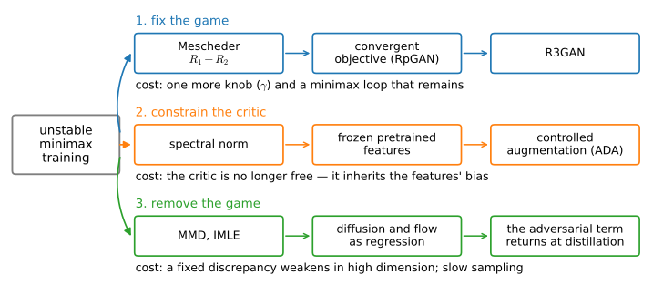

# Adversarial Losses Beyond GANs
:label:`sec_gan_beyond`

The chapter has so far used adversarial objectives to train stand-alone samplers. :numref:`sec_basic_gan` analyzed the original objective, :numref:`sec_gan_objectives` compared its alternatives, :numref:`sec_gan_relativistic` and :numref:`sec_gan_convergence` studied its landscape and dynamics, and :numref:`sec_dcgan` applied the resulting recipe to images. Current image, audio, and video generators are often trained instead by regression against closed-form targets, as developed in :numref:`chap_diffusion`. Adversarial losses nevertheless remain in one-step image generators, the tokenizers used by latent-space models, and neural vocoders. This section explains why these applications retain a learned comparison. It concludes by separating the adversarial objective from the simultaneous two-player optimization used to estimate it.

The common mechanism is a mismatch between a pointwise regression loss and a model that lacks the capacity or information to represent every valid output. We first demonstrate this mismatch on a small problem whose regression and adversarial solutions can be compared directly. We then examine its consequences for distillation, tokenizers, audio, and video. The final sections compare three approaches to adversarial instability and show how the density-ratio identity of :numref:`sec_basic_gan` can be used inside a likelihood model without training a separate discriminator.

```{.python .input #adversarial-losses-adversarial-losses-beyond-gans}
%%tab pytorch
%matplotlib inline
from d2l import torch as d2l
import torch
from torch import nn
```

```{.python .input #adversarial-losses-adversarial-losses-beyond-gans}
%%tab jax
%matplotlib inline
from d2l import jax as d2l
import jax
from jax import numpy as jnp
from flax import nnx
import numpy as np
import optax
```

## The Capacity Argument
:label:`subsec_gan_beyond_capacity`

Many generation problems are conditional predictions. A super-resolution network receives a low-resolution image and must produce a high-resolution one; a vocoder receives a spectrogram and must produce a waveform; a one-step distillation student receives a noise vector and must produce, in a single forward pass, the image its teacher builds over hundreds of evaluations. The default loss for a prediction is the pointwise squared error, and its minimizer is a classical identity. For any predictor $f$ and the conditional mean $\mu(x) = E[y \mid x]$, adding and subtracting $\mu$ inside the square and noting that the cross term vanishes conditionally on $x$ gives

$$
E\big[(y - f(x))^2\big]
\;=\;
E\big[(y - \mu(x))^2\big] \;+\; E\big[(\mu(x) - f(x))^2\big].
$$
:eqlabel:`eq_beyond_condmean`

The first term does not depend on $f$, and the second is the squared distance between $f(x)$ and the conditional mean. Minimizing squared error over all functions therefore gives $f = \mu$. A capacity-limited model approximates this conditional mean as closely as its function class permits. When $p(y \mid x)$ concentrates around a single answer, the conditional mean represents that answer well. When several distinct answers are possible, however, the mean combines them and need not itself be valid. For example, many sharp images may downsample to the same blurry thumbnail, while their pixelwise mean is not sharp under any of the original interpretations.

An adversarial loss evaluates a prediction differently. The optimal critic of :numref:`sec_basic_gan` scores a sample by the log density ratio :eqref:`eq_gan_dstar`. It can therefore distinguish predictions in regions of low data density without measuring their pointwise distance to every valid answer. The two objectives behave similarly when $p(y \mid x)$ concentrates on one answer that the model can represent. With several incompatible answers, squared error favors their mean, whereas the critic favors predictions that remain within the data distribution.

The smallest problem exhibiting the split has one input, one output, and two answers. Draw $x$ uniformly from $[-1, 1]$ and set

$$
y \;=\; x + m + 0.05\,\epsilon,
\qquad
m \in \{-1, +1\} \textrm{ with probability } \tfrac12 \textrm{ each},
\quad \epsilon \sim \mathcal{N}(0, 1),
$$
:eqlabel:`eq_beyond_twoband`

with the mode $m$ drawn independently of $x$. The data form two parallel bands, $y = x \pm 1$, forty noise widths apart. The conditional mean is $\mu(x) = x$, a line through the empty corridor between them. Both students are the same deterministic network, a small two-hidden-layer perceptron mapping $x$ to a single $\hat y$, so neither can represent two answers for one input; the capacity limit is built in. The first student trains on the squared error. The second trains as the generator of the log-loss game against a critic that scores $(x, y)$ pairs, using the non-saturating weight of :eqref:`eq_gan_weights`; its prediction enters the game carrying the same observation noise as the data, so the two distributions the critic compares differ in structure rather than in smoothness.

```{.python .input #adversarial-losses-the-capacity-argument-1}
%%tab pytorch
torch.manual_seed(0)
n = 1024
x = torch.rand(n, 1) * 2 - 1
m = torch.randint(0, 2, (n, 1)) * 2.0 - 1.0
y = x + m + 0.05 * torch.randn(n, 1)

def make_student():
    torch.manual_seed(1)
    return nn.Sequential(nn.Linear(1, 32), nn.Tanh(),
                         nn.Linear(32, 32), nn.Tanh(), nn.Linear(32, 1))

f_mse = make_student()
opt = torch.optim.Adam(f_mse.parameters(), lr=0.01)
for _ in range(2000):
    idx = torch.randint(0, n, (128,))
    opt.zero_grad()
    ((f_mse(x[idx]) - y[idx]) ** 2).mean().backward()
    opt.step()

softplus = nn.functional.softplus
f_adv = make_student()
critic = nn.Sequential(nn.Linear(2, 32), nn.LeakyReLU(0.2),
                       nn.Linear(32, 32), nn.LeakyReLU(0.2),
                       nn.Linear(32, 1))
opt_G = torch.optim.Adam(f_adv.parameters(), lr=1e-3)
opt_D = torch.optim.Adam(critic.parameters(), lr=2e-3)
for _ in range(8000):
    idx = torch.randint(0, n, (128,))
    xb, yb = x[idx], y[idx]
    pair = lambda pred: torch.cat(
        [xb, pred + 0.05 * torch.randn_like(pred)], 1)
    opt_D.zero_grad()
    (softplus(-critic(torch.cat([xb, yb], 1)))
     + softplus(critic(pair(f_adv(xb)).detach()))).mean().backward()
    opt_D.step()
    opt_G.zero_grad()
    softplus(-critic(pair(f_adv(xb)))).mean().backward()
    opt_G.step()
```

```{.python .input #adversarial-losses-the-capacity-argument-1}
%%tab jax
class Student(nnx.Module):
    def __init__(self, rngs):
        self.h1 = nnx.Linear(1, 32, rngs=rngs)
        self.h2 = nnx.Linear(32, 32, rngs=rngs)
        self.out = nnx.Linear(32, 1, rngs=rngs)

    def __call__(self, x):
        return self.out(nnx.tanh(self.h2(nnx.tanh(self.h1(x)))))

class Critic(nnx.Module):
    def __init__(self, rngs):
        self.h1 = nnx.Linear(2, 32, rngs=rngs)
        self.h2 = nnx.Linear(32, 32, rngs=rngs)
        self.out = nnx.Linear(32, 1, rngs=rngs)

    def __call__(self, xy):
        h = nnx.leaky_relu(self.h1(xy), 0.2)
        return self.out(nnx.leaky_relu(self.h2(h), 0.2))

rng = np.random.default_rng(0)
n = 1024
x = jnp.asarray(rng.uniform(-1, 1, (n, 1)))
m = jnp.asarray(rng.integers(0, 2, (n, 1)) * 2.0 - 1.0)
y = x + m + 0.05 * jnp.asarray(rng.standard_normal((n, 1)))

f_mse = Student(nnx.Rngs(1))
opt = nnx.Optimizer(f_mse, optax.adam(0.01), wrt=nnx.Param)

@nnx.jit
def step_mse(f, opt, xb, yb):
    loss, grads = nnx.value_and_grad(
        lambda f_: ((f_(xb) - yb) ** 2).mean())(f)
    opt.update(f, grads)
    return loss

for _ in range(2000):
    idx = jnp.asarray(rng.integers(0, n, 128))
    step_mse(f_mse, opt, x[idx], y[idx])

softplus = jax.nn.softplus
f_adv = Student(nnx.Rngs(1))
critic = Critic(nnx.Rngs(2))
opt_G = nnx.Optimizer(f_adv, optax.adam(1e-3), wrt=nnx.Param)
opt_D = nnx.Optimizer(critic, optax.adam(2e-3), wrt=nnx.Param)

@nnx.jit
def step_D(f, D, opt_D, xb, yb, eps):
    fake = jnp.concatenate([xb, f(xb) + 0.05 * eps], 1)
    real = jnp.concatenate([xb, yb], 1)
    def loss_fn(D_):
        return (softplus(-D_(real)) + softplus(D_(fake))).mean()
    loss, grads = nnx.value_and_grad(loss_fn)(D)
    opt_D.update(D, grads)
    return loss

@nnx.jit
def step_G(f, D, opt_G, xb, eps):
    def loss_fn(f_):
        fake = jnp.concatenate([xb, f_(xb) + 0.05 * eps], 1)
        return softplus(-D(fake)).mean()
    loss, grads = nnx.value_and_grad(loss_fn)(f)
    opt_G.update(f, grads)
    return loss

for _ in range(8000):
    idx = jnp.asarray(rng.integers(0, n, 128))
    eps1 = jnp.asarray(rng.standard_normal((128, 1)))
    eps2 = jnp.asarray(rng.standard_normal((128, 1)))
    step_D(f_adv, critic, opt_D, x[idx], y[idx], eps1)
    step_G(f_adv, critic, opt_G, x[idx], eps2)
```

Two numbers summarize each student: the mean distance from its curve to the nearest of the two mode lines, and the mean distance to the conditional mean line $y = x$.

```{.python .input #adversarial-losses-the-capacity-argument-2}
%%tab pytorch
xs = torch.linspace(-1, 1, 201).reshape(-1, 1)
with torch.no_grad():
    curves = {'MSE student': f_mse(xs), 'adversarial student': f_adv(xs)}
for name, f in curves.items():
    to_mode = torch.minimum((f - xs - 1).abs(), (f - xs + 1).abs()).mean()
    to_mean = (f - xs).abs().mean()
    print(f'{name}: mean distance {to_mode:.2f} to the nearest mode, '
          f'{to_mean:.2f} to the conditional mean')
x_np, y_np, xs_np = x.numpy(), y.numpy(), xs.numpy()
curves_np = {k: v.numpy() for k, v in curves.items()}
```

```{.python .input #adversarial-losses-the-capacity-argument-2}
%%tab jax
xs = jnp.linspace(-1, 1, 201).reshape(-1, 1)
curves = {'MSE student': f_mse(xs), 'adversarial student': f_adv(xs)}
for name, f in curves.items():
    to_mode = jnp.minimum(jnp.abs(f - xs - 1), jnp.abs(f - xs + 1)).mean()
    to_mean = jnp.abs(f - xs).mean()
    print(f'{name}: mean distance {to_mode:.2f} to the nearest mode, '
          f'{to_mean:.2f} to the conditional mean')
x_np, y_np, xs_np = np.asarray(x), np.asarray(y), np.asarray(xs)
curves_np = {k: np.asarray(v) for k, v in curves.items()}
```

```{.python .input #adversarial-losses-the-capacity-argument-3}
%%tab pytorch, jax
d2l.set_figsize((5.5, 3.2))
d2l.plt.scatter(x_np[:400], y_np[:400], s=5, c='lightgray', label='data')
for name, f in curves_np.items():
    d2l.plt.plot(xs_np, f, lw=2, label=name)
d2l.plt.xlabel('$x$'), d2l.plt.ylabel('$y$')
d2l.plt.legend();
```

In the displayed runs for both frameworks, the two students behave consistently. As predicted by :eqref:`eq_beyond_condmean`, the squared-error student's curve follows the conditional mean $y = x$ through the empty region between the bands. Its mean distance from the nearest mode is almost one unit, and the curve rarely passes near a data point. The adversarial student's curve lies on one of the two bands for nearly all inputs. In each displayed run, its mean distance from the nearest mode is only a few hundredths; most of the remaining error occurs in narrow intervals where the curve crosses between bands.

The selected band varies between runs. A curve may follow one band across the full input range, or follow different bands on separate intervals and cross between them, as in the displayed run. Because $m$ is independent of $x$, this switching introduces a dependence absent from the data distribution. Its location is determined by the continuity of the student and by optimization. Any continuous function that changes bands must pass through the empty region, but adversarial training limits this passage to a narrow interval. Squared-error training instead places predictions throughout that region.

The adversarial loss does not recover the full conditional distribution in this example. A deterministic student produces only one answer per input, so following one band leaves the other unrepresented. The critic influences the location of the student's graph but cannot add outputs to its hypothesis class. Models requiring conditional diversity must therefore include a latent input or retain a multi-step sampling process. They must also address the mode-coverage problem analyzed in :numref:`sec_gan_relativistic`.

At image scale, the two alternatives become the many sharp textures compatible with one prompt or low-resolution input. The SDXL-Lightning report finds that whole-image FID differs little across recent few-step text-to-image distillation methods, whereas patch-level FID shows larger differences :cite:`Lin.Wang.Yang.2024`. Patch-level FID is more sensitive to local texture than to global layout. Conditioning determines much of the global arrangement, leaving greater ambiguity in high-frequency details, where the averaging effect in :eqref:`eq_beyond_condmean` is strongest. The adversarial term primarily improves these local details.

## Distillation

Diffusion and flow models, previewed here and developed in :numref:`chap_diffusion`, generate samples by repeatedly evaluating a learned denoiser, often requiring dozens or hundreds of network evaluations :cite:`ho2020denoising,Lipman.Chen.BenHamu.ea.2022`. Distillation trains a student to approximate the resulting distribution in one to four evaluations. A one-step student must represent the output of a long iterative computation in a single forward pass. Pointwise regression on teacher outputs or scores can therefore exhibit the averaging behavior derived above.

Adversarial diffusion distillation makes this trade-off explicit :cite:`Sauer.Lorenz.Blattmann.ea.2023`. ADD trains a one-step student with a score-distillation regression toward a frozen teacher and an adversarial loss against real images. Its critic uses frozen DINOv2 features with small trainable heads. In the reported one-step ablation, with other settings held fixed, distillation alone gives FID 315.6, the adversarial loss alone gives 20.8, and the two together give 20.6. In this setting, the regression target produces averages that score poorly, while the adversarial term supplies nearly all of the measured sample fidelity. The teacher still provides guidance but does not by itself yield a useful one-step sampler.

Later systems use the adversarial term for different reasons. DMD2 adds an adversarial loss to train on real data rather than only sharpen teacher outputs, allowing its ImageNet-64 student to reach FID 1.28, below its teacher :cite:`Yin.Gharbi.Park.ea.2024`. LADD reuses the teacher diffusion model as the discriminator backbone and finds synthetic teacher samples effective enough to remove the distillation loss entirely, leaving only the adversarial objective :cite:`Sauer.Boesel.Dockhorn.ea.2024`. The approach is also used in deployed models. The FLUX.1-schnell model card states that its twelve-billion-parameter rectified-flow transformer was trained by latent adversarial diffusion distillation to generate in one to four steps :cite:`BlackForestLabs.2024`.

Few-step generation does not require an adversarial term. MeanFlow trains a one-evaluation generator from scratch, without a teacher, distillation, or discriminator, and reports FID 3.43 on ImageNet-256 :cite:`Geng.Deng.Bai.ea.2025`. Continuous-time consistency models report FID 1.88 on ImageNet-512 using two evaluations and no adversarial loss :cite:`Lu.Song.2025`. Both methods replace the critic with a regression target designed to remain informative at low step counts. Thus adversarial training is one solution to the capacity constraints of few-step generation, but it is not the only one.

## Tokenizers, Audio, Video

Latent-space generative models use an autoencoder, and many influential autoencoders include an adversarial loss. VQGAN combined reconstruction and perceptual losses with a patch-based discriminator :cite:`Esser.Rombach.Ommer.2021`; the Stable Diffusion autoencoder retained this combination because the patch critic reduces the blurring associated with pixelwise losses and favors reconstructions on the image manifold :cite:`Rombach.Blattmann.Lorenz.ea.2022`. This is the capacity argument applied to local patches: a compressed code does not determine the exact texture at every location, so squared error averages over plausible textures.

The ViTok study found that adversarial fine-tuning of the decoder improved reconstruction FID by roughly a factor of three in its reference configuration, although downstream generation FID changed much less :cite:`Hansen-Estruch.Yan.Chung.ea.2025`. A later five-billion-parameter version removed both the adversarial and LPIPS losses and used a fixed perceptual loss based on self-supervised DINOv3 features, because the adversarial loss prevented stable scaling :cite:`Hansen-Estruch.Chen.Ramanujan.ea.2026`. This result illustrates the optimization constraint analyzed in :numref:`sec_gan_convergence`: when fixed features provide a sufficiently informative discrepancy, they can replace a learned critic.

Adversarial training remains a major approach to neural vocoding and is common in deployed low-latency systems. The discriminator ensembles introduced by HiFi-GAN continue in the BigVGAN family :cite:`Kong.Kim.Bae.2020,Lee.Ping.Ginsburg.ea.2023`. RAF applies the relativistic pairing loss of :numref:`sec_gan_relativistic` to waveforms; a pairing-trained BigVGAN-base outperforms an LSGAN-trained BigVGAN while using twelve percent as many parameters :cite:`Lee.Choi.2026`. Diffusion and flow-matching vocoders provide non-adversarial alternatives. For example, WaveFM uses flow matching followed by consistency distillation to obtain single-step synthesis :cite:`Luo.Miao.Duan.2025`. The capacity argument suggests why adversarial losses remain useful for audio: perceived quality depends strongly on phase and fine spectral structure, which pointwise conditional means can average away. Whether fixed perceptual features can replace the critic for audio, as DINO-family features have for images, remains unresolved.

A recent real-time video generator uses the same mechanism. Adversarial post-training fine-tunes the generator against real data, with a zero-centered gradient penalty in the family of :numref:`sec_gan_convergence`, and produces two seconds of $1280 \times 720$ video at 24 frames per second in a single forward evaluation :cite:`Lin.Xia.Ren.ea.2025`.

## Three Responses to Adversarial Instability

Each application above inherits the failure modes analyzed earlier in the chapter, and ViTok-v2 shows that they can prevent stable scaling. Existing methods address three possible sources of instability: the gradient dynamics, the flexibility of the critic, or the two-player game itself. :numref:`fig_gan_exits` compares representative methods and their costs.

![Three responses to unstable adversarial training, corresponding to different sources of instability: regularize the dynamics of the game, constrain the critic, or replace the game with a fixed discrepancy or regression objective. The first retains a minimax loop and a penalty weight; the second inherits the biases of its fixed features; the third may use discrepancies that weaken in high dimensions or require multi-step sampling. Adversarial losses can reappear when non-adversarial models are distilled to a few steps.](../img/mdl-gan-exits.svg)
:label:`fig_gan_exits`

The first response regularizes the gradient vector field. Support separation can eliminate the generator gradient :cite:`Arjovsky.Bottou.2017`; zero-centered penalties restore local convergence under the conditions derived in :numref:`sec_gan_convergence` :cite:`Mescheder.Geiger.Nowozin.2018`. The pairing objective of :numref:`sec_gan_relativistic` changes the loss landscape :cite:`Sun.Fang.Schwing.2020`, and R3GAN combines pairing with gradient penalties :cite:`Huang.Gokaslan.Kuleshov.ea.2024`. This approach retains the two-player optimization and requires a penalty weight tuned to the dataset.

The second response constrains the critic to reduce its co-adaptation with the generator. Spectral normalization bounds the critic's Lipschitz constant by construction and removes a regularization coefficient :cite:`Miyato.Kataoka.Koyama.ea.2018`. Frozen critic features eliminate feature co-adaptation altogether. Projected GAN discriminates in the feature pyramid of a frozen pretrained classifier and reports reaching previous best FID values up to forty times faster :cite:`Sauer.Chitta.Muller.ea.2021`. StyleGAN-T retains this construction but uses self-supervised features to reduce overlap with the evaluation network :cite:`Sauer.Karras.Laine.ea.2023`. ADD uses a related DINOv2-based critic for distillation.

A critic can also overfit by memorizing a small training set. Applying the same differentiable augmentations to real and generated samples reduces this form of overfitting :cite:`Zhao.Liu.Lin.ea.2020`; StyleGAN2-ADA adjusts the augmentation strength during training :cite:`Karras.Aittala.Hellsten.ea.2020`. Frozen features introduce a different limitation: the critic inherits their biases and blind spots. Evaluation should therefore avoid feature extractors closely related to those used by the critic, as discussed in :numref:`sec_dcgan`.

The third response removes the game. Generative moment matching networks minimize the fixed-kernel MMD from :numref:`sec_gan_objectives`, requiring neither a critic nor an inner optimization :cite:`Li.Swersky.Zemel.2015`. IMLE associates each data point with its nearest generated sample, directly penalizing any data mode left without a nearby sample :cite:`Li.Malik.2018`. Sliced Wasserstein generators compute one-dimensional transport costs along random projections :cite:`Deshpande.Zhang.Schwing.2018`, while Sinkhorn divergences replace the critic with a differentiable fixed-point solver that interpolates between optimal transport and MMD :cite:`Genevay.Peyre.Cuturi.2018`. Diffusion and flow models apply this strategy more broadly: they regress a network against a closed-form target with a unique minimizer, so training does not require an equilibrium between two networks :cite:`ho2020denoising,Lipman.Chen.BenHamu.ea.2022`.

On natural images, several fixed discrepancies became more effective after adding a learned component. Fixed-kernel moment matching was not competitive with contemporary GANs and was extended to MMD-GAN by learning the kernel adversarially :cite:`Li.Chang.Cheng.ea.2017`. Sliced-Wasserstein generators added a log-loss discriminator to select informative projection directions because random directions provide little signal in high dimensions :cite:`Deshpande.Zhang.Schwing.2018`. Diffusion models avoid a game during initial training, but some few-step distillation methods introduce a discriminator. Sinkhorn generators illustrate the estimation trade-off within one method: on CIFAR-10, the two regularization settings nearest unregularized optimal transport score about one Inception point below the setting nearest MMD :cite:`Genevay.Peyre.Cuturi.2018`. This agrees with the estimation ordering derived in :numref:`sec_gan_objectives`: a discrepancy can be theoretically discriminating yet difficult to estimate reliably in high dimensions. Learning the critic or its features is one recurring response.

## The Discriminator Inside Likelihood Models

The optimal log-loss critic between $p$ and $q$ is the log density ratio :eqref:`eq_gan_dstar`. Standard adversarial training estimates this ratio with a separate network because the generator density cannot usually be evaluated. A likelihood model can instead compute a ratio between two versions of itself. Direct discriminative optimization applies this observation to a pretrained likelihood model $q_\theta$ :cite:`Zheng.Chen.Chen.ea.2025`. It compares real data with samples from a frozen reference copy $q_{\textrm{ref}}$ and parameterizes the critic as

$$
D_\theta(x) = \log\big(q_\theta(x)/q_{\textrm{ref}}(x)\big).
$$
:eqlabel:`eq_beyond_ddo`

Optimizing the critic then updates the generative model directly, without a separate discriminator or simultaneous two-player training. If $q_\theta = p$, this parameterization equals the Bayes-optimal critic (exercise :exref:`ex_adversarial-losses-ddo-plays-log-loss`a). As a fine-tuning stage for pretrained EDM diffusion models, it lowers FID from 1.79 to 1.30 on CIFAR-10 and from 1.58 to 0.97 on ImageNet-64 :cite:`Zheng.Chen.Chen.ea.2025`.

This construction separates the adversarial objective from its usual optimization scheme. The objective scores samples through an estimate of $\log(p/q)$ and follows its gradient; the optimization scheme estimates that ratio with a second network trained simultaneously. The convergence failures in :numref:`sec_gan_convergence` arise from the latter. Applications need not use both components together. Vocoders and video post-training retain the two-player game; LADD freezes the critic features; ViTok-v2 replaces the critic with fixed perceptual features; and direct discriminative optimization represents the ratio with the likelihood model itself. Chapter :numref:`chap_diffusion` develops models trained by regression against closed-form targets, with foundations in :numref:`sec_mdl-score-matching-diffusion-flow`. Adversarial objectives reappear when some of these models are distilled to a few sampling steps.

## Summary

The decomposition :eqref:`eq_beyond_condmean` shows that pointwise squared error measures a predictor's distance from the conditional mean. A model that cannot represent every valid answer therefore approximates their average, even when that average is not itself a valid answer. A learned critic instead uses an estimate of the log density ratio from :numref:`sec_basic_gan` to distinguish predictions outside the data distribution. In the displayed two-band runs, the squared-error student follows the empty region between the bands. The adversarial student follows one band for nearly all inputs, with narrow crossings when it switches bands. Because the student is deterministic, however, it represents only one of the two valid outputs at each input.

The capacity argument explains the continued use of adversarial terms in diffusion distillation, tokenizers, vocoders, and real-time video. ADD's ablation attributes nearly all one-step fidelity to the adversarial term; patch critics and vocoder discriminators target local detail that pointwise means tend to remove. The evidence also defines clear limits. MeanFlow and continuous-time consistency models achieve few-step generation with regression targets alone, and ViTok-v2 removes the adversarial loss to improve scaling stability. Methods address instability by regularizing the dynamics, constraining the critic, or avoiding a two-player game. Fixed discrepancies can become weak in high dimensions, which has repeatedly motivated learned features or critics. Direct discriminative optimization shows that a likelihood model can represent the density-ratio critic itself, preserving the adversarial objective without simultaneous optimization of a second network.

## Exercises

1. **Distortion of a perfect sampler.** Let $\hat y$ be drawn from
   $p(y \mid x)$, independently of $y$ given $x$, so that the predictor
   samples the conditional distribution exactly. This problem follows the
   analysis of the trade-off between distortion and realism by
   :citet:`Blau.Michaeli.2017`.
    1. Use :eqref:`eq_beyond_condmean` to show that
       $E\big[(y - \hat y)^2\big] = 2\, E\big[(y - \mu(x))^2\big]$. For
       outputs with peak value $y_{\max}$, the peak signal-to-noise ratio of
       a predictor $\hat y$ is
       $10 \log_{10}\big(y_{\max}^2 / E[(y - \hat y)^2]\big)$ decibels. By
       how many decibels does the peak signal-to-noise ratio of such a
       sampler fall below that of the conditional mean?
    1. For the two-band data :eqref:`eq_beyond_twoband`, compute the
       expected squared error of the conditional mean, of the exact sampler,
       and of a deterministic student whose curve follows the band
       $y = x + 1$ for every $x$. Which of the three does squared error rank
       first? Which of them can an optimal critic of $(x, y)$ pairs not
       distinguish from the data?
    1. A predictor can match the distribution of $y$ without sampling. Let
       $y \sim \mathcal{N}(0, 1)$ and $x = y + \tau \epsilon$ with
       $\epsilon \sim \mathcal{N}(0, 1)$ independent of $y$. Show that the
       deterministic predictor $\hat y = x / \sqrt{1 + \tau^2}$ has the same
       distribution as $y$, and compute the ratio of its squared error to
       that of the conditional mean for $\tau \in \{0.1, 1, 10\}$. When is
       the price of matching the distribution of $y$ small?
1. [code] **Mean and median.** Squared error is minimized by the
   conditional mean :eqref:`eq_beyond_condmean`. Absolute error
   $E\big[|y - f(x)|\big]$ is minimized by a conditional median, a value $t$
   with $P(y \leq t \mid x) = \tfrac12$. Both statistics can be computed for
   variants of the two-band data :eqref:`eq_beyond_twoband`.
    1. Let the mode offset $m$ take the three values $\{-1, 0, +1\}$ with
       equal probability. What are the conditional mean and the conditional
       median, and is each a valid output? Answer the same questions for the
       probabilities $(\tfrac14, \tfrac14, \tfrac12)$ of $-1$, $0$ and $+1$.
    1. Return to two bands and let $P(m = +1) = r$. Write the conditional
       mean as a function of $r$. For $r = \tfrac34$, show that the
       conditional median lies on the upper band, and compute its offset from
       $x$ to two decimal places. For $r = \tfrac12$, describe the
       absolute-error risk as a function of $f(x) - x$ inside the corridor
       between the bands.
    1. Train the squared-error student of
       :numref:`subsec_gan_beyond_capacity` and a copy trained with absolute
       error on the data of (a) and (b), using three seeds for $r = \tfrac12$,
       and compare the curves with your predictions. Under which condition on
       $p(y \mid x)$ is the conditional median a valid output?
1. [code] **Pointwise plus adversarial.** ADD trains its student on the sum
   of an adversarial loss and a weighted pointwise distillation loss
   :cite:`Sauer.Lorenz.Blattmann.ea.2023`.
    1. Add $\lambda_{\textrm{pw}}$ times the squared error against the
       observed $y$ to the generator loss of the adversarial student of
       :numref:`subsec_gan_beyond_capacity`. Train with
       $\lambda_{\textrm{pw}} \in \{0.1, 1, 10, 100\}$ and two seeds each,
       and report the mean distances to the nearest mode and to the
       conditional mean. Near which $\lambda_{\textrm{pw}}$ does the curve
       leave the bands?
    1. ADD's distillation target is not an observed sample. The teacher
       denoises a noised copy of the student's own output, and this estimate
       serves as a constant target. As a stand-in for such a teacher, use the
       center of the band nearest to the student's prediction,
       $x + \operatorname{sign}(\hat y - x)$, with its gradient stopped, and
       repeat the sweep. Why does this pointwise term not pull the curve into
       the corridor? Relate the two sweeps to ADD's one-step ablation, in
       which the adversarial loss alone gives FID 20.8 and the sum of both
       losses gives 20.6.
1. **A patch critic.** VQGAN :cite:`Esser.Rombach.Ommer.2021` uses the patch
   critic of pix2pix :cite:`Isola.Zhu.Zhou.ea.2017`: five $4 \times 4$
   convolutions with padding 1 and strides 2, 2, 2, 1, and 1, the last of
   which has a single output channel. The critic therefore returns a map of
   scores instead of one score per image.
    1. Compute the receptive field of one score and the size of the score
       map for a $256 \times 256$ input.
    1. A critic of this kind compares the distribution of local patches of
       generated images with that of real images. Describe an image in which
       every patch that one score sees is plausible, but which is not
       plausible as a whole.
    1. Why does this blind spot matter little for the decoder of a
       tokenizer, which is also trained with a reconstruction loss against
       the encoded image? Why does it matter more for a generator that maps
       noise to images and is trained against this critic alone?
1. **Phase and the conditional mean.** A vocoder receives a spectrogram,
   which fixes the frequency content and the magnitude of each frame but not
   the phase. Model one frame of $N$ samples as
   $y_t = \sin(\omega t + \phi)$ for $t = 0, \ldots, N - 1$, where the
   spectrogram fixes $\omega$ and the phase $\phi$ is uniform on $[-a, a]$
   with $0 < a \leq \pi$.
    1. Compute the squared-error prediction $E[y_t]$ and the ratio of its
       amplitude to the common amplitude of the valid waveforms. Evaluate the
       ratio for $a = \pi/2$ and $a = \pi$.
    1. Let $\omega = 2\pi k / N$ for an integer $k$ with $0 < k < N/2$. Show
       that the magnitudes of the discrete Fourier transform of $y$ do not
       depend on $\phi$. Which outputs minimize a loss on these magnitudes,
       such as the mel-spectrogram term in the generator loss of HiFi-GAN
       :cite:`Kong.Kim.Bae.2020`?
    1. Concatenate two such frames whose phases are drawn independently. A
       magnitude loss computed on the two non-overlapping frames is zero.
       What is wrong with the waveform at the boundary between the frames,
       and why can no loss that sees each non-overlapping frame only through
       its magnitudes detect it? What must the input of a critic contain for
       the critic to penalize this defect?
1. **Frozen critic features.** Projected GAN and ADD score a sample through
   a frozen pretrained feature map $\psi$ and train only a head $g$, so that
   $D(\mathbf{x}) = g(\psi(\mathbf{x}))$
   :cite:`Sauer.Chitta.Muller.ea.2021,Sauer.Lorenz.Blattmann.ea.2023`. Let
   $p_\psi$ and $q_\psi$ be the distributions of $\psi(\mathbf{x})$ for
   $\mathbf{x} \sim p$ and for $\mathbf{x} \sim q$, and let $g$ range over all
   functions.
    1. Write :eqref:`eq_gan_V` for this critic as an expectation over
       $p_\psi$ and $q_\psi$, and maximize it over $g$ as in the derivation
       of :eqref:`eq_gan_dstar`. What is the optimal head, and which
       divergence does the maximal value measure? Which generator
       distributions $q$ minimize this value?
    1. Let $p = \mathcal{N}(\mathbf{0}, \mathbf{I}_2)$ and
       $\psi(\mathbf{x}) = x_1$. Give a distribution $q \neq p$ that
       minimizes the value of (a).
    1. Suppose that the generator is evaluated by the Fréchet distance of
       :numref:`sec_dcgan`, computed with the same features $\psi$. Which
       score does a minimizer from (a) reach, and what does this score say
       about $q$? Relate the answer to the observation of
       :citet:`Kynkaanniemi.Karras.Aittala.ea.2023` that ImageNet-pretrained
       discriminators can lower Inception-based FID.
1. **DDO's implicit critic.** Direct discriminative optimization
   :cite:`Zheng.Chen.Chen.ea.2025` plays the log-loss game :eqref:`eq_gan_V`
   between real data and samples from a frozen model $q_{\textrm{ref}}$,
   with the critic $D_\theta$ of :eqref:`eq_beyond_ddo`. It minimizes
   $L(\theta) = -V(D_\theta)$, with $q = q_{\textrm{ref}}$ in
   :eqref:`eq_gan_V`, over the parameters $\theta$ of $q_\theta$, starting
   from $\theta = \theta_{\textrm{ref}}$.
    1. Show in three lines from :numref:`sec_basic_gan` that if training
       reaches $q_\theta = p$, this critic equals the game's optimal critic,
       so the parameterization can represent the exact solution of the game
       it plays.
    1. Show that at $\theta = \theta_{\textrm{ref}}$ the gradient of $L$ is
       one half of the gradient of the negative log-likelihood
       $-E_{x \sim p}[\log q_\theta(x)]$. Use the identity
       $E_{x \sim q_\theta}[\nabla_\theta \log q_\theta(x)] = 0$, which
       follows from differentiating $\int q_\theta(x)\, dx = 1$.
    1. At $\theta = \theta_{\textrm{ref}}$, every real and every reference
       sample enters the gradient with weight $\tfrac12$. Away from
       $\theta_{\textrm{ref}}$, which real samples receive a smaller weight,
       and which reference samples does the update push down most strongly?
   :exlabel:`ex_adversarial-losses-ddo-plays-log-loss`
1. [code] **A latent bit.** ● Give the student of
   :numref:`subsec_gan_beyond_capacity` the information it lacks: a latent
   input $s \in \{-1, +1\}$, drawn uniformly and independently of $x$, so
   that the student maps $(x, s)$ to $\hat y$. The critic still scores
   $(x, y)$ pairs.
    1. Train one such student with squared error and one adversarially. At
       several values of $x$, find the band on which the output for each
       latent value lies. Which of the two losses gives the student an
       incentive to use the latent bit?
    1. IMLE :cite:`Li.Malik.2018` associates each data point with its
       nearest generated sample. With a binary latent, this becomes the loss
       $E\big[\min_{s} (f(x, s) - y)^2\big]$. Train a student with this loss
       and compare it with the two students of (a). Which property of the
       loss forces both latent values into use without a critic?
    1. Now let $P(m = +1) = \tfrac34$. Which band frequencies can a student
       with a uniform binary latent represent at a given $x$? Compute the
       Jensen--Shannon divergence between the band probabilities
       $(\tfrac14, \tfrac34)$ of the data and each representable choice,
       predict the choice that the adversarial student and the IMLE student
       reach, and check by training. What must change in the latent input for
       a student to represent the probability $\tfrac34$?
1. [code] **Random and learned projections.** ● Sliced-Wasserstein
   generators replace the critic by one-dimensional transport costs along
   random directions :cite:`Deshpande.Zhang.Schwing.2018`, the third response
   of :numref:`fig_gan_exits`. For a unit vector $\mathbf{u}$, let
   $W_2^2(\mathbf{u})$ be the squared Wasserstein-2 distance between the
   distributions of $\mathbf{u}^\top \mathbf{x}$ under $p$ and under $q$.
   Between two samples of equal size $n$, it equals the mean squared
   difference of the sorted projected samples. The sliced distance averages
   $W_2^2(\mathbf{u})$ over directions $\mathbf{u}$ drawn uniformly from the
   unit sphere. Let $p = \mathcal{N}(\mathbf{0}, \mathbf{I}_d)$ and
   $q = \mathcal{N}(\delta \mathbf{e}_1, \mathbf{I}_d)$.
    1. By exercise :exref:`ex_dcgan-one-dimension-squared-wasserstein`a of
       :numref:`sec_dcgan`, two one-dimensional Gaussians with equal
       variance have $W_2^2$ equal to the squared difference of their
       means. Use this to show that the
       sliced distance equals $\delta^2 / d$. What is $W_2^2(\mathbf{u})$ for
       the best direction?
    1. For $\delta = 1$ and $n = 1000$, estimate the sliced distance with 100
       random directions between samples of $p$ and $q$, and between two
       independent samples of $p$, for $d \in \{2, 16, 128, 1024\}$ with 20
       repetitions each. At which dimension does the first value become hard
       to distinguish from the second?
    1. Replace the random directions by one learned direction, the
       difference between the means of the two samples being compared, and
       evaluate $W_2^2$ along it for $p$ against $q$ and for $p$ against $p$.
       Explain the $p$-against-$p$ value at $d = 1024$. What does this show
       about a critic that is trained and evaluated on the same samples?
    1. Learn the direction instead from an independent pair of samples of
       the same two distributions, and repeat the evaluation. Predict the
       $p$-against-$q$ value from the angle between the learned direction and
       $\mathbf{e}_1$, and compare the prediction with the measured value.
1. [code] **Multi-round refinement.** ●● In practice DDO minimizes

   $$L_{\alpha, \beta}(\theta) = -E_{x \sim p}\big[\log \sigma\big(\beta D_\theta(x)\big)\big] - \alpha\, E_{x \sim q_{\textrm{ref}}}\big[\log \sigma\big(-\beta D_\theta(x)\big)\big]$$

   with $D_\theta$ from :eqref:`eq_beyond_ddo`, typical values
   $\beta \in [0.01, 0.1]$, and several rounds, each of which replaces
   $q_{\textrm{ref}}$ by the model obtained in the previous round
   :cite:`Zheng.Chen.Chen.ea.2025`.
    1. Let $q_\theta$ range over all densities. Minimize the integrand at
       each $x$ over $D_\theta(x)$, as in the derivation of
       :eqref:`eq_gan_dstar`, to show that the minimizer is proportional to
       $q_{\textrm{ref}}^{1 - 1/\beta}\, p^{1/\beta}$ and is normalized for
       exactly one value of $\alpha$. Write $r_n = \log(q_n / p)$ for the
       model $q_n$ of round $n$, and derive the recursion that relates
       $r_{n+1}$ to $r_n$ up to an additive constant. For which $\beta$ do
       the rounds converge to $p$, and what happens at $\beta = 0.05$?
    1. Now let the family $q_\theta$ be restricted. Generalize problem
       :exref:`ex_adversarial-losses-ddo-plays-log-loss`b to show that at
       $\theta = \theta_{\textrm{ref}}$ the gradient of $L_{\alpha, \beta}$
       is $\beta / 2$ times the gradient of the negative log-likelihood, for
       every $\alpha$. Conclude that every fixed point of the rounds is a
       stationary point of the likelihood.
    1. Let $q_\theta(x) = h(x) \exp\big(\theta^\top T(x) - A(\theta)\big)$
       be an exponential family and $\theta_{\textrm{ref}}$ its
       maximum-likelihood fit, so that
       $E_{x \sim q_{\textrm{ref}}}[T(x)] = E_{x \sim p}[T(x)]$. Show that for
       $\alpha = 1$ and every $\beta > 0$, $\theta_{\textrm{ref}}$ minimizes
       $L_{1, \beta}$ globally. Compare with logistic regression over all
       critics of the form $\mathbf{w}^\top T(x) + b$.
    1. Fit the Gaussian family to
       $p = \tfrac12 \mathcal{N}(-2, 0.5^2) + \tfrac12 \mathcal{N}(2, 0.5^2)$,
       computing all expectations by quadrature on a grid. Start the rounds
       from $q_{\textrm{ref}} = \mathcal{N}(1, 1)$ with $\alpha = 1$, solve
       each round to convergence by gradient descent, and track the mean and
       the standard deviation over eight rounds for
       $\beta \in \{1, 0.75, 0.5, 0.05\}$. For which $\beta$ do the rounds
       converge, and how does the threshold compare with the one from (a)?
       By (b) and (c), the rounds cannot improve on maximum likelihood in
       this experiment. Which features of the setting of
       :citet:`Zheng.Chen.Chen.ea.2025` must differ for their reported gains
       to be possible?

[Discussions](https://d2l.discourse.group/)

<!-- slides -->

::: {.slide}
::: {.cover}
[Dive into Deep Learning · §16.6]{.kicker}

Adversarial losses beyond GANs<br>
**the capacity argument · distillation · tokenizers and vocoders · three responses to instability · likelihood models as discriminators**
:::
:::

::: {.slide title="A Pointwise Loss Predicts the Conditional Mean"}
For any predictor $f$, with $\mu(x) = E[y \mid x]$:

$$E\big[(y - f(x))^2\big]
= E\big[(y - \mu(x))^2\big] + E\big[(\mu(x) - f(x))^2\big]$$

. . .

- Squared error grades every $f$ by its distance to the conditional mean.
- If $p(y \mid x)$ has several valid answers, $\mu$ averages them — and the
  average of sharp answers is blurry.
- A critic instead asks whether the prediction resembles samples from the data
  distribution. Its optimum is the log ratio $\log(p/q)$.
:::

::: {.slide title="Capacity Limits Make the Two Losses Differ"}
Two bands $y = x \pm 1$; one deterministic student per loss:

@!adversarial-losses-the-capacity-argument-3

The MSE student runs through the empty corridor at the conditional mean;
the adversarial student commits to a band, crossing only where it switches.
:::

::: {.slide title="An Ablation Separates Regression and Adversarial Terms"}
ADD trains a **one-step** distillation student with two losses; ablating
them (everything else fixed):

| loss configuration | FID |
|:---|:---|
| distillation only | 315.6 |
| adversarial only | 20.8 |
| both | 20.6 |

. . .

At one step, regression toward the teacher averages; the adversarial term
carries essentially all of the sample fidelity.
:::

::: {.slide title="Distillation Uses the Adversarial Term for Different Purposes"}
- **ADD**: stay on the image manifold at one step (frozen DINOv2 critic).
- **DMD2**: train on *real* data — escape the teacher's ceiling
  (ImageNet-64 FID 1.28, below its teacher).
- **LADD**: the teacher *is* the discriminator; the distillation loss is
  dropped entirely.
- **Production**: FLUX.1-schnell, 12B parameters, trained by latent
  adversarial diffusion distillation, 1–4 steps.
:::

::: {.slide title="One-Step Generation Without a Discriminator"}
- **MeanFlow**: one evaluation, ImageNet-256 FID 3.43, from scratch — no
  teacher, no discriminator.
- **sCM**: two evaluations, ImageNet-512 FID 1.88 — no adversarial term.

. . .

Both replace the critic with a better-constructed regression target.
The adversarial term is one working answer to few-step capacity —
useful, not necessary.
:::

::: {.slide title="Tokenizers, Audio, Video"}
- **Tokenizers**: VQGAN's patch critic improves local realism; ViTok measured
  a ~3× reconstruction-FID gain — then ViTok-v2 removed the loss at 5B
  parameters: it "prevents stable scaling".
- **Audio**: adversarial training is common in deployed low-latency vocoders
  (HiFi-GAN through BigVGAN); RAF ports the pairing loss of §16.3 to
  waveforms; flow-matching vocoders are active non-adversarial alternatives.
- **Video**: adversarial post-training gives real-time 720p generation in
  a single forward evaluation.
:::

::: {.slide title="Three Responses to Adversarial Instability"}
{width=90%}

Fixed discrepancies have repeatedly been supplemented by learned components:
a learned kernel, selected projections, or a critic used during distillation.
:::

::: {.slide title="A Likelihood Model Is an Implicit Discriminator"}
Any two evaluable densities define a log-ratio critic:

$$D(x) = \log\frac{q_\theta(x)}{q_{\textrm{ref}}(x)}$$

- DDO fine-tunes $q_\theta$ by playing the log-loss game with this
  *implicit* critic — no discriminator network, no two-player loop.
- EDM FID: CIFAR-10 1.79 → 1.30; ImageNet-64 1.58 → 0.97.
- The density-ratio objective remains, without simultaneous optimization
  of a second network.
:::

::: {.slide title="Recap"}
- Squared error → conditional mean; under capacity limits, the mean is
  off-manifold. A critic instead scores samples through an estimated density
  ratio.
- Adversarial terms remain useful when capacity is limited and ambiguity is
  concentrated in local detail: distillation, tokenizers, vocoders, and video.
- It is not necessary: MeanFlow and sCM reach few-step quality with
  regression targets alone; ViTok-v2 dropped it at scale.
- Three responses address instability: regularize the dynamics, constrain
  the critic, or remove the game. Each introduces a different limitation.
- DDO: likelihood models are implicit discriminators. :numref:`chap_diffusion`
  builds the models whose distillation brings this loss back.
:::
