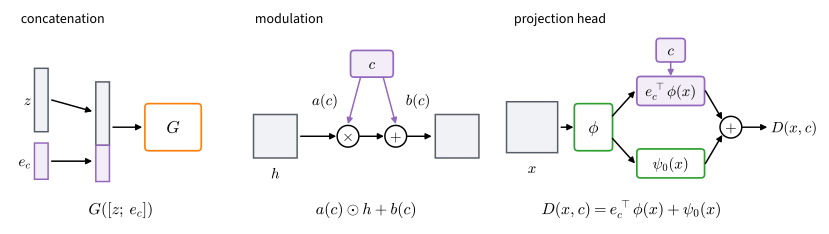

# Conditional Generation
:label:`sec_gan_conditional`

The garment generator of :numref:`sec_basic_gan` and the sprite generators of :numref:`sec_dcgan` take no request. Each returns a sample from the whole data distribution: to get a pair of trousers from the garment generator we can only draw again until one appears, and nothing lets us ask the sprite generator for a particular creature. Most image generators that people use take a request instead: a class, a caption, a sketch to complete. Within months of the original GAN, :citet:`Mirza.Osindero.2014` proposed the obvious repair: give the request to both players. The generator receives it as an extra input, and the critic judges whether a sample is a realistic instance of that request.

Is that one change enough? This section asks what the game then optimizes, how the critic should read the request, and how we can tell whether the generator obeys. The answers reuse the chapter's log-loss game, pairing loss and penalties, applied once per request. The running example is CIFAR-10: ask for a bird, and check that we get one. The check turns out to be the harder half, because a generator can obey every request and still offer only a narrow part of each class.

```{.python .input #conditional-conditional-generation}
%%tab pytorch
import math
import numpy as np
import torch
from torch import nn
from torch.nn import functional as F
from d2l import torch as d2l
```

```{.python .input #conditional-conditional-generation}
%%tab jax
import math
import numpy as np
import jax
from jax import numpy as jnp
from flax import nnx
import optax
from d2l import jax as d2l
```

## The Conditional Game

### The Optimal Conditional Critic

Let us start with the data. It consists of pairs of an image $x$ and a condition $c$ drawn from a joint distribution $p(x,c)$; the condition can be a class label, a caption embedding or a whole image, and in our running example it is one of the ten CIFAR-10 classes. Each condition selects a *slice* of the data, the conditional distribution $p(\cdot \mid c)$ of the images that fit it: all birds, say. The generator receives the condition, $x' = G(z,c)$, and varying $z$ at fixed $c$ samples from its own slice $q(\cdot \mid c)$.

Which conditions should the generator receive? We draw them from the data marginal $p(c)$, so the generated pairs follow $q(x,c)=p(c)\,q(x\mid c)$, and the real and generated joint distributions share their condition marginal. In code this costs nothing: each generated batch reuses the labels of the real batch it is compared with. The critic scores sample--condition pairs, $D(x, c)$, and the game is the log-loss game of :numref:`sec_basic_gan` played on those pairs:

$$
V(D) \;=\; \mathbb{E}_{(x, c) \sim p}\big[\log \sigma(D(x, c))\big]
+ \mathbb{E}_{c \sim p(c),\; x' \sim q(\cdot \mid c)}\big[\log \sigma(-D(x', c))\big].
$$
:eqlabel:`eq_gan_cond_V`

In the unconditional game the optimal critic is the log density ratio $\log(p/q)$, and the value at that critic is $2\,\mathrm{JS}(p, q) - 2\log 2$. The pointwise argument behind both results works for any input space, so it applies with the pair $(x, c)$ in place of $x$. The optimal critic is the log ratio of the two joint densities, and their shared condition marginal cancels:

$$
D^\star(x, c)
\;=\; \log \frac{p(x, c)}{q(x, c)}
\;=\; \log \frac{p(c)\, p(x \mid c)}{p(c)\, q(x \mid c)}
\;=\; \log \frac{p(x \mid c)}{q(x \mid c)} .
$$
:eqlabel:`eq_gan_cond_dstar`

The optimal conditional critic is the log density ratio within the slice that the condition selects. For the bird condition it compares real and generated birds; images of other classes do not enter. Had the generator drawn its requests from some other marginal $q(c)$, the factors would not cancel, and the optimal critic would carry an extra term $\log(p(c)/q(c))$. If the generator asked for birds too rarely, the critic could then call a bird pair real from its label alone, whatever the image. Sharing the labels removes that distraction. Substituting the critic into :eqref:`eq_gan_cond_V` keeps the outer expectation over $c$, and each condition contributes the value of its own unconditional game:

$$
\max_D V(D)
\;=\; \mathbb{E}_{c}\Big[\, 2\, \mathrm{JS}\big(p(\cdot \mid c),\, q(\cdot \mid c)\big) \Big] - 2 \log 2 .
$$
:eqlabel:`eq_gan_cond_value`

The conditional game is an average of per-condition games, weighted by how often each condition occurs. Its value reaches the minimum $-2\log 2$ exactly when $q(\cdot \mid c) = p(\cdot \mid c)$ for every condition that $p(c)$ weights: the generator must match the data within every slice.

### Stronger than Marginal Matching

This requirement is stronger than matching the distribution of images. Consider a generator that produces accurate CIFAR-10 images but shifts every label cyclically, so that $q(\cdot \mid c) = p(\cdot \mid c{+}1)$: a request for a bird returns a cat. All ten classes occur equally often, so the shift leaves the mixture over classes unchanged. The generator's distribution of images equals the data's, and the unconditional game sits at its minimum, $-2\log 2$; it cannot see the wrong labels. The conditional game compares each slice with its neighbor instead. If the classes had disjoint supports, every slice would contribute $\mathrm{JS} = \log 2$, and :eqref:`eq_gan_cond_value` would equal $0$, the value of a game that the critic wins outright. CIFAR-10 classes overlap a little, so the value sits just below $0$: a perfect image generator that fails every request is nearly the worst conditional generator there is (Exercise :exref:`ex_conditional-verify-decomposition-eqref-eq` computes both values for two Gaussian slices).

The weights $p(c)$ also say what neglect costs. A slice of weight $\epsilon$ contributes $2\epsilon\,\mathrm{JS}$ to the value, and the Jensen--Shannon divergence never exceeds $\log 2$, so a generator that serves the slice arbitrarily badly loses at most $2\epsilon \log 2$. A class with one image in a thousand is worth about 0.0014 nats, a thousandth of the $2\log 2 \approx 1.39$ nats that separate a perfect generator from a useless one. The objective will not stop a generator from neglecting a rare class; that protection has to come from how we draw the batches (Exercise :exref:`ex_conditional-rare-class`).

## Conditioning Mechanisms

### Three Ways In

The analysis says what the optimal critic computes, but not how a network should take the condition in. Three mechanisms are common (:numref:`fig_gan_conditioning`).


:label:`fig_gan_conditioning`

*Concatenation* :cite:`Mirza.Osindero.2014` embeds the condition in a vector $e_c$ and appends it to an input: beside the latent code in the generator, or beside the image or a feature map in the critic. It imposes no form on how sample and condition interact, so the network must learn that interaction from the adversarial signal alone. It also states the condition only once, at the input, and every later layer must carry it forward in its channels.

*Modulation* repeats the request at every stage. It scales and shifts each channel of a feature map $h$ by amounts that depend on the condition, $a(c) \odot h + b(c)$, and it follows a convolution in every block of the generator, so the class can steer the coarse layout at $4 \times 4$ pixels and the texture at $32 \times 32$ directly. With $h$ normalized first, the layer is *conditional batch normalization* :cite:`De-Vries.Strub.Mary.ea.2017`. BigGAN uses it in every block of its generator and computes $a$ and $b$ from a shared class embedding joined with a chunk of the latent code :cite:`Brock.Donahue.Simonyan.2019`. A caption can enter the same way, through a text encoder's embedding in place of the class embedding, and the diffusion transformer of :numref:`sec_diffusion-latent` receives its noise level and its label through such a scale and shift.

In code, $a$ and $b$ are two embedding tables with one row per class. We start every row of $a$ at one and every row of $b$ at zero, so the layer begins as the identity for every class, and training only has to learn how each class departs from it.

```{.python .input #conditional-three-ways-in-1}
%%tab pytorch
class Modulate(nn.Module):
    """Scale and shift each channel of h by a(c) and b(c), one row per class."""
    def __init__(self, num_classes, channels):
        super().__init__()
        self.a = nn.Embedding(num_classes, channels)
        self.b = nn.Embedding(num_classes, channels)
        nn.init.ones_(self.a.weight)   # a(c) = 1, b(c) = 0: the identity
        nn.init.zeros_(self.b.weight)

    def forward(self, h, c):
        return self.a(c)[:, :, None, None] * h + self.b(c)[:, :, None, None]
```

```{.python .input #conditional-three-ways-in-1}
%%tab jax
class Modulate(nnx.Module):
    """Scale and shift each channel of h by a(c) and b(c), one row per class."""
    def __init__(self, num_classes, channels, *, rngs):
        # a(c) = 1, b(c) = 0: the identity
        self.a = nnx.Embed(num_classes, channels, rngs=rngs,
                           embedding_init=nnx.initializers.ones)
        self.b = nnx.Embed(num_classes, channels, rngs=rngs,
                           embedding_init=nnx.initializers.zeros)

    def __call__(self, h, c):
        return self.a(c)[:, None, None, :] * h + self.b(c)[:, None, None, :]
```

Before running the layer, we can predict two things. At initialization the output must equal the input, whatever the class. And a gradient step on a batch that requests only class 3 (cat, in the CIFAR-10 order used below) must change row 3 of each table and no other, because an embedding lookup passes gradient only to the rows it read. The check takes one such step toward the toy target $2h + 1$.

```{.python .input #conditional-three-ways-in-2}
%%tab pytorch
torch.manual_seed(0)
mod = Modulate(10, 8)
h = torch.randn(10, 8, 4, 4)  # one feature map per class
with torch.no_grad():
    print('at initialization: max |out - h| =',
          float((mod(h, torch.arange(10)) - h).abs().max()))
a0, b0 = mod.a.weight.detach().clone(), mod.b.weight.detach().clone()
c3 = torch.full((10,), 3)  # a batch that requests class 3 only
loss = ((mod(h, c3) - (2 * h + 1)) ** 2).mean()
loss.backward()
torch.optim.SGD(mod.parameters(), lr=0.1).step()
rows = lambda w, w0: (w != w0).any(1).nonzero().flatten().tolist()
print('after one step on class 3: rows changed in a', rows(mod.a.weight, a0),
      'and in b', rows(mod.b.weight, b0))
```

```{.python .input #conditional-three-ways-in-2}
%%tab jax
mod = Modulate(10, 8, rngs=nnx.Rngs(0))
h = jax.random.normal(jax.random.key(0), (10, 4, 4, 8))  # one map per class
print('at initialization: max |out - h| =',
      float(jnp.abs(mod(h, jnp.arange(10)) - h).max()))
a0, b0 = mod.a.embedding[...], mod.b.embedding[...]
c3 = jnp.full(10, 3)  # a batch that requests class 3 only
grads = nnx.grad(lambda m: ((m(h, c3) - (2 * h + 1)) ** 2).mean())(mod)
nnx.Optimizer(mod, optax.sgd(0.1), wrt=nnx.Param).update(mod, grads)
rows = lambda w, w0: np.nonzero(np.any(w != w0, axis=1))[0].tolist()
print('after one step on class 3: rows changed in a',
      rows(mod.a.embedding[...], a0), 'and in b',
      rows(mod.b.embedding[...], b0))
```

Both predictions hold. Each class owns its scales and shifts, so training on cats leaves the other nine rows alone; what the classes share lives in the convolutions around the layer. The flip side is that a class's row learns only from the batches that request it. A rare class trains its own row rarely: the neglect that the objective tolerates, seen from inside the network. The third mechanism, the *projection head*, conditions only the critic, and its form follows from the optimal critic.

### The Projection Head from Bayes' Rule

Bayes' rule, $p(x \mid c) = p(c \mid x)\, p(x) / p(c)$, applied to the numerator and the denominator of :eqref:`eq_gan_cond_dstar`, cancels the shared label marginal and yields

$$
\log \frac{p(x \mid c)}{q(x \mid c)}
\;=\; \log \frac{p(c \mid x)}{q(c \mid x)} + \log \frac{p(x)}{q(x)} .
$$
:eqlabel:`eq_gan_cond_bayes`

The optimal conditional critic separates condition compatibility from unconditional sample quality. The first term, the *label term*, compares the real and generated label posteriors at $x$. The second, the *realness term*, is the log density ratio of the unconditional game. This split is the most useful identity of the section: it says what the critic must learn beyond the unconditional game, and nothing more. A generator that produces realistic images with scrambled labels differs from the data through the first term; one that produces poorly formed images of the requested class differs through the second.

If both posteriors are softmax classifiers on one shared feature map $\phi$, the first term takes a familiar form. Let $p(c \mid x) \propto \exp(u_c^\top \phi(x))$ with one weight vector per class, and $q(c \mid x) \propto \exp(w_c^\top \phi(x))$ likewise. The two normalizers do not depend on $c$, so the log ratio of the posteriors is the inner product $(u_c - w_c)^\top \phi(x)$ plus a function of $x$ alone. Absorbing that function, together with the unconditional term, into a single head $\psi_0$ and writing $e_c = u_c - w_c$, the critic becomes

$$
D(x, c) \;=\; e_c^\top \phi(x) + \psi_0(x).
$$
:eqlabel:`eq_gan_cond_projection`

This is the projection head of :citet:`Miyato.Koyama.2018`, who call the resulting critic a projection discriminator: one learned embedding per class, an inner product with the critic's features, and an unconditional head. Bayes' rule is an identity, but the shared feature map is a modeling assumption (Exercise :exref:`ex_conditional-projection-derivation-modeled-both`). StyleGAN-T replaces the class embedding by the CLIP embedding of a caption and obtains a text-conditioned critic with the same head :cite:`Sauer.Karras.Laine.ea.2023`; this section stays with classes. The *auxiliary classifier* critic of :citet:`Odena.Olah.Shlens.2017` is the main alternative: it adds a classification head, and the generator is trained to make its samples receive the requested label, which favors easily classified prototypes over within-class diversity (Exercise :exref:`ex_conditional-auxiliary-classifier-bias`); the prototype baseline at the end of this section shows what such images do to the measurements.

Our networks use concatenation in the generator and the projection head in the critic. Concatenation is the smallest change to the backbone of :numref:`sec_dcgan`, whose generator already accepts extra input maps; the projection head shares one feature map across classes, as the derivation suggests. With ten classes neither choice restricts what the networks can represent. The critic's features have far more than ten dimensions, which is all the projection form needs (Exercise :exref:`ex_conditional-projection-derivation-modeled-both`), and a learned embedding of ten classes carries as much as a one-hot code. The choice is therefore about what is easy to learn at a fixed budget. At larger scale, modulation is the usual choice for the generator; Exercise :exref:`ex_conditional-modulated-generator` swaps `Modulate` into our generator and asks whether it helps at our budget.

## Class-Conditional CIFAR-10

We now train a class-conditional generator on the 50,000 labeled $32 \times 32$ training images of CIFAR-10, 5,000 for each of the ten classes, loaded with `d2l.load_cifar10_arrays` (:numref:`subsec_utils_feature_cnn`). Training takes 15,000 steps, and the whole notebook twenty to forty minutes on one GPU. The run tests the conditioning and its measurement, not sample quality at scale. A reader on a CPU can lower the number of steps (15,000 in the training call) and the generator's base width (256) to watch the pipeline work, but should expect weaker numbers than ours.

```{.python .input #conditional-class-conditional-cifar-10}
%%tab pytorch
classes = ['airplane', 'automobile', 'bird', 'cat', 'deer',
           'dog', 'frog', 'horse', 'ship', 'truck']
device = d2l.try_gpu()
train_X, train_y, test_X, test_y = d2l.load_cifar10_arrays()
first = [int((train_y == c).nonzero()[0]) for c in range(10)]
d2l.show_images(train_X[first].cpu().permute(0, 2, 3, 1) / 2 + 0.5,
                num_rows=2, num_cols=5, titles=classes);
```

```{.python .input #conditional-class-conditional-cifar-10}
%%tab jax
classes = ['airplane', 'automobile', 'bird', 'cat', 'deer',
           'dog', 'frog', 'horse', 'ship', 'truck']
train_X, train_y, test_X, test_y = d2l.load_cifar10_arrays()
first = [int(np.nonzero(np.asarray(train_y) == c)[0][0]) for c in range(10)]
d2l.show_images(np.asarray(train_X[np.array(first)]) / 2 + 0.5,
                num_rows=2, num_cols=5, titles=classes);
```

### A Conditional Backbone

The networks are the saved `d2l.Generator` and `d2l.Discriminator` of :numref:`sec_dcgan` at resolution 32, one resampling stage fewer than for the $64 \times 64$ sprites, with the condition as an extra input to each. Everything else is unchanged: bilinear resampling, leaky ReLU, no normalization, no tanh, and fan-in initialization. The saved generator concatenates optional extra $4 \times 4$ maps, its `extra` input, with the learned constant and the projected latent code before the mixing convolution. `CondGenerator` fills that slot with the class embedding, broadcast over the $4 \times 4$ grid. The embedding starts with unit variance, the scale of the learned constant beside it, so from the first step the class weighs about as much as the other inputs.

```{.python .input #conditional-a-conditional-backbone-at-32-by-32-1}
%%tab pytorch
class CondGenerator(d2l.Generator):
    """The backbone generator with a class embedding as extra 4x4 maps."""
    def __init__(self, latent_dim, resolution, base_ch, embed_dim=64,
                 num_classes=10):
        super().__init__(latent_dim, resolution, base_ch, extra_ch=embed_dim)
        self.embed = nn.Embedding(num_classes, embed_dim)  # unit variance

    def forward(self, z, y):
        ec = self.embed(y)[:, :, None, None].expand(-1, -1, 4, 4)
        return super().forward(z, ec)
```

```{.python .input #conditional-a-conditional-backbone-at-32-by-32-1}
%%tab jax
class CondGenerator(d2l.Generator):
    """The backbone generator with a class embedding as extra 4x4 maps."""
    def __init__(self, latent_dim, resolution, base_ch, embed_dim=64,
                 num_classes=10, *, rngs):
        super().__init__(latent_dim, resolution, base_ch, extra_ch=embed_dim,
                         rngs=rngs)
        self.embed = nnx.Embed(num_classes, embed_dim, rngs=rngs,
                               embedding_init=nnx.initializers.normal(1.0))

    def __call__(self, z, y):
        e = self.embed(y)[:, None, None, :]
        ec = jnp.broadcast_to(e, (z.shape[0], 4, 4, e.shape[-1]))
        return super().__call__(z, ec)
```

:begin_tab:`jax`
The default initializer of `nnx.Embed` draws entries with a standard deviation of one over the square root of the embedding width, an eighth here, so the code asks for unit variance explicitly.
:end_tab:

`ProjectionCritic` implements :eqref:`eq_gan_cond_projection`. The base class's `phi` returns the $4 \times 4$ feature map after the mixing convolution; summing it over positions gives $\phi(x)$. A linear head on $\phi(x)$ gives $\psi_0(x)$ and replaces the base head, which reads the flattened map, and a table holds one embedding $e_c$ per class. The table starts at zero, so the critic begins as an unconditional critic and learns the label term from the data.

```{.python .input #conditional-a-conditional-backbone-at-32-by-32-2}
%%tab pytorch
class ProjectionCritic(d2l.Discriminator):
    """The backbone critic with a projection head: e_c . phi(x) + psi_0(x)."""
    def __init__(self, resolution, base_ch, num_classes=10):
        super().__init__(resolution, base_ch)
        width = self.mix.out_channels
        self.head = nn.Linear(width, 1)  # psi_0 on the pooled features
        d2l.fan_in_init(self.head)
        self.embed = nn.Embedding(num_classes, width)
        nn.init.zeros_(self.embed.weight)  # start as an unconditional critic

    def forward(self, x, y):
        phi = self.phi(x).sum(dim=(2, 3))  # sum over the 4x4 positions
        return (self.embed(y) * phi).sum(dim=1) + self.head(phi).squeeze(-1)

net_G, net_D = CondGenerator(100, 32, 256), ProjectionCritic(32, 64)
print(net_G(torch.zeros(2, 100), torch.zeros(2, dtype=torch.long)).shape)
print(net_D(torch.zeros(2, 3, 32, 32),
            torch.zeros(2, dtype=torch.long)).shape)
```

```{.python .input #conditional-a-conditional-backbone-at-32-by-32-2}
%%tab jax
class ProjectionCritic(d2l.Discriminator):
    """The backbone critic with a projection head: e_c . phi(x) + psi_0(x)."""
    def __init__(self, resolution, base_ch, num_classes=10, *, rngs):
        super().__init__(resolution, base_ch, rngs=rngs)
        width = self.mix.out_features
        self.head = nnx.Linear(width, 1, kernel_init=d2l.fan_in_init,
                               rngs=rngs)  # psi_0 on the pooled features
        self.embed = nnx.Embed(num_classes, width, rngs=rngs,
                               embedding_init=nnx.initializers.zeros)

    def __call__(self, x, y):
        phi = self.phi(x).sum(axis=(1, 2))  # sum over the 4x4 positions
        return (self.embed(y) * phi).sum(axis=1) + self.head(phi).squeeze(-1)

net_G = CondGenerator(100, 32, 256, rngs=nnx.Rngs(0))
net_D = ProjectionCritic(32, 64, rngs=nnx.Rngs(0))
print(net_G(jnp.zeros((2, 100)), jnp.zeros(2, dtype=jnp.int32)).shape)
print(net_D(jnp.zeros((2, 32, 32, 3)), jnp.zeros(2, dtype=jnp.int32)).shape)
```

One image per request, and one score per image--label pair.

### Training with Same-Class Pairs

Training runs the saved loop `d2l.train_r3gan` of :numref:`sec_dcgan` with its sprite recipe: the pairing loss for both players, the penalties $R_1$ and $R_2$ on real and generated images, Adam with $\beta_1 = 0$, and random horizontal flips of the real images. Samples and evaluations come from an exponential moving average of the generator (`d2l.EMA`, half-life 500 steps). Given labels, the loop draws each real batch with its labels and conditions the generated batch on the same labels, so every comparison pairs a real bird with a generated bird. The saved steps `d2l.critic_step` and `d2l.generator_step` of :numref:`sec_gan_convergence` receive the labels `y` and hold them fixed, so to the losses and the penalties the conditional critic is an ordinary critic of images, $x \mapsto D(x, y)$. In particular the penalties differentiate with respect to the image only; the label is a discrete input and has no gradient.

Within one class, the pairing loss of :numref:`sec_gan_relativistic` scores a real image $x$ against a generated image $x'$ by $\log \sigma(D(x, c) - D(x', c))$, the pairing game between $p(\cdot \mid c)$ and $q(\cdot \mid c)$. For a critic free to choose a separate function for each class, the classes decouple, and the fixed point is that of :eqref:`eq_gan_cond_value`: every slice matched. The shift invariance of the pairing game carries over class by class. Adding a constant to the critic leaves every score difference unchanged, and with same-class pairs this holds for one constant per class: $D(x, c) + \zeta_c$ has the same loss for any constants $\zeta_1, \ldots, \zeta_{10}$. The critic never calibrates its scores across classes, so our diagnostics must not depend on these constants (Exercise :exref:`ex_conditional-critic-classifier` measures them).

Every 250 steps the loop also logs how often the critic ranks a real image above a generated one. With test images on the real side, this is the *held-out pair accuracy*: on 512 fresh pairs of a test image and a generated image of the same class, the fraction that the critic orders correctly, $\hat P(D(x, c) > D(x', c))$. The constants $\zeta_c$ cancel from it, whereas the critic's mean score drifts with them. A value of one half means that the critic cannot tell real from generated images of a class.

Apart from the length, 15,000 steps against 12,000, and the widths that come with one stage fewer, three settings differ from the sprite runs: batches of 128 images instead of 64, evaluations on 512 pairs instead of 256, and the penalty weight $\gamma = 0.5$ instead of $10$. Resolution accounts for a factor of four of the last change, since $\gamma$ is a squared length (:numref:`sec_gan_convergence`) and a $32 \times 32$ image has a quarter of the pixels of a $64 \times 64$ sprite (Exercise :exref:`ex_dcgan-penalty-weight-resolution`); the remaining factor of five was set at this budget, for this data, and R3GAN itself starts CIFAR-10 at a smaller value still.

```{.python .input #conditional-training-with-the-chapter-s-loss-2}
%%tab pytorch
torch.manual_seed(0)  # the initialization
net_G = CondGenerator(100, 32, 256).to(device)
net_D = ProjectionCritic(32, 64).to(device)
gamma = 0.5
ema_G, history = d2l.train_r3gan(
    net_G, net_D, d2l.rpgan_loss_D, d2l.rpgan_loss_G, gamma, 15000, train_X,
    train_y, eval_images=test_X, eval_labels=test_y, eval_size=512,
    batch_size=128, seed=1)
```

```{.python .input #conditional-training-with-the-chapter-s-loss-2}
%%tab jax
rngs = nnx.Rngs(0)  # the initialization
net_G = CondGenerator(100, 32, 256, rngs=rngs)
net_D = ProjectionCritic(32, 64, rngs=rngs)
gamma = 0.5
ema_G, history = d2l.train_r3gan(
    net_G, net_D, d2l.rpgan_loss_D, d2l.rpgan_loss_G, gamma, 15000, train_X,
    train_y, eval_images=test_X, eval_labels=test_y, eval_size=512,
    batch_size=128, seed=1)
```

We average the logs over the last 5,000 steps, and the pair accuracy also over the first 2,000.

```{.python .input #conditional-training-with-the-chapter-s-loss-3}
%%tab pytorch, jax
loss_D, loss_G, pen, acc = (np.mean(v[-5000 // 250:]) for v in (
    history['loss_D'], history['loss_G'], history['R1'] + history['R2'],
    history['accuracy']))
acc_early = history['accuracy'][history['step'] <= 2000].mean()
print(f'last 5,000 steps: critic loss {loss_D:.2f} (+ penalty '
      f'{gamma / 2 * pen:.3f}), generator loss {loss_G:.2f}, '
      f'pair accuracy {acc:.2f}')
print(f'first 2,000 steps: pair accuracy {acc_early:.2f}')
```

```{.python .input #conditional-training-with-the-chapter-s-loss-4}
%%tab pytorch, jax
steps = history['step']
fig, axes = d2l.plt.subplots(1, 2, figsize=(9, 3.2))
d2l.plot(steps, [history['loss_D'], history['loss_G'],
                 np.full_like(steps, np.log(2))], 'step', 'loss',
         legend=['critic (pairing part)', 'generator', 'log 2'],
         fmts=('-', '--', 'k:'), yscale='log', axes=axes[0])
d2l.plot(steps, [history['accuracy'], np.full_like(steps, 0.5)], 'step',
         'held-out pair accuracy', ylim=[0.3, 1], fmts=('-', 'k:'),
         axes=axes[1]);
```

The dotted lines mark $\log 2$, the value of either pairing loss when the critic cannot order a pair, and a pair accuracy of one half. After an early transient both losses settle within a few thousand steps, the critic's pairing loss near 0.52, below $\log 2$ because the critic keeps winning, with the penalty adding about 0.06 to it. The pair accuracy says by how much. The critic orders nearly every fresh same-class pair at the first check, between 83% and 92% averaged over the first 2,000 steps, and about 80% over the last 5,000; over the last 10,000 steps the curve fluctuates around 0.8 without a trend.

Is that a failure of the conditioning? A generator that ignored its labels would hand the critic easy wins: a truck generated on a request for a cat, paired with a real cat, is no contest. The sprite critics of :numref:`sec_dcgan`, which play the same penalized game without labels, order more than nine in ten fresh pairs at most checks until the end of their runs, so a critic that stays ahead is the normal state of this game at our budgets. A generator that matched every class would bring the pair accuracy down to one half. Ours has settled short of it at this size and this budget, and the flat curve gives no reason to expect that more of the same steps would close the rest.

### Samples on Request

Each panel of the next figure requests one class, and its nine images use fresh latent codes; `d2l.tile_images` of :numref:`sec_dcgan` tiles them. As in that section, the generator has no tanh, so the display and every evaluation below clamp its output to $[-1, 1]$.

```{.python .input #conditional-training-with-the-chapter-s-loss-5}
%%tab pytorch
torch.manual_seed(42)
z = torch.randn(90, 100, device=device)
y = torch.arange(10, device=device).repeat_interleave(9)  # nine per class
with torch.no_grad():
    imgs = ema_G(z, y)
panels = [d2l.tile_images(imgs[9 * c:9 * (c + 1)], 3) for c in range(10)]
d2l.show_images(panels, 2, 5, titles=classes, scale=2);
```

```{.python .input #conditional-training-with-the-chapter-s-loss-5}
%%tab jax
z = jax.random.normal(jax.random.key(42), (90, 100))
y = jnp.repeat(jnp.arange(10), 9)  # nine per class
imgs = ema_G(z, y)
panels = [d2l.tile_images(imgs[9 * c:9 * (c + 1)], 3) for c in range(10)]
d2l.show_images(panels, 2, 5, titles=classes, scale=2);
```

Most panels read as their class, and pose, color and background vary within every panel, so the figure shows no obvious collapse within a class. Look closer at the animals, though. Deer and horses are brown forms on grass, frogs are green and brown textures, and birds, cats and dogs are often similar brown shapes: the generator tells these classes apart by palette and background as much as by shape. That is what a shortcut looks like, and a shortcut can satisfy a classifier without satisfying a person. Inspection cannot say how often an image would be recognized as its class, or how much of a class's variety is missing; we measure both next.

## Measuring a Conditional Generator

A conditional generator can fail in three ways: it can return the wrong class, poor images of the right class, or too little variety within a class, in the extreme one image per request. No single number sees all three clearly. Alignment asks a classifier, which we call the *referee*, whether the class is right. FD and $\mathrm{MMD}^2$ compare all generated features with all real ones and never see a label. Precision and recall, computed class by class, ask whether generated images lie among the real ones, and whether real images have generated ones near them. Published evaluations also use scores that fold image and condition into one number: the Fréchet joint distance embeds them together :cite:`DeVries.Romero.Pineda.ea.2019`, and the classification accuracy score trains a classifier on generated pairs and tests it on real ones :cite:`Ravuri.Vinyals.2019`. We keep the failures apart instead, and before computing anything we predict which failure each measurement sees (:numref:`tab_gan_cond_failures`).

:Which failure each measurement can see, predicted before any number is computed.
:label:`tab_gan_cond_failures`

| failure | alignment | FD, $\mathrm{MMD}^2$ (labels ignored) | precision per class | recall per class |
|:--|:--|:--|:--|:--|
| wrong class | sees it | blind | sees it | sees it |
| poor images | partly | sees it | sees it | partly |
| too little variety | blind, may reward it | sees it | blind, may reward it | sees it |

The cyclic shift from the start of this section is the first row at its sharpest: FD and $\mathrm{MMD}^2$ would not move, while alignment would fall to the rate at which the referee mistakes class $c{+}1$ for class $c$. The last row is the twist this section announced, and a baseline below tests it.

### A Referee Classifier

To check requests we need a judge that knows the classes. The referee is a CIFAR-10 classifier: the feature network of :numref:`sec_dcgan`, trained the same way, with `d2l.train_feature_cnn` at CIFAR-10's native $32 \times 32$ resolution, random horizontal flips, random shifts of up to four pixels, and a learning rate that rises and then anneals over 15 epochs. It reaches about 78%. Both additions come from trials that this notebook does not repeat: without them the referee overfit, and its accuracy on a single class moved by tens of points between two training seeds, more than the differences we want to read; with them it moved by a few points. A pretrained ImageNet network would be a sharper referee; ours trains inside the notebook, and reading every alignment against its accuracy on real images corrects for how often it errs on photographs.

```{.python .input #conditional-measuring-condition-alignment-1}
%%tab pytorch
torch.manual_seed(0)
cnn = d2l.FeatureCNN(resolution=32).to(device)
d2l.train_feature_cnn(cnn, train_X, train_y, shift=4)
pred = d2l.batched(cnn, test_X).argmax(1)
cls_acc = [float((pred[test_y == c] == c).float().mean())
           for c in range(10)]
print(f'CIFAR-10 test accuracy: {float((pred == test_y).float().mean()):.3f}')
```

```{.python .input #conditional-measuring-condition-alignment-1}
%%tab jax
cnn = d2l.FeatureCNN(resolution=32, rngs=nnx.Rngs(1))
d2l.train_feature_cnn(cnn, train_X, train_y, shift=4)
pred = d2l.batched(cnn, test_X).argmax(1)
cls_acc = [float((pred[test_y == c] == c).mean()) for c in range(10)]
print(f'CIFAR-10 test accuracy: {float((pred == test_y).mean()):.3f}')
```

### Alignment per Class

For each generated image, the referee either predicts the requested class or it does not. The fraction of matches, overall and per class, is the *alignment*. We compare it with the referee's accuracy on real test images of the same class, because the referee also misclassifies real images. The real accuracy is a reference, not an upper bound: unusually typical images can be easier to classify than average photographs, as a baseline below shows. The next cell draws 500 images of each class from the averaged generator, and the one after prints alignment beside the real accuracy and their difference.

```{.python .input #conditional-alignment-per-class-1}
%%tab pytorch
def generate(seed, n=500):
    """n images of each class from the EMA generator, in class order."""
    torch.manual_seed(seed)
    z = torch.randn(10 * n, 100, device=device)
    y = torch.arange(10, device=device).repeat_interleave(n)
    with torch.no_grad():
        return torch.cat([ema_G(z_k, y_k) for z_k, y_k in
                          zip(z.split(1000), y.split(1000))])

raw = generate(7)
gen = raw.clamp(-1, 1)
yg = np.repeat(np.arange(10), 500)  # the requested classes
pred_gen = d2l.batched(cnn, gen).argmax(1).cpu().numpy()
align = [float((pred_gen[yg == c] == c).mean()) for c in range(10)]
```

```{.python .input #conditional-alignment-per-class-1}
%%tab jax
def generate(seed, n=500):
    """n images of each class from the EMA generator, in class order."""
    z = jax.random.normal(jax.random.key(seed), (10 * n, 100))
    y = jnp.repeat(jnp.arange(10), n)
    return jnp.concatenate([ema_G(z[i:i + 1000], y[i:i + 1000])
                            for i in range(0, 10 * n, 1000)])

raw = generate(7)
gen = jnp.clip(raw, -1, 1)
yg = np.repeat(np.arange(10), 500)  # the requested classes
pred_gen = np.asarray(d2l.batched(cnn, gen).argmax(1))
align = [float((pred_gen[yg == c] == c).mean()) for c in range(10)]
```

```{.python .input #conditional-measuring-condition-alignment-2}
%%tab pytorch, jax
print(f'{"class":12s}{"alignment":>11s}{"real":>7s}{"gap":>7s}')
for name, a, r in zip(classes + ['mean'], align + [np.mean(align)],
                      cls_acc + [np.mean(cls_acc)]):
    print(f'{name:12s}{a:11.2f}{r:7.2f}{a - r:+7.2f}')
```

Averaged over classes, alignment is about three in four (0.72 to 0.74), four to six points below the referee's accuracy on real images. By this measure the generator obeys nearly as often as the referee can tell. Remember the shortcut, though: the referee learned from the same 50,000 images as the generator, so a palette that works for one may work for the other, and alignment counts what a 78% classifier accepts, which can be more than a person would. No class is recognized much more often than its real counterpart, and cat is the hardest class in both columns, for generated images as for photographs. Beyond that, the table does not rank the classes: it comes from one training run, and in our trials, which this notebook does not repeat, the per-class differences moved by several points from one training run to the next.

### Fidelity and Within-Class Diversity

Alignment says nothing about image quality or variety. For those we use the two feature distances of :numref:`sec_dcgan`, the Fréchet distance between Gaussian fits to two feature sets and the unbiased $\mathrm{MMD}^2$ estimate with a cubic polynomial kernel, on the referee's 128-dimensional features. We call them FD and $\mathrm{MMD}^2$ (CIFAR-CNN), since they cannot be compared with published FID or KID scores. Neither is zero for two finite samples of one distribution, so each needs a floor, the score of a second real set of the same size. Of the 1,000 test images per class, the first 500 are the reference and the other 500 the floor. The 500 generated images per class are scored against the reference, and a second draw from the same generator shows how much the scores move with the latent codes alone.

```{.python .input #conditional-fidelity-and-within-class-diversity-1}
%%tab pytorch
features = lambda imgs: d2l.batched(cnn.features, imgs).cpu().numpy()
out_of_range = float((raw.abs() > 1).float().mean())
idx = test_y.argsort(stable=True).reshape(10, 1000)  # row c: class c
f_real = features(test_X[idx[:, :500].flatten()])    # the reference
f_real2 = features(test_X[idx[:, 500:].flatten()])   # the floor
f_gen = features(gen)
f_gen2 = features(generate(8).clamp(-1, 1))          # a second draw
idx, pred_real = idx.cpu().numpy(), pred.cpu().numpy()
```

```{.python .input #conditional-fidelity-and-within-class-diversity-1}
%%tab jax
features = lambda imgs: np.asarray(d2l.batched(cnn.features, imgs))
out_of_range = float((jnp.abs(raw) > 1).mean())
idx = jnp.argsort(test_y, stable=True).reshape(10, 1000)  # row c: class c
f_real = features(test_X[idx[:, :500].flatten()])    # the reference
f_real2 = features(test_X[idx[:, 500:].flatten()])   # the floor
f_gen = features(gen)
f_gen2 = features(jnp.clip(generate(8), -1, 1))      # a second draw
idx, pred_real = np.asarray(idx), np.asarray(pred)
```

```{.python .input #conditional-measuring-condition-alignment-4}
%%tab pytorch, jax
draws = {'real (the floor)': f_real2, 'generated': f_gen,
         'generated, second draw': f_gen2}
print(f'{"against the reference":24s}{"FD (CIFAR-CNN)":>16s}'
      f'{"MMD^2 (CIFAR-CNN)":>19s}')
for name, f in draws.items():
    print(f'{name:24s}{d2l.fid_score(f, f_real):16.2f}'
          f'{d2l.kid_score(f, f_real):19.3f}')
print(f'generated values outside [-1, 1]: {out_of_range:.3f}')
```

In FD the generated set lies ten to twelve times as far from the reference as the floor does, and the second draw moves FD by less than a tenth, so the distance belongs to the generator, not to the draw. In $\mathrm{MMD}^2$ the floor sits at zero within its noise and the generated set at about 0.11. About one raw value in a hundred lies outside $[-1, 1]$ before the clamp, so the clamp changes few pixels and hides little.

The distances fold every difference into one number. Per-class precision and recall separate two kinds of difference: generated images unlike any real image of their class, and real images unlike any generated one. Around each feature vector, draw a ball that reaches to its third-nearest neighbor in its own set (:numref:`subsec_gan_precision_recall`). *Precision* is the fraction of generated images of class $c$ that fall inside some real ball of class $c$, and *recall* is the fraction of real images of class $c$ that fall inside some generated ball. The cell computes both for each class against the reference, prints their means over classes and the worst class, and ends with the within-class feature variance, the variance of the features within each class averaged over features and classes.

```{.python .input #conditional-fidelity-and-within-class-diversity-2}
%%tab pytorch, jax
by_class = lambda f: np.asarray(f).reshape(10, -1, f.shape[-1])

def pr_by_class(f):
    """Precision and recall of each class of f against the reference."""
    return np.array([d2l.precision_recall(r, g) for r, g in
                     zip(by_class(f_real), by_class(f))])

print(f'{"per class, k = 3":24s}{"precision":>10s}{"worst class":>17s}'
      f'{"recall":>8s}{"worst class":>17s}')
for name, f in draws.items():
    pr = pr_by_class(f)
    lo = pr.argmin(0)
    print(f'{name:24s}{pr[:, 0].mean():10.2f}{classes[lo[0]]:>12s}'
          f'{pr[lo[0], 0]:5.2f}{pr[:, 1].mean():8.2f}'
          f'{classes[lo[1]]:>12s}{pr[lo[1], 1]:5.2f}')
# Variance within each class, averaged over features and classes
cvar = lambda f: float(by_class(f).astype(np.float64).var(1).mean())
print(f'within-class feature variance: generated {cvar(f_gen):.3f}, '
      f'real {cvar(f_real):.3f}, the floor {cvar(f_real2):.3f}')
```

The two numbers point in opposite directions. Precision is higher for the generated images than for a second real set, 0.90 against 0.85. Recall is far lower: only about three in five real images have a generated image near them, against more than four in five for the floor. The second draw changes neither number by more than 0.01. The generator plays it safe. Together the two numbers say where its images are: precision says they lie among the real images of their class, so the generator has not drifted away from the data; recall says they lie in only part of each class. The measurements cannot say which part is missing, whether poses, backgrounds or contrast, but each is variety the class has and the generator lacks. The within-class feature variance points the same way, about a fifth lower for the generated images, while the floor comes within a few percent of the reference. The worst classes are printed for completeness; one training run cannot say whether another would find the same ones, so we name none.

### A Prototype Baseline

Does recall really see missing variety, or would it penalize anything that is not a fresh sample of the data? Suppose a generator returned real photographs, but only the most typical ones: for each class, the 100 distinct floor images whose features lie nearest the class centroid. Every image is a real photograph, so fidelity is perfect image by image; what is missing is variety. The cell scores these prototypes by every measure against the reference, beside 100 random floor images and the first 100 generated images per class, so all three rows have the same size. Before reading the table, decide which columns should reward the prototypes and which should catch them.

```{.python .input #conditional-a-prototype-baseline}
%%tab pytorch, jax
floor = by_class(f_real2)  # test images 500-999 of each class
dist = ((floor - floor.mean(1, keepdims=True)) ** 2).sum(-1)
near = np.argsort(dist, axis=1)[:, :100]  # 100 distinct images per class
rows = np.arange(10)[:, None]
sets = {  # 100 images per class: features and the referee's predictions
    'real, random': (floor[:, :100], pred_real[idx[:, 500:600]]),
    'real, nearest centroid': (floor[rows, near],
                               pred_real[idx[:, 500:][rows, near]]),
    'generated': (by_class(f_gen)[:, :100],
                  pred_gen.reshape(10, 500)[:, :100])}
print(f'{"100 per class":24s}{"alignment":>10s}{"FD":>7s}{"MMD^2":>8s}'
      f'{"precision":>10s}{"recall":>8s}')
for name, (f, p) in sets.items():
    f = f.reshape(1000, -1)
    prec, rec = pr_by_class(f).mean(0)
    print(f'{name:24s}{(p == rows).mean():10.2f}'
          f'{d2l.fid_score(f, f_real):7.2f}{d2l.kid_score(f, f_real):8.3f}'
          f'{prec:10.2f}{rec:8.2f}')
```

Alignment rewards prototypes; recall catches them. The referee recognizes nine in ten prototypes, more than the random real images, and their precision is close to one. Their recall is less than half that of the random real images. The generator's row lies between the two real rows: its precision sits above the random real images, as the prototypes' does, but its recall is nearly twice theirs, and its alignment is the lowest of the three. It is less typical than the prototypes and more varied.

FD gives the surprise of the table. It places the prototypes at about 3, against 0.43 for the random real images, and so ranks a set of real photographs below the trained generator (1.6 to 2.0); $\mathrm{MMD}^2$ also places the prototypes far above the random real images. FD measures how far one cloud of features lies from another. It is not a score of image quality, and a set of perfect but typical photographs lies farther from the data than our generator does.

Nor are the prototypes a straw man. BigGAN's truncation trick moves a generator toward them on purpose, trading recall for precision, and Exercise :exref:`ex_conditional-biggan-s-truncation-trick` measures that trade with these instruments.

One caution about sizes. At 100 images per class the generator's recall is about two thirds, higher than the three in five it has at 500, while the floor's barely moves. Smaller sets draw wider balls, and wider balls around concentrated samples reach real images that the samples themselves do not cover. Recall, like FD, is therefore compared only at equal sizes: real images from the floor half score 0.43 in FD at 100 per class, and about 0.15 at 500 (Exercise :exref:`ex_conditional-diagnostics-cell-detects-within`).

Is giving the request to both players enough, as the opening asked? It is enough to make the game demand every class: the optimal critic compares like with like, and the trained generator obeys about as often as our referee can tell. It was not enough, at our budget, for the generator to cover each class. The opening's third kind of request, a sketch to complete, is a whole image, and for an image condition squared error offers itself as the loss; :numref:`sec_gan_beyond` shows what it does.

## Summary

Conditional generation gives the request to both players and plays the chapter's game on sample--condition pairs. Its optimal critic is the log density ratio within each class, $\log(p(x \mid c)/q(x \mid c))$, and its value averages the per-class divergences weighted by how often each class occurs, so it detects perfect images with the wrong labels, which the unconditional game cannot, but charges little for neglecting a rare class. Bayes' rule splits the optimal critic into a label term and a realness term, and softmax posteriors on shared features turn the label term into the projection head $D(x, c) = e_c^\top \phi(x) + \psi_0(x)$; in a generator, modulation scales and shifts the features of every block by the class. With same-class pairs the pairing loss plays its game within every class, up to one free constant per class. On CIFAR-10 the referee recognizes the requested class in about three of four generated images, against 78% of real ones, and the generated images stay among the real ones of their class (precision 0.90 against 0.85) while covering less of it (recall about 0.58 against 0.83). A prototype baseline shows why both kinds of measurement are needed: alignment and precision reward a generator that returns only typical images, and recall catches it.

## Exercises

1. [code] **Two slices with known densities.** Let $c \in \{1, 2\}$ be
   equally likely, $p(\cdot \mid 1) = \mathcal{N}(-2, 1)$ and
   $p(\cdot \mid 2) = \mathcal{N}(2, 1)$, and let the generator be wrong on
   one slice only: $q(\cdot \mid 1) = \mathcal{N}(0, 1)$ and
   $q(\cdot \mid 2) = \mathcal{N}(2, 1)$.
    1. Compute the value :eqref:`eq_gan_cond_value` by numerical
       integration on a grid.
    1. Train a small critic on $x$ and a one-hot encoding of $c$ by
       minimizing $-\tfrac12 V(D)$ of :eqref:`eq_gan_cond_V` on samples, and
       compare the converged loss with $-\tfrac12$ times the value from (a).
       Plot the critic against :eqref:`eq_gan_cond_dstar` for each
       condition. How large is it on the matched slice $c = 2$?
    1. Let the generator swap the labels instead, $q(\cdot \mid 1) =
       \mathcal{N}(2, 1)$ and $q(\cdot \mid 2) = \mathcal{N}(-2, 1)$.
       Compute the conditional value and the unconditional value with the
       labels discarded, and check both by retraining the critic.
   :exlabel:`ex_conditional-verify-decomposition-eqref-eq`
1. **Separate feature maps.** The derivation of
   :eqref:`eq_gan_cond_projection` modeled both label posteriors with one
   shared feature map $\phi$. Suppose instead that
   $p(c \mid x) \propto \exp(u_c^\top \phi_p(x))$ and
   $q(c \mid x) \propto \exp(w_c^\top \phi_q(x))$ with
   $\phi_p \neq \phi_q$.
    1. Derive the critic that takes the place of
       :eqref:`eq_gan_cond_projection`, and show that it is a projection
       head over the concatenated feature map $(\phi_p(x), \phi_q(x))$.
    1. Let there be $K$ classes. Show that every function $D(x, c)$ can be
       written in the form :eqref:`eq_gan_cond_projection` once $\phi$
       has at least $K$ dimensions. How many dimensions does $\phi$ have
       in `ProjectionCritic`?
    1. Given (b), when does the projection form restrict the set of
       critics? What does the shared-map assumption then restrict in the
       CIFAR-10 experiment?
   :exlabel:`ex_conditional-projection-derivation-modeled-both`
1. [short-code] **The critic as a classifier.** The trained critic `net_D`
   assigns each image ten scores, one per class.
    1. Use :eqref:`eq_gan_cond_bayes` to express
       $D^\star(x, c) - D^\star(x, c')$ through the real and the generated
       label posteriors. How does $\arg\max_c D^\star(x, c)$ differ from
       the rule $\arg\max_c p(c \mid x)$ of the referee?
    1. For the reference images `test_X[idx[:, :500].flatten()]`, 500 of
       each class in class order, compute $S_{ic} = D(x_i, c)$ for all ten
       classes. Report the fraction of images that score higher under
       their own label $c$ than under $c + 1$, and the accuracy of
       $\arg\max_c S_{ic}$. Then estimate the per-class constant
       $\hat\zeta_c$ as the critic's mean score on the generated images
       `gen` of class $c$ (labels `yg`), and classify with
       $\arg\max_c (S_{ic} - \hat\zeta_c)$. How far above chance is each
       rule? Which does better, and why?
    1. Why must the corrected rule fall to chance as the generator
       improves? If the first fraction in (b) fell to one half after longer
       training, name two states of the game that would produce this, and a
       measurement of this section that tells them apart.
   :exlabel:`ex_conditional-critic-classifier`
1. [code] **Recall class by class.** The features `f_real`, `f_real2`,
   `f_gen` and `f_gen2` hold 500 images of each class, in class order, and
   `pr_by_class` returns the precision and recall of each class against
   `f_real`.
    1. The prototype table found a higher recall for the same generator at
       100 images per class than at 500. Explain this from the radii of the
       nearest-neighbor balls. Compute the recall of the floor and of the
       generated set at 50, 100, 200 and 500 images per class. Which
       comparison stays fair as the size changes?
    1. For each class, take the difference between the generated recall
       and the floor's recall, and rank the classes by it; rank them also by
       the difference between alignment and real accuracy. Repeat with
       `f_gen2`. Which per-class differences exceed the change between the
       two draws, and do the two rankings agree? Display the samples of a
       class on which they disagree.
    1. :numref:`tab_gan_cond_failures` covers three failures. A generator
       may also leak between conditions, mixing features of two classes, or
       neglect a rare condition. Which per-class measurement (alignment,
       precision, recall, feature variance) detects each? What happens to
       recall at $k = 3$ if each prototype is repeated five times, and why
       is that number then no longer a measurement?
   :exlabel:`ex_conditional-diagnostics-cell-detects-within`
1. [code] **A modulated generator.** ● Build a generator in which the class
   enters only through a `Modulate` layer after the convolution of every
   block, with one pair of tables per block. This exercise needs four
   training runs of 4,000 steps on a GPU.
    1. At initialization this generator ignores the class. How does the
       class reach its output during training, and how does that differ
       from `CondGenerator`, whose embedding has unit variance from the
       first step?
    1. Train it and `CondGenerator` with `d2l.train_r3gan` for 4,000 steps,
       from two seeds each. Report the mean alignment and the per-class
       recall of Exercise
       :exref:`ex_conditional-diagnostics-cell-detects-within`, together
       with the change between two draws and between the two seeds. Is the
       difference between the generators larger than both? Which classes
       change most?
   :exlabel:`ex_conditional-modulated-generator`
1. [code] **Truncated latents.** The truncation trick of
   :citet:`Brock.Donahue.Simonyan.2019` draws each latent coordinate from a
   standard Gaussian truncated to $[-\tau, \tau]$. Such a coordinate has
   variance
   $1 - \sqrt{2/\pi}\,\tau e^{-\tau^2/2} / \operatorname{erf}(\tau/\sqrt{2})$.
    1. For the 100-dimensional latent code of `CondGenerator` and
       $\tau \in \{0.5, 1, 2\}$, compute the probability that an untruncated
       draw lies inside $[-\tau, \tau]^{100}$ and the typical norm of a
       truncated draw. Compare it with the norm of the training latents.
    1. Implement truncated sampling for `ema_G` and sweep
       $\tau \in \{0.5, 1, 2, \infty\}$, where $\tau = \infty$ is ordinary
       sampling. Report the alignment, the per-class precision and recall,
       and the Fréchet distance to `f_real`, and display the samples. Where
       do the truncated generators fall relative to the prototype baseline?
    1. BigGAN found that only 16% of its models trained without orthogonal
       regularization tolerated truncation without saturation artifacts,
       against 60% with it; `ema_G` was trained without orthogonal
       regularization. At which $\tau$ do your measurements change most,
       given the norms from (a)? What does this say about how the generator
       treats latent codes with norms it never saw in training?

    *Adapted from Simon Prince,
    [Understanding Deep Learning](https://udlbook.github.io/udlbook/),
    Problem 15.6.*
   :exlabel:`ex_conditional-biggan-s-truncation-trick`
1. [code] **A rare class.** ● Keep only 50 of the 5,000 automobile training
   images and all images of the other classes, so that
   $p(c_{\textrm{rare}}) = \epsilon = 50/45{,}050 \approx 0.0011$. This
   exercise needs three training runs of 4,000 steps on a GPU.
    1. Show that a generator that serves the rare slice arbitrarily badly
       raises :eqref:`eq_gan_cond_value` by at most $2 \epsilon \log 2$.
       Class-balanced sampling of the real batches raises the weight of the
       slice to $1/10$. Which risk does it introduce, given that the slice
       holds only 50 images?
    1. Train with `d2l.train_r3gan` for 4,000 steps on real batches drawn
       uniformly from the reduced set, and on class-balanced real batches,
       whose labels then condition the generator uniformly; as a reference,
       train at the same budget on the full set. For the rare class, report
       the alignment, the per-class recall of Exercise
       :exref:`ex_conditional-diagnostics-cell-detects-within`, and the
       feature distance of each generated sample to its nearest neighbor
       among the 50 training images. Which scheme serves the rare class
       better, and what does it cost the other classes?
   :exlabel:`ex_conditional-rare-class`
1. **Auxiliary classifier bias.** ● An auxiliary classifier critic
   :cite:`Odena.Olah.Shlens.2017` contains a classifier $C(c \mid x)$, and
   the generator also minimizes the classification loss
   $\mathbb{E}_{c \sim p(c),\, x \sim q(\cdot \mid c)}[-\log C(c \mid x)]$
   of its own samples. Let $q(x)$ and $q(c \mid x)$ be the image marginal
   and the label posterior of the generated pairs.
    1. Show that this loss equals

       $$\mathbb{E}_{x \sim q}\Big[H\big(q(\cdot \mid x)\big) + D_{\textrm{KL}}\big(q(\cdot \mid x) \,\|\, C(\cdot \mid x)\big)\Big],$$

       where $H$ is the entropy.
    1. Hold $C$ fixed, set $q(x) = p(x)$, and let $q(\cdot \mid x)$ vary
       freely at every $x$, ignoring the constraint that the generated labels
       follow $p(c)$. Which label posterior minimizes the loss? With
       $C = p(c \mid x)$ and two overlapping classes, show that the
       generator can lower the loss below its value at $q = p$.
    1. Take the expectation of the label term
       $\log [p(c \mid x) / q(c \mid x)]$ of :eqref:`eq_gan_cond_bayes`
       under the generated pairs. Which term of the loss in (a) does its
       denominator cancel?
   :exlabel:`ex_conditional-auxiliary-classifier-bias`

[Discussions](https://d2l.discourse.group/t/36813)

<!-- slides -->

::: {.slide}
::: {.cover}
[Dive into Deep Learning · §16.6]{.kicker}

Conditional generation<br>
**the game on pairs · modulation and the projection head · class-conditional CIFAR-10 · which number sees which failure**
:::
:::

::: {.slide title="Perfect Images with Every Label Wrong Fool the Unconditional Game"}
[The problem]{.kicker}

- The garment and sprite generators return random samples; neither can
  be asked for a class.
- Suppose a CIFAR-10 generator takes the request but shifts every label:
  asked for a bird, it returns a perfect cat.
- The classes are equally frequent, so the image distribution is exactly
  the data's: unconditional value $-2\log 2$, its **minimum**.

::: {.d2l-note .warn}
To ask for a bird, both players must see the request. What does the game
then optimize, and how do we check that the generator obeys?
:::
:::

::: {.slide title="By the End of This Deck You Can"}
[Goals]{.kicker}

- derive the optimal conditional critic and the value of the game on
  sample--condition pairs;
- derive the projection head from Bayes' rule, and build a modulation layer;
- train class-conditional CIFAR-10 with same-class pairs;
- say which failure alignment, FD, precision and recall each detect.

**The idea:** play the chapter's game once per condition.
**Running example:** CIFAR-10, ten classes; ask for a bird, check for a bird.
:::

::: {.slide title="Every Image GAN So Far Ignored Requests"}
[Where this fits]{.kicker}

::: {.cols .vc}
::: {.col}
| section | asks |
|---|---|
| Generative Adversarial Networks | what a classifier of samples computes |
| Adversarial Objectives and Divergences | which loss gives which distance |
| Relativistic Objectives | what changes when the critic ranks pairs |
| Gradient Penalties and Convergence | why training circles, and what stops it |
| Adversarial Image Generation | which network, and how to score images |
| **Conditional Generation** | **how to ask for a class** |
| Adversarial Losses Beyond GANs | where a learned comparison remains |
:::

::: {.col .narrow}
- **Uses:** the optimal critic $\log(p/q)$; the pairing loss and its
  shift invariance; $R_1$, $R_2$; the image backbone; FD, precision and
  recall.
- **Skips:** text-to-image systems; images as conditions (next deck).
:::
:::
:::

::: {.slide title="The Critic Scores Sample–Condition Pairs"}
[The conditional game]{.kicker}

Data: pairs $(x, c) \sim p(x, c)$. Generator: $c \sim p(c)$, then
$x' = G(z, c) \sim q(\cdot \mid c)$. Critic: $D(x, c)$.

$$V(D) = \mathbb{E}_{(x,c) \sim p}[\log \sigma(D(x, c))]
+ \mathbb{E}_{c,\, x' \sim q(\cdot \mid c)}[\log \sigma(-D(x', c))]$$

- The log-loss game, with the pair $(x, c)$ in place of $x$.
- Both joint distributions share the label marginal $p(c)$: each
  generated batch reuses the labels of its real batch.
:::

::: {.slide title="The Optimal Critic Compares Real and Generated Birds Only"}
[The conditional game]{.kicker}

$$D^\star(x, c) = \log \frac{p(c)\, p(x \mid c)}{p(c)\, q(x \mid c)}
= \log \frac{p(x \mid c)}{q(x \mid c)}$$

$$\max_D V = \mathbb{E}_c\big[2\, \mathrm{JS}(p(\cdot \mid c), q(\cdot \mid c))\big]
- 2 \log 2$$

- One game per condition, weighted by $p(c)$; minimum iff
  $q(\cdot \mid c) = p(\cdot \mid c)$ for **every** $c$.
- A class of weight $\epsilon$ costs at most $2\epsilon \log 2$: one image
  in a thousand is worth 0.0014 nats.
:::

::: {.slide title="Check: What Is the Conditional Value of the Label Shift?"}
[Check]{.kicker}

$q(\cdot \mid c) = p(\cdot \mid c{+}1)$. Suppose the ten classes had
disjoint supports. Unconditional value? Conditional value?

. . .

- Unconditional: the image distributions match, value $-2\log 2$, the
  minimum.
- Conditional: every slice has $\mathrm{JS} = \log 2$, so
  $2\log 2 - 2\log 2 = 0$: the critic wins outright.
- The perfect image generator that ignores requests is nearly the worst
  conditional generator.
:::

::: {.slide title="A Condition Enters Once, at Every Block, or Only Through the Critic"}
[Conditioning mechanisms]{.kicker}



Concatenation (once, at the input) · modulation $a(c) \odot h + b(c)$
(after a convolution in every generator block) · projection head (critic).
:::

::: {.slide title="Modulation Starts as the Identity and Trains One Class at a Time"}
[Conditioning mechanisms]{.kicker}

$$\mathrm{Modulate}(h, c) = a(c) \odot h + b(c)$$

$a$, $b$: embedding tables, one row per class, one entry per channel,
started at $a = 1$, $b = 0$.

@!conditional-three-ways-in-2

- One step on a batch of class 3 (cat) moves only row 3.
- Each class owns its row, so a rare class trains its row rarely.
- Captions, and diffusion noise levels, enter by the same scale and shift.
:::

::: {.slide title="Bayes' Rule Splits the Optimal Critic in Two"}
[The projection head]{.kicker}

$$\log \frac{p(x \mid c)}{q(x \mid c)}
= \underbrace{\log \frac{p(c \mid x)}{q(c \mid x)}}_{\textrm{label term}}
+ \underbrace{\log \frac{p(x)}{q(x)}}_{\textrm{realness term}}$$

- Wrong labels on good images: the label term is off.
- Poor images of the right class: the realness term is off.
:::

::: {.slide title="Softmax Posteriors on Shared Features Give an Inner Product"}
[The projection head]{.kicker}

$p(c \mid x) \propto e^{u_c^\top \phi(x)}$ and
$q(c \mid x) \propto e^{w_c^\top \phi(x)}$; the normalizers do not depend
on $c$:

$$D(x, c) = e_c^\top \phi(x) + \psi_0(x), \qquad e_c = u_c - w_c$$

- One embedding per class, one inner product, one unconditional head.
- The shared feature map $\phi$ is a modeling assumption.
- A caption embedding in place of $e_c$: the text-conditioned critic of
  StyleGAN-T.
:::

::: {.slide title="The Projection Head Is Three Lines of the Forward Pass" only="pytorch"}
[The projection head]{.kicker}

```{.python #conditional-exercises}
phi = self.phi(x).sum(dim=(2, 3))         # phi(x): 4x4 map summed
label = (self.embed(y) * phi).sum(dim=1)  # e_c . phi(x), c = y
return label + self.head(phi).squeeze(-1) # + psi_0(x)
```

- The class table starts at zero: the critic starts unconditional.
- $\phi(x)$ has 512 dimensions, far more than the ten classes need.
:::

::: {.slide title="The Projection Head Is Three Lines of the Forward Pass" only="jax"}
[The projection head]{.kicker}

```{.python #conditional-exercises-1}
phi = self.phi(x).sum(axis=(1, 2))         # phi(x): 4x4 map summed
label = (self.embed(y) * phi).sum(axis=1)  # e_c . phi(x), c = y
return label + self.head(phi).squeeze(-1)  # + psi_0(x)
```

- The class table starts at zero: the critic starts unconditional.
- $\phi(x)$ has 512 dimensions, far more than the ten classes need.
:::

::: {.slide title="Pair a Real Bird with a Generated Bird"}
[Same-class pairs]{.kicker}

Pairing loss within class $c$:
$\log \sigma\big(D(x, c) - D(x', c)\big)$, with
$x \sim p(\cdot \mid c)$, $x' \sim q(\cdot \mid c)$.

- Fixed point: every class matched, as in the game on pairs.
- **One free constant per class:** $D(x, c) + \zeta_c$ has the same loss.
- So monitor the held-out pair accuracy
  $\hat P(D(x, c) > D(x', c))$, in which $\zeta_c$ cancels.
:::

::: {.slide title="Check: Does the Critic Find Cats More Real Than Trucks?"}
[Check]{.kicker}

After training, the critic's mean score on real cats is far above its mean
score on real trucks. Does it judge cats more realistic?

. . .

- No. The pairing loss is unchanged by $D(x, c) + \zeta_c$, one free
  constant per class, so scores of different classes are not comparable.
- Only differences within a class mean anything: the pair accuracy
  $\hat P(D(x, c) > D(x', c))$, in which $\zeta_c$ cancels.
:::

::: {.slide title="The Recipe Is the Chapter's, with Labels Shared Across Each Pair"}
[Class-conditional CIFAR-10]{.kicker}

- Backbone: the image backbone at $32 \times 32$; the generator
  concatenates a class embedding at $4 \times 4$, the smallest change.
- Loss: pairing loss for both players, $R_1 + R_2$ at $\gamma = 0.5$.
- The penalty smooths the critic below distances of $2\sqrt\gamma$; a
  quarter of the pixels halves image distances: $10 \to 2.5$. The last
  factor of five was set at this budget.
- Adam $\beta_1 = 0$, batch 128, flips, EMA half-life 500 steps;
  15,000 steps; the whole notebook 20 to 40 minutes on one GPU.
:::

::: {.slide title="The Critic Still Orders About 80% of Same-Class Pairs"}
[Class-conditional CIFAR-10]{.kicker}

@!conditional-training-with-the-chapter-s-loss-4

- Pair accuracy: near 1 at the first check, 83 to 92% over the first
  2,000 steps, about 80% over the last 5,000, flat for the last 10,000.
- The sprite critics, without labels, order more than 90% at most checks:
  a winning critic is normal here.
:::

::: {.slide title="Each Panel Is a Request; Animals Lean on Palette"}
[Class-conditional CIFAR-10]{.kicker}

@!conditional-training-with-the-chapter-s-loss-5

- Pose, color and background vary within every panel.
- Deer, frogs, cats and dogs are told apart by palette and background
  as much as by shape: a shortcut a classifier may accept.
:::

::: {.slide title="Check: Which Measurement Catches Which Failure?"}
[Check]{.kicker}

A generator returns (a) the wrong class, (b) poor images of the right
class, (c) only a few typical images per class. Which of alignment,
FD/MMD$^2$ (labels ignored), per-class precision, per-class recall
flags each?

. . .

| | alignment | FD, MMD$^2$ | precision | recall |
|---|---|---|---|---|
| (a) | yes | no | yes | yes |
| (b) | partly | yes | yes | partly |
| (c) | no, may reward | yes | no, may reward | yes |
:::

::: {.slide title="An Augmented CNN Referee Reaches 78% on CIFAR-10"}
[Measuring a conditional generator]{.kicker}

@!conditional-measuring-condition-alignment-1

- Alignment: the fraction of generated images the referee labels as
  requested.
- Flips, 4-pixel shifts and a rising-then-annealed rate: without them,
  in trials not repeated here, accuracy on one class moved by tens of
  points between seeds.
- Reference: the referee's accuracy on real images of the same class.

::: {.d2l-note .warn}
The referee learned from the same images as the generator: a palette
shortcut can fool both.
:::
:::

::: {.slide title="Generated Images Are Recognized Almost as Often as Photographs"}
[Measuring a conditional generator]{.kicker}

@!conditional-measuring-condition-alignment-2

- Mean alignment 0.72 to 0.74 against 0.78 on real images.
- Cat is the hardest class in both columns.
- One training run cannot rank the classes.
:::

::: {.slide title="The Generated Set Sits Ten to Twelve Times Farther Out Than a Real Floor"}
[Measuring a conditional generator]{.kicker}

@!conditional-measuring-condition-alignment-4

- Floor: test images 500 to 999 of each class against images 0 to 499.
- A second generated draw moves FD by less than 0.1.
- FD and MMD$^2$ never see a label.
:::

::: {.slide title="Generated Images Stay Inside the Data but Cover Less of It"}
[Measuring a conditional generator]{.kicker}

@!conditional-fidelity-and-within-class-diversity-2

**Precision:** generated images inside a real 3-NN ball of their class.
**Recall:** real images inside a generated ball of their class.

- Precision 0.90 against 0.85: generated images lie among the real ones.
- Recall about 0.58 against 0.83: two in five real images have no
  generated neighbor. The generator covers part of each class.
:::

::: {.slide title="Alignment Rewards Prototypes; Recall Catches Them"}
[Measuring a conditional generator]{.kicker}

@!conditional-a-prototype-baseline

- Prototypes: the 100 real images per class nearest the class centroid.
- Alignment about 0.9 and precision 0.97, above random real images.
- Recall less than half that of random real images.
- FD about 3: real photographs ranked below the generator (1.6 to 2.0).
- Compare recall and FD only at equal set sizes.
:::

::: {.slide title="Check: Where Does Truncation Move the Measurements?"}
[Check]{.kicker}

BigGAN's truncation trick draws latent codes from a truncated Gaussian, so
samples move toward typical images. Which way should alignment, precision,
recall and FD move?

. . .

- Expect the prototype row's pattern: alignment and precision up, recall
  down, FD up.
- Exercise: sweep $\tau$ and place each truncated generator against the
  prototypes.
:::

::: {.slide title="Wrap-up"}
[Wrap-up]{.kicker}

- Conditioning plays the game per class: $D^\star = \log(p(x \mid c)/q(x \mid c))$,
  value $\mathbb{E}_c[2\,\mathrm{JS}] - 2\log 2$; a label shift is near the
  worst value, a rare class costs little.
- Bayes' rule gives the projection head $e_c^\top \phi(x) + \psi_0(x)$;
  modulation $a(c) \odot h + b(c)$ conditions every generator block.
- CIFAR-10, 15,000 steps: alignment 0.72 to 0.74 against 0.78; precision
  0.90 against 0.85; recall about 0.58 against 0.83.
- Alignment and precision reward prototypes; recall catches them; FD is a
  distance between feature clouds, not a score of image quality.

**Next:** what squared error does when the condition is a whole image.
:::
