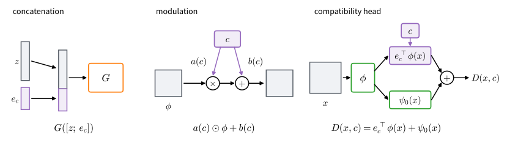

# Conditional Generation
:label:`sec_gan_conditional`

The garment generator of :numref:`sec_basic_gan` and the sprite generators of :numref:`sec_dcgan` take no request. Each returns a sample from the whole data distribution: to get a pair of trousers from the garment generator we can only draw again until one appears, and nothing lets us ask the sprite generator for a particular creature. Most image generators that people use take a request instead: a class, a caption, a sketch to complete. Within months of the original GAN, :citet:`Mirza.Osindero.2014` proposed the obvious repair: give the request to both players. The generator receives it as an extra input, and the critic judges whether a sample is a realistic instance of that request.

Is that one change enough? This section asks what the game then optimizes, how the critic should read the request, and how we can tell whether the generator obeys. The answers reuse the chapter's log-loss game, pairing loss and penalties, applied once per request. The running example is CIFAR-10: ask for a bird, and check that we get one. The check turns out to be the harder half, because a generator can obey every request and still return a single image per class.

```{.python .input #conditional-conditional-generation}
%%tab pytorch
%matplotlib inline
from d2l import torch as d2l
import numpy as np
import torch
from torch import nn
```
```{.python .input #conditional-conditional-generation}
%%tab jax
%matplotlib inline
from d2l import jax as d2l
import jax
from jax import numpy as jnp
from flax import nnx
import numpy as np
import optax
```
## The Conditional Game

### The Optimal Conditional Critic

A condition specifies a property of the requested sample. It may be a class label, a caption embedding, or an entire image; our running example uses the ten CIFAR-10 class labels. The data consists of image--label pairs drawn from a joint distribution $p(x,c)$. The generator also receives the condition, so $x' = G(z,c)$, and varying $z$ at fixed $c$ samples from a conditional distribution $q(\cdot \mid c)$. We draw the generator's conditions from the data marginal $p(c)$, so the generated pairs follow $q(x,c)=p(c)\,q(x\mid c)$. The real and generated joint distributions then share the condition marginal and differ only in their conditional image distributions.

The critic scores sample--condition pairs, $D(x, c)$, and the game is the log-loss game of :numref:`sec_basic_gan` played on those pairs:

$$
V(D) \;=\; \mathbb{E}_{(x, c) \sim p}\big[\log \sigma(D(x, c))\big]
+ \mathbb{E}_{c \sim p(c),\; x' \sim q(\cdot \mid c)}\big[\log \sigma(-D(x', c))\big].
$$
:eqlabel:`eq_gan_cond_V`

In the unconditional game the optimal critic is the log density ratio $\log(p/q)$, and the value at that critic is $2\,\mathrm{JS}(p, q) - 2\log 2$. The pointwise argument behind both results works for any input space, so it applies with the pair $(x, c)$ in place of $x$. The optimal critic is the log ratio of the two joint densities, and their shared condition marginal cancels:

$$
D^\star(x, c)
\;=\; \log \frac{p(x, c)}{q(x, c)}
\;=\; \log \frac{p(c)\, p(x \mid c)}{p(c)\, q(x \mid c)}
\;=\; \log \frac{p(x \mid c)}{q(x \mid c)} .
$$
:eqlabel:`eq_gan_cond_dstar`

The optimal conditional critic is the log density ratio within the slice of data that the condition selects. For the bird condition it compares real and generated birds; images of other classes do not enter. Substituting this critic into :eqref:`eq_gan_cond_V` keeps the outer expectation over $c$, and each condition contributes the value of its own unconditional game:

$$
\max_D V(D)
\;=\; \mathbb{E}_{c}\Big[\, 2\, \mathrm{JS}\big(p(\cdot \mid c),\, q(\cdot \mid c)\big) \Big] - 2 \log 2 .
$$
:eqlabel:`eq_gan_cond_value`

Thus the conditional game is an average of per-condition games, weighted by how often each condition occurs. Its value reaches the minimum $-2\log 2$ exactly when $q(\cdot \mid c) = p(\cdot \mid c)$ for every condition that $p(c)$ weights: the generator must match the data within every slice.

### Stronger than Marginal Matching

This requirement is stronger than matching the distribution of images. Consider a generator that produces accurate CIFAR-10 images but shifts every label cyclically, so that $q(\cdot \mid c) = p(\cdot \mid c{+}1)$: a request for a bird returns a cat. All ten classes occur equally often, so the shift leaves the mixture over classes unchanged. The generator's distribution of images equals the data's, and the unconditional game sits at its minimum, $-2\log 2$; it cannot see the wrong labels. The conditional game compares each slice with its neighbor instead. If the classes had disjoint supports, every slice would contribute $\mathrm{JS} = \log 2$, and :eqref:`eq_gan_cond_value` would equal $0$, the largest value the game can take. CIFAR-10 classes overlap a little, so the value sits just below that maximum: a perfect image generator that fails every request is close to the worst conditional generator (Exercise :exref:`ex_conditional-verify-decomposition-eqref-eq` computes both values for two Gaussian slices).

The weighting by $p(c)$ has a cost for imbalanced data. A rare condition contributes little to the average, so the generator can serve it poorly at a small cost to the objective (Exercise :exref:`ex_conditional-rare-class`).

### Same-Class Pairs

Our experiment trains with the pairing loss of :numref:`sec_gan_relativistic`, which compares a real sample with a generated one. We pair each real image with a generated image of the same class, a real bird with a generated bird. Within one class this is the pairing game between $p(\cdot \mid c)$ and $q(\cdot \mid c)$, with the objective $\Phi_c(D) = \mathbb{E}_{x \sim p(\cdot \mid c),\, x' \sim q(\cdot \mid c)}[\log \sigma(D(x, c) - D(x', c))]$. For one pair of distributions, :numref:`sec_gan_relativistic` showed that the value of the pairing game is the Jensen--Shannon divergence between the two orderings of a pair, real sample first ($p \otimes q$) or generated sample first ($q \otimes p$). The critic of each class can be optimized separately, so the conditional value averages these divergences over classes:

$$
\max_D \mathbb{E}_c\big[\Phi_c(D)\big] + \log 2
\;=\; \mathbb{E}_c\Big[\mathrm{JS}\big(p(\cdot \mid c) \otimes q(\cdot \mid c),\; q(\cdot \mid c) \otimes p(\cdot \mid c)\big)\Big].
$$
:eqlabel:`eq_gan_cond_rp_value`

Each term is zero exactly when its slice is matched, so the fixed point is that of :eqref:`eq_gan_cond_value`. The shift invariance of the pairing game carries over class by class. Adding a constant to the critic leaves every score difference unchanged, and with same-class pairs this holds for one constant per class: $D(x, c) + \zeta_c$ has the same loss for any constants $\zeta_1, \ldots, \zeta_{10}$. The critic never calibrates its scores across classes, so our diagnostics must not depend on these constants (Exercise :exref:`ex_conditional-critic-classifier` measures them). The chapter's other results, such as the analysis of the zero-centered penalties, likewise hold class by class, since each concerns one pair of distributions.

## Conditioning Mechanisms

### Three Ways In

The analysis says what the optimal critic computes, but not how a network should take the condition in. Three mechanisms are common (:numref:`fig_gan_conditioning`).

![Three ways a condition $c$ enters a GAN. Left: concatenation appends a class embedding $e_c$ to the latent code (or to an image or feature map in the critic). Middle: modulation scales and shifts a feature map $\phi$ by functions of the condition, $a(c) \odot \phi + b(c)$ (conditional batch normalization normalizes $\phi$ first). Right: the compatibility head of the projection critic scores the inner product of a class embedding with the critic features, $e_c^\top \phi(x)$, and adds an unconditional term $\psi_0(x)$.](../img/mdl-gan-conditioning.svg)
:label:`fig_gan_conditioning`

*Concatenation* :cite:`Mirza.Osindero.2014` embeds the condition in a vector $e_c$ and appends it to an input: beside the latent code in the generator, or beside the image or a feature map in the critic. It imposes no form on how sample and condition interact, so the network must learn that interaction from the adversarial signal alone. *Modulation* scales and shifts a feature map, $a(c) \odot \phi + b(c)$, with one entry per channel; BigGAN computes $a(c)$ and $b(c)$ from a class embedding in every block of its generator :cite:`Brock.Donahue.Simonyan.2019`. Papers write $\gamma(c)$ and $\beta(c)$, but $\gamma$ is the penalty weight in this chapter. The third mechanism conditions only the critic, through a head that scores how well sample and condition fit together. Its most common form follows from the optimal critic.

### The Projection Head from Bayes' Rule

Bayes' rule, $p(x \mid c) = p(c \mid x)\, p(x) / p(c)$, applied to the numerator and the denominator of :eqref:`eq_gan_cond_dstar`, cancels the shared label marginal and yields

$$
\log \frac{p(x \mid c)}{q(x \mid c)}
\;=\; \log \frac{p(c \mid x)}{q(c \mid x)} + \log \frac{p(x)}{q(x)} .
$$
:eqlabel:`eq_gan_cond_bayes`

Thus the optimal conditional critic separates condition compatibility from unconditional sample quality. The second term is the log density ratio of the unconditional game. The first compares the real and generated *label posteriors* at $x$. A generator that produces realistic images with scrambled labels differs from the data through the first term; one that produces poorly formed images of the requested class differs through the second.

If both posteriors are softmax classifiers on one shared feature map $\phi$, the first term takes a familiar form. Let $p(c \mid x) \propto \exp(u_c^\top \phi(x))$ with one weight vector per class, and $q(c \mid x) \propto \exp(w_c^\top \phi(x))$ likewise. The two normalizers do not depend on $c$, so the log ratio of the posteriors is the inner product $(u_c - w_c)^\top \phi(x)$ plus a function of $x$ alone. Absorbing that function, together with the unconditional term, into a single head $\psi_0$ and writing $e_c = u_c - w_c$, the critic becomes

$$
D(x, c) \;=\; e_c^\top \phi(x) + \psi_0(x).
$$
:eqlabel:`eq_gan_cond_projection`

This is the *projection discriminator* of :citet:`Miyato.Koyama.2018`: one learned embedding per class, an inner product with the critic's features, and an unconditional head. Bayes' rule is an identity, but the shared feature map is a modeling assumption (Exercise :exref:`ex_conditional-projection-derivation-modeled-both`). A linear $\psi_0$ can be folded into the class embeddings, and R3GAN's conditional critic keeps only the inner product :cite:`Huang.Gokaslan.Kuleshov.ea.2024`; StyleGAN-T replaces the class embedding by the CLIP embedding of a caption, which makes the same head the text-conditioned critic of current one-step generators :cite:`Sauer.Karras.Laine.ea.2023`. The *auxiliary classifier* critic of :citet:`Odena.Olah.Shlens.2017` is the main alternative: it adds a classification head, and the generator is trained to make its samples receive the requested label, which favors easily classified prototypes over within-class diversity (Exercise :exref:`ex_conditional-auxiliary-classifier-bias`).

Our experiment uses concatenation in the generator and a projection head in the critic, the division R3GAN uses in its class-conditional experiments. The critic gets the structure that the derivation motivates; no such identity says how the generator should use $c$, so concatenation leaves that free.

### An Image as the Condition

The condition can also be an entire image: a semantic map, an edge sketch, or a grayscale photograph. Pix2pix :cite:`Isola.Zhu.Zhou.ea.2017` plays the conditional game on output--input pairs, with the source image as $c$, and adds an $L_1$ loss against the paired target. The source fixes the coarse layout of the output, which the $L_1$ term recovers. Fine texture is ambiguous given the source, and the $L_1$ term alone blurs it, so pix2pix keeps the critic beside it.

## Class-Conditional CIFAR-10

We now train a class-conditional generator on the 50,000 labeled $32 \times 32$ training images of CIFAR-10, which come from ten classes and are loaded with `d2l.load_cifar10_arrays` (:numref:`subsec_utils_feature_cnn`). R3GAN reports a class-conditional CIFAR-10 benchmark trained for four days on eight GPUs. Our run takes 15,000 steps, well under half an hour on one GPU, and tests the conditioning and its measurement, not large-scale sample quality.

```{.python .input #conditional-class-conditional-cifar-10}
%%tab pytorch
classes = ['airplane', 'automobile', 'bird', 'cat', 'deer',
           'dog', 'frog', 'horse', 'ship', 'truck']
device = d2l.try_gpu()
train_X, train_y, test_X, test_y = d2l.load_cifar10_arrays()
first = [int((train_y == c).nonzero()[0]) for c in range(10)]
d2l.show_images(train_X[first].cpu().permute(0, 2, 3, 1) / 2 + 0.5,
                num_rows=2, num_cols=5, titles=classes);
```
```{.python .input #conditional-class-conditional-cifar-10}
%%tab jax
classes = ['airplane', 'automobile', 'bird', 'cat', 'deer',
           'dog', 'frog', 'horse', 'ship', 'truck']
train_X, train_y, test_X, test_y = d2l.load_cifar10_arrays()
first = [int(np.nonzero(np.asarray(train_y) == c)[0][0]) for c in range(10)]
d2l.show_images(np.asarray(train_X[np.array(first)]) / 2 + 0.5,
                num_rows=2, num_cols=5, titles=classes);
```
### A Conditional Backbone

The networks are the saved `d2l.Generator` and `d2l.Discriminator` of :numref:`sec_dcgan` at resolution 32, one resampling stage fewer than for the $64 \times 64$ sprites, with the condition as an extra input to each. Everything else is unchanged: bilinear resampling, leaky ReLU, no normalization, no tanh, and fan-in initialization. `CondGenerator` embeds the class, broadcasts the embedding over the $4 \times 4$ grid, and passes it as the base class's `extra` input, which is concatenated with the learned constant and the projected latent code before the mixing convolution.

```{.python .input #conditional-a-conditional-backbone-at-32-by-32-1}
%%tab pytorch
class CondGenerator(d2l.Generator):
    """The backbone generator with a class embedding as extra 4x4 maps."""
    def __init__(self, latent_dim, resolution, base_ch, embed_dim=64,
                 num_classes=10):
        super().__init__(latent_dim, resolution, base_ch, extra_ch=embed_dim)
        self.embed = nn.Embedding(num_classes, embed_dim)  # unit variance

    def forward(self, z, y):
        ec = self.embed(y)[:, :, None, None].expand(-1, -1, 4, 4)
        return super().forward(z, ec)
```
```{.python .input #conditional-a-conditional-backbone-at-32-by-32-1}
%%tab jax
class CondGenerator(d2l.Generator):
    """The backbone generator with a class embedding as extra 4x4 maps."""
    def __init__(self, latent_dim, resolution, base_ch, embed_dim=64,
                 num_classes=10, *, rngs):
        super().__init__(latent_dim, resolution, base_ch, extra_ch=embed_dim,
                         rngs=rngs)
        self.embed = nnx.Embed(num_classes, embed_dim, rngs=rngs,
                               embedding_init=nnx.initializers.normal(1.0))

    def __call__(self, z, y):
        e = self.embed(y)[:, None, None, :]
        ec = jnp.broadcast_to(e, (z.shape[0], 4, 4, e.shape[-1]))
        return super().__call__(z, ec)
```
`ProjectionCritic` implements :eqref:`eq_gan_cond_projection`. The base class's `phi` returns the $4 \times 4$ feature map after the mixing convolution; summing it over positions gives $\phi(x)$. A linear head on $\phi(x)$ gives $\psi_0(x)$ and replaces the base head, which reads the flattened map, and a table holds one embedding $e_c$ per class. The table starts at zero, so the critic begins as an unconditional critic and learns the label term from the data.

```{.python .input #conditional-a-conditional-backbone-at-32-by-32-2}
%%tab pytorch
class ProjectionCritic(d2l.Discriminator):
    """The backbone critic with a projection head: e_c . phi(x) + psi_0(x)."""
    def __init__(self, resolution, base_ch, num_classes=10):
        super().__init__(resolution, base_ch)
        width = self.mix.out_channels
        self.head = nn.Linear(width, 1)  # psi_0 on the pooled features
        d2l.fan_in_init(self.head)
        self.embed = nn.Embedding(num_classes, width)
        nn.init.zeros_(self.embed.weight)  # start as an unconditional critic

    def forward(self, x, y):
        phi = self.phi(x).sum(dim=(2, 3))  # sum over the 4x4 positions
        return (self.embed(y) * phi).sum(dim=1) + self.head(phi).squeeze(-1)

net_G, net_D = CondGenerator(100, 32, 256), ProjectionCritic(32, 64)
print(net_G(torch.zeros(2, 100), torch.zeros(2, dtype=torch.long)).shape)
print(net_D(torch.zeros(2, 3, 32, 32),
            torch.zeros(2, dtype=torch.long)).shape)
```
```{.python .input #conditional-a-conditional-backbone-at-32-by-32-2}
%%tab jax
class ProjectionCritic(d2l.Discriminator):
    """The backbone critic with a projection head: e_c . phi(x) + psi_0(x)."""
    def __init__(self, resolution, base_ch, num_classes=10, *, rngs):
        super().__init__(resolution, base_ch, rngs=rngs)
        width = self.mix.out_features
        self.head = nnx.Linear(width, 1, kernel_init=d2l.fan_in_init,
                               rngs=rngs)  # psi_0 on the pooled features
        self.embed = nnx.Embed(num_classes, width, rngs=rngs,
                               embedding_init=nnx.initializers.zeros)

    def __call__(self, x, y):
        phi = self.phi(x).sum(axis=(1, 2))  # sum over the 4x4 positions
        return (self.embed(y) * phi).sum(axis=1) + self.head(phi).squeeze(-1)

net_G = CondGenerator(100, 32, 256, rngs=nnx.Rngs(0))
net_D = ProjectionCritic(32, 64, rngs=nnx.Rngs(0))
print(net_G(jnp.zeros((2, 100)), jnp.zeros(2, dtype=jnp.int32)).shape)
print(net_D(jnp.zeros((2, 32, 32, 3)), jnp.zeros(2, dtype=jnp.int32)).shape)
```
### Training with Same-Class Pairs

Training follows the sprite recipe of :numref:`sec_dcgan`: the pairing loss for both players, the penalties $R_1$ and $R_2$ on real and generated images, Adam with $\beta_1 = 0$, random horizontal flips of the real images, and an exponential moving average of the generator (`d2l.EMA`, half-life 500 steps) that supplies the generator for evaluation. Same-class pairs come from the labels: we draw a labeled real batch and condition the generated batch on the same labels. Given the labels as `y`, the saved steps `d2l.critic_step` and `d2l.generator_step` of :numref:`sec_gan_convergence` score with the critic $x \mapsto D(x, y)$, so the losses and the penalty see an ordinary critic of images.

Every 250 steps the loop also records the *held-out pair accuracy*: on 512 fresh pairs of a test image and a generated image of the same class, the fraction that the critic orders correctly, $\hat P(D(x, c) > D(x', c))$. The constants $\zeta_c$ cancel from it, whereas the critic's mean score drifts with them. A value of one half means that the critic cannot tell real from generated images of a class.

```{.python .input #conditional-training-with-same-class-pairs}
%%tab jax
@nnx.jit
def cond_step(net_G, net_D, opt_G, opt_D, X, y, z, X2, y2, z2, gamma):
    loss_D, r1, r2 = d2l.critic_step(net_D, opt_D, d2l.rpgan_loss_D, X,
                                     net_G(z, y), gamma, y=y)  # same labels
    loss_G = d2l.generator_step(net_G, opt_G, d2l.rpgan_loss_G, net_D,
                                X2, z2, y=y2)
    return loss_D, loss_G, r1 + r2
```

:begin_tab:`jax`
One compiled function takes both steps: it generates the batch with the real batch's labels and calls the two saved steps, so each training step is a single call.
:end_tab:

```{.python .input #conditional-training-with-the-chapter-s-loss-2}
%%tab pytorch
def train_conditional(train_X, train_y, test_X, test_y, gamma,
                      num_steps=15000, batch_size=128, lr=0.0002,
                      latent_dim=100, half_life=500, log_every=250, seed=0):
    torch.manual_seed(seed)
    net_G = CondGenerator(latent_dim, 32, 256).to(train_X.device)
    net_D = ProjectionCritic(32, 64).to(train_X.device)
    opt_G, opt_D = [torch.optim.Adam(net.parameters(), lr, betas=(0.0, 0.99))
                    for net in (net_G, net_D)]
    noise = lambda n: torch.randn(n, latent_dim, device=train_X.device)
    ema, history = d2l.EMA(net_G, half_life), []
    for step in range(1, num_steps + 1):
        X, y = d2l.sample_real(train_X, batch_size, train_y)
        with torch.no_grad():  # the generated batch takes the same labels
            fake = net_G(noise(batch_size), y)
        loss_D, r1, r2 = d2l.critic_step(net_D, opt_D, d2l.rpgan_loss_D,
                                         X, fake, gamma, y=y)
        X, y = d2l.sample_real(train_X, batch_size, train_y)
        loss_G = d2l.generator_step(net_G, opt_G, d2l.rpgan_loss_G, net_D,
                                    X, noise(batch_size), y=y)
        ema.update(net_G)
        if step % log_every == 0:  # fresh same-class pairs of test images
            X, y = d2l.sample_real(test_X, 512, test_y)
            with torch.no_grad():
                acc = d2l.ranking_accuracy(lambda x: net_D(x, y), X,
                                           net_G(noise(512), y))
            history.append((step, *map(float, (loss_D, loss_G, r1 + r2)), acc))
    return ema.model, net_D, np.array(history)
```
```{.python .input #conditional-training-with-the-chapter-s-loss-2}
%%tab jax
def train_conditional(train_X, train_y, test_X, test_y, gamma,
                      num_steps=15000, batch_size=128, lr=0.0002,
                      latent_dim=100, half_life=500, log_every=250, seed=0):
    rngs = nnx.Rngs(seed)
    net_G = CondGenerator(latent_dim, 32, 256, rngs=rngs)
    net_D = ProjectionCritic(32, 64, rngs=rngs)
    opt_G, opt_D = [nnx.Optimizer(net, optax.adam(lr, b1=0.0, b2=0.99),
                                  wrt=nnx.Param) for net in (net_G, net_D)]
    noise = lambda key, n: jax.random.normal(key, (n, latent_dim))
    ema, history, key = d2l.EMA(net_G, half_life), [], jax.random.key(seed + 1)
    for step in range(1, num_steps + 1):
        key, kx, kz, kx2, kz2 = jax.random.split(key, 5)
        logs = cond_step(net_G, net_D, opt_G, opt_D,
                         *d2l.sample_real(kx, train_X, batch_size, train_y),
                         noise(kz, batch_size),
                         *d2l.sample_real(kx2, train_X, batch_size, train_y),
                         noise(kz2, batch_size), gamma)
        ema.update(net_G)
        if step % log_every == 0:  # fresh same-class pairs of test images
            key, kx, kz = jax.random.split(key, 3)
            X, y = d2l.sample_real(kx, test_X, 512, test_y)
            acc = d2l.ranking_accuracy(lambda x: net_D(x, y), X,
                                       net_G(noise(kz, 512), y))
            history.append((step, *map(float, logs), acc))
    return ema.model, net_D, np.array(history)
```
The runs use the penalty weight $\gamma = 0.5$, against $\gamma = 10$ for the sprites. The penalty weight is a squared length on the scale of the input (:numref:`sec_gan_convergence`), and the right value also depends on the critic, the batch size and the budget, so a new setup needs its own sweep (Exercise :exref:`ex_conditional-implement-concatenation-critic-one`).

```{.python .input #conditional-training-with-the-chapter-s-loss-3}
%%tab pytorch
gamma = 0.5
ema_G, net_D, history = train_conditional(train_X, train_y, test_X, test_y,
                                          gamma)
loss_D, loss_G, pen, acc = history[-20:, 1:].mean(0)  # last 5,000 steps
print(f'critic loss {loss_D:.2f} (+ penalty {gamma / 2 * pen:.3f}), '
      f'generator loss {loss_G:.2f}, pair accuracy {acc:.2f}')
```
```{.python .input #conditional-training-with-the-chapter-s-loss-3}
%%tab jax
gamma = 0.5
ema_G, net_D, history = train_conditional(train_X, train_y, test_X, test_y,
                                          gamma)
loss_D, loss_G, pen, acc = history[-20:, 1:].mean(0)  # last 5,000 steps
print(f'critic loss {loss_D:.2f} (+ penalty {gamma / 2 * pen:.3f}), '
      f'generator loss {loss_G:.2f}, pair accuracy {acc:.2f}')
```
```{.python .input #conditional-training-with-the-chapter-s-loss-4}
%%tab pytorch, jax
fig, axes = d2l.plt.subplots(1, 2, figsize=(9, 3.2))
d2l.plot(history[:, 0], [history[:, 1], history[:, 2]], 'step', 'loss',
         legend=['critic (pairing part)', 'generator'], yscale='log',
         axes=axes[0])
axes[0].axhline(np.log(2), ls='--', c='gray', lw=1)
d2l.plot(history[:, 0], history[:, 4], 'step', 'held-out pair accuracy',
         ylim=[0.3, 1], axes=axes[1])
axes[1].axhline(0.5, ls='--', c='gray', lw=1);
```
The dashed lines mark $\log 2$, the value of either pairing loss when the critic cannot order a pair, and a pair accuracy of one half. Both losses settle within the first few thousand steps, after a high start of the generator loss: the generator's near 1.0, above $\log 2$, and the critic's near 0.5, below it, with the penalty adding about 0.06. The critic still wins most comparisons: late in training it orders about 80% of fresh same-class pairs correctly, down from about 90% early in training. At this budget the generator has not caught up with the data.

### Samples on Request

Each row of the next grid requests one class, and each column uses a fresh latent code. As in :numref:`sec_dcgan`, the generator has no tanh, so the display and every evaluation below clamp its output to $[-1, 1]$.

```{.python .input #conditional-training-with-the-chapter-s-loss-5}
%%tab pytorch
torch.manual_seed(42)
z = torch.randn(100, 100, device=device)
y = torch.arange(10, device=device).repeat_interleave(10)
with torch.no_grad():
    imgs = ((ema_G(z, y).clamp(-1, 1) + 1) / 2)
grid = imgs.reshape(10, 10, 3, 32, 32).permute(0, 3, 1, 4, 2)
grid = grid.reshape(320, 320, 3).cpu().numpy()
d2l.set_figsize((6, 6))
d2l.plt.imshow(grid)
d2l.plt.yticks([32 * i + 16 for i in range(10)], classes)
d2l.plt.xticks([]);
```
```{.python .input #conditional-training-with-the-chapter-s-loss-5}
%%tab jax
z = jax.random.normal(jax.random.key(42), (100, 100))
y = jnp.repeat(jnp.arange(10), 10)
imgs = (jnp.clip(ema_G(z, y), -1, 1) + 1) / 2
grid = np.asarray(imgs.reshape(10, 10, 32, 32, 3).transpose(0, 2, 1, 3, 4)
                  .reshape(320, 320, 3))
d2l.set_figsize((6, 6))
d2l.plt.imshow(grid)
d2l.plt.yticks([32 * i + 16 for i in range(10)], classes)
d2l.plt.xticks([]);
```
Most rows read as their class. Vehicles are recognizable by shape: cars and trucks as wheeled bodies, ships as hulls on water, airplanes against the sky. The animal rows lean more on palette and background: frogs are green and brown textures, deer and horses brown forms on grass, while birds, cats and dogs are often similar brown shapes. Pose, color and background vary along every row, so the grid shows no obvious collapse within a class. Inspection cannot say how often a generated image would be recognized as its class, or how much variety is missing; we measure both next.

## Measuring Condition Alignment

### A Referee Classifier

An unconditional metric cannot detect the cyclic label shift, which preserves the distribution of images while violating every request. We therefore check requests with a CIFAR-10 classifier, the *referee*. It is the small convolutional network `d2l.FeatureCNN` of :numref:`sec_dcgan`, trained here at the native $32 \times 32$ resolution by `d2l.train_feature_cnn` with random horizontal flips, random shifts of up to four pixels, and a learning rate that rises and then anneals over 15 epochs. Without the augmentation and the schedule the network overfits, and its accuracy on a single class moves by tens of points between two training seeds, more than the differences we want to read. With them it reaches about 78%, and its per-class accuracies move by a few points.

```{.python .input #conditional-measuring-condition-alignment-1}
%%tab pytorch
torch.manual_seed(0)
cnn = d2l.FeatureCNN(resolution=32).to(device)
d2l.train_feature_cnn(cnn, train_X, train_y, shift=4)
with torch.no_grad():
    pred = torch.cat([cnn(test_X[i:i + 1000]).argmax(1)
                      for i in range(0, len(test_X), 1000)])
cls_acc = [float((pred[test_y == c] == c).float().mean())
           for c in range(10)]
print(f'CIFAR-10 test accuracy: {float((pred == test_y).float().mean()):.3f}')
```
```{.python .input #conditional-measuring-condition-alignment-1}
%%tab jax
cnn = d2l.FeatureCNN(resolution=32, rngs=nnx.Rngs(1))
d2l.train_feature_cnn(cnn, train_X, train_y, shift=4)
pred = jnp.concatenate([cnn(test_X[i:i + 1000]).argmax(1)
                        for i in range(0, len(test_X), 1000)])
cls_acc = [float((pred[test_y == c] == c).mean()) for c in range(10)]
print(f'CIFAR-10 test accuracy: {float((pred == test_y).mean()):.3f}')
```
### Alignment per Class

For each generated image, the referee either predicts the requested class or it does not. The fraction of matches, overall and per class, is the *condition alignment*. We compare it with the referee's accuracy on real test images of the same class, because the referee also misclassifies real images. The real accuracy is a reference, not an upper bound: unusually prototypical generated images can be easier to classify than photographs. The next cell generates 500 images of each class and prints both and their difference, the *gap*.

```{.python .input #conditional-measuring-condition-alignment-2}
%%tab pytorch
torch.manual_seed(7)
align = []
for c in range(10):
    z = torch.randn(500, 100, device=device)
    yc = torch.full((500,), c, device=device)
    with torch.no_grad():
        pred_c = cnn(ema_G(z, yc).clamp(-1, 1)).argmax(1)
    align.append(float((pred_c == c).float().mean()))
print(f'{"class":12s}{"alignment":>11s}{"real":>7s}{"gap":>7s}')
for c in range(10):
    print(f'{classes[c]:12s}{align[c]:11.2f}{cls_acc[c]:7.2f}'
          f'{align[c] - cls_acc[c]:+7.2f}')
print(f'{"mean":12s}{np.mean(align):11.2f}{np.mean(cls_acc):7.2f}'
      f'{np.mean(align) - np.mean(cls_acc):+7.2f}')
```
```{.python .input #conditional-measuring-condition-alignment-2}
%%tab jax
key = jax.random.key(7)
align = []
for c in range(10):
    key, kz = jax.random.split(key)
    z = jax.random.normal(kz, (500, 100))
    yc = jnp.full((500,), c)
    pred_c = cnn(jnp.clip(ema_G(z, yc), -1, 1)).argmax(1)
    align.append(float((pred_c == c).mean()))
print(f'{"class":12s}{"alignment":>11s}{"real":>7s}{"gap":>7s}')
for c in range(10):
    print(f'{classes[c]:12s}{align[c]:11.2f}{cls_acc[c]:7.2f}'
          f'{align[c] - cls_acc[c]:+7.2f}')
print(f'{"mean":12s}{np.mean(align):11.2f}{np.mean(cls_acc):7.2f}'
      f'{np.mean(align) - np.mean(cls_acc):+7.2f}')
```
Averaged over classes, alignment is about 0.7, five or six points below the referee's accuracy on real images. No class is recognized much more often than its real counterpart, and no class is harder than cat in either column. Individual gaps move by several points between runs, so the table does not rank them.

### Fidelity and Within-Class Diversity

Alignment does not measure image quality. We therefore also compute the two feature-distribution distances of :numref:`sec_dcgan`: the Fréchet distance between Gaussian fits to two feature sets, and the unbiased $\mathrm{MMD}^2$ estimate with a cubic polynomial kernel. Both use the referee's 128-dimensional features, so we call them FD and $\mathrm{MMD}^2$ (CIFAR-CNN); they cannot be compared with published FID or KID scores. The evaluation compares 1,000 generated images, 100 per class, with 1,000 test images in the same proportions, and a second disjoint set of 1,000 test images gives the real-versus-real floor. The distances ignore the labels, so the cell also reports the *within-class feature variance*: the variance of the features within each class, averaged over features and classes.

```{.python .input #conditional-measuring-condition-alignment-4}
%%tab pytorch
def features(imgs, bs=500):
    with torch.no_grad():
        return np.concatenate([cnn.features(imgs[i:i + bs]).cpu().numpy()
                               for i in range(0, len(imgs), bs)])

torch.manual_seed(11)
z = torch.randn(1000, 100, device=device)
yg = torch.arange(10, device=device).repeat_interleave(100)
with torch.no_grad():
    raw = ema_G(z, yg)
oob = float(((raw < -1) | (raw > 1)).float().mean())
gen = raw.clamp(-1, 1)
idx = [(test_y == c).nonzero().flatten()[:200] for c in range(10)]
f_real = features(test_X[torch.cat([i[:100] for i in idx])])
f_real2 = features(test_X[torch.cat([i[100:] for i in idx])])
f_gen = features(gen)
print(f'{"comparison":22s}{"FD (CIFAR-CNN)":>16s}{"MMD^2 (CIFAR-CNN)":>19s}'
      f'{"out-of-range":>14s}')
print(f'{"real vs. real":22s}{d2l.fid_score(f_real2, f_real):16.2f}'
      f'{d2l.kid_score(f_real2, f_real):19.3f}{"--":>14s}')
print(f'{"generated vs. real":22s}{d2l.fid_score(f_gen, f_real):16.2f}'
      f'{d2l.kid_score(f_gen, f_real):19.3f}{oob:14.3f}')
cvar = lambda f: float(np.float64(f).reshape(10, 100, -1).var(1).mean())
print(f'within-class feature variance: generated {cvar(f_gen):.3g}, '
      f'real {cvar(f_real):.3g}, second real set {cvar(f_real2):.3g}')
```
```{.python .input #conditional-measuring-condition-alignment-4}
%%tab jax
def features(imgs, bs=500):
    return np.concatenate([np.asarray(cnn.features(imgs[i:i + bs]))
                           for i in range(0, len(imgs), bs)])

z = jax.random.normal(jax.random.key(11), (1000, 100))
yg = jnp.repeat(jnp.arange(10), 100)
raw = ema_G(z, yg)
oob = float(((raw < -1) | (raw > 1)).mean())
gen = jnp.clip(raw, -1, 1)
idx = [jnp.nonzero(test_y == c)[0][:200] for c in range(10)]
f_real = features(test_X[jnp.concatenate([i[:100] for i in idx])])
f_real2 = features(test_X[jnp.concatenate([i[100:] for i in idx])])
f_gen = features(gen)
print(f'{"comparison":22s}{"FD (CIFAR-CNN)":>16s}{"MMD^2 (CIFAR-CNN)":>19s}'
      f'{"out-of-range":>14s}')
print(f'{"real vs. real":22s}{d2l.fid_score(f_real2, f_real):16.2f}'
      f'{d2l.kid_score(f_real2, f_real):19.3f}{"--":>14s}')
print(f'{"generated vs. real":22s}{d2l.fid_score(f_gen, f_real):16.2f}'
      f'{d2l.kid_score(f_gen, f_real):19.3f}{oob:14.3f}')
cvar = lambda f: float(np.float64(f).reshape(10, 100, -1).var(1).mean())
print(f'within-class feature variance: generated {cvar(f_gen):.3g}, '
      f'real {cvar(f_real):.3g}, second real set {cvar(f_real2):.3g}')
```
In FD the generated set lies two to four times as far from the real test images as the second real set does. In $\mathrm{MMD}^2$ the real-versus-real estimate fluctuates around zero, while the generated-versus-real estimate is small and positive. The variance line shows what the distances cannot separate: the generated images have about 20% less within-class feature variance than the real ones, while a second real set comes within 5%. The generator has lost some of the variety within each class, and alignment cannot see that loss.

### Two Baselines

Two constructed generators show what each measurement can and cannot see. The first keeps the same 1,000 generated images and shifts their *requested* labels cyclically, the counterexample from the start of this section. The second is a degenerate generator that returns, for every request of class $c$, the real test image that the referee classifies as $c$ most confidently.

```{.python .input #conditional-measuring-condition-alignment-5}
%%tab pytorch
y_perm = (yg + 1) % 10                       # same images, shifted requests
bal = torch.cat([i[:100] for i in idx])      # 100 test images per class
ar = torch.arange(1000, device=device)
with torch.no_grad():
    pred_gen = cnn(gen).argmax(1)
    p = cnn(test_X[bal]).softmax(1)[ar, test_y[bal]].reshape(10, 100)
    conf = bal.reshape(10, 100)[torch.arange(10), p.argmax(1)]
    fixed = test_X[conf].repeat_interleave(100, dim=0)  # one image per class
    pred_fix = cnn(fixed).argmax(1)
print(f'permuted labels: alignment '
      f'{float((pred_gen == yg).float().mean()):.2f} -> '
      f'{float((pred_gen == y_perm).float().mean()):.2f}, '
      f'FD {d2l.fid_score(f_gen, f_real):.2f}, '
      f'MMD^2 {d2l.kid_score(f_gen, f_real):.3f} (both unchanged)')
print(f'most confident image per class: alignment '
      f'{float((pred_fix == yg).float().mean()):.2f}, '
      f'within-class variance {cvar(features(fixed)):.3g}')
```
```{.python .input #conditional-measuring-condition-alignment-5}
%%tab jax
y_perm = (yg + 1) % 10                       # same images, shifted requests
bal = jnp.concatenate([i[:100] for i in idx])  # 100 test images per class
ar = jnp.arange(1000)
pred_gen = cnn(gen).argmax(1)
p = jax.nn.softmax(cnn(test_X[bal]))[ar, test_y[bal]].reshape(10, 100)
conf = bal.reshape(10, 100)[jnp.arange(10), p.argmax(1)]
fixed = jnp.repeat(test_X[conf], 100, axis=0)  # one image per class
pred_fix = cnn(fixed).argmax(1)
print(f'permuted labels: alignment '
      f'{float((pred_gen == yg).mean()):.2f} -> '
      f'{float((pred_gen == y_perm).mean()):.2f}, '
      f'FD {d2l.fid_score(f_gen, f_real):.2f}, '
      f'MMD^2 {d2l.kid_score(f_gen, f_real):.3f} (both unchanged)')
print(f'most confident image per class: alignment '
      f'{float((pred_fix == yg).mean()):.2f}, '
      f'within-class variance {cvar(features(fixed)):.3g}')
```
Shifting the requests drops alignment from about 0.7 to a few percent, while FD and $\mathrm{MMD}^2$ do not change, because neither receives a label. The confident-image generator reaches alignment 1.00 with zero within-class variance: it beats real images on alignment while returning one image per request. This *within-class collapse* is mode collapse inside each conditional distribution. The conditional objective :eqref:`eq_gan_cond_value` penalizes it, because a point mass is far from $p(\cdot \mid c)$, and so does the within-class variance; alignment rewards it.

Conditional evaluation thus has three axes, fidelity, diversity and alignment, and each of our measurements sees only part of them. Published scores combine them: the Fréchet joint distance embeds image and condition together :cite:`DeVries.Romero.Pineda.ea.2019`, and the classification accuracy score trains a classifier on generated pairs and tests it on real ones :cite:`Ravuri.Vinyals.2019`. Exercise :exref:`ex_conditional-diagnostics-cell-detects-within` extends our diagnosis to per-class distances, and Exercise :exref:`ex_conditional-biggan-s-truncation-trick` uses the same instruments on BigGAN's truncation trick, which trades variety for fidelity on purpose.

We can now ask a GAN for a class and check what we got: whether it obeys, how much it varies, and how close it comes to the data. Pix2pix has a paired target for every input and still needs its critic. Why a learned comparison helps when a regression target exists is the question of :numref:`sec_gan_beyond`.

## Summary

Conditional generation gives the request to both players and plays the chapter's game on sample--condition pairs. Its optimal critic is the per-class log density ratio $\log(p(x \mid c)/q(x \mid c))$ and its value averages the per-class divergences, so it detects perfect images with the wrong labels, which the unconditional game cannot. With same-class pairs the pairing loss plays the game of :numref:`sec_gan_relativistic` within every class, up to one free constant per class. Bayes' rule splits the optimal critic into a label term and a realness term, which gives the projection critic $D(x, c) = e_c^\top \phi(x) + \psi_0(x)$. On CIFAR-10 the referee recognizes the requested class in about 70% of the generated images, against 78% of real images, and the generated images have about a fifth less within-class variety than real data. Alignment, feature distances and within-class variance each catch a different failure.

## Exercises

1. [code] **Two slices with known densities.** Let $c \in \{1, 2\}$ be
   equally likely, $p(\cdot \mid 1) = \mathcal{N}(-2, 1)$ and
   $p(\cdot \mid 2) = \mathcal{N}(2, 1)$, and let the generator be wrong on
   one slice only: $q(\cdot \mid 1) = \mathcal{N}(0, 1)$ and
   $q(\cdot \mid 2) = \mathcal{N}(2, 1)$.
    1. Compute the value :eqref:`eq_gan_cond_value` by numerical
       integration on a grid.
    1. Train a small critic on $x$ and a one-hot encoding of $c$ by
       minimizing $-\tfrac12 V(D)$ of :eqref:`eq_gan_cond_V` on samples, and
       compare the converged loss with $-\tfrac12$ times the value from (a).
       Plot the critic against :eqref:`eq_gan_cond_dstar` for each
       condition. How large is it on the matched slice $c = 2$?
    1. Let the generator swap the labels instead, $q(\cdot \mid 1) =
       \mathcal{N}(2, 1)$ and $q(\cdot \mid 2) = \mathcal{N}(-2, 1)$.
       Compute the conditional value and the unconditional value with the
       labels discarded, and check both by retraining the critic.
   :exlabel:`ex_conditional-verify-decomposition-eqref-eq`
1. **Separate feature maps.** The derivation of
   :eqref:`eq_gan_cond_projection` modeled both label posteriors with one
   shared feature map $\phi$. Suppose instead that
   $p(c \mid x) \propto \exp(u_c^\top \phi_p(x))$ and
   $q(c \mid x) \propto \exp(w_c^\top \phi_q(x))$ with
   $\phi_p \neq \phi_q$.
    1. Derive the critic that takes the place of
       :eqref:`eq_gan_cond_projection`, and show that it is a projection
       head over the concatenated feature map $(\phi_p(x), \phi_q(x))$.
    1. Let there be $K$ classes. Show that every function $D(x, c)$ can be
       written in the form :eqref:`eq_gan_cond_projection` once $\phi$
       has at least $K$ dimensions. How many dimensions does $\phi$ have
       in `ProjectionCritic`?
    1. Given (b), when does the projection form restrict the set of
       critics? What does the shared-map assumption then restrict in the
       CIFAR-10 experiment?
   :exlabel:`ex_conditional-projection-derivation-modeled-both`
1. [short-code] **The critic as a classifier.** The trained critic `net_D`
   assigns each image ten scores, one per class.
    1. Use :eqref:`eq_gan_cond_bayes` to express
       $D^\star(x, c) - D^\star(x, c')$ through the real and the generated
       label posteriors. How does $\arg\max_c D^\star(x, c)$ differ from
       the rule $\arg\max_c p(c \mid x)$ of the referee?
    1. For the test images indexed by `bal`, compute $S_{ic} = D(x_i, c)$
       for all ten classes. Report the fraction of images that score higher
       under their own label $c$ than under $c + 1$, and the accuracy of
       $\arg\max_c S_{ic}$. Then estimate the per-class constant
       $\hat\zeta_c$ as the critic's mean score on the generated images
       `gen` of class $c$ (labels `yg`), and classify with
       $\arg\max_c (S_{ic} - \hat\zeta_c)$. Expect between a quarter and a
       third of the images to be classified correctly, two to three times
       chance. Why does the raw rule do worse?
    1. Why must the corrected rule fall to chance as the generator
       improves? If the first fraction in (b) fell to one half after longer
       training, name two states of the game that would produce this, and a
       measurement of this section that tells them apart.
   :exlabel:`ex_conditional-critic-classifier`
1. [code] **Per-class distances.** The features `f_gen`, `f_real` and
   `f_real2` hold 100 images of each class, in class order.
    1. A covariance matrix estimated from 100 samples of 128-dimensional
       features has rank at most 99. How does this affect a per-class
       Fréchet distance, and why does the unbiased $\mathrm{MMD}^2$
       estimator not suffer in the same way?
    1. For each class, compute $\mathrm{MMD}^2$ between the generated and
       the real features, and between the two real sets. Rank the classes by
       the difference and compare with the ranking by alignment; display the
       samples of a class on which the two rankings disagree.
    1. A conditional generator may ignore the condition, obey it through
       shortcuts such as background or palette, collapse within a condition,
       leak between conditions, or neglect a rare condition. Which of these
       failures does each per-class diagnostic (alignment, feature variance,
       $\mathrm{MMD}^2$) detect? Check your answer on the collapse baseline.
   :exlabel:`ex_conditional-diagnostics-cell-detects-within`
1. [code] **Truncated latents.** The truncation trick of
   :citet:`Brock.Donahue.Simonyan.2019` draws each latent coordinate from a
   standard Gaussian truncated to $[-\tau, \tau]$. Such a coordinate has
   variance
   $1 - \sqrt{2/\pi}\,\tau e^{-\tau^2/2} / \operatorname{erf}(\tau/\sqrt{2})$.
    1. For the 100-dimensional latent code of `CondGenerator` and
       $\tau \in \{0.5, 1, 2\}$, compute the probability that an untruncated
       draw lies inside $[-\tau, \tau]^{100}$ and the typical norm of a
       truncated draw. Compare it with the norm of the training latents.
    1. Implement truncated sampling for `ema_G` and sweep
       $\tau \in \{0.5, 1, 2, \infty\}$, where $\tau = \infty$ is ordinary
       sampling. Report the alignment, the within-class feature variance and
       the Fréchet distance to `f_real`, and display the samples.
    1. BigGAN found that only 16% of its models trained without orthogonal
       regularization tolerated truncation without saturation artifacts,
       against 60% with it; `ema_G` had none. At which $\tau$ do your
       measurements change most, given the norms from (a)? What does this
       say about how the generator treats latent codes with norms it never
       saw in training?

    *Adapted from Simon Prince,
    [Understanding Deep Learning](https://udlbook.github.io/udlbook/),
    Problem 15.6.*
   :exlabel:`ex_conditional-biggan-s-truncation-trick`
1. [code] **A rare class.** ● Keep only 50 of the 5,000 automobile training
   images and all images of the other classes, so that
   $p(c_{\textrm{rare}}) = \epsilon = 50/45{,}050 \approx 0.0011$.
    1. Show that a generator that serves the rare slice arbitrarily badly
       raises :eqref:`eq_gan_cond_value` by at most $2 \epsilon \log 2$.
       Class-balanced sampling of the real batches raises the weight of the
       slice to $1/10$. Which risk does it introduce, given that the slice
       holds only 50 images?
    1. Train with `train_conditional` for 4,000 steps on real batches drawn
       uniformly from the reduced set, and on class-balanced real batches,
       whose labels then condition the generator uniformly; as a reference,
       train at the same budget on the full set. For the rare class, report
       the alignment, the per-class $\mathrm{MMD}^2$ of problem
       :exref:`ex_conditional-diagnostics-cell-detects-within`b, and the
       feature distance of each generated sample to its nearest neighbor
       among the 50 training images. Which scheme serves the rare class
       better, and what does it cost the other classes?
   :exlabel:`ex_conditional-rare-class`
1. **Auxiliary classifier bias.** ● An auxiliary classifier critic
   :cite:`Odena.Olah.Shlens.2017` contains a classifier $C(c \mid x)$, and
   the generator also minimizes the classification loss
   $\mathbb{E}_{c \sim p(c),\, x \sim q(\cdot \mid c)}[-\log C(c \mid x)]$
   of its own samples. Let $q(x)$ and $q(c \mid x)$ be the image marginal
   and the label posterior of the generated pairs.
    1. Show that this loss equals

       $$\mathbb{E}_{x \sim q}\Big[H\big(q(\cdot \mid x)\big) + D_{\mathrm{KL}}\big(q(\cdot \mid x) \,\|\, C(\cdot \mid x)\big)\Big],$$

       where $H$ is the entropy.
    1. Hold $C$ fixed, set $q(x) = p(x)$, and let $q(\cdot \mid x)$ vary
       freely at every $x$, ignoring the constraint that the generated labels
       follow $p(c)$. Which label posterior minimizes the loss? With
       $C = p(c \mid x)$ and two overlapping classes, show that the
       generator can lower the loss below its value at $q = p$.
    1. Take the expectation of the label term
       $\log [p(c \mid x) / q(c \mid x)]$ of :eqref:`eq_gan_cond_bayes`
       under the generated pairs. Which term of the loss in (a) does its
       denominator cancel?
   :exlabel:`ex_conditional-auxiliary-classifier-bias`
1. [code] **The critic at a fixed budget.** ● `train_conditional` fixes the
   penalty weight $\gamma = 0.5$ and the projection head.
    1. Train for 4,000 steps at $\gamma \in \{0.05, 0.5, 5\}$, and report
       the logged squared input gradients (`history[:, 3]`), the alignment,
       and the within-class feature variance. Which change by an order of
       magnitude, and which barely move? Since $\gamma$ is a squared length
       in pixel space, why does CIFAR-10 need a different value from the
       sprites?
    1. Replace the projection head of `ProjectionCritic` by concatenation:
       append the one-hot label to the image as ten constant
       $32 \times 32$ planes and score with the head $\psi_0$ alone. Give
       `train_conditional` the critic class as an argument, and train both
       critics for 4,000 steps with two seeds each. Compare the alignment,
       the feature distances, and the critic's accuracy as a classifier with
       its constants removed (problem :exref:`ex_conditional-critic-classifier`b).
    1. By problem
       :exref:`ex_conditional-projection-derivation-modeled-both`b, neither
       critic restricts the function $D(x, c)$ for ten classes. What can
       then explain a difference at a fixed budget?
   :exlabel:`ex_conditional-implement-concatenation-critic-one`

[Discussions](https://d2l.discourse.group/t/36813)

<!-- slides -->

::: {.slide}
::: {.cover}
[Dive into Deep Learning · §16.6]{.kicker}

Conditional generation<br>
**the game on pairs · same-class pairs · the projection head · class-conditional CIFAR-10 · measuring obedience**
:::
:::

::: {.slide title="Perfect Images with Every Label Wrong Fool the Unconditional Game"}
[The problem]{.kicker}

- The garment and sprite generators return random samples; neither can
  be asked for a class.
- Suppose a CIFAR-10 generator takes the request but shifts every label:
  asked for a bird, it returns a perfect cat.
- The classes are equally frequent, so the image distribution is exactly
  the data's: unconditional value $-2\log 2$, its **minimum**.

::: {.d2l-note .warn}
To ask for a bird, both players must see the request. What does the game
then optimize, and how do we check that the generator obeys?
:::
:::

::: {.slide title="By the End of This Deck You Can"}
[Goals]{.kicker}

- derive the optimal conditional critic and the value of the game on
  sample--condition pairs;
- explain why real and generated images are paired within a class;
- derive the projection critic from Bayes' rule;
- train class-conditional CIFAR-10 with the pairing loss and both penalties;
- measure fidelity, within-class diversity and alignment separately.

**The idea:** play the chapter's game once per condition.
**Running example:** CIFAR-10, ten classes; ask for a bird, check for a bird.
:::

::: {.slide title="Every Image GAN So Far Ignored Requests"}
[Where this fits]{.kicker}

::: {.cols .vc}
::: {.col}
| section | asks |
|---|---|
| Generative Adversarial Networks | what a classifier of samples computes |
| Adversarial Objectives and Divergences | which loss gives which distance |
| Relativistic Objectives | what changes when the critic ranks pairs |
| Gradient Penalties and Convergence | why training circles, and what stops it |
| Adversarial Image Generation | which network, and how to score images |
| **Conditional Generation** | **how to ask for a class** |
| Adversarial Losses Beyond GANs | where a learned comparison remains |
:::

::: {.col .narrow}
- **Uses:** the optimal critic $\log(p/q)$; the pairing loss and its
  shift invariance; $R_1$, $R_2$; the image backbone.
- **Skips:** text-to-image systems; image-to-image translation.
:::
:::
:::

::: {.slide title="The Critic Scores Sample–Condition Pairs"}
[The conditional game]{.kicker}

Data: pairs $(x, c) \sim p(x, c)$. Generator: $c \sim p(c)$, then
$x' = G(z, c) \sim q(\cdot \mid c)$. Critic: $D(x, c)$.

$$V(D) = \mathbb{E}_{(x,c) \sim p}[\log \sigma(D(x, c))]
+ \mathbb{E}_{c,\, x' \sim q(\cdot \mid c)}[\log \sigma(-D(x', c))]$$

- The log-loss game, with the pair $(x, c)$ in place of $x$.
- Both joint distributions share the label marginal $p(c)$.
:::

::: {.slide title="The Optimal Critic Compares Real and Generated Birds Only"}
[The conditional game]{.kicker}

$$D^\star(x, c) = \log \frac{p(c)\, p(x \mid c)}{p(c)\, q(x \mid c)}
= \log \frac{p(x \mid c)}{q(x \mid c)}$$

$$\max_D V = \mathbb{E}_c\big[2\, \mathrm{JS}(p(\cdot \mid c), q(\cdot \mid c))\big]
- 2 \log 2$$

- One game per condition, weighted by $p(c)$.
- Minimum iff $q(\cdot \mid c) = p(\cdot \mid c)$ for **every** $c$.
- A rare class carries a small weight, so it is served cheaply.
:::

::: {.slide title="Check: What Is the Conditional Value of the Label Shift?"}
[Check]{.kicker}

$q(\cdot \mid c) = p(\cdot \mid c{+}1)$. Suppose the ten classes had
disjoint supports. Unconditional value? Conditional value?

. . .

- Unconditional: the image distributions match, value $-2\log 2$, the
  minimum.
- Conditional: every slice has $\mathrm{JS} = \log 2$, so
  $2\log 2 - 2\log 2 = 0$, the **maximum**.
- The perfect image generator that ignores requests is the worst
  conditional generator.
:::

::: {.slide title="Pair a Real Bird with a Generated Bird"}
[Same-class pairs]{.kicker}

Within class $c$: the pairing game between $p_c = p(\cdot \mid c)$ and
$q_c = q(\cdot \mid c)$. Its value is the JS divergence between the two
orderings of a pair, averaged over classes:

$$\mathbb{E}_c\big[\mathrm{JS}(p_c \otimes q_c,\; q_c \otimes p_c)\big]$$

- **One free constant per class:** $D(x, c) + \zeta_c$ has the same loss,
  so monitor quantities in which $\zeta_c$ cancels.
:::

::: {.slide title="Three Ways for the Condition to Enter"}
[Conditioning mechanisms]{.kicker}



Concatenation (any network) · modulation $a(c) \odot \phi + b(c)$
(generators) · a compatibility head (critics).
:::

::: {.slide title="Bayes' Rule Splits the Optimal Critic in Two"}
[The projection head]{.kicker}

$$\log \frac{p(x \mid c)}{q(x \mid c)}
= \underbrace{\log \frac{p(c \mid x)}{q(c \mid x)}}_{\textrm{label term}}
+ \underbrace{\log \frac{p(x)}{q(x)}}_{\textrm{realness term}}$$

- Wrong labels on good images: the label term is off.
- Poor images of the right class: the realness term is off.
:::

::: {.slide title="Softmax Posteriors on Shared Features Give an Inner Product"}
[The projection head]{.kicker}

$p(c \mid x) \propto e^{u_c^\top \phi(x)}$ and
$q(c \mid x) \propto e^{w_c^\top \phi(x)}$; the normalizers do not depend
on $c$:

$$D(x, c) = e_c^\top \phi(x) + \psi_0(x), \qquad e_c = u_c - w_c$$

- One embedding per class, one inner product, one unconditional head.
- Linear $\psi_0$ folds into the $e_c$: R3GAN keeps only the inner product.
- A caption embedding in place of $e_c$: the text-conditioned critic of
  StyleGAN-T.
:::

::: {.slide title="The Projection Head Is Two Lines of the Forward Pass" only="pytorch"}
[The projection head]{.kicker}

```{.python #conditional-exercises}
phi = self.phi(x).sum(dim=(2, 3))         # phi(x): 4x4 map summed
label = (self.embed(y) * phi).sum(dim=1)  # e_c . phi(x), c = y
return label + self.head(phi).squeeze(-1) # + psi_0(x)
```

- The class table starts at zero: the critic starts unconditional.
- The generator concatenates a class embedding at the $4 \times 4$ stage.
:::

::: {.slide title="The Projection Head Is Two Lines of the Forward Pass" only="jax"}
[The projection head]{.kicker}

```{.python #conditional-exercises-1}
phi = self.phi(x).sum(axis=(1, 2))         # phi(x): 4x4 map summed
label = (self.embed(y) * phi).sum(axis=1)  # e_c . phi(x), c = y
return label + self.head(phi).squeeze(-1)  # + psi_0(x)
```

- The class table starts at zero: the critic starts unconditional.
- The generator concatenates a class embedding at the $4 \times 4$ stage.
:::

::: {.slide title="The Recipe Is the Chapter's, with Labels Shared Across Each Pair"}
[Class-conditional CIFAR-10]{.kicker}

- Backbone: the minimal image backbone at $32 \times 32$, fan-in
  initialization, no normalization.
- Loss: pairing loss for both players, $\gamma = 0.5$ on $R_1 + R_2$.
- Pairs: the real batch's labels condition the generated batch.
- Adam $(0, 0.99)$, $2 \cdot 10^{-4}$, batch 128, flips, EMA with
  half-life 500 steps; 15,000 steps on one GPU.
- Monitor: held-out pair accuracy $\hat P(D(x, c) > D(x', c))$, in which
  $\zeta_c$ cancels; the mean score drifts with it.
:::

::: {.slide title="The Critic Still Orders 80% of Same-Class Pairs"}
[Class-conditional CIFAR-10]{.kicker}

@!conditional-training-with-the-chapter-s-loss-4

- Losses settle within a few thousand steps: generator near 1.0, critic's
  pairing loss near 0.5 ($\log 2 \approx 0.69$ dashed).
- Pair accuracy falls from about 90% to about 80%: the generator improves
  but has not caught up on average.
:::

::: {.slide title="Each Row Is a Request"}
[Class-conditional CIFAR-10]{.kicker}

@!conditional-training-with-the-chapter-s-loss-5

- Vehicles read by shape; animals lean on palette and background.
- Pose, color and background vary along every row.
:::

::: {.slide title="A Referee That Gives the Same Verdict Twice"}
[Measuring alignment]{.kicker}

- Referee: a small CNN classifies each generated image; alignment is the
  fraction labeled as requested.
- Trained plainly, its accuracy on one class moves by tens of points
  between seeds.
- With flips, 4-pixel shifts and a one-cycle rate over 15 epochs: about
  78%, per-class accuracies within a few points.
- Reference: the referee's accuracy on real images of the same class.
:::

::: {.slide title="Generated Images Are Recognized Five or Six Points Less Often"}
[Measuring alignment]{.kicker}

@!conditional-measuring-condition-alignment-2

- Mean alignment about 0.7 against about 0.78 on real images.
- No class far above its real reference; none harder than cat in either column.
- Single gaps move by several points between runs: do not rank them.
:::

::: {.slide title="The Generator Has About a Fifth Less Variety within a Class"}
[Fidelity and diversity]{.kicker}

@!conditional-measuring-condition-alignment-4

- FD: two to four times the real-versus-real value.
- Within-class variance about 20% below real; a second real set is
  within 5%.
- Alignment cannot see this loss.
:::

::: {.slide title="Each Baseline Fools a Different Measurement"}
[Two baselines]{.kicker}

@!conditional-measuring-condition-alignment-5

- Shifted requests: alignment collapses; FD and MMD$^2$ do not move.
- One confident real image per class: alignment 1.00, variance 0.
:::

::: {.slide title="Check: Which Measurement Catches Which Failure?"}
[Check]{.kicker}

A generator (a) shifts every label, (b) returns one image per class,
(c) returns blurry images of the right class. Which of alignment,
FD/MMD$^2$, within-class variance flags each?

. . .

- (a) alignment only.
- (b) variance (and FD, after mixing the classes); alignment is perfect.
- (c) FD/MMD$^2$; alignment may stay high if the shapes survive.
:::

::: {.slide title="Wrap-up"}
[Wrap-up]{.kicker}

- Conditioning plays the game per class: $D^\star = \log(p(x \mid c)/q(x \mid c))$,
  value $\mathbb{E}_c[2\,\mathrm{JS}] - 2\log 2$; a label shift is near the
  worst value.
- Same-class pairs: the pairing game per class, one free constant per class.
- Bayes' rule gives the projection critic $e_c^\top \phi(x) + \psi_0(x)$.
- CIFAR-10, 15,000 steps: alignment about 0.7 against about 0.78 on real
  images; within-class variance about 20% below real.
- Alignment, feature distances and within-class variance each catch a
  different failure.

**Next:** why a learned comparison helps even when a regression target is
known.
:::
