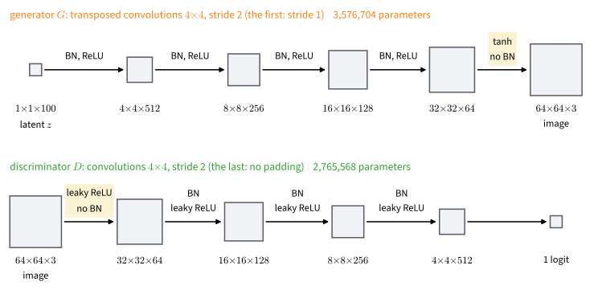
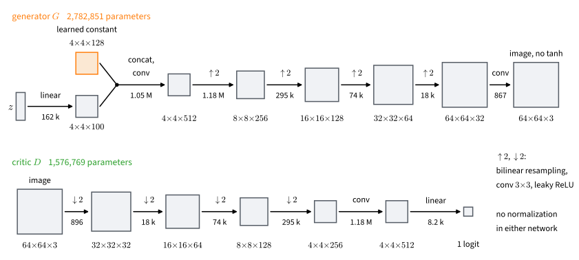

# Adversarial Image Generation
:label:`sec_dcgan`

The multilayer perceptron of :numref:`sec_basic_gan` learned to draw Fashion-MNIST garments in a few minutes on a CPU. Its shirts, dresses and shoes were recognizable but grainy, and the game never settled: the critic's loss stayed well below its equilibrium value. That network treats each pixel as an input of its own and knows nothing of which pixels are neighbors. A color image of $64 \times 64$ pixels has $12{,}288$ values, all of which the generator must produce from about a hundred random numbers.

Convolutional networks made adversarial training work on images. In 2015 a convolutional generator trained on photographs of bedrooms produced bedrooms that no camera had taken :cite:`Radford.Metz.Chintala.2015`, and within a few years generated faces were hard to tell from photographs. Images also raise a second problem: a grid of samples reveals a collapse, but two good generators look alike to the eye.

This section takes up both problems on 40,000 small game sprites. We first build the 2015 network, which trained the original loss on images through its architecture alone. We then build a network without normalization layers and train it three times, changing one ingredient at a time: the classic loss, the classic loss with the two gradient penalties of :numref:`sec_gan_convergence`, and the pairing loss of :numref:`sec_gan_relativistic` with the same penalties. To compare the runs we need a number; the two standard scores turn out to be distances from :numref:`sec_gan_objectives`, computed in the feature space of an image classifier.

```{.python .input #dcgan-adversarial-image-generation}
%%tab pytorch
import math
import numpy as np
import torch
from torch import nn
from torch.nn import functional as F
from d2l import torch as d2l
```

```{.python .input #dcgan-adversarial-image-generation}
%%tab jax
import math
import numpy as np
import jax
from jax import numpy as jnp
from flax import nnx
import optax
from d2l import jax as d2l
```

```{.python .input #dcgan-adversarial-image-generation-1}
%%tab pytorch
import torchvision
```

```{.python .input #dcgan-adversarial-image-generation-1}
%%tab jax
import os
```

## The 2015 Recipe

The deep convolutional GAN (DCGAN) of :citet:`Radford.Metz.Chintala.2015` kept the original objective and changed the networks. Its generator grows an image with transposed convolutions, and its discriminator shrinks one with strided convolutions. The generator uses ReLU and ends in a tanh, which matches its range to images scaled to $[-1, 1]$. The discriminator uses the leaky ReLU, which passes $0.2x$ for negative $x$, so that no unit stops passing gradient to the generator. Adam runs with $\beta_1 = 0.5$ instead of the usual 0.9, which shortens the optimizer's memory of a gradient field that changes as the other player moves.

### The Sprite Dataset

The dataset contains 40,597 sprite images of 721 Pokemon species, with many variants of each, obtained from [pokemondb](https://pokemondb.net/sprites). Sprites are small, centered on white backgrounds, and diverse in silhouette and palette. We resize each image to $64 \times 64$ and scale its pixel values to $[-1, 1]$. The whole dataset fits in memory, so `load_pokemon` decodes it once into one array.

```{.python .input #dcgan-the-pokemon-sprites-1}
%%tab pytorch
#@save
d2l.DATA_HUB['pokemon'] = (d2l.DATA_URL + 'pokemon.zip',
                           'c065c0e2593b8b161a2d7873e42418bf6a21106c')

#@save
def load_pokemon(resolution=64):
    """All Pokemon sprites as one (n, 3, h, w) tensor in [-1, 1]."""
    import warnings  # not in the d2l library preamble
    transform = torchvision.transforms.Compose([
        torchvision.transforms.Resize((resolution, resolution)),
        torchvision.transforms.PILToTensor()])
    dataset = torchvision.datasets.ImageFolder(
        d2l.download_extract('pokemon'), transform=transform)
    loader = torch.utils.data.DataLoader(
        dataset, batch_size=512, num_workers=d2l.get_dataloader_workers())
    with warnings.catch_warnings():  # palette sprites with transparency
        warnings.filterwarnings('ignore', message='Palette images')
        return torch.cat([X for X, _ in loader]).float() / 127.5 - 1

images = load_pokemon()
images.shape
```

```{.python .input #dcgan-the-pokemon-sprites-1}
%%tab jax
#@save
d2l.DATA_HUB['pokemon'] = (d2l.DATA_URL + 'pokemon.zip',
                           'c065c0e2593b8b161a2d7873e42418bf6a21106c')

#@save
def load_pokemon(resolution=64):
    """All Pokemon sprites as one (n, h, w, 3) array in [-1, 1]."""
    import warnings
    from PIL import Image  # neither is in the d2l library preamble
    data_dir = d2l.download_extract('pokemon')
    files = sorted(os.path.join(root, f)
                   for root, _, names in os.walk(data_dir) for f in names
                   if f.lower().endswith(('.png', '.jpg', '.jpeg')))
    def load(path):
        img = Image.open(path).convert('RGB')
        return np.asarray(img.resize((resolution, resolution), Image.BILINEAR),
                          dtype=np.float32)
    with warnings.catch_warnings():  # palette sprites with transparency
        warnings.filterwarnings('ignore', message='Palette images')
        return np.stack([load(f) for f in files]) / 127.5 - 1

images = load_pokemon()
images.shape
```

A fixed permutation sets aside one tenth of the images, which are never used for training. They are the real sample against which generated images are scored, and they show whether the critic scores its training images higher than unseen ones. The split is by image, so variants of one species can fall on both sides.

```{.python .input #dcgan-the-pokemon-sprites-2}
%%tab pytorch
device = d2l.try_gpu()
perm = np.random.default_rng(12345).permutation(len(images))
n_holdout = len(images) // 10
train_imgs = images[perm[n_holdout:]].to(device)
holdout_imgs = images[perm[:n_holdout]].to(device)
print(f'{len(train_imgs)} training and {len(holdout_imgs)} held-out images')
d2l.show_images(train_imgs[:20].cpu().permute(0, 2, 3, 1) / 2 + 0.5,
                num_rows=4, num_cols=5);
```

```{.python .input #dcgan-the-pokemon-sprites-2}
%%tab jax
perm = np.random.default_rng(12345).permutation(len(images))
n_holdout = len(images) // 10
train_imgs = jnp.asarray(images[perm[n_holdout:]])
holdout_imgs = jnp.asarray(images[perm[:n_holdout]])
print(f'{len(train_imgs)} training and {len(holdout_imgs)} held-out images')
d2l.show_images(np.asarray(train_imgs[:20]) / 2 + 0.5,
                num_rows=4, num_cols=5);
```

### Transposed Convolutions and Batch Normalization

The generator must grow a $1 \times 1$ input with 100 channels into a $64 \times 64$ image. A *transposed convolution* grows a feature map by running a convolution's arithmetic backwards. Each input pixel stamps a copy of the kernel, scaled by the pixel's value, onto the output; successive stamps start one stride apart, and where they overlap their values add. In one dimension, the input $(1, 2)$ and a kernel of four ones with stride 2 give the stamps $(1, 1, 1, 1)$ and $(2, 2, 2, 2)$, two positions apart, so the output is $(1, 1, 3, 3, 2, 2)$. If $\textrm{pad}$ rows and columns are trimmed from each border, an $n \times n$ input gives an output of side

$$\textrm{stride} \cdot (n - 1) + \textrm{kernel} - 2 \cdot \textrm{pad}.$$

With kernel 4, stride 2, and padding 1 the side is $2n$, so each such layer doubles the resolution; with stride 1 and no padding the same kernel turns a $1 \times 1$ input into a $4 \times 4$ map. A strided convolution with the same settings halves the side.

The DCGAN generator chains five transposed convolutions through the resolutions $1 \to 4 \to 8 \to 16 \to 32 \to 64$, halving the number of channels at each doubling. The discriminator mirrors it with strided convolutions down to $4 \times 4$ and a last $4 \times 4$ convolution that returns one logit (:numref:`fig_gan_dcgan`). Each block is a convolution, batch normalization, and an activation. Batch normalization keeps the scale of the activations in range while the weights change; following Radford et al., we leave it out of the discriminator's input block and the generator's output layer.


:label:`fig_gan_dcgan`

```{.python .input #dcgan-generator-1}
%%tab pytorch
def G_block(c_in, c_out, stride=2, padding=1):
    """Transposed convolution (kernel 4), batch norm, ReLU."""
    return nn.Sequential(
        nn.ConvTranspose2d(c_in, c_out, 4, stride, padding, bias=False),
        nn.BatchNorm2d(c_out), nn.ReLU())

def D_block(c_in, c_out, norm=True):
    """Strided convolution (kernel 4), batch norm, leaky ReLU."""
    return nn.Sequential(
        nn.Conv2d(c_in, c_out, 4, 2, 1, bias=False),
        nn.BatchNorm2d(c_out) if norm else nn.Identity(), nn.LeakyReLU(0.2))
```

```{.python .input #dcgan-generator-1}
%%tab jax
conv_init = nnx.initializers.normal(0.02)  # DCGAN: kernels from N(0, 0.02^2)

def bn_scale_init(key, shape, dtype=jnp.float32):
    return 1 + 0.02 * jax.random.normal(key, shape, dtype)  # N(1, 0.02^2)

def batch_norm(c, rngs):
    # Running averages decay 0.9; the variance is computed in two passes
    return nnx.BatchNorm(c, momentum=0.9, use_fast_variance=False,
                         scale_init=bn_scale_init, rngs=rngs)

def G_block(c_in, c_out, rngs, stride=2, padding='SAME'):
    """Transposed convolution (kernel 4), batch norm, ReLU."""
    return nnx.Sequential(
        nnx.ConvTranspose(c_in, c_out, (4, 4), strides=(stride, stride),
                          padding=padding, use_bias=False,
                          kernel_init=conv_init, rngs=rngs),
        batch_norm(c_out, rngs), nnx.relu)

def D_block(c_in, c_out, rngs, norm=True):
    """Strided convolution (kernel 4), batch norm, leaky ReLU."""
    return nnx.Sequential(
        nnx.Conv(c_in, c_out, (4, 4), strides=(2, 2), padding='SAME',
                 use_bias=False, kernel_init=conv_init, rngs=rngs),
        batch_norm(c_out, rngs) if norm else (lambda x: x),
        lambda x: nnx.leaky_relu(x, 0.2))
```

```{.python .input #dcgan-generator-3}
%%tab pytorch
torch.manual_seed(0)
net_G = nn.Sequential(                                   # (100,)
    nn.Unflatten(1, (100, 1, 1)),                        # (100, 1, 1)
    G_block(100, 512, stride=1, padding=0),              # (512, 4, 4)
    G_block(512, 256), G_block(256, 128), G_block(128, 64),  # (64, 32, 32)
    nn.ConvTranspose2d(64, 3, 4, 2, 1, bias=False), nn.Tanh()).to(device)
net_D = nn.Sequential(                                   # (3, 64, 64)
    D_block(3, 64, norm=False),                          # (64, 32, 32)
    D_block(64, 128), D_block(128, 256), D_block(256, 512),  # (512, 4, 4)
    nn.Conv2d(512, 1, 4, bias=False)).to(device)         # (1, 1, 1)
X = net_G(torch.zeros(2, 100, device=device))
print(X.shape, net_D(X).shape)
```

```{.python .input #dcgan-generator-3}
%%tab jax
rngs = nnx.Rngs(0)
net_G = nnx.Sequential(                                  # (100,)
    lambda z: z.reshape(-1, 1, 1, 100),                  # (1, 1, 100)
    G_block(100, 512, rngs, stride=1, padding='VALID'),  # (4, 4, 512)
    G_block(512, 256, rngs), G_block(256, 128, rngs),
    G_block(128, 64, rngs),                              # (32, 32, 64)
    nnx.ConvTranspose(64, 3, (4, 4), strides=(2, 2), padding='SAME',
                      use_bias=False, kernel_init=conv_init, rngs=rngs),
    nnx.tanh)                                            # (64, 64, 3)
net_D = nnx.Sequential(                                  # (64, 64, 3)
    D_block(3, 64, rngs, norm=False),                    # (32, 32, 64)
    D_block(64, 128, rngs), D_block(128, 256, rngs),
    D_block(256, 512, rngs),                             # (4, 4, 512)
    nnx.Conv(512, 1, (4, 4), padding='VALID', use_bias=False,
             kernel_init=conv_init, rngs=rngs))          # (1, 1, 1)
X = net_G(jnp.zeros((2, 100)))
print(X.shape, net_D(X).shape)
```

### Training with the Classic Loss

The loop `d2l.train_gan` of :numref:`sec_basic_gan`, which alternates a logistic-regression step of the critic with a non-saturating step of the generator over shuffled minibatches, applies to images unchanged. We use the DCGAN settings: minibatches of 256 images with the incomplete last one dropped, learning rate $2 \cdot 10^{-4}$, $\beta_1 = 0.5$, convolution kernels drawn from $\mathcal{N}(0, 0.02^2)$, batch-normalization scales from $\mathcal{N}(1, 0.02^2)$, and offsets at zero.

```{.python .input #dcgan-training-with-the-classic-loss-1}
%%tab pytorch
def dcgan_init(module):
    if isinstance(module, (nn.Conv2d, nn.ConvTranspose2d)):
        nn.init.normal_(module.weight, 0, 0.02)
    elif isinstance(module, nn.BatchNorm2d):
        nn.init.normal_(module.weight, 1, 0.02)
        nn.init.zeros_(module.bias)

for net in (net_D, net_G):
    net.apply(dcgan_init)
dataset = torch.utils.data.TensorDataset(train_imgs)
# Sample whole minibatches of indices, so that the GPU tensor is indexed
# once per minibatch rather than once per image
sampler = torch.utils.data.BatchSampler(
    torch.utils.data.RandomSampler(dataset), 256, drop_last=True)
data_iter = torch.utils.data.DataLoader(dataset, sampler=sampler,
                                        batch_size=None)
```

```{.python .input #dcgan-training-with-the-classic-loss-1}
%%tab jax
# The training images from the host array: the loader keeps them there
data_iter = d2l.ArrayLoader((images[perm[n_holdout:]],), 256, shuffle=True,
                            drop_last=True, key=jax.random.key(3))
```

Twenty epochs take a minute or two on one GPU. The printed losses are per image; at the equilibrium both would equal $\log 2 \approx 0.69$.

```{.python .input #dcgan-training-with-the-classic-loss-2}
%%tab pytorch
history = d2l.train_gan(net_D, net_G, data_iter, num_epochs=20,
                        latent_dim=100, lr_D=0.0002, lr_G=0.0002, seed=1)
loss_D, loss_G = history[-1]
print(f'last epoch: loss_D {loss_D:.3f}, loss_G {loss_G:.3f}')
```

```{.python .input #dcgan-training-with-the-classic-loss-2}
%%tab jax
history = d2l.train_gan(net_D, net_G, data_iter, num_epochs=20,
                        latent_dim=100, lr_D=0.0002, lr_G=0.0002, seed=1)
loss_D, loss_G = history[-1]
print(f'last epoch: loss_D {loss_D:.3f}, loss_G {loss_G:.3f}')
```

We sample in evaluation mode, in which batch normalization uses the statistics collected during training, so that each image depends only on its own latent code.

```{.python .input #dcgan-training-with-the-classic-loss-3}
%%tab pytorch
net_G.eval()
with torch.no_grad():
    fake = net_G(torch.randn(20, 100, device=device))
d2l.show_images(fake.cpu().permute(0, 2, 3, 1) / 2 + 0.5,
                num_rows=4, num_cols=5);
```

```{.python .input #dcgan-training-with-the-classic-loss-3}
%%tab jax
net_G.eval()
fake = net_G(jax.random.normal(jax.random.key(2), (20, 100)))
d2l.show_images(np.asarray(fake) / 2 + 0.5, num_rows=4, num_cols=5);
```

The samples are diverse: centered, creature-like shapes on mostly white backgrounds, with plausible palettes and blotchy textures. As in the garment run, the game is unbalanced, and here it is further from equilibrium: the critic's loss is far below $\log 2$ and the generator's several times above it. Yet the generator does not collapse onto one output. The architecture, not a change of loss, keeps this game trainable.

## A Backbone without Normalization

### Six Principles
:label:`subsec_gan_r3gan_principles`

For several years after DCGAN, most progress on image GANs came from architectural devices, each added to repair one failure of training. R3GAN :cite:`Huang.Gokaslan.Kuleshov.ea.2024` asked whether a well-behaved loss makes them unnecessary. It lists six differences between its minimal baseline and DCGAN: (a) a convergent objective, in its experiments the pairing loss with both zero-centered penalties of :numref:`sec_gan_convergence`; (b) a small learning rate and Adam without first-moment momentum, $\beta_1 = 0$; (c) no normalization layer in either network; (d) bilinear resampling instead of strided or transposed convolutions; (e) leaky ReLU in both networks and no tanh at the generator's output; and (f) a $4 \times 4$ constant input, output skips, and a residual critic. Violating (a), (b), or (c) often makes training fail, while violating (d) or (e) lowers sample quality. StyleGAN2 :cite:`Karras.Laine.Aittala.ea.2020`, the strongest face generator of 2020, relied on about ten such devices; rebuilt from these principles without them, a network of about its size scored slightly better on photographs of faces.

### The Backbone

We build a small network that follows principles (b) to (e) at sprite scale (:numref:`fig_gan_backbone`). Both networks resample with bilinear interpolation followed by an ordinary $3 \times 3$ convolution, which avoids the uneven overlap of transposed-convolution stamps that produces checkerboard artifacts :cite:`Odena.Dumoulin.Olah.2016`. Neither network uses normalization. Batch normalization would make each critic score depend on the whole minibatch and couple the per-sample input gradients that the penalties measure.

![The minimal backbone used with the pairing loss, with the parameter count of each layer. The generator concatenates a learned $4 \times 4 \times 128$ constant with a linear projection of $z$ to $4 \times 4 \times 100$, mixes them with a convolution, and doubles the resolution four times by bilinear upsampling, a $3 \times 3$ convolution and a leaky ReLU. A last convolution produces the image, with no tanh. The critic mirrors it with bilinear downsampling, and a linear head gives one logit. Neither network uses normalization.](../img/mdl-gan-backbone.svg)
:label:`fig_gan_backbone`

The generator starts from a learned $4 \times 4 \times 128$ constant, which holds what all samples share. A linear layer projects $z$ to a $4 \times 4 \times 100$ map, which is concatenated with the constant along the channel axis and mixed with it by a convolution. Both classes are saved: :numref:`sec_gan_conditional` reuses them at $32 \times 32$, which their `resolution` argument allows, and feeds the class label through the generator's `extra` input, concatenated beside the projected latent code.

Without normalization layers nothing rescales the activations, so the initialization has to keep their scale. We draw every weight with variance $2 / ((1 + 0.2^2)\, n_{\mathrm{in}})$ for a layer with $n_{\mathrm{in}}$ inputs. This is the fan-in rule of :citet:`He.Zhang.Ren.ea.2015` with the gain of a leaky ReLU of slope 0.2, and it keeps the variance of the activations roughly constant from layer to layer.

```{.python .input #dcgan-a-modern-minimal-backbone-1}
%%tab pytorch
#@save
def fan_in_init(module):
    """Fan-in normal weights with the leaky-ReLU gain, zero offsets."""
    if isinstance(module, (nn.Conv2d, nn.Linear)):
        nn.init.kaiming_normal_(module.weight, a=0.2)
        nn.init.zeros_(module.bias)

#@save
class Generator(nn.Module):
    """Learned 4x4 constant + projected latent (+ extra 4x4 input maps),
    bilinearly upsampled to resolution x resolution; no normalization."""
    def __init__(self, latent_dim, resolution, base_ch, *, extra_ch=0,
                 const_ch=128):
        super().__init__()
        self.latent_dim = latent_dim
        self.const = nn.Parameter(torch.randn(1, const_ch, 4, 4))
        self.z_proj = nn.Linear(latent_dim, 16 * latent_dim)
        self.mix = nn.Conv2d(const_ch + latent_dim + extra_ch, base_ch, 3,
                             padding=1)
        num_stages = int(np.log2(resolution / 4))       # 64: four doublings
        chans = [base_ch // 2 ** i for i in range(num_stages + 1)]
        self.stages = nn.ModuleList(
            [nn.Conv2d(c_in, c_out, 3, padding=1)
             for c_in, c_out in zip(chans[:-1], chans[1:])])
        self.to_rgb = nn.Conv2d(chans[-1], 3, 3, padding=1)
        self.act = nn.LeakyReLU(0.2)
        self.apply(fan_in_init)

    def forward(self, z, extra=None):
        zc = self.z_proj(z).reshape(-1, self.latent_dim, 4, 4)
        const = self.const.expand(z.shape[0], -1, -1, -1)
        maps = [const, zc] + ([] if extra is None else [extra])
        x = self.act(self.mix(torch.cat(maps, dim=1)))
        for conv in self.stages:                     # 4 -> 8 -> ... -> 64
            x = F.interpolate(x, scale_factor=2, mode='bilinear')
            x = self.act(conv(x))
        return self.to_rgb(x)                        # no tanh: raw output
```

```{.python .input #dcgan-a-modern-minimal-backbone-1}
%%tab jax
#@save
# Fan-in initialization with the leaky-ReLU gain (normal, not truncated)
fan_in_init = nnx.initializers.variance_scaling(2 / (1 + 0.2 ** 2),
                                                'fan_in', 'normal')

#@save
class Generator(nnx.Module):
    """Learned 4x4 constant + projected latent (+ extra 4x4 input maps),
    bilinearly upsampled to resolution x resolution; no normalization."""
    def __init__(self, latent_dim, resolution, base_ch, *, extra_ch=0,
                 const_ch=128, rngs):
        self.latent_dim = latent_dim
        self.const = nnx.Param(
            jax.random.normal(rngs.params(), (1, 4, 4, const_ch)))
        self.z_proj = nnx.Linear(latent_dim, 16 * latent_dim,
                                 kernel_init=fan_in_init, rngs=rngs)
        self.mix = nnx.Conv(const_ch + latent_dim + extra_ch, base_ch,
                            (3, 3), padding='SAME', kernel_init=fan_in_init,
                            rngs=rngs)
        num_stages = int(np.log2(resolution / 4))       # 64: four doublings
        chans = [base_ch // 2 ** i for i in range(num_stages + 1)]
        self.stages = nnx.List(
            [nnx.Conv(c_in, c_out, (3, 3), padding='SAME',
                      kernel_init=fan_in_init, rngs=rngs)
             for c_in, c_out in zip(chans[:-1], chans[1:])])
        self.to_rgb = nnx.Conv(chans[-1], 3, (3, 3), padding='SAME',
                               kernel_init=fan_in_init, rngs=rngs)

    def __call__(self, z, extra=None):
        zc = self.z_proj(z).reshape(-1, 4, 4, self.latent_dim)
        const = jnp.broadcast_to(self.const[...],
                                 (z.shape[0],) + self.const.shape[1:])
        maps = [const, zc] + ([] if extra is None else [extra])
        x = nnx.leaky_relu(self.mix(jnp.concatenate(maps, axis=-1)), 0.2)
        for conv in self.stages:                     # 4 -> 8 -> ... -> 64
            b, h, w, c = x.shape
            x = jax.image.resize(x, (b, 2 * h, 2 * w, c), method='bilinear')
            x = nnx.leaky_relu(conv(x), 0.2)
        return self.to_rgb(x)                        # no tanh: raw output
```

The critic mirrors the generator. Four stages of convolution, leaky ReLU, and bilinear downsampling take a $64 \times 64$ image to $4 \times 4$, a mixing convolution gives the feature map `phi`, and a linear head returns one score.

```{.python .input #dcgan-a-modern-minimal-backbone-2}
%%tab pytorch
#@save
class Discriminator(nn.Module):
    """Mirror of the generator: conv + leaky ReLU + bilinear downsampling to
    a 4x4 feature map phi(x), then a linear head on the flattened map."""
    def __init__(self, resolution, base_ch):
        super().__init__()
        num_stages = int(np.log2(resolution / 4))
        chans = [3] + [base_ch * 2 ** i for i in range(num_stages)]
        self.stages = nn.ModuleList(
            [nn.Conv2d(c_in, c_out, 3, padding=1)
             for c_in, c_out in zip(chans[:-1], chans[1:])])
        self.mix = nn.Conv2d(chans[-1], 2 * chans[-1], 3, padding=1)
        self.head = nn.Linear(2 * chans[-1] * 4 * 4, 1)
        self.act = nn.LeakyReLU(0.2)
        self.apply(fan_in_init)

    def phi(self, x):
        for conv in self.stages:                     # 64 -> 32 -> ... -> 4
            x = F.interpolate(self.act(conv(x)), scale_factor=0.5,
                              mode='bilinear', antialias=True)
        return self.act(self.mix(x))

    def forward(self, x):
        return self.head(self.phi(x).flatten(1))

for net in (Generator(latent_dim=100, resolution=64, base_ch=512),
            Discriminator(resolution=64, base_ch=32)):
    print(f'{type(net).__name__}: {d2l.num_params(net)} parameters')
```

```{.python .input #dcgan-a-modern-minimal-backbone-2}
%%tab jax
#@save
class Discriminator(nnx.Module):
    """Mirror of the generator: conv + leaky ReLU + bilinear downsampling to
    a 4x4 feature map phi(x), then a linear head on the flattened map."""
    def __init__(self, resolution, base_ch, *, rngs):
        num_stages = int(np.log2(resolution / 4))
        chans = [3] + [base_ch * 2 ** i for i in range(num_stages)]
        self.stages = nnx.List(
            [nnx.Conv(c_in, c_out, (3, 3), padding='SAME',
                      kernel_init=fan_in_init, rngs=rngs)
             for c_in, c_out in zip(chans[:-1], chans[1:])])
        self.mix = nnx.Conv(chans[-1], 2 * chans[-1], (3, 3),
                            padding='SAME', kernel_init=fan_in_init,
                            rngs=rngs)
        self.head = nnx.Linear(2 * chans[-1] * 4 * 4, 1,
                               kernel_init=fan_in_init, rngs=rngs)

    def phi(self, x):
        for conv in self.stages:                     # 64 -> 32 -> ... -> 4
            x = nnx.leaky_relu(conv(x), 0.2)
            b, h, w, c = x.shape
            x = jax.image.resize(x, (b, h // 2, w // 2, c),
                                 method='bilinear')
        return nnx.leaky_relu(self.mix(x), 0.2)

    def __call__(self, x):
        return self.head(self.phi(x).reshape(x.shape[0], -1))

for net in (Generator(100, 64, 512, rngs=nnx.Rngs(0)),
            Discriminator(64, 32, rngs=nnx.Rngs(0))):
    print(f'{type(net).__name__}: {d2l.num_params(net)} parameters')
```

Counted by `d2l.num_params` of :numref:`sec_efficient_cnns`, the generator has about 2.8 million parameters and the critic about 1.6 million, a reduced version of R3GAN's design without its residual blocks, grouped convolutions, and inverted bottlenecks.

### Averaging, Flips, and Ranking

Three saved helpers complete the recipe. `sample_real` draws a training batch with random horizontal flips, which makes the real images harder for the critic to memorize. `EMA` keeps an exponential moving average of the generator's parameters, $\bar\theta \leftarrow \beta \bar\theta + (1 - \beta)\theta$ after every step, here with a half-life of 500 steps, and we sample from the average. The iterates of the game rotate around the equilibrium as they contract (:numref:`sec_gan_convergence`), so their average sits closer to it than they do. `pair_stats` reports two statistics of aligned (real, generated) pairs, read in the training traces below: the fraction that a critic orders correctly and the mean rank weight of :numref:`sec_gan_relativistic`.

```{.python .input #dcgan-a-modern-minimal-backbone-3}
%%tab pytorch
#@save
class EMA:
    """Exponential moving average of a model's parameters, given as a
    half-life in steps. Buffers such as batch-norm statistics are copied;
    the average is kept in evaluation mode."""
    def __init__(self, model, half_life):
        import copy  # the d2l library preamble does not import it
        self.model = copy.deepcopy(model).requires_grad_(False).eval()
        self.decay = 0.5 ** (1 / half_life)

    def update(self, model):
        with torch.no_grad():
            for avg, p in zip(self.model.parameters(), model.parameters()):
                avg.lerp_(p, 1 - self.decay)
            for avg, b in zip(self.model.buffers(), model.buffers()):
                avg.copy_(b)

#@save
def sample_real(images, n, labels=None):
    """Draw a training batch with random horizontal flips; return it with
    its labels (None without labels)."""
    idx = torch.randint(0, len(images), (n,), device=images.device)
    batch = images[idx]
    flip = torch.rand(n, device=images.device) < 0.5
    batch = torch.where(flip.view(-1, 1, 1, 1), batch.flip(-1), batch)
    return batch, (None if labels is None else labels[idx])

#@save
def pair_stats(net_D, real, fake, y=None):
    """Ranking accuracy P(D(x) > D(x')) and mean rank weight
    E[sigma(D(x') - D(x))] over aligned (real, generated) pairs; given
    labels y, the critic is D(., y)."""
    critic = net_D if y is None else lambda x: net_D(x, y)
    with torch.no_grad():
        diff = critic(fake) - critic(real)
    return float((diff < 0).float().mean()), float(torch.sigmoid(diff).mean())
```

```{.python .input #dcgan-a-modern-minimal-backbone-3}
%%tab jax
#@save
class EMA:
    """Exponential moving average of a model's parameters, given as a
    half-life in steps. Other state such as batch-norm statistics is copied;
    the average is kept in evaluation mode."""
    def __init__(self, model, half_life):
        self.model = nnx.clone(model)
        self.model.eval()
        self.decay = 0.5 ** (1 / half_life)

    def update(self, model):
        self.average(self.model, model, self.decay)

    @staticmethod
    @nnx.jit
    def average(avg, model, decay):
        """Move the parameters of avg toward those of model, in place."""
        params = jax.tree.map(lambda a, p: decay * a + (1 - decay) * p,
                              nnx.state(avg, nnx.Param),
                              nnx.state(model, nnx.Param))
        nnx.update(avg, params, nnx.state(model, nnx.Not(nnx.Param)))

#@save
def sample_real(key, images, n, labels=None):
    """Draw a training batch with random horizontal flips; return it with
    its labels (None without labels)."""
    k1, k2 = jax.random.split(key)
    idx = jax.random.randint(k1, (n,), 0, len(images))
    batch = images[idx]
    flip = jax.random.bernoulli(k2, 0.5, (n,))
    batch = jnp.where(flip[:, None, None, None], batch[:, :, ::-1, :], batch)
    return batch, (None if labels is None else labels[idx])

#@save
def pair_stats(net_D, real, fake, y=None):
    """Ranking accuracy P(D(x) > D(x')) and mean rank weight
    E[sigma(D(x') - D(x))] over aligned (real, generated) pairs; given
    labels y, the critic is D(., y)."""
    critic = net_D if y is None else lambda x: net_D(x, y)
    diff = critic(fake) - critic(real)
    return float((diff < 0).mean()), float(jax.nn.sigmoid(diff).mean())
```

## A Controlled Loss Comparison

### Three Arms

We train the backbone three times from the same initialization, with Adam at $\beta_1 = 0$, $\beta_2 = 0.99$, and learning rate $2 \cdot 10^{-4}$, batch size 64, flips, and EMA; only the critic's objective changes. Writing $x$ for a real image and $x'$ for a generated one, each critic minimizes

$$L(D) + \frac{\gamma}{2}\Big(\mathbb{E}_x\big[\|\nabla_x D(x)\|^2\big] + \mathbb{E}_{x'}\big[\|\nabla_{x'} D(x')\|^2\big]\Big),$$

where $L$ is either the logistic loss of :numref:`sec_basic_gan`, $\mathbb{E}_{x}[\log(1 + e^{-D(x)})] + \mathbb{E}_{x'}[\log(1 + e^{D(x')})]$ (`d2l.gan_loss_D`), or the pairing loss of :numref:`sec_gan_relativistic`, $\mathbb{E}_{x, x'}[\log(1 + e^{D(x') - D(x)})]$ (`d2l.rpgan_loss_D`). The penalty terms $R_1$ and $R_2$ of :numref:`sec_gan_convergence` flatten the critic at the real and at the generated images, and each generator uses the non-saturating loss that matches its critic. At $q = p$ the best critic is constant, and the classic and pairing losses equal $2 \log 2 \approx 1.39$ and $\log 2 \approx 0.69$.

| arm | critic loss | penalty | steps |
|:--|:--|:--|--:|
| NS | classic | none | 6,000 |
| NS + $R_1$ + $R_2$ | classic | $\gamma = 10$ | 12,000 |
| RpGAN + $R_1$ + $R_2$ | pairing | $\gamma = 10$ | 12,000 |

The first two arms isolate the penalty and the last two isolate pairing. Because $\gamma$ is a squared length on the input scale (:numref:`sec_gan_convergence`), a value tuned on one dataset does not transfer to another (Exercise :exref:`ex_dcgan-penalty-weight-resolution`). The unpenalized arm gets half the budget because it has failed by then.

The saved loop `train_r3gan` takes the two networks, the two losses as functions and the penalty weight as a number. It alternates `d2l.critic_step` and `d2l.generator_step` of :numref:`sec_gan_convergence` on flipped real batches and updates the EMA after every step. The critic step returns the loss and the batch means of $R_1$ and $R_2$, so the critic's steepness on real images, $\mathbb{E}_x\|\nabla_x D(x)\|^2$, is logged in every arm, at weight zero in the first. Every 250 steps the loop also applies `pair_stats` to 256 fresh real images and 256 fresh generated ones. It returns the EMA generator and the history, a dict of logged arrays. Given labels, it conditions each generated batch on the labels of its real batch, which :numref:`sec_gan_conditional` uses.

:begin_tab:`jax`
One compiled function, `r3gan_step`, takes both steps: it computes the generated batch and calls the two saved steps, whose compiled bodies it inlines, so each training step is a single call.
:end_tab:

```{.python .input #dcgan-three-arms}
%%tab jax
#@save
@nnx.jit(static_argnums=(4, 5))
def r3gan_step(net_G, net_D, opt_G, opt_D, loss_D, loss_G, gamma,
               X, z, y, X2, z2, y2):
    """One critic step on X against G(z), one generator step on (X2, z2);
    generated images take the labels y, y2 (None: unconditional). Return
    the critic loss, R1, R2 and the generator loss."""
    fake = net_G(z) if y is None else net_G(z, y)
    loss_d, r1, r2 = d2l.critic_step(net_D, opt_D, loss_D, X, fake, gamma, y)
    loss_g = d2l.generator_step(net_G, opt_G, loss_G, net_D, X2, z2, y2)
    return loss_d, r1, r2, loss_g
```

```{.python .input #dcgan-loss-a-b-on-one-backbone-1}
%%tab pytorch
#@save
def train_r3gan(net_G, net_D, loss_D, loss_G, gamma, num_steps, images,
                labels=None, *, eval_images=None, eval_labels=None,
                eval_size=256, batch_size=64, lr=2e-4, half_life=500,
                log_every=250, seed=None):
    """Train with Adam (beta_1 = 0), alternating critic_step and
    generator_step on flipped real batches; a generated batch takes the
    labels of its real batch, if any. Every log_every steps, log the losses,
    R1, R2 and pair_stats on fresh pairs from eval_images (default: images).
    Return the EMA of the generator and the history, a dict of arrays."""
    if seed is not None:
        torch.manual_seed(seed)
    if eval_images is None:
        eval_images, eval_labels = images, labels
    opt_G, opt_D = [torch.optim.Adam(net.parameters(), lr, betas=(0.0, 0.99))
                    for net in (net_G, net_D)]
    noise = lambda n: torch.randn(n, net_G.latent_dim, device=images.device)
    generate = lambda z, y: net_G(z) if y is None else net_G(z, y)
    ema = EMA(net_G, half_life)
    history = {k: [] for k in ('step', 'loss_D', 'loss_G', 'R1', 'R2',
                               'accuracy', 'rank_weight')}
    for step in range(1, num_steps + 1):
        X, y = sample_real(images, batch_size, labels)
        with torch.no_grad():
            fake = generate(noise(batch_size), y)
        loss_d, r1, r2 = d2l.critic_step(net_D, opt_D, loss_D, X, fake,
                                         gamma, y)
        X, y = sample_real(images, batch_size, labels)
        loss_g = d2l.generator_step(net_G, opt_G, loss_G, net_D, X,
                                    noise(batch_size), y)
        ema.update(net_G)
        if step % log_every == 0:  # fresh pairs of real and generated images
            X, y = sample_real(eval_images, eval_size, eval_labels)
            with torch.no_grad():
                fake = generate(noise(eval_size), y)
            acc, weight = pair_stats(net_D, X, fake, y)
            logs = (step, loss_d, loss_g, r1, r2, acc, weight)
            for k, v in zip(history, logs):
                history[k].append(float(v))
    return ema.model, {k: np.array(v) for k, v in history.items()}
```

```{.python .input #dcgan-loss-a-b-on-one-backbone-1}
%%tab jax
#@save
def train_r3gan(net_G, net_D, loss_D, loss_G, gamma, num_steps, images,
                labels=None, *, eval_images=None, eval_labels=None,
                eval_size=256, batch_size=64, lr=2e-4, half_life=500,
                log_every=250, seed=None):
    """Train with Adam (beta_1 = 0), alternating critic_step and
    generator_step on flipped real batches; a generated batch takes the
    labels of its real batch, if any. Every log_every steps, log the losses,
    R1, R2 and pair_stats on fresh pairs from eval_images (default: images).
    Return the EMA of the generator and the history, a dict of arrays."""
    key = d2l.get_key() if seed is None else jax.random.key(seed)
    if eval_images is None:
        eval_images, eval_labels = images, labels
    opt_G, opt_D = [nnx.Optimizer(net, optax.adam(lr, b1=0.0, b2=0.99),
                                  wrt=nnx.Param) for net in (net_G, net_D)]
    noise = lambda key, n: jax.random.normal(key, (n, net_G.latent_dim))
    generate = lambda z, y: net_G(z) if y is None else net_G(z, y)
    ema = EMA(net_G, half_life)
    history = {k: [] for k in ('step', 'loss_D', 'loss_G', 'R1', 'R2',
                               'accuracy', 'rank_weight')}
    for step in range(1, num_steps + 1):
        key, kx, kz, kx2, kz2 = jax.random.split(key, 5)
        X, y = sample_real(kx, images, batch_size, labels)
        X2, y2 = sample_real(kx2, images, batch_size, labels)
        loss_d, r1, r2, loss_g = r3gan_step(
            net_G, net_D, opt_G, opt_D, loss_D, loss_G, gamma,
            X, noise(kz, batch_size), y, X2, noise(kz2, batch_size), y2)
        ema.update(net_G)
        if step % log_every == 0:  # fresh pairs of real and generated images
            key, kx, kz = jax.random.split(key, 3)
            X, y = sample_real(kx, eval_images, eval_size, eval_labels)
            fake = generate(noise(kz, eval_size), y)
            acc, weight = pair_stats(net_D, X, fake, y)
            logs = (step, loss_d, loss_g, r1, r2, acc, weight)
            for k, v in zip(history, logs):
                history[k].append(float(v))
    return ema.model, {k: np.array(v) for k, v in history.items()}
```

`train_arm` builds the two networks from the same seed in every arm, trains them, and returns the critic's train--holdout gap: the difference between its mean score on 1,024 training images and on 1,024 held-out images.

```{.python .input #dcgan-three-arms-1}
%%tab pytorch
def train_arm(loss_D, loss_G, gamma, num_steps):
    torch.manual_seed(0)  # the same initialization in every arm
    net_G = Generator(100, 64, 512).to(device)
    net_D = Discriminator(64, 32).to(device)
    ema_G, history = train_r3gan(net_G, net_D, loss_D, loss_G, gamma,
                                 num_steps, train_imgs, seed=1)
    with torch.no_grad():
        gap = (net_D(train_imgs[:1024]).mean()
               - net_D(holdout_imgs[:1024]).mean())
    return ema_G, history, float(gap)
```

```{.python .input #dcgan-three-arms-1}
%%tab jax
def train_arm(loss_D, loss_G, gamma, num_steps):
    rngs = nnx.Rngs(0)  # the same initialization in every arm
    net_G = Generator(100, 64, 512, rngs=rngs)
    net_D = Discriminator(64, 32, rngs=rngs)
    ema_G, history = train_r3gan(net_G, net_D, loss_D, loss_G, gamma,
                                 num_steps, train_imgs, seed=1)
    gap = (net_D(train_imgs[:1024]).mean()
           - net_D(holdout_imgs[:1024]).mean())
    return ema_G, history, float(gap)
```

The three runs are the longest computation in the chapter, under half an hour on one GPU; a penalized step costs more because the penalty differentiates the critic's input gradient a second time. After each run we print the critic's loss and penalty, averaged over the last 2,000 steps, and the train--holdout gap.

```{.python .input #dcgan-loss-a-b-on-one-backbone-2}
%%tab pytorch, jax
arms = {'NS': (d2l.gan_loss_D, d2l.gan_loss_G, 0, 6000),
        'NS + R1 + R2': (d2l.gan_loss_D, d2l.gan_loss_G, 10, 12000),
        'RpGAN + R1 + R2': (d2l.rpgan_loss_D, d2l.rpgan_loss_G, 10, 12000)}
runs = {}
for name, (loss_D, loss_G, gamma, num_steps) in arms.items():
    ema_G, hist, gap = train_arm(loss_D, loss_G, gamma, num_steps)
    runs[name] = (ema_G, hist)
    loss, r1, r2 = (hist[k][-2000 // 250:].mean()  # the last 2,000 steps
                    for k in ('loss_D', 'R1', 'R2'))
    print(f'{name:16s} critic loss {loss:.2f}, '
          f'penalty {gamma / 2 * (r1 + r2):.3f}, train-holdout gap {gap:+.2f}')
```

Both penalized critics sit below their equilibrium values, about 1.05 against $2 \log 2 \approx 1.39$ for the classic loss and about 0.45 against $\log 2 \approx 0.69$ for pairing: each stays somewhat ahead of its generator without running away. The penalty adds about a tenth to a fifth to the loss. The unpenalized critic's loss swings too widely to be read from one number. We return to the train--holdout gaps in :numref:`subsec_gan_limited_data`.

### Training Traces

The losses do not say how the critic separates the two sets, but three logged statistics do. The first is the critic's steepness on real images, $\mathbb{E}_x\|\nabla_x D(x)\|^2$, which $R_1$ pushes down. The second is the ranking accuracy $\hat P(D(x) > D(x'))$ on fresh pairs, where 0.5 means that the critic cannot tell the sets apart and 1 that it orders every pair. The third is the *rank weight* of :numref:`sec_gan_relativistic`, $w_{\mathrm{Rp}}(x') = \mathbb{E}_{x}[\sigma(D(x') - D(x))]$, averaged over generated samples: the probability, softened by the sigmoid, that a generated image outranks a real one. Replacing the sigmoid by a step function turns the averaged rank weight into one minus the ranking accuracy.

```{.python .input #dcgan-loss-a-b-on-one-backbone-4}
%%tab pytorch, jax
fig, axes = d2l.plt.subplots(1, 3, figsize=(12, 3.2))
hists = [hist for _, hist in runs.values()]
for ax, key, ylabel, yscale in zip(
        axes, ('R1', 'accuracy', 'rank_weight'),
        (r'$E\,\|\nabla_x D(x)\|^2$', 'ranking accuracy',
         r'rank weight $w_{\mathrm{Rp}}$'),
        ('log', 'linear', 'linear')):
    d2l.plot([h['step'] for h in hists], [h[key] for h in hists], 'step',
             ylabel, yscale=yscale, axes=ax)
axes[0].legend(list(runs), loc='center right')
fig.tight_layout()
```

The first panel separates the arms by two orders of magnitude. Without a penalty the critic's squared gradient on real images jumps between about 0.1 and ten, mostly near one, while both penalized critics stay flat near 0.01. The second panel hardly separates them: all three critics order more than nine in ten fresh pairs correctly at most checks, with occasional sharp dips. The penalty does not stop the critic from ranking; it limits how steep the critic is. In the third panel the unpenalized rank weight stays mostly below 0.2, often near zero, with spikes, while with the penalty it settles between about a quarter and two fifths.

### Samples of the Three Arms

The grids show 64 samples of each EMA generator, drawn from the same latent codes in all three arms. The saved helper `tile_images` tiles a batch of images into one image, with pixel values clamped to $[-1, 1]$ and mapped to $[0, 1]$ for display.

```{.python .input #dcgan-samples-of-the-three-arms-1}
%%tab pytorch
#@save
def tile_images(imgs, num_rows):
    """Tile images (n, 3, h, w) in [-1, 1] into one (rows * h, cols * w, 3)
    array in [0, 1]."""
    n, c, h, w = imgs.shape
    grid = (imgs.clamp(-1, 1) + 1) / 2
    grid = grid.reshape(num_rows, n // num_rows, c, h, w)
    grid = grid.permute(0, 3, 1, 4, 2)  # (rows, h, cols, w, c)
    return grid.reshape(num_rows * h, -1, c).cpu().numpy()
```

```{.python .input #dcgan-samples-of-the-three-arms-1}
%%tab jax
#@save
def tile_images(imgs, num_rows):
    """Tile images (n, h, w, 3) in [-1, 1] into one (rows * h, cols * w, 3)
    array in [0, 1]."""
    n, h, w, c = imgs.shape
    grid = (jnp.clip(imgs, -1, 1) + 1) / 2
    grid = grid.reshape(num_rows, n // num_rows, h, w, c)
    grid = grid.transpose(0, 2, 1, 3, 4)  # (rows, h, cols, w, c)
    return np.asarray(grid.reshape(num_rows * h, -1, c))
```

```{.python .input #dcgan-loss-a-b-on-one-backbone-3}
%%tab pytorch
torch.manual_seed(42)
z_show = torch.randn(64, 100, device=device)
with torch.no_grad():
    grids = [tile_images(ema_G(z_show), 8) for ema_G, _ in runs.values()]
d2l.show_images(grids, 1, 3, titles=list(runs), scale=4.5);
```

```{.python .input #dcgan-loss-a-b-on-one-backbone-3}
%%tab jax
z_show = jax.random.normal(jax.random.key(42), (64, 100))
grids = [tile_images(ema_G(z_show), 8) for ema_G, _ in runs.values()]
d2l.show_images(grids, 1, 3, titles=list(runs), scale=4.5);
```

Without a penalty the classic loss collapses: after 6,000 steps the 64 latent codes produce one grey texture that resembles no sprite (in some runs a handful of images). The two penalized arms produce diverse, creature-shaped sprites on white backgrounds, with softer outlines than real sprites, and no difference between the two is visible.

The collapse is a training failure, not a minimum of the loss. :numref:`sec_gan_convergence` showed that gradient training circles the equilibrium unless something damps the critic near the data. Here nothing does: the unpenalized critic is about a hundred times steeper at the real images than the penalized ones. The rank weight shows what this does to the generator. Near zero, the critic ranks every generated sample below nearly every real one, and the weight no longer says which samples are worse, so the non-saturating generator, which weights a sample by $1 - w_{\mathrm{Rp}}$, gives every sample the same full push. With the penalty the weight stays graded, and the samples that the critic ranks lowest are pushed hardest. The ranking accuracy, the hard-threshold version of the same ordering, is close to one in all three arms and misses this difference.

With both penalties, the classic and the pairing loss reach the same quality on sprites at this budget: their scores below overlap across seeds, and so do their grids. Sprites have no countable modes, so this comparison cannot test coverage, the one place where the StackedMNIST ablation of :numref:`sec_gan_convergence` favored pairing.

## Measuring Sample Quality

A grid shows a collapse, but it cannot rank two good checkpoints or two values of $\gamma$, and an implicit generator has no likelihood to rank them by. The standard scores pass $n$ real and $n$ generated images through a fixed feature map $\phi$ and compare the two clouds of feature vectors. Both scores used here are distances of :numref:`sec_gan_objectives` that have closed forms.

### FID and KID from Two Closed Forms

The Fréchet inception distance (FID) of :citet:`Heusel.Ramsauer.Unterthiner.ea.2017` fits a Gaussian to each cloud, $\mathcal{N}(\mu_p, \Sigma_p)$ to the real features and $\mathcal{N}(\mu_q, \Sigma_q)$ to the generated ones, and reports the squared Wasserstein-2 distance between the two Gaussians. In one dimension this is the cost of moving one bell curve onto the other, $(\mu_p - \mu_q)^2 + (\tau_p - \tau_q)^2$ for standard deviations $\tau_p$ and $\tau_q$; real features $\mathcal{N}(0, 1)$ against generated features $\mathcal{N}(0.5, 1.1^2)$ give $0.25 + 0.01 = 0.26$. The general Wasserstein-2 problem has no explicit solution, but between Gaussians it does :cite:`Dowson.Landau.1982,Givens.Shortt.1984`:

$$
\mathrm{FID}
= \big\| \mu_p - \mu_q \big\|^2
+ \operatorname{tr}\!\Big( \Sigma_p + \Sigma_q
- 2 \big( \Sigma_p^{1/2}\, \Sigma_q\, \Sigma_p^{1/2} \big)^{1/2} \Big).
$$
:eqlabel:`eq_gan_fid`

The first term compares the means and the trace term the spreads. If $\Sigma_p$ and $\Sigma_q$ share eigenvectors, with eigenvalues $a_i$ and $b_i$, the trace term becomes $\sum_i (\sqrt{a_i} - \sqrt{b_i})^2$, the one-dimensional formula along each axis. FID sees only the first two moments of the features, and its plug-in estimate is biased at finite $n$, so two disjoint samples of real images score above zero.

The kernel inception distance (KID) of :citet:`Binkowski.Sutherland.Arbel.ea.2018` uses the chapter's other closed form, the maximum mean discrepancy, with the cubic kernel $k(u, v) = (u^\top v / d + 1)^3$ on $d$-dimensional features. For $n_p$ real images $x_i$ and $n_q$ generated images $x'_j$, KID reports the unbiased estimate of $\mathrm{MMD}^2$ (`d2l.mmd2_unbiased`), which leaves out the terms that compare a point with itself:

$$
\widehat{\mathrm{MMD}}^2
= \frac{1}{n_p(n_p-1)} \sum_{i \neq i'} k\big(\phi(x_i), \phi(x_{i'})\big)
+ \frac{1}{n_q(n_q-1)} \sum_{j \neq j'} k\big(\phi(x'_j), \phi(x'_{j'})\big)
- \frac{2}{n_p n_q} \sum_{i,j} k\big(\phi(x_i), \phi(x'_j)\big).
$$
:eqlabel:`eq_gan_kid`

The first two sums measure how similar the images within each set are, the third how similar they are across sets. Because the estimate is unbiased, two samples of the same distribution give a value that fluctuates around zero and can be slightly negative.

```{.python .input #dcgan-measuring-sample-quality}
%%tab pytorch, jax
#@save
def fid_score(feat_p, feat_q):
    """Frechet distance between Gaussians fitted to two feature sets."""
    feat_p = np.asarray(feat_p, np.float64)
    feat_q = np.asarray(feat_q, np.float64)
    mu_p, mu_q = feat_p.mean(0), feat_q.mean(0)
    C_p = np.cov(feat_p, rowvar=False)
    C_q = np.cov(feat_q, rowvar=False)
    lam, U = np.linalg.eigh(C_p)
    sqrt_C_p = (U * np.sqrt(np.maximum(lam, 0))) @ U.T
    M = sqrt_C_p @ C_q @ sqrt_C_p
    cross = np.linalg.eigvalsh((M + M.T) / 2)   # symmetric up to rounding
    return (((mu_p - mu_q) ** 2).sum() + np.trace(C_p) + np.trace(C_q)
            - 2 * np.sqrt(np.maximum(cross, 0)).sum())

#@save
def kid_score(feat_p, feat_q):
    """Unbiased MMD^2 between two feature sets, cubic polynomial kernel."""
    d = feat_p.shape[1]
    kernel = lambda a, b: (a @ b.T / d + 1) ** 3
    return d2l.mmd2_unbiased(kernel(feat_p, feat_p), kernel(feat_q, feat_q),
                             kernel(feat_p, feat_q))
```

### A Feature Network

Published FID uses the pooled features of an Inception-v3 classifier trained on ImageNet. To keep the experiment inside the notebook, we train a small convolutional classifier on CIFAR-10 for 15 epochs and use its 128-dimensional penultimate layer as $\phi$. A feature network can judge only images that resemble its training data. We therefore shrink the sprites to $32 \times 32$ by averaging blocks of $2 \times 2$ pixels, rather than enlarge CIFAR-10 to $64 \times 64$. Enlarged photographs are blurry, so a network trained on them has never seen sharp $64 \times 64$ outlines, and how it responds to them depends on its random initialization: in our runs, the FD of the same generated sprites varied by a factor of two to four between training runs of the network at $64 \times 64$, and by about 10% at $32 \times 32$. The network's three blocks of $3 \times 3$ convolution and $2 \times 2$ pooling see windows of about 22 pixels, two thirds of the image side, so after global averaging its features describe parts of shapes, texture and color. The loader `d2l.load_cifar10_arrays`, the network `d2l.FeatureCNN`, and its training function `d2l.train_feature_cnn` (random flips, random shifts of up to four pixels, and a learning rate that rises and then anneals) contain nothing new; their code is in :numref:`subsec_utils_feature_cnn`. Every evaluation pass below runs through `batched`, which applies a function to an array 1,000 rows at a time and concatenates the results.

```{.python .input #dcgan-a-feature-network-1}
%%tab pytorch
#@save
def batched(f, X, batch_size=1000):
    """Apply f to X in batches, without gradients, and concatenate."""
    with torch.no_grad():
        return torch.cat([f(X_k) for X_k in X.split(batch_size)])
```

```{.python .input #dcgan-a-feature-network-1}
%%tab jax
#@save
def batched(f, X, batch_size=1000):
    """Apply f to X in batches and concatenate."""
    return jnp.concatenate([f(X[i:i + batch_size])
                            for i in range(0, len(X), batch_size)])
```

```{.python .input #dcgan-a-feature-network-trained-in-the-notebook-2}
%%tab pytorch
cifar_X, cifar_y, test_X, test_y = d2l.load_cifar10_arrays()
torch.manual_seed(0)
cnn = d2l.FeatureCNN(resolution=32).to(device)
d2l.train_feature_cnn(cnn, cifar_X, cifar_y, shift=4)
pred = batched(cnn, test_X).argmax(1)
print(f'CIFAR-10 test accuracy: {float((pred == test_y).float().mean()):.3f}')
```

```{.python .input #dcgan-a-feature-network-trained-in-the-notebook-2}
%%tab jax
cifar_X, cifar_y, test_X, test_y = d2l.load_cifar10_arrays()
cnn = d2l.FeatureCNN(resolution=32, rngs=nnx.Rngs(1))
d2l.train_feature_cnn(cnn, cifar_X, cifar_y, shift=4)
pred = batched(cnn, test_X).argmax(1)
print(f'CIFAR-10 test accuracy: {float((pred == test_y).mean()):.3f}')
```

The classifier labels about four in five test images correctly.

### Scoring the Runs

We score 500 samples of each generator against 500 held-out sprites. As a floor we also score two disjoint sets of 500 training images against each other: any distance between them is estimator noise and, for FD, finite-sample bias. Because the feature network is our own, we call the scores FD and $\mathrm{MMD}^2$ rather than FID and KID; they use the same formulas but cannot be compared with published values. The backbone has no tanh, so its outputs can leave $[-1, 1]$. We clamp them before scoring, and the last column reports the fraction of raw pixel values outside the range.

```{.python .input #dcgan-scoring-the-runs-1}
%%tab pytorch
features = lambda imgs: batched(  # 2 x 2 averages: 64 x 64 -> 32 x 32
    cnn.features, F.avg_pool2d(imgs, 2)).cpu().numpy()
n = 500
torch.manual_seed(7)
z_score = torch.randn(n, 100, device=device)
gens = {'DCGAN': net_G, **{name: ema_G for name, (ema_G, _) in runs.items()}}
with torch.no_grad():
    raw = {name: G(z_score) for name, G in gens.items()}
out_of_range = {name: float((x.abs() > 1).float().mean())
                for name, x in raw.items()}
feat_gen = {name: features(x.clamp(-1, 1)) for name, x in raw.items()}
feat_real = features(holdout_imgs[:n])
feat_a, feat_b = features(train_imgs[:n]), features(train_imgs[n:2 * n])
white = float((holdout_imgs == 1).float().mean())
```

```{.python .input #dcgan-scoring-the-runs-1}
%%tab jax
features = lambda imgs: np.asarray(batched(  # 2 x 2 averages: 64 -> 32
    cnn.features, nnx.avg_pool(imgs, (2, 2), strides=(2, 2))))
n = 500
z_score = jax.random.normal(jax.random.key(7), (n, 100))
gens = {'DCGAN': net_G, **{name: ema_G for name, (ema_G, _) in runs.items()}}
raw = {name: G(z_score) for name, G in gens.items()}
out_of_range = {name: float((jnp.abs(x) > 1).mean()) for name, x in raw.items()}
feat_gen = {name: features(jnp.clip(x, -1, 1)) for name, x in raw.items()}
feat_real = features(holdout_imgs[:n])
feat_a, feat_b = features(train_imgs[:n]), features(train_imgs[n:2 * n])
white = float((holdout_imgs == 1).mean())
```

Each feature set is compared with that of the held-out sprites; the first row is the floor.

```{.python .input #dcgan-scoring-the-two-runs}
%%tab pytorch, jax
print(f'{"run":18s}{"FD":>8s}{"MMD^2":>8s}{"out-of-range":>14s}')
print(f'{"real vs. real":18s}{fid_score(feat_a, feat_b):8.2f}'
      f'{kid_score(feat_a, feat_b):8.3f}')
for name, feat in feat_gen.items():
    print(f'{name:18s}{fid_score(feat, feat_real):8.2f}'
          f'{kid_score(feat, feat_real):8.3f}{out_of_range[name]:14.3f}')
print(f'real pixel values equal to +1: {white:.0%}')
```

The floor behaves as described above: FD is positive for two samples of the same distribution, while $\widehat{\mathrm{MMD}}^2$ is close to zero. Against it the collapsed arm scores dozens to hundreds of times higher. The two penalized arms score about an order of magnitude above the floor, which fits the soft outlines in their grids, and far below the collapsed arm. Which of the two scores lower changes from run to run, sometimes by a factor of two or three, so this budget does not separate them. DCGAN lands close to them: the 2015 architecture keeps trainable the same classic loss that collapses on the unnormalized backbone. $\widehat{\mathrm{MMD}}^2$ agrees, with the collapsed arm far above the other three. Between about one in eight and one in six raw pixel values of a penalized generator lie outside $[-1, 1]$. Nearly half of the real pixel values equal $+1$, the white background, and this is where a generator without tanh overshoots; clamping maps the overshoot back to white.

Both scores depend on the feature network as well as on the generator: our classifier judges sprites by what helps to classify photographs, and a different feature network can change the values and reorder similar models.

## Limited Data

### Memorizing Critics
:label:`subsec_gan_limited_data`

Forty thousand sprites is a small dataset for a critic with 1.6 million parameters: in 12,000 steps at batch size 64 it sees each training image about twenty times. Instead of estimating a density ratio, such a critic can start to recognize individual training images. It then scores them higher than held-out images, and its gradient pulls the generator toward the finite training set rather than the distribution behind it. The train--holdout gap printed after each run measures this. The penalized critics' gaps stay within a few hundredths of zero, so at this budget they score held-out sprites as they score their training images; the unpenalized critic's gap varies from run to run, by up to a few tenths in either direction, and lives on a larger score scale (Exercise :exref:`ex_dcgan-scale-free-overfitting-statistic`). On smaller datasets this gap is the first sign of trouble :cite:`Karras.Aittala.Hellsten.ea.2020`. Whether the generator copies its training images is a separate question (Exercise :exref:`ex_dcgan-checking-for-copies`).

### Augmenting Both Inputs

Augmentation makes memorization harder, but where it is applied decides what the generator learns. Our loop flips only the real images, so the generator is trained toward the flipped distribution, which equals the data distribution only if sprites face left as often as right. Color jitter applied only to real images would likewise teach the generator to produce color shifts. Applying the same random transformation to both inputs of the critic, inside the generator's gradient path, avoids this :cite:`Zhao.Liu.Lin.ea.2020`. The critic then sees many versions of each training image, and the matching problem stays the original one as long as the transformation cannot map two different distributions to the same one. :citet:`Karras.Aittala.Hellsten.ea.2020` call such a transformation *non-leaking* (Exercise :exref:`ex_dcgan-augmentation-leaks`).

We can now build an image generator from either decade, change its loss one ingredient at a time, and score the result against a floor whose meaning we know. The generator still answers no request: it returns a random sprite, never the one we ask for. :numref:`sec_gan_conditional` gives both players the request.

## Summary

DCGAN trained the classic loss to diverse sprites through its architecture: transposed convolutions, batch normalization, and Adam with $\beta_1 = 0.5$. A backbone without normalization relies on the loss instead. On it, the classic loss without a penalty collapses within 6,000 steps, while with the zero-centered penalties $R_1$ and $R_2$ both the classic and the pairing loss train to diverse sprites and tie. The penalty does not stop the critic from ranking; it makes the critic about a hundred times less steep, so the rank weight stays graded instead of saturating near zero. FID and KID are the Gaussian Wasserstein-2 distance and an unbiased cubic-kernel MMD in a feature space; their values depend on the feature network and on $n$, so we read them against a real-versus-real floor. On limited data the critic memorizes first, and augmenting both of its inputs counters this.

## Exercises

1. **Checkerboards from stride.** `G_block` upsamples with a transposed
   convolution of kernel 4, stride 2, and padding 1.
    1. Find every kernel size (at most 6) and padding for which a
       transposed convolution with stride 2 exactly doubles the side $n$.
    1. A one-dimensional transposed convolution with stride 2 and a kernel
       of ones acts on a constant input. Away from the borders, how many
       input positions contribute to each output position for kernel size
       3, and for kernel size 4? The first case is what
       :citet:`Odena.Dumoulin.Olah.2016` call uneven overlap.
    1. `Generator` instead upsamples bilinearly and then applies a
       $3 \times 3$ convolution with stride 1. What does this produce from
       a constant input away from the borders, and why can no choice of
       weights create a periodic pattern?
   :exlabel:`ex_dcgan-checkerboards-from-stride`
1. **Penalty weight and resolution.** R3GAN tunes $\gamma$ for every
   dataset and resolution. Part of this follows from the units of the input
   gradient.
    1. Let $U$ upsample a $64 \times 64$ image to $128 \times 128$ by
       copying each pixel into a $2 \times 2$ block, and let $A$ average
       each block, so that the critic $D' = D \circ A$ scores $Ux$ as $D$
       scores $x$. Express $\|\nabla D'(Ux)\|^2$ through
       $\|\nabla D(x)\|^2$. Which $\gamma'$ makes the two penalized games
       equivalent?
    1. How must $\gamma$ change if the pixel values lie in $[0, 1]$ instead
       of $[-1, 1]$?
    1. :citet:`Karras.Aittala.Hellsten.ea.2020` set
       $\gamma = 0.0002\, r^2 / B$ for resolution $r$ and batch size $B$.
       Which factor does the upsampling argument explain?
   :exlabel:`ex_dcgan-penalty-weight-resolution`
1. [code] **A scale-free overfitting statistic.** The printed
   train--holdout gaps of the three arms live on different score scales.
   :citet:`Karras.Aittala.Hellsten.ea.2020` consider

   $$r_v = \frac{\mathbb{E}[D_{\textrm{train}}] - \mathbb{E}[D_{\textrm{holdout}}]}{\mathbb{E}[D_{\textrm{train}}] - \mathbb{E}[D_{\textrm{generated}}]}, \qquad r_t = \mathbb{E}\big[\operatorname{sign}(D_{\textrm{train}})\big],$$

   where the subscripts name the images the critic scores.
    1. Show that $r_v$ is unchanged when $D$ is replaced by $aD + c$ with
       $a > 0$, whereas the gap scales with $a$ and $r_t$ changes with $c$.
    1. Adding a constant to a pairing critic leaves its loss unchanged, so
       the sign of one score means nothing. Under which transformations of
       $D$ is
       $\mathbb{E}[\operatorname{sign}(D_{\textrm{train}} - D_{\textrm{holdout}})]$
       invariant, and what is its value for a critic that scores training
       and held-out images alike?
    1. Compute both statistics for the three arms from 1,024 images of each
       kind. Do they change the comparison of the arms?
   :exlabel:`ex_dcgan-scale-free-overfitting-statistic`
1. **FID across dimensions.** In one dimension the squared Wasserstein-2
   distance is $\int_0^1 \big(Q_p(u) - Q_q(u)\big)^2\, du$ for quantile
   functions $Q_p$ and $Q_q$.
    1. Using $Q_p(u) = \mu_p + \tau_p\, Q_0(u)$, with $Q_0$ the quantile
       function of $\mathcal{N}(0, 1)$, show that two univariate Gaussians
       are at distance $(\mu_p - \mu_q)^2 + (\tau_p - \tau_q)^2$.
    1. Evaluate :eqref:`eq_gan_fid` for $\mathcal{N}(0, I_d)$ against
       $\mathcal{N}(0, c\, I_d)$ and against
       $\mathcal{N}(\mu_0 \mathbf{1}, I_d)$, where $\mathbf{1}$ is the
       all-ones vector.
    1. A generator's features are 10% too spread out in every coordinate,
       $c = 1.21$. Compare its FID in 128 dimensions, as here, and in the
       2,048 dimensions of Inception. What does this imply for scores from
       different feature networks?
   :exlabel:`ex_dcgan-one-dimension-squared-wasserstein`
1. [code] **Finite-sample bias.**
    1. Compute the real-versus-real FD and $\widehat{\mathrm{MMD}}^2$ between
       two disjoint sets of $n$ held-out sprites for
       $n \in \{100, 250, 500, 1000, 2000\}$, five random splits each. How
       does each move with $n$?
    1. Fit a line to FD against $1/n$ and extrapolate to $1/n \to 0$, the
       bias correction of :citet:`Chong.Forsyth.2020`. How close to zero is
       the result, and how large is the bias at $n = 500$?
    1. Repeat the fit for the RpGAN + $R_1$ + $R_2$ generator. Is the slope
       the same? Why can two generators rank differently at $n = 500$ and
       as $n \to \infty$?
   :exlabel:`ex_dcgan-measure-finite-sample-bias`
1. [code] **Precision and recall.**
   :citet:`Kynkaanniemi.Karras.Laine.ea.2019` estimate the support of a
   feature set by balls around its points, with radii the distances to the
   $K$-th nearest neighbors. Precision is the fraction of generated
   features inside the real support, recall the fraction of real features
   inside the generated support.
    1. Implement both with $K = 3$ for `feat_real` against 500 samples of
       each generator and against 500 training images. How do the metrics
       respond to $K \in \{1, 10\}$?
    1. A generator collapses onto $J$ distinct images, each produced equally
       often by the 500 samples. For $K = 3$, find the largest $J$ for which
       every radius is zero, and the recall of such a generator. What does
       this say about recall as a count of covered modes?
   :exlabel:`ex_dcgan-precision-recall`
1. [code] **Initialization and collapse.** ● Let the diversity of a
   generator be the mean pairwise feature distance of its samples from
   `z_show`, divided by the same statistic for 64 held-out images. Keep
   every run to 5,000 steps.
    1. Record the diversity of the raw generator every 500 steps. Train the
       unpenalized arm from the fan-in initialization and with all weights
       drawn from a normal distribution with standard deviation 0.01, 0.02
       (the DCGAN convention), or 0.05. Does any initialization keep the
       diversity above one half? Does the rise of
       $\mathbb{E}\|\nabla_x D(x)\|^2$ precede its fall?
    1. Repeat the fan-in run with three seeds. How much does the step at
       which the diversity falls below one half vary, and what does this
       imply for a loss comparison based on a single run?
   :exlabel:`ex_dcgan-rerun-arm-classic-loss`
1. **Moments behind FID and KID.** ● FID sees only means and covariances.
    1. Expand the KID kernel $(u^\top v / d + 1)^3$ with the binomial
       theorem and $(u^\top v)^j = \langle u^{\otimes j}, v^{\otimes j}\rangle$
       to show that the population $\mathrm{MMD}^2$ is

       $$\sum_{j=1}^{3} \binom{3}{j} d^{-j}\, \big\| \mathbb{E}_p[u^{\otimes j}] - \mathbb{E}_q[u^{\otimes j}] \big\|^2.$$

       Which moments does KID compare?
    1. In one dimension, compute the population FID and $\mathrm{MMD}^2$ of
       $p = \mathcal{N}(0, 1)$ against $X - 1$ for $X$ exponential with
       rate 1 (mean 0, variance 1, third moment 2), and against the equal
       mixture of $\mathcal{N}(\pm a, 1 - a^2)$ for $0 < a < 1$.
    1. Is the KID kernel *characteristic*, that is, does
       $\mathrm{MMD}^2 = 0$ imply $q = p$? Does a Gaussian kernel
       distinguish the mixture in (b) from $p$?
   :exlabel:`ex_dcgan-moments-fid-kid`
1. [short-code] **Checking for copies.** Embed the 500 samples of the
   RpGAN + $R_1$ + $R_2$ arm drawn from `z_score` and all training images
   with `features`, and find each sample's nearest training
   image.
    1. Compare the median nearest-neighbor distance of the samples with that
       of the held-out sprites in `feat_real`; a copying generator would
       sit closer to its training images than new sprites do. Variants of
       one species fall on both sides of the split. Does this make the test
       more or less likely to flag copying?
    1. Show the eight samples closest to the training set above their
       nearest training images. Do the pairs look alike?
    1. The features describe texture and color in windows of about 22
       pixels. Could the test detect a generator that recombines memorized
       parts of different training images?
   :exlabel:`ex_dcgan-checking-for-copies`
1. **Leaking augmentations.** ● Let $F$ flip an image horizontally and
   $F_\# r$ be the distribution of flipped images under $r$. Flipping with
   probability $\rho$ maps $r$ to $T_\rho r = (1 - \rho)\, r + \rho\, F_\# r$.
    1. `sample_real` flips only real images, with $\rho = 1/2$, so the
       generator is trained toward $T_{1/2}\, p$. If a fraction $\alpha$ of
       the sprites faces left with no mirrored counterpart and every other
       sprite is its own mirror image, which fraction of the optimal
       generator's samples faces right?
    1. A differentiable augmentation applies $T_\rho$ to real and generated
       images. Using $F_\# F_\# r = r$, show that $T_\rho q = T_\rho p$
       implies $q = p$ for $\rho \neq 1/2$. For $\rho = 1/2$, which generator
       distributions can the critic not tell from $p$? Give one that never
       produces an unmirrored sprite.
    1. With probability $\rho$, an augmentation rotates each image by a
       multiple of $90^\circ$ chosen uniformly. Show that it is non-leaking
       for $\rho < 1$ and leaking at $\rho = 1$. Why can a finite critic on
       finite data fail well before $\rho = 1$, as
       :citet:`Karras.Aittala.Hellsten.ea.2020` observe above about 0.85?
   :exlabel:`ex_dcgan-augmentation-leaks`

[Discussions](https://d2l.discourse.group/t/36812)

<!-- slides -->

::: {.slide}
::: {.cover}
[Dive into Deep Learning · §16.5]{.kicker}

Adversarial Image Generation<br>
**transposed convolutions · DCGAN · a backbone without normalization · three losses, one change at a time · FID and KID · limited data**
:::
:::

::: {.slide title="An MLP Drew Grainy Garments; an Image Has 12,288 Values"}
[The problem]{.kicker}

- An MLP GAN on Fashion-MNIST: recognizable garments, grainy, and a
  critic that stays ahead for the whole run.
- A $64 \times 64$ RGB image has $12{,}288$ values. The generator must
  produce all of them from 100 random numbers.
- A grid of samples shows a collapse, but two good generators look alike.

::: {.d2l-note}
**Which network turns noise into an image, and which number says how
close its samples are to the data?**
:::
:::

::: {.slide title="By the End of This Deck You Can"}
[Goals]{.kicker}

- compute the output size of a transposed convolution;
- build the 2015 DCGAN and a backbone without normalization;
- run a loss comparison that changes one ingredient at a time;
- read a critic's steepness, ranking accuracy, and rank weight;
- derive FID and KID from two closed forms.

**Running example:** 40,597 Pokemon sprites at $64 \times 64$, 36,538 for
training and 4,059 held out. **Idea:** with a penalized loss, a plain
network trains without normalization.
:::

::: {.slide title="This Deck Moves the Chapter's Loss from Scatter Plots to Images"}
[Where this fits]{.kicker}

::: {.cols .vc}
::: {.col}
| section | asks |
|---|---|
| Generative Adversarial Networks | what a classifier of samples computes |
| Adversarial Objectives and Divergences | which loss gives which distance |
| Relativistic Objectives | what changes when the critic ranks pairs |
| Gradient Penalties and Convergence | why training circles, and what stops it |
| **Adversarial Image Generation** | **which network, and how to score images** |
| Conditional Generation | how to ask for a class |
| Adversarial Losses Beyond GANs | where a learned comparison remains |
:::

::: {.col .narrow}
- **Uses:** the classic and pairing losses, the two zero-centered
  penalties.
- **Skips:** architecture zoos, large-scale training.
:::
:::
:::

::: {.slide title="A Transposed Convolution Stamps the Kernel and Adds the Overlaps"}
Each input pixel stamps a scaled copy of the kernel; stamps start one
stride apart; overlaps add.

Input $(1, 2)$, kernel $(1, 1, 1, 1)$, stride 2: stamps $(1, 1, 1, 1)$ and
$(2, 2, 2, 2)$, two apart, give $(1, 1, 3, 3, 2, 2)$.

$$\text{side} = \text{stride}\cdot(n - 1) + \text{kernel} - 2\cdot\text{pad}$$

Kernel 4, stride 2, padding 1: side $2n$.

::: {.d2l-note}
Five such layers grow $1 \times 1$ into $64 \times 64$.
:::
:::

::: {.slide title="DCGAN Stabilized the Classic Loss with Architecture"}
{width=85%}

Batch norm everywhere except the discriminator's input and the generator's
output; ReLU and tanh in $G$, leaky ReLU in $D$; Adam with $\beta_1 = 0.5$.
:::

::: {.slide title="DCGAN Trains the Classic Loss to Diverse Sprites"}
@!dcgan-training-with-the-classic-loss-3

The critic stays well ahead (its loss far below $\log 2$), yet the samples
stay diverse: the architecture keeps this game trainable.
:::

::: {.slide title="Check: What Does a Size-3, Stride-2 Transposed Convolution Do to a Constant?"}
[Check]{.kicker}

All-ones kernel of length 3, stride 2, constant input. How many stamps
cover each output position away from the borders?

::: {.fragment .fade-up}
Alternately 2 and 1: the output alternates between two values, a
checkerboard. With kernel size 4 every position is covered twice.
:::
:::

::: {.slide title="R3GAN: A Well-Behaved Loss Lets a Plain Network Train"}
Six differences from DCGAN:

- (a) a convergent loss: pairing loss with $R_1$ and $R_2$;
- (b) a small learning rate, Adam with $\beta_1 = 0$;
- (c) no normalization layer;
- (d) bilinear resampling, no strided or transposed convolutions;
- (e) leaky ReLU everywhere, no tanh;
- (f) a $4 \times 4$ constant input, residual critic.

::: {.d2l-note}
Violating (a), (b), or (c) often breaks training; (d) or (e) lowers
quality.
:::

[Huang et al., 2024]{.small}
:::

::: {.slide title="A Minimal Backbone: Bilinear Resampling, Leaky ReLU, No Normalization"}


Fan-in initialization: no layer rescales activations, so the weights must
keep their variance, $\operatorname{Var} w = 2 / ((1 + 0.2^2)\, n_{\mathrm{in}})$.
:::

::: {.slide title="One Backbone, Three Losses, One Change at a Time"}
| arm | critic loss | penalty | steps |
|:--|:--|:--|--:|
| NS | classic logistic | none | 6,000 |
| NS + $R_1$ + $R_2$ | classic logistic | $\gamma = 10$ | 12,000 |
| RpGAN + $R_1$ + $R_2$ | pairing | $\gamma = 10$ | 12,000 |

Same seed, optimizer (Adam, $\beta_1 = 0$), batch 64, flips, weight EMA.
Rows 1 and 2 isolate the penalty; rows 2 and 3 isolate pairing.
:::

::: {.slide title="The Critic Step: Loss Plus $\gamma/2$ Times Both Squared Input Gradients" only="pytorch"}
```{.python #dcgan-exercises}
X, _ = sample_real(images, 64)                 # flipped reals
fake = net_G(noise(64)).detach()
r1, r2 = d2l.r1_r2_penalty(net_D, X, fake)     # per sample
loss = loss_D(net_D, X, fake)                  # classic or pairing
(loss + gamma / 2 * (r1 + r2).mean()).backward()     # critic
X2, _ = sample_real(images, 64)
loss_G(net_D, X2, net_G(noise(64))).backward()       # generator
ema.update(net_G)                              # average for sampling
```

$R_1 = \|\nabla_x D(x)\|^2$ on real images, $R_2$ on generated ones.
`d2l.critic_step` and `d2l.generator_step` take these two steps.
:::

::: {.slide title="The Critic Step: Loss Plus $\gamma/2$ Times Both Squared Input Gradients" only="jax"}
```{.python #dcgan-exercises-1}
(X, _), fake = sample_real(kx, images, 64), net_G(noise(kz, 64))
def critic_objective(net_D):
    r1, r2 = d2l.r1_r2_penalty(net_D, X, fake)    # per sample
    loss = loss_D(net_D, X, fake)                 # classic or pairing
    return loss + gamma / 2 * (r1 + r2).mean()
opt_D.update(net_D, nnx.grad(critic_objective)(net_D))       # critic
(X2, _), z2 = sample_real(kx2, images, 64), noise(kz2, 64)
gen_objective = lambda net_G: loss_G(net_D, X2, net_G(z2))
opt_G.update(net_G, nnx.grad(gen_objective)(net_G))          # generator
ema.update(net_G)                                 # average for sampling
```

$R_1 = \|\nabla_x D(x)\|^2$ on real images, $R_2$ on generated ones.
`d2l.critic_step` and `d2l.generator_step` take these two steps.
:::

::: {.slide title="Without a Penalty the Critic Is Steep; All Three Rank Equally Well"}
@!dcgan-loss-a-b-on-one-backbone-4

- Steepness $\mathbb{E}\|\nabla_x D\|^2$: about 100× larger without $R_1$.
- Ranking accuracy: near 1 in all three arms.
- Rank weight $w_{\mathrm{Rp}}$: mostly below 0.2 without the penalty, 0.25 to 0.4 with it.
:::

::: {.slide title="The Unpenalized Arm Collapses; Both Penalized Arms Stay Diverse"}
@!dcgan-loss-a-b-on-one-backbone-3

A training failure of an unregularized game: nothing damps the critic,
whose squared input gradient is about 100× larger than with the penalty,
and every sample gets the same push.
:::

::: {.slide title="Near Zero, the Rank Weight No Longer Tells Better Samples from Worse"}
Rank weight of a generated $x'$, the probability that it outranks a real
image:

$$w_{\mathrm{Rp}}(x') = \mathbb{E}_{x \sim p}\,\sigma\big(D(x') - D(x)\big)$$

- Near 0 for every $x'$: all samples ranked far below all real ones. The
  non-saturating generator, weight $1 - w_{\mathrm{Rp}}$, pushes all alike.
- Graded (0.25 to 0.4): worse samples pushed harder.
- Replace $\sigma$ by a step: one minus the ranking accuracy, near 0 in
  every arm.

::: {.d2l-note}
The penalty keeps the critic's verdict graded; the ranking stays correct either way.
:::
:::

::: {.slide title="Once Both Are Penalized, the Classic and Pairing Losses Tie on Sprites"}
- Grids and scores of the two penalized arms overlap across seeds.
- Sprites have no countable modes, so this cannot measure coverage.
- StackedMNIST, 1,000 countable modes, single runs with both penalties:
  pairing recovers all 1,000, classic 693.

[Huang et al., 2024]{.small}
:::

::: {.slide title="Check: Which Run Would You Stop, from the Traces Alone?"}
[Check]{.kicker}

Three runs, all with ranking accuracy near 0.98. One has
$\mathbb{E}\|\nabla_x D\|^2$ near 1 and rank weight near 0; two sit at
0.01 and 0.3.

::: {.fragment .fade-up}
The first: its critic separates the sets by a steep wall, the step that
precedes collapse. Ranking accuracy alone would not have told you.
:::
:::

::: {.slide title="FID Is the Wasserstein-2 Distance between Two Gaussians"}
Fit $\mathcal{N}(\mu_p, \Sigma_p)$ to real features and
$\mathcal{N}(\mu_q, \Sigma_q)$ to generated ones:

$$\mathrm{FID} = \|\mu_p - \mu_q\|^2 + \operatorname{tr}\big(\Sigma_p +
\Sigma_q - 2(\Sigma_p^{1/2} \Sigma_q \Sigma_p^{1/2})^{1/2}\big)$$

- 1-D, standard deviations $\tau_p, \tau_q$: $(\mu_p - \mu_q)^2 + (\tau_p - \tau_q)^2$.
- $\mathcal{N}(0, 1)$ vs. $\mathcal{N}(0.5, 1.1^2)$: $0.25 + 0.01 = 0.26$.
- Two moments only; biased upward at finite $n$.
:::

::: {.slide title="KID Is the Unbiased MMD with a Cubic Kernel"}
$k(u, v) = (u^\top v / d + 1)^3$ on features $\phi$; drop the self-pairs:

$$\widehat{\mathrm{MMD}}^2 = \tfrac{1}{n_p(n_p-1)}\textstyle\sum_{i \neq i'} k_{ii'}
+ \tfrac{1}{n_q(n_q-1)}\sum_{j \neq j'} k'_{jj'} - \tfrac{2}{n_p n_q}\sum_{i, j} k''_{ij}$$

with $k_{ii'} = k(\phi_i, \phi_{i'})$, $k'_{jj'} = k(\phi'_j, \phi'_{j'})$,
$k''_{ij} = k(\phi_i, \phi'_j)$, $\phi_i = \phi(x_i)$ real,
$\phi'_j = \phi(x'_j)$ generated.

- Within-set similarity minus across-set similarity.
- Unbiased: real vs. real fluctuates around 0, may be negative.
- Fixed kernel, learned features: the feature network decides what counts.
:::

::: {.slide title="Every Generator Scores Several Times Above the Real-versus-Real Floor"}
@!dcgan-scoring-the-two-runs

- Collapsed arm: dozens to hundreds of times the floor.
- Penalized arms: about 10× the floor, which one is lower changes from run to run; DCGAN close to them.
- Out-of-range pixels: the white background overshooting $+1$.
:::

::: {.slide title="On Small Datasets the Critic Memorizes First"}
- A critic with 1.6 M parameters sees each sprite about 20 times.
- Overfit critic: higher scores on training than on held-out images.
- Augment **both** inputs of $D$, differentiably; real-only augmentation
  teaches $G$ the augmented distribution.
- Non-leaking: the augmentation must not map two distributions to one.

[Zhao et al., 2020; Karras et al., 2020]{.small}
:::

::: {.slide title="Check: Flip Only the Real Images. What Does $G$ Learn?"}
[Check]{.kicker}

A fraction $\alpha$ of the sprites faces left and has no mirror image in
the data. `sample_real` flips real images with probability 1/2.

::: {.fragment .fade-up}
The flipped distribution: $\alpha/2$ of the samples face right. Flipping
only the reals is safe only if $p$ is mirror-symmetric.
:::
:::

::: {.slide title="Wrap-up"}
[Wrap-up]{.kicker}

- Transposed convolution: side $\text{stride}\cdot(n-1) + \text{kernel} - 2\cdot\text{pad}$; five layers grow $1 \to 64$.
- DCGAN: architecture makes the classic loss train on 36,538 sprites.
- No normalization, no penalty: collapse within 6,000 steps.
- $R_1 + R_2$ at $\gamma = 10$: squared input gradient about 100× smaller, rank weight 0.25 to 0.4, diverse sprites.
- Classic and pairing losses tie once both are penalized.
- FID = Gaussian $W_2^2$, KID = unbiased cubic-kernel MMD; read against the real-versus-real floor.

**Next:** ask for a class, and check that the generator obeys.
:::
