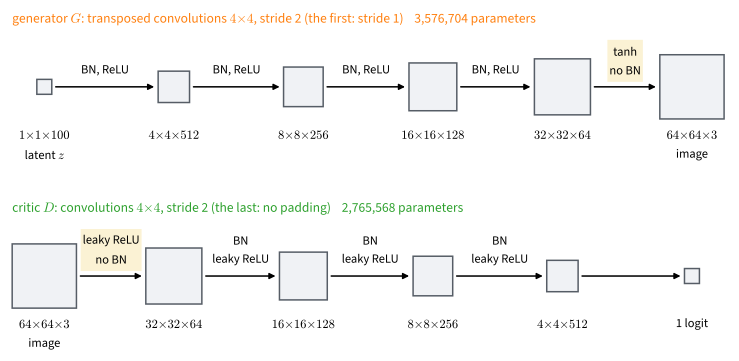

# Adversarial Image Generation
:label:`sec_dcgan`

The multilayer perceptron of :numref:`sec_basic_gan` learned to draw Fashion-MNIST garments in a few minutes. Its tops and shoes were recognizable but grainy, which is no surprise: the network knows nothing of which pixels are neighbors. A color image of $64 \times 64$ pixels has $12{,}288$ values, all of which the generator must produce from about a hundred random numbers. Two questions follow. Which networks can play the game at this size? And once two generators both draw plausible pictures, which one is better? A grid of samples shows a collapse at a glance, but between two good generators the eye gives an opinion, not a number.

Convolutional networks answered the first question. In 2015 a convolutional generator trained on photographs of bedrooms produced bedrooms that no camera had taken :cite:`Radford.Metz.Chintala.2015`, and within a few years generated faces were hard to tell from photographs. Diffusion models now draw most images, but the adversarial loss survives as a term in one-step generators (:numref:`sec_gan_beyond`), which are built and judged with the networks and scores of this section.

We work with about 40,000 small game sprites. We build the 2015 network, then a plain network without its batch normalization and its other devices, and train the plain network three times, changing one ingredient at a time, to see whether the gradient penalties of :numref:`sec_gan_convergence` make the devices unnecessary. Then we turn the second question into numbers: two distances the chapter already knows, computed in the features of an image classifier, and a pair of scores that say separately whether the samples look like real images and whether they cover all of them. The section ends with two questions about memory: does the generator draw sensible images between its samples, and does the critic remember its training images? The notebook needs a GPU, on which it runs in under half an hour.

```{.python .input #dcgan-setup}
%%tab jax
# Deterministic GPU kernels; JAX reads XLA_FLAGS once, before the imports
import os
os.environ['XLA_FLAGS'] = (os.environ.get('XLA_FLAGS', '') +
                           ' --xla_gpu_deterministic_ops=true').strip()
```

```{.python .input #dcgan-adversarial-image-generation}
%%tab pytorch
import math
import numpy as np
import torch
from torch import nn
from torch.nn import functional as F
from d2l import torch as d2l
```

```{.python .input #dcgan-adversarial-image-generation}
%%tab jax
import math
import numpy as np
import jax
from jax import numpy as jnp
from flax import nnx
import optax
from d2l import jax as d2l
```

```{.python .input #dcgan-adversarial-image-generation-1}
%%tab pytorch
import torchvision
```

## The 2015 Recipe

The deep convolutional GAN (DCGAN) of :citet:`Radford.Metz.Chintala.2015` kept the original objective and changed the networks. Its generator grows an image with transposed convolutions; its discriminator, the network this chapter calls the critic, shrinks one with strided convolutions. Batch normalization keeps the activations of both networks in range. The generator uses ReLU and ends in a tanh, which matches its range to images scaled to $[-1, 1]$. The critic uses the leaky ReLU, which passes $0.2x$ for negative $x$, so that no unit stops passing gradient to the generator. The weights start small, drawn from $\mathcal{N}(0, 0.02^2)$, and Adam runs with $\beta_1 = 0.5$ instead of the usual 0.9, which shortens its memory of a gradient field that changes whenever the other player moves. None of these devices is deep. Together, Radford et al. reported, they made deep convolutional GANs stable to train in most settings, and most image GANs of the next few years started from them.

### The Sprite Dataset

The dataset contains 40,597 sprite images of 721 Pokemon species, with many variants of each, obtained from [pokemondb](https://pokemondb.net/sprites). Sprites are small, centered on white backgrounds, and diverse in silhouette and palette. We resize each image to $64 \times 64$ and scale its pixel values to $[-1, 1]$. The whole dataset fits in memory, so `load_pokemon` decodes it once into one array.

```{.python .input #dcgan-the-pokemon-sprites-1}
%%tab pytorch
#@save
d2l.DATA_HUB['pokemon'] = (d2l.DATA_URL + 'pokemon.zip',
                           'c065c0e2593b8b161a2d7873e42418bf6a21106c')

#@save
def load_pokemon(resolution=64):
    """All Pokemon sprites as one (n, 3, h, w) tensor in [-1, 1]."""
    import warnings
    transform = torchvision.transforms.Compose([
        torchvision.transforms.Resize((resolution, resolution)),
        torchvision.transforms.PILToTensor()])
    dataset = torchvision.datasets.ImageFolder(
        d2l.download_extract('pokemon'), transform=transform)
    loader = torch.utils.data.DataLoader(
        dataset, batch_size=512, num_workers=d2l.get_dataloader_workers())
    with warnings.catch_warnings():  # palette sprites with transparency
        warnings.filterwarnings('ignore', message='Palette images')
        return torch.cat([X for X, _ in loader]).float() / 127.5 - 1

images = load_pokemon()
images.shape
```

```{.python .input #dcgan-the-pokemon-sprites-1}
%%tab jax
#@save
d2l.DATA_HUB['pokemon'] = (d2l.DATA_URL + 'pokemon.zip',
                           'c065c0e2593b8b161a2d7873e42418bf6a21106c')

#@save
def load_pokemon(resolution=64):
    """All Pokemon sprites as one (n, h, w, 3) array in [-1, 1]."""
    import warnings
    from PIL import Image
    data_dir = d2l.download_extract('pokemon')
    files = sorted(os.path.join(root, f)
                   for root, _, names in os.walk(data_dir) for f in names
                   if f.lower().endswith(('.png', '.jpg', '.jpeg')))
    def load(path):
        img = Image.open(path).convert('RGB')
        return np.asarray(img.resize((resolution, resolution), Image.BILINEAR),
                          dtype=np.float32)
    with warnings.catch_warnings():  # palette sprites with transparency
        warnings.filterwarnings('ignore', message='Palette images')
        return np.stack([load(f) for f in files]) / 127.5 - 1

images = load_pokemon()
images.shape
```

A fixed permutation sets aside one tenth of the images, which are never used for training. They are the real sample against which generated images are scored, and they show whether the critic scores its training images higher than unseen ones. The split is by image, not by species, so variants of one species can fall on both sides, and a generator that copies a training sprite may land close to a held-out variant of it.

```{.python .input #dcgan-the-pokemon-sprites-2}
%%tab pytorch
device = d2l.try_gpu()
perm = np.random.default_rng(12345).permutation(len(images))
n_holdout = len(images) // 10
train_imgs = images[perm[n_holdout:]].to(device)
holdout_imgs = images[perm[:n_holdout]].to(device)
print(f'{len(train_imgs)} training and {len(holdout_imgs)} held-out images')
d2l.show_images(train_imgs[:20].cpu().permute(0, 2, 3, 1) / 2 + 0.5,
                num_rows=4, num_cols=5);
```

```{.python .input #dcgan-the-pokemon-sprites-2}
%%tab jax
perm = np.random.default_rng(12345).permutation(len(images))
n_holdout = len(images) // 10
train_imgs = jnp.asarray(images[perm[n_holdout:]])
holdout_imgs = jnp.asarray(images[perm[:n_holdout]])
print(f'{len(train_imgs)} training and {len(holdout_imgs)} held-out images')
d2l.show_images(np.asarray(train_imgs[:20]) / 2 + 0.5,
                num_rows=4, num_cols=5);
```

### Transposed Convolutions and Batch Normalization

The generator must grow a $1 \times 1$ input with 100 channels into a $64 \times 64$ image. A *transposed convolution* grows a feature map by running a convolution's arithmetic backwards. Each input pixel stamps a copy of the kernel, scaled by the pixel's value, onto the output; successive stamps start one stride apart, and where they overlap their values add. In one dimension, the input $(1, 2)$ and a kernel of four ones with stride 2 give the stamps $(1, 1, 1, 1)$ and $(2, 2, 2, 2)$, two positions apart, so the output is $(1, 1, 3, 3, 2, 2)$. If $\textrm{pad}$ rows and columns are trimmed from each border, an $n \times n$ input gives an output of side

$$\textrm{stride} \cdot (n - 1) + \textrm{kernel} - 2 \cdot \textrm{pad}.$$

With kernel 4, stride 2, and padding 1 the side is $2n$, so each such layer doubles the resolution; with stride 1 and no padding the same kernel turns a $1 \times 1$ input into a $4 \times 4$ map. A strided convolution with the same settings halves the side. :numref:`sec_transposed_conv` treats the operation at length.

The DCGAN generator chains five transposed convolutions through the resolutions $1 \to 4 \to 8 \to 16 \to 32 \to 64$, halving the number of channels at each doubling until the last layer, which outputs the three color channels. The critic mirrors it with strided convolutions down to $4 \times 4$ and a last $4 \times 4$ convolution that returns one logit (:numref:`fig_gan_dcgan`). Each block is a convolution, batch normalization, and an activation. Batch normalization keeps the scale of the activations in range while the weights change; following Radford et al., we leave it out of the critic's input block and the generator's output layer.

![The DCGAN architecture :cite:`Radford.Metz.Chintala.2015`, at half the paper's width (512 channels at $4 \times 4$ instead of 1,024) and with $4 \times 4$ kernels where the authors' code used $5 \times 5$. The generator maps a 100-dimensional latent vector through transposed $4 \times 4$ convolutions to feature maps of side $4, 8, 16, 32$ and a $64 \times 64$ RGB image. The critic reverses the schedule with strided $4 \times 4$ convolutions down to one logit. Every block uses batch normalization except the two shaded ones: the generator's output layer (tanh) and the critic's input block (leaky ReLU).](../img/mdl-gan-dcgan.svg)
:label:`fig_gan_dcgan`

```{.python .input #dcgan-generator-1}
%%tab pytorch
def G_block(c_in, c_out, stride=2, padding=1):
    """Transposed convolution (kernel 4), batch norm, ReLU."""
    return nn.Sequential(
        nn.ConvTranspose2d(c_in, c_out, 4, stride, padding, bias=False),
        nn.BatchNorm2d(c_out), nn.ReLU())

def D_block(c_in, c_out, norm=True):
    """Strided convolution (kernel 4), batch norm, leaky ReLU."""
    return nn.Sequential(
        nn.Conv2d(c_in, c_out, 4, 2, 1, bias=False),
        nn.BatchNorm2d(c_out) if norm else nn.Identity(), nn.LeakyReLU(0.2))
```

```{.python .input #dcgan-generator-1}
%%tab jax
conv_init = nnx.initializers.normal(0.02)  # DCGAN: kernels from N(0, 0.02^2)

def bn_scale_init(key, shape, dtype=jnp.float32):
    return 1 + 0.02 * jax.random.normal(key, shape, dtype)  # N(1, 0.02^2)

def batch_norm(c, rngs):
    # Running averages decay 0.9; the variance is computed in two passes
    return nnx.BatchNorm(c, momentum=0.9, use_fast_variance=False,
                         scale_init=bn_scale_init, rngs=rngs)

def G_block(c_in, c_out, rngs, stride=2, padding='SAME'):
    """Transposed convolution (kernel 4), batch norm, ReLU."""
    return nnx.Sequential(
        nnx.ConvTranspose(c_in, c_out, (4, 4), strides=(stride, stride),
                          padding=padding, use_bias=False,
                          kernel_init=conv_init, rngs=rngs),
        batch_norm(c_out, rngs), nnx.relu)

def D_block(c_in, c_out, rngs, norm=True):
    """Strided convolution (kernel 4), batch norm, leaky ReLU."""
    return nnx.Sequential(
        nnx.Conv(c_in, c_out, (4, 4), strides=(2, 2), padding='SAME',
                 use_bias=False, kernel_init=conv_init, rngs=rngs),
        batch_norm(c_out, rngs) if norm else (lambda x: x),
        lambda x: nnx.leaky_relu(x, 0.2))
```

```{.python .input #dcgan-generator-3}
%%tab pytorch
torch.manual_seed(0)
net_G = nn.Sequential(                                   # (100,)
    nn.Unflatten(1, (100, 1, 1)),                        # (100, 1, 1)
    G_block(100, 512, stride=1, padding=0),              # (512, 4, 4)
    G_block(512, 256), G_block(256, 128), G_block(128, 64),  # (64, 32, 32)
    nn.ConvTranspose2d(64, 3, 4, 2, 1, bias=False), nn.Tanh()).to(device)
net_D = nn.Sequential(                                   # (3, 64, 64)
    D_block(3, 64, norm=False),                          # (64, 32, 32)
    D_block(64, 128), D_block(128, 256), D_block(256, 512),  # (512, 4, 4)
    nn.Conv2d(512, 1, 4, bias=False)).to(device)         # (1, 1, 1)
X = net_G(torch.zeros(2, 100, device=device))
print(X.shape, net_D(X).shape)
```

```{.python .input #dcgan-generator-3}
%%tab jax
rngs = nnx.Rngs(0)
net_G = nnx.Sequential(                                  # (100,)
    lambda z: z.reshape(-1, 1, 1, 100),                  # (1, 1, 100)
    G_block(100, 512, rngs, stride=1, padding='VALID'),  # (4, 4, 512)
    G_block(512, 256, rngs), G_block(256, 128, rngs),
    G_block(128, 64, rngs),                              # (32, 32, 64)
    nnx.ConvTranspose(64, 3, (4, 4), strides=(2, 2), padding='SAME',
                      use_bias=False, kernel_init=conv_init, rngs=rngs),
    nnx.tanh)                                            # (64, 64, 3)
net_D = nnx.Sequential(                                  # (64, 64, 3)
    D_block(3, 64, rngs, norm=False),                    # (32, 32, 64)
    D_block(64, 128, rngs), D_block(128, 256, rngs),
    D_block(256, 512, rngs),                             # (4, 4, 512)
    nnx.Conv(512, 1, (4, 4), padding='VALID', use_bias=False,
             kernel_init=conv_init, rngs=rngs))          # (1, 1, 1)
X = net_G(jnp.zeros((2, 100)))
print(X.shape, net_D(X).shape)
```

### Training with the Classic Loss

The loop `d2l.train_gan` of :numref:`sec_basic_gan`, which alternates a logistic-regression step of the critic with a non-saturating step of the generator, applies to images unchanged. We use the DCGAN settings with a larger minibatch, 256 images instead of the paper's 128: learning rate $2 \cdot 10^{-4}$, $\beta_1 = 0.5$, and convolution kernels drawn from $\mathcal{N}(0, 0.02^2)$. Batch-normalization scales start from $\mathcal{N}(1, 0.02^2)$ and offsets at zero, as in the authors' released code.

```{.python .input #dcgan-training-with-the-classic-loss-1}
%%tab pytorch
def dcgan_init(module):
    if isinstance(module, (nn.Conv2d, nn.ConvTranspose2d)):
        nn.init.normal_(module.weight, 0, 0.02)
    elif isinstance(module, nn.BatchNorm2d):
        nn.init.normal_(module.weight, 1, 0.02)
        nn.init.zeros_(module.bias)

for net in (net_D, net_G):
    net.apply(dcgan_init)
dataset = torch.utils.data.TensorDataset(train_imgs)
# Sample whole minibatches of indices, so that the GPU tensor is indexed
# once per minibatch rather than once per image
sampler = torch.utils.data.BatchSampler(
    torch.utils.data.RandomSampler(dataset), 256, drop_last=True)
data_iter = torch.utils.data.DataLoader(dataset, sampler=sampler,
                                        batch_size=None)
```

```{.python .input #dcgan-training-with-the-classic-loss-1}
%%tab jax
# The training images from the host array: the loader keeps them there
data_iter = d2l.ArrayLoader((images[perm[n_holdout:]],), 256, shuffle=True,
                            drop_last=True, key=jax.random.key(3))
```

We sample from an average of the generator's recent weights rather than from its last ones. `EMA` keeps an exponential moving average of the parameters, updated after every step as

$$\bar\theta \leftarrow \beta\, \bar\theta + (1 - \beta)\, \theta, \qquad \beta = 2^{-1/n_{1/2}},$$

so that the weight of a past step halves every $n_{1/2}$ steps, the *half-life*. The iterates of the game rotate around the equilibrium (:numref:`sec_gan_convergence`), so their average sits closer to it than they do. Batch-normalization statistics are not parameters, and the average copies them from the live network. The copies belong to the live weights, not to the averaged ones, so after training we re-estimate them.

```{.python .input #dcgan-training-with-the-classic-loss-4}
%%tab pytorch
#@save
class EMA:
    """Exponential moving average of a model's parameters, given as a
    half-life in steps. Buffers such as batch-norm statistics are copied;
    the average is kept in evaluation mode."""
    def __init__(self, model, half_life):
        import copy  # the d2l library preamble does not import it
        self.model = copy.deepcopy(model).requires_grad_(False).eval()
        self.decay = 0.5 ** (1 / half_life)

    def update(self, model):
        with torch.no_grad():
            for avg, p in zip(self.model.parameters(), model.parameters()):
                avg.lerp_(p, 1 - self.decay)
            for avg, b in zip(self.model.buffers(), model.buffers()):
                avg.copy_(b)
```

```{.python .input #dcgan-training-with-the-classic-loss-4}
%%tab jax
#@save
class EMA:
    """Exponential moving average of a model's parameters, given as a
    half-life in steps. Other state such as batch-norm statistics is copied;
    the average is kept in evaluation mode."""
    def __init__(self, model, half_life):
        self.model = nnx.clone(model)
        self.model.eval()
        self.decay = 0.5 ** (1 / half_life)

    def update(self, model):
        self.average(self.model, model, self.decay)

    @staticmethod
    @nnx.jit
    def average(avg, model, decay):
        """Move the parameters of avg toward those of model, in place."""
        params = jax.tree.map(lambda a, p: decay * a + (1 - decay) * p,
                              nnx.state(avg, nnx.Param),
                              nnx.state(model, nnx.Param))
        nnx.update(avg, params, nnx.state(model, nnx.Not(nnx.Param)))
```

The later runs of this section average over 32,000 images, a half-life of 500 steps at batch size 64. At batch size 256 the same 32,000 images take 125 steps, under a twentieth of this run's 2,840 steps (20 epochs of 142).

The printed critic loss is the sum of the two batch means of :numref:`sec_basic_gan`, which equals $2 \log 2 \approx 1.39$ at the equilibrium; the generator's loss would equal $\log 2 \approx 0.69$ there.

```{.python .input #dcgan-training-with-the-classic-loss-2}
%%tab pytorch
ema = EMA(net_G, half_life=125)  # 32,000 images, as in the later runs
history = d2l.train_gan(net_D, net_G, data_iter, num_epochs=20,
                        latent_dim=100, lr_D=0.0002, lr_G=0.0002, seed=1,
                        ema=ema)
loss_D, loss_G = history[-1]
print(f'last epoch: loss_D {loss_D:.3f}, loss_G {loss_G:.3f}')
```

```{.python .input #dcgan-training-with-the-classic-loss-2}
%%tab jax
ema = EMA(net_G, half_life=125)  # 32,000 images, as in the later runs
history = d2l.train_gan(net_D, net_G, data_iter, num_epochs=20,
                        latent_dim=100, lr_D=0.0002, lr_G=0.0002, seed=1,
                        ema=ema)
loss_D, loss_G = history[-1]
print(f'last epoch: loss_D {loss_D:.3f}, loss_G {loss_G:.3f}')
```

The next cell re-estimates the batch-normalization statistics of the average by running the averaged generator in training mode on 100 fresh batches of latent codes. The running averages forget at rate 0.1 per batch, so the copied values keep a weight of $0.9^{100} \approx 3 \cdot 10^{-5}$, which is to say none.

```{.python .input #dcgan-training-with-the-classic-loss-5}
%%tab pytorch
ema.model.train()  # batch-norm statistics for the averaged weights
with torch.no_grad():  # 100 batches; running averages forget at rate 0.1
    for _ in range(100):
        ema.model(torch.randn(256, 100, device=device))
ema.model.eval();
```

```{.python .input #dcgan-training-with-the-classic-loss-5}
%%tab jax
ema.model.train()  # batch-norm statistics for the averaged weights
# 100 batches; running averages forget at rate 0.1
for key in jax.random.split(jax.random.key(4), 100):
    ema.model(jax.random.normal(key, (256, 100)))
ema.model.eval()
```

We sample in evaluation mode, so that each image depends only on its own latent code.

```{.python .input #dcgan-training-with-the-classic-loss-3}
%%tab pytorch
with torch.no_grad():
    fake = ema.model(torch.randn(20, 100, device=device))
d2l.show_images(fake.cpu().permute(0, 2, 3, 1) / 2 + 0.5,
                num_rows=4, num_cols=5);
```

```{.python .input #dcgan-training-with-the-classic-loss-3}
%%tab jax
fake = ema.model(jax.random.normal(jax.random.key(2), (20, 100)))
d2l.show_images(np.asarray(fake) / 2 + 0.5, num_rows=4, num_cols=5);
```

The samples are diverse but crude: large, creature-like shapes on mostly white backgrounds, often filling the frame, with plausible palettes and blotchy, smeared textures. As in the garment run, the game is unbalanced, and here it is further from equilibrium: the critic's loss is far below $2 \log 2$ and the generator's is several times $\log 2$. Yet the generator does not collapse onto one output.

This run alone cannot say what keeps the game trainable. The plain network below trains the same loss and collapses, but it differs from DCGAN in almost everything at once: normalization, initialization, resampling, activations and the output tanh, the input stage, Adam's $\beta_1$ and $\beta_2$, batch size, width and flips. DCGAN's authors found batch normalization critical, since without it their deep generators collapsed all samples to a single point; Exercise :exref:`ex_dcgan-rerun-arm-classic-loss` tests the initialization.

## A Backbone without Normalization

### R3GAN's Minimal Baseline
:label:`subsec_gan_r3gan_principles`

For several years after DCGAN, most progress on image GANs came from architectural devices, each added to repair one failure of training. StyleGAN2 :cite:`Karras.Laine.Aittala.ea.2020`, the strongest face generator of 2020, carried ten of them. R3GAN :cite:`Huang.Gokaslan.Kuleshov.ea.2024` asked whether a well-behaved loss makes them unnecessary. It stripped all ten from StyleGAN2 and then rebuilt the network with the pairing loss, both penalties and modern convolutional blocks; at StyleGAN2's size the result scored slightly better on faces. The stripped network, before the rebuild, still differs from DCGAN in six ways:

- (a) a convergent objective, in the stripped network the classic loss with $R_1$;
- (b) a small learning rate and Adam with $\beta_1 = 0$;
- (c) no normalization layers;
- (d) bilinear resampling instead of strided or transposed convolutions;
- (e) leaky ReLU in both networks and no tanh at the output;
- (f) a $4 \times 4$ constant input, output skips, and a residual critic.

Violating (a), (b), or (c) often made training fail; violating (d) or (e) lowered quality. We ask a narrower question, one a notebook can answer: does a network with none of DCGAN's devices train at all once the loss is penalized?

### The Backbone

We build a small network that follows (c) to (e), takes Adam with $\beta_1 = 0$ from (b) but keeps DCGAN's learning rate, and takes the constant input of (f), without output skips or residual blocks (:numref:`fig_gan_backbone`). The generator upsamples bilinearly before each ordinary $3 \times 3$ convolution, and the critic downsamples bilinearly after each. This avoids the uneven overlap of transposed-convolution stamps that produces checkerboard artifacts :cite:`Odena.Dumoulin.Olah.2016`. Neither network uses normalization. Batch normalization would make each critic score depend on the whole minibatch and couple the per-sample input gradients that the penalties measure.

![The minimal backbone of the three arms, with the parameter count of each layer. The generator concatenates a learned $4 \times 4 \times 128$ constant with a linear projection of $z$ to $4 \times 4 \times 100$, mixes them with a convolution, and doubles the resolution four times by bilinear upsampling, a $3 \times 3$ convolution and a leaky ReLU. A last convolution produces the image, with no tanh. The critic mirrors it with bilinear downsampling, and a linear head gives one logit. Neither network uses normalization.](../img/mdl-gan-backbone.svg)
:label:`fig_gan_backbone`

The input stage is our own simple choice, not R3GAN's: the learned constant gives every sample the same starting map, in the spirit of StyleGAN2's constant input, and the projected code beside it makes each sample different. We have not tested whether the constant matters. The label arguments of the saved classes and of the training loop serve :numref:`sec_gan_conditional`; we ignore them here.

Without normalization layers nothing rescales the activations, so the initialization has to keep their scale. We draw every weight with variance $2 / ((1 + 0.2^2)\, n_{\mathrm{in}})$ for a layer with $n_{\mathrm{in}}$ inputs. This is the fan-in rule of :citet:`He.Zhang.Ren.ea.2015` with the gain of a leaky ReLU of slope 0.2, and it keeps the variance of the activations roughly constant from layer to layer.

```{.python .input #dcgan-a-modern-minimal-backbone-1}
%%tab pytorch
#@save
def fan_in_init(module):
    """Fan-in normal weights with the leaky-ReLU gain, zero offsets."""
    if isinstance(module, (nn.Conv2d, nn.Linear)):
        nn.init.kaiming_normal_(module.weight, a=0.2)
        nn.init.zeros_(module.bias)

#@save
class Generator(nn.Module):
    """Learned 4x4 constant + projected latent (+ extra 4x4 input maps),
    bilinearly upsampled to resolution x resolution; no normalization."""
    def __init__(self, latent_dim, resolution, base_ch, *, extra_ch=0,
                 const_ch=128):
        super().__init__()
        self.latent_dim = latent_dim
        self.const = nn.Parameter(torch.randn(1, const_ch, 4, 4))
        self.z_proj = nn.Linear(latent_dim, 16 * latent_dim)
        self.mix = nn.Conv2d(const_ch + latent_dim + extra_ch, base_ch, 3,
                             padding=1)
        num_stages = int(np.log2(resolution / 4))       # 64: four doublings
        chans = [base_ch // 2 ** i for i in range(num_stages + 1)]
        self.stages = nn.ModuleList(
            [nn.Conv2d(c_in, c_out, 3, padding=1)
             for c_in, c_out in zip(chans[:-1], chans[1:])])
        self.to_rgb = nn.Conv2d(chans[-1], 3, 3, padding=1)
        self.act = nn.LeakyReLU(0.2)
        self.apply(fan_in_init)

    def forward(self, z, extra=None):
        zc = self.z_proj(z).reshape(-1, self.latent_dim, 4, 4)
        const = self.const.expand(z.shape[0], -1, -1, -1)
        maps = [const, zc] + ([] if extra is None else [extra])
        x = self.act(self.mix(torch.cat(maps, dim=1)))
        for conv in self.stages:                     # 4 -> 8 -> ... -> 64
            x = F.interpolate(x, scale_factor=2, mode='bilinear')
            x = self.act(conv(x))
        return self.to_rgb(x)                        # no tanh: raw output
```

```{.python .input #dcgan-a-modern-minimal-backbone-1}
%%tab jax
#@save
# Fan-in initialization with the leaky-ReLU gain (normal, not truncated)
fan_in_init = nnx.initializers.variance_scaling(2 / (1 + 0.2 ** 2),
                                                'fan_in', 'normal')

#@save
class Generator(nnx.Module):
    """Learned 4x4 constant + projected latent (+ extra 4x4 input maps),
    bilinearly upsampled to resolution x resolution; no normalization."""
    def __init__(self, latent_dim, resolution, base_ch, *, extra_ch=0,
                 const_ch=128, rngs):
        self.latent_dim = latent_dim
        self.const = nnx.Param(
            jax.random.normal(rngs.params(), (1, 4, 4, const_ch)))
        self.z_proj = nnx.Linear(latent_dim, 16 * latent_dim,
                                 kernel_init=fan_in_init, rngs=rngs)
        self.mix = nnx.Conv(const_ch + latent_dim + extra_ch, base_ch,
                            (3, 3), padding='SAME', kernel_init=fan_in_init,
                            rngs=rngs)
        num_stages = int(np.log2(resolution / 4))       # 64: four doublings
        chans = [base_ch // 2 ** i for i in range(num_stages + 1)]
        self.stages = nnx.List(
            [nnx.Conv(c_in, c_out, (3, 3), padding='SAME',
                      kernel_init=fan_in_init, rngs=rngs)
             for c_in, c_out in zip(chans[:-1], chans[1:])])
        self.to_rgb = nnx.Conv(chans[-1], 3, (3, 3), padding='SAME',
                               kernel_init=fan_in_init, rngs=rngs)

    def __call__(self, z, extra=None):
        zc = self.z_proj(z).reshape(-1, 4, 4, self.latent_dim)
        const = jnp.broadcast_to(self.const[...],
                                 (z.shape[0],) + self.const.shape[1:])
        maps = [const, zc] + ([] if extra is None else [extra])
        x = nnx.leaky_relu(self.mix(jnp.concatenate(maps, axis=-1)), 0.2)
        for conv in self.stages:                     # 4 -> 8 -> ... -> 64
            b, h, w, c = x.shape
            x = jax.image.resize(x, (b, 2 * h, 2 * w, c), method='bilinear')
            x = nnx.leaky_relu(conv(x), 0.2)
        return self.to_rgb(x)                        # no tanh: raw output
```

The critic mirrors the generator. Four stages of convolution, leaky ReLU, and bilinear downsampling take a $64 \times 64$ image to $4 \times 4$, and a mixing convolution and a linear head return one score.

```{.python .input #dcgan-a-modern-minimal-backbone-2}
%%tab pytorch
#@save
class Discriminator(nn.Module):
    """Critic that mirrors the generator: conv + leaky ReLU + bilinear
    downsampling to a 4x4 feature map phi(x), then a linear head on the
    flattened map."""
    def __init__(self, resolution, base_ch):
        super().__init__()
        num_stages = int(np.log2(resolution / 4))
        chans = [3] + [base_ch * 2 ** i for i in range(num_stages)]
        self.stages = nn.ModuleList(
            [nn.Conv2d(c_in, c_out, 3, padding=1)
             for c_in, c_out in zip(chans[:-1], chans[1:])])
        self.mix = nn.Conv2d(chans[-1], 2 * chans[-1], 3, padding=1)
        self.head = nn.Linear(2 * chans[-1] * 4 * 4, 1)
        self.act = nn.LeakyReLU(0.2)
        self.apply(fan_in_init)

    def phi(self, x):
        for conv in self.stages:                     # 64 -> 32 -> ... -> 4
            x = F.interpolate(self.act(conv(x)), scale_factor=0.5,
                              mode='bilinear', antialias=True)
        return self.act(self.mix(x))

    def forward(self, x):
        return self.head(self.phi(x).flatten(1))

for net in (Generator(latent_dim=100, resolution=64, base_ch=512),
            Discriminator(resolution=64, base_ch=32)):
    print(f'{type(net).__name__}: {d2l.num_params(net)} parameters')
```

```{.python .input #dcgan-a-modern-minimal-backbone-2}
%%tab jax
#@save
class Discriminator(nnx.Module):
    """Critic that mirrors the generator: conv + leaky ReLU + bilinear
    downsampling to a 4x4 feature map phi(x), then a linear head on the
    flattened map."""
    def __init__(self, resolution, base_ch, *, rngs):
        num_stages = int(np.log2(resolution / 4))
        chans = [3] + [base_ch * 2 ** i for i in range(num_stages)]
        self.stages = nnx.List(
            [nnx.Conv(c_in, c_out, (3, 3), padding='SAME',
                      kernel_init=fan_in_init, rngs=rngs)
             for c_in, c_out in zip(chans[:-1], chans[1:])])
        self.mix = nnx.Conv(chans[-1], 2 * chans[-1], (3, 3),
                            padding='SAME', kernel_init=fan_in_init,
                            rngs=rngs)
        self.head = nnx.Linear(2 * chans[-1] * 4 * 4, 1,
                               kernel_init=fan_in_init, rngs=rngs)

    def phi(self, x):
        for conv in self.stages:                     # 64 -> 32 -> ... -> 4
            x = nnx.leaky_relu(conv(x), 0.2)
            b, h, w, c = x.shape
            x = jax.image.resize(x, (b, h // 2, w // 2, c),
                                 method='bilinear')
        return nnx.leaky_relu(self.mix(x), 0.2)

    def __call__(self, x):
        return self.head(self.phi(x).reshape(x.shape[0], -1))

for net in (Generator(100, 64, 512, rngs=nnx.Rngs(0)),
            Discriminator(64, 32, rngs=nnx.Rngs(0))):
    print(f'{type(net).__name__}: {d2l.num_params(net)} parameters')
```

Counted by `d2l.num_params` of :numref:`sec_efficient_cnns`, the generator has about 2.8 million parameters and the critic about 1.6 million, somewhat fewer than the DCGAN pair of :numref:`fig_gan_dcgan`.

## A Controlled Loss Comparison

### Three Arms

We train the backbone three times from the same initialization, with Adam at $\beta_1 = 0$, $\beta_2 = 0.99$, and learning rate $2 \cdot 10^{-4}$, batch size 64, flips, and the moving average. Only the objective changes: the critic's loss and penalty, and with them the generator's loss. Writing $x$ for a real image and $x'$ for a generated one, each critic minimizes

$$L(D) + \frac{\gamma}{2}\Big(\mathbb{E}_x\big[\|\nabla_x D(x)\|^2\big] + \mathbb{E}_{x'}\big[\|\nabla_{x'} D(x')\|^2\big]\Big),$$

where $L$ is one of two losses, the classic logistic loss of :numref:`sec_basic_gan` (`d2l.gan_loss_D`) or the pairing loss of :numref:`sec_gan_relativistic` (`d2l.rpgan_loss_D`):

$$L_{\textrm{classic}}(D) = \mathbb{E}_{x}\big[\log(1 + e^{-D(x)})\big] + \mathbb{E}_{x'}\big[\log(1 + e^{D(x')})\big], \qquad L_{\textrm{pair}}(D) = \mathbb{E}_{x, x'}\big[\log(1 + e^{D(x') - D(x)})\big].$$

The penalty terms $R_1$ and $R_2$ of :numref:`sec_gan_convergence` flatten the critic at the real and at the generated images. Each generator uses the non-saturating loss that matches its critic. At $q = p$ the best critic is constant, and the two losses equal $2 \log 2 \approx 1.39$ and $\log 2 \approx 0.69$.

| arm | critic loss | penalty | steps |
|:--|:--|:--|--:|
| NS | classic | none | 6,000 |
| NS + $R_1$ + $R_2$ | classic | $\gamma = 10$ | 12,000 |
| RpGAN + $R_1$ + $R_2$ | pairing | $\gamma = 10$ | 12,000 |

The first two arms isolate the penalty, apart from the budget, and the last two isolate pairing. The unpenalized arm gets half the steps, because its samples have collapsed by then, as the grids below show.

The weight $\gamma = 10$ is a safe choice here because $\gamma$ is a squared length. The penalty smooths the critic over distances below about $2\sqrt\gamma$ (:numref:`sec_gan_convergence`), about 6 units here. On the grid of 25 Gaussians of :numref:`subsec_gan_25_gaussians`, with modes 2 units apart, that spans neighboring modes. Two sprites that differ by 0.5 in each of their 12,288 values lie $0.5\sqrt{12{,}288} \approx 55$ units apart, and even sprites with a shared white background lie tens of units apart, so here $\gamma = 10$ smooths only over small changes of one image. This does not mean that the penalty does little. Its job on images is not to blur one sprite into another but to keep the critic flat at the samples themselves, which damps the rotation of the game; the first panel of the training traces below measures that flatness. A value tuned on one dataset does not transfer to another (Exercise :exref:`ex_dcgan-penalty-weight-resolution`).

The cells from here to the printed losses only wire known parts together, and a reader may skim them. Two saved helpers come first. `sample_real` draws a training batch with random horizontal flips, which makes the real images harder for the critic to memorize. `pair_stats` reports, for aligned (real, generated) pairs, the fraction that the critic orders correctly and the mean rank weight of :numref:`sec_gan_relativistic`; both are read in the training traces below.

```{.python .input #dcgan-a-modern-minimal-backbone-3}
%%tab pytorch
#@save
def sample_real(images, n, labels=None):
    """Draw a training batch with random horizontal flips; return it with
    its labels (None without labels)."""
    idx = torch.randint(0, len(images), (n,), device=images.device)
    batch = images[idx]
    flip = torch.rand(n, device=images.device) < 0.5
    batch = torch.where(flip.view(-1, 1, 1, 1), batch.flip(-1), batch)
    return batch, (None if labels is None else labels[idx])

#@save
def pair_stats(net_D, real, fake, y=None):
    """Ranking accuracy P(D(x) > D(x')) and mean rank weight
    E[sigma(D(x') - D(x))] over aligned (real, generated) pairs; given
    labels y, the critic is D(., y)."""
    critic = net_D if y is None else lambda x: net_D(x, y)
    with torch.no_grad():
        diff = critic(fake) - critic(real)
    return float((diff < 0).float().mean()), float(torch.sigmoid(diff).mean())
```

```{.python .input #dcgan-a-modern-minimal-backbone-3}
%%tab jax
#@save
def sample_real(key, images, n, labels=None):
    """Draw a training batch with random horizontal flips; return it with
    its labels (None without labels)."""
    k1, k2 = jax.random.split(key)
    idx = jax.random.randint(k1, (n,), 0, len(images))
    batch = images[idx]
    flip = jax.random.bernoulli(k2, 0.5, (n,))
    batch = jnp.where(flip[:, None, None, None], batch[:, :, ::-1, :], batch)
    return batch, (None if labels is None else labels[idx])

#@save
def pair_stats(net_D, real, fake, y=None):
    """Ranking accuracy P(D(x) > D(x')) and mean rank weight
    E[sigma(D(x') - D(x))] over aligned (real, generated) pairs; given
    labels y, the critic is D(., y)."""
    critic = net_D if y is None else lambda x: net_D(x, y)
    diff = critic(fake) - critic(real)
    return float((diff < 0).mean()), float(jax.nn.sigmoid(diff).mean())
```

The saved loop `train_r3gan` alternates `d2l.critic_step` and `d2l.generator_step` of :numref:`sec_gan_convergence` on flipped real batches and updates the average after every step. The critic step returns the batch means of $R_1$ and $R_2$, so the critic's steepness on real images, $\mathbb{E}_x\|\nabla_x D(x)\|^2$, is logged in every arm, at weight zero in the first. Every 250 steps the loop also applies `pair_stats` to 256 fresh pairs.

:begin_tab:`jax`
One compiled function, `r3gan_step`, takes both steps, so each training step is a single call.
:end_tab:

```{.python .input #dcgan-three-arms}
%%tab jax
#@save
@nnx.jit(static_argnums=(4, 5))
def r3gan_step(net_G, net_D, opt_G, opt_D, loss_D, loss_G, gamma,
               X, z, y, X2, z2, y2):
    """One critic step on X against G(z), one generator step on (X2, z2);
    generated images take the labels y, y2 (None: unconditional). Return
    the critic loss, R1, R2 and the generator loss."""
    fake = net_G(z) if y is None else net_G(z, y)
    loss_d, r1, r2 = d2l.critic_step(net_D, opt_D, loss_D, X, fake, gamma, y)
    loss_g = d2l.generator_step(net_G, opt_G, loss_G, net_D, X2, z2, y2)
    return loss_d, r1, r2, loss_g
```

```{.python .input #dcgan-loss-a-b-on-one-backbone-1}
%%tab pytorch
#@save
def train_r3gan(net_G, net_D, loss_D, loss_G, gamma, num_steps, images,
                labels=None, *, eval_images=None, eval_labels=None,
                eval_size=256, batch_size=64, lr=2e-4, half_life=500,
                log_every=250, seed=None):
    """Train with Adam (beta_1 = 0), alternating critic_step and
    generator_step on flipped real batches; a generated batch takes the
    labels of its real batch, if any. Every log_every steps, log the losses,
    R1, R2 and pair_stats on fresh pairs from eval_images (default: images).
    Return the EMA of the generator and the history, a dict of arrays."""
    if seed is not None:
        torch.manual_seed(seed)
    if eval_images is None:
        eval_images, eval_labels = images, labels
    opt_G, opt_D = [torch.optim.Adam(net.parameters(), lr, betas=(0.0, 0.99))
                    for net in (net_G, net_D)]
    noise = lambda n: torch.randn(n, net_G.latent_dim, device=images.device)
    generate = lambda z, y: net_G(z) if y is None else net_G(z, y)
    ema = EMA(net_G, half_life)
    history = {k: [] for k in ('step', 'loss_D', 'loss_G', 'R1', 'R2',
                               'accuracy', 'rank_weight')}
    for step in range(1, num_steps + 1):
        X, y = sample_real(images, batch_size, labels)
        with torch.no_grad():
            fake = generate(noise(batch_size), y)
        loss_d, r1, r2 = d2l.critic_step(net_D, opt_D, loss_D, X, fake,
                                         gamma, y)
        X, y = sample_real(images, batch_size, labels)
        loss_g = d2l.generator_step(net_G, opt_G, loss_G, net_D, X,
                                    noise(batch_size), y)
        ema.update(net_G)
        if step % log_every == 0:  # fresh pairs of real and generated images
            X, y = sample_real(eval_images, eval_size, eval_labels)
            with torch.no_grad():
                fake = generate(noise(eval_size), y)
            acc, weight = pair_stats(net_D, X, fake, y)
            logs = (step, loss_d, loss_g, r1, r2, acc, weight)
            for k, v in zip(history, logs):
                history[k].append(float(v))
    return ema.model, {k: np.array(v) for k, v in history.items()}
```

```{.python .input #dcgan-loss-a-b-on-one-backbone-1}
%%tab jax
#@save
def train_r3gan(net_G, net_D, loss_D, loss_G, gamma, num_steps, images,
                labels=None, *, eval_images=None, eval_labels=None,
                eval_size=256, batch_size=64, lr=2e-4, half_life=500,
                log_every=250, seed=None):
    """Train with Adam (beta_1 = 0), alternating critic_step and
    generator_step on flipped real batches; a generated batch takes the
    labels of its real batch, if any. Every log_every steps, log the losses,
    R1, R2 and pair_stats on fresh pairs from eval_images (default: images).
    Return the EMA of the generator and the history, a dict of arrays."""
    key = d2l.get_key() if seed is None else jax.random.key(seed)
    if eval_images is None:
        eval_images, eval_labels = images, labels
    opt_G, opt_D = [nnx.Optimizer(net, optax.adam(lr, b1=0.0, b2=0.99),
                                  wrt=nnx.Param) for net in (net_G, net_D)]
    noise = lambda key, n: jax.random.normal(key, (n, net_G.latent_dim))
    generate = lambda z, y: net_G(z) if y is None else net_G(z, y)
    ema = EMA(net_G, half_life)
    history = {k: [] for k in ('step', 'loss_D', 'loss_G', 'R1', 'R2',
                               'accuracy', 'rank_weight')}
    for step in range(1, num_steps + 1):
        key, kx, kz, kx2, kz2 = jax.random.split(key, 5)
        X, y = sample_real(kx, images, batch_size, labels)
        X2, y2 = sample_real(kx2, images, batch_size, labels)
        loss_d, r1, r2, loss_g = r3gan_step(
            net_G, net_D, opt_G, opt_D, loss_D, loss_G, gamma,
            X, noise(kz, batch_size), y, X2, noise(kz2, batch_size), y2)
        ema.update(net_G)
        if step % log_every == 0:  # fresh pairs of real and generated images
            key, kx, kz = jax.random.split(key, 3)
            X, y = sample_real(kx, eval_images, eval_size, eval_labels)
            fake = generate(noise(kz, eval_size), y)
            acc, weight = pair_stats(net_D, X, fake, y)
            logs = (step, loss_d, loss_g, r1, r2, acc, weight)
            for k, v in zip(history, logs):
                history[k].append(float(v))
    return ema.model, {k: np.array(v) for k, v in history.items()}
```

`train_arm` builds the two networks from the same seed in every arm, trains them, and returns the critic's train--holdout gap: the difference between its mean score on 1,024 training images and on 1,024 held-out images.

```{.python .input #dcgan-three-arms-1}
%%tab pytorch
def train_arm(loss_D, loss_G, gamma, num_steps):
    torch.manual_seed(0)  # the same initialization in every arm
    net_G = Generator(100, 64, 512).to(device)
    net_D = Discriminator(64, 32).to(device)
    ema_G, history = train_r3gan(net_G, net_D, loss_D, loss_G, gamma,
                                 num_steps, train_imgs, seed=1)
    with torch.no_grad():
        gap = (net_D(train_imgs[:1024]).mean()
               - net_D(holdout_imgs[:1024]).mean())
    return ema_G, history, float(gap)
```

```{.python .input #dcgan-three-arms-1}
%%tab jax
def train_arm(loss_D, loss_G, gamma, num_steps):
    rngs = nnx.Rngs(0)  # the same initialization in every arm
    net_G = Generator(100, 64, 512, rngs=rngs)
    net_D = Discriminator(64, 32, rngs=rngs)
    ema_G, history = train_r3gan(net_G, net_D, loss_D, loss_G, gamma,
                                 num_steps, train_imgs, seed=1)
    gap = (net_D(train_imgs[:1024]).mean()
           - net_D(holdout_imgs[:1024]).mean())
    return ema_G, history, float(gap)
```

A penalized step costs more than an unpenalized one, because the penalty differentiates the critic's input gradient a second time. After each run we print the critic's loss and penalty, averaged over the eight checks of the last 2,000 steps, and the train--holdout gap.

```{.python .input #dcgan-loss-a-b-on-one-backbone-2}
%%tab pytorch, jax
arms = {'NS': (d2l.gan_loss_D, d2l.gan_loss_G, 0, 6000),
        'NS + R1 + R2': (d2l.gan_loss_D, d2l.gan_loss_G, 10, 12000),
        'RpGAN + R1 + R2': (d2l.rpgan_loss_D, d2l.rpgan_loss_G, 10, 12000)}
runs = {}
for name, (loss_D, loss_G, gamma, num_steps) in arms.items():
    ema_G, hist, gap = train_arm(loss_D, loss_G, gamma, num_steps)
    runs[name] = (ema_G, hist)
    loss, r1, r2 = (hist[k][-2000 // 250:].mean()  # the last 2,000 steps
                    for k in ('loss_D', 'R1', 'R2'))
    print(f'{name:16s} critic loss {loss:.2f}, '
          f'penalty {gamma / 2 * (r1 + r2):.3f}, train-holdout gap {gap:+.2f}')
```

Both penalized critics sit below their equilibrium values, about 1.05 against $2 \log 2 \approx 1.39$ for the classic loss and about 0.5 against $\log 2 \approx 0.69$ for pairing: each stays somewhat ahead of its generator without running away. The penalty adds between 0.08 and 0.13 to these losses. The unpenalized critic's loss lies lower still, far below $2 \log 2$. We return to the train--holdout gaps at the end of the section.

### Training Traces

The losses do not say how the critic separates the two sets, but three logged statistics do. The first is the critic's steepness on real images, $\mathbb{E}_x\|\nabla_x D(x)\|^2$, which $R_1$ pushes down. The second is the ranking accuracy $\hat P(D(x) > D(x'))$ on fresh pairs, from 0.5 for a critic that cannot tell the sets apart to 1 for one that orders every pair. The third is the *rank weight* of :numref:`sec_gan_relativistic`, $w_{\mathrm{Rp}}(x') = \mathbb{E}_{x}[\sigma(D(x') - D(x))]$, averaged over generated samples. It is a soft version of the probability that a generated image outranks a real one; its hard version is one minus the ranking accuracy. In the pairing arm the generator weights each sample by $1 - w_{\mathrm{Rp}}(x')$, most heavily the samples the critic ranks lowest. In the classic arms, whose generator weights a sample by $\sigma(-D(x'))$, the rank weight is only a diagnostic.

```{.python .input #dcgan-loss-a-b-on-one-backbone-4}
%%tab pytorch, jax
fig, axes = d2l.plt.subplots(1, 3, figsize=(12, 3.2))
hists = [hist for _, hist in runs.values()]
for ax, key, ylabel, yscale in zip(
        axes, ('R1', 'accuracy', 'rank_weight'),
        (r'$E\,\|\nabla_x D(x)\|^2$', 'ranking accuracy',
         r'rank weight $w_{\mathrm{Rp}}$'),
        ('log', 'linear', 'linear')):
    d2l.plot([h['step'] for h in hists], [h[key] for h in hists], 'step',
             ylabel, yscale=yscale, axes=ax)
axes[0].legend(list(runs), loc='center right')
fig.tight_layout()
```

The first panel separates the arms by two orders of magnitude. Without a penalty the critic's squared gradient on real images climbs from about a tenth to above one during the first 2,000 steps and then swings between a few tenths and about 6, while both penalized critics stay flat near 0.01. The second panel hardly separates them: all three critics order more than nine in ten fresh pairs correctly at most checks, with occasional sharp dips. In the third panel all three rank weights start near 0.1. Over the same first 2,000 steps the unpenalized one falls toward zero and then stays mostly below a tenth, apart from spikes, while with the penalty it rises to between about a quarter and two fifths.

Read together, the last two panels say what the penalty does. Every critic orders nearly every pair, but the margins differ. A rank weight of a third means a typical score difference of about 0.7, since $\sigma(-0.7) \approx 0.33$; a rank weight of a few hundredths means a difference of 3 or more, since $\sigma(-3) \approx 0.05$. The penalized critic puts real images above generated ones by a small margin, the unpenalized critic by a wide one. The ranking accuracy, a hard threshold, cannot see this; the rank weight, its soft version, can.

### Samples of the Three Arms

The grids show 64 samples of each averaged generator, DCGAN's and those of the three arms, drawn from the same latent codes. The saved helper `tile_images` tiles a batch of images into one image, with pixel values clamped to $[-1, 1]$ and mapped to $[0, 1]$ for display.

```{.python .input #dcgan-samples-of-the-three-arms-1}
%%tab pytorch
#@save
def tile_images(imgs, num_rows):
    """Tile images (n, 3, h, w) in [-1, 1] into one (rows * h, cols * w, 3)
    array in [0, 1]."""
    n, c, h, w = imgs.shape
    grid = (imgs.clamp(-1, 1) + 1) / 2
    grid = grid.reshape(num_rows, n // num_rows, c, h, w)
    grid = grid.permute(0, 3, 1, 4, 2)  # (rows, h, cols, w, c)
    return grid.reshape(num_rows * h, -1, c).cpu().numpy()
```

```{.python .input #dcgan-samples-of-the-three-arms-1}
%%tab jax
#@save
def tile_images(imgs, num_rows):
    """Tile images (n, h, w, 3) in [-1, 1] into one (rows * h, cols * w, 3)
    array in [0, 1]."""
    n, h, w, c = imgs.shape
    grid = (jnp.clip(imgs, -1, 1) + 1) / 2
    grid = grid.reshape(num_rows, n // num_rows, h, w, c)
    grid = grid.transpose(0, 2, 1, 3, 4)  # (rows, h, cols, w, c)
    return np.asarray(grid.reshape(num_rows * h, -1, c))
```

```{.python .input #dcgan-loss-a-b-on-one-backbone-3}
%%tab pytorch
torch.manual_seed(42)
z_show = torch.randn(64, 100, device=device)
gens = {'DCGAN': ema.model,
        **{name: ema_G for name, (ema_G, _) in runs.items()}}
with torch.no_grad():
    grids = [tile_images(G(z_show), 8) for G in gens.values()]
d2l.show_images(grids, 1, 4, titles=list(gens), scale=3.4);
```

```{.python .input #dcgan-loss-a-b-on-one-backbone-3}
%%tab jax
z_show = jax.random.normal(jax.random.key(42), (64, 100))
gens = {'DCGAN': ema.model,
        **{name: ema_G for name, (ema_G, _) in runs.items()}}
grids = [tile_images(G(z_show), 8) for G in gens.values()]
d2l.show_images(grids, 1, 4, titles=list(gens), scale=3.4);
```

Without a penalty the classic loss collapses: after 6,000 steps the 64 latent codes produce one grey texture that resembles no sprite. The two penalized arms produce diverse, creature-shaped sprites on white backgrounds with softer outlines than real ones, and no difference between the two is visible. Creature-shaped is as far as it goes: none of these is a creature one could name. Each penalized arm sees about 0.77 million images, far fewer than published GANs train on. Compare them with DCGAN's samples: those are large, blotchy shapes that fill their frames, while the penalized arms draw smaller figures with outlines on white, closer in look to the real sprites. The eye prefers the penalized arms. We will see whether the scores agree.

The traces put two changes of the unpenalized arm in order: during the first 2,000 steps its critic grows about a hundred times steeper on real images than the penalized critics, and its rank weight falls toward zero. They do not log the diversity of the samples, so where the collapse falls in that sequence, and what causes what, they cannot say. Exercise :exref:`ex_dcgan-rerun-arm-classic-loss` logs steepness and diversity together to find out.

## Measuring Sample Quality

The grids separate the collapsed arm from the other two, and they leave the eye with an opinion about DCGAN. An opinion is not a number, and an implicit generator has no likelihood by which to rank two good checkpoints. The standard scores pass $n$ real and $n$ generated images through a fixed feature map $\phi$ and compare the two clouds of feature vectors. Both build on distances of :numref:`sec_gan_objectives`: one is a transport distance, the other the maximum mean discrepancy.

### FID and KID from Two Closed Forms

The Fréchet inception distance (FID) of :citet:`Heusel.Ramsauer.Unterthiner.ea.2017` fits a Gaussian to each cloud, $\mathcal{N}(\mu_p, \Sigma_p)$ to the real features and $\mathcal{N}(\mu_q, \Sigma_q)$ to the generated ones, and reports the squared Wasserstein-2 distance between the two Gaussians. In one dimension this is the cost of moving one bell curve onto the other, $(\mu_p - \mu_q)^2 + (\tau_p - \tau_q)^2$ for standard deviations $\tau_p$ and $\tau_q$; real features $\mathcal{N}(0, 1)$ against generated features $\mathcal{N}(0.5, 1.1^2)$ give $0.25 + 0.01 = 0.26$. The general Wasserstein-2 problem has no explicit solution, but between Gaussians it does :cite:`Dowson.Landau.1982,Givens.Shortt.1984`:

$$
\mathrm{FID}
= \big\| \mu_p - \mu_q \big\|^2
+ \operatorname{tr}\!\Big( \Sigma_p + \Sigma_q
- 2 \big( \Sigma_p^{1/2}\, \Sigma_q\, \Sigma_p^{1/2} \big)^{1/2} \Big).
$$
:eqlabel:`eq_gan_fid`

The first term compares the means and the trace term the spreads. If $\Sigma_p$ and $\Sigma_q$ share eigenvectors, with eigenvalues $a_i$ and $b_i$, the trace term becomes $\sum_i (\sqrt{a_i} - \sqrt{b_i})^2$, the one-dimensional formula along each axis. FID sees only the first two moments of the features, and its plug-in estimate is biased at finite $n$, so two disjoint samples of real images score above zero.

The kernel inception distance (KID) of :citet:`Binkowski.Sutherland.Arbel.ea.2018` uses the chapter's other closed form, the maximum mean discrepancy, with the cubic kernel $k(u, v) = (u^\top v / d + 1)^3$ on $d$-dimensional features. A polynomial kernel compares moments, here those up to the third, one more than FID sees (Exercise :exref:`ex_dcgan-moments-fid-kid`). For $n_p$ real images $x_i$ and $n_q$ generated images $x'_j$, KID reports the unbiased estimate of $\mathrm{MMD}^2$ (`d2l.mmd2_unbiased`), which leaves out the terms that compare a point with itself:

$$
\widehat{\mathrm{MMD}}^2
= \frac{1}{n_p(n_p-1)} \sum_{i \neq i'} k\big(\phi(x_i), \phi(x_{i'})\big)
+ \frac{1}{n_q(n_q-1)} \sum_{j \neq j'} k\big(\phi(x'_j), \phi(x'_{j'})\big)
- \frac{2}{n_p n_q} \sum_{i,j} k\big(\phi(x_i), \phi(x'_j)\big).
$$
:eqlabel:`eq_gan_kid`

The first two sums measure how similar the images within each set are, the third how similar they are across sets. Because the estimate is unbiased, two samples of the same distribution give a value that fluctuates around zero and can be slightly negative.

```{.python .input #dcgan-measuring-sample-quality}
%%tab pytorch, jax
#@save
def fid_score(feat_p, feat_q):
    """Frechet distance between Gaussians fitted to two feature sets."""
    feat_p = np.asarray(feat_p, np.float64)
    feat_q = np.asarray(feat_q, np.float64)
    mu_p, mu_q = feat_p.mean(0), feat_q.mean(0)
    C_p = np.cov(feat_p, rowvar=False)
    C_q = np.cov(feat_q, rowvar=False)
    lam, U = np.linalg.eigh(C_p)
    sqrt_C_p = (U * np.sqrt(np.maximum(lam, 0))) @ U.T
    M = sqrt_C_p @ C_q @ sqrt_C_p
    cross = np.linalg.eigvalsh((M + M.T) / 2)   # symmetric up to rounding
    return (((mu_p - mu_q) ** 2).sum() + np.trace(C_p) + np.trace(C_q)
            - 2 * np.sqrt(np.maximum(cross, 0)).sum())

#@save
def kid_score(feat_p, feat_q):
    """Unbiased MMD^2 between two feature sets, cubic polynomial kernel."""
    d = feat_p.shape[1]
    kernel = lambda a, b: (a @ b.T / d + 1) ** 3
    return d2l.mmd2_unbiased(kernel(feat_p, feat_p), kernel(feat_q, feat_q),
                             kernel(feat_p, feat_q))
```

### A Feature Network

Published FID uses the 2,048-dimensional pooled features of an Inception-v3 classifier trained on ImageNet, computed on 50,000 generated images. Recent papers also report the same distance in the features of DINOv2, a network trained without labels, whose distances agree better with human judgments :cite:`Stein.Cresswell.Hosseinzadeh.ea.2023,Oquab.Darcet.Moutakanni.ea.2024`. To keep the experiment inside the notebook, we train a small convolutional classifier on CIFAR-10 for 15 epochs and use its 128-dimensional penultimate layer as $\phi$.

A feature network can judge only images that resemble its training data, so we shrink the sprites to $32 \times 32$ by averaging blocks of $2 \times 2$ pixels rather than enlarge CIFAR-10 to $64 \times 64$. A network trained on blurry enlarged photographs has never seen sharp $64 \times 64$ outlines, and its verdicts are unstable: trained at $64 \times 64$, a network of this kind gives FDs for the same sprites that vary by a factor of two to four from one of its training runs to the next, against less than 1.5 at $32 \times 32$.

The network's three blocks of $3 \times 3$ convolution and $2 \times 2$ pooling see windows of about 22 pixels, so its features describe parts of shapes, texture and color, not whole creatures. `d2l.load_cifar10_arrays`, `d2l.FeatureCNN` and `d2l.train_feature_cnn` contain nothing new (:numref:`subsec_utils_feature_cnn`), and `batched` applies a function to 1,000 rows at a time.

```{.python .input #dcgan-a-feature-network-1}
%%tab pytorch
#@save
def batched(f, X, batch_size=1000):
    """Apply f to X in batches, without gradients, and concatenate."""
    with torch.no_grad():
        return torch.cat([f(X_k) for X_k in X.split(batch_size)])
```

```{.python .input #dcgan-a-feature-network-1}
%%tab jax
#@save
def batched(f, X, batch_size=1000):
    """Apply f to X in batches and concatenate."""
    return jnp.concatenate([f(X[i:i + batch_size])
                            for i in range(0, len(X), batch_size)])
```

```{.python .input #dcgan-a-feature-network-trained-in-the-notebook-2}
%%tab pytorch
cifar_X, cifar_y, test_X, test_y = d2l.load_cifar10_arrays()
torch.manual_seed(0)
cnn = d2l.FeatureCNN(resolution=32).to(device)
d2l.train_feature_cnn(cnn, cifar_X, cifar_y, shift=4)
pred = batched(cnn, test_X).argmax(1)
print(f'CIFAR-10 test accuracy: {float((pred == test_y).float().mean()):.3f}')
```

```{.python .input #dcgan-a-feature-network-trained-in-the-notebook-2}
%%tab jax
cifar_X, cifar_y, test_X, test_y = d2l.load_cifar10_arrays()
cnn = d2l.FeatureCNN(resolution=32, rngs=nnx.Rngs(1))
d2l.train_feature_cnn(cnn, cifar_X, cifar_y, shift=4)
pred = batched(cnn, test_X).argmax(1)
print(f'CIFAR-10 test accuracy: {float((pred == test_y).mean()):.3f}')
```

The classifier labels about 78% of the test images correctly, far from the state of the art, but a classifier needs features for edges, textures and colors to get that far. We will use its features, not its labels.

### Precision and Recall
:label:`subsec_gan_precision_recall`

FD and $\mathrm{MMD}^2$ fold two failures into one number. A generator can miss parts of the data, a failure of *coverage*, or draw images that lie off the data, a failure of *fidelity*. :citet:`Kynkaanniemi.Karras.Laine.ea.2019` measure each with one fraction.

Around each real feature vector $\phi(x_i)$, draw a ball whose radius $r_i$ is the distance to its $K$-th nearest neighbor among the other real features. The union of these balls estimates where real features live, with small balls in dense regions and large ones in sparse regions. The generated features $\phi(x'_j)$ get balls of radii $r'_j$ in the same way. Writing $B(c, r)$ for the ball of radius $r$ around $c$,

$$
\mathrm{precision} = \frac{1}{n_q} \sum_{j=1}^{n_q} \mathbb{1}\Big[\phi(x'_j) \in \textstyle\bigcup_i B\big(\phi(x_i), r_i\big)\Big],
\qquad
\mathrm{recall} = \frac{1}{n_p} \sum_{i=1}^{n_p} \mathbb{1}\Big[\phi(x_i) \in \textstyle\bigcup_j B\big(\phi(x'_j), r'_j\big)\Big].
$$

Precision is the fraction of generated images that land among real ones; recall is the fraction of real images near which the generator lands. We use $K = 3$, as the paper does. Larger $K$ inflates every ball and pushes both numbers toward one, so they compare generators only at equal $K$ and $n$.

What should a collapsed generator score? Its samples are nearly identical, so each one's third nearest neighbor sits almost on top of it, every generated ball shrinks to a point, and recall falls to zero whatever the image looks like. Precision depends on whether the repeated image looks like a sprite. Our unpenalized arm repeats a grey texture, so we expect both numbers near zero.

```{.python .input #dcgan-precision-and-recall}
%%tab pytorch, jax
#@save
def precision_recall(feat_real, feat_gen, k=3, chunk=1000):
    """k-NN precision and recall of two feature sets: the fraction of each
    set inside the union of the other set's balls, each ball reaching to its
    center's k-th nearest neighbor; return (precision, recall)."""
    P = np.asarray(feat_real, np.float64)
    Q = np.asarray(feat_gen, np.float64)
    def dists(A, B):  # (len(A), len(B)) Euclidean distances
        sq = (A ** 2).sum(1)[:, None] - 2 * A @ B.T + (B ** 2).sum(1)
        return np.sqrt(np.maximum(sq, 0))
    def chunks(A):
        return (A[i:i + chunk] for i in range(0, len(A), chunk))
    def radii(A):  # sorted distances start with the point itself, at 0
        return np.concatenate([np.partition(dists(a, A), k, axis=1)[:, k]
                               for a in chunks(A)])
    def covered(A, B, r_B):  # is each row of A inside some ball of B?
        return np.concatenate([(dists(a, B) <= r_B).any(1)
                               for a in chunks(A)])
    return (float(covered(Q, P, radii(P)).mean()),
            float(covered(P, Q, radii(Q)).mean()))
```

### Scoring the Runs

We score $n = 4{,}059$ samples of each generator, taken from its moving average, against all 4,059 held-out sprites. Each generator is scored on two draws of latent codes, so the second row shows how much a score moves when only the samples change. As a floor we score two disjoint sets of 4,059 training images against each other: any distance between them is estimator noise and, for FD, finite-sample bias. Because the feature network is our own, we call the scores FD and $\mathrm{MMD}^2$ rather than FID and KID; they cannot be compared with published values, which also use twelve times as many samples. The backbone has no tanh, so we clamp its outputs before scoring; the last two columns report the fractions of raw pixel values above $+1$ and below $-1$.

```{.python .input #dcgan-scoring-the-runs-1}
%%tab pytorch
features = lambda imgs: batched(  # 2 x 2 averages: 64 x 64 -> 32 x 32
    cnn.features, F.avg_pool2d(imgs, 2)).cpu().numpy()
n = len(holdout_imgs)
zs = []
for seed in (7, 8):  # a second latent draw gives the sampling range
    torch.manual_seed(seed)
    zs.append(torch.randn(n, 100, device=device))
z_score = zs[0]
feat_gen, out_of_range = {}, {}  # out_of_range: fractions above +1, below -1
for name, G in gens.items():
    for row, z in zip((name, '  second draw'), zs):
        x = batched(G, z)
        out_of_range[(name, row)] = (float((x > 1).float().mean()),
                                     float((x < -1).float().mean()))
        feat_gen[(name, row)] = features(x.clamp(-1, 1))
feat_real = features(holdout_imgs)
feat_a, feat_b = features(train_imgs[:n]), features(train_imgs[n:2 * n])
white = float((holdout_imgs == 1).float().mean())
```

```{.python .input #dcgan-scoring-the-runs-1}
%%tab jax
features = lambda imgs: np.asarray(batched(  # 2 x 2 averages: 64 -> 32
    cnn.features, nnx.avg_pool(imgs, (2, 2), strides=(2, 2))))
n = len(holdout_imgs)
zs = [jax.random.normal(jax.random.key(seed), (n, 100))
      for seed in (7, 8)]  # a second latent draw gives the sampling range
z_score = zs[0]
feat_gen, out_of_range = {}, {}  # out_of_range: fractions above +1, below -1
for name, G in gens.items():
    for row, z in zip((name, '  second draw'), zs):
        x = batched(G, z)
        out_of_range[(name, row)] = (float((x > 1).mean()),
                                     float((x < -1).mean()))
        feat_gen[(name, row)] = features(jnp.clip(x, -1, 1))
feat_real = features(holdout_imgs)
feat_a, feat_b = features(train_imgs[:n]), features(train_imgs[n:2 * n])
white = float((holdout_imgs == 1).mean())
```

Each feature set is compared with that of the held-out sprites; the first row is the floor.

```{.python .input #dcgan-scoring-the-two-runs}
%%tab pytorch, jax
print(f'{"run":17s}{"FD":>7s}{"MMD^2":>8s}{"precision":>11s}{"recall":>8s}'
      f'{"> +1":>7s}{"< -1":>7s}')
scored = {(None, 'real vs. real'): (feat_a, feat_b),
          **{key: (feat_real, feat) for key, feat in feat_gen.items()}}
for key, (ref, feat) in scored.items():
    precision, recall = precision_recall(ref, feat)
    oor = ''.join(f'{v:7.3f}' for v in out_of_range.get(key, ()))
    print(f'{key[1]:17s}{fid_score(ref, feat):7.2f}{kid_score(ref, feat):8.3f}'
          f'{precision:11.2f}{recall:8.2f}{oor}')
print(f'real pixel values equal to +1: {white:.0%}')
```

The floor behaves as predicted: FD is below 0.2 for two samples of the same distribution, and $\widehat{\mathrm{MMD}}^2$ lies within a few thousandths of zero. Precision and recall are 0.95 rather than one, because with $K = 3$ a real image of one set can fall between the balls of the other. A second draw moves FD by at most 0.15, less than any gap between two generators.

The collapsed arm scores an FD of 72 to 86, hundreds of times the floor, with precision and recall both zero, as predicted. This is the firm result of the experiment: on this backbone the unpenalized classic loss collapses, and the two penalties rescue it. The penalized arms score FD between 2.8 and 4.2, about 15 to 25 times the floor.

Which penalized arm is better? In this table pairing scores lower, and the second draw shows that the gap is larger than sampling noise. But the second draw changes only the latent codes. Each arm is a single training run, and the table does not measure how far a second training run would move its scores; Exercise :exref:`ex_dcgan-rerun-arm-classic-loss` shows how much one run can differ from the next. A difference with no range beside it is not a result. This budget does not separate the classic loss from the pairing loss; that would take several training runs per arm.

Every generator that did not collapse is still far from the data. Its precision is about 0.35 to 0.4 and its recall about 0.4 to 0.5: fewer than half of its samples land among real sprites, and it comes near only about half of the real ones. Between one in seven and one in six raw pixel values of a penalized generator lie outside $[-1, 1]$, where DCGAN's tanh keeps all of them inside. Nearly half of the real pixel values equal $+1$, the white background, which is most likely where a generator without tanh overshoots; clamping maps such overshoot back to white.

The DCGAN row deserves the most attention, because here the eye and the scores disagree. The 2015 network has the lowest FD, about 2, and an $\widehat{\mathrm{MMD}}^2$ four to eight times below the penalized arms, with about as many images seen (20 epochs of 36,538 against 12,000 steps of 64) and no second differentiation of its critic. This gap is also large against the differences within the table: the two penalized arms differ from each other in $\widehat{\mathrm{MMD}}^2$ by less than a factor of two. Each generator is still one training run, so we draw only the weak conclusion that no score here prefers the penalized arms. Precision and recall call DCGAN and the penalized arms about equal. The eye, as we saw, prefers the penalized arms.

Which should we believe? The scores see each sprite as a $32 \times 32$ thumbnail, through 22-pixel windows of a network trained on photographs. At that size DCGAN's blotches are partly averaged away, and the statistics of color and texture that FD and $\widehat{\mathrm{MMD}}^2$ compare presumably count for more than the outlines the eye looks for. A score measures closeness in the features of its network and nothing else: our classifier judges sprites by what helps to classify photographs, and a different feature network can change the values and reorder similar models. The verdict therefore has two halves. By these scores and at this scale, DCGAN is at least as good as the modern recipe, and cheaper; by eye it is not. What the penalized loss gives us on sprites is a network with none of DCGAN's devices that trains at all. That the same loss scales to far larger networks is R3GAN's claim, which our notebook cannot test.

## Interpolation and Limited Data

### Latent Interpolation

Has the generator learned a continuous map from codes to sprites, or something closer to a lookup table that sends each region of code space to one stored image? A simple test walks along the line between two latent codes, $z_t = (1 - t)\, z_0 + t\, z_1$. A continuous map onto sprites makes two predictions about the walk. First, every image along it should be a sprite, where a pixel cross-fade, $(1 - t)\, G(z_0) + t\, G(z_1)$, gives a double exposure; precision tests this, and the walk should match the precision of the arm's own samples while the cross-fade falls clearly below it. Second, shape and color should change gradually along the walk, where a lookup table would jump from one stored sprite to the next; the grid shows this. The cell walks 64 pairs of codes through the pairing arm's averaged generator at eight evenly spaced points and scores the six inner points of both.

```{.python .input #dcgan-latent-interpolation}
%%tab pytorch
G = runs['RpGAN + R1 + R2'][0]
torch.manual_seed(0)
z0, z1 = torch.randn(2, 64, 1, 100, device=device)  # 64 pairs of codes
t = torch.linspace(0, 1, 8, device=device).view(1, 8, 1)
path = batched(G, ((1 - t) * z0 + t * z1).reshape(-1, 100)).clamp(-1, 1)
path = path.reshape(64, 8, 3, 64, 64)               # (pair, step, image)
t = t.view(1, 8, 1, 1, 1)
fade = (1 - t) * path[:, :1] + t * path[:, -1:]     # pixel cross-fades
inner = lambda x: features(x[:, 1:-1].flatten(0, 1))
print(f'precision of the inner steps: latent walk '
      f'{precision_recall(feat_real, inner(path))[0]:.2f}, '
      f'cross-fade {precision_recall(feat_real, inner(fade))[0]:.2f}')
d2l.show_images([tile_images(x[:8].flatten(0, 1), 8) for x in (path, fade)],
                1, 2, titles=['latent walk', 'pixel cross-fade'], scale=4.5);
```

```{.python .input #dcgan-latent-interpolation}
%%tab jax
G = runs['RpGAN + R1 + R2'][0]
z0, z1 = jax.random.normal(jax.random.key(0), (2, 64, 1, 100))  # 64 pairs
t = jnp.linspace(0, 1, 8).reshape(1, 8, 1)
path = jnp.clip(batched(G, ((1 - t) * z0 + t * z1).reshape(-1, 100)), -1, 1)
path = path.reshape(64, 8, 64, 64, 3)               # (pair, step, image)
t = t.reshape(1, 8, 1, 1, 1)
fade = (1 - t) * path[:, :1] + t * path[:, -1:]     # pixel cross-fades
inner = lambda x: features(x[:, 1:-1].reshape(-1, 64, 64, 3))
print(f'precision of the inner steps: latent walk '
      f'{precision_recall(feat_real, inner(path))[0]:.2f}, '
      f'cross-fade {precision_recall(feat_real, inner(fade))[0]:.2f}')
d2l.show_images([tile_images(x[:8].reshape(-1, 64, 64, 3), 8)
                 for x in (path, fade)],
                1, 2, titles=['latent walk', 'pixel cross-fade'], scale=4.5);
```

Both predictions hold. The walk scores 0.38 to 0.39, close to the arm's own 0.35 to 0.41, and the cross-fade about half of that. Along the walk shape and color change gradually, while each cross-fade shows two figures at once. The midpoint of two Gaussian codes is shorter than a typical code by a factor of about $\sqrt 2$, which is why some authors walk along a great circle; here the straight line already stays among the data.

### Limited Data

About 37,000 training sprites is a small dataset for a critic with 1.6 million parameters, which sees each training image about twenty times in 12,000 steps of 64. A critic that recognizes individual training images scores them higher than unseen ones and pulls the generator toward the finite training set. The penalized critics' train--holdout gaps of $+0.02$ to $+0.05$ are small against the margin of about 0.7 by which they rank real above generated images: at this budget they score held-out sprites much as they score training images. The unpenalized critic ranks by margins several times wider, so its larger gap of $+0.16$ to $+0.29$ is no clearer sign of memorization; Exercise :exref:`ex_dcgan-scale-free-overfitting-statistic` puts all three on one scale. Smaller datasets and longer training do open the gap. On subsets of a face dataset from 140,000 down to 10,000 images, :citet:`Karras.Aittala.Hellsten.ea.2020` saw FID begin to worsen during training, sooner the smaller the set, and at 20,000 and 50,000 images, about the size of ours, they saw the critic's scores of training and held-out images drift apart as training went on.

The remedy that they and :citet:`Zhao.Liu.Lin.ea.2020` propose augments both inputs of the critic, inside the generator's gradient path. Augmenting only the real images, as our flips do, teaches the generator the augmented distribution, which for flips is harmless only if each sprite is as likely as its mirror image. Applied to both inputs, an augmentation leaves the matching problem intact as long as it does not map two different distributions to the same one; Karras et al. call such an augmentation *non-leaking* (Exercise :exref:`ex_dcgan-augmentation-leaks`).

Every generator in this section draws whatever it likes: it returns a random sprite, never the one we ask for. :numref:`sec_gan_conditional` gives both players the request.

## Summary

Convolutional networks let the adversarial game work on images. The 2015 DCGAN trains the classic loss on sprites with batch normalization, a tanh output, small initial weights and Adam at $\beta_1 = 0.5$. A plain backbone without these devices collapses under the same loss and trains to diverse sprites once the zero-centered penalties $R_1$ and $R_2$ flatten its critic about a hundredfold; at our budget the classic and pairing losses are not separated. FID and KID mean something only against a real-versus-real floor, and precision and recall separate fidelity from coverage, with recall seeing a collapse at once. By these scores DCGAN is at least as good as the penalized backbone at this scale, although the eye prefers the backbone's samples: every score measures closeness in the features of its own network.

## Exercises

1. **Checkerboards from stride.** `G_block` upsamples with a transposed
   convolution of kernel 4, stride 2, and padding 1.
    1. Find every kernel size (at most 6) and padding for which a
       transposed convolution with stride 2 exactly doubles the side $n$.
    1. A one-dimensional transposed convolution with stride 2 and a kernel
       of ones acts on a constant input. Away from the borders, how many
       input positions contribute to each output position for kernel size
       3, and for kernel size 4? The first case is what
       :citet:`Odena.Dumoulin.Olah.2016` call uneven overlap.
    1. `Generator` instead upsamples bilinearly and then applies a
       $3 \times 3$ convolution with stride 1. What does this produce from
       a constant input away from the borders, and why can no choice of
       weights create a periodic pattern?
   :exlabel:`ex_dcgan-checkerboards-from-stride`
1. **Penalty weight and resolution.** R3GAN tunes $\gamma$ for every
   dataset and resolution. Part of this follows from the units of the input
   gradient.
    1. Let $U$ upsample a $64 \times 64$ image to $128 \times 128$ by
       copying each pixel into a $2 \times 2$ block, and let $A$ average
       each block, so that the critic $D' = D \circ A$ scores $Ux$ as $D$
       scores $x$. Express $\|\nabla D'(Ux)\|^2$ through
       $\|\nabla D(x)\|^2$. Which $\gamma'$ makes the two penalized games
       equivalent?
    1. How must $\gamma$ change if the pixel values lie in $[0, 1]$ instead
       of $[-1, 1]$?
    1. :citet:`Karras.Aittala.Hellsten.ea.2020` set
       $\gamma = 0.0002\, r^2 / B$ for resolution $r$ and batch size $B$.
       Which factor does the upsampling argument explain?
   :exlabel:`ex_dcgan-penalty-weight-resolution`
1. [code] **A scale-free overfitting statistic.** The printed
   train--holdout gaps of the three arms live on different score scales.
   :citet:`Karras.Aittala.Hellsten.ea.2020` consider

   $$r_v = \frac{\mathbb{E}[D_{\textrm{train}}] - \mathbb{E}[D_{\textrm{holdout}}]}{\mathbb{E}[D_{\textrm{train}}] - \mathbb{E}[D_{\textrm{generated}}]}, \qquad r_t = \mathbb{E}\big[\operatorname{sign}(D_{\textrm{train}})\big],$$

   where the subscripts name the images the critic scores.
    1. Show that $r_v$ is unchanged when $D$ is replaced by $aD + c$ with
       $a > 0$, whereas the gap scales with $a$ and $r_t$ changes with $c$.
    1. Adding a constant to a pairing critic leaves its loss unchanged, so
       the sign of one score means nothing. Under which transformations of
       $D$ is
       $\mathbb{E}[\operatorname{sign}(D_{\textrm{train}} - D_{\textrm{holdout}})]$
       invariant, and what is its value for a critic that scores training
       and held-out images alike?
    1. Compute both statistics for the three arms from 1,024 images of each
       kind; for this, return `net_D` from `train_arm` and rerun the arms.
       Do they change the comparison of the arms?
   :exlabel:`ex_dcgan-scale-free-overfitting-statistic`
1. **FID across dimensions.** In one dimension the squared Wasserstein-2
   distance is $\int_0^1 \big(Q_p(u) - Q_q(u)\big)^2\, du$ for quantile
   functions $Q_p$ and $Q_q$.
    1. Using $Q_p(u) = \mu_p + \tau_p\, Q_0(u)$, with $Q_0$ the quantile
       function of $\mathcal{N}(0, 1)$, show that two univariate Gaussians
       are at distance $(\mu_p - \mu_q)^2 + (\tau_p - \tau_q)^2$.
    1. Evaluate :eqref:`eq_gan_fid` for $\mathcal{N}(0, I_d)$ against
       $\mathcal{N}(0, c\, I_d)$ and against
       $\mathcal{N}(\mu_0 \mathbf{1}, I_d)$, where $\mathbf{1}$ is the
       all-ones vector.
    1. A generator's features are 10% too spread out in every coordinate,
       $c = 1.21$. Compare its FID in 128 dimensions, as here, and in the
       2,048 dimensions of Inception. What does this imply for scores from
       different feature networks?
   :exlabel:`ex_dcgan-one-dimension-squared-wasserstein`
1. [code] **Finite-sample bias.**
    1. Compute the real-versus-real FD and $\widehat{\mathrm{MMD}}^2$ between
       two disjoint sets of $n$ training sprites for
       $n \in \{250, 500, 1000, 2000, 4059\}$, five random splits each. How
       does each move with $n$?
    1. Fit a line to FD against $1/n$ and extrapolate to $1/n \to 0$, the
       bias correction of :citet:`Chong.Forsyth.2020`. How close to zero is
       the result, and how large is the bias at $n = 500$ and at the
       $n = 4{,}059$ of the table?
    1. Repeat the fit for the RpGAN + $R_1$ + $R_2$ generator against the
       held-out sprites. Is the slope the same? Why can two generators rank
       differently at $n = 500$ and as $n \to \infty$?
   :exlabel:`ex_dcgan-measure-finite-sample-bias`
1. [code] **Initialization and collapse.** ● Let the diversity of a
   generator be the mean pairwise feature distance of its samples from
   `z_show`, divided by the same statistic for 64 held-out images. Keep
   every run to 5,000 steps.
    1. Record the diversity of the raw generator every 500 steps. Train the
       unpenalized arm from the fan-in initialization and with all weights
       drawn from a normal distribution with standard deviation 0.01, 0.02
       (the DCGAN convention), or 0.05. Does any initialization keep the
       diversity above one half? Does the rise of
       $\mathbb{E}\|\nabla_x D(x)\|^2$ precede the fall of the diversity?
    1. Repeat the fan-in run with three seeds. How much does the step at
       which the diversity falls below one half vary, and what does this
       imply for a loss comparison based on a single run?
   :exlabel:`ex_dcgan-rerun-arm-classic-loss`
1. **Moments behind FID and KID.** ● FID sees only means and covariances.
    1. Expand the KID kernel $(u^\top v / d + 1)^3$ with the binomial
       theorem and $(u^\top v)^j = \langle u^{\otimes j}, v^{\otimes j}\rangle$
       to show that the population $\mathrm{MMD}^2$ is

       $$\sum_{j=1}^{3} \binom{3}{j} d^{-j}\, \big\| \mathbb{E}_p[u^{\otimes j}] - \mathbb{E}_q[u^{\otimes j}] \big\|^2.$$

       Which moments does KID compare?
    1. In one dimension, compute the population FID and $\mathrm{MMD}^2$ of
       $p = \mathcal{N}(0, 1)$ against $X - 1$ for $X$ exponential with
       rate 1 (mean 0, variance 1, third moment 2), and against the equal
       mixture of $\mathcal{N}(\pm a, 1 - a^2)$ for $0 < a < 1$.
    1. Is the KID kernel *characteristic*, that is, does
       $\mathrm{MMD}^2 = 0$ imply $q = p$? Does a Gaussian kernel
       distinguish the mixture in (b) from $p$?
   :exlabel:`ex_dcgan-moments-fid-kid`
1. [short-code] **Checking for copies.** Embed the 4,059 samples of the
   RpGAN + $R_1$ + $R_2$ arm drawn from `z_score` and all training images
   with `features`, and find each sample's nearest training
   image.
    1. Compare the median nearest-neighbor distance of the samples with that
       of the held-out sprites in `feat_real`; a copying generator would
       sit closer to its training images than new sprites do. Variants of
       one species fall on both sides of the split. Does this make the test
       more or less likely to flag copying?
    1. Show the eight samples closest to the training set above their
       nearest training images. Do the pairs look alike?
    1. The features describe texture and color in windows of about 22
       pixels. Could the test detect a generator that recombines memorized
       parts of different training images?
   :exlabel:`ex_dcgan-checking-for-copies`
1. **Leaking augmentations.** ● Let $F$ flip an image horizontally and
   $F_\# r$ be the distribution of flipped images under $r$. Flipping with
   probability $\rho$ maps $r$ to $T_\rho r = (1 - \rho)\, r + \rho\, F_\# r$.
    1. `sample_real` flips only real images, with $\rho = 1/2$, so the
       generator is trained toward $T_{1/2}\, p$. If a fraction $\alpha$ of
       the sprites faces left with no mirrored counterpart and every other
       sprite is its own mirror image, which fraction of the optimal
       generator's samples faces right?
    1. A differentiable augmentation applies $T_\rho$ to real and generated
       images. Using $F_\# F_\# r = r$, show that $T_\rho q = T_\rho p$
       implies $q = p$ for $\rho \neq 1/2$. For $\rho = 1/2$, which generator
       distributions can the critic not tell from $p$? Give one that never
       produces an unmirrored sprite.
    1. With probability $\rho$, an augmentation rotates each image by a
       multiple of $90^\circ$ chosen uniformly. Show that it is non-leaking
       for $\rho < 1$ and leaking at $\rho = 1$. Why can a finite critic on
       finite data fail well before $\rho = 1$, as
       :citet:`Karras.Aittala.Hellsten.ea.2020` observe above about 0.8?
   :exlabel:`ex_dcgan-augmentation-leaks`

[Discussions](https://d2l.discourse.group/t/36812)

<!-- slides -->

::: {.slide}
::: {.cover}
[Dive into Deep Learning · §16.5]{.kicker}

Adversarial Image Generation<br>
**transposed convolutions · DCGAN · a backbone without normalization · three losses, one change at a time · FID, KID, precision and recall**
:::
:::

::: {.slide title="An MLP Drew Grainy Garments; an Image Has 12,288 Values"}
[The problem]{.kicker}

- An MLP GAN on Fashion-MNIST: recognizable tops and shoes, but grainy.
  It does not know which pixels are neighbors.
- A $64 \times 64$ RGB image has $12{,}288$ values. The generator must
  produce all of them from 100 random numbers.
- A grid of samples shows a collapse; between two good generators the eye
  gives an opinion, not a number.

::: {.d2l-note}
**Which network turns noise into an image, and which number says how
close its samples are to the data?**
:::
:::

::: {.slide title="By the End of This Deck You Can"}
[Goals]{.kicker}

- compute the output size of a transposed convolution;
- build the 2015 DCGAN and a backbone without normalization;
- read a loss comparison that changes one ingredient at a time;
- read a critic's steepness, ranking accuracy, and rank weight;
- derive FID and KID, and read them with precision and recall against a
  real-versus-real floor.

**Running example:** 40,597 Pokemon sprites at $64 \times 64$, 36,538 for
training and 4,059 held out. **Idea:** with a penalized loss a plain
network trains without normalization; a score means something only
against a floor.
:::

::: {.slide title="This Deck Moves the Chapter's Loss from Scatter Plots to Images"}
[Where this fits]{.kicker}

::: {.cols .vc}
::: {.col}
| section | asks |
|---|---|
| Generative Adversarial Networks | what a classifier of samples computes |
| Adversarial Objectives and Divergences | which loss gives which distance |
| Relativistic Objectives | what changes when the critic ranks pairs |
| Gradient Penalties and Convergence | why training circles, and what stops it |
| **Adversarial Image Generation** | **which network, and how to score images** |
| Conditional Generation | how to ask for a class |
| Adversarial Losses Beyond GANs | where a learned comparison remains |
:::

::: {.col .narrow}
- **Uses:** the classic and pairing losses, the two zero-centered
  penalties $R_1$, $R_2$.
- **Skips:** architecture zoos, large-scale training, conditioning.
:::
:::
:::

::: {.slide title="A Transposed Convolution Stamps the Kernel and Adds the Overlaps"}
Each input pixel stamps a scaled copy of the kernel; stamps start one
stride apart; overlaps add.

Input $(1, 2)$, kernel $(1, 1, 1, 1)$, stride 2: stamps $(1, 1, 1, 1)$ and
$(2, 2, 2, 2)$, two apart, give $(1, 1, 3, 3, 2, 2)$.

$$\text{side} = \text{stride}\cdot(n - 1) + \text{kernel} - 2\cdot\text{pad}$$

Kernel 4, stride 2, padding 1: side $2n$.

::: {.d2l-note}
Five such layers grow $1 \times 1$ into $64 \times 64$.
:::
:::

::: {.slide title="DCGAN Builds Images with Transposed Convolutions and Batch Norm"}
{width=85%}

Batch norm everywhere except the critic's input and the generator's
output; ReLU and tanh in $G$, leaky ReLU in the critic (DCGAN's
discriminator); weights from $\mathcal{N}(0, 0.02^2)$; Adam $\beta_1 = 0.5$;
batch 256.

::: {.d2l-note}
One simple device per problem: batch norm for scale, tanh for range,
leaky ReLU for gradient flow, $\beta_1 = 0.5$ for a moving target.
:::
:::

::: {.slide title="DCGAN Trains the Classic Loss to Diverse Sprites"}
@!dcgan-training-with-the-classic-loss-3

- Diverse but blotchy shapes; critic loss far below its equilibrium
  $2 \log 2 \approx 1.39$, yet no collapse.
- Sampled from a moving average of the weights (half-life 32,000 images):
  the iterates circle the equilibrium, their average sits closer.
  Batch-norm statistics re-estimated for the average.

::: {.d2l-note}
Why it trains is not isolated: our plain backbone differs in almost
everything (normalization, initialization, resampling, activations and
tanh, input, Adam's $\beta_1$ and $\beta_2$, batch, width, flips).
:::
:::

::: {.slide title="Check: What Does a Size-3, Stride-2 Transposed Convolution Do to a Constant?"}
[Check]{.kicker}

All-ones kernel of length 3, stride 2, constant input. How many stamps
cover each output position away from the borders?

::: {.fragment .fade-up}
Alternately 2 and 1: the output alternates between two values, a
checkerboard. With kernel size 4 every position is covered twice.
R3GAN avoids the question: it upsamples bilinearly instead.
:::
:::

::: {.slide title="R3GAN Stripped StyleGAN2 to Six Differences from DCGAN"}
**Asked:** with a convergent loss, are StyleGAN2's ten devices needed?
**Found:** no; stripped, then rebuilt with pairing + $R_1$ + $R_2$ and
modern blocks, it scored slightly better on faces. The stripped network vs. DCGAN:

- (a) a convergent loss: the classic loss with $R_1$, later pairing with
  $R_1$ and $R_2$;
- (b) a small learning rate, Adam with $\beta_1 = 0$;
- (c) no normalization layer;
- (d) bilinear resampling, no strided or transposed convolutions;
- (e) leaky ReLU everywhere, no tanh;
- (f) a $4 \times 4$ constant input, output skips, residual critic.

::: {.d2l-note}
Violating (a), (b), or (c) often broke training; (d) or (e) lowered
quality.
:::

[Huang et al., 2024]{.small}
:::

::: {.slide title="Our Backbone Resamples Bilinearly and Has No Normalization"}


(c) to (e), $\beta_1 = 0$ of (b) at DCGAN's learning rate, a constant
input; $G$ 2.8 M, critic 1.6 M parameters. No batch norm: it would couple
the per-sample input gradients that the penalties measure. No layer
rescales activations, so the weights keep the variance:
$\textrm{Var}\, w = 2 / ((1 + 0.2^2)\, n_{\mathrm{in}})$.
:::

::: {.slide title="One Backbone, Three Losses, One Change at a Time"}
| arm | critic loss | penalty | steps |
|:--|:--|:--|--:|
| NS | classic logistic | none | 6,000 |
| NS + $R_1$ + $R_2$ | classic logistic | $\gamma = 10$ | 12,000 |
| RpGAN + $R_1$ + $R_2$ | pairing | $\gamma = 10$ | 12,000 |

Same seed, optimizer (Adam, $\beta_1 = 0$), batch 64, flips, weight average;
only the objective changes (critic loss and penalty, matching $G$ loss).
Rows 1 and 2 isolate the penalty (and the budget); rows 2 and 3 isolate
pairing.

::: {.d2l-note}
$\gamma$ is a squared length: the penalty smooths over $\approx 2\sqrt\gamma
\approx 6$ units, while two sprites lie tens of units apart. Its job here:
keep the critic flat at the samples.
:::
:::

::: {.slide title="The Critic Step: Loss Plus $\gamma/2$ Times Both Squared Input Gradients" only="pytorch"}
```{.python #dcgan-exercises}
X, _ = sample_real(images, 64)                 # flipped reals
fake = net_G(noise(64)).detach()
r1, r2 = d2l.r1_r2_penalty(net_D, X, fake)     # per sample
loss = loss_D(net_D, X, fake)                  # classic or pairing
opt_D.zero_grad()
(loss + gamma / 2 * (r1 + r2).mean()).backward()
opt_D.step()                                   # critic
X2, _ = sample_real(images, 64)
opt_G.zero_grad()
loss_G(net_D, X2, net_G(noise(64))).backward()
opt_G.step()                                   # generator
ema.update(net_G)                              # average for sampling
```

$R_1 = \|\nabla_x D(x)\|^2$ on real images, $R_2$ on generated ones.
`d2l.critic_step` and `d2l.generator_step` take these two steps.
:::

::: {.slide title="The Critic Step: Loss Plus $\gamma/2$ Times Both Squared Input Gradients" only="jax"}
```{.python #dcgan-exercises-1}
(X, _), fake = sample_real(kx, images, 64), net_G(noise(kz, 64))
def critic_objective(net_D):
    r1, r2 = d2l.r1_r2_penalty(net_D, X, fake)    # per sample
    loss = loss_D(net_D, X, fake)                 # classic or pairing
    return loss + gamma / 2 * (r1 + r2).mean()
opt_D.update(net_D, nnx.grad(critic_objective)(net_D))       # critic
(X2, _), z2 = sample_real(kx2, images, 64), noise(kz2, 64)
gen_objective = lambda net_G: loss_G(net_D, X2, net_G(z2))
opt_G.update(net_G, nnx.grad(gen_objective)(net_G))          # generator
ema.update(net_G)                                 # average for sampling
```

$R_1 = \|\nabla_x D(x)\|^2$ on real images, $R_2$ on generated ones.
`d2l.critic_step` and `d2l.generator_step` take these two steps.
:::

::: {.slide title="Without a Penalty the Critic Is 100× Steeper; All Three Still Rank"}
@!dcgan-loss-a-b-on-one-backbone-4

- Steepness $\mathbb{E}\|\nabla_x D\|^2$: without $R_1$ it climbs to about
  100× the penalized value within 2,000 steps.
- Ranking accuracy: above 0.9 at most checks in all three arms.
- Rank weight $w_{\mathrm{Rp}} = \mathbb{E}_x\,\sigma(D(x') - D(x))$:
  falls toward 0 without the penalty (margin 3 or more), rises to
  0.25 to 0.4 with it (margin about 0.7, since $\sigma(-0.7) \approx 0.33$).
:::

::: {.slide title="The Unpenalized Arm Collapses; Both Penalized Arms Stay Diverse"}
@!dcgan-loss-a-b-on-one-backbone-3

- No penalty: one grey texture after 6,000 steps.
- Penalized: diverse sprite-like shapes, no visible difference; none is a
  nameable creature after 0.77 M images.
- To the eye they look closer to real sprites than DCGAN's blotches.

::: {.d2l-note}
Seen together: a steep critic, a rank weight near 0, a collapse. The
traces order the first two; when the diversity fell was not logged.
:::
:::

::: {.slide title="Check: Which Run Would You Stop, from the Traces Alone?"}
[Check]{.kicker}

Three runs, all with ranking accuracy near 0.98. One has
$\mathbb{E}\|\nabla_x D\|^2$ near 1 and rank weight near 0; two sit at
0.01 and 0.3.

::: {.fragment .fade-up}
The first: a steep critic that ranks every pair by a wide margin. In our
runs it is the arm that collapsed. Ranking accuracy alone would not have
told you.
:::
:::

::: {.slide title="FID Is the Wasserstein-2 Distance between Two Gaussians"}
Fit $\mathcal{N}(\mu_p, \Sigma_p)$ to real features and
$\mathcal{N}(\mu_q, \Sigma_q)$ to generated ones:

$$\mathrm{FID} = \|\mu_p - \mu_q\|^2 + \operatorname{tr}\big(\Sigma_p +
\Sigma_q - 2(\Sigma_p^{1/2} \Sigma_q \Sigma_p^{1/2})^{1/2}\big)$$

- 1-D, standard deviations $\tau_p, \tau_q$: $(\mu_p - \mu_q)^2 + (\tau_p - \tau_q)^2$.
- $\mathcal{N}(0, 1)$ vs. $\mathcal{N}(0.5, 1.1^2)$: $0.25 + 0.01 = 0.26$.
- Two moments only; biased upward at finite $n$.
:::

::: {.slide title="KID Is the Unbiased MMD with a Cubic Kernel"}
$k(u, v) = (u^\top v / d + 1)^3$ on real features $\phi_i$ and generated
features $\phi'_j$; drop the self-pairs:

$$\widehat{\mathrm{MMD}}^2 = \tfrac{1}{n_p(n_p-1)}\textstyle\sum_{i \neq i'} k(\phi_i, \phi_{i'})
+ \tfrac{1}{n_q(n_q-1)}\sum_{j \neq j'} k(\phi'_j, \phi'_{j'}) - \tfrac{2}{n_p n_q}\sum_{i, j} k(\phi_i, \phi'_j)$$

- Within-set similarity minus across-set similarity.
- Cubic kernel: compares moments up to the third.
- Unbiased: real vs. real fluctuates around 0, may be negative.
:::

::: {.slide title="Precision Asks Whether Samples Land on the Data, Recall Whether They Cover It"}
Around each feature vector, a ball reaching to its 3rd nearest neighbor
in its own set.

- **Precision:** fraction of generated features inside some real ball
  (fidelity).
- **Recall:** fraction of real features inside some generated ball
  (coverage).
- Collapse: identical samples, balls shrink to points, recall $\approx 0$.
- Two real samples score 0.95, not 1: a fresh point can fall between
  the balls.

[Kynkäänniemi et al., 2019]{.small}
:::

::: {.slide title="Against the Real Floor, the Collapsed Arm Scores Hundreds of Times Higher"}
@!dcgan-scoring-the-two-runs

4,059 samples against 4,059 held-out sprites; every generator from its
weight average, on two latent draws.
:::

::: {.slide title="By These Scores the 2015 Network Is at Least as Good as the Penalized Backbone"}
| run | FD | $\widehat{\mathrm{MMD}}^2$ | recall |
|:--|--:|--:|--:|
| real vs. real | 0.17 to 0.18 | about 0 | 0.95 |
| DCGAN | about 2 | 0.08 to 0.11 | about 0.5 |
| penalized arms | 2.8 to 4.2 | 0.4 to 0.8 | 0.4 to 0.5 |
| unpenalized | 72 to 86 | 7.5 to 9.6 | 0.00 |

- The penalties rescue the plain backbone: the firm result.
- Classic vs. pairing: one training run each; the second draw shows only
  sampling noise. Not separated.
- DCGAN: lowest FD and $\widehat{\mathrm{MMD}}^2$, equal precision and
  recall, yet the eye prefers the penalized samples. A score sees only
  what its feature network sees.
:::

::: {.slide title="A Latent Walk Stays among Sprites; a Pixel Cross-Fade Does Not"}
@!dcgan-latent-interpolation

$z_t = (1 - t)\, z_0 + t\, z_1$ at eight evenly spaced points for 64
pairs. Inner points: precision 0.38 to 0.39, like the arm's own samples;
cross-fade 0.18 to 0.19. Shape and color change gradually: no jumps, as a
lookup table would show.
:::

::: {.slide title="On Small Datasets, Augment Both Inputs of the Critic"}
- A critic with 1.6 M parameters sees each sprite about 20 times; with
  the penalty its train–holdout gap stays at +0.02 to +0.05, small
  against its real–generated margin of about 0.7.
- With tens of thousands of images and long training the gap opens and
  FID worsens.
- Augment **both** inputs of $D$, differentiably; real-only augmentation
  teaches $G$ the augmented distribution.
- Non-leaking: the augmentation must not map two distributions to one.

[Zhao et al., 2020; Karras et al., 2020]{.small}
:::

::: {.slide title="Check: Flip Only the Real Images. What Does $G$ Learn?"}
[Check]{.kicker}

A fraction $\alpha$ of the sprites faces left and has no mirror image in
the data; every other sprite is its own mirror image. Real images are
flipped with probability 1/2.

::: {.fragment .fade-up}
The flipped distribution: $\alpha/2$ of the samples face right. Flipping
only the reals is safe only if $p$ is mirror-symmetric.
:::
:::

::: {.slide title="Wrap-up"}
[Wrap-up]{.kicker}

- Transposed convolution: side $\text{stride}\cdot(n-1) + \text{kernel} - 2\cdot\text{pad}$; five layers grow $1 \to 64$.
- DCGAN trains the classic loss on 36,538 sprites: FD about 2 against a floor below 0.2, lowest of all generators, though its samples look blotchier.
- No normalization, no penalty: collapse, FD 72 to 86, recall 0.
- $R_1 + R_2$ at $\gamma = 10$: critic about 100× flatter, diverse sprites; classic and pairing not separated.
- FID = Gaussian $W_2^2$, KID = unbiased cubic-kernel MMD, precision and recall = fidelity and coverage; all read against the floor.

**Next:** ask for a class, and check that the generator obeys.
:::
