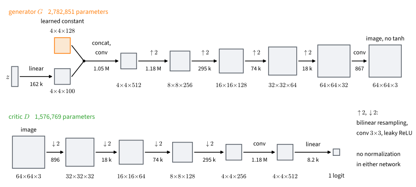

# Adversarial Image Generation
:label:`sec_dcgan`

The multilayer perceptron in :numref:`sec_basic_gan` generated recognizable $28 \times 28$ Fashion-MNIST silhouettes, but its textures were grainy because fully connected layers ignore spatial locality. Generating a $64 \times 64$ RGB image requires producing $12{,}288$ pixel values from a 100-dimensional latent vector. Two questions arise:

1. What convolutional architectures train stably for adversarial image generation?
2. How can we evaluate and compare image generators quantitatively when no likelihood is available?

Convolutional generators and discriminators first scaled GANs to natural images with the Deep Convolutional GAN (DCGAN) of :citet:`Radford.Metz.Chintala.2015`. While diffusion models (:numref:`chap_diffusion`) have since become the primary method for general-purpose image synthesis, convolutional discriminators and feature-space evaluation metrics remain central to modern image tokenizers and one-step distilled generators (:numref:`sec_gan_beyond`).

In this section, we train on a dataset of 40,597 $64 \times 64$ Pokémon sprites. We first implement the classic 2015 DCGAN architecture, and then construct a minimalist normalization-free convolutional backbone inspired by R3GAN :cite:`Huang.Gokaslan.Kuleshov.ea.2024`. By training this normalization-free backbone under three objectives—unpenalized classic logistic loss, classic logistic loss with $R_1 + R_2$ penalties, and relativistic pairing loss with $R_1 + R_2$ penalties—we test whether zero-centered gradient penalties (:numref:`sec_gan_convergence`) replace batch normalization and other architectural heuristics. We then implement the standard feature-space evaluation metrics—Fréchet Distance (FID), Kernel Inception Distance (KID), and $k$-NN precision and recall—and examine latent space interpolation and discriminator overfitting.

```{.python .input #dcgan-setup}
%%tab jax
# Deterministic GPU kernels; JAX reads XLA_FLAGS once, before the imports
import os
os.environ['XLA_FLAGS'] = (os.environ.get('XLA_FLAGS', '') +
                           ' --xla_gpu_deterministic_ops=true').strip()
```

```{.python .input #dcgan-adversarial-image-generation}
%%tab pytorch
import math
import numpy as np
import torch
from torch import nn
from torch.nn import functional as F
from d2l import torch as d2l
```

```{.python .input #dcgan-adversarial-image-generation}
%%tab jax
import math
import numpy as np
import jax
from jax import numpy as jnp
from flax import nnx
import optax
from d2l import jax as d2l
```

```{.python .input #dcgan-adversarial-image-generation-1}
%%tab pytorch
import torchvision
```

## The DCGAN Architecture

DCGAN :cite:`Radford.Metz.Chintala.2015` retains the classic non-saturating logistic objective of :numref:`sec_basic_gan` and stabilizes convolutional training through a set of architectural conventions:

- Spatial upsampling in the generator uses *transposed convolutions* (fractional-strided convolutions), while downsampling in the discriminator uses strided convolutions instead of pooling layers.
- *Batch normalization* is applied after every convolution except the generator output layer and the discriminator input layer.
- The generator uses ReLU hidden activations and a $\tanh$ output activation (matching pixel values in $[-1, 1]$), whereas the discriminator uses leaky ReLU ($\text{slope} = 0.2$) throughout to prevent zero-gradient dead zones.
- Weights are initialized from $\mathcal{N}(0, 0.02^2)$, and Adam uses reduced momentum $\beta_1 = 0.5$.

### The Pokémon Sprite Dataset

Our dataset consists of 40,597 RGB sprites of 721 Pokémon species from [pokemondb.net](https://pokemondb.net/sprites), resized to $64 \times 64$ and scaled to $[-1, 1]$. Because the entire dataset fits in memory, `load_pokemon` decodes it into a single tensor.

```{.python .input #dcgan-the-pokemon-sprites-1}
%%tab pytorch
#@save
d2l.DATA_HUB['pokemon'] = (d2l.DATA_URL + 'pokemon.zip',
                           'c065c0e2593b8b161a2d7873e42418bf6a21106c')

#@save
def load_pokemon(resolution=64):
    """All Pokemon sprites as one (n, 3, h, w) tensor in [-1, 1]."""
    import warnings
    transform = torchvision.transforms.Compose([
        torchvision.transforms.Resize((resolution, resolution)),
        torchvision.transforms.PILToTensor()])
    dataset = torchvision.datasets.ImageFolder(
        d2l.download_extract('pokemon'), transform=transform)
    loader = torch.utils.data.DataLoader(
        dataset, batch_size=512, num_workers=d2l.get_dataloader_workers())
    with warnings.catch_warnings():  # palette sprites with transparency
        warnings.filterwarnings('ignore', message='Palette images')
        return torch.cat([X for X, _ in loader]).float() / 127.5 - 1

images = load_pokemon()
images.shape
```

```{.python .input #dcgan-the-pokemon-sprites-1}
%%tab jax
#@save
d2l.DATA_HUB['pokemon'] = (d2l.DATA_URL + 'pokemon.zip',
                           'c065c0e2593b8b161a2d7873e42418bf6a21106c')

#@save
def load_pokemon(resolution=64):
    """All Pokemon sprites as one (n, h, w, 3) array in [-1, 1]."""
    import warnings
    from PIL import Image
    data_dir = d2l.download_extract('pokemon')
    files = sorted(os.path.join(root, f)
                   for root, _, names in os.walk(data_dir) for f in names
                   if f.lower().endswith(('.png', '.jpg', '.jpeg')))
    def load(path):
        img = Image.open(path).convert('RGB')
        return np.asarray(img.resize((resolution, resolution), Image.BILINEAR),
                          dtype=np.float32)
    with warnings.catch_warnings():  # palette sprites with transparency
        warnings.filterwarnings('ignore', message='Palette images')
        return np.stack([load(f) for f in files]) / 127.5 - 1

images = load_pokemon()
images.shape
```

A fixed permutation sets aside one tenth of the images, which are never used for training. They are the real sample against which generated images are scored, and they show whether the critic scores its training images higher than unseen ones. The split is by image, not by species, so variants of one species can fall on both sides, and a generator that copies a training sprite may land close to a held-out variant of it.

```{.python .input #dcgan-the-pokemon-sprites-2}
%%tab pytorch
device = d2l.try_gpu()
perm = np.random.default_rng(12345).permutation(len(images))
n_holdout = len(images) // 10
train_imgs = images[perm[n_holdout:]].to(device)
holdout_imgs = images[perm[:n_holdout]].to(device)
print(f'{len(train_imgs)} training and {len(holdout_imgs)} held-out images')
d2l.show_images(train_imgs[:20].cpu().permute(0, 2, 3, 1) / 2 + 0.5,
                num_rows=4, num_cols=5);
```

```{.python .input #dcgan-the-pokemon-sprites-2}
%%tab jax
perm = np.random.default_rng(12345).permutation(len(images))
n_holdout = len(images) // 10
train_imgs = jnp.asarray(images[perm[n_holdout:]])
holdout_imgs = jnp.asarray(images[perm[:n_holdout]])
print(f'{len(train_imgs)} training and {len(holdout_imgs)} held-out images')
d2l.show_images(np.asarray(train_imgs[:20]) / 2 + 0.5,
                num_rows=4, num_cols=5);
```

### Transposed Convolutions and Batch Normalization

To upsample a $1 \times 1$ feature map with 100 channels into a $64 \times 64$ image, DCGAN uses *transposed convolutions* (:numref:`sec_transposed_conv`). A transposed convolution with kernel size $k$, stride $s$, and padding $p$ maps an $n \times n$ spatial grid to an output of side

$$s(n - 1) + k - 2p.$$

With $k = 4, s = 2, p = 1$, each layer doubles the spatial resolution ($n \to 2n$); for the initial layer ($k = 4, s = 1, p = 0$), a $1 \times 1$ input expands to $4 \times 4$. Conversely, a strided convolution with $k = 4, s = 2, p = 1$ halves the spatial resolution.

As shown in :numref:`fig_gan_dcgan`, the DCGAN generator chains five transposed convolutions across resolutions $1 \to 4 \to 8 \to 16 \to 32 \to 64$, halving the channel width at each stage before outputting 3 RGB channels. The discriminator mirrors this hierarchy with strided convolutions down to a single $1 \times 1$ logit.


:label:`fig_gan_dcgan`

```{.python .input #dcgan-generator-1}
%%tab pytorch
def G_block(c_in, c_out, stride=2, padding=1):
    """Transposed convolution (kernel 4), batch norm, ReLU."""
    return nn.Sequential(
        nn.ConvTranspose2d(c_in, c_out, 4, stride, padding, bias=False),
        nn.BatchNorm2d(c_out), nn.ReLU())

def D_block(c_in, c_out, norm=True):
    """Strided convolution (kernel 4), batch norm, leaky ReLU."""
    return nn.Sequential(
        nn.Conv2d(c_in, c_out, 4, 2, 1, bias=False),
        nn.BatchNorm2d(c_out) if norm else nn.Identity(), nn.LeakyReLU(0.2))
```

```{.python .input #dcgan-generator-1}
%%tab jax
conv_init = nnx.initializers.normal(0.02)  # DCGAN: kernels from N(0, 0.02^2)

def bn_scale_init(key, shape, dtype=jnp.float32):
    return 1 + 0.02 * jax.random.normal(key, shape, dtype)  # N(1, 0.02^2)

def batch_norm(c, rngs):
    # Running averages decay 0.9; the variance is computed in two passes
    return nnx.BatchNorm(c, momentum=0.9, use_fast_variance=False,
                         scale_init=bn_scale_init, rngs=rngs)

def G_block(c_in, c_out, rngs, stride=2, padding='SAME'):
    """Transposed convolution (kernel 4), batch norm, ReLU."""
    return nnx.Sequential(
        nnx.ConvTranspose(c_in, c_out, (4, 4), strides=(stride, stride),
                          padding=padding, use_bias=False,
                          kernel_init=conv_init, rngs=rngs),
        batch_norm(c_out, rngs), nnx.relu)

def D_block(c_in, c_out, rngs, norm=True):
    """Strided convolution (kernel 4), batch norm, leaky ReLU."""
    return nnx.Sequential(
        nnx.Conv(c_in, c_out, (4, 4), strides=(2, 2), padding='SAME',
                 use_bias=False, kernel_init=conv_init, rngs=rngs),
        batch_norm(c_out, rngs) if norm else (lambda x: x),
        lambda x: nnx.leaky_relu(x, 0.2))
```

Stacking four `G_block` stages with a final transposed convolution and `tanh`
forms `net_G`, while four `D_block` stages (omitting batch normalization in the
first block) and a $4 \times 4$ convolution form `net_D`; a forward pass on two
100-dimensional latent vectors verifies their output shapes:

```{.python .input #dcgan-generator-3}
%%tab pytorch
torch.manual_seed(0)
net_G = nn.Sequential(                                   # (100,)
    nn.Unflatten(1, (100, 1, 1)),                        # (100, 1, 1)
    G_block(100, 512, stride=1, padding=0),              # (512, 4, 4)
    G_block(512, 256), G_block(256, 128), G_block(128, 64),  # (64, 32, 32)
    nn.ConvTranspose2d(64, 3, 4, 2, 1, bias=False), nn.Tanh()).to(device)
net_D = nn.Sequential(                                   # (3, 64, 64)
    D_block(3, 64, norm=False),                          # (64, 32, 32)
    D_block(64, 128), D_block(128, 256), D_block(256, 512),  # (512, 4, 4)
    nn.Conv2d(512, 1, 4, bias=False)).to(device)         # (1, 1, 1)
X = net_G(torch.zeros(2, 100, device=device))
print(X.shape, net_D(X).shape)
```

```{.python .input #dcgan-generator-3}
%%tab jax
rngs = nnx.Rngs(0)
net_G = nnx.Sequential(                                  # (100,)
    lambda z: z.reshape(-1, 1, 1, 100),                  # (1, 1, 100)
    G_block(100, 512, rngs, stride=1, padding='VALID'),  # (4, 4, 512)
    G_block(512, 256, rngs), G_block(256, 128, rngs),
    G_block(128, 64, rngs),                              # (32, 32, 64)
    nnx.ConvTranspose(64, 3, (4, 4), strides=(2, 2), padding='SAME',
                      use_bias=False, kernel_init=conv_init, rngs=rngs),
    nnx.tanh)                                            # (64, 64, 3)
net_D = nnx.Sequential(                                  # (64, 64, 3)
    D_block(3, 64, rngs, norm=False),                    # (32, 32, 64)
    D_block(64, 128, rngs), D_block(128, 256, rngs),
    D_block(256, 512, rngs),                             # (4, 4, 512)
    nnx.Conv(512, 1, (4, 4), padding='VALID', use_bias=False,
             kernel_init=conv_init, rngs=rngs))          # (1, 1, 1)
X = net_G(jnp.zeros((2, 100)))
print(X.shape, net_D(X).shape)
```

### Training with the Classic Loss

The loop `d2l.train_gan` of :numref:`sec_basic_gan`, which alternates a logistic-regression step of the critic with a non-saturating step of the generator, applies to images unchanged. We use the DCGAN settings with a larger minibatch, 256 images instead of the paper's 128: learning rate $2 \cdot 10^{-4}$, $\beta_1 = 0.5$, and convolution kernels drawn from $\mathcal{N}(0, 0.02^2)$. Batch-normalization scales start from $\mathcal{N}(1, 0.02^2)$ and offsets at zero, as in the authors' released code.

```{.python .input #dcgan-training-with-the-classic-loss-1}
%%tab pytorch
def dcgan_init(module):
    if isinstance(module, (nn.Conv2d, nn.ConvTranspose2d)):
        nn.init.normal_(module.weight, 0, 0.02)
    elif isinstance(module, nn.BatchNorm2d):
        nn.init.normal_(module.weight, 1, 0.02)
        nn.init.zeros_(module.bias)

for net in (net_D, net_G):
    net.apply(dcgan_init)
dataset = torch.utils.data.TensorDataset(train_imgs)
# Sample whole minibatches of indices, so that the GPU tensor is indexed
# once per minibatch rather than once per image
sampler = torch.utils.data.BatchSampler(
    torch.utils.data.RandomSampler(dataset), 256, drop_last=True)
data_iter = torch.utils.data.DataLoader(dataset, sampler=sampler,
                                        batch_size=None)
```

```{.python .input #dcgan-training-with-the-classic-loss-1}
%%tab jax
# The training images from the host array: the loader keeps them there
data_iter = d2l.ArrayLoader((images[perm[n_holdout:]],), 256, shuffle=True,
                            drop_last=True, key=jax.random.key(3))
```

We sample from an average of the generator's recent weights rather than from its last ones. `EMA` keeps an exponential moving average of the parameters, updated after every step as

$$\bar\theta \leftarrow \beta\, \bar\theta + (1 - \beta)\, \theta, \qquad \beta = 2^{-1/n_{1/2}},$$

so that the weight of a past step halves every $n_{1/2}$ steps, the *half-life*. The iterates of the game rotate around the equilibrium (:numref:`sec_gan_convergence`), so their average sits closer to it than they do. Batch-normalization statistics are not parameters, and the average copies them from the live network. The copies belong to the live weights, not to the averaged ones, so after training we re-estimate them.

```{.python .input #dcgan-training-with-the-classic-loss-4}
%%tab pytorch
#@save
class EMA:
    """Exponential moving average of a model's parameters, given as a
    half-life in steps. Buffers such as batch-norm statistics are copied;
    the average is kept in evaluation mode."""
    def __init__(self, model, half_life):
        import copy  # the d2l library preamble does not import it
        self.model = copy.deepcopy(model).requires_grad_(False).eval()
        self.decay = 0.5 ** (1 / half_life)

    def update(self, model):
        with torch.no_grad():
            for avg, p in zip(self.model.parameters(), model.parameters()):
                avg.lerp_(p, 1 - self.decay)
            for avg, b in zip(self.model.buffers(), model.buffers()):
                avg.copy_(b)
```

```{.python .input #dcgan-training-with-the-classic-loss-4}
%%tab jax
#@save
class EMA:
    """Exponential moving average of a model's parameters, given as a
    half-life in steps. Other state such as batch-norm statistics is copied;
    the average is kept in evaluation mode."""
    def __init__(self, model, half_life):
        self.model = nnx.clone(model)
        self.model.eval()
        self.decay = 0.5 ** (1 / half_life)

    def update(self, model):
        self.average(self.model, model, self.decay)

    @staticmethod
    @nnx.jit
    def average(avg, model, decay):
        """Move the parameters of avg toward those of model, in place."""
        params = jax.tree.map(lambda a, p: decay * a + (1 - decay) * p,
                              nnx.state(avg, nnx.Param),
                              nnx.state(model, nnx.Param))
        nnx.update(avg, params, nnx.state(model, nnx.Not(nnx.Param)))
```

The later runs of this section average over 32,000 images, a half-life of 500 steps at batch size 64. At batch size 256 the same 32,000 images take 125 steps, under a twentieth of this run's 2,840 steps (20 epochs of 142).

The printed critic loss is the sum of the two batch means of :numref:`sec_basic_gan`, which equals $2 \log 2 \approx 1.39$ at the equilibrium; the generator's loss would equal $\log 2 \approx 0.69$ there.

```{.python .input #dcgan-training-with-the-classic-loss-2}
%%tab pytorch
ema = EMA(net_G, half_life=125)  # 32,000 images, as in the later runs
history = d2l.train_gan(net_D, net_G, data_iter, num_epochs=20,
                        latent_dim=100, lr_D=0.0002, lr_G=0.0002, seed=1,
                        ema=ema)
loss_D, loss_G = history[-1]
print(f'last epoch: loss_D {loss_D:.3f}, loss_G {loss_G:.3f}')
```

```{.python .input #dcgan-training-with-the-classic-loss-2}
%%tab jax
ema = EMA(net_G, half_life=125)  # 32,000 images, as in the later runs
history = d2l.train_gan(net_D, net_G, data_iter, num_epochs=20,
                        latent_dim=100, lr_D=0.0002, lr_G=0.0002, seed=1,
                        ema=ema)
loss_D, loss_G = history[-1]
print(f'last epoch: loss_D {loss_D:.3f}, loss_G {loss_G:.3f}')
```

The next cell re-estimates the batch-normalization statistics of the average by running the averaged generator in training mode on 100 fresh batches of latent codes. The running averages forget at rate 0.1 per batch, so the copied values keep a weight of $0.9^{100} \approx 3 \cdot 10^{-5}$, which is to say none.

```{.python .input #dcgan-training-with-the-classic-loss-5}
%%tab pytorch
ema.model.train()  # batch-norm statistics for the averaged weights
with torch.no_grad():  # 100 batches; running averages forget at rate 0.1
    for _ in range(100):
        ema.model(torch.randn(256, 100, device=device))
ema.model.eval();
```

```{.python .input #dcgan-training-with-the-classic-loss-5}
%%tab jax
ema.model.train()  # batch-norm statistics for the averaged weights
# 100 batches; running averages forget at rate 0.1
for key in jax.random.split(jax.random.key(4), 100):
    ema.model(jax.random.normal(key, (256, 100)))
ema.model.eval()
```

We sample in evaluation mode, so that each image depends only on its own latent code.

```{.python .input #dcgan-training-with-the-classic-loss-3}
%%tab pytorch
with torch.no_grad():
    fake = ema.model(torch.randn(20, 100, device=device))
d2l.show_images(fake.cpu().permute(0, 2, 3, 1) / 2 + 0.5,
                num_rows=4, num_cols=5);
```

```{.python .input #dcgan-training-with-the-classic-loss-3}
%%tab jax
fake = ema.model(jax.random.normal(jax.random.key(2), (20, 100)))
d2l.show_images(np.asarray(fake) / 2 + 0.5, num_rows=4, num_cols=5);
```

The generated sprites show diverse silhouettes and color palettes on white backgrounds, though with somewhat blotchy textures. Notice that the discriminator loss ($\sim 0.45$) remains well below $2\log 2 \approx 1.39$ without causing mode collapse.

## A Normalization-Free Backbone
:label:`subsec_gan_r3gan_principles`

Over the years following DCGAN, large-scale image GANs accumulated numerous architectural stabilizers (StyleGAN2 :cite:`Karras.Laine.Aittala.ea.2020` combined ten distinct techniques). R3GAN :cite:`Huang.Gokaslan.Kuleshov.ea.2024` demonstrated that once the objective is regularized with $R_1 + R_2$ gradient penalties and the relativistic pairing loss, those ad-hoc architectural devices can be removed. In particular, omitting batch normalization from the discriminator is essential when using $R_1$ and $R_2$, because batch normalization couples samples across a minibatch and invalidates per-sample input-gradient computation.

### Architecture and Fan-In Initialization

We build a minimalist convolutional backbone (:numref:`fig_gan_backbone`) without normalization layers or output $\tanh$:

- The generator concatenates a learned $4 \times 4 \times 128$ constant tensor with a linear projection of $z$ ($4 \times 4 \times 100$)—plus optional extra channels used for class conditioning in :numref:`sec_gan_conditional`—and upsamples four times ($4 \to 8 \to 16 \to 32 \to 64$) via bilinear interpolation followed by a $3 \times 3$ convolution and leaky ReLU ($\text{slope} = 0.2$). Bilinear upsampling followed by a $3 \times 3$ convolution avoids the checkerboard artifacts caused by uneven transposed-convolution overlap :cite:`Odena.Dumoulin.Olah.2016`.
- The critic mirrors this structure with $3 \times 3$ convolutions, leaky ReLU, and bilinear downsampling down to a $4 \times 4$ feature map $\phi(x)$ followed by a linear head.
- To preserve activation variance across layers without batch normalization, all weights use He fan-in initialization :cite:`He.Zhang.Ren.ea.2015` scaled for leaky ReLU of slope $0.2$: variance $2 / ((1 + 0.2^2)\,n_{\mathrm{in}})$.


:label:`fig_gan_backbone`

```{.python .input #dcgan-a-modern-minimal-backbone-1}
%%tab pytorch
#@save
def fan_in_init(module):
    """Fan-in normal weights with the leaky-ReLU gain, zero offsets."""
    if isinstance(module, (nn.Conv2d, nn.Linear)):
        nn.init.kaiming_normal_(module.weight, a=0.2)
        nn.init.zeros_(module.bias)

#@save
class Generator(nn.Module):
    """Learned 4x4 constant + projected latent (+ extra 4x4 input maps),
    bilinearly upsampled to resolution x resolution; no normalization."""
    def __init__(self, latent_dim, resolution, base_ch, *, extra_ch=0,
                 const_ch=128):
        super().__init__()
        self.latent_dim = latent_dim
        self.const = nn.Parameter(torch.randn(1, const_ch, 4, 4))
        self.z_proj = nn.Linear(latent_dim, 16 * latent_dim)
        self.mix = nn.Conv2d(const_ch + latent_dim + extra_ch, base_ch, 3,
                             padding=1)
        num_stages = int(np.log2(resolution / 4))       # 64: four doublings
        chans = [base_ch // 2 ** i for i in range(num_stages + 1)]
        self.stages = nn.ModuleList(
            [nn.Conv2d(c_in, c_out, 3, padding=1)
             for c_in, c_out in zip(chans[:-1], chans[1:])])
        self.to_rgb = nn.Conv2d(chans[-1], 3, 3, padding=1)
        self.act = nn.LeakyReLU(0.2)
        self.apply(fan_in_init)

    def forward(self, z, extra=None):
        zc = self.z_proj(z).reshape(-1, self.latent_dim, 4, 4)
        const = self.const.expand(z.shape[0], -1, -1, -1)
        maps = [const, zc] + ([] if extra is None else [extra])
        x = self.act(self.mix(torch.cat(maps, dim=1)))
        for conv in self.stages:                     # 4 -> 8 -> ... -> 64
            x = F.interpolate(x, scale_factor=2, mode='bilinear')
            x = self.act(conv(x))
        return self.to_rgb(x)                        # no tanh: raw output
```

```{.python .input #dcgan-a-modern-minimal-backbone-1}
%%tab jax
#@save
# Fan-in initialization with the leaky-ReLU gain (normal, not truncated)
fan_in_init = nnx.initializers.variance_scaling(2 / (1 + 0.2 ** 2),
                                                'fan_in', 'normal')

#@save
class Generator(nnx.Module):
    """Learned 4x4 constant + projected latent (+ extra 4x4 input maps),
    bilinearly upsampled to resolution x resolution; no normalization."""
    def __init__(self, latent_dim, resolution, base_ch, *, extra_ch=0,
                 const_ch=128, rngs):
        self.latent_dim = latent_dim
        self.const = nnx.Param(
            jax.random.normal(rngs.params(), (1, 4, 4, const_ch)))
        self.z_proj = nnx.Linear(latent_dim, 16 * latent_dim,
                                 kernel_init=fan_in_init, rngs=rngs)
        self.mix = nnx.Conv(const_ch + latent_dim + extra_ch, base_ch,
                            (3, 3), padding='SAME', kernel_init=fan_in_init,
                            rngs=rngs)
        num_stages = int(np.log2(resolution / 4))       # 64: four doublings
        chans = [base_ch // 2 ** i for i in range(num_stages + 1)]
        self.stages = nnx.List(
            [nnx.Conv(c_in, c_out, (3, 3), padding='SAME',
                      kernel_init=fan_in_init, rngs=rngs)
             for c_in, c_out in zip(chans[:-1], chans[1:])])
        self.to_rgb = nnx.Conv(chans[-1], 3, (3, 3), padding='SAME',
                               kernel_init=fan_in_init, rngs=rngs)

    def __call__(self, z, extra=None):
        zc = self.z_proj(z).reshape(-1, 4, 4, self.latent_dim)
        const = jnp.broadcast_to(self.const[...],
                                 (z.shape[0],) + self.const.shape[1:])
        maps = [const, zc] + ([] if extra is None else [extra])
        x = nnx.leaky_relu(self.mix(jnp.concatenate(maps, axis=-1)), 0.2)
        for conv in self.stages:                     # 4 -> 8 -> ... -> 64
            b, h, w, c = x.shape
            x = jax.image.resize(x, (b, 2 * h, 2 * w, c), method='bilinear')
            x = nnx.leaky_relu(conv(x), 0.2)
        return self.to_rgb(x)                        # no tanh: raw output
```

The critic mirrors the generator. Four stages of convolution, leaky ReLU, and bilinear downsampling take a $64 \times 64$ image to $4 \times 4$, and a mixing convolution and a linear head return one score.

```{.python .input #dcgan-a-modern-minimal-backbone-2}
%%tab pytorch
#@save
class Discriminator(nn.Module):
    """Critic that mirrors the generator: conv + leaky ReLU + bilinear
    downsampling to a 4x4 feature map phi(x), then a linear head on the
    flattened map."""
    def __init__(self, resolution, base_ch):
        super().__init__()
        num_stages = int(np.log2(resolution / 4))
        chans = [3] + [base_ch * 2 ** i for i in range(num_stages)]
        self.stages = nn.ModuleList(
            [nn.Conv2d(c_in, c_out, 3, padding=1)
             for c_in, c_out in zip(chans[:-1], chans[1:])])
        self.mix = nn.Conv2d(chans[-1], 2 * chans[-1], 3, padding=1)
        self.head = nn.Linear(2 * chans[-1] * 4 * 4, 1)
        self.act = nn.LeakyReLU(0.2)
        self.apply(fan_in_init)

    def phi(self, x):
        for conv in self.stages:                     # 64 -> 32 -> ... -> 4
            x = F.interpolate(self.act(conv(x)), scale_factor=0.5,
                              mode='bilinear', antialias=True)
        return self.act(self.mix(x))

    def forward(self, x):
        return self.head(self.phi(x).flatten(1))

for net in (Generator(latent_dim=100, resolution=64, base_ch=512),
            Discriminator(resolution=64, base_ch=32)):
    print(f'{type(net).__name__}: {d2l.num_params(net)} parameters')
```

```{.python .input #dcgan-a-modern-minimal-backbone-2}
%%tab jax
#@save
class Discriminator(nnx.Module):
    """Critic that mirrors the generator: conv + leaky ReLU + bilinear
    downsampling to a 4x4 feature map phi(x), then a linear head on the
    flattened map."""
    def __init__(self, resolution, base_ch, *, rngs):
        num_stages = int(np.log2(resolution / 4))
        chans = [3] + [base_ch * 2 ** i for i in range(num_stages)]
        self.stages = nnx.List(
            [nnx.Conv(c_in, c_out, (3, 3), padding='SAME',
                      kernel_init=fan_in_init, rngs=rngs)
             for c_in, c_out in zip(chans[:-1], chans[1:])])
        self.mix = nnx.Conv(chans[-1], 2 * chans[-1], (3, 3),
                            padding='SAME', kernel_init=fan_in_init,
                            rngs=rngs)
        self.head = nnx.Linear(2 * chans[-1] * 4 * 4, 1,
                               kernel_init=fan_in_init, rngs=rngs)

    def phi(self, x):
        for conv in self.stages:                     # 64 -> 32 -> ... -> 4
            x = nnx.leaky_relu(conv(x), 0.2)
            b, h, w, c = x.shape
            x = jax.image.resize(x, (b, h // 2, w // 2, c),
                                 method='bilinear')
        return nnx.leaky_relu(self.mix(x), 0.2)

    def __call__(self, x):
        return self.head(self.phi(x).reshape(x.shape[0], -1))

for net in (Generator(100, 64, 512, rngs=nnx.Rngs(0)),
            Discriminator(64, 32, rngs=nnx.Rngs(0))):
    print(f'{type(net).__name__}: {d2l.num_params(net)} parameters')
```

The generator has $\sim 2.8\text{M}$ parameters and the critic $\sim 1.6\text{M}$ parameters.

## A Controlled Loss Comparison

### Three Experimental Arms

We train the normalization-free backbone three times from identical initial weights using Adam ($\beta_1 = 0, \beta_2 = 0.99, \text{lr} = 2 \times 10^{-4}$), batch size 64, random horizontal flips, and EMA ($\text{half-life} = 500$ steps), varying only the training objective:

$$L(D) + \frac{\gamma}{2}\Big(\mathbb{E}_x\big[\|\nabla_x D(x)\|^2\big] + \mathbb{E}_{x'}\big[\|\nabla_{x'} D(x')\|^2\big]\Big),$$

where $L(D)$ is either the classic logistic loss (`d2l.gan_loss_D`) or the relativistic pairing loss (`d2l.rpgan_loss_D`), and the generator uses the corresponding non-saturating loss:

| arm | critic loss | gradient penalty | steps |
|:--|:--|:--|--:|
| `NS` | classic logistic | $\gamma = 0$ (none) | 6,000 |
| `NS + R1 + R2` | classic logistic | $\gamma = 10$ | 12,000 |
| `RpGAN + R1 + R2` | relativistic pairing | $\gamma = 10$ | 12,000 |

Comparing the first two arms isolates the effect of the $R_1 + R_2$ gradient penalty (the unpenalized arm is stopped at 6,000 steps because it collapses well before then); comparing the second and third arms isolates the effect of pairwise ranking (Exercise :exref:`ex_dcgan-penalty-weight-resolution` analyzes how $\gamma$ scales with image resolution). Two saved helpers support the training loop: `sample_real` draws random minibatches with horizontal flips, and `pair_stats` computes pairwise ranking accuracy $\hat P(D(x) > D(x'))$ and the mean relativistic rank weight $w_{\mathrm{Rp}} = \mathbb{E}[\sigma(D(x') - D(x))]$.

```{.python .input #dcgan-a-modern-minimal-backbone-3}
%%tab pytorch
#@save
def sample_real(images, n, labels=None):
    """Draw a training batch with random horizontal flips; return it with
    its labels (None without labels)."""
    idx = torch.randint(0, len(images), (n,), device=images.device)
    batch = images[idx]
    flip = torch.rand(n, device=images.device) < 0.5
    batch = torch.where(flip.view(-1, 1, 1, 1), batch.flip(-1), batch)
    return batch, (None if labels is None else labels[idx])

#@save
def pair_stats(net_D, real, fake, y=None):
    """Ranking accuracy P(D(x) > D(x')) and mean rank weight
    E[sigma(D(x') - D(x))] over aligned (real, generated) pairs; given
    labels y, the critic is D(., y)."""
    critic = net_D if y is None else lambda x: net_D(x, y)
    with torch.no_grad():
        diff = critic(fake) - critic(real)
    return float((diff < 0).float().mean()), float(torch.sigmoid(diff).mean())
```

```{.python .input #dcgan-a-modern-minimal-backbone-3}
%%tab jax
#@save
def sample_real(key, images, n, labels=None):
    """Draw a training batch with random horizontal flips; return it with
    its labels (None without labels)."""
    k1, k2 = jax.random.split(key)
    idx = jax.random.randint(k1, (n,), 0, len(images))
    batch = images[idx]
    flip = jax.random.bernoulli(k2, 0.5, (n,))
    batch = jnp.where(flip[:, None, None, None], batch[:, :, ::-1, :], batch)
    return batch, (None if labels is None else labels[idx])

#@save
def pair_stats(net_D, real, fake, y=None):
    """Ranking accuracy P(D(x) > D(x')) and mean rank weight
    E[sigma(D(x') - D(x))] over aligned (real, generated) pairs; given
    labels y, the critic is D(., y)."""
    critic = net_D if y is None else lambda x: net_D(x, y)
    diff = critic(fake) - critic(real)
    return float((diff < 0).mean()), float(jax.nn.sigmoid(diff).mean())
```

:begin_tab:`jax`
In JAX, we first compile `r3gan_step` to combine `d2l.critic_step` and
`d2l.generator_step` into a single jitted call per training iteration:
:end_tab:

```{.python .input #dcgan-three-arms}
%%tab jax
#@save
@nnx.jit(static_argnums=(4, 5))
def r3gan_step(net_G, net_D, opt_G, opt_D, loss_D, loss_G, gamma,
               X, z, y, X2, z2, y2):
    """One critic step on X against G(z), one generator step on (X2, z2);
    generated images take the labels y, y2 (None: unconditional). Return
    the critic loss, R1, R2 and the generator loss."""
    fake = net_G(z) if y is None else net_G(z, y)
    loss_d, r1, r2 = d2l.critic_step(net_D, opt_D, loss_D, X, fake, gamma, y)
    loss_g = d2l.generator_step(net_G, opt_G, loss_G, net_D, X2, z2, y2)
    return loss_d, r1, r2, loss_g
```

The saved loop `train_r3gan` alternates `d2l.critic_step` and `d2l.generator_step` of :numref:`sec_gan_convergence` on flipped real batches and updates the EMA generator after every step. The critic step returns the batch means of $R_1$ and $R_2$, so the critic's steepness on real images, $\mathbb{E}_x\|\nabla_x D(x)\|^2$, is logged in every arm (with weight $\gamma = 0$ in the first). Every 250 steps the loop also applies `pair_stats` to 256 fresh pairs:

```{.python .input #dcgan-loss-a-b-on-one-backbone-1}
%%tab pytorch
#@save
def train_r3gan(net_G, net_D, loss_D, loss_G, gamma, num_steps, images,
                labels=None, *, eval_images=None, eval_labels=None,
                eval_size=256, batch_size=64, lr=2e-4, half_life=500,
                log_every=250, seed=None):
    """Train with Adam (beta_1 = 0), alternating critic_step and
    generator_step on flipped real batches; a generated batch takes the
    labels of its real batch, if any. Every log_every steps, log the losses,
    R1, R2 and pair_stats on fresh pairs from eval_images (default: images).
    Return the EMA of the generator and the history, a dict of arrays."""
    if seed is not None:
        torch.manual_seed(seed)
    if eval_images is None:
        eval_images, eval_labels = images, labels
    opt_G, opt_D = [torch.optim.Adam(net.parameters(), lr, betas=(0.0, 0.99))
                    for net in (net_G, net_D)]
    noise = lambda n: torch.randn(n, net_G.latent_dim, device=images.device)
    generate = lambda z, y: net_G(z) if y is None else net_G(z, y)
    ema = EMA(net_G, half_life)
    history = {k: [] for k in ('step', 'loss_D', 'loss_G', 'R1', 'R2',
                               'accuracy', 'rank_weight')}
    for step in range(1, num_steps + 1):
        X, y = sample_real(images, batch_size, labels)
        with torch.no_grad():
            fake = generate(noise(batch_size), y)
        loss_d, r1, r2 = d2l.critic_step(net_D, opt_D, loss_D, X, fake,
                                         gamma, y)
        X, y = sample_real(images, batch_size, labels)
        loss_g = d2l.generator_step(net_G, opt_G, loss_G, net_D, X,
                                    noise(batch_size), y)
        ema.update(net_G)
        if step % log_every == 0:  # fresh pairs of real and generated images
            X, y = sample_real(eval_images, eval_size, eval_labels)
            with torch.no_grad():
                fake = generate(noise(eval_size), y)
            acc, weight = pair_stats(net_D, X, fake, y)
            logs = (step, loss_d, loss_g, r1, r2, acc, weight)
            for k, v in zip(history, logs):
                history[k].append(float(v))
    return ema.model, {k: np.array(v) for k, v in history.items()}
```

```{.python .input #dcgan-loss-a-b-on-one-backbone-1}
%%tab jax
#@save
def train_r3gan(net_G, net_D, loss_D, loss_G, gamma, num_steps, images,
                labels=None, *, eval_images=None, eval_labels=None,
                eval_size=256, batch_size=64, lr=2e-4, half_life=500,
                log_every=250, seed=None):
    """Train with Adam (beta_1 = 0), alternating critic_step and
    generator_step on flipped real batches; a generated batch takes the
    labels of its real batch, if any. Every log_every steps, log the losses,
    R1, R2 and pair_stats on fresh pairs from eval_images (default: images).
    Return the EMA of the generator and the history, a dict of arrays."""
    key = d2l.get_key() if seed is None else jax.random.key(seed)
    if eval_images is None:
        eval_images, eval_labels = images, labels
    opt_G, opt_D = [nnx.Optimizer(net, optax.adam(lr, b1=0.0, b2=0.99),
                                  wrt=nnx.Param) for net in (net_G, net_D)]
    noise = lambda key, n: jax.random.normal(key, (n, net_G.latent_dim))
    generate = lambda z, y: net_G(z) if y is None else net_G(z, y)
    ema = EMA(net_G, half_life)
    history = {k: [] for k in ('step', 'loss_D', 'loss_G', 'R1', 'R2',
                               'accuracy', 'rank_weight')}
    for step in range(1, num_steps + 1):
        key, kx, kz, kx2, kz2 = jax.random.split(key, 5)
        X, y = sample_real(kx, images, batch_size, labels)
        X2, y2 = sample_real(kx2, images, batch_size, labels)
        loss_d, r1, r2, loss_g = r3gan_step(
            net_G, net_D, opt_G, opt_D, loss_D, loss_G, gamma,
            X, noise(kz, batch_size), y, X2, noise(kz2, batch_size), y2)
        ema.update(net_G)
        if step % log_every == 0:  # fresh pairs of real and generated images
            key, kx, kz = jax.random.split(key, 3)
            X, y = sample_real(kx, eval_images, eval_size, eval_labels)
            fake = generate(noise(kz, eval_size), y)
            acc, weight = pair_stats(net_D, X, fake, y)
            logs = (step, loss_d, loss_g, r1, r2, acc, weight)
            for k, v in zip(history, logs):
                history[k].append(float(v))
    return ema.model, {k: np.array(v) for k, v in history.items()}
```

`train_arm` builds the two networks from the same seed in every arm, trains them, and returns the critic's train--holdout gap: the difference between its mean score on 1,024 training images and on 1,024 held-out images.

```{.python .input #dcgan-three-arms-1}
%%tab pytorch
def train_arm(loss_D, loss_G, gamma, num_steps):
    torch.manual_seed(0)  # the same initialization in every arm
    net_G = Generator(100, 64, 512).to(device)
    net_D = Discriminator(64, 32).to(device)
    ema_G, history = train_r3gan(net_G, net_D, loss_D, loss_G, gamma,
                                 num_steps, train_imgs, seed=1)
    with torch.no_grad():
        gap = (net_D(train_imgs[:1024]).mean()
               - net_D(holdout_imgs[:1024]).mean())
    return ema_G, history, float(gap)
```

```{.python .input #dcgan-three-arms-1}
%%tab jax
def train_arm(loss_D, loss_G, gamma, num_steps):
    rngs = nnx.Rngs(0)  # the same initialization in every arm
    net_G = Generator(100, 64, 512, rngs=rngs)
    net_D = Discriminator(64, 32, rngs=rngs)
    ema_G, history = train_r3gan(net_G, net_D, loss_D, loss_G, gamma,
                                 num_steps, train_imgs, seed=1)
    gap = (net_D(train_imgs[:1024]).mean()
           - net_D(holdout_imgs[:1024]).mean())
    return ema_G, history, float(gap)
```

A penalized step costs more than an unpenalized one, because the penalty differentiates the critic's input gradient a second time. After each run we print the critic's loss and penalty, averaged over the eight checks of the last 2,000 steps, and the train--holdout gap.

```{.python .input #dcgan-loss-a-b-on-one-backbone-2}
%%tab pytorch, jax
arms = {'NS': (d2l.gan_loss_D, d2l.gan_loss_G, 0, 6000),
        'NS + R1 + R2': (d2l.gan_loss_D, d2l.gan_loss_G, 10, 12000),
        'RpGAN + R1 + R2': (d2l.rpgan_loss_D, d2l.rpgan_loss_G, 10, 12000)}
runs = {}
for name, (loss_D, loss_G, gamma, num_steps) in arms.items():
    ema_G, hist, gap = train_arm(loss_D, loss_G, gamma, num_steps)
    runs[name] = (ema_G, hist)
    loss, r1, r2 = (hist[k][-2000 // 250:].mean()  # the last 2,000 steps
                    for k in ('loss_D', 'R1', 'R2'))
    print(f'{name:16s} critic loss {loss:.2f}, '
          f'penalty {gamma / 2 * (r1 + r2):.3f}, train-holdout gap {gap:+.2f}')
```

Both penalized critics settle moderately below their equilibrium values ($1.05$ vs. $2\log 2 \approx 1.39$ for classic logistic; $0.50$ vs. $\log 2 \approx 0.69$ for pairing), whereas the unpenalized critic drops to $0.60$.

### Training Traces and Generated Samples

Plotting the critic's squared input gradient $\mathbb{E}_x[\|\nabla_x D(x)\|^2]$, the pairwise ranking accuracy $\hat P(D(x) > D(x'))$, and the relativistic rank weight $w_{\mathrm{Rp}} = \mathbb{E}[\sigma(D(x') - D(x))]$ every 250 steps shows how the gradient penalty stabilizes training:

```{.python .input #dcgan-loss-a-b-on-one-backbone-4}
%%tab pytorch, jax
fig, axes = d2l.plt.subplots(1, 3, figsize=(12, 3.2))
hists = [hist for _, hist in runs.values()]
for ax, key, ylabel, yscale in zip(
        axes, ('R1', 'accuracy', 'rank_weight'),
        (r'$E\,\|\nabla_x D(x)\|^2$', 'ranking accuracy',
         r'rank weight $w_{\mathrm{Rp}}$'),
        ('log', 'linear', 'linear')):
    d2l.plot([h['step'] for h in hists], [h[key] for h in hists], 'step',
             ylabel, yscale=yscale, axes=ax)
axes[0].legend(list(runs), loc='center right')
fig.tight_layout()
```

Without $R_1 + R_2$, the critic's squared gradient norm climbs by two orders of magnitude (reaching $1\text{--}8$ vs. $\sim 0.01$ for the penalized critics). While all three critics order $> 90\%$ of pairs correctly, the penalized critics maintain a small score margin ($w_{\mathrm{Rp}} \in [0.25, 0.40]$, corresponding to a median logit difference around $0.7$), whereas the unpenalized critic drives $w_{\mathrm{Rp}}$ below $0.15$.

To compare sample quality visually, we first define a helper `tile_images` that
arranges a batch of images in $[-1, 1]$ into a single $[0, 1]$ grid:

```{.python .input #dcgan-samples-of-the-three-arms-1}
%%tab pytorch
#@save
def tile_images(imgs, num_rows):
    """Tile images (n, 3, h, w) in [-1, 1] into one (rows * h, cols * w, 3)
    array in [0, 1]."""
    n, c, h, w = imgs.shape
    grid = (imgs.clamp(-1, 1) + 1) / 2
    grid = grid.reshape(num_rows, n // num_rows, c, h, w)
    grid = grid.permute(0, 3, 1, 4, 2)  # (rows, h, cols, w, c)
    return grid.reshape(num_rows * h, -1, c).cpu().numpy()
```

```{.python .input #dcgan-samples-of-the-three-arms-1}
%%tab jax
#@save
def tile_images(imgs, num_rows):
    """Tile images (n, h, w, 3) in [-1, 1] into one (rows * h, cols * w, 3)
    array in [0, 1]."""
    n, h, w, c = imgs.shape
    grid = (jnp.clip(imgs, -1, 1) + 1) / 2
    grid = grid.reshape(num_rows, n // num_rows, h, w, c)
    grid = grid.transpose(0, 2, 1, 3, 4)  # (rows, h, cols, w, c)
    return np.asarray(grid.reshape(num_rows * h, -1, c))
```

We now evaluate all four EMA generators—DCGAN and the three normalization-free
arms—on the same 64 latent vectors `z_show` and tile their outputs into
$8 \times 8$ grids:

```{.python .input #dcgan-loss-a-b-on-one-backbone-3}
%%tab pytorch
torch.manual_seed(42)
z_show = torch.randn(64, 100, device=device)
gens = {'DCGAN': ema.model,
        **{name: ema_G for name, (ema_G, _) in runs.items()}}
with torch.no_grad():
    grids = [tile_images(G(z_show), 8) for G in gens.values()]
d2l.show_images(grids, 1, 4, titles=list(gens), scale=3.4);
```

```{.python .input #dcgan-loss-a-b-on-one-backbone-3}
%%tab jax
z_show = jax.random.normal(jax.random.key(42), (64, 100))
gens = {'DCGAN': ema.model,
        **{name: ema_G for name, (ema_G, _) in runs.items()}}
grids = [tile_images(G(z_show), 8) for G in gens.values()]
d2l.show_images(grids, 1, 4, titles=list(gens), scale=3.4);
```

Without batch normalization or gradient penalties, the `NS` arm suffers complete mode collapse (producing a uniform gray texture across all 64 latent codes; see Exercise :exref:`ex_dcgan-rerun-arm-classic-loss`). Adding $R_1 + R_2$ (`NS + R1 + R2` and `RpGAN + R1 + R2`) prevents collapse and produces diverse, centered sprite silhouettes on clean white backgrounds.

## Quantitative Evaluation Metrics

Visual inspection easily spots catastrophic collapse, but comparing two working generators requires quantitative metrics. Standard GAN evaluation embeds $n$ real images and $n$ generated images through a pretrained feature extractor $\phi(x) \in \mathbb{R}^d$ and measures the discrepancy between the two empirical feature distributions using closed-form distances from :numref:`sec_gan_objectives`.

### FID and KID

1. **Fréchet Inception Distance (FID)** :cite:`Heusel.Ramsauer.Unterthiner.ea.2017` fits multivariate Gaussians $\mathcal{N}(\mu_p, \Sigma_p)$ and $\mathcal{N}(\mu_q, \Sigma_q)$ to the real and generated feature clouds and computes the squared Wasserstein-2 distance between them :cite:`Dowson.Landau.1982,Givens.Shortt.1984`:

   $$
   \mathrm{FID}
   = \big\| \mu_p - \mu_q \big\|^2
   + \operatorname{tr}\!\Big( \Sigma_p + \Sigma_q
   - 2 \big( \Sigma_p^{1/2}\, \Sigma_q\, \Sigma_p^{1/2} \big)^{1/2} \Big).
   $$
   :eqlabel:`eq_gan_fid`

   FID depends only on the first two moments of the feature distribution, and its plug-in sample covariance estimator has a positive $O(1/n)$ bias at finite sample sizes (Exercise :exref:`ex_dcgan-measure-finite-sample-bias`).

2. **Kernel Inception Distance (KID)** :cite:`Binkowski.Sutherland.Arbel.ea.2018` computes the unbiased squared Maximum Mean Discrepancy (`d2l.mmd2_unbiased`, :numref:`sec_gan_objectives`) using the cubic polynomial kernel $k(u, v) = (u^\top v / d + 1)^3$, which compares feature moments up to order three (Exercise :exref:`ex_dcgan-moments-fid-kid`):

   $$
   \widehat{\mathrm{MMD}}^2
   = \frac{1}{n_p(n_p-1)} \sum_{i \neq i'} k\big(\phi(x_i), \phi(x_{i'})\big)
   + \frac{1}{n_q(n_q-1)} \sum_{j \neq j'} k\big(\phi(x'_j), \phi(x'_{j'})\big)
   - \frac{2}{n_p n_q} \sum_{i,j} k\big(\phi(x_i), \phi(x'_j)\big).
   $$
   :eqlabel:`eq_gan_kid`

```{.python .input #dcgan-measuring-sample-quality}
%%tab pytorch, jax
#@save
def fid_score(feat_p, feat_q):
    """Frechet distance between Gaussians fitted to two feature sets."""
    feat_p = np.asarray(feat_p, np.float64)
    feat_q = np.asarray(feat_q, np.float64)
    mu_p, mu_q = feat_p.mean(0), feat_q.mean(0)
    C_p = np.cov(feat_p, rowvar=False)
    C_q = np.cov(feat_q, rowvar=False)
    lam, U = np.linalg.eigh(C_p)
    sqrt_C_p = (U * np.sqrt(np.maximum(lam, 0))) @ U.T
    M = sqrt_C_p @ C_q @ sqrt_C_p
    cross = np.linalg.eigvalsh((M + M.T) / 2)   # symmetric up to rounding
    return (((mu_p - mu_q) ** 2).sum() + np.trace(C_p) + np.trace(C_q)
            - 2 * np.sqrt(np.maximum(cross, 0)).sum())

#@save
def kid_score(feat_p, feat_q):
    """Unbiased MMD^2 between two feature sets, cubic polynomial kernel."""
    d = feat_p.shape[1]
    kernel = lambda a, b: (a @ b.T / d + 1) ** 3
    return d2l.mmd2_unbiased(kernel(feat_p, feat_p), kernel(feat_q, feat_q),
                             kernel(feat_p, feat_q))
```

### A Feature Network

Standard benchmarks compute FID and KID using 2,048D features from an ImageNet-pretrained Inception-v3 network or self-supervised DINOv2 features :cite:`Stein.Cresswell.Hosseinzadeh.ea.2023,Oquab.Darcet.Moutakanni.ea.2024`. To keep this notebook self-contained, we train a lightweight 3-block CIFAR-10 classifier `d2l.FeatureCNN` (:numref:`subsec_utils_feature_cnn`) at $32 \times 32$ resolution for 15 epochs and use its 128D penultimate layer as $\phi$ (downsampling the $64 \times 64$ sprites to $32 \times 32$ via $2 \times 2$ average pooling).

```{.python .input #dcgan-a-feature-network-1}
%%tab pytorch
#@save
def batched(f, X, batch_size=1000):
    """Apply f to X in batches, without gradients, and concatenate."""
    with torch.no_grad():
        return torch.cat([f(X_k) for X_k in X.split(batch_size)])
```

```{.python .input #dcgan-a-feature-network-1}
%%tab jax
#@save
def batched(f, X, batch_size=1000):
    """Apply f to X in batches and concatenate."""
    return jnp.concatenate([f(X[i:i + batch_size])
                            for i in range(0, len(X), batch_size)])
```

Using `batched` for memory-safe evaluation, we load CIFAR-10, train
`d2l.FeatureCNN` at $32 \times 32$ resolution with random 4-pixel shifts, and
verify its test-set classification accuracy:

```{.python .input #dcgan-a-feature-network-trained-in-the-notebook-2}
%%tab pytorch
cifar_X, cifar_y, test_X, test_y = d2l.load_cifar10_arrays()
torch.manual_seed(0)
cnn = d2l.FeatureCNN(resolution=32).to(device)
d2l.train_feature_cnn(cnn, cifar_X, cifar_y, shift=4)
pred = batched(cnn, test_X).argmax(1)
print(f'CIFAR-10 test accuracy: {float((pred == test_y).float().mean()):.3f}')
```

```{.python .input #dcgan-a-feature-network-trained-in-the-notebook-2}
%%tab jax
cifar_X, cifar_y, test_X, test_y = d2l.load_cifar10_arrays()
cnn = d2l.FeatureCNN(resolution=32, rngs=nnx.Rngs(1))
d2l.train_feature_cnn(cnn, cifar_X, cifar_y, shift=4)
pred = batched(cnn, test_X).argmax(1)
print(f'CIFAR-10 test accuracy: {float((pred == test_y).mean()):.3f}')
```

### Precision and Recall
:label:`subsec_gan_precision_recall`

A single distance like FID or KID conflates two distinct failure modes: *poor fidelity* (generating unrealistic images outside the support of $p$) and *poor coverage* (mode dropping, failing to cover parts of $p$). :citet:`Kynkaanniemi.Karras.Laine.ea.2019` separate them using $K$-nearest-neighbor balls in feature space. Around each real feature $\phi(x_i)$, let $B(\phi(x_i), r_i)$ be the Euclidean ball reaching its $K$-th nearest real neighbor; define $B(\phi(x'_j), r'_j)$ analogously among the generated features (we use $K = 3$). Then:

$$
\mathrm{precision} = \frac{1}{n_q} \sum_{j=1}^{n_q} \mathbb{1}\Big[\phi(x'_j) \in \textstyle\bigcup_i B\big(\phi(x_i), r_i\big)\Big],
\qquad
\mathrm{recall} = \frac{1}{n_p} \sum_{i=1}^{n_p} \mathbb{1}\Big[\phi(x_i) \in \textstyle\bigcup_j B\big(\phi(x'_j), r'_j\big)\Big].
$$

*Precision* is the fraction of generated samples that fall within the estimated real feature support, while *recall* is the fraction of real samples covered by the estimated generated feature support. When a generator collapses to a single output, its $K$-NN radii $r'_j$ shrink to zero, driving recall to $0$.

```{.python .input #dcgan-precision-and-recall}
%%tab pytorch, jax
#@save
def precision_recall(feat_real, feat_gen, k=3, chunk=1000):
    """k-NN precision and recall of two feature sets: the fraction of each
    set inside the union of the other set's balls, each ball reaching to its
    center's k-th nearest neighbor; return (precision, recall)."""
    P = np.asarray(feat_real, np.float64)
    Q = np.asarray(feat_gen, np.float64)
    def dists(A, B):  # (len(A), len(B)) Euclidean distances
        sq = (A ** 2).sum(1)[:, None] - 2 * A @ B.T + (B ** 2).sum(1)
        return np.sqrt(np.maximum(sq, 0))
    def chunks(A):
        return (A[i:i + chunk] for i in range(0, len(A), chunk))
    def radii(A):  # sorted distances start with the point itself, at 0
        return np.concatenate([np.partition(dists(a, A), k, axis=1)[:, k]
                               for a in chunks(A)])
    def covered(A, B, r_B):  # is each row of A inside some ball of B?
        return np.concatenate([(dists(a, B) <= r_B).any(1)
                               for a in chunks(A)])
    return (float(covered(Q, P, radii(P)).mean()),
            float(covered(P, Q, radii(Q)).mean()))
```

### Scoring the Runs

We score $n = 4{,}059$ samples of each generator, taken from its moving average, against all 4,059 held-out sprites. Each generator is scored on two draws of latent codes, so the second row shows how much a score moves when only the samples change. As a floor we score two disjoint sets of 4,059 training images against each other: any distance between them is estimator noise and, for FD, finite-sample bias. Because the feature network is our own, we call the scores FD and $\mathrm{MMD}^2$ rather than FID and KID; they cannot be compared with published values, which also use twelve times as many samples. The backbone has no tanh, so we clamp its outputs before scoring; the last two columns report the fractions of raw pixel values above $+1$ and below $-1$.

```{.python .input #dcgan-scoring-the-runs-1}
%%tab pytorch
features = lambda imgs: batched(  # 2 x 2 averages: 64 x 64 -> 32 x 32
    cnn.features, F.avg_pool2d(imgs, 2)).cpu().numpy()
n = len(holdout_imgs)
zs = []
for seed in (7, 8):  # a second latent draw gives the sampling range
    torch.manual_seed(seed)
    zs.append(torch.randn(n, 100, device=device))
z_score = zs[0]
feat_gen, out_of_range = {}, {}  # out_of_range: fractions above +1, below -1
for name, G in gens.items():
    for row, z in zip((name, '  second draw'), zs):
        x = batched(G, z)
        out_of_range[(name, row)] = (float((x > 1).float().mean()),
                                     float((x < -1).float().mean()))
        feat_gen[(name, row)] = features(x.clamp(-1, 1))
feat_real = features(holdout_imgs)
feat_a, feat_b = features(train_imgs[:n]), features(train_imgs[n:2 * n])
white = float((holdout_imgs == 1).float().mean())
```

```{.python .input #dcgan-scoring-the-runs-1}
%%tab jax
features = lambda imgs: np.asarray(batched(  # 2 x 2 averages: 64 -> 32
    cnn.features, nnx.avg_pool(imgs, (2, 2), strides=(2, 2))))
n = len(holdout_imgs)
zs = [jax.random.normal(jax.random.key(seed), (n, 100))
      for seed in (7, 8)]  # a second latent draw gives the sampling range
z_score = zs[0]
feat_gen, out_of_range = {}, {}  # out_of_range: fractions above +1, below -1
for name, G in gens.items():
    for row, z in zip((name, '  second draw'), zs):
        x = batched(G, z)
        out_of_range[(name, row)] = (float((x > 1).mean()),
                                     float((x < -1).mean()))
        feat_gen[(name, row)] = features(jnp.clip(x, -1, 1))
feat_real = features(holdout_imgs)
feat_a, feat_b = features(train_imgs[:n]), features(train_imgs[n:2 * n])
white = float((holdout_imgs == 1).mean())
```

Each feature set is compared with that of the held-out sprites; the first row is the floor.

```{.python .input #dcgan-scoring-the-two-runs}
%%tab pytorch, jax
print(f'{"run":17s}{"FD":>7s}{"MMD^2":>8s}{"precision":>11s}{"recall":>8s}'
      f'{"> +1":>7s}{"< -1":>7s}')
scored = {(None, 'real vs. real'): (feat_a, feat_b),
          **{key: (feat_real, feat) for key, feat in feat_gen.items()}}
for key, (ref, feat) in scored.items():
    precision, recall = precision_recall(ref, feat)
    oor = ''.join(f'{v:7.3f}' for v in out_of_range.get(key, ()))
    print(f'{key[1]:17s}{fid_score(ref, feat):7.2f}{kid_score(ref, feat):8.3f}'
          f'{precision:11.2f}{recall:8.2f}{oor}')
print(f'real pixel values equal to +1: {white:.0%}')
```

The table highlights several key lessons:

1. **Real-versus-real baseline floor:** Two disjoint sets of $4{,}059$ real sprites score $\text{FD} \approx 0.2$ (due to finite-sample covariance bias), $\widehat{\mathrm{MMD}}^2 \approx 0.000$, and precision/recall of $0.95$. Evaluating a second draw of latent codes changes FD by $\leq 0.2$.
2. **Collapse vs. penalized training:** The collapsed unpenalized `NS` arm scores $\text{FD} \approx 64\text{--}72$ with $\text{recall} = 0.00$ and $\text{precision} \leq 0.07$. Adding $R_1 + R_2$ reduces FD by an order of magnitude ($\sim 4\text{--}6$) and raises both precision and recall to $\sim 0.4\text{--}0.5$.
3. **Feature-space sensitivity (DCGAN vs. penalized backbone):** Even though the penalized backbone produces cleaner visual outlines and white backgrounds at $64 \times 64$, the 2015 DCGAN achieves a lower FD ($\sim 2$) and $\widehat{\mathrm{MMD}}^2$ in our $32 \times 32$ CIFAR-10 classifier features, where $2 \times 2$ downsampling smooths out DCGAN's high-frequency blotches. Feature-space metrics always reflect the invariance and resolution of their underlying feature network.

## Latent Interpolation and Critic Overfitting

### Latent Space Interpolation

To check that the generator has learned a smooth mapping from latent codes to images rather than memorizing discrete templates, we linearly interpolate between 64 pairs of latent vectors, $z_t = (1 - t)z_0 + t z_1$ for $t \in [0, 1]$, and compare the generated images $G(z_t)$ against pixelwise cross-fades $(1 - t)G(z_0) + t G(z_1)$.

```{.python .input #dcgan-latent-interpolation}
%%tab pytorch
G = runs['RpGAN + R1 + R2'][0]
torch.manual_seed(0)
z0, z1 = torch.randn(2, 64, 1, 100, device=device)  # 64 pairs of codes
t = torch.linspace(0, 1, 8, device=device).view(1, 8, 1)
path = batched(G, ((1 - t) * z0 + t * z1).reshape(-1, 100)).clamp(-1, 1)
path = path.reshape(64, 8, 3, 64, 64)               # (pair, step, image)
t = t.view(1, 8, 1, 1, 1)
fade = (1 - t) * path[:, :1] + t * path[:, -1:]     # pixel cross-fades
inner = lambda x: features(x[:, 1:-1].flatten(0, 1))
print(f'precision of the inner steps: latent walk '
      f'{precision_recall(feat_real, inner(path))[0]:.2f}, '
      f'cross-fade {precision_recall(feat_real, inner(fade))[0]:.2f}')
d2l.show_images([tile_images(x[:8].flatten(0, 1), 8) for x in (path, fade)],
                1, 2, titles=['latent walk', 'pixel cross-fade'], scale=4.5);
```

```{.python .input #dcgan-latent-interpolation}
%%tab jax
G = runs['RpGAN + R1 + R2'][0]
z0, z1 = jax.random.normal(jax.random.key(0), (2, 64, 1, 100))  # 64 pairs
t = jnp.linspace(0, 1, 8).reshape(1, 8, 1)
path = jnp.clip(batched(G, ((1 - t) * z0 + t * z1).reshape(-1, 100)), -1, 1)
path = path.reshape(64, 8, 64, 64, 3)               # (pair, step, image)
t = t.reshape(1, 8, 1, 1, 1)
fade = (1 - t) * path[:, :1] + t * path[:, -1:]     # pixel cross-fades
inner = lambda x: features(x[:, 1:-1].reshape(-1, 64, 64, 3))
print(f'precision of the inner steps: latent walk '
      f'{precision_recall(feat_real, inner(path))[0]:.2f}, '
      f'cross-fade {precision_recall(feat_real, inner(fade))[0]:.2f}')
d2l.show_images([tile_images(x[:8].reshape(-1, 64, 64, 3), 8)
                 for x in (path, fade)],
                1, 2, titles=['latent walk', 'pixel cross-fade'], scale=4.5);
```

The intermediate latent interpolants maintain the same feature precision ($\sim 0.35\text{--}0.38$) as random generator draws and transition smoothly in shape and color, whereas pixelwise cross-fades produce ghosted double exposures whose precision drops in half ($\sim 0.18\text{--}0.21$).

### Critic Overfitting and Non-Leaking Augmentation

With $1.6\text{M}$ parameters and $36{,}538$ training sprites, the critic sees each training image roughly 20 times over 12,000 steps. The penalized critics exhibit a very small train–holdout score gap ($+0.02$ to $+0.05$ compared to a real-versus-fake margin of $\sim 0.7$; Exercise :exref:`ex_dcgan-scale-free-overfitting-statistic`). On smaller datasets or longer runs, however, discriminator memorization can degrade FID :cite:`Karras.Aittala.Hellsten.ea.2020`. The standard remedy—Adaptive Discriminator Augmentation (ADA, :citet:`Karras.Aittala.Hellsten.ea.2020`) and DiffAugment :cite:`Zhao.Liu.Lin.ea.2020`—applies invertible, *non-leaking* augmentations to both real and generated images inside the gradient path (whereas augmenting only real images, like our horizontal flips, trains the generator to match the augmented distribution; Exercise :exref:`ex_dcgan-augmentation-leaks`).

## Summary

- DCGAN stabilizes convolutional adversarial training under the classic logistic loss using transposed/strided convolutions, batch normalization, small weight initialization ($\sigma = 0.02$), and Adam with $\beta_1 = 0.5$.
- Removing batch normalization and architectural stabilizers causes the classic unpenalized loss to collapse completely, whereas adding zero-centered gradient penalties ($R_1 + R_2$) damps critic gradients by two orders of magnitude and enables a minimalist bilinear-resampling backbone to train stably.
- Quantitative image evaluation compares real and generated feature clouds via Fréchet Distance (FID, :eqref:`eq_gan_fid`), Kernel Inception Distance (KID, :eqref:`eq_gan_kid`), and $K$-NN precision (fidelity) and recall (coverage), always benchmarked against a real-versus-real finite-sample floor.

## Exercises

1. **Gradient penalty weight and image resolution.** Because $\nabla_x D(x)$ has units of inverse length, the penalty weight $\gamma$ depends on image resolution and pixel scaling.
    1. Let $U$ upsample a $64 \times 64$ image $x$ to $128 \times 128$ by replicating each pixel into a $2 \times 2$ block, and let $A$ average each $2 \times 2$ block so that $D' = D \circ A$ satisfies $D'(Ux) = D(x)$. Express $\|\nabla D'(Ux)\|^2$ in terms of $\|\nabla D(x)\|^2$, and find the penalty weight $\gamma'$ that makes the $128 \times 128$ penalty equal to the $64 \times 64$ penalty.
    1. How must $\gamma$ be rescaled if pixel values are normalized to $[0, 1]$ instead of $[-1, 1]$?
    1. Relate your result in (a) to the heuristic $\gamma \propto r^2 / B$ (for resolution $r$ and batch size $B$) used in StyleGAN2-ADA :cite:`Karras.Aittala.Hellsten.ea.2020`.
   :exlabel:`ex_dcgan-penalty-weight-resolution`

1. [code] **Scale-free critic overfitting statistics.** To compare critic memorization across objectives with different score scales, :citet:`Karras.Aittala.Hellsten.ea.2020` define

   $$r_v = \frac{\mathbb{E}[D_{\textrm{train}}] - \mathbb{E}[D_{\textrm{holdout}}]}{\mathbb{E}[D_{\textrm{train}}] - \mathbb{E}[D_{\textrm{generated}}]}, \qquad r_t = \mathbb{E}\big[\operatorname{sign}(D_{\textrm{train}})\big].$$

    1. Show that $r_v$ is invariant to positive affine transformations $D \mapsto aD + c$ ($a > 0$), whereas the raw gap $\mathbb{E}[D_{\textrm{train}}] - \mathbb{E}[D_{\textrm{holdout}}]$ scales with $a$ and $r_t$ depends on the shift $c$.
    1. For a shift-invariant pairing critic, under what transformations of $D$ is $\mathbb{E}[\operatorname{sign}(D_{\textrm{train}} - D_{\textrm{holdout}})]$ invariant, and what value does it take when training and held-out scores have identical distributions?
    1. Modify `train_arm` to return `net_D` and compute $r_v$ and $\mathbb{E}[\operatorname{sign}(D_{\textrm{train}} - D_{\textrm{holdout}})]$ across 1,024 images for each of the three arms.
   :exlabel:`ex_dcgan-scale-free-overfitting-statistic`

1. [code] **Finite-sample bias of FID versus KID.**
    1. Compute the real-versus-real FD and $\widehat{\mathrm{MMD}}^2$ between two disjoint sets of $n$ training sprites for $n \in \{250, 500, 1000, 2000, 4059\}$ across five random splits each.
    1. Fit a linear regression of FD against $1/n$ and extrapolate to $1/n \to 0$ (:citet:`Chong.Forsyth.2020`). How large is the finite-sample bias at $n = 500$ and $n = 4{,}059$?
    1. Repeat the $1/n$ linear fit for the `RpGAN + R1 + R2` generator against held-out sprites. Because the $1/n$ slope depends on the generator's feature covariance, explain how finite-sample bias at small $n$ can reverse the ranking of two generators.
   :exlabel:`ex_dcgan-measure-finite-sample-bias`

1. [code] **Weight initialization and mode collapse.** ● Define sample diversity as the mean pairwise feature distance of generated images on `z_show` divided by the mean pairwise feature distance of 64 held-out sprites.
    1. Log sample diversity and $\mathbb{E}_x[\|\nabla_x D(x)\|^2]$ every 500 steps over 5,000 steps for the unpenalized `NS` arm under He fan-in initialization and under $\mathcal{N}(0, \sigma^2)$ initialization with $\sigma \in \{0.01, 0.02, 0.05\}$. Does the spike in critic gradient norm precede the drop in diversity?
    1. Repeat the fan-in run across three seeds and measure how much the collapse step varies from seed to seed.
   :exlabel:`ex_dcgan-rerun-arm-classic-loss`

1. **Moments captured by FID and KID.** ●
    1. Expand the cubic KID kernel $k(u, v) = (u^\top v / d + 1)^3$ via the binomial theorem to show that the population $\mathrm{MMD}^2(p, q)$ equals

       $$\sum_{j=1}^{3} \binom{3}{j} d^{-j}\, \big\| \mathbb{E}_p[u^{\otimes j}] - \mathbb{E}_q[u^{\otimes j}] \big\|_F^2,$$

       and thus compares the first three moments of the feature distribution.
    1. In 1D ($d = 1$), compute the population FID and cubic-kernel $\mathrm{MMD}^2$ between $p = \mathcal{N}(0, 1)$ and (i) a shifted exponential distribution $X - 1$ with $X \sim \textrm{Exp}(1)$ (mean $0$, variance $1$, skewness $2$), and (ii) the symmetric mixture $\tfrac12\mathcal{N}(-a, 1 - a^2) + \tfrac12\mathcal{N}(a, 1 - a^2)$ ($0 < a < 1$).
   :exlabel:`ex_dcgan-moments-fid-kid`

1. **Non-leaking data augmentations.** ● Let $F$ be the horizontal flip operator and $T_\rho r = (1 - \rho)r + \rho\,F_\# r$ be the distribution obtained by flipping samples from $r$ with probability $\rho$.
    1. When only real images are flipped with $\rho = \tfrac12$ (as in `sample_real`), the generator is trained toward $T_{1/2} p$. If a fraction $\alpha$ of true sprites face left without a right-facing counterpart, what fraction of samples from an optimal generator will face right?
    1. When $T_\rho$ is applied to both real and generated images inside the critic, use $F^2 = I$ to show that $T_\rho q = T_\rho p \implies q = p$ whenever $\rho \neq \tfrac12$ (*non-leaking*, :citet:`Karras.Aittala.Hellsten.ea.2020`), whereas at $\rho = \tfrac12$ any distribution sharing the flip-symmetrized density of $p$ is indistinguishable from $p$.
   :exlabel:`ex_dcgan-augmentation-leaks`

[Discussions](https://d2l.discourse.group/t/36812)

<!-- slides -->

::: {.slide}
::: {.cover}
[Dive into Deep Learning · §16.5]{.kicker}

Deep Convolutional GANs and Architectural Stabilization<br>**transposed convolutions · DCGAN conventions · EMA & BatchNorm recalibration · normalization-free R3GAN backbone · FID, KID & precision/recall**
:::
:::

::: {.slide title="Scaling from Flat Vectors to 64×64 RGB Images"}
[Motivation]{.kicker}

In §16.1, a fully connected MLP generator produced grainy $28 \times 28$ Fashion-MNIST silhouettes because dense layers ignore 2D spatial locality. Scaling to $64 \times 64$ RGB images raises two fundamental challenges:

::: {.cols .vc}
::: {.col}
- **High-dimensional spatial synthesis:** A $64 \times 64$ RGB image contains $3 \times 64 \times 64 = 12{,}288$ correlated pixel values generated from a $100$-dimensional latent draw $z \sim \mathcal{N}(0, I_{100})$.
- **Benchmark dataset ($40{,}597$ Pokémon sprites):** Resized to $64 \times 64$ and scaled to $[-1, 1]$, split into $36{,}538$ training sprites and $4{,}059$ held-out test sprites for quantitative evaluation.
- **Two guiding questions:** (1) Do zero-centered gradient penalties ($R_1 + R_2$) replace BatchNorm and architectural stabilizers? (2) How do we score image fidelity and mode coverage without a likelihood?
:::

::: {.col .fig}
@!dcgan-the-pokemon-sprites-2
:::
:::
:::

::: {.slide title="Spatial Upsampling via Transposed Convolutions"}
[Resolution Doubling]{.kicker}

To expand a $1 \times 1 \times 100$ latent tensor into a $64 \times 64 \times 3$ image, DCGAN chains **transposed convolutions** (fractional-strided convolutions):

- **Stamping mechanism:** Each input pixel stamps a weighted $k \times k$ kernel onto the output grid at stride $s$, summing overlapping stamps. An $n \times n$ input with kernel $k$, stride $s$, and padding $p$ produces output spatial width:
  $$n_{\textrm{out}} = s(n - 1) + k - 2p$$
- **Stage 1 ($1 \times 1 \to 4 \times 4$):** $k = 4, s = 1, p = 0$ maps $n = 1 \to 1(0) + 4 - 0 = 4$.
- **Stages 2–5 ($n \to 2n$):** $k = 4, s = 2, p = 1$ doubles the spatial side ($2(n - 1) + 4 - 2 = 2n$) across $4 \to 8 \to 16 \to 32 \to 64$, while strided convolutions ($k = 4, s = 2, p = 1$) in the critic halve resolution from $64 \to 1$.

::: {.d2l-note .warn}
**Checkerboard overlap pitfall (Odena et al., 2016):** When kernel size $k$ is not divisible by stride $s$ (e.g., $k = 3, s = 2$), adjacent output positions receive an alternating number of overlapping stamps ($2, 1, 2, 1, \ldots$), imprinting a high-frequency checkerboard pattern.
:::
:::

::: {.slide title="The 2015 DCGAN Architecture and Stabilizers"}
[Architectural Conventions]{.kicker}

{.nostretch width=100%}

Radford, Metz, and Chintala (2015) stabilized the unpenalized non-saturating logistic loss via five architectural conventions:

1. **All-convolutional hierarchy:** Replace all pooling and fully connected layers with transposed convolutions in $G$ ($512 \to 256 \to 128 \to 64 \to 3$) and strided convolutions in $D$.
2. **Batch normalization:** Normalize activations after every convolution *except* the generator output layer and the discriminator input block.
3. **Activations, initialization & Adam:** ReLU + output $\tanh$ in $G$; leaky ReLU ($\text{slope} = 0.2$) throughout $D$; weights drawn from $\mathcal{N}(0, 0.02^2)$; Adam with reduced momentum $\beta_1 = 0.5$.
:::

::: {.slide title="Implementing DCGAN Generator and Critic Blocks"}
[Code Construction]{.kicker}

::: {.cols}
::: {.col}
@dcgan-generator-1
:::

::: {.col}
@dcgan-generator-3
:::
:::
:::

::: {.slide title="EMA Weight Averaging and BatchNorm Recalibration"}
[Damping Rotational Orbits]{.kicker}

Because minimax gradient iterates orbit around equilibrium (§16.4), their center of mass sits closer to the solution than the last iterate. We therefore sample from an **exponential moving average (EMA)** of the generator parameters:

::: {.cols .vc}
::: {.col}
- **Half-life parameterization ($n_{1/2}$ steps, $\beta = 2^{-1/n_{1/2}}$):**
  $$\bar{\theta} \leftarrow \beta\,\bar{\theta} + (1 - \beta)\,\theta$$
  We set the half-life to $32{,}000$ images ($n_{1/2} = 125$ steps at batch size $256$; $500$ steps at batch size $64$).
- **Pitfall — Stale BatchNorm statistics:** Copying running mean/variance buffers from the live network mismatches the averaged weights $\bar{\theta}$! After training, we run $100$ fresh forward batches in `train()` mode ($0.9^{100} \approx 3 \times 10^{-5}$) to recalibrate BatchNorm buffers for $\bar{\theta}$.
:::

::: {.col .fig}
@dcgan-training-with-the-classic-loss-4
:::
:::
:::

::: {.slide title="DCGAN Training Results on Pokémon Sprites"}
[20-Epoch Baseline]{.kicker}

Training DCGAN for $20$ epochs ($2{,}840$ steps at batch size $256$, $\text{lr} = 2 \times 10^{-4}, \beta_1 = 0.5$) with the classic non-saturating logistic loss produces recognizable, diverse sprites:

::: {.cols .vc}
::: {.col}
@!dcgan-training-with-the-classic-loss-2

- **Visual inspection:** Generated sprites exhibit diverse silhouettes and color palettes on white backgrounds, though with high-frequency blotchy textures.
- **Sub-equilibrium critic loss:** Even though `loss_D` ($\sim 0.45$) remains well below the random-guessing level $2\log 2 \approx 1.39$, batch normalization and $\mathcal{N}(0, 0.02^2)$ initialization prevent mode collapse.
:::

::: {.col .fig}
@!dcgan-training-with-the-classic-loss-3
:::
:::
:::

::: {.slide title="Why Strip BatchNorm? The R3GAN Minimalist Backbone"}
[From Heuristics to Penalized Objectives]{.kicker}

{.nostretch width=100%}

- **Why remove BatchNorm for $R_1 + R_2$?** Batch normalization couples all samples in a minibatch, which invalidates the independent per-sample input gradients $\nabla_{x_i} D(x_i)$ penalized by $R_1$ and $R_2$!
- **Minimalist normalization-free architecture (inspired by R3GAN, Huang et al., 2024):**
  - **Bilinear resampling + $3 \times 3$ convolutions:** Replaces $4 \times 4$ transposed/strided convolutions to avoid checkerboard artifacts.
  - **No normalization layers & no output $\tanh$:** Both $G$ ($2.8\text{M}$ params, starting from a learned $4 \times 4 \times 128$ constant + projected $z$) and $D$ ($1.6\text{M}$ params) use leaky ReLU ($\text{slope} = 0.2$) with He fan-in initialization $\mathrm{Var}(w) = \frac{2}{(1 + 0.2^2)\,n_{\mathrm{in}}}$.
:::

::: {.slide title="Implementing the Normalization-Free Generator"}
[Code Architecture]{.kicker}

`Generator` concatenates a learned $4 \times 4 \times 128$ constant tensor with a projected latent vector (plus optional conditioning channels for §16.6) and applies four stages of bilinear upsampling + $3 \times 3$ convolution + leaky ReLU:

@dcgan-a-modern-minimal-backbone-1
:::

::: {.slide title="Implementing the Normalization-Free Critic"}
[Code Architecture]{.kicker}

`Discriminator` mirrors the generator with four stages of $3 \times 3$ convolution, leaky ReLU, and antialiased bilinear downsampling down to a $4 \times 4$ feature map $\phi(x)$ followed by a linear head:

@dcgan-a-modern-minimal-backbone-2
:::

::: {.slide title="A Controlled Three-Arm Objective Ablation"}
[Experimental Design]{.kicker}

We train the normalization-free backbone three times from identical initial weights (Adam $\beta_1 = 0$, $\beta_2 = 0.99$, $\text{lr} = 2 \times 10^{-4}$, batch size $64$, horizontal flips, EMA half-life $500$ steps), changing one objective ingredient at a time:

| Experimental Arm | Critic Loss $L(D)$ | Gradient Penalty $\frac{\gamma}{2}(R_1 + R_2)$ | Training Steps | Hypothesis Tested |
| :--- | :--- | :--- | :--- | :--- |
| **`NS`** | Classic logistic (`gan_loss_D`) | $\gamma = 0$ (none) | $6{,}000$ | Does the plain backbone train without BatchNorm or penalties? |
| **`NS + R1 + R2`** | Classic logistic (`gan_loss_D`) | $\gamma = 10$ | $12{,}000$ | Do zero-centered penalties $R_1 + R_2$ replace BatchNorm? |
| **`RpGAN + R1 + R2`** | Relativistic pairing (`rpgan_loss_D`) | $\gamma = 10$ | $12{,}000$ | Does pairwise ranking improve upon penalized classic log loss? |

@!dcgan-loss-a-b-on-one-backbone-2
:::

::: {.slide title="Critic Steepness, Pair Accuracy, and Rank Weights"}
[Training Dynamics Traces]{.kicker}

Logging $\mathbb{E}_x[\|\nabla_x D(x)\|^2]$, pairwise ranking accuracy $\hat{P}(D(x) > D(x'))$, and the relativistic rank weight $w_{\mathrm{Rp}} = \mathbb{E}[\sigma(D(x') - D(x))]$ every $250$ steps explains why the unpenalized run collapses:

@!dcgan-loss-a-b-on-one-backbone-4

- **Critic steepness ($\mathbb{E}_x\|\nabla_x D\|^2$, left):** Without $R_1 + R_2$, critic gradient norm climbs $100\times$ higher ($1\text{--}8$ vs. $\sim 0.01$ for both penalized arms).
- **Accuracy vs. rank weight (middle & right):** All three critics order $> 90\%$ of pairs correctly, so ranking accuracy alone does not warn of collapse! However, the unpenalized critic drives $w_{\mathrm{Rp}}$ below $0.15$, whereas penalized critics maintain a small logit margin ($w_{\mathrm{Rp}} \in [0.25, 0.40]$, median difference $\approx 0.7$).
:::

::: {.slide title="Visual Comparison: Penalties Prevent Collapse"}
[Generated Sprite Grids]{.kicker}

Evaluating all four EMA generators on the same $64$ latent vectors `z_show`:

@!dcgan-loss-a-b-on-one-backbone-3

- Without BatchNorm or $R_1 + R_2$, the unpenalized `NS` arm collapses completely to a uniform gray texture, whereas both penalized arms (`NS + R1 + R2` and `RpGAN + R1 + R2`) produce crisp, diverse sprite silhouettes on clean white backgrounds.
:::

::: {.slide title="Feature-Space Evaluation: FID and KID"}
[Quantitative Quality Metrics]{.kicker}

To compare generators quantitatively, we embed real and generated images through a pretrained feature extractor $\phi(x) \in \mathbb{R}^d$ and compute closed-form distances between the feature distributions:

::: {.cols .vc}
::: {.col}
- **Fréchet Inception Distance (FID; Heusel et al., 2017):** Fits Gaussians $\mathcal{N}(\mu_p, \Sigma_p)$ and $\mathcal{N}(\mu_q, \Sigma_q)$ to the real and generated features and computes their squared $W_2$ distance:
  $$\mathrm{FID} = \|\mu_p - \mu_q\|^2 + \operatorname{tr}\!\Big(\Sigma_p + \Sigma_q - 2\big(\Sigma_p^{1/2}\Sigma_q\Sigma_p^{1/2}\big)^{1/2}\Big)$$
  Captures first two moments; exhibits positive $O(1/n)$ finite-sample covariance bias.
- **Kernel Inception Distance (KID; Bińkowski et al., 2018):** Unbiased $\widehat{\mathrm{MMD}}^2$ with cubic polynomial kernel $k(u, v) = (u^\top v / d + 1)^3$ (compares up to 3rd moments; unbiased at any sample size $n$).
:::

::: {.col .fig}
@dcgan-measuring-sample-quality
:::
:::
:::

::: {.slide title="Fidelity vs. Coverage: k-NN Precision and Recall"}
[k-NN Support Estimation]{.kicker}

A single distance like FID or KID conflates **poor sample fidelity** (unrealistic artifacts) with **poor mode coverage** (mode dropping). Kynkäänniemi et al. (2019) separate them using $K$-nearest-neighbor balls ($K = 3$) in feature space:

::: {.cols .vc}
::: {.col}
- Around each real feature $\phi(x_i)$, draw the Euclidean ball $B(\phi(x_i), r_i)$ reaching its $K$-th nearest real neighbor; define $B(\phi(x'_j), r'_j)$ analogously among generated features:
  $$\mathrm{precision} = \frac{1}{n_q}\sum_{j=1}^{n_q}\mathbb{1}\!\left[\phi(x'_j) \in \bigcup_i B\big(\phi(x_i), r_i\big)\right]$$
  $$\mathrm{recall} = \frac{1}{n_p}\sum_{i=1}^{n_p}\mathbb{1}\!\left[\phi(x_i) \in \bigcup_j B\big(\phi(x'_j), r'_j\big)\right]$$
- When a generator collapses to one output, its radii $r'_j \to 0$, driving **$\mathrm{recall} \to 0$**.
:::

::: {.col .fig}
@dcgan-precision-and-recall
:::
:::
:::

::: {.slide title="Scoring Runs Against a Real-vs.-Real Floor"}
[Scoring 4,059 Sprites]{.kicker}

Using 128D features from our 3-block CIFAR-10 classifier `FeatureCNN` ($64 \times 64$ sprites average-pooled to $32 \times 32$), we score $n = 4{,}059$ generated samples against the $4{,}059$ held-out sprites across two independent latent draws:

@!dcgan-scoring-the-two-runs

- **1. Real-vs.-real floor:** Two disjoint real sets score $\mathrm{FD} \approx 0.18$ (finite-sample covariance bias), $\widehat{\mathrm{MMD}}^2 \approx 0.000$, and precision/recall $0.95$.
- **2. Collapse vs. penalized arms:** Unpenalized `NS` scores $\mathrm{FD} \approx 64\text{--}72$ with $\mathrm{recall} = 0.00$; adding $R_1 + R_2$ reduces FD tenfold ($\sim 3.5\text{--}5.4$) and restores precision/recall to $\sim 0.4\text{--}0.5$.
- **3. Feature-network invariance:** Because $2 \times 2$ pooling into $32 \times 32$ `FeatureCNN` smooths out DCGAN's high-frequency blotches, DCGAN achieves the lowest FD ($\sim 2.0$) despite looking blotchier at $64 \times 64$.
:::

::: {.slide title="Latent Space Interpolation vs. Pixel Cross-Fades"}
[Testing Manifold Smoothness]{.kicker}

To check that `RpGAN + R1 + R2` learns a smooth image manifold rather than memorizing discrete templates, we linearly interpolate between $64$ pairs of latent codes, $z_t = (1 - t)z_0 + t z_1$ ($t \in [0, 1]$), and compare $G(z_t)$ against pixelwise cross-fades $(1 - t)G(z_0) + t G(z_1)$:

::: {.cols .vc}
::: {.col}
- **On-manifold transitions:** Intermediate latent steps maintain the generator's full 3-NN feature precision ($\sim 0.35\text{--}0.38$) and transition smoothly in shape and color without discrete jumps.
- **Off-manifold cross-fades:** Pixelwise blends create ghosted double exposures whose feature precision drops in half ($\sim 0.18\text{--}0.21$).
:::

::: {.col .fig .big}
@!dcgan-latent-interpolation
:::
:::
:::

::: {.slide title="Critic Overfitting and Non-Leaking Augmentation"}
[Small-Data Generalization Pitfall]{.kicker}

With $1.6\text{M}$ parameters and $36{,}538$ training sprites, our critic sees each sprite $\sim 20$ times over $12{,}000$ steps. Under $R_1 + R_2$, the train–holdout score gap $\mathbb{E}[D_{\textrm{train}}] - \mathbb{E}[D_{\textrm{holdout}}]$ stays tiny ($+0.02$ to $+0.05$ vs. a real–fake margin of $\sim 0.7$):

- **Small-dataset overfitting hazard:** On smaller datasets or longer runs, critic memorization widens the train–holdout gap and degrades FID.
- **Why augmenting only real images leaks:** Applying a random transformation $T_\rho$ (such as flipping with probability $\rho$) *only* to real images trains $G$ to match the transformed distribution $T_\rho p$ (e.g., generating right-facing copies of strictly left-facing sprites).
- **Non-leaking augmentation (ADA / DiffAugment; Karras et al., 2020; Zhao et al., 2020):** Apply invertible $T_\rho$ ($\rho \neq \frac{1}{2}$ for flips) to **both** real and generated images inside the differentiable critic path so that $T_\rho q = T_\rho p \implies q = p$.
:::

::: {.slide title="Concept Check: Convolutions, Metrics, and Flips"}
[Check Your Understanding]{.kicker}

Test your understanding of convolutional GAN architectures and evaluation metrics:

1. **Resolution scaling of $\gamma$:** Suppose a $64 \times 64$ image $x$ is upsampled to $128 \times 128$ by replicating each pixel into a $2 \times 2$ block ($Ux$), and a $128 \times 128$ critic $D'(Ux) = D(x)$ averages each $2 \times 2$ block back. How does $\|\nabla D'(Ux)\|^2$ compare to $\|\nabla D(x)\|^2$, and how must $\gamma'$ scale with resolution $r$ to keep the penalty invariant?
2. **Diagnosing failure modes from Precision and Recall:** Generator A achieves $(\text{precision}, \text{recall}) = (0.78, 0.01)$, whereas Generator B achieves $(\text{precision}, \text{recall}) = (0.12, 0.68)$. Which failure mode does each generator exhibit?
3. **Leaking horizontal flips:** Suppose a fraction $\alpha$ of true sprites face left with no right-facing counterpart, while all other sprites are mirror-symmetric. If only real training images are flipped with probability $\frac{1}{2}$, what fraction of generated samples from an optimal generator will face right?

::: {.d2l-note .fragment .fade-up}
**Answers:**

1. Because each pixel of $x$ is split across $4$ pixels of $Ux$ with weight $\frac{1}{4}$ each, $\|\nabla D'(Ux)\|^2 = 4 \cdot \frac{1}{16}\|\nabla D(x)\|^2$ $= \mathbf{\frac{1}{4}\|\nabla D(x)\|^2}$. To keep the penalty invariant when resolution doubles, the weight must quadrupled: **$\gamma' = 4\gamma \propto r^2$**.
2. **Generator A** has high precision but near-zero recall: it suffers from **mode collapse** (emitting realistic samples from only one or a few modes). **Generator B** has low precision but high recall: it covers the data support broadly but produces many **low-fidelity / noisy outlier images**.
3. The generator matches the flip-symmetrized distribution $T_{1/2}p$, in which half of the asymmetric left-facing mass $\alpha$ is flipped to face right—so a fraction **$\alpha / 2$** of generated samples will face right.
:::
:::

::: {.slide title="Summary: Convolutional GANs and Image Evaluation"}
[Key Takeaways]{.kicker}

| Component / Metric | Mathematical or Architectural Form | Key Property / Bias | Practical Role in Image Synthesis |
| :--- | :--- | :--- | :--- |
| **Transposed Conv.** | $n_{\textrm{out}} = s(n - 1) + k - 2p$ ($k=4, s=2, p=1 \implies 2n$) | Uneven $k/s$ causes checkerboard artifacts | Spatial upsampling in 2015 DCGAN generator |
| **EMA + BN Recalibration** | $\bar{\theta} \leftarrow \beta\bar{\theta} + (1-\beta)\theta$, $\;\beta = 2^{-1/n_{1/2}}$ | Averages out rotational minimax orbits | Requires $100$ fresh `train()` passes if BatchNorm is used |
| **Normalization-Free Backbone** | Bilinear resampling + $3 \times 3$ conv + He fan-in init | Omits BatchNorm so rows $D(x_i)$ are independent | Enables exact per-sample $R_1 + R_2$ gradient penalties |
| **Fréchet Distance (FID)** | $\|\mu_p - \mu_q\|^2 + \operatorname{tr}(\Sigma_p + \Sigma_q - 2(\Sigma_p^{1/2}\Sigma_q\Sigma_p^{1/2})^{1/2})$ | Gaussian $W_2^2$ (first 2 moments); $+O(1/n)$ bias | Standard overall feature-distribution distance |
| **Kernel Distance (KID)** | Unbiased $\widehat{\mathrm{MMD}}^2$ with $k(u, v) = (u^\top v/d + 1)^3$ | Compares up to 3rd moments; zero finite-$n$ bias | Reliable comparison at small evaluation sample sizes |
| **$K$-NN Precision & Recall** | Fraction of $q$ in $p$-balls vs. fraction of $p$ in $q$-balls | Separates fidelity (precision) from coverage (recall) | Detects mode collapse ($\mathrm{recall} \to 0$) vs. blur/noise |
:::
