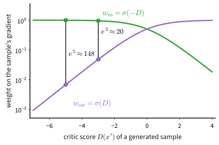

# Generative Adversarial Networks
:label:`sec_basic_gan`

A counterfeiter improves until the police can no longer tell forged notes from real ones. :citet:`Goodfellow.Pouget-Abadie.Mirza.ea.2014` described the game of the chapter introduction with this picture. The generator is the counterfeiter. The police are the critic, a classifier that learns to tell real samples from generated ones, as the domain classifier of :numref:`subsec_covariate-shift-correction` learned to tell training inputs from test inputs. The pair is called a *generative adversarial network* (GAN).

A reader may well be suspicious. A counterfeiter who fools the police has learned to fool these particular police, which is not obviously the same as printing notes that match the real ones. Does a generator that defeats the critic reproduce the data? And while the critic still wins, does it tell the generator which way to move? These are the two questions of this section: what the game measures, and whether it gives the generator a usable signal. Both have answers on paper, because the critic's problem can be solved exactly. We then test the answers on a two-dimensional Gaussian, where every density is known and the fit can be measured in nats, and finally train a generator of Fashion-MNIST garments, where all we can look at are the pictures and the losses.

```{.python .input #gan-generative-adversarial-networks}
%%tab pytorch
import math
import numpy as np
import torch
from torch import nn
from torch.nn import functional as F
from d2l import torch as d2l
```

```{.python .input #gan-generative-adversarial-networks}
%%tab jax
import math
import numpy as np
import jax
from jax import numpy as jnp
from flax import nnx
import optax
from d2l import jax as d2l
```

## From Likelihood to Comparison

### Implicit Generators

Maximum likelihood needs $\log p_\theta(x)$, the model's log-density at each data point. The generators of this chapter are *implicit*: they draw a latent variable $z \sim \mathcal{N}(0, I_{d_z})$ and output $x' = G(z)$, where $G$ is a neural network. When the latent dimension $d_z$ is smaller than the data dimension, the samples lie on a lower-dimensional surface and have no density at all. When the dimensions match, the change-of-variables formula gives the density of $G(z)$ only for an invertible $G$, and only at the cost of the determinant of its Jacobian at every point.

Nor is likelihood what we want from a sampler. Consider a model that mixes the data density with noise,

$$
\tilde p \;=\; 0.01\, p_{\textrm{data}} + 0.99\, p_{\textrm{noise}}.
$$
:eqlabel:`eq_gan_noise_mixture`

Since $\tilde p(x) \geq 0.01\, p_{\textrm{data}}(x)$ everywhere, the expected log-likelihood of $\tilde p$ is within $\log 100 \approx 4.6$ nats of the best achievable by any model, a small shortfall for images, whose log-likelihoods run to thousands of nats. Yet 99 percent of its samples are noise :cite:`Theis.Oord.Bethge.2016`. Judging a sampler requires looking at its samples.

### A Classifier between Real and Generated Samples

A *two-sample test* asks whether two sets of examples came from the same distribution, and one way to run it is to train a classifier to tell them apart. A GAN turns this test into a training signal. Draw a label $y \sim \textrm{Bernoulli}(\tfrac12)$. If $y = 1$, draw $x$ from the data density $p$; if $y = 0$, draw $x$ from the generator density $q$. The marginal density of $x$ is the balanced mixture $m = (p + q)/2$.

The *critic* is a classifier for this problem, a function $D: \mathcal{X} \to \mathbb{R}$ that outputs a *realness logit*: with $\sigma(t) = 1/(1 + e^{-t})$, the value $\sigma(D(x))$ estimates $P(y = 1 \mid x)$. :citet:`Goodfellow.Pouget-Abadie.Mirza.ea.2014` called it the *discriminator*, and our code keeps its letter (`net_D`, `update_D`); the name critic also fits its successors later in the chapter, which score samples without classifying them. It has nothing to do with the critic of actor--critic methods (:numref:`sec_actorcritic`), which estimates a value function.

Training alternates between the two networks, as :numref:`fig_gan` shows. The critic is fitted to separate a batch of data from a batch of generated samples. The generator then changes so that its samples become harder to separate, receiving its gradient through the critic. The symbols $p$, $q$, $m$, $x$, $x'$ and $D$ keep these meanings through the chapter; :numref:`tab_gan_notation` in the chapter introduction collects them with the others.


:label:`fig_gan`

## The Log-Loss Game

The natural loss for a probabilistic classifier is the log loss. The critic's log-likelihood on the balanced labeling problem, without a factor $\tfrac12$, is

$$
V(D) \;=\; \mathbb{E}_{x \sim p}\big[\log \sigma(D(x))\big] + \mathbb{E}_{x' \sim q}\big[\log \sigma(-D(x'))\big],
$$
:eqlabel:`eq_gan_V`

the value function of :citet:`Goodfellow.Pouget-Abadie.Mirza.ea.2014`. The critic maximizes $V$; the generator influences only the second term and minimizes it, so training solves the *minimax* problem $\min_G \max_D V$. Because maximizing $V$ fits the best classifier, $\max_D V$ measures how well $p$ and $q$ can be told apart.

### The Optimal Critic

The maximization over $D$ separates into independent scalar problems. The integrand of :eqref:`eq_gan_V` at a point $x$ is $p(x) \log \sigma(D(x)) + q(x) \log \sigma(-D(x))$, which depends on $D$ only through the number $D(x)$. Writing $u = \sigma(D(x))$, the problem at each point is to maximize $p \log u + q \log(1-u)$, a strictly concave function of $u$ whose stationarity condition $p/u = q/(1-u)$ has the unique solution

$$
\sigma(D^\star(x)) = \frac{p(x)}{p(x) + q(x)} = P(y = 1 \mid x),
\qquad
D^\star(x) = \log \frac{p(x)}{q(x)} = \lambda(x).
$$
:eqlabel:`eq_gan_dstar`

Thus the optimal critic returns the Bayes posterior of the labeling problem, and its logit is the logarithm $\lambda = \log \rho$ of the *density ratio* $\rho = p/q$. Although $q$ has no computable density, a classifier estimates the one function of $q$ the objective needs, just as the domain classifier of covariate shift did. Of all the results in this section, this is the one to remember: every later section of the chapter reads its critic as an estimate of $\lambda$.

The objective also fixes the critic's additive constant. Shifting $D^\star$ by any constant $b \neq 0$ strictly decreases $V$ (Exercise :exref:`ex_gan-log-loss-game-identifies`b), so the sign of the score means something: $D(x) > 0$ says that $x$ is more likely real than generated. We will need this zero level when we ask what a critic that is not at its best response tells the generator.

For two unit Gaussians a distance $\mu$ apart, $p = \mathcal{N}(0, 1)$ and $q = \mathcal{N}(\mu, 1)$, the optimal critic can be written down by hand:

$$
\lambda(x) = -\frac{x^2}{2} + \frac{(x - \mu)^2}{2} = \mu \Big(\frac{\mu}{2} - x\Big),
$$

a linear function of $x$, positive left of the midpoint $\mu/2$. A logistic regression, whose logit is affine in $x$, therefore contains the optimal critic. When the two Gaussians also differ in their covariances, $\lambda$ is quadratic and a nonlinear critic is needed.

### The Value of the Game

Substituting the best response into the objective identifies what the generator minimizes. With $\sigma(D^\star) = p/(2m)$ and $\sigma(-D^\star) = q/(2m)$,

$$
V(D^\star) = \int p \log \frac{p}{2m} + \int q \log \frac{q}{2m}
= D_{\textrm{KL}}(p \,\|\, m) + D_{\textrm{KL}}(q \,\|\, m) - 2 \log 2 .
$$

The two divergences define the Jensen--Shannon divergence $\mathrm{JS}(p, q) = \tfrac12 D_{\textrm{KL}}(p \,\|\, m) + \tfrac12 D_{\textrm{KL}}(q \,\|\, m)$. Hence

$$
\max_D V(D) = 2\,\mathrm{JS}(p, q) - 2 \log 2 .
$$
:eqlabel:`eq_gan_js_value`

Against an optimal critic, the generator minimizes the Jensen--Shannon divergence, which vanishes exactly when $q = p$: a generator that defeats the best possible critic reproduces the data, so the counterfeiter's worry does not arise against the best police.

Read as a loss, $-V$ is the critic's cross-entropy on one real and one generated sample. A critic that guesses, $D = 0$ everywhere, scores $-V = 2 \log 2$, and the best critic does better by $2\,\mathrm{JS}(p, q)$. For the two unit Gaussians, $\mathrm{JS}$ is 0.11 nats at $\mu = 1$, 0.34 at $\mu = 2$ and 0.63 at $\mu = 4$; at $\mu = 8$ it falls short of $\log 2 \approx 0.693$ by less than 0.0001.

Writing $D_{\textrm{KL}}(p \,\|\, m) = -H(p) - \int p \log m$, and likewise for $q$, and collecting the mixture terms into $-H(m)$ shows what the game measures:

$$
\mathrm{JS}(p, q) \;=\; H(m) - \frac{H(p) + H(q)}{2} \;=\; I(x; y).
$$
:eqlabel:`eq_gan_entropy_gap`

The first term is the uncertainty about a sample whose source is unknown, the second the average uncertainty once the source is known. Their difference is the mutual information between a sample $x \sim m$ and its source label $y$: the number of nats that one sample provides about its source. A binary label carries at most $\log 2$ nats, and mutual information is never negative, so $0 \leq \mathrm{JS}(p, q) \leq \log 2$. The upper end is reached exactly when $p$ and $q$ put their mass on disjoint sets, so that every sample identifies its source.

### Separated Supports

The ceiling has a cost: once the supports separate, the value stops depending on how far apart they are. Take two point masses on the line, $p = \delta_0$ and $q_\theta = \delta_\theta$. For every $\theta \neq 0$ their supports are disjoint, $\mathrm{JS}(p, q_\theta) = \log 2$, and the value does not depend on $\theta$. A constant objective supplies no gradient, even when the generator lies arbitrarily close to the data. The two unit Gaussians showed the same flattening, although their supports overlap everywhere: from $\mu = 8$ on, $\mathrm{JS}$ lies within 0.0001 of its ceiling, and moving $q$ further away barely changes the value.

The case is not exotic. A generator that maps a $d_z$-dimensional latent variable into a higher-dimensional space places its samples near a surface of dimension at most $d_z$, and natural images also concentrate near a low-dimensional set, so the two supports are typically disjoint or nearly so :cite:`Arjovsky.Bottou.2017`. An optimal critic then classifies perfectly, and the generator learns nothing from the value of the game.

## The Generator's Gradient

The value describes the game at the critic's best response, but training moves the generator by gradient steps with the critic held fixed. We now follow that gradient.

### Two Weights

The generator influences only the second term of :eqref:`eq_gan_V`, so playing the minimax game literally means minimizing $\mathbb{E}_z[\log \sigma(-D(G(z)))]$ over the generator's parameters $\theta$, with the critic fixed. Differentiating through $x' = G(z)$ with the identity $\tfrac{d}{du} \log \sigma(-u) = -\sigma(u)$ gives

$$
\nabla_\theta \, \mathbb{E}_z\big[\log \sigma(-D(G(z)))\big]
= -\,\mathbb{E}_z\big[\sigma(D(x'))\, \nabla_\theta D(G(z))\big].
$$

A descent step therefore moves each generated sample in the direction that raises its critic score, with weight $\sigma(D(x'))$, the critic's probability that the sample is real. For a sample the critic rejects, $D(x') \ll 0$ and this weight is exponentially small. The loss has *saturated*: the samples the critic rejects most confidently contribute least to the update.

:citet:`Goodfellow.Pouget-Abadie.Mirza.ea.2014` therefore use a different generator loss in practice: rather than minimizing the probability of being called fake, the generator maximizes that of being called real, minimizing $-\mathbb{E}_z[\log \sigma(D(G(z)))]$. With $\tfrac{d}{du} \log \sigma(u) = \sigma(-u)$,

$$
\nabla_\theta \Big({-\mathbb{E}_z\big[\log \sigma(D(G(z)))\big]}\Big)
= -\,\mathbb{E}_z\big[\sigma(-D(x'))\, \nabla_\theta D(G(z))\big].
$$

The two losses move each sample in the *same* direction $\nabla_\theta D$ and differ only in the weight attached to it:

$$
w_{\textrm{sat}}(x') = \sigma(D(x')),
\qquad
w_{\textrm{ns}}(x') = \sigma(-D(x')) = 1 - \sigma(D(x')).
$$
:eqlabel:`eq_gan_weights`

The *non-saturating* weight $w_{\textrm{ns}}$ is near one where the saturating weight is near zero, as :numref:`fig_gan_weights` shows. Their ratio is $w_{\textrm{ns}}/w_{\textrm{sat}} = e^{-D(x')}$: a sample with score $-3$ receives 20 times more weight under the non-saturating loss, one with score $-5$ about 148 times more. The non-saturating loss is the one to use. The saturating loss is the minimax game as written, and we keep it below only to watch it fail.


:label:`fig_gan_weights`

### The Divergence of the Non-Saturating Loss

Which divergence does the non-saturating generator minimize? Suppose the critic has reached its best response to the current generator, $D = \lambda$, and stays there while the generator takes one step. Since $\log \sigma(-D) - \log \sigma(D) = -D$, the non-saturating loss is the difference of two simpler ones:

$$
-\mathbb{E}_{x'}\big[\log \sigma(D(x'))\big]
= \mathbb{E}_{x'}\big[-D(x')\big] - \mathbb{E}_{x'}\big[\log \sigma(-D(x'))\big].
$$

Each term on the right has a known gradient. At $D = \lambda$ the first is $\mathbb{E}_q[\log(q/p)] = D_{\textrm{KL}}(q \,\|\, p)$, and its gradient with the critic held fixed is that of $D_{\textrm{KL}}(q \,\|\, p)$. The second is the saturating loss, the game itself. At the critic's optimum a small change of the critic changes $V$ only to second order, so the gradient of the saturating loss is that of the value, $2\,\mathrm{JS}(p, q)$. Subtracting, the non-saturating gradient is the gradient of $D_{\textrm{KL}}(q \,\|\, p) - 2\,\mathrm{JS}(p, q)$, a result of :citet:`Arjovsky.Bottou.2017`. Exercise :exref:`ex_gan-generator-weight-divergences` fills in the two steps and finds the divergences of other weights.

A difference of two divergences need not be a divergence, and the minus sign in front of $\mathrm{JS}$ even looks as if it rewarded moving $q$ away from $p$. Neither worry survives a short computation. Expand $2\,\mathrm{JS} = D_{\textrm{KL}}(p \,\|\, m) + D_{\textrm{KL}}(q \,\|\, m)$; the two integrals against $q$ combine, since $\log(q/p) - \log(q/m) = \log(m/p)$, and the last step uses $p + q = 2m$:

$$
\begin{aligned}
D_{\textrm{KL}}(q \,\|\, p) - D_{\textrm{KL}}(p \,\|\, m) - D_{\textrm{KL}}(q \,\|\, m)
&= \int q \log \frac{m}{p} + \int p \log \frac{m}{p} \\
&= \int (p + q) \log \frac{m}{p} \;=\; 2\, D_{\textrm{KL}}(m \,\|\, p).
\end{aligned}
$$
:eqlabel:`eq_gan_ns_divergence`

Against a critic held at its best response, the non-saturating generator therefore descends twice the Kullback--Leibler divergence from the mixture $m$ to the data, a divergence that :citet:`Shannon.Poole.Mariooryad.ea.2020` call, up to a constant factor, the *softened reverse KL*. It is zero only at $q = p$, so changing the weight has not moved the fixed point.

The form $2\, D_{\textrm{KL}}(m \,\|\, p)$ also shows which errors the generator is penalized for. Where $q$ puts mass and $p$ has none, $m > 0 = p$ and the divergence is infinite, so drawing what the data never contain is ruled out. Where $p$ has mass that $q$ misses, $m = p/2$ and the integrand stays finite. Missing part of the data is penalized by a finite amount, and the next example shows how small it is.

### Mode Dropping
:label:`subsec_gan_mode_dropping`

A generator that covers only some of the data's modes is said to suffer *mode dropping*. Let us take the simplest case: $p$ an equal mixture of two modes that do not overlap, and $q$ a copy of one of them. On the covered mode $p = q/2$, so $D_{\textrm{KL}}(q \,\|\, p) = \log 2 \approx 0.69$ nats. The Jensen--Shannon divergence is about 0.22 nats, and by :eqref:`eq_gan_ns_divergence` the generator's divergence $2\, D_{\textrm{KL}}(m \,\|\, p)$ is about 0.26 nats. Losing half of the data costs the generator about a quarter of a nat. Maximum likelihood minimizes the other direction, $D_{\textrm{KL}}(p \,\|\, q)$, which is infinite here: a likelihood model that drops a mode assigns zero probability to half of the data.

Worse, at the best response the gradient on the covered mode vanishes. The critic's score there is the constant $\log(p/q) = -\log 2$, so $\nabla_\theta D$ is zero and neither weight pushes toward the missing mode: the best critic cannot point at what the generator lacks.

A real critic is never exactly at its best response, but its scores do not lead the generator to the missing mode either. Suppose a lagging critic scores the generated samples on the covered mode at $D = 3$, confidently real, and the real samples of the missing mode at $D = 5$. Each generated sample receives the non-saturating weight $\sigma(-3) \approx 0.05$, a weak push, and the real samples at $D = 5$ enter the generator's update nowhere. Both weights compare a generated sample's own score with the zero level that the log loss fixes, never with the scores of real data. :numref:`sec_gan_relativistic` asks whether a critic that ranks a generated sample against a real one helps.

## The Game on a Gaussian

The analysis makes three predictions. Near the fixed point the critic should be reduced to guessing. A trained critic should compute $\lambda$. And a generator whose samples the critic rejects confidently should keep learning under the non-saturating loss but stall under the saturating one. To test them we need a case in which the densities are known, so that the fit can be read in nats rather than judged from pictures. Let us therefore start with the simplest such case: Gaussian data and a linear generator, for which $p$, $q$ and $\lambda$ have closed forms and each prediction can be checked against a known answer.

### The Update Rules

In practice both players are networks, updated in turn by gradient steps on minibatches. We write the two updates once; they train the Gaussian generator here and the garment generator at the end of the section, and they are saved to the `d2l` library for the image networks of later sections. The critic's half-step is ordinary logistic regression: it ascends :eqref:`eq_gan_V` on a minibatch, with label one for data and zero for generated samples. Only two details belong to the game, and the comments in the code mark both. The critic's step must not move the generator, so the generated samples enter it as constants; the generator's step must see the critic's latest scores, so it recomputes them. The critic's half-step returns the critic's cross-entropy summed over both batches; divided by the batch size, this is an estimate of $-V$, which is $2 \log 2$ for a critic that guesses.

```{.python .input #gan-the-update-rules-1}
%%tab pytorch
#@save
def update_D(X, Z, net_D, net_G, trainer_D):
    """Update the critic; return its log loss summed over both batches
    (per sample, the sum of two means: 2 log 2 at equilibrium)."""
    trainer_D.zero_grad()
    real_Y = net_D(X)
    # The generator is the fixed player here: detach its output
    fake_Y = net_D(net_G(Z).detach())
    loss_D = (F.binary_cross_entropy_with_logits(
                  real_Y, torch.ones_like(real_Y), reduction='sum') +
              F.binary_cross_entropy_with_logits(
                  fake_Y, torch.zeros_like(fake_Y), reduction='sum'))
    loss_D.backward()
    trainer_D.step()
    return loss_D
```

```{.python .input #gan-the-update-rules-1}
%%tab jax
#@save
@nnx.jit
def update_D(X, Z, net_D, net_G, optimizer_D):
    """Update the critic; return its log loss summed over both batches
    (per sample, the sum of two means: 2 log 2 at equilibrium)."""
    batch_size = X.shape[0]
    fake_X = net_G(Z)  # computed outside the loss: no gradient to net_G
    def loss_D_fn(model_D):
        real_Y = model_D(X).squeeze()
        fake_Y = model_D(fake_X).squeeze()
        return (jnp.sum(optax.sigmoid_binary_cross_entropy(
                    real_Y, jnp.ones(batch_size))) +
                jnp.sum(optax.sigmoid_binary_cross_entropy(
                    fake_Y, jnp.zeros(batch_size))))
    loss_D, grads_D = nnx.value_and_grad(loss_D_fn)(net_D)
    optimizer_D.update(net_D, grads_D)
    return loss_D
```

The generator's half-step implements the non-saturating loss of :eqref:`eq_gan_weights`: generated samples are fed to the critic under the label *one*, so that the cross-entropy is $-\mathbb{E}[\log \sigma(D(G(z)))]$. For a sample the critic cannot place, $D = 0$, this loss is $\log 2$.

```{.python .input #gan-the-update-rules-2}
%%tab pytorch
#@save
def update_G(Z, net_D, net_G, trainer_G):
    """Update the generator on the non-saturating loss; return its sum."""
    trainer_G.zero_grad()
    # net_D changed in its half-step, so recompute the scores
    fake_Y = net_D(net_G(Z))
    loss_G = F.binary_cross_entropy_with_logits(
        fake_Y, torch.ones_like(fake_Y), reduction='sum')
    loss_G.backward()  # also fills net_D's .grad (update_D zeroes it)
    trainer_G.step()
    return loss_G
```

```{.python .input #gan-the-update-rules-2}
%%tab jax
#@save
@nnx.jit
def update_G(Z, net_D, net_G, optimizer_G):
    """Update the generator on the non-saturating loss; return its sum."""
    # Both networks are arguments, so critics with mutable state (batch
    # norm) work too; argnums=0 differentiates the generator only
    def loss_G_fn(model_G, model_D):
        fake_Y = model_D(model_G(Z)).squeeze()
        return jnp.sum(optax.sigmoid_binary_cross_entropy(
            fake_Y, jnp.ones(Z.shape[0])))
    loss_G, grads_G = nnx.value_and_grad(loss_G_fn, argnums=0)(net_G, net_D)
    optimizer_G.update(net_G, grads_G)
    return loss_G
```

The loop `train_gan` alternates the two half-steps over minibatches, drawing a fresh latent batch of dimension `latent_dim` for each. For every epoch it returns two numbers: the critic's loss as the sum of its two batch means, which is $2 \log 2$ for a guessing critic, and the generator's mean loss, which is $\log 2$ at $D = 0$. An optional callback `on_epoch` receives the number of each finished epoch, and an optional `ema` keeps a running average of the generator's weights for later sections.

Both players use Adam with $\beta_1 = 0.5$ instead of the default 0.9, the DCGAN setting of :citet:`Radford.Metz.Chintala.2015`. The usual explanation is that a shorter memory of past gradients lets each player respond sooner to the other's latest move.

```{.python .input #gan-training-1}
%%tab pytorch
#@save
def train_gan(net_D, net_G, data_iter, num_epochs, latent_dim, lr_D, lr_G,
              step_G=update_G, seed=None, on_epoch=None, ema=None):
    """Alternate update_D and step_G over the minibatches with Adam
    (beta_1 = 0.5), calling ema.update(net_G) after every generator step
    and on_epoch(epoch) after each epoch if given; return each epoch's
    per-sample losses (loss_D, the sum of the critic's two batch means,
    and loss_G)."""
    if seed is not None:
        torch.manual_seed(seed)
    trainer_D = torch.optim.Adam(net_D.parameters(), lr=lr_D,
                                 betas=(0.5, 0.999))
    trainer_G = torch.optim.Adam(net_G.parameters(), lr=lr_G,
                                 betas=(0.5, 0.999))
    history = []
    for epoch in range(1, num_epochs + 1):
        loss_D, loss_G, n = 0, 0, 0  # summed on the device, read once
        for X, *_ in data_iter:  # labels, if any, are ignored
            Z = torch.randn(X.shape[0], latent_dim, device=X.device)
            loss_D += update_D(X, Z, net_D, net_G, trainer_D).detach()
            loss_G += step_G(Z, net_D, net_G, trainer_G).detach()
            if ema is not None:
                ema.update(net_G)
            n += X.shape[0]
        history.append(torch.stack([loss_D, loss_G]) / n)
        if on_epoch is not None:
            on_epoch(epoch)
    return torch.stack(history).cpu().numpy()
```

```{.python .input #gan-training-1}
%%tab jax
#@save
def train_gan(net_D, net_G, data_iter, num_epochs, latent_dim, lr_D, lr_G,
              step_G=update_G, seed=None, on_epoch=None, ema=None):
    """Alternate update_D and step_G over the minibatches with Adam
    (beta_1 = 0.5), calling ema.update(net_G) after every generator step
    and on_epoch(epoch) after each epoch if given; return each epoch's
    per-sample losses (loss_D, the sum of the critic's two batch means,
    and loss_G)."""
    key = d2l.get_key() if seed is None else jax.random.key(seed)
    optimizer_D = nnx.Optimizer(net_D, optax.adam(lr_D, b1=0.5),
                                wrt=nnx.Param)
    optimizer_G = nnx.Optimizer(net_G, optax.adam(lr_G, b1=0.5),
                                wrt=nnx.Param)
    history = []
    for epoch in range(1, num_epochs + 1):
        loss_D, loss_G, n = 0.0, 0.0, 0  # summed on the device, read once
        for X, *_ in data_iter:  # labels, if any, are ignored
            key, subkey = jax.random.split(key)
            Z = jax.random.normal(subkey, (X.shape[0], latent_dim))
            loss_D += update_D(X, Z, net_D, net_G, optimizer_D)
            loss_G += step_G(Z, net_D, net_G, optimizer_G)
            if ema is not None:
                ema.update(net_G)
            n += X.shape[0]
        history.append((loss_D / n, loss_G / n))
        if on_epoch is not None:
            on_epoch(epoch)
    return np.array(history)
```

### A Linear Generator with Known Densities
:label:`subsec_gan_training`

The data are a standard Gaussian pushed through a fixed linear map, $x = z A + \mu_p$ with $z \sim \mathcal{N}(0, I_2)$, so $p = \mathcal{N}(\mu_p, A^\top A)$; the code calls the offset `b`. The data form a thin tilted ellipse, whose orientation and two very different scales the generator must learn. Training uses a fixed sample of one thousand draws.

```{.python .input #gan-data-and-models-1}
%%tab pytorch
torch.manual_seed(0)
Z = torch.normal(0.0, 1.0, (1000, 2))
A = torch.tensor([[1.0, 2.0], [-0.1, 0.5]])
b = torch.tensor([1.0, 2.0])
data = Z @ A + b
print(f'covariance of the data distribution:\n{A.T @ A}')
```

```{.python .input #gan-data-and-models-1}
%%tab jax
Z = jax.random.normal(jax.random.key(0), (1000, 2))
A = jnp.array([[1.0, 2.0], [-0.1, 0.5]])
b = jnp.array([1.0, 2.0])
data = Z @ A + b
print(f'covariance of the data distribution:\n{A.T @ A}')
```

The generator is a single linear layer, so its output is Gaussian with a mean and covariance read off the weights. The critic has two hidden layers of 16 leaky ReLU units, which pass negative inputs with slope 0.2 instead of zeroing them. They keep the critic's score surface sloped, so the generator almost always receives a direction (Exercise :exref:`ex_gan-dead-critic` replaces them by tanh units). A factory function builds both networks from a fixed seed, so that later cells can restart from the same initialization.

```{.python .input #gan-data-and-models-2}
%%tab pytorch
def make_nets(seed=7):
    """The linear generator and the critic, all weights and offsets drawn
    from N(0, 0.02^2) by a generator seeded with seed."""
    gen = torch.Generator().manual_seed(seed)
    net_G = nn.Sequential(nn.Linear(2, 2))
    net_D = nn.Sequential(nn.Linear(2, 16), nn.LeakyReLU(0.2),
                          nn.Linear(16, 16), nn.LeakyReLU(0.2),
                          nn.Linear(16, 1))
    for w in [*net_G.parameters(), *net_D.parameters()]:
        nn.init.normal_(w, 0, 0.02, generator=gen)
    return net_G, net_D
```

```{.python .input #gan-data-and-models-2}
%%tab jax
def make_nets(seed=7):
    """The linear generator and the critic, all weights and offsets drawn
    from N(0, 0.02^2) with keys from seed."""
    normal = nnx.initializers.normal(0.02)
    dense = lambda m, n, rngs: nnx.Linear(m, n, kernel_init=normal,
                                          bias_init=normal, rngs=rngs)
    leaky = lambda x: nnx.leaky_relu(x, 0.2)
    rngs_G, rngs_D = nnx.Rngs(seed), nnx.Rngs(seed + 1)
    net_G = nnx.Sequential(dense(2, 2, rngs_G))
    net_D = nnx.Sequential(dense(2, 16, rngs_D), leaky,
                           dense(16, 16, rngs_D), leaky,
                           dense(16, 1, rngs_D))
    return net_G, net_D
```

We train for twenty epochs in minibatches of eight, giving the critic ten times the generator's learning rate so that its scores stay close to their best response.

```{.python .input #gan-training-2}
%%tab pytorch
data_iter = d2l.load_array((data,), batch_size=8)
net_G, net_D = make_nets()
history = train_gan(net_D, net_G, data_iter, num_epochs=20, latent_dim=2,
                    lr_D=0.05, lr_G=0.005, seed=1)
with torch.no_grad():
    fake = net_G(torch.normal(0, 1, (200, 2)))
```

```{.python .input #gan-training-2}
%%tab jax
data_iter = d2l.ArrayLoader((data,), batch_size=8, shuffle=True,
                            key=jax.random.key(6))
net_G, net_D = make_nets()
history = train_gan(net_D, net_G, data_iter, num_epochs=20, latent_dim=2,
                    lr_D=0.05, lr_G=0.005, seed=1)
fake = net_G(jax.random.normal(jax.random.key(4), (200, 2)))
```

The left panel tracks both losses against their values at the fixed point, $2 \log 2$ for the critic and $\log 2$ for the generator; the right panel overlays generated samples on the data.

```{.python .input #gan-training-3}
%%tab pytorch, jax
fig, axes = d2l.plt.subplots(1, 2, figsize=(9, 3.2))
epochs = list(range(1, len(history) + 1))
d2l.plot(epochs, [history[:, 0], history[:, 1], [2 * math.log(2)] * len(epochs),
                  [math.log(2)] * len(epochs)],
         'epoch', 'loss',
         legend=['critic', 'generator', '2 log 2', 'log 2'],
         fmts=('C0-', 'C1--', 'C0:', 'C1:'), axes=axes[0])
d2l.plot([data[:100, 0], fake[:100, 0]], [data[:100, 1], fake[:100, 1]],
         legend=['real', 'generated'], fmts=('C0.', 'C1.'), axes=axes[1])
fig.tight_layout()
```

The critic wins the first epoch, while the generated samples are still a speck near the origin, and loses its edge as they spread: its loss rises to $2 \log 2$ within about ten epochs and then stays at that level, apart from brief excursions that the next epoch undoes. That is what it should do if $\mathrm{JS}$ approaches zero, since the best critic's loss is $2 \log 2 - 2\,\mathrm{JS}(p, q)$. The generator's loss falls to $\log 2$, its value when the critic cannot place a sample, and the generated samples fill the data's ellipse. Still, a critic loss of $2 \log 2$ shows only that this critic can no longer separate the samples, not that $q = p$, so we check the fit independently.

### The Fit in Nats
:label:`subsec_gan_fit`

A linear generator $G(z) = z A_q + \mu_q$ produces the Gaussian $q = \mathcal{N}(\mu_q, A_q^\top A_q)$, and between Gaussians in $d_x$ dimensions the Kullback--Leibler divergence has the closed form :cite:`Kullback.1959`

$$
D_{\textrm{KL}}\big(\mathcal{N}(\mu_0, \Sigma_0) \,\|\, \mathcal{N}(\mu_1, \Sigma_1)\big)
= \tfrac12 \Big[ \operatorname{tr}(\Sigma_1^{-1} \Sigma_0)
+ (\mu_1 - \mu_0)^\top \Sigma_1^{-1} (\mu_1 - \mu_0)
- d_x + \log \tfrac{\det \Sigma_1}{\det \Sigma_0} \Big],
$$
:eqlabel:`eq_gan_mvn_kl`

the multivariate form of the univariate formula of :numref:`sec_mdl-information_theory`. We report $D_{\textrm{KL}}(q \,\|\, p)$ at initialization and after training. If the losses above are telling the truth, the second number should be close to zero.

```{.python .input #gan-quantifying-the-fit}
%%tab pytorch
def generator_gaussian(net_G):
    A_qT, b_q = net_G[0].weight.detach(), net_G[0].bias.detach()
    return b_q, A_qT @ A_qT.T  # nn.Linear stores A_q.T

def kl_gaussians(mu0, S0, mu1, S1):
    diff = mu1 - mu0
    return 0.5 * (torch.trace(torch.linalg.solve(S1, S0))
                  + diff @ torch.linalg.solve(S1, diff) - len(mu0)
                  + torch.logdet(S1) - torch.logdet(S0))

mu_p, Sigma_p = b, A.T @ A
for name, net in [('at initialization', make_nets()[0]),
                  ('after training   ', net_G)]:
    mu_q, Sigma_q = generator_gaussian(net)
    print(f'KL(q || p) {name}: '
          f'{kl_gaussians(mu_q, Sigma_q, mu_p, Sigma_p):.3f} nats')
```

```{.python .input #gan-quantifying-the-fit}
%%tab jax
def generator_gaussian(net_G):
    A_q, b_q = net_G.layers[0].kernel[...], net_G.layers[0].bias[...]
    return b_q, A_q.T @ A_q

def kl_gaussians(mu0, S0, mu1, S1):
    diff = mu1 - mu0
    return 0.5 * (jnp.trace(jnp.linalg.solve(S1, S0))
                  + diff @ jnp.linalg.solve(S1, diff) - len(mu0)
                  + jnp.linalg.slogdet(S1)[1] - jnp.linalg.slogdet(S0)[1])

mu_p, Sigma_p = b, A.T @ A
for name, net in [('at initialization', make_nets()[0]),
                  ('after training   ', net_G)]:
    mu_q, Sigma_q = generator_gaussian(net)
    print(f'KL(q || p) {name}: '
          f'{kl_gaussians(mu_q, Sigma_q, mu_p, Sigma_p):.3f} nats')
```

The training loop never evaluated the generator's density, yet the divergence falls from about eight nats at initialization to a few hundredths of a nat. The critic told the generator everything it needed to know about $q$. Most of the initial eight nats measure the generator's spread, not its position. Its weights start at a scale of 0.02, so the initial $q$ is a speck near the origin, and $D_{\textrm{KL}}(q \,\|\, p) = -H(q) - \mathbb{E}_q[\log p]$ penalizes a distribution of so little entropy heavily: almost all of the initial divergence sits in the log-determinant term of :eqref:`eq_gan_mvn_kl`.

### The Learned Density Ratio
:label:`subsec_gan_verify_critic`

:eqref:`eq_gan_dstar` says that the best response to a *fixed* generator computes $\lambda = \log(p/q)$. We saw a classifier do this in :numref:`subsec_covariate-shift-correction`, where $\lambda$ was linear. Here the covariances of $p$ and $q$ differ, so $\lambda$ is quadratic and the critic must be a network, and with the true $\lambda$ at hand we can see where a learned critic goes wrong. After the run above, $\lambda$ is close to zero everywhere, and even a constant critic would look accurate. We therefore set a generator by hand, $A_q = [[1, 2], [-0.5, 0.5]]$ and $\mu_q = (1.5, 1.5)$, a Gaussian $q$ at $D_{\textrm{KL}}(q \,\|\, p) \approx 3.4$ nats from the data, and train a fresh critic against it alone for 2,000 steps.

```{.python .input #gan-verifying-the-optimal-critic-1}
%%tab pytorch
net_G_q, net_D_q = make_nets()  # a fresh critic
with torch.no_grad():  # the hand-set generator; nn.Linear stores A_q.T
    net_G_q[0].weight.copy_(torch.tensor([[1.0, -0.5], [2.0, 0.5]]))
    net_G_q[0].bias.copy_(torch.tensor([1.5, 1.5]))
trainer_D = torch.optim.Adam(net_D_q.parameters(), lr=0.01)
torch.manual_seed(2)
for _ in range(2000):  # critic-only steps against the frozen generator
    X = data[torch.randint(0, len(data), (256,))]
    Zb = torch.normal(0, 1, (256, 2))
    update_D(X, Zb, net_D_q, net_G_q, trainer_D)
```

```{.python .input #gan-verifying-the-optimal-critic-1}
%%tab jax
net_G_q, net_D_q = make_nets()  # a fresh critic
net_G_q.layers[0].kernel[...] = jnp.array([[1.0, 2.0], [-0.5, 0.5]])  # A_q
net_G_q.layers[0].bias[...] = jnp.array([1.5, 1.5])  # b_q
optimizer_D = nnx.Optimizer(net_D_q, optax.adam(0.01), wrt=nnx.Param)
key = jax.random.key(2)
for _ in range(2000):  # critic-only steps against the frozen generator
    key, k1, k2 = jax.random.split(key, 3)
    X = data[jax.random.randint(k1, (256,), 0, len(data))]
    Zb = jax.random.normal(k2, (256, 2))
    update_D(X, Zb, net_D_q, net_G_q, optimizer_D)
```

We compare the critic with the analytic $\lambda$, a difference of two Gaussian log densities, at two hundred real and two hundred generated samples, through the correlation and the fraction $R^2$ of the variance of $\lambda$ that the critic explains. The best constant critic, the mean of $\lambda$, has $R^2 = 0$.

```{.python .input #gan-verifying-the-optimal-critic-2}
%%tab pytorch
def gaussian_logpdf(x, mu, Sigma):
    diff = x - mu
    sol = torch.linalg.solve(Sigma, diff.T).T
    return -0.5 * ((diff * sol).sum(1)
                   + torch.logdet(2 * torch.pi * Sigma))

mu_q, Sigma_q = generator_gaussian(net_G_q)
with torch.no_grad():
    xs = torch.cat([data[:200], net_G_q(torch.normal(0, 1, (200, 2)))])
    lam = (gaussian_logpdf(xs, b, A.T @ A)
           - gaussian_logpdf(xs, mu_q, Sigma_q))
    D_out = net_D_q(xs).squeeze()
r2 = 1 - ((D_out - lam) ** 2).mean() / ((lam - lam.mean()) ** 2).mean()
print(f'correlation {torch.corrcoef(torch.stack([lam, D_out]))[0, 1]:.3f}, '
      f'R^2 {r2:.3f}')
```

```{.python .input #gan-verifying-the-optimal-critic-2}
%%tab jax
def gaussian_logpdf(x, mu, Sigma):
    diff = x - mu
    sol = jnp.linalg.solve(Sigma, diff.T).T
    return -0.5 * ((diff * sol).sum(1)
                   + jnp.linalg.slogdet(2 * jnp.pi * Sigma)[1])

mu_q, Sigma_q = generator_gaussian(net_G_q)
key, subkey = jax.random.split(key)
xs = jnp.concatenate([data[:200],
                      net_G_q(jax.random.normal(subkey, (200, 2)))])
lam = (gaussian_logpdf(xs, b, A.T @ A)
       - gaussian_logpdf(xs, mu_q, Sigma_q))
D_out = net_D_q(xs).squeeze()
r2 = 1 - ((D_out - lam) ** 2).mean() / ((lam - lam.mean()) ** 2).mean()
print(f'correlation {jnp.corrcoef(jnp.stack([lam, D_out]))[0, 1]:.3f}, '
      f'R^2 {r2:.3f}')
```

In the scatter plot a perfect critic lies on the dashed diagonal.

```{.python .input #gan-the-learned-density-ratio-1}
%%tab pytorch, jax
lims = [float(lam.min()), float(lam.max())]
d2l.plot([lam[:200], lam[200:], lims], [D_out[:200], D_out[200:], lims],
         r'analytic $\lambda = \log(p/q)$', 'critic output $D$',
         legend=['at real samples', 'at generated samples', r'$D = \lambda$'],
         fmts=('C0.', 'C1.', 'k--'), figsize=(4.2, 3.4))
```

From samples alone, the critic has learned the log density ratio: the correlation exceeds 0.98, and the critic explains more than 90 percent of the variance of $\lambda$. The points leave the diagonal at the most negative values of $\lambda$, at generated samples where $p$ is nearly zero, and there the critic is milder than $\lambda$. Two things combine. The critic is a leaky-ReLU network, piecewise linear in $x$, and beyond the samples it has seen it continues linearly, while $\lambda$, a quadratic, keeps falling faster. And the log loss does almost nothing to correct it there. A generated sample contributes $-\log \sigma(-D)$ to the critic's loss, whose derivative in the score is $\sigma(D)$, about $3 \cdot 10^{-7}$ at $D = -15$. This is the saturating weight $w_{\textrm{sat}}$ again, seen from the critic's side: once the critic is confident, it is hardly pushed to be more so. The objective constrains the critic only where the mixture $m$ has appreciable mass and the critic is still unsure, so the estimate is least accurate where the ratio is most extreme.

### Saturating and Non-Saturating Losses Compared
:label:`subsec_gan_saturation`

Testing the two weights of :eqref:`eq_gan_weights` needs a start at which they differ. The initial generator above emits samples about one standard deviation from the data mean, which the critic never rejects confidently enough to drive $w_{\textrm{sat}}$ toward zero. We therefore move the generator's offset $\mu_q$ by $(-6, 6)$, about eight units from the data mean. The saturating update minimizes $\mathbb{E}_z[\log \sigma(-D(G(z)))]$, the minimax game taken literally.

```{.python .input #gan-saturating-and-non-saturating-losses-compared-2}
%%tab pytorch
def update_G_saturating(Z, net_D, net_G, trainer_G):
    trainer_G.zero_grad()
    fake_Y = net_D(net_G(Z))
    # log sigma(-D) is minus the cross-entropy under the label zero
    loss_G = -F.binary_cross_entropy_with_logits(
        fake_Y, torch.zeros_like(fake_Y), reduction='sum')
    loss_G.backward()
    trainer_G.step()
    return loss_G
```

```{.python .input #gan-saturating-and-non-saturating-losses-compared-2}
%%tab jax
@nnx.jit
def update_G_saturating(Z, net_D, net_G, optimizer_G):
    def loss_G_fn(model_G, model_D):
        fake_Y = model_D(model_G(Z)).squeeze()
        # log sigma(-D) is minus the cross-entropy under the label zero
        return -jnp.sum(optax.sigmoid_binary_cross_entropy(
            fake_Y, jnp.zeros(Z.shape[0])))
    loss_G, grads_G = nnx.value_and_grad(loss_G_fn, argnums=0)(net_G, net_D)
    optimizer_G.update(net_G, grads_G)
    return loss_G
```

Two arms start from the same initialization and differ only in the generator loss. The cell trains each arm three times, and within a run both arms see the same minibatches and latent draws. After every epoch the callback `on_epoch` records the generator's samples at one fixed set of latent draws. The generator learns at 0.01, twice the rate of the run above. Adam moves each parameter by roughly its learning rate per step, and the first coordinate of $\mu_q$ has about seven units to travel: some 1,400 steps at the slower rate, eleven of the twenty epochs of 125 minibatches, and half as many at 0.01.

The weights predict the outcome. The critic will reject the distant samples at once, so $w_{\textrm{sat}} = \sigma(D(x'))$ should be nearly zero, and the saturating generator should not move. The helper `far_start` builds the shifted pair for every run, and the cell first prints how far that start lies from the data.

```{.python .input #gan-saturating-versus-non-saturating-training-1}
%%tab pytorch
def far_start():
    """make_nets with the generator's offset moved by (-6, 6)."""
    net_G, net_D = make_nets()
    with torch.no_grad():
        net_G[0].bias += torch.tensor([-6.0, 6.0])
    return net_G, net_D

mu_q, Sigma_q = generator_gaussian(far_start()[0])
print(f'start of every run: KL(q || p) = '
      f'{kl_gaussians(mu_q, Sigma_q, mu_p, Sigma_p):.2f} nats')
torch.manual_seed(3)
Z_show = torch.randn(200, 2)  # one latent sample for every snapshot
runs = {}  # name: (losses, snapshots) of the first run, for the plot
for name, step in [('non-saturating', update_G),
                   ('saturating', update_G_saturating)]:
    kls = []
    for seed in (1, 2, 3):  # both arms see the same minibatches and draws
        net_G_ab, net_D_ab = far_start()
        snaps = {}  # epoch: generated samples
        hist = train_gan(net_D_ab, net_G_ab, data_iter, num_epochs=20,
                         latent_dim=2, lr_D=0.05, lr_G=0.01, step_G=step,
                         seed=seed, on_epoch=lambda epoch: snaps.update(
                             {epoch: net_G_ab(Z_show).detach()}))
        runs.setdefault(name, (hist, snaps))
        mu_q, Sigma_q = generator_gaussian(net_G_ab)
        kls.append(f'{kl_gaussians(mu_q, Sigma_q, mu_p, Sigma_p):.2f}')
    print(f'{name}: final KL(q || p) = {", ".join(kls)} nats')
```

```{.python .input #gan-saturating-versus-non-saturating-training-1}
%%tab jax
def far_start():
    """make_nets with the generator's offset moved by (-6, 6)."""
    net_G, net_D = make_nets()
    net_G.layers[0].bias[...] += jnp.array([-6.0, 6.0])
    return net_G, net_D

mu_q, Sigma_q = generator_gaussian(far_start()[0])
print(f'start of every run: KL(q || p) = '
      f'{kl_gaussians(mu_q, Sigma_q, mu_p, Sigma_p):.2f} nats')
Z_show = jax.random.normal(jax.random.key(5), (200, 2))  # for every snapshot
runs = {}  # name: (losses, snapshots) of the first run, for the plot
for name, step in [('non-saturating', update_G),
                   ('saturating', update_G_saturating)]:
    kls = []
    for seed in (1, 2, 3):  # both arms see the same minibatches and draws
        net_G_ab, net_D_ab = far_start()
        data_iter_ab = d2l.ArrayLoader((data,), batch_size=8, shuffle=True,
                                       key=jax.random.key(seed - 1))
        snaps = {}  # epoch: generated samples
        hist = train_gan(net_D_ab, net_G_ab, data_iter_ab, num_epochs=20,
                         latent_dim=2, lr_D=0.05, lr_G=0.01, step_G=step,
                         seed=seed, on_epoch=lambda epoch: snaps.update(
                             {epoch: net_G_ab(Z_show)}))
        runs.setdefault(name, (hist, snaps))
        mu_q, Sigma_q = generator_gaussian(net_G_ab)
        kls.append(f'{kl_gaussians(mu_q, Sigma_q, mu_p, Sigma_p):.2f}')
    print(f'{name}: final KL(q || p) = {", ".join(kls)} nats')
```

The first two panels show each arm's samples after five and twenty epochs of the first run; the third shows both critics' losses.

```{.python .input #gan-saturating-and-non-saturating-losses-compared-1}
%%tab pytorch, jax
fig, axes = d2l.plt.subplots(1, 3, figsize=(10.5, 3.2))
for ax, (name, (hist, snaps)) in zip(axes[:2], runs.items()):
    d2l.plot([data[:150, 0], snaps[5][:, 0], snaps[20][:, 0]],
             [data[:150, 1], snaps[5][:, 1], snaps[20][:, 1]],
             legend=['real', 'epoch 5', 'epoch 20'],
             fmts=('C0.', 'C1+', 'C1.'), axes=ax)
    ax.set_title(name)
epochs = list(range(1, 21))
d2l.plot(epochs, [runs['non-saturating'][0][:, 0],
                  runs['saturating'][0][:, 0], [2 * math.log(2)] * 20],
         'epoch', 'critic loss', legend=['non-saturating', 'saturating',
                                         '2 log 2'],
         fmts=('-', '--', 'k:'), axes=axes[2])
fig.tight_layout()
```

For the first two epochs the two critics behave alike: both reject every generated sample, and both losses fall to nearly zero. The critics agree; only the weights differ. The saturating generator hardly moves. Its critic's loss stays at zero, so $\sigma(D(x')) \approx 0$ for every generated sample, and every run ends between 334 and 341 nats from the data, against about 345 at the start. The non-saturating generator crosses to the data within the first few epochs: by epoch five its samples lie in the data region, though not yet centered on it. By epoch twenty they fill the ellipse, $D_{\textrm{KL}}(q \,\|\, p)$ is a few hundredths of a nat in every run, and its critic's loss is back near $2 \log 2$. The two arms end more than three hundred nats apart, while the runs within either arm differ by a few nats at most, so the weight alone decides the outcome.

The non-saturating weight amplifies the factor $\nabla_\theta D$ but cannot create it. Here the critic's score surface slopes toward the data even far from them; an optimal critic on separated supports offers no slope, and no choice of weight helps.

## The Game on Fashion-MNIST
:label:`subsec_gan_fashion_mnist`

On the Gaussian every prediction of the analysis checked out against a known answer. Images take the known answers away: neither density can be evaluated, so we can say neither how far $q$ is from $p$ nor whether the critic computes $\lambda$. What remains are the pictures and the two losses, and the losses turn out to say less than one would like.

Fashion-MNIST, the $28 \times 28$ grayscale images of ten kinds of clothing from :numref:`sec_fashion_mnist`, gives a first test on images. Both players are multilayer perceptrons with leaky ReLU units of slope 0.2. The generator maps 100 latent numbers through hidden layers of 256 and 512 units to 784 pixels, with a final tanh for the range $[-1, 1]$ to which we scale the images. The critic mirrors it, from 784 inputs through 512 and 256 units to one logit. The function `make_mlp` builds such a perceptron from its list of layer widths, with the activation `act` between consecutive linear layers; it is saved for the small networks of later sections.

```{.python .input #gan-garments-from-noise-5}
%%tab pytorch
#@save
def make_mlp(sizes, act):
    """Linear layers of the given widths with the activation module act
    between them; weights uniform in +-1/sqrt(fan_in), zero biases."""
    layers = []
    for d_in, d_out in zip(sizes[:-1], sizes[1:]):
        linear = nn.Linear(d_in, d_out)  # weights uniform by default
        nn.init.zeros_(linear.bias)
        layers += [linear, act]
    return nn.Sequential(*layers[:-1])
```

```{.python .input #gan-garments-from-noise-5}
%%tab jax
#@save
def make_mlp(sizes, act, *, rngs):
    """Linear layers of the given widths with the activation function act
    between them; weights uniform in +-1/sqrt(fan_in), zero biases."""
    init = nnx.initializers.variance_scaling(1 / 3, 'fan_in', 'uniform')
    layers = []
    for d_in, d_out in zip(sizes[:-1], sizes[1:]):
        layers += [nnx.Linear(d_in, d_out, kernel_init=init, rngs=rngs), act]
    return nnx.Sequential(*layers[:-1])
```

```{.python .input #gan-garments-from-noise-1}
%%tab pytorch
torch.manual_seed(0)
fmnist = d2l.FashionMNIST()
# All 60,000 training images as rows of 784 pixels in [-1, 1]
images = fmnist.train.data.reshape(-1, 784).float() / 127.5 - 1
image_iter = d2l.load_array((images,), batch_size=64)
leaky = nn.LeakyReLU(0.2)
net_G_img = nn.Sequential(make_mlp([100, 256, 512, 784], leaky), nn.Tanh())
net_D_img = make_mlp([784, 512, 256, 1], leaky)
```

```{.python .input #gan-garments-from-noise-1}
%%tab jax
fmnist = d2l.FashionMNIST()
# All 60,000 training images as rows of 784 pixels in [-1, 1]
images = fmnist.train[0].reshape(-1, 784).astype(np.float32) / 127.5 - 1
image_iter = d2l.ArrayLoader((images,), batch_size=64, shuffle=True,
                             key=jax.random.key(3))
rngs = nnx.Rngs(0)
leaky = lambda x: nnx.leaky_relu(x, 0.2)
net_G_img = nnx.Sequential(make_mlp([100, 256, 512, 784], leaky, rngs=rngs),
                           jnp.tanh)
net_D_img = make_mlp([784, 512, 256, 1], leaky, rngs=rngs)
```

Both players learn at the DCGAN's rate of $2 \cdot 10^{-4}$, on minibatches of 64, for twenty epochs (almost 19,000 iterations).

```{.python .input #gan-garments-from-noise-2}
%%tab pytorch, jax
history_img = train_gan(net_D_img, net_G_img, image_iter, num_epochs=20,
                        latent_dim=100, lr_D=2e-4, lr_G=2e-4, seed=1)
print(f'last epoch: critic loss {history_img[-1, 0]:.2f}, '
      f'generator loss {history_img[-1, 1]:.2f}')
```

We draw thirty samples from fresh latent draws.

```{.python .input #gan-garments-from-noise-3}
%%tab pytorch
with torch.no_grad():
    fake_img = net_G_img(torch.randn(30, 100))
d2l.show_images(fake_img.reshape(30, 28, 28), 2, 15, scale=0.9, cmap='gray');
```

```{.python .input #gan-garments-from-noise-3}
%%tab jax
fake_img = net_G_img(jax.random.normal(jax.random.key(2), (30, 100)))
d2l.show_images(fake_img.reshape(30, 28, 28), 2, 15, scale=0.9, cmap='gray');
```

Most samples are recognizable garments, tops and shoes among them, and a few are shapeless. Their interiors are grainy and speckled: neither network knows that neighboring pixels belong together, which convolutional networks build in. The losses show how the game went; each panel draws one player's loss against its own equilibrium value.

```{.python .input #gan-garments-from-noise-4}
%%tab pytorch, jax
epochs = list(range(1, len(history_img) + 1))
fig, axes = d2l.plt.subplots(1, 2, figsize=(9, 3), sharex=True)
for ax, loss, ref, name, ref_name, fmt in zip(
        axes, history_img.T, (2 * math.log(2), math.log(2)),
        ('critic', 'generator'), ('2 log 2', 'log 2'), ('C0-', 'C1--')):
    d2l.plot(epochs, [loss, [ref] * len(epochs)], 'epoch', f'{name} loss',
             legend=[name, ref_name], fmts=(fmt, 'k:'), axes=ax)
fig.tight_layout()
```

Within the first epoch the critic pulls ahead: its loss lies far below $2 \log 2$ and the generator's far above $\log 2$. Both then drift slowly back toward these values. After twenty epochs the critic's loss is about 1.05 against $2 \log 2 \approx 1.39$, and the generator's about 1.4 against $\log 2 \approx 0.69$. The critic still tells real garments from generated ones better than chance. What the losses cannot say is why. A critic ahead of the game may face a generator that is still wrong, or it may have learned, with about 530,000 parameters, the 60,000 training images it sees every epoch (Exercise :exref:`ex_gan-finite-sample-critic`). Nor can they say whether every kind of garment is drawn as often as in the data (Exercise :exref:`ex_gan-class-coverage`), or whether more epochs would bring both players to their equilibrium values. On the Gaussian we could look behind the losses. On images we cannot, and that is the usual situation for a GAN.

## Summary

A GAN trains a sampler that has no density by replacing the likelihood with a learned comparison: a critic learns to tell real from generated samples, and the generator learns to defeat it. With the log loss, the optimal critic's logit is the log density ratio $\lambda = \log(p/q)$, and the value of the game is $2\,\mathrm{JS}(p, q) - 2 \log 2$, where $\mathrm{JS}$ is the information one sample carries about its source. Against a critic held at its best response, the non-saturating generator loss descends $2\, D_{\textrm{KL}}(m \,\|\, p)$: it keeps the fixed point $q = p$ and keeps learning from samples the critic rejects, but it penalizes a dropped mode little. On a two-dimensional Gaussian these predictions check out in nats. On Fashion-MNIST two perceptrons draw mostly recognizable garments, while the losses show a critic that stays ahead and cannot tell us why it does. The log loss is one choice among many: its Jensen--Shannon value stops changing once the supports separate, and on images its losses say little about the fit. :numref:`sec_gan_objectives` asks what other losses and critic classes measure, and which of them keep a gradient.

## Exercises

1. **Excess loss and the additive constant.** Let $\eta = p / (p + q)$ and
   let $D_{\textrm{b}}(a \,\|\, u)$ be the Kullback--Leibler divergence
   between Bernoulli distributions with success probabilities $a$ and $u$.
    1. Show that every critic satisfies
       $V(D^\star) - V(D) = 2\, \mathbb{E}_{m}\big[D_{\textrm{b}}(\eta \,\|\, \sigma(D))\big]$,
       so that $D^\star$ is the unique maximizer of :eqref:`eq_gan_V` up to
       $m$-null sets.
    1. Conclude that $V(D^\star + b) < V(D^\star)$ for every constant
       $b \neq 0$.
    1. Expand to second order in $b$ to show
       $V(D^\star + b) - V(D^\star) = -\frac{b^2}{2} \int \frac{p q}{p + q}\, dx + O(b^3)$,
       and that the coefficient lies in $[0, \tfrac12]$. When the critic
       separates the samples easily, how sharply do finite samples fix its
       additive constant?
   :exlabel:`ex_gan-log-loss-game-identifies`

1. **Supports of measure zero.**
    1. A generator $G(z) = z v + \mu_q$ with a scalar latent $z$ places its
       samples on a line. Show that $\mathrm{JS}(p, q) = \log 2$ against the
       data distribution $p = \mathcal{N}(\mu_p, A^\top A)$ for every $v$ and
       $\mu_q$.
    1. Show that $\mathrm{JS}(\hat p, q) = \log 2$ for the empirical
       distribution $\hat p$ of the thousand training points and every $q$
       with a density, $q = p$ included.
    1. Yet training on $\hat p$ fits $q$ to a few hundredths of a nat. For a
       $\kappa$-Lipschitz critic, such as that of `make_nets`, use the
       Kantorovich--Rubinstein duality (:numref:`sec_mdl-optimal-transport`)
       to show that replacing $p$ by $\hat p$ in :eqref:`eq_gan_V` changes
       $V(D)$ by at most $\kappa\, W_1(\hat p, p)$. Why does this make the
       restricted game informative, and what happens as $\kappa$ grows?
   :exlabel:`ex_gan-measure-zero-supports`

1. [code] **A dead critic.** ● Give the critic of `make_nets` tanh units and
   hidden layers of 5 and 3 units.
    1. Rerun the non-saturating arm of the far-start comparison of
       :numref:`subsec_gan_saturation` for five seeds, and record the final
       $D_{\textrm{KL}}(q \,\|\, p)$ and critic loss.
    1. For a run that stalls, inspect the hidden activations and
       $\|\nabla_x D\|$ at real and generated samples. How can Adam at the
       critic's rate of $0.05$ drive the units there while the critic rejects
       a distant generator, and why does the generator then get no direction?
    1. Show that a constant critic has the loss $2 \log 2$ at best, on the
       scale that `train_gan` reports. Which of the two readings of a critic
       loss of $2 \log 2$, a best response to $q = p$ or a critic that cannot
       separate the samples, fits the stalled run, and which measurement of
       this section tells them apart?
   :exlabel:`ex_gan-dead-critic`

1. [code] **Two time scales.** ● Rerun the Gaussian training of
   :numref:`subsec_gan_training` with (`lr_D`, `lr_G`) set to
   $(0.05, 0.005)$, $(0.005, 0.005)$ and $(0.005, 0.05)$, five seeds each.
   Report the median and range of the final $D_{\textrm{KL}}(q \,\|\, p)$.
   Is the spread across seeds small compared with the differences between
   settings? Against which critic does the generator optimize when it adapts
   faster than the critic?
   :exlabel:`ex_gan-two-time-scales`

1. [code] **Classifier two-sample test.** ● A classifier two-sample test
   :cite:`Lopez-Paz.Oquab.2017` asks whether a classifier separates fresh
   real from fresh generated samples better than chance.
    1. Show that the Bayes classifier has the accuracy
       $\tfrac12 \big(1 + \mathrm{TV}(p, q)\big)$
       (:numref:`sec_mdl-tv-pinsker`), and use Pinsker's inequality with the
       printed $D_{\textrm{KL}}(q \,\|\, p)$ to bound the accuracy any
       classifier can reach against the trained Gaussian generator `net_G`.
    1. Train the fresh critic `make_nets()[1]` against the frozen `net_G` and
       measure its accuracy on 2,000 held-out samples per class. How close
       does it come to the bound?
    1. With accuracy approximately $\mathcal{N}(\tfrac12, 1/(4 n))$ under
       $q = p$, how many test points $n$ would reject $q = p$ at the 5 percent
       level? What does a test with fewer points say about the generator?
   :exlabel:`ex_gan-classifier-two-sample-test`

1. [code] **Class coverage of the garment generator.** ● Thirty samples cannot
   show whether the generator of :numref:`subsec_gan_fashion_mnist` draws each
   kind of clothing as often as the data do.
    1. Train the LeNet of :numref:`sec_lenet` on Fashion-MNIST and label 1,000
       generated samples with it. Compare the class histogram with the
       uniform one of the data. Which classes are over- or under-represented?
       Look at the samples of the rarest class.
    1. Repeat for generators trained for 5 and for 40 epochs. Does longer
       training even out the histogram?
    1. The classifier assigns every sample to some class, even one that
       resembles none. How does this bias the histogram? Relate what you find
       to mode dropping (:numref:`subsec_gan_mode_dropping`).
   :exlabel:`ex_gan-class-coverage`

1. **Generator weights and their divergences.** ●● A generator loss
   $\mathbb{E}_z[g(D(G(z)))]$ with the critic held fixed has the gradient
   $-\mathbb{E}_z[w(D)\, \nabla_\theta D(G(z))]$ with $w = -g'$. Let the
   critic be the best response $D = \lambda$ to the current generator
   $q_{\theta_0}$, held fixed, and write $\rho = e^{D} = p / q_{\theta_0}$.
    1. The two losses sum to $\mathbb{E}_z[-D(G(z))]$, a loss with weight
       $w = 1$. Show that, with the critic held at $\lambda$, its gradient
       at $\theta_0$ equals $\nabla_\theta D_{\textrm{KL}}(q_\theta \,\|\, p)$,
       although the critic's dependence on $\theta$ is ignored. Hint:
       $\int \nabla_\theta q_\theta = 0$.
    1. For the $f$-divergence
       $D_f(p \,\|\, q_\theta) = \mathbb{E}_{q_\theta}[f(p/q_\theta)]$
       (:numref:`sec_mdl-f-divergences`), show that
       $\nabla_\theta D_f\big|_{\theta_0} = -\mathbb{E}_z\big[\rho^2 f''(\rho)\, \nabla_\theta D(G(z))\big]$.
       Hint: the product rule gives $\int \nabla_\theta q_\theta\, h$ with
       $h = f(\rho) - \rho f'(\rho)$. A weight $w$ thus selects the $f$ with
       $\rho^2 f''(\rho) = w(\log \rho)$.
    1. Identify the divergences selected by $w_{\textrm{sat}}$, by $w = 1$, by
       $w(t) = e^t$ :cite:`Goodfellow.2016`, and by $w_{\textrm{ns}}$
       (Theorem 2.5 of :citet:`Arjovsky.Bottou.2017`). Why may the critic be
       held fixed when differentiating the maximum over $D$?
    1. :citet:`Arjovsky.Bottou.2017` read the negative Jensen--Shannon term of
       the non-saturating divergence as pushing $p$ and $q$ apart. Use
       :eqref:`eq_gan_ns_divergence` to decide whether that reading holds.
       Then let $p$ have $K$ equal modes that do not overlap and $q$ copy one
       of them. Compute $2\, D_{\textrm{KL}}(m \,\|\, p)$ and compare its
       growth in $K$ with that of $D_{\textrm{KL}}(q \,\|\, p) = \log K$.
    1. Suppose instead that the critic is re-optimized for every $q$. Show
       that the non-saturating loss is then
       $\log 2 + \mathbb{E}_q[\log(m/p)]$, that it is at least
       $\log 2 + \tfrac12 D_{\textrm{KL}}(q \,\|\, p)$, and that its minimum
       is again at $q = p$.

   *Adapted from a homework problem of Stefano Ermon and Aditya Grover's
   [CS236: Deep Generative Models](https://cs236.stanford.edu) (Stanford).*
   :exlabel:`ex_gan-generator-weight-divergences`

1. [extended] **Finite samples and critic capacity.** ●● Once the number of
   samples exceeds the number of critic parameters by a factor of about
   $1/\epsilon^2$, up to logarithmic factors, a critic's value on the samples
   is within $\epsilon$ of its value on the populations
   :cite:`Arora.Ge.Liang.ea.2017`. Test this with the generator set to
   $z A + \mu_p$, so that $q = p$.
    1. Train critics with two hidden layers of width 4, 16, 128 and 1024 on
       $n \in \{100, 1000, 10000\}$ points from $p$ (Adam at $10^{-3}$, 4,000
       steps of 256). Plot the gap between the loss on the training points
       and on fresh draws against the number of parameters, one curve per
       $n$. Where does the 337-parameter critic of `make_nets` lie?
    1. The garment critic of :numref:`subsec_gan_fashion_mnist` has about
       530,000 parameters and sees the same 60,000 images every epoch. Its
       loss stays below $2 \log 2$. Propose a measurement that tells a
       generator that is still wrong from a critic that has memorized its
       training images, and carry it out.
   :exlabel:`ex_gan-finite-sample-critic`

[Discussions](https://d2l.discourse.group/t/36808)

<!-- slides -->

::: {.slide}
::: {.cover}
[Dive into Deep Learning · §16.1]{.kicker}

Generative adversarial networks<br>
**a classifier in place of a likelihood · the optimal critic · Jensen--Shannon · two generator weights · a Gaussian and garments**
:::
:::

::: {.slide title="A Generator Has Samples but No Density"}
[The problem]{.kicker}

@!gan-garments-from-noise-3

- $x' = G(z)$, $z \sim \mathcal{N}(0, I_{100})$: 784 pixels in one forward
  pass, and no way to evaluate $\log q(x')$.
- Likelihood would mislead anyway: $0.01\,p_{\textrm{data}} + 0.99\,$noise is
  within 4.6 nats of the best model.

::: {.d2l-note .warn}
Can a classifier between real and generated samples take the likelihood's
place?
:::

[Noise mixture: Theis et al. 2016]{.small}
:::

::: {.slide title="By the End of This Deck You Can"}
[Goals]{.kicker}

- derive the optimal critic and read it as a log density ratio;
- compute the value of the game as a Jensen--Shannon divergence;
- explain why separated supports give the generator no gradient;
- compare the two generator weights and name the divergence of the
  non-saturating one;
- say what a GAN loss curve shows and what it cannot.

**Running examples:** a 2-D Gaussian whose densities we know, and
Fashion-MNIST garments.
:::

::: {.slide title="The First Deck Builds the Game the Others Modify"}
[Where this fits]{.kicker}

::: {.cols .vc}
::: {.col}
| deck | adds |
|---|---|
| **Generative Adversarial Networks** | **the log-loss game and its value** |
| Adversarial Objectives and Divergences | other losses and critic classes |
| Relativistic Objectives | a critic that ranks pairs |
| Gradient Penalties and Convergence | convergence of the training dynamics |
| Adversarial Image Generation | convolutional networks, scores |
| Conditional Generation | asking for a class |
| Adversarial Losses Beyond GANs | where the comparison survives |
:::

::: {.col .narrow}
- **Uses:** logistic regression; KL divergence and entropy; the domain
  classifier for covariate shift.
- **Skips:** other losses (next deck); convolutional generators.
:::
:::
:::

::: {.slide title="A Classifier between Two Samples Measures Their Difference"}
{width=65%}

- Label $y \sim \textrm{Bernoulli}(\tfrac12)$: $x \sim p$ (data) if $y = 1$,
  $x \sim q$ (generator) if $y = 0$; mixture $m = \tfrac12(p + q)$.
- Critic logit $D(x)$: $\sigma(D(x))$ estimates $P(y = 1 \mid x)$, with
  $\sigma(t) = 1/(1 + e^{-t})$.
- Same trick as covariate shift: there, training against test inputs.
:::

::: {.slide title="The Critic Maximizes the Log-Likelihood of the Labels"}
$$V(D) = \mathbb{E}_{x \sim p}[\log \sigma(D(x))] + \mathbb{E}_{x' \sim q}[\log \sigma(-D(x'))]$$

- The critic maximizes $V$: the best classifier of real against generated.
- The generator enters only the second term and minimizes it:
  $\min_G \max_D V$.
- A guessing critic, $D = 0$: $-V = 2 \log 2$.
:::

::: {.slide title="The Optimal Critic Is the Log Density Ratio"}
At each $x$, maximize $p \log u + q \log(1 - u)$ over $u = \sigma(D(x))$:

$$\sigma(D^\star) = \frac{p}{p+q},
\qquad
D^\star = \log\frac{p}{q} = \lambda$$

. . .

- The trained critic is a **density-ratio estimator**: it recovers the one
  function of $q$ the game needs, though $q$ has no formula.
- The constant is fixed too: $D > 0$ means "more likely real".
:::

::: {.slide title="Check: Two Unit Gaussians"}
[Check]{.kicker}

$p = \mathcal{N}(0, 1)$, $q = \mathcal{N}(1, 1)$. What is the optimal critic
$D^\star(x)$, and which model class contains it?

. . .

- $\lambda(x) = -\tfrac{x^2}{2} + \tfrac{(x-1)^2}{2} = \tfrac12 - x$.
- Linear in $x$: logistic regression already contains the optimal critic.
- Unequal variances make $\lambda$ quadratic: then a network is needed.
:::

::: {.slide title="At the Optimal Critic the Game Is Worth 2 JS − 2 log 2"}
With $\sigma(D^\star) = p/(2m)$ and $\sigma(-D^\star) = q/(2m)$:

$$V(D^\star) = D_{\textrm{KL}}(p\|m) + D_{\textrm{KL}}(q\|m) - 2\log 2
= 2\,\mathrm{JS}(p, q) - 2\log 2$$

- Jensen--Shannon divergence:
  $\mathrm{JS} = \tfrac12 D_{\textrm{KL}}(p\|m) + \tfrac12 D_{\textrm{KL}}(q\|m)$.
- Against the best critic the generator minimizes Jensen--Shannon, zero only
  at $q = p$.
- The best critic's loss $-V$ beats guessing, $2 \log 2$, by
  $2\,\mathrm{JS}$.
:::

::: {.slide title="JS Is the Information One Sample Carries about Its Source"}
$$\mathrm{JS}(p, q) = H(m) - \tfrac12\big(H(p) + H(q)\big) = I(x; y) \leq \log 2$$

| $q = \mathcal{N}(\mu, 1)$ vs. $p = \mathcal{N}(0, 1)$ | $\mu = 1$ | $2$ | $4$ | $8$ |
|---|---|---|---|---|
| $\mathrm{JS}$ (nats) | 0.11 | 0.34 | 0.63 | 0.693 |

- One binary label holds at most $\log 2 \approx 0.693$ nats.
- The ceiling is reached on **disjoint supports**, where each sample names
  its source.
:::

::: {.slide title="Separated Supports Freeze JS at log 2"}
Point masses on the line: $p = \delta_0$, $q_\theta = \delta_\theta$.

- For every $\theta \neq 0$: disjoint supports, $\mathrm{JS} = \log 2$.
- No gradient, even at $\theta = 0.001$.
- A generator from a latent of dimension $d_z$ lands on a surface of
  dimension at most $d_z$; natural images also concentrate near a
  low-dimensional set. The supports are nearly disjoint.

::: {.d2l-note}
An optimal critic classifies perfectly, and the generator learns nothing
from the value of the game.
:::

[Arjovsky and Bottou 2017]{.small}
:::

::: {.slide title="Both Generator Losses Push Along ∇D, with Different Weights"}
::: {.cols .vc}
::: {.col}
$$w_{\textrm{sat}} = \sigma(D(x')), \qquad w_{\textrm{ns}} = \sigma(-D(x'))$$

- Saturating: minimize $\mathbb{E}[\log \sigma(-D(x'))]$, the game as
  written.
- Non-saturating: minimize $-\mathbb{E}[\log \sigma(D(x'))]$. Use this one.
- Same direction $\nabla_\theta D$; rejected samples get almost no weight
  under $w_{\textrm{sat}}$.
:::

::: {.col}

:::
:::
:::

::: {.slide title="Check: A Confidently Rejected Sample"}
[Check]{.kicker}

A generated sample scores $D(x') = -5$. How much more weight does it get
under the non-saturating loss?

. . .

- $w_{\textrm{ns}} / w_{\textrm{sat}} = \sigma(5) / \sigma(-5) = e^{5}
  \approx 148$.
- At $D = -3$: $e^3 \approx 20$.
:::

::: {.slide title="The Non-Saturating Step Descends 2 KL(m‖p)"}
Critic held at its best response $\lambda$; one generator step.

- Non-saturating $=$ $\mathbb{E}[-D]$ $-$ saturating. At $D = \lambda$:
  $\mathbb{E}_q[-\lambda] = D_{\textrm{KL}}(q\|p)$, and the saturating
  gradient is that of the value, $2\,\mathrm{JS}$.

$$D_{\textrm{KL}}(q\|p) - 2\,\mathrm{JS}(p, q)
= \int (p + q) \log\frac{m}{p} = 2\, D_{\textrm{KL}}(m\|p)$$

- A divergence: zero only at $q = p$. The fixed point survives.
- $q > 0 = p$: infinite. $p > 0 = q$: finite, since $m \geq p/2$.

::: {.d2l-note}
The minus sign does not push $q$ away from $p$.
:::

[Arjovsky and Bottou 2017; Shannon et al. 2020]{.small}
:::

::: {.slide title="Losing Half the Data Costs a Quarter of a Nat"}
$p$: two non-overlapping modes of equal weight. $q$: a copy of one of them.

| divergence | nats |
|---|---|
| $D_{\textrm{KL}}(q\|p)$ | 0.69 |
| $\mathrm{JS}(p, q)$ | 0.22 |
| $2\, D_{\textrm{KL}}(m\|p)$, the non-saturating generator's | 0.26 |
| $D_{\textrm{KL}}(p\|q)$, maximum likelihood's | $\infty$ |

- At the best critic the score on the covered mode is the constant
  $-\log 2$: $\nabla D = 0$, no pull toward the missing mode.
- **Mode dropping:** the generator covers only some of the data's modes.
:::

::: {.slide title="On a Gaussian Both Losses Reach Their Fixed-Point Values"}
@!gan-training-3

- Data $x = zA + b$, linear generator: $p$, $q$, $\lambda$ in closed form.
- Critic $\to 2 \log 2$ (it can only guess), generator $\to \log 2$; the
  samples fill the ellipse.
:::

::: {.slide title="Check: Does a Critic Loss of 2 log 2 Mean q = p?"}
[Check]{.kicker}

The critic's loss reads $2 \log 2$ at the end of a run. Has the generator
matched the data?

. . .

- Not necessarily: a constant critic also scores $2 \log 2$ at best.
- Measure the fit instead. Here $D_{\textrm{KL}}(q\|p)$ has a closed form:
  about 8 nats at the start, a few hundredths after 20 epochs.
:::

::: {.slide title="A Trained Critic Tracks log(p/q), Except Where It Is Sure"}
::: {.cols .vc}
::: {.col}
Hand-set $q$ at $D_{\textrm{KL}}(q\|p) \approx 3.4$ nats; a fresh critic,
2,000 steps.

- Correlation above 0.98; over 90% of the variance of $\lambda$ explained.
- Too mild at very negative $\lambda$: a piecewise-linear critic against a
  quadratic $\lambda$, and a loss gradient $\sigma(D)$ of about
  $3 \cdot 10^{-7}$ at $D = -15$.
:::

::: {.col .narrow}
@!gan-the-learned-density-ratio-1
:::
:::
:::

::: {.slide title="From a Far Start Only the Non-Saturating Generator Moves"}
@!gan-saturating-and-non-saturating-losses-compared-1

- Start: generator offset moved by $(-6, 6)$, about 8 units from the data
  mean and about 345 nats from the data.
- Saturating: $w_{\textrm{sat}} \approx 0$; 334 to 341 nats from the data
  in all three runs. Non-saturating: a few hundredths of a nat.

::: {.d2l-note}
By epoch 2 both critics reject every sample. Only the weight differs.
:::
:::

::: {.slide title="On Garments the Critic Stays Ahead after Twenty Epochs"}
@!gan-garments-from-noise-4

- MLPs $100 \to 256 \to 512 \to 784$ and $784 \to 512 \to 256 \to 1$; Adam
  $2 \cdot 10^{-4}$, $\beta_1 = 0.5$, batch 64.
- Each loss against its own equilibrium: critic about 1.05 against
  $2 \log 2 \approx 1.39$, generator about 1.4 against $\log 2 \approx 0.69$.

::: {.d2l-note .warn}
No nats here: neither density can be evaluated.
:::

[Learning rate and $\beta_1$: Radford et al. 2015]{.small}
:::

::: {.slide title="Check: What Does a Critic Loss of 1.05 Tell You?"}
[Check]{.kicker}

The garment critic ends at about 1.05, below $2 \log 2 \approx 1.39$.

. . .

- It separates real from generated garments better than chance.
- It cannot say whether the generator is wrong or the critic has memorized
  60,000 images.
- It cannot say whether every kind of garment is drawn.
:::

::: {.slide title="Wrap-up"}
[Wrap-up]{.kicker}

- Optimal critic $D^\star = \log(p/q)$; value $2\,\mathrm{JS} - 2\log 2$;
  $\mathrm{JS} = I(x; y) \leq \log 2$, constant on disjoint supports.
- Non-saturating weight: $e^{5} \approx 148$ times more at $D = -5$;
  descends $2\, D_{\textrm{KL}}(m\|p)$, 0.26 nats for a dropped mode.
- Gaussian: KL from about 8 nats to a few hundredths; far start, 334 to 341
  nats against a few hundredths.
- Garments: mostly recognizable; critic about 1.05, still ahead.

**Next:** other losses and critic classes, and which keep a gradient on
separated supports.
:::
