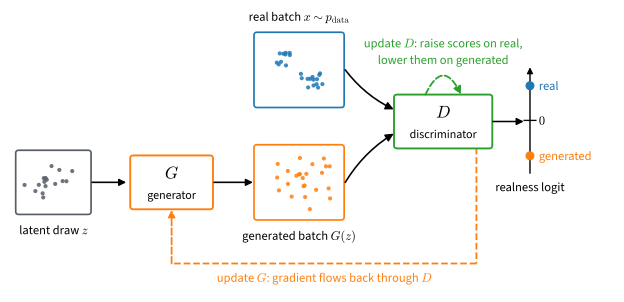
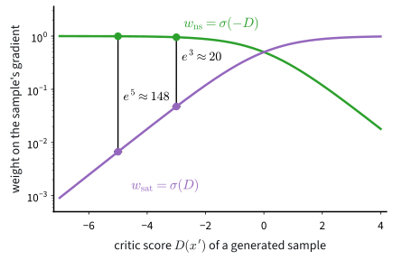

# Generative Adversarial Networks
:label:`sec_basic_gan`

Suppose we want a network that draws a Fashion-MNIST garment from a hundred random numbers in a single forward pass. It produces images but no probabilities, so the likelihood training of the earlier chapters does not apply. How can such a network be trained?

We have met the way out before. To correct for covariate shift in :numref:`subsec_covariate-shift-correction`, we trained a classifier to tell training inputs from test inputs and read the ratio of their two densities off its logit, although neither density was ever written down. A *generative adversarial network* (GAN) :cite:`Goodfellow.Pouget-Abadie.Mirza.ea.2014` trains the same kind of classifier on real and generated samples, and then changes the generator until the classifier fails, as a counterfeiter improves until the police can no longer tell forged notes from real ones.

This section asks what that game measures and whether it gives the generator a usable signal. We solve the classifier's problem exactly and find the quantity the generator then minimizes. We then train a generator of Fashion-MNIST garments, and check the predictions of the analysis on a two-dimensional Gaussian whose densities we know.

```{.python .input #gan-generative-adversarial-networks}
%%tab pytorch
import math
import numpy as np
import torch
from torch import nn
from torch.nn import functional as F
from d2l import torch as d2l
```

```{.python .input #gan-generative-adversarial-networks}
%%tab jax
import math
import numpy as np
import jax
from jax import numpy as jnp
from flax import nnx
import optax
from d2l import jax as d2l
```

## From Likelihood to Comparison

### Implicit Generators

Maximum likelihood needs $\log p_\theta(x)$, the model's log-density at each data point (:numref:`subsec_mdl-nll-crossentropy`). The generators of this chapter are *implicit*: they draw a latent variable $z \sim \mathcal{N}(0, I_{d_z})$ and output $x' = G(z)$, where $G$ is a neural network. When the latent dimension $d_z$ is smaller than the data dimension, the samples lie on a lower-dimensional surface and have no density at all; when the dimensions match, evaluating the density would require an invertible $G$ with a tractable Jacobian.

Nor is likelihood what we want from a sampler. Consider a model that mixes the data density with noise,

$$
\tilde p \;=\; 0.01\, p_{\textrm{data}} + 0.99\, p_{\textrm{noise}}.
$$
:eqlabel:`eq_gan_noise_mixture`

Since $\tilde p(x) \geq 0.01\, p_{\textrm{data}}(x)$ everywhere, the expected log-likelihood of $\tilde p$ is within $\log 100 \approx 4.6$ nats of the best achievable by any model, a small shortfall for images, whose log-likelihoods run to thousands of nats. Yet 99 percent of its samples are noise :cite:`Theis.Oord.Bethge.2016`. Judging a sampler requires looking at its samples.

### A Classifier between Real and Generated Samples

A *two-sample test* asks whether two sets of examples came from the same distribution, and one way to run it is to train a classifier to tell them apart. A GAN turns this test into a training signal. Draw a label $y \sim \textrm{Bernoulli}(\tfrac12)$. If $y = 1$, draw $x$ from the data density $p$; if $y = 0$, draw $x$ from the generator density $q$. The marginal density of $x$ is the balanced mixture $m = (p + q)/2$.

The classifier is a function $D: \mathcal{X} \to \mathbb{R}$ that outputs a *realness logit*: with $\sigma(t) = 1/(1 + e^{-t})$, the value $\sigma(D(x))$ estimates $P(y = 1 \mid x)$. :citet:`Goodfellow.Pouget-Abadie.Mirza.ea.2014` called $D$ the *discriminator*. We call it the *critic*, the name used for its successors later in the chapter, which score samples without classifying them.

Training alternates between the two networks, as :numref:`fig_gan` shows. The critic is fitted to separate a batch of data from a batch of generated samples. The generator then changes so that its samples become harder to separate, receiving its gradient through the critic.


:label:`fig_gan`

### Notation

:numref:`tab_gan_notation` collects the chapter's symbols, each with one meaning throughout; letters defined inside an exercise are local to it.

:Notation of this chapter.
:label:`tab_gan_notation`

| symbol | meaning | first used | papers write |
|:--|:--|:--|:--|
| $p$, $q$, $m = \tfrac12(p + q)$ | data, generator and mixture densities | :numref:`sec_basic_gan` | |
| $x \sim p$, $x' \sim q$; $y$ | a real and a generated sample; the source label, $1$ for real | :numref:`sec_basic_gan` | $y$ or $\hat x$ for $x'$ |
| $z$, $G$, $d_z$; $d_x$ | latent variable, generator, latent dimension; data dimension | :numref:`sec_basic_gan` | $k$ for $d_z$, $d$ for $d_x$ |
| $D$, $V$, $V_\ell$ | the critic's realness logit; the value of the log-loss game, of the game with payoff $\ell$ | :numref:`sec_basic_gan` | discriminator; $-D$ in :citet:`Huang.Gokaslan.Kuleshov.ea.2024` |
| $\rho = p/q$, $\lambda = \log \rho$ | density ratio and its logarithm | :numref:`sec_basic_gan` | |
| $\mu$; $b$; $\delta_\theta$; $d(p, q)$ | a mean; an additive shift; a point mass at $\theta$; a discrepancy | :numref:`sec_basic_gan` | $\delta$ for a separation of means |
| $w_{\textrm{sat}}$, $w_{\textrm{ns}}$, $w_{\textrm{Rp}}$ | per-sample weights of the generator update | :numref:`sec_basic_gan` | not named |
| $\eta = p/(p + q)$ | class posterior | :numref:`sec_gan_objectives` | $\eta$ for a step size, $h$ here |
| $\ell$, $L$, $\Delta_\ell$ | payoff of a score, its conditional Bayes risk, its Bayes-risk gap | :numref:`sec_gan_objectives` | the loss $-\ell$ |
| $T \in \mathcal{T}$, $\ell_p$, $\ell_q$; $\mathcal{F}$ | a critic and its class, scores of real and generated samples; the class of an integral probability metric | :numref:`sec_gan_objectives` | $f$ for its test functions |
| $f$, $D_f$; $k$, $s$ | divergence function, $f$-divergence; kernel, bandwidth | :numref:`sec_gan_objectives` | $\sigma$ or $\ell$ for $s$ |
| $\Phi$, $d_{\textrm{Rp}}$ | pairing objective, its value at the optimal critic | :numref:`sec_gan_relativistic` | $2\, d_{\textrm{Rp}}$ |
| $(a_1, a_2)$, $P$, $Q$, $\pi$ | a real--generated pair, its orderings $p \otimes q$ and $q \otimes p$, a pairing permutation | :numref:`sec_gan_relativistic` | |
| $\mathcal{E}_{\mathrm{GAN}}$, $\mathcal{E}_{\mathrm{diag}}$, $\mathcal{E}_{\mathrm{all}}$ | classical, paired and all-pairs losses at the best response | :numref:`sec_gan_relativistic` | not named |
| $v$, $\epsilon$ | direction and size of a change $q = p\,(1 + \epsilon v)$ | :numref:`sec_gan_relativistic` | $h$ for $v$ |
| $\gamma$, $R_1$, $R_2$ | penalty weight, zero-centered gradient penalties | :numref:`sec_gan_convergence` | |
| $h$, $\nu_{1,2}$, $\psi$, $\mathbf{u}$; $\omega$ | Dirac-GAN step size, eigenvalues, critic slope, field; a wavenumber | :numref:`sec_gan_convergence` | $\lambda_{1,2}$, $v$; $k$ |
| $\phi$ | a feature map | :numref:`sec_dcgan` | |
| $c$, $e_c$, $a(c)$, $\psi_0$, $\zeta_c$ | condition, its embedding, modulation scale, unconditional head, per-class constant | :numref:`sec_gan_conditional` | $\gamma(c)$, $\beta(c)$ for scale and shift |
| $g$; $\xi$; $\vartheta$ | predictor of $x$ from $c$; standard normal noise; a phase | :numref:`sec_gan_beyond` | $f$; $\epsilon$; $\varphi$ |

Divergences and entropies follow the appendix and are in nats: $D_{\textrm{KL}}$ is the Kullback--Leibler divergence, $D_{\mathrm{J}} = D_{\textrm{KL}}(p \,\|\, q) + D_{\textrm{KL}}(q \,\|\, p)$ its symmetrized form, $\mathrm{JS}$ the Jensen--Shannon divergence, $H$ an entropy and $H_b(t)$ that of a coin with bias $t$.

## The Log-Loss Game

The natural loss for a probabilistic classifier is the log loss. The critic's log-likelihood on the balanced labeling problem, without a factor $\tfrac12$, is

$$
V(D) \;=\; \mathbb{E}_{x \sim p}\big[\log \sigma(D(x))\big] + \mathbb{E}_{x' \sim q}\big[\log \sigma(-D(x'))\big],
$$
:eqlabel:`eq_gan_V`

the value function of :citet:`Goodfellow.Pouget-Abadie.Mirza.ea.2014`. The critic maximizes $V$; the generator influences only the second term and minimizes it, so training solves the *minimax* problem $\min_G \max_D V$. Because maximizing $V$ fits the best classifier, $\max_D V$ measures how well $p$ and $q$ can be told apart.

### The Optimal Critic

The maximization over $D$ separates into independent scalar problems. The integrand of :eqref:`eq_gan_V` at a point $x$ is $p(x) \log \sigma(D(x)) + q(x) \log \sigma(-D(x))$, which depends on $D$ only through the number $D(x)$. Writing $u = \sigma(D(x))$, the problem at each point is to maximize $p \log u + q \log(1-u)$, a strictly concave function of $u$ whose stationarity condition $p/u = q/(1-u)$ has the unique solution

$$
\sigma(D^\star(x)) = \frac{p(x)}{p(x) + q(x)} = P(y = 1 \mid x),
\qquad
D^\star(x) = \log \frac{p(x)}{q(x)} = \lambda(x).
$$
:eqlabel:`eq_gan_dstar`

Thus the optimal critic returns the Bayes posterior of the labeling problem, and its logit is the logarithm $\lambda = \log \rho$ of the *density ratio* $\rho = p/q$. Although $q$ has no computable density, a classifier estimates the one function of $q$ the objective needs, just as the domain classifier of covariate shift did. The objective also fixes the critic's additive constant: shifting $D^\star$ by any $b \neq 0$ strictly decreases $V$ (Exercise :exref:`ex_gan-log-loss-game-identifies`b), so $D(x) > 0$ says that $x$ is more likely real than generated.

For two unit Gaussians a distance $\mu$ apart, $p = \mathcal{N}(0, 1)$ and $q = \mathcal{N}(\mu, 1)$, the optimal critic can be written down by hand:

$$
\lambda(x) = -\frac{x^2}{2} + \frac{(x - \mu)^2}{2} = \mu \Big(\frac{\mu}{2} - x\Big),
$$

a linear function of $x$, positive left of the midpoint $\mu/2$. A logistic regression $D(x) = wx + b$ therefore contains the optimal critic. When the two Gaussians also differ in their covariances, $\lambda$ is quadratic and a nonlinear critic is needed.

### The Value of the Game

Substituting the best response into the objective identifies what the generator minimizes. With $\sigma(D^\star) = p/(2m)$ and $\sigma(-D^\star) = q/(2m)$,

$$
V(D^\star) = \int p \log \frac{p}{2m} + \int q \log \frac{q}{2m}
= D_{\textrm{KL}}(p \,\|\, m) + D_{\textrm{KL}}(q \,\|\, m) - 2 \log 2 .
$$

The two divergences define the Jensen--Shannon divergence $\mathrm{JS}(p, q) = \tfrac12 D_{\textrm{KL}}(p \,\|\, m) + \tfrac12 D_{\textrm{KL}}(q \,\|\, m)$. Hence

$$
\max_D V(D) = 2\,\mathrm{JS}(p, q) - 2 \log 2 .
$$
:eqlabel:`eq_gan_js_value`

Against an optimal critic, the generator minimizes the Jensen--Shannon divergence, which vanishes exactly when $q = p$. Equivalently, the critic's smallest per-sample negative log-likelihood is $\log 2 - \mathrm{JS}(p, q)$: chance level minus the divergence. For the two unit Gaussians, $\mathrm{JS}$ is 0.11 nats at $\mu = 1$, 0.34 at $\mu = 2$ and 0.63 at $\mu = 4$; at $\mu = 8$ it equals $\log 2 \approx 0.6931$ to four digits.

Writing $D_{\textrm{KL}}(p \,\|\, m) = -H(p) - \int p \log m$, and likewise for $q$, and collecting the mixture terms into $-H(m)$ shows what the game measures:

$$
\mathrm{JS}(p, q) \;=\; H(m) - \frac{H(p) + H(q)}{2} \;=\; I(x; y).
$$
:eqlabel:`eq_gan_entropy_gap`

The first term is the uncertainty about a sample whose source is unknown, the second the average uncertainty once the source is known. Their difference is the mutual information between a sample $x \sim m$ and its source label $y$: the number of nats that one sample provides about its source. A binary label carries at most $\log 2$ nats, so $0 \leq \mathrm{JS}(p, q) \leq \log 2$ (:numref:`sec_mdl-divergences-distances` proves both bounds), and the upper end is reached exactly when the supports of $p$ and $q$ are disjoint and every sample identifies its source.

### Separated Supports

The ceiling has a cost: once the supports separate, the value stops depending on how far apart they are. Take two point masses on the line, $p = \delta_0$ and $q_\theta = \delta_\theta$. For every $\theta \neq 0$ their supports are disjoint, $\mathrm{JS}(p, q_\theta) = \log 2$, and the value does not depend on $\theta$. A constant objective supplies no gradient, even when the generator lies arbitrarily close to the data.

The case is not exotic. A generator that maps a $d_z$-dimensional latent variable into a higher-dimensional space places its samples near a $d_z$-dimensional surface, and natural images also concentrate near a low-dimensional set, so the two supports are typically disjoint or nearly so :cite:`Arjovsky.Bottou.2017`. An optimal critic then classifies perfectly, and the generator learns nothing from the value of the game.

## The Generator's Gradient

The value describes the game at the critic's best response, but training moves the generator by gradient steps with the critic held fixed. We now follow that gradient.

### Two Weights

The generator influences only the second term of :eqref:`eq_gan_V`, so playing the minimax game literally means minimizing $\mathbb{E}_z[\log \sigma(-D(G(z)))]$ over the generator's parameters $\theta$, with the critic fixed. Differentiating through $x' = G(z)$ with the identity $\tfrac{d}{du} \log \sigma(-u) = -\sigma(u)$ gives

$$
\nabla_\theta \, \mathbb{E}_z\big[\log \sigma(-D(G(z)))\big]
= -\,\mathbb{E}_z\big[\sigma(D(x'))\, \nabla_\theta D(G(z))\big].
$$

A descent step therefore moves each generated sample in the direction that raises its critic score, with weight $\sigma(D(x'))$, the critic's probability that the sample is real. For a sample the critic rejects, $D(x') \ll 0$ and this weight is exponentially small. The loss has *saturated*: the samples the critic rejects most confidently contribute least to the update.

:citet:`Goodfellow.Pouget-Abadie.Mirza.ea.2014` therefore use a different generator loss in practice: rather than minimizing the probability of being called fake, the generator maximizes that of being called real, minimizing $-\mathbb{E}_z[\log \sigma(D(G(z)))]$. With $\tfrac{d}{du} \log \sigma(u) = \sigma(-u)$,

$$
\nabla_\theta \Big({-\mathbb{E}_z\big[\log \sigma(D(G(z)))\big]}\Big)
= -\,\mathbb{E}_z\big[\sigma(-D(x'))\, \nabla_\theta D(G(z))\big].
$$

The two losses move each sample in the *same* direction $\nabla_\theta D$ and differ only in the weight attached to it:

$$
w_{\textrm{sat}}(x') = \sigma(D(x')),
\qquad
w_{\textrm{ns}}(x') = \sigma(-D(x')) = 1 - \sigma(D(x')).
$$
:eqlabel:`eq_gan_weights`

The *non-saturating* weight $w_{\textrm{ns}}$ is near one where the saturating weight is near zero, as :numref:`fig_gan_weights` shows. Their ratio is $w_{\textrm{ns}}/w_{\textrm{sat}} = e^{-D(x')}$: a sample with score $-3$ receives 20 times more weight under the non-saturating loss, one with score $-5$ about 148 times more.


:label:`fig_gan_weights`

### The Same Fixed Point

Changing the weight does not change the population minimizer against an optimal critic. Substituting $D^\star = \lambda$ into the non-saturating loss and using $\sigma(\lambda) = p/(2m)$,

$$
-\mathbb{E}_{x' \sim q}\big[\log \sigma(\lambda(x'))\big]
= \log 2 + D_{\textrm{KL}}(q \,\|\, p) - D_{\textrm{KL}}(q \,\|\, m)
\;\geq\; \log 2 + \tfrac12\, D_{\textrm{KL}}(q \,\|\, p).
$$
:eqlabel:`eq_gan_ns_value`

The inequality is the convexity of $D_{\textrm{KL}}(q \,\|\, \cdot)$ at the midpoint $m$: $D_{\textrm{KL}}(q \,\|\, m) \leq \tfrac12 D_{\textrm{KL}}(q \,\|\, p) + \tfrac12 D_{\textrm{KL}}(q \,\|\, q)$, and the last term is zero. The bound exceeds $\log 2$ unless $q = p$, so with an optimal critic the non-saturating loss is minimized only at $q = p$.

A gradient step, however, holds the critic fixed rather than re-optimizing it. With the critic fixed at $D = \lambda$, the non-saturating update descends $D_{\textrm{KL}}(q \,\|\, p) - 2\,\mathrm{JS}(p, q)$ :cite:`Arjovsky.Bottou.2017`, an $f$-divergence whose only minimizer is again $q = p$ (Exercise :exref:`ex_gan-generator-weight-divergences`).

### Mode Dropping
:label:`subsec_gan_mode_dropping`

That divergence inherits the asymmetry of its first term, the reverse Kullback--Leibler divergence $D_{\textrm{KL}}(q \,\|\, p)$, which charges the generator heavily for placing mass where the data have little, but lightly for missing mass where the data have much. Take $p$ an equal mixture of two well-separated modes and $q$ a copy of one of them. On the covered mode $p = q/2$, so $D_{\textrm{KL}}(q \,\|\, p) = \log 2 \approx 0.69$ nats and $\mathrm{JS}(p, q) \approx 0.22$ nats, while the forward divergence $D_{\textrm{KL}}(p \,\|\, q)$ is infinite. A generator that covers only some of the data's modes is said to suffer *mode dropping*. Gradient steps rarely leave such a state: at the best response the score on the covered mode is the constant $\log(p/q) = -\log 2$, so $\nabla_\theta D$ vanishes there and neither weight pushes toward the missing mode.

A critic away from its best response shows a second blindness. Both weights read a sample's own score $D(x')$ against the zero level that the log-loss game fixes, and nothing in them compares the sample with real data. A generator whose samples all score above zero receives little push, whatever the data's other modes do. Later in the chapter, a critic that ranks a generated sample against a real one replaces this threshold with a comparison.

## The Game on Fashion-MNIST

In practice both players are networks, updated in turn by gradient steps on minibatches. We write these updates once and use them to train a generator of images.

### The Update Rules

One training iteration is two half-steps, one per player. The critic's update ascends :eqref:`eq_gan_V` on a minibatch as logistic regression, with label one for data and zero for generated samples, while the generator is held fixed. Both update functions are saved to the `d2l` library for the image networks of later sections.

```{.python .input #gan-the-update-rules-1}
%%tab pytorch
#@save
def update_D(X, Z, net_D, net_G, trainer_D):
    """Update the critic; return the summed log loss, halved."""
    trainer_D.zero_grad()
    real_Y = net_D(X)
    # The generator is the fixed player here: detach its output
    fake_Y = net_D(net_G(Z).detach())
    loss_D = (F.binary_cross_entropy_with_logits(
                  real_Y, torch.ones_like(real_Y), reduction='sum') +
              F.binary_cross_entropy_with_logits(
                  fake_Y, torch.zeros_like(fake_Y), reduction='sum')) / 2
    loss_D.backward()
    trainer_D.step()
    return loss_D
```

```{.python .input #gan-the-update-rules-1}
%%tab jax
#@save
@nnx.jit
def update_D(X, Z, net_D, net_G, optimizer_D):
    """Update the critic; return the summed log loss, halved."""
    batch_size = X.shape[0]
    fake_X = net_G(Z)  # computed outside the loss: no gradient to net_G
    def loss_D_fn(model_D):
        real_Y = model_D(X).squeeze()
        fake_Y = model_D(fake_X).squeeze()
        return (jnp.sum(optax.sigmoid_binary_cross_entropy(
                    real_Y, jnp.ones(batch_size))) +
                jnp.sum(optax.sigmoid_binary_cross_entropy(
                    fake_Y, jnp.zeros(batch_size)))) / 2
    loss_D, grads_D = nnx.value_and_grad(loss_D_fn)(net_D)
    optimizer_D.update(net_D, grads_D)
    return loss_D
```

The generator's update implements the non-saturating loss of :eqref:`eq_gan_weights`: generated samples are fed to the critic under the label *one*, so that the cross-entropy is $-\mathbb{E}[\log \sigma(D(G(z)))]$.

```{.python .input #gan-the-update-rules-2}
%%tab pytorch
#@save
def update_G(Z, net_D, net_G, trainer_G):
    """Update the generator on the non-saturating loss; return its sum."""
    trainer_G.zero_grad()
    # net_D changed in its half-step, so recompute the scores
    fake_Y = net_D(net_G(Z))
    loss_G = F.binary_cross_entropy_with_logits(
        fake_Y, torch.ones_like(fake_Y), reduction='sum')
    loss_G.backward()
    trainer_G.step()
    return loss_G
```

```{.python .input #gan-the-update-rules-2}
%%tab jax
#@save
@nnx.jit
def update_G(Z, net_D, net_G, optimizer_G):
    """Update the generator on the non-saturating loss; return its sum."""
    # Both networks are arguments, so critics with mutable state (batch
    # norm) work too; argnums=0 differentiates the generator only
    def loss_G_fn(model_G, model_D):
        fake_Y = model_D(model_G(Z)).squeeze()
        return jnp.sum(optax.sigmoid_binary_cross_entropy(
            fake_Y, jnp.ones(Z.shape[0])))
    loss_G, grads_G = nnx.value_and_grad(loss_G_fn, argnums=0)(net_G, net_D)
    optimizer_G.update(net_G, grads_G)
    return loss_G
```

The loop `train_gan` alternates the two half-steps over minibatches, drawing a fresh latent batch of dimension `latent_dim` for each, and returns each player's per-sample loss for every epoch; an optional callback `on_epoch` receives the number of each finished epoch. Both players use Adam with $\beta_1 = 0.5$ instead of the default 0.9, the DCGAN setting of :citet:`Radford.Metz.Chintala.2015`: a shorter momentum lets each player respond sooner to the other's latest move.

```{.python .input #gan-training-1}
%%tab pytorch
#@save
def train_gan(net_D, net_G, data_iter, num_epochs, latent_dim, lr_D, lr_G,
              step_G=update_G, seed=None, on_epoch=None):
    """Alternate update_D and step_G over the minibatches with Adam
    (beta_1 = 0.5), calling on_epoch(epoch) after each epoch if given;
    return the per-sample (loss_D, loss_G) of each epoch."""
    if seed is not None:
        torch.manual_seed(seed)
    trainer_D = torch.optim.Adam(net_D.parameters(), lr=lr_D,
                                 betas=(0.5, 0.999))
    trainer_G = torch.optim.Adam(net_G.parameters(), lr=lr_G,
                                 betas=(0.5, 0.999))
    history = []
    for epoch in range(1, num_epochs + 1):
        loss_D, loss_G, n = 0, 0, 0  # summed on the device, read once
        for X, *_ in data_iter:  # labels, if any, are ignored
            Z = torch.randn(X.shape[0], latent_dim, device=X.device)
            loss_D += update_D(X, Z, net_D, net_G, trainer_D).detach()
            loss_G += step_G(Z, net_D, net_G, trainer_G).detach()
            n += X.shape[0]
        history.append(torch.stack([loss_D, loss_G]) / n)
        if on_epoch is not None:
            on_epoch(epoch)
    return torch.stack(history).cpu().numpy()
```

```{.python .input #gan-training-1}
%%tab jax
#@save
def train_gan(net_D, net_G, data_iter, num_epochs, latent_dim, lr_D, lr_G,
              step_G=update_G, seed=None, on_epoch=None):
    """Alternate update_D and step_G over the minibatches with Adam
    (beta_1 = 0.5), calling on_epoch(epoch) after each epoch if given;
    return the per-sample (loss_D, loss_G) of each epoch."""
    key = d2l.get_key() if seed is None else jax.random.key(seed)
    optimizer_D = nnx.Optimizer(net_D, optax.adam(lr_D, b1=0.5),
                                wrt=nnx.Param)
    optimizer_G = nnx.Optimizer(net_G, optax.adam(lr_G, b1=0.5),
                                wrt=nnx.Param)
    history = []
    for epoch in range(1, num_epochs + 1):
        loss_D, loss_G, n = 0.0, 0.0, 0  # summed on the device, read once
        for X, *_ in data_iter:  # labels, if any, are ignored
            key, subkey = jax.random.split(key)
            Z = jax.random.normal(subkey, (X.shape[0], latent_dim))
            loss_D += update_D(X, Z, net_D, net_G, optimizer_D)
            loss_G += step_G(Z, net_D, net_G, optimizer_G)
            n += X.shape[0]
        history.append((loss_D / n, loss_G / n))
        if on_epoch is not None:
            on_epoch(epoch)
    return np.array(history)
```

### Garments from Noise
:label:`subsec_gan_fashion_mnist`

Fashion-MNIST, the $28 \times 28$ grayscale images of ten kinds of clothing from :numref:`sec_fashion_mnist`, gives a first test on images. Both players are multilayer perceptrons with leaky ReLU units, which pass negative inputs with slope 0.2 instead of zeroing them. The generator maps 100 latent numbers through hidden layers of 256 and 512 units to 784 pixels, with a final tanh for the range $[-1, 1]$ to which we scale the images. The critic mirrors it, from 784 inputs through 512 and 256 units to one logit.

The function `make_mlp` builds such a perceptron from its list of layer widths, with the activation `act` between consecutive linear layers. Its weights start uniform in $\pm 1/\sqrt{n_{\mathrm{in}}}$ for a layer with $n_{\mathrm{in}}$ inputs, and its offsets at zero. It is saved for the small networks of later sections.

```{.python .input #gan-garments-from-noise-5}
%%tab pytorch
#@save
def make_mlp(sizes, act):
    """Linear layers of the given widths with the activation module act
    between them; weights uniform in +-1/sqrt(fan_in), zero biases."""
    layers = []
    for d_in, d_out in zip(sizes[:-1], sizes[1:]):
        linear = nn.Linear(d_in, d_out)  # weights uniform by default
        nn.init.zeros_(linear.bias)
        layers += [linear, act]
    return nn.Sequential(*layers[:-1])
```

```{.python .input #gan-garments-from-noise-5}
%%tab jax
#@save
def make_mlp(sizes, act, *, rngs):
    """Linear layers of the given widths with the activation function act
    between them; weights uniform in +-1/sqrt(fan_in), zero biases."""
    init = nnx.initializers.variance_scaling(1 / 3, 'fan_in', 'uniform')
    layers = []
    for d_in, d_out in zip(sizes[:-1], sizes[1:]):
        layers += [nnx.Linear(d_in, d_out, kernel_init=init, rngs=rngs), act]
    return nnx.Sequential(*layers[:-1])
```

```{.python .input #gan-garments-from-noise-1}
%%tab pytorch
torch.manual_seed(0)
fmnist = d2l.FashionMNIST()
# All 60,000 training images as rows of 784 pixels in [-1, 1]
images = fmnist.train.data.reshape(-1, 784).float() / 127.5 - 1
image_iter = d2l.load_array((images,), batch_size=64)
leaky = nn.LeakyReLU(0.2)
net_G_img = nn.Sequential(make_mlp([100, 256, 512, 784], leaky), nn.Tanh())
net_D_img = make_mlp([784, 512, 256, 1], leaky)
```

```{.python .input #gan-garments-from-noise-1}
%%tab jax
fmnist = d2l.FashionMNIST()
# All 60,000 training images as rows of 784 pixels in [-1, 1]
images = fmnist.train[0].reshape(-1, 784).astype(np.float32) / 127.5 - 1
image_iter = d2l.ArrayLoader((images,), batch_size=64, shuffle=True,
                             key=jax.random.key(3))
rngs = nnx.Rngs(0)
leaky = lambda x: nnx.leaky_relu(x, 0.2)
net_G_img = nnx.Sequential(make_mlp([100, 256, 512, 784], leaky, rngs=rngs),
                           jnp.tanh)
net_D_img = make_mlp([784, 512, 256, 1], leaky, rngs=rngs)
```

Both players learn at the DCGAN's rate of $2 \cdot 10^{-4}$, on minibatches of 64, for twenty epochs (almost 19,000 iterations).

```{.python .input #gan-garments-from-noise-2}
%%tab pytorch, jax
history_img = train_gan(net_D_img, net_G_img, image_iter, num_epochs=20,
                        latent_dim=100, lr_D=2e-4, lr_G=2e-4, seed=1)
print(f'last epoch: critic loss {history_img[-1, 0]:.2f}, '
      f'generator loss {history_img[-1, 1]:.2f}')
```

Thirty samples from fresh latent draws:

```{.python .input #gan-garments-from-noise-3}
%%tab pytorch
with torch.no_grad():
    fake_img = net_G_img(torch.randn(30, 100))
d2l.show_images(fake_img.reshape(30, 28, 28), 2, 15, scale=0.9, cmap='gray');
```

```{.python .input #gan-garments-from-noise-3}
%%tab jax
fake_img = net_G_img(jax.random.normal(jax.random.key(2), (30, 100)))
d2l.show_images(fake_img.reshape(30, 28, 28), 2, 15, scale=0.9, cmap='gray');
```

The samples are recognizable garments: shirts and other tops, dresses and shoes. Most outlines are clear, but the interiors are grainy and speckled rather than blurred; neither network knows that neighboring pixels belong together, which the convolutional networks of :numref:`sec_dcgan` add. The two losses show how far the game is from its end.

```{.python .input #gan-garments-from-noise-4}
%%tab pytorch, jax
epochs = list(range(1, len(history_img) + 1))
d2l.plot(epochs, [history_img[:, 0], history_img[:, 1],
                  [math.log(2)] * len(epochs)],
         'epoch', 'per-sample loss', legend=['critic', 'generator', 'log 2'],
         fmts=('-', '--', 'k:'), figsize=(4.5, 3))
```

Within the first epoch the critic pulls ahead: its per-sample loss falls well below $\log 2$ and the generator's rises well above it. Both then drift slowly toward $\log 2$, but after twenty epochs the critic's loss is still about 0.5 and the generator's about 1.4. The critic still tells real from generated garments with some confidence, so at this budget the game has not reached its equilibrium, where both losses would sit at $\log 2$.

## The Game on a Gaussian

The garments cannot be scored in nats: neither density can be evaluated, so we can say neither how far $q$ is from $p$ nor whether the critic computes $\lambda$. We therefore return to a case where the densities are known. With Gaussian data and a linear generator, $p$, $q$ and $\lambda$ have closed forms, and three predictions can be checked exactly: the critic's loss approaches $\log 2$ near the fixed point, a trained critic approximates $\lambda$, and a confidently rejected generator keeps learning with the non-saturating loss but stalls with the saturating one.

### A Linear Generator with Known Densities
:label:`subsec_gan_training`

The data are a standard Gaussian pushed through a fixed linear map, $x = z A + b$ with $z \sim \mathcal{N}(0, I_2)$, so $p = \mathcal{N}(b, A^\top A)$: a thin tilted ellipse, whose orientation and two very different scales the generator must learn. Training uses a fixed sample of one thousand draws.

```{.python .input #gan-data-and-models-1}
%%tab pytorch
torch.manual_seed(0)
Z = torch.normal(0.0, 1.0, (1000, 2))
A = torch.tensor([[1.0, 2.0], [-0.1, 0.5]])
b = torch.tensor([1.0, 2.0])
data = Z @ A + b
print(f'covariance of the data distribution:\n{A.T @ A}')
```

```{.python .input #gan-data-and-models-1}
%%tab jax
Z = jax.random.normal(jax.random.key(0), (1000, 2))
A = jnp.array([[1.0, 2.0], [-0.1, 0.5]])
b = jnp.array([1.0, 2.0])
data = Z @ A + b
print(f'covariance of the data distribution:\n{A.T @ A}')
```

The generator is a single linear layer, so its output is Gaussian with a mean and covariance read off the weights. The critic has two hidden layers of 16 leaky ReLU units, which keep its score surface sloped, so the generator almost always receives a direction (Exercise :exref:`ex_gan-dead-critic` replaces them by tanh units). A factory function builds both networks from a fixed seed, so that later cells can restart from the same initialization.

```{.python .input #gan-data-and-models-2}
%%tab pytorch
def make_nets(seed=7):
    """The linear generator and the critic, all weights and offsets drawn
    from N(0, 0.02^2) by a generator seeded with seed."""
    gen = torch.Generator().manual_seed(seed)
    net_G = nn.Sequential(nn.Linear(2, 2))
    net_D = nn.Sequential(nn.Linear(2, 16), nn.LeakyReLU(0.2),
                          nn.Linear(16, 16), nn.LeakyReLU(0.2),
                          nn.Linear(16, 1))
    for w in [*net_G.parameters(), *net_D.parameters()]:
        nn.init.normal_(w, 0, 0.02, generator=gen)
    return net_G, net_D
```

```{.python .input #gan-data-and-models-2}
%%tab jax
def make_nets(seed=7):
    """The linear generator and the critic, all weights and offsets drawn
    from N(0, 0.02^2) with keys from seed."""
    normal = nnx.initializers.normal(0.02)
    dense = lambda m, n, rngs: nnx.Linear(m, n, kernel_init=normal,
                                          bias_init=normal, rngs=rngs)
    leaky = lambda x: nnx.leaky_relu(x, 0.2)
    rngs_G, rngs_D = nnx.Rngs(seed), nnx.Rngs(seed + 1)
    net_G = nnx.Sequential(dense(2, 2, rngs_G))
    net_D = nnx.Sequential(dense(2, 16, rngs_D), leaky,
                           dense(16, 16, rngs_D), leaky,
                           dense(16, 1, rngs_D))
    return net_G, net_D
```

We train for twenty epochs in minibatches of eight, giving the critic ten times the generator's learning rate so that its scores stay close to their best response.

```{.python .input #gan-training-2}
%%tab pytorch
data_iter = d2l.load_array((data,), batch_size=8)
net_G, net_D = make_nets()
history = train_gan(net_D, net_G, data_iter, num_epochs=20, latent_dim=2,
                    lr_D=0.05, lr_G=0.005, seed=1)
with torch.no_grad():
    fake = net_G(torch.normal(0, 1, (200, 2)))
```

```{.python .input #gan-training-2}
%%tab jax
data_iter = d2l.ArrayLoader((data,), batch_size=8, shuffle=True,
                            key=jax.random.key(6))
net_G, net_D = make_nets()
history = train_gan(net_D, net_G, data_iter, num_epochs=20, latent_dim=2,
                    lr_D=0.05, lr_G=0.005, seed=1)
fake = net_G(jax.random.normal(jax.random.key(4), (200, 2)))
```

The left panel tracks both losses against the dotted line at $\log 2$; the right panel overlays generated samples on the data.

```{.python .input #gan-training-3}
%%tab pytorch, jax
fig, axes = d2l.plt.subplots(1, 2, figsize=(9, 3.2))
epochs = list(range(1, len(history) + 1))
d2l.plot(epochs, [history[:, 0], history[:, 1], [math.log(2)] * len(epochs)],
         'epoch', 'per-sample loss', legend=['critic', 'generator', 'log 2'],
         fmts=('-', '--', 'k:'), axes=axes[0])
d2l.plot([data[:100, 0], fake[:100, 0]], [data[:100, 1], fake[:100, 1]],
         legend=['real', 'generated'], fmts=('C0.', 'C1.'), axes=axes[1])
fig.tight_layout()
```

Unlike on the garments, the critic's loss rises to $\log 2$ within about ten epochs and then stays near it, apart from an occasional epoch in which both losses jump above it and fall back. That is what it should do if $\mathrm{JS}$ approaches zero, since the best critic's per-sample loss is $\log 2 - \mathrm{JS}(p, q)$. The generator's loss approaches the same level from above, the minimum of the non-saturating loss by :eqref:`eq_gan_ns_value`, and the generated samples fill the data's ellipse. Still, a critic loss of $\log 2$ shows only that this critic can no longer separate the samples, not that $q = p$, so we check the fit independently.

### The Fit in Nats
:label:`subsec_gan_fit`

A linear generator $G(z) = z A_q + b_q$ produces the Gaussian $q = \mathcal{N}(b_q, A_q^\top A_q)$, and between Gaussians in $d_x$ dimensions the Kullback--Leibler divergence has the closed form :cite:`Kullback.1959`

$$
D_{\textrm{KL}}\big(\mathcal{N}(\mu_0, \Sigma_0) \,\|\, \mathcal{N}(\mu_1, \Sigma_1)\big)
= \tfrac12 \Big[ \operatorname{tr}(\Sigma_1^{-1} \Sigma_0)
+ (\mu_1 - \mu_0)^\top \Sigma_1^{-1} (\mu_1 - \mu_0)
- d_x + \log \tfrac{\det \Sigma_1}{\det \Sigma_0} \Big],
$$
:eqlabel:`eq_gan_mvn_kl`

the multivariate form of the univariate formula of :numref:`sec_mdl-information_theory`. We report $D_{\textrm{KL}}(q \,\|\, p)$ at initialization and after training.

```{.python .input #gan-quantifying-the-fit}
%%tab pytorch
def generator_gaussian(net_G):
    A_qT, b_q = net_G[0].weight.detach(), net_G[0].bias.detach()
    return b_q, A_qT @ A_qT.T  # nn.Linear stores A_q.T

def kl_gaussians(mu0, S0, mu1, S1):
    diff = mu1 - mu0
    return 0.5 * (torch.trace(torch.linalg.solve(S1, S0))
                  + diff @ torch.linalg.solve(S1, diff) - len(mu0)
                  + torch.logdet(S1) - torch.logdet(S0))

mu_p, Sigma_p = b, A.T @ A
for name, net in [('at initialization', make_nets()[0]),
                  ('after training   ', net_G)]:
    mu_q, Sigma_q = generator_gaussian(net)
    print(f'KL(q || p) {name}: '
          f'{kl_gaussians(mu_q, Sigma_q, mu_p, Sigma_p):.3f} nats')
```

```{.python .input #gan-quantifying-the-fit}
%%tab jax
def generator_gaussian(net_G):
    A_q, b_q = net_G.layers[0].kernel[...], net_G.layers[0].bias[...]
    return b_q, A_q.T @ A_q

def kl_gaussians(mu0, S0, mu1, S1):
    diff = mu1 - mu0
    return 0.5 * (jnp.trace(jnp.linalg.solve(S1, S0))
                  + diff @ jnp.linalg.solve(S1, diff) - len(mu0)
                  + jnp.linalg.slogdet(S1)[1] - jnp.linalg.slogdet(S0)[1])

mu_p, Sigma_p = b, A.T @ A
for name, net in [('at initialization', make_nets()[0]),
                  ('after training   ', net_G)]:
    mu_q, Sigma_q = generator_gaussian(net)
    print(f'KL(q || p) {name}: '
          f'{kl_gaussians(mu_q, Sigma_q, mu_p, Sigma_p):.3f} nats')
```

The divergence falls from about eight nats at initialization to well below one, typically a few hundredths of a nat or less. The training loop never evaluates the generator's density, yet the critic supplies enough information to fit its parameters.

### The Learned Density Ratio
:label:`subsec_gan_verify_critic`

:eqref:`eq_gan_dstar` says that the best response to a *fixed* generator computes $\lambda = \log(p/q)$. After the run above, $\lambda$ is close to zero everywhere and even a constant critic would look accurate, so we set a generator by hand, $A_q = [[1, 2], [-0.5, 0.5]]$ and $b_q = (1.5, 1.5)$, a Gaussian $q$ at $D_{\textrm{KL}}(q \,\|\, p) \approx 3.4$ nats from the data, and train a fresh critic against it alone for 2,000 steps.

```{.python .input #gan-verifying-the-optimal-critic-1}
%%tab pytorch
net_G_q, net_D_q = make_nets()  # a fresh critic
with torch.no_grad():  # the hand-set generator; nn.Linear stores A_q.T
    net_G_q[0].weight.copy_(torch.tensor([[1.0, -0.5], [2.0, 0.5]]))
    net_G_q[0].bias.copy_(torch.tensor([1.5, 1.5]))
trainer_D = torch.optim.Adam(net_D_q.parameters(), lr=0.01)
torch.manual_seed(2)
for _ in range(2000):  # critic-only steps against the frozen generator
    X = data[torch.randint(0, len(data), (256,))]
    Zb = torch.normal(0, 1, (256, 2))
    update_D(X, Zb, net_D_q, net_G_q, trainer_D)
```

```{.python .input #gan-verifying-the-optimal-critic-1}
%%tab jax
net_G_q, net_D_q = make_nets()  # a fresh critic
net_G_q.layers[0].kernel[...] = jnp.array([[1.0, 2.0], [-0.5, 0.5]])  # A_q
net_G_q.layers[0].bias[...] = jnp.array([1.5, 1.5])  # b_q
optimizer_D = nnx.Optimizer(net_D_q, optax.adam(0.01), wrt=nnx.Param)
key = jax.random.key(2)
for _ in range(2000):  # critic-only steps against the frozen generator
    key, k1, k2 = jax.random.split(key, 3)
    X = data[jax.random.randint(k1, (256,), 0, len(data))]
    Zb = jax.random.normal(k2, (256, 2))
    update_D(X, Zb, net_D_q, net_G_q, optimizer_D)
```

We compare the critic with the analytic $\lambda$, a difference of two Gaussian log densities, at two hundred real and two hundred generated samples, through the correlation and the fraction $R^2$ of the variance of $\lambda$ that the critic explains; a constant critic has $R^2 = 0$.

```{.python .input #gan-verifying-the-optimal-critic-2}
%%tab pytorch
def gaussian_logpdf(x, mu, Sigma):
    diff = x - mu
    sol = torch.linalg.solve(Sigma, diff.T).T
    return -0.5 * ((diff * sol).sum(1)
                   + torch.logdet(2 * torch.pi * Sigma))

mu_q, Sigma_q = generator_gaussian(net_G_q)
with torch.no_grad():
    xs = torch.cat([data[:200], net_G_q(torch.normal(0, 1, (200, 2)))])
    lam = (gaussian_logpdf(xs, b, A.T @ A)
           - gaussian_logpdf(xs, mu_q, Sigma_q))
    D_out = net_D_q(xs).squeeze()
r2 = 1 - ((D_out - lam) ** 2).mean() / ((lam - lam.mean()) ** 2).mean()
print(f'correlation {torch.corrcoef(torch.stack([lam, D_out]))[0, 1]:.3f}, '
      f'R^2 {r2:.3f}')
```

```{.python .input #gan-verifying-the-optimal-critic-2}
%%tab jax
def gaussian_logpdf(x, mu, Sigma):
    diff = x - mu
    sol = jnp.linalg.solve(Sigma, diff.T).T
    return -0.5 * ((diff * sol).sum(1)
                   + jnp.linalg.slogdet(2 * jnp.pi * Sigma)[1])

mu_q, Sigma_q = generator_gaussian(net_G_q)
key, subkey = jax.random.split(key)
xs = jnp.concatenate([data[:200],
                      net_G_q(jax.random.normal(subkey, (200, 2)))])
lam = (gaussian_logpdf(xs, b, A.T @ A)
       - gaussian_logpdf(xs, mu_q, Sigma_q))
D_out = net_D_q(xs).squeeze()
r2 = 1 - ((D_out - lam) ** 2).mean() / ((lam - lam.mean()) ** 2).mean()
print(f'correlation {jnp.corrcoef(jnp.stack([lam, D_out]))[0, 1]:.3f}, '
      f'R^2 {r2:.3f}')
```

In the scatter plot a perfect critic lies on the dashed diagonal.

```{.python .input #gan-the-learned-density-ratio-1}
%%tab pytorch, jax
lims = [float(lam.min()), float(lam.max())]
d2l.plot([lam[:200], lam[200:], lims], [D_out[:200], D_out[200:], lims],
         r'analytic $\lambda = \log(p/q)$', 'critic output $D$',
         legend=['at real samples', 'at generated samples', r'$D = \lambda$'],
         fmts=('C0.', 'C1.', 'k--'), figsize=(4.2, 3.4))
```

A network trained only to classify has learned the log density ratio: the correlation exceeds 0.97 and the critic explains more than 90 percent of the variance of $\lambda$. The points leave the diagonal mainly at the extreme values of $\lambda$, at generated samples where $p$ is nearly zero. The objective constrains the critic only where the mixture $m$ has appreciable mass, so the estimate is least accurate where the ratio is most extreme.

### Saturating and Non-Saturating Losses Compared
:label:`subsec_gan_saturation`

Testing the two weights of :eqref:`eq_gan_weights` needs a start at which they differ. The initial generator above emits samples about one standard deviation from the data mean, which the critic never rejects confidently enough to drive $w_{\textrm{sat}}$ toward zero. We therefore move the generator's bias far from the data. The saturating update minimizes $\mathbb{E}_z[\log \sigma(-D(G(z)))]$, the minimax game taken literally.

```{.python .input #gan-saturating-and-non-saturating-losses-compared-2}
%%tab pytorch
def update_G_saturating(Z, net_D, net_G, trainer_G):
    trainer_G.zero_grad()
    fake_Y = net_D(net_G(Z))
    # log sigma(-D) is minus the cross-entropy under the label zero
    loss_G = -F.binary_cross_entropy_with_logits(
        fake_Y, torch.zeros_like(fake_Y), reduction='sum')
    loss_G.backward()
    trainer_G.step()
    return loss_G
```

```{.python .input #gan-saturating-and-non-saturating-losses-compared-2}
%%tab jax
@nnx.jit
def update_G_saturating(Z, net_D, net_G, optimizer_G):
    def loss_G_fn(model_G, model_D):
        fake_Y = model_D(model_G(Z)).squeeze()
        # log sigma(-D) is minus the cross-entropy under the label zero
        return -jnp.sum(optax.sigmoid_binary_cross_entropy(
            fake_Y, jnp.zeros(Z.shape[0])))
    loss_G, grads_G = nnx.value_and_grad(loss_G_fn, argnums=0)(net_G, net_D)
    optimizer_G.update(net_G, grads_G)
    return loss_G
```

Two arms start from the same initialization, see the same minibatches and latent draws, and differ only in the generator loss. After every epoch the callback `on_epoch` records the generator's samples at one fixed set of latent draws.

```{.python .input #gan-saturating-versus-non-saturating-training-1}
%%tab pytorch
torch.manual_seed(3)
Z_show = torch.randn(200, 2)  # one latent sample for every snapshot
runs = {}
for name, step in [('non-saturating', update_G),
                   ('saturating', update_G_saturating)]:
    net_G_ab, net_D_ab = make_nets()
    with torch.no_grad():
        net_G_ab[0].bias += torch.tensor([-6.0, 6.0])
    snaps = {}  # epoch: generated samples
    hist = train_gan(net_D_ab, net_G_ab, data_iter, num_epochs=20,
                     latent_dim=2, lr_D=0.05, lr_G=0.01, step_G=step,
                     seed=1,  # the same minibatches and latent draws
                     on_epoch=lambda epoch: snaps.update(
                         {epoch: net_G_ab(Z_show).detach()}))
    runs[name] = (hist, snaps)
    mu_q, Sigma_q = generator_gaussian(net_G_ab)
    print(f'{name}: final KL(q || p) = '
          f'{kl_gaussians(mu_q, Sigma_q, mu_p, Sigma_p):.2f} nats')
```

```{.python .input #gan-saturating-versus-non-saturating-training-1}
%%tab jax
Z_show = jax.random.normal(jax.random.key(5), (200, 2))  # for every snapshot
runs = {}
for name, step in [('non-saturating', update_G),
                   ('saturating', update_G_saturating)]:
    net_G_ab, net_D_ab = make_nets()
    net_G_ab.layers[0].bias[...] += jnp.array([-6.0, 6.0])
    data_iter_ab = d2l.ArrayLoader((data,), batch_size=8, shuffle=True,
                                   key=jax.random.key(9))
    snaps = {}  # epoch: generated samples
    hist = train_gan(net_D_ab, net_G_ab, data_iter_ab, num_epochs=20,
                     latent_dim=2, lr_D=0.05, lr_G=0.01, step_G=step,
                     seed=10,  # the same minibatches and latent draws
                     on_epoch=lambda epoch: snaps.update(
                         {epoch: net_G_ab(Z_show)}))
    runs[name] = (hist, snaps)
    mu_q, Sigma_q = generator_gaussian(net_G_ab)
    print(f'{name}: final KL(q || p) = '
          f'{kl_gaussians(mu_q, Sigma_q, mu_p, Sigma_p):.2f} nats')
```

The first two panels show each arm's samples after five and twenty epochs; the third shows both critics' losses.

```{.python .input #gan-saturating-and-non-saturating-losses-compared-1}
%%tab pytorch, jax
fig, axes = d2l.plt.subplots(1, 3, figsize=(10.5, 3.2))
for ax, (name, (hist, snaps)) in zip(axes[:2], runs.items()):
    d2l.plot([data[:150, 0], snaps[5][:, 0], snaps[20][:, 0]],
             [data[:150, 1], snaps[5][:, 1], snaps[20][:, 1]],
             legend=['real', 'epoch 5', 'epoch 20'],
             fmts=('C0.', 'C1+', 'C1.'), axes=ax)
    ax.set_title(name)
epochs = list(range(1, 21))
d2l.plot(epochs, [runs['non-saturating'][0][:, 0],
                  runs['saturating'][0][:, 0], [math.log(2)] * 20],
         'epoch', 'critic loss', legend=['non-saturating', 'saturating',
                                         'log 2'],
         fmts=('-', '--', 'k:'), axes=axes[2])
fig.tight_layout()
```

The saturating generator does not move. Its critic's loss drops to zero within the first epochs, so $\sigma(D(x')) \approx 0$ for every generated sample, and the run ends where it started, more than three hundred nats from the data. The non-saturating generator crosses to the data within the first few epochs: by epoch five its samples lie in the data region, though not yet centered on it. By epoch twenty they fill the ellipse, $D_{\textrm{KL}}(q \,\|\, p)$ is well below one nat, and its critic's loss is back at $\log 2$.

The non-saturating weight amplifies the factor $\nabla_\theta D$ but cannot create it. Here the critic's score surface slopes toward the data even far from them; an optimal critic on separated supports offers no slope, and no choice of weight helps.

## Summary

A GAN replaces the likelihood with a learned comparison: a critic learns to tell real from generated samples, and the generator learns to defeat it. With the log loss, the optimal critic's logit is the log density ratio $\lambda$, and the value of the game is $2\,\mathrm{JS}(p,q) - 2\log 2$, where $\mathrm{JS}$ is the information a sample carries about its source. The non-saturating generator loss keeps the fixed point $q = p$ and, unlike the saturating one, keeps learning from rejected samples. Two perceptrons trained this way draw recognizable garments, though the critic still wins after twenty epochs; on a Gaussian, the fit and the learned ratio check out in nats. Two limits remain: the value is constant on separated supports, and the generator's divergence charges little for a dropped mode. :numref:`sec_gan_objectives` changes the loss and the critic class to obtain discrepancies that keep a gradient when the supports separate.

## Exercises

1. **Likelihood versus samples.** Replace the weights of the noise mixture
   :eqref:`eq_gan_noise_mixture` by $\epsilon$ and $1 - \epsilon$.
    1. Write the shortfall
       $\mathbb{E}_{p_{\textrm{data}}}[\log p_{\textrm{data}} - \log \tilde p]$
       exactly as an expectation of a function of
       $p_{\textrm{noise}} / p_{\textrm{data}}$, and show that it is at most
       $\log(1/\epsilon)$. When is the bound nearly attained, and is it for
       natural images with $p_{\textrm{noise}}$ uniform on the pixel cube?
    1. Convert the bound for $\epsilon = 0.01$ into bits per dimension (the
       negative log-likelihood divided by $d_x \log 2$) for $32 \times 32$
       color images. Would a results table rounded to two decimals show it?
   :exlabel:`ex_gan-likelihood-versus-samples`

1. **Excess loss and the additive constant.** Let $\eta = p / (p + q)$ and
   let $D_{\textrm{b}}(a \,\|\, u)$ be the Kullback--Leibler divergence
   between Bernoulli distributions with success probabilities $a$ and $u$.
    1. Show that every critic satisfies
       $V(D^\star) - V(D) = 2\, \mathbb{E}_{m}\big[D_{\textrm{b}}(\eta \,\|\, \sigma(D))\big]$,
       so that $D^\star$ is the unique maximizer of :eqref:`eq_gan_V` up to
       $m$-null sets.
    1. Conclude that $V(D^\star + b) < V(D^\star)$ for every constant
       $b \neq 0$.
    1. Expand to second order in $b$ to show
       $V(D^\star + b) - V(D^\star) = -\frac{b^2}{2} \int \frac{p q}{p + q}\, dx + O(b^3)$,
       and that the coefficient lies in $[0, \tfrac12]$. When the critic
       separates the samples easily, how sharply do finite samples fix its
       additive constant?
   :exlabel:`ex_gan-log-loss-game-identifies`

1. **Unequal priors.** Let the labeling problem draw $y = 1$ with
   probability $\alpha$, so that the critic maximizes
   $V_\alpha(D) = \alpha\, \mathbb{E}_{p}[\log \sigma(D)] + (1 - \alpha)\, \mathbb{E}_{q}[\log \sigma(-D)]$.
    1. Show that $D^\star_\alpha = \lambda + \log \frac{\alpha}{1 - \alpha}$,
       and that $\max_D V_\alpha + H_b(\alpha)$ is the mutual information
       between a sample and its label, which lies between $0$ and
       $H_b(\alpha)$.
    1. If `update_D` received twice as many real as generated samples, which
       $\alpha$ would it implement? How would the best response and
       $w_{\textrm{ns}}$ change, and would $q = p$ remain a stationary point
       of the generator update?
   :exlabel:`ex_gan-unequal-priors`

1. **Supports of measure zero.**
    1. A generator $G(z) = z v + b_q$ with a scalar latent $z$ places its
       samples on a line. Show that $\mathrm{JS}(p, q) = \log 2$ against the
       data distribution $p = \mathcal{N}(b, A^\top A)$ for every $v$ and
       $b_q$.
    1. Show that $\mathrm{JS}(\hat p, q) = \log 2$ for the empirical
       distribution $\hat p$ of the thousand training points and every $q$
       with a density, $q = p$ included.
    1. Yet training on $\hat p$ fits $q$ to a few hundredths of a nat. For a
       $\kappa$-Lipschitz critic, such as that of `make_nets`, use the
       Kantorovich--Rubinstein duality (:numref:`sec_mdl-optimal-transport`)
       to show that replacing $p$ by $\hat p$ in :eqref:`eq_gan_V` changes
       $V(D)$ by at most $\kappa\, W_1(\hat p, p)$. Why does this make the
       restricted game informative, and what happens as $\kappa$ grows?
   :exlabel:`ex_gan-measure-zero-supports`

1. [code] **A dead critic.** ● Give the critic of `make_nets` tanh units and
   hidden layers of 5 and 3 units.
    1. Rerun the non-saturating arm of the far-start comparison of
       :numref:`subsec_gan_saturation` for five seeds, and record the final
       $D_{\textrm{KL}}(q \,\|\, p)$ and critic loss.
    1. For a run that stalls, inspect the hidden activations and
       $\|\nabla_x D\|$ at real and generated samples. How can Adam at the
       critic's rate of $0.05$ drive the units there while the critic rejects
       a distant generator, and why does the generator then get no direction?
    1. Show that a constant critic has the loss $\log 2$ at best. Which of the
       two readings of a critic loss of $\log 2$, a best response to $q = p$
       or a critic that cannot separate the samples, fits the stalled run, and
       which measurement of this section tells them apart?
   :exlabel:`ex_gan-dead-critic`

1. [code] **Two time scales.** ● Rerun the Gaussian training of
   :numref:`subsec_gan_training` with (`lr_D`, `lr_G`) set to
   $(0.05, 0.005)$, $(0.005, 0.005)$ and $(0.005, 0.05)$, five seeds each.
   Report the median and range of the final $D_{\textrm{KL}}(q \,\|\, p)$.
   Is the spread across seeds small compared with the differences between
   settings? Against which critic does the generator optimize when it adapts
   faster than the critic?
   :exlabel:`ex_gan-two-time-scales`

1. [code] **Classifier two-sample test.** ● A classifier two-sample test
   :cite:`Lopez-Paz.Oquab.2017` asks whether a classifier separates fresh
   real from fresh generated samples better than chance.
    1. Show that the Bayes classifier has the accuracy
       $\tfrac12 \big(1 + \mathrm{TV}(p, q)\big)$
       (:numref:`sec_mdl-tv-pinsker`), and use Pinsker's inequality with the
       printed $D_{\textrm{KL}}(q \,\|\, p)$ to bound the accuracy any
       classifier can reach against the trained Gaussian generator `net_G`.
    1. Train the fresh critic `make_nets()[1]` against the frozen `net_G` and
       measure its accuracy on 2,000 held-out samples per class. How close
       does it come to the bound?
    1. With accuracy approximately $\mathcal{N}(\tfrac12, 1/(4 n))$ under
       $q = p$, how many test points $n$ would reject $q = p$ at the 5 percent
       level? What does a test with fewer points say about the generator?
   :exlabel:`ex_gan-classifier-two-sample-test`

1. [code] **Class coverage of the garment generator.** ● Thirty samples cannot
   show whether the generator of :numref:`subsec_gan_fashion_mnist` draws each
   kind of clothing as often as the data do.
    1. Train the LeNet of :numref:`sec_lenet` on Fashion-MNIST and label 1,000
       generated samples with it. Compare the class histogram with the
       uniform one of the data. Which classes are over- or under-represented?
       Look at the samples of the rarest class.
    1. Repeat for generators trained for 5 and for 40 epochs. Does longer
       training even out the histogram?
    1. The classifier assigns every sample to some class, even one that
       resembles none. How does this bias the histogram? Relate what you find
       to mode dropping (:numref:`subsec_gan_mode_dropping`).
   :exlabel:`ex_gan-class-coverage`

1. **Generator weights and their divergences.** ●● A generator loss
   $\mathbb{E}_z[g(D(G(z)))]$ with the critic held fixed has the gradient
   $-\mathbb{E}_z[w(D)\, \nabla_\theta D(G(z))]$ with $w = -g'$. Let the
   critic be the best response $D = \lambda$ to the current generator
   $q_{\theta_0}$, held fixed, and write $\rho = e^{D} = p / q_{\theta_0}$.
    1. Show that the saturating and non-saturating losses sum to
       $D_{\textrm{KL}}(q \,\|\, p)$ at $D = \lambda$, with weight $w = 1$.
    1. For the $f$-divergence
       $D_f(p \,\|\, q_\theta) = \mathbb{E}_{q_\theta}[f(p/q_\theta)]$
       (:numref:`sec_mdl-f-divergences`), show that
       $\nabla_\theta D_f\big|_{\theta_0} = -\mathbb{E}_z\big[\rho^2 f''(\rho)\, \nabla_\theta D(G(z))\big]$.
       Hint: the product rule gives $\int \nabla_\theta q_\theta\, h$ with
       $h = f(\rho) - \rho f'(\rho)$. A weight $w$ thus selects the $f$ with
       $\rho^2 f''(\rho) = w(\log \rho)$.
    1. Identify the divergences selected by $w_{\textrm{sat}}$, by $w = 1$, by
       $w(t) = e^t$ :cite:`Goodfellow.2016`, and by $w_{\textrm{ns}}$
       (Theorem 2.5 of :citet:`Arjovsky.Bottou.2017`). Why may the critic be
       held fixed when differentiating the maximum over $D$?
    1. Show that the divergence of $w_{\textrm{ns}}$,
       $D_{\textrm{KL}}(q \,\|\, p) - 2\,\mathrm{JS}(p, q)$, equals
       $2\, D_{\textrm{KL}}(m \,\|\, p)$. :citet:`Arjovsky.Bottou.2017` read
       its negative Jensen--Shannon term as pushing $p$ and $q$ apart. Does
       that reading hold?

   *Adapted from Stefano Ermon and Aditya Grover,
   [CS236: Deep Generative Models](https://cs236.stanford.edu), Homework 3,
   Problem 2.3.*
   :exlabel:`ex_gan-generator-weight-divergences`

1. [extended] **Finite samples and critic capacity.** ●● Once the number of
   samples exceeds the number of critic parameters, up to logarithmic
   factors, a critic's value on the samples is close to its value on the
   populations :cite:`Arora.Ge.Liang.ea.2017`. Test this with the generator
   set to $z A + b$, so that $q = p$.
    1. Train critics with two hidden layers of width 4, 16, 128 and 1024 on
       $n \in \{100, 1000, 10000\}$ points from $p$ (Adam at $10^{-3}$, 4,000
       steps of 256). Plot the gap between the loss on the training points
       and on fresh draws against the number of parameters, one curve per
       $n$. Where does the 337-parameter critic of `make_nets` lie?
    1. The garment critic of :numref:`subsec_gan_fashion_mnist` has about
       530,000 parameters and sees the same 60,000 images every epoch. What
       can its loss below $\log 2$ no longer tell apart? Propose a measurement
       that separates the two causes.
   :exlabel:`ex_gan-finite-sample-critic`

[Discussions](https://d2l.discourse.group/t/36808)

<!-- slides -->

::: {.slide}
::: {.cover}
[Dive into Deep Learning · §16.1]{.kicker}

Generative adversarial networks<br>
**a sampler without a density · the optimal critic · the value is Jensen--Shannon · two generator weights · garments and a Gaussian**
:::
:::

::: {.slide title="A Garment from a Hundred Random Numbers"}
[The problem]{.kicker}

@!gan-garments-from-noise-3

- $x' = G(z)$, $z \sim \mathcal{N}(0, I_{100})$: one forward pass per image,
  no density to evaluate or maximize.

::: {.d2l-note .warn}
Can a classifier that tells samples from data take the place of the
likelihood?
:::
:::

::: {.slide title="By the End of This Deck You Can"}
[Goals]{.kicker}

- derive the optimal critic and read it as a log density ratio;
- compute the value of the game as a Jensen--Shannon divergence;
- explain why separated supports give the generator no gradient;
- compare the saturating and non-saturating generator weights;
- read a GAN loss curve, and say what a loss of $\log 2$ does not prove.

**The idea:** train a classifier to tell real from generated, then move the
generator until the classifier fails. **Running examples:** Fashion-MNIST
garments, and a 2-D Gaussian whose densities we know.
:::

::: {.slide title="The First Deck Builds the Game the Others Modify"}
[Where this fits]{.kicker}

::: {.cols .vc}
::: {.col}
| deck | adds |
|---|---|
| **Generative Adversarial Networks** | **the log-loss game and its value** |
| Adversarial Objectives | other losses and critic classes |
| Relativistic Objectives | a critic that ranks pairs |
| Gradient Penalties and Convergence | convergence of the training dynamics |
| Adversarial Image Generation | convolutional networks, scores |
| Conditional Generation | asking for a class |
| Adversarial Losses Beyond GANs | where the comparison survives |
:::

::: {.col .narrow}
- **Uses:** logistic regression; multilayer perceptrons; KL and JS
  divergences; the domain classifier for covariate shift.
- **Skips:** other losses (next deck); convolutional generators.
:::
:::
:::

::: {.slide title="A Classifier between Real and Generated Samples Trains the Generator"}
{width=70%}

- Label $y \sim \textrm{Bernoulli}(\tfrac12)$; $x \sim p$ (data) if $y = 1$,
  $x \sim q$ (generator) if $y = 0$.
- The critic's logit $D(x)$; $\sigma(D(x))$ estimates $P(y = 1 \mid x)$.
:::

::: {.slide title="The Critic Maximizes the Log-Likelihood of the Labels"}
$$V(D) = \mathbb{E}_{x \sim p}[\log \sigma(D(x))] + \mathbb{E}_{x' \sim q}[\log \sigma(-D(x'))]$$

- The critic maximizes $V$: it fits the best classifier of real against
  generated.
- The generator enters only the second term and minimizes $V$:
  $\min_G \max_D V$.
- $\max_D V$ measures how well the two distributions can be told apart.
:::

::: {.slide title="The Optimal Critic Is the Log Density Ratio"}
At each $x$, maximize $p \log u + q \log(1 - u)$ over $u = \sigma(D(x))$:

$$\sigma(D^\star) = \frac{p}{p+q},
\qquad
D^\star = \log\frac{p}{q} = \lambda$$

. . .

- The trained critic is a **density-ratio estimator**: it recovers the one
  function of $q$ the game needs, though $q$ has no formula.
- The constant is fixed too: shifting $D^\star$ by $b \neq 0$ lowers $V$, so
  $D > 0$ means "more likely real".
:::

::: {.slide title="Check: Two Unit Gaussians"}
[Check]{.kicker}

$p = \mathcal{N}(0, 1)$, $q = \mathcal{N}(1, 1)$. What is the optimal critic
$D^\star(x)$, and which model class contains it?

. . .

- $\lambda(x) = -\tfrac{x^2}{2} + \tfrac{(x-1)^2}{2} = \tfrac12 - x$.
- Linear in $x$: logistic regression already contains the optimal critic.
- In general $\lambda = \mu(\mu/2 - x)$ for $q = \mathcal{N}(\mu, 1)$.
:::

::: {.slide title="At the Optimal Critic the Game Is Worth 2 JS − 2 log 2"}
With $m = \tfrac12(p+q)$, $\sigma(D^\star) = p/(2m)$, $\sigma(-D^\star) = q/(2m)$:

$$V(D^\star) = \int p \log\frac{p}{2m} + \int q \log\frac{q}{2m}
= D_{\textrm{KL}}(p\|m) + D_{\textrm{KL}}(q\|m) - 2\log 2$$

$$\max_D V = 2\,\mathrm{JS}(p, q) - 2\log 2$$

- Against the best critic the generator minimizes Jensen--Shannon, which is
  zero only at $q = p$.
- The best critic's per-sample loss is $\log 2 - \mathrm{JS}$.
:::

::: {.slide title="JS Is the Information One Sample Carries about Its Source"}
$$\mathrm{JS}(p, q) = H(m) - \tfrac12\big(H(p) + H(q)\big) = I(x; y) \leq \log 2$$

| $q = \mathcal{N}(\mu, 1)$ vs. $p = \mathcal{N}(0, 1)$ | $\mu = 1$ | $2$ | $4$ | $8$ |
|---|---|---|---|---|
| $\mathrm{JS}$ (nats) | 0.11 | 0.34 | 0.63 | 0.6931 |

- One binary label holds at most $\log 2$ nats.
- The ceiling is reached on **disjoint supports**, where each sample names its
  source.
:::

::: {.slide title="Separated Supports Freeze the Value at log 2"}
Point masses on the line: $p = \delta_0$, $q_\theta = \delta_\theta$.

- For every $\theta \neq 0$: disjoint supports, $\mathrm{JS} = \log 2$.
- The value does not depend on $\theta$: no gradient, even at
  $\theta = 0.001$.
- In high dimensions a generator from a $d_z$-dimensional latent fills a
  $d_z$-dimensional surface: supports are nearly disjoint.

::: {.d2l-note}
An optimal critic classifies perfectly, and the generator learns nothing
from the value of the game.
:::
:::

::: {.slide title="Both Generator Losses Push Along ∇D, with Different Weights"}
::: {.cols .vc}
::: {.col}
$$w_{\textrm{sat}} = \sigma(D(x')), \qquad w_{\textrm{ns}} = \sigma(-D(x'))$$

- Saturating: minimize $\mathbb{E}[\log \sigma(-D(x'))]$, the game as
  written.
- Non-saturating: minimize $-\mathbb{E}[\log \sigma(D(x'))]$.
- Same direction $\nabla_\theta D$; confidently rejected samples get almost
  no weight under $w_{\textrm{sat}}$.
:::

::: {.col}

:::
:::
:::

::: {.slide title="Check: A Confidently Rejected Sample"}
[Check]{.kicker}

A generated sample scores $D(x') = -5$. How much more weight does it get
under the non-saturating loss?

. . .

- $w_{\textrm{ns}} / w_{\textrm{sat}} = \sigma(5) / \sigma(-5) = e^{5}
  \approx 148$.
- At $D = -3$: $e^3 \approx 20$.
:::

::: {.slide title="The Non-Saturating Loss Keeps the Fixed Point q = p"}
At the optimal critic:

$$-\mathbb{E}_{q}[\log \sigma(\lambda)] = \log 2 + D_{\textrm{KL}}(q\|p) - D_{\textrm{KL}}(q\|m)
\;\geq\; \log 2 + \tfrac12 D_{\textrm{KL}}(q\|p)$$

- Equality, $\log 2$, only at $q = p$.
- With the critic held fixed at $\lambda$, the update descends
  $D_{\textrm{KL}}(q\|p) - 2\,\mathrm{JS}(p, q)$, again minimized only at
  $q = p$.
:::

::: {.slide title="Reverse KL Barely Charges a Missing Mode"}
$p$: two separated modes, equal weight. $q$: one of them.

- $D_{\textrm{KL}}(q\|p) = \log 2 \approx 0.69$ nats; $\mathrm{JS} \approx
  0.22$; $D_{\textrm{KL}}(p\|q) = \infty$.
- At the best critic the score on the covered mode is the constant
  $-\log 2$: $\nabla D = 0$, no push toward the other mode.
- Both weights read a sample's own score against the zero level; nothing
  compares it with real samples.

**Mode dropping:** the generator covers only some of the data's modes.
:::

::: {.slide title="The Same Two Updates Turn Noise into Garments"}
@!gan-garments-from-noise-3

- MLPs $100 \to 256 \to 512 \to 784$ and $784 \to 512 \to 256 \to 1$; Adam
  $2 \cdot 10^{-4}$, $\beta_1 = 0.5$, batch 64, 20 epochs.
- Recognizable garments: outlines mostly clear, interiors grainy.
:::

::: {.slide title="On Garments the Critic Stays Ahead after Twenty Epochs"}
::: {.cols .vc}
::: {.col}
- Within the first epoch the critic's loss falls well below $\log 2$, the
  generator's rises well above.
- After 20 epochs: critic about 0.5, generator about 1.4, both drifting
  slowly toward $\log 2$.
- The game has not reached its equilibrium, where both sit at $\log 2$.

::: {.d2l-note .warn}
The garments cannot be scored in nats: neither density can be evaluated.
:::
:::

::: {.col}
@!gan-garments-from-noise-4
:::
:::
:::

::: {.slide title="On a Gaussian the Fit Can Be Measured"}
@!gan-training-3

- Linear generator on a tilted ellipse: $\lambda$ and $D_{\textrm{KL}}(q\|p)$
  in closed form; critic loss $\to \log 2$ means $\mathrm{JS} \to 0$.
- $D_{\textrm{KL}}(q\|p)$: about 8 nats at start, a few hundredths or less after 20 epochs.
:::

::: {.slide title="A Trained Critic Tracks log(p/q) on a Hand-Set q"}
::: {.cols .vc}
::: {.col}
Freeze $q$ at $D_{\textrm{KL}}(q\|p) \approx 3.4$ nats; train a fresh critic
for 2,000 steps; compare with the analytic $\lambda$.

- Correlation above 0.97; the critic explains over 90% of the variance of
  $\lambda$ ($R^2$; a constant critic scores 0).
- Largest errors at the extremes of $\lambda$, where samples are rare.
:::

::: {.col .narrow}
@!gan-the-learned-density-ratio-1
:::
:::
:::

::: {.slide title="From a Far Start Only the Non-Saturating Generator Moves"}
@!gan-saturating-and-non-saturating-losses-compared-1

- Saturating: critic loss $\to 0$, $w_{\textrm{sat}} \approx 0$; stays more
  than 300 nats away.
- Non-saturating: reaches the data, well below 1 nat.
:::

::: {.slide title="Check: Does a Loss of log 2 Mean q = p?"}
[Check]{.kicker}

The critic's loss reads $\log 2$ at the end of a run. Has the generator
matched the data?

. . .

- Not necessarily: a critic that outputs a constant also scores $\log 2$.
- A critic whose hidden units saturate can sit near $\log 2$ while $q$ is
  still far from $p$.
- Check the fit independently: here $D_{\textrm{KL}}(q\|p)$ in closed form.
:::

::: {.slide title="Wrap-up"}
[Wrap-up]{.kicker}

- Optimal critic: $D^\star = \log(p/q)$; value $2\,\mathrm{JS} - 2\log 2$;
  $\mathrm{JS} = I(x; y) \leq \log 2$.
- Disjoint supports: value fixed at $\log 2$, no gradient.
- Weights $\sigma(D)$ and $\sigma(-D)$: same fixed point; a ratio of 148 at
  $D = -5$.
- Garments after 20 epochs: recognizable, grainy; critic about 0.5,
  generator about 1.4, not at equilibrium.
- Gaussian: KL from about 8 nats to well below 1; the critic explains over
  90% of $\lambda$'s variance; far start, only non-saturating moves.

**Next:** other losses and critic classes, and which keep a gradient on
separated supports.
:::
