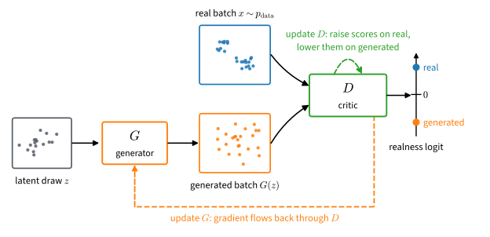

# Generative Adversarial Networks
:label:`sec_basic_gan`

:citet:`Goodfellow.Pouget-Abadie.Mirza.ea.2014` introduced *generative adversarial networks* (GANs) by pairing a generator network with a binary classifier—called the *discriminator* or *critic*—that learns to distinguish real data from generated samples, much like the domain classifier used for covariate-shift correction in :numref:`subsec_covariate-shift-correction`.

Two fundamental questions arise immediately:

1. If a generator fools the discriminator, has it actually learned to match the data distribution $p$?
2. When the discriminator can easily separate generated samples from real data, does its gradient still guide the generator toward $p$?

Because the optimal discriminator for a fixed generator can be derived in closed form, we can answer both questions analytically. We then verify our analysis on a 2D Gaussian problem where exact densities and KL divergences are available in closed form, and finally train a multilayer perceptron generator on Fashion-MNIST images.

```{.python .input #gan-generative-adversarial-networks}
%%tab pytorch
import math
import numpy as np
import torch
from torch import nn
from torch.nn import functional as F
from d2l import torch as d2l
```

```{.python .input #gan-generative-adversarial-networks}
%%tab jax
import math
import numpy as np
import jax
from jax import numpy as jnp
from flax import nnx
import optax
from d2l import jax as d2l
```

## From Likelihood to Two-Sample Comparison

### Implicit Generators

Maximum likelihood estimation requires evaluating the model's log-density $\log p_\theta(x)$ at each observation. By contrast, the generators in this chapter are *implicit*: they sample a latent vector $z \sim \mathcal{N}(0, I_{d_z})$ and pass it through a deterministic network $x' = G(z)$. When the latent dimension $d_z$ is smaller than the data dimension $d_x$, generated samples lie on a low-dimensional manifold and do not admit a density with respect to Lebesgue measure on $\mathbb{R}^{d_x}$. Even when $d_z = d_x$, computing the induced density via the change-of-variables formula requires $G$ to be invertible with a tractable Jacobian determinant.

Moreover, high test log-likelihood does not guarantee realistic samples :cite:`Theis.Oord.Bethge.2016`. Consider a mixture of the true data distribution with uniform or Gaussian noise:

$$
\tilde p \;=\; 0.01\, p_{\textrm{data}} + 0.99\, p_{\textrm{noise}}.
$$
:eqlabel:`eq_gan_noise_mixture`

Because $\tilde p(x) \geq 0.01\, p_{\textrm{data}}(x)$ everywhere, its expected log-likelihood falls short of the true data distribution by at most $\log 100 \approx 4.6$ nats—a negligible difference for images, whose log-likelihoods span thousands of nats. Yet 99% of samples drawn from $\tilde p$ are pure noise. Evaluating a sample generator therefore requires inspecting its samples directly.

### Discriminating Real from Generated Samples

A *two-sample test* checks whether two sets of samples come from the same distribution, and a natural way to implement one is to train a binary classifier to separate them. A GAN uses this classifier to provide gradients to the generator. Let $y \sim \textrm{Bernoulli}(\tfrac12)$ be a balanced source label: if $y = 1$, we draw $x \sim p$ from the data distribution; if $y = 0$, we draw $x \sim q$ from the generator distribution. The marginal distribution of $x$ is the balanced mixture $m = (p + q)/2$.

The *critic* (or *discriminator*) is a function $D: \mathcal{X} \to \mathbb{R}$ that outputs a *realness logit*, so that $\sigma(D(x)) = 1/(1 + e^{-D(x)})$ estimates the posterior probability $P(y = 1 \mid x)$. Following :citet:`Goodfellow.Pouget-Abadie.Mirza.ea.2014`, our code uses `net_D` and `update_D` for the discriminator network, while the text also uses the term *critic* to encompass non-probabilistic scoring networks later in the chapter. (Note that a GAN critic is distinct from the value-function critic in actor–critic reinforcement learning, :numref:`sec_actorcritic`.)

As shown in :numref:`fig_gan`, training alternates between the two networks: the discriminator is updated to separate real minibatches from generated minibatches, and the generator is updated via gradients backpropagated through the discriminator to make its samples harder to classify as fake.


:label:`fig_gan`

## The Log-Loss Objective

Training the discriminator by binary cross-entropy (log loss) on balanced real and generated samples yields the minimax value function of :citet:`Goodfellow.Pouget-Abadie.Mirza.ea.2014`:

$$
V(D) \;=\; \mathbb{E}_{x \sim p}\big[\log \sigma(D(x))\big] + \mathbb{E}_{x' \sim q}\big[\log \sigma(-D(x'))\big].
$$
:eqlabel:`eq_gan_V`

The discriminator maximizes $V(D)$, while the generator affects only the second term and seeks to minimize $V(D)$, resulting in the minimax problem $\min_G \max_D V(D)$.

### The Optimal Critic

For a fixed generator distribution $q$, maximizing :eqref:`eq_gan_V` decouples pointwise across $x$. At each point $x$, the integrand is $p(x) \log \sigma(D(x)) + q(x) \log \sigma(-D(x))$. Writing $u = \sigma(D(x)) \in (0, 1)$, maximizing the strictly concave function $p \log u + q \log(1-u)$ via the first-order condition $p/u = q/(1-u)$ gives the unique optimum:

$$
\sigma(D^\star(x)) = \frac{p(x)}{p(x) + q(x)} = P(y = 1 \mid x),
\qquad
D^\star(x) = \log \frac{p(x)}{q(x)} = \lambda(x).
$$
:eqlabel:`eq_gan_dstar`

Thus, the optimal discriminator outputs the Bayes posterior $P(y = 1 \mid x)$, and its logit $D^\star(x)$ equals the *log density ratio* $\lambda(x) = \log \rho(x)$, where $\rho(x) = p(x)/q(x)$. Even though $q(x)$ has no closed-form density, binary classification estimates $\log(p/q)$ directly from samples. Furthermore, the log-loss objective uniquely pins down the additive constant of $D^\star$: shifting $D^\star$ by any nonzero constant $b$ strictly decreases $V$ (Exercise :exref:`ex_gan-log-loss-game-identifies`), so $D^\star(x) > 0$ precisely where $p(x) > q(x)$.

For example, for two unit-variance Gaussians $p = \mathcal{N}(0, 1)$ and $q = \mathcal{N}(\mu, 1)$, the optimal logit is affine in $x$:

$$
\lambda(x) = -\frac{x^2}{2} + \frac{(x - \mu)^2}{2} = \mu \Big(\frac{\mu}{2} - x\Big),
$$

which changes sign at the midpoint $\mu/2$. When $p$ and $q$ have different covariance matrices, $\lambda(x)$ is quadratic in $x$ and requires a nonlinear discriminator.

### Connection to Jensen–Shannon Divergence

Substituting the optimal discriminator $\sigma(D^\star) = p/(2m)$ and $\sigma(-D^\star) = q/(2m)$ back into :eqref:`eq_gan_V` reveals what the generator minimizes against an optimal discriminator:

$$
V(D^\star) = \int p \log \frac{p}{2m} + \int q \log \frac{q}{2m}
= D_{\textrm{KL}}(p \,\|\, m) + D_{\textrm{KL}}(q \,\|\, m) - 2 \log 2 .
$$

Using the definition of the Jensen–Shannon divergence, $\mathrm{JS}(p, q) = \tfrac12 D_{\textrm{KL}}(p \,\|\, m) + \tfrac12 D_{\textrm{KL}}(q \,\|\, m)$, we obtain:

$$
\max_D V(D) = 2\,\mathrm{JS}(p, q) - 2 \log 2 .
$$
:eqlabel:`eq_gan_js_value`

Because $\mathrm{JS}(p, q) \geq 0$ with equality if and only if $q = p$, minimizing $\max_D V(D)$ uniquely recovers the data distribution $q = p$ at the global minimum $-2\log 2$ (where $D^\star(x) = 0$ everywhere and the discriminator is reduced to random guessing).

Expanding $D_{\textrm{KL}}(p \,\|\, m)$ and $D_{\textrm{KL}}(q \,\|\, m)$ in terms of differential entropies provides an information-theoretic interpretation:

$$
\mathrm{JS}(p, q) \;=\; H(m) - \frac{H(p) + H(q)}{2} \;=\; I(x; y).
$$
:eqlabel:`eq_gan_entropy_gap`

That is, $\mathrm{JS}(p, q)$ equals the mutual information $I(x; y)$ between a sample $x \sim m$ and its binary source label $y$. Because a binary label carries at most $\log 2$ nats of information, $0 \leq \mathrm{JS}(p, q) \leq \log 2$, reaching $\log 2$ whenever $p$ and $q$ have disjoint supports.

### Disjoint Supports and Vanishing Gradients

Because $\mathrm{JS}(p, q)$ saturates at $\log 2$, the minimax objective becomes constant whenever the supports of $p$ and $q$ do not overlap. For instance, if $p = \delta_0$ and $q_\theta = \delta_\theta$ are point masses on $\mathbb{R}$, then $\mathrm{JS}(p, q_\theta) = \log 2$ for every $\theta \neq 0$, yielding zero gradient with respect to $\theta$ no matter how close $\theta$ is to $0$. Even when supports overlap in their tails—such as $p = \mathcal{N}(0, 1)$ and $q = \mathcal{N}(\mu, 1)$—$\mathrm{JS}(p, q)$ equals $0.11$, $0.34$, and $0.63$ nats at $\mu = 1, 2, 4$, and at $\mu = 8$ it lies within $10^{-4}$ of $\log 2 \approx 0.6931$.

In high dimensions, disjoint supports are the norm rather than the exception: both natural images and the outputs of a generator $G: \mathbb{R}^{d_z} \to \mathbb{R}^{d_x}$ with $d_z \ll d_x$ concentrate on low-dimensional manifolds whose intersection typically has measure zero :cite:`Arjovsky.Bottou.2017`. When the discriminator separates them perfectly, the minimax value saturates.

## The Generator's Gradient

In practice, the generator takes gradient steps against a fixed discriminator $D$ rather than minimizing $\max_D V(D)$ directly. Let us examine the gradient of the generator objective.

### Saturating versus Non-Saturating Weights

In the literal minimax formulation, the generator minimizes $\mathbb{E}_z[\log \sigma(-D(G(z)))]$ with respect to its parameters $\theta$. Using $\tfrac{d}{du} \log \sigma(-u) = -\sigma(u)$ and $x' = G(z)$, the gradient is:

$$
\nabla_\theta \, \mathbb{E}_z\big[\log \sigma(-D(G(z)))\big]
= -\,\mathbb{E}_z\big[\sigma(D(x'))\, \nabla_\theta D(G(z))\big].
$$

Each generated sample $x'$ is pushed uphill along $\nabla_\theta D(G(z))$, weighted by $\sigma(D(x'))$—the discriminator's estimated probability that $x'$ is real. When the discriminator confidently rejects a sample ($D(x') \ll 0$), this weight $\sigma(D(x')) \approx e^{D(x')}$ becomes exponentially small, causing the generator gradient to *saturate* precisely when the generator most needs to improve.

To avoid this saturation, :citet:`Goodfellow.Pouget-Abadie.Mirza.ea.2014` trained the generator to maximize the log-probability of its samples being classified as real, minimizing $-\mathbb{E}_z[\log \sigma(D(G(z)))]$. Since $\tfrac{d}{du} \log \sigma(u) = \sigma(-u)$, its gradient is:

$$
\nabla_\theta \Big({-\mathbb{E}_z\big[\log \sigma(D(G(z)))\big]}\Big)
= -\,\mathbb{E}_z\big[\sigma(-D(x'))\, \nabla_\theta D(G(z))\big].
$$

Both objectives push each sample in the same direction $\nabla_\theta D(G(z))$, differing only in the per-sample scalar weight:

$$
w_{\textrm{sat}}(x') = \sigma(D(x')),
\qquad
w_{\textrm{ns}}(x') = \sigma(-D(x')) = 1 - \sigma(D(x')).
$$
:eqlabel:`eq_gan_weights`

As shown in :numref:`fig_gan_weights`, the *non-saturating* weight $w_{\textrm{ns}}(x')$ approaches $1$ for confidently rejected samples ($D(x') \ll 0$), whereas $w_{\textrm{sat}}(x')$ decays as $e^{D(x')}$ (a ratio of $w_{\textrm{ns}}/w_{\textrm{sat}} = e^{-D(x')}$, or $20\times$ at $D = -3$ and $148\times$ at $D = -5$).


:label:`fig_gan_weights`

### Effective Divergence of the Non-Saturating Loss

What divergence does the non-saturating generator loss descend when the discriminator is held at its optimal response $D = \lambda = \log(p/q)$? Using $\log \sigma(-D) - \log \sigma(D) = -D$, we can decompose the non-saturating objective as:

$$
-\mathbb{E}_{x'}\big[\log \sigma(D(x'))\big]
= \mathbb{E}_{x'}\big[-D(x')\big] - \mathbb{E}_{x'}\big[\log \sigma(-D(x'))\big].
$$

With $D$ fixed at $\lambda$, the first term on the right has the same gradient with respect to $q$ as the reverse KL divergence $D_{\textrm{KL}}(q \,\|\, p) = \mathbb{E}_q[\log(q/p)]$, while by the envelope theorem the second term (the minimax loss) has the gradient of $2\,\mathrm{JS}(p, q) = D_{\textrm{KL}}(p \,\|\, m) + D_{\textrm{KL}}(q \,\|\, m)$ :cite:`Arjovsky.Bottou.2017` (Exercise :exref:`ex_gan-generator-weight-divergences`). Combining the integrals using $\log(q/p) - \log(q/m) = \log(m/p)$ and $p + q = 2m$ yields:

$$
\begin{aligned}
D_{\textrm{KL}}(q \,\|\, p) - D_{\textrm{KL}}(p \,\|\, m) - D_{\textrm{KL}}(q \,\|\, m)
&= \int q \log \frac{m}{p} + \int p \log \frac{m}{p} \\
&= \int (p + q) \log \frac{m}{p} \;=\; 2\, D_{\textrm{KL}}(m \,\|\, p).
\end{aligned}
$$
:eqlabel:`eq_gan_ns_divergence`

Thus, against an optimal critic, the non-saturating generator descends $2\,D_{\textrm{KL}}(m \,\|\, p)$, the *softened reverse KL divergence* :cite:`Shannon.Poole.Mariooryad.ea.2020`, which shares the unique global minimum $q = p$.

Inspecting $2\,D_{\textrm{KL}}(m \,\|\, p)$ reveals an asymmetry in how errors are penalized:

- Where $q(x) > 0$ but $p(x) = 0$ (spurious samples outside the data support), $m(x) > 0 = p(x)$ and $D_{\textrm{KL}}(m \,\|\, p) = \infty$, heavily penalizing unrealistic samples.
- Where $p(x) > 0$ but $q(x) = 0$ (dropped modes of the data), $m(x) = p(x)/2$ and the integrand contributes only $p(x) \log \tfrac12$, a small finite penalty.

### Mode Dropping
:label:`subsec_gan_mode_dropping`

When a generator covers only a subset of the modes of a multimodal distribution $p$, it exhibits *mode dropping* (or *mode collapse*). Suppose $p$ is an equal mixture of two disjoint modes and $q$ matches one mode perfectly while omitting the other. On the covered mode, $p = q/2$, so $D_{\textrm{KL}}(q \,\|\, p) = \log 2 \approx 0.69$ nats, $\mathrm{JS}(p, q) \approx 0.22$ nats, and $2\,D_{\textrm{KL}}(m \,\|\, p) \approx 0.26$ nats. Dropping half of the data distribution costs only a quarter of a nat! By contrast, maximum likelihood minimizes the forward KL divergence $D_{\textrm{KL}}(p \,\|\, q)$, which is infinite whenever any part of $p$ is assigned zero density.

Worse still, at the optimal discriminator response $D^\star(x) = \log(p(x)/q(x)) = -\log 2$ on the covered mode, $D^\star$ is constant across the support of $q$, so $\nabla_\theta D^\star(G(z)) = 0$: the local gradient on the covered mode vanishes and provides no signal pointing toward the missing mode. Even with an imperfect discriminator that assigns, say, $D = 3$ to generated samples on the covered mode and $D = 5$ to real samples on the uncovered mode, each generated sample is weighted only against the fixed zero threshold via $\sigma(-3) \approx 0.05$, and the higher scores on the uncovered real mode never enter the generator update. :numref:`sec_gan_relativistic` examines whether comparing generated scores directly against real scores helps address this.

## Verifying the Theory on a 2D Gaussian

To test the theoretical predictions quantitatively, we first train a linear generator on 2D Gaussian data, where $p$, $q$, $\lambda(x) = \log(p(x)/q(x))$, and $D_{\textrm{KL}}(q \,\|\, p)$ can all be computed in closed form.

### Alternating Update Rules

We define `update_D`, `update_G`, and the alternating training loop `train_gan` once and save them to `d2l` for reuse across the chapter.

- `update_D` performs one discriminator step maximizing :eqref:`eq_gan_V` (minimizing binary cross-entropy with label $1$ for real samples and $0$ for detached generated samples). Dividing the summed loss by the batch size estimates $-V(D)$, which equals $2\log 2 \approx 1.386$ when $D = 0$.
- `update_G` performs one generator step minimizing the non-saturating loss $-\mathbb{E}[\log \sigma(D(G(z)))]$ (binary cross-entropy with target label $1$), which equals $\log 2 \approx 0.693$ when $D = 0$.

```{.python .input #gan-the-update-rules-1}
%%tab pytorch
#@save
def update_D(X, Z, net_D, net_G, trainer_D):
    """Update the critic; return its log loss summed over both batches
    (per sample, the sum of two means: 2 log 2 at equilibrium)."""
    trainer_D.zero_grad()
    real_Y = net_D(X)
    # The generator is the fixed player here: detach its output
    fake_Y = net_D(net_G(Z).detach())
    loss_D = (F.binary_cross_entropy_with_logits(
                  real_Y, torch.ones_like(real_Y), reduction='sum') +
              F.binary_cross_entropy_with_logits(
                  fake_Y, torch.zeros_like(fake_Y), reduction='sum'))
    loss_D.backward()
    trainer_D.step()
    return loss_D
```

```{.python .input #gan-the-update-rules-1}
%%tab jax
#@save
@nnx.jit
def update_D(X, Z, net_D, net_G, optimizer_D):
    """Update the critic; return its log loss summed over both batches
    (per sample, the sum of two means: 2 log 2 at equilibrium)."""
    batch_size = X.shape[0]
    fake_X = net_G(Z)  # computed outside the loss: no gradient to net_G
    def loss_D_fn(model_D):
        real_Y = model_D(X).squeeze()
        fake_Y = model_D(fake_X).squeeze()
        return (jnp.sum(optax.sigmoid_binary_cross_entropy(
                    real_Y, jnp.ones(batch_size))) +
                jnp.sum(optax.sigmoid_binary_cross_entropy(
                    fake_Y, jnp.zeros(batch_size))))
    loss_D, grads_D = nnx.value_and_grad(loss_D_fn)(net_D)
    optimizer_D.update(net_D, grads_D)
    return loss_D
```

```{.python .input #gan-the-update-rules-2}
%%tab pytorch
#@save
def update_G(Z, net_D, net_G, trainer_G):
    """Update the generator on the non-saturating loss; return its sum."""
    trainer_G.zero_grad()
    # net_D changed in its half-step, so recompute the scores
    fake_Y = net_D(net_G(Z))
    loss_G = F.binary_cross_entropy_with_logits(
        fake_Y, torch.ones_like(fake_Y), reduction='sum')
    loss_G.backward()  # also fills net_D's .grad (update_D zeroes it)
    trainer_G.step()
    return loss_G
```

```{.python .input #gan-the-update-rules-2}
%%tab jax
#@save
@nnx.jit
def update_G(Z, net_D, net_G, optimizer_G):
    """Update the generator on the non-saturating loss; return its sum."""
    # Both networks are arguments, so critics with mutable state (batch
    # norm) work too; argnums=0 differentiates the generator only
    def loss_G_fn(model_G, model_D):
        fake_Y = model_D(model_G(Z)).squeeze()
        return jnp.sum(optax.sigmoid_binary_cross_entropy(
            fake_Y, jnp.ones(Z.shape[0])))
    loss_G, grads_G = nnx.value_and_grad(loss_G_fn, argnums=0)(net_G, net_D)
    optimizer_G.update(net_G, grads_G)
    return loss_G
```

`train_gan` alternates `update_D` and `step_G` across minibatches using Adam with $\beta_1 = 0.5$ :cite:`Radford.Metz.Chintala.2015` so that momentum adapts quickly to the changing objective. It also supports an optional per-epoch callback `on_epoch` and exponential moving average `ema`.

```{.python .input #gan-training-1}
%%tab pytorch
#@save
def train_gan(net_D, net_G, data_iter, num_epochs, latent_dim, lr_D, lr_G,
              step_G=update_G, seed=None, on_epoch=None, ema=None):
    """Alternate update_D and step_G over the minibatches with Adam
    (beta_1 = 0.5), calling ema.update(net_G) after every generator step
    and on_epoch(epoch) after each epoch if given; return each epoch's
    per-sample losses (loss_D, the sum of the critic's two batch means,
    and loss_G)."""
    if seed is not None:
        torch.manual_seed(seed)
    trainer_D = torch.optim.Adam(net_D.parameters(), lr=lr_D,
                                 betas=(0.5, 0.999))
    trainer_G = torch.optim.Adam(net_G.parameters(), lr=lr_G,
                                 betas=(0.5, 0.999))
    history = []
    for epoch in range(1, num_epochs + 1):
        loss_D, loss_G, n = 0, 0, 0  # summed on the device, read once
        for X, *_ in data_iter:  # labels, if any, are ignored
            Z = torch.randn(X.shape[0], latent_dim, device=X.device)
            loss_D += update_D(X, Z, net_D, net_G, trainer_D).detach()
            loss_G += step_G(Z, net_D, net_G, trainer_G).detach()
            if ema is not None:
                ema.update(net_G)
            n += X.shape[0]
        history.append(torch.stack([loss_D, loss_G]) / n)
        if on_epoch is not None:
            on_epoch(epoch)
    return torch.stack(history).cpu().numpy()
```

```{.python .input #gan-training-1}
%%tab jax
#@save
def train_gan(net_D, net_G, data_iter, num_epochs, latent_dim, lr_D, lr_G,
              step_G=update_G, seed=None, on_epoch=None, ema=None):
    """Alternate update_D and step_G over the minibatches with Adam
    (beta_1 = 0.5), calling ema.update(net_G) after every generator step
    and on_epoch(epoch) after each epoch if given; return each epoch's
    per-sample losses (loss_D, the sum of the critic's two batch means,
    and loss_G)."""
    key = d2l.get_key() if seed is None else jax.random.key(seed)
    optimizer_D = nnx.Optimizer(net_D, optax.adam(lr_D, b1=0.5),
                                wrt=nnx.Param)
    optimizer_G = nnx.Optimizer(net_G, optax.adam(lr_G, b1=0.5),
                                wrt=nnx.Param)
    history = []
    for epoch in range(1, num_epochs + 1):
        loss_D, loss_G, n = 0.0, 0.0, 0  # summed on the device, read once
        for X, *_ in data_iter:  # labels, if any, are ignored
            key, subkey = jax.random.split(key)
            Z = jax.random.normal(subkey, (X.shape[0], latent_dim))
            loss_D += update_D(X, Z, net_D, net_G, optimizer_D)
            loss_G += step_G(Z, net_D, net_G, optimizer_G)
            if ema is not None:
                ema.update(net_G)
            n += X.shape[0]
        history.append((loss_D / n, loss_G / n))
        if on_epoch is not None:
            on_epoch(epoch)
    return np.array(history)
```

### A Linear Generator with Known Densities
:label:`subsec_gan_training`

We generate 1,000 training points from $x = z A + b$ with $z \sim \mathcal{N}(0, I_2)$, so that the true data distribution is the tilted elliptical Gaussian $p = \mathcal{N}(b, A^\top A)$.

```{.python .input #gan-data-and-models-1}
%%tab pytorch
torch.manual_seed(0)
Z = torch.normal(0.0, 1.0, (1000, 2))
A = torch.tensor([[1.0, 2.0], [-0.1, 0.5]])
b = torch.tensor([1.0, 2.0])
data = Z @ A + b
print(f'covariance of the data distribution:\n{A.T @ A}')
```

```{.python .input #gan-data-and-models-1}
%%tab jax
Z = jax.random.normal(jax.random.key(0), (1000, 2))
A = jnp.array([[1.0, 2.0], [-0.1, 0.5]])
b = jnp.array([1.0, 2.0])
data = Z @ A + b
print(f'covariance of the data distribution:\n{A.T @ A}')
```

The generator is a single linear layer $G(z) = z A_q + \mu_q$, which induces the Gaussian distribution $q = \mathcal{N}(\mu_q, A_q^\top A_q)$. Because the log density ratio between two Gaussians with different covariances is quadratic, the discriminator uses a 3-layer MLP with two hidden layers of 16 leaky ReLU units (negative slope $0.2$; Exercise :exref:`ex_gan-dead-critic` examines what happens when saturating $\tanh$ activations are used instead).

```{.python .input #gan-data-and-models-2}
%%tab pytorch
def make_nets(seed=7):
    """The linear generator and the critic, all weights and offsets drawn
    from N(0, 0.02^2) by a generator seeded with seed."""
    gen = torch.Generator().manual_seed(seed)
    net_G = nn.Sequential(nn.Linear(2, 2))
    net_D = nn.Sequential(nn.Linear(2, 16), nn.LeakyReLU(0.2),
                          nn.Linear(16, 16), nn.LeakyReLU(0.2),
                          nn.Linear(16, 1))
    for w in [*net_G.parameters(), *net_D.parameters()]:
        nn.init.normal_(w, 0, 0.02, generator=gen)
    return net_G, net_D
```

```{.python .input #gan-data-and-models-2}
%%tab jax
def make_nets(seed=7):
    """The linear generator and the critic, all weights and offsets drawn
    from N(0, 0.02^2) with keys from seed."""
    normal = nnx.initializers.normal(0.02)
    dense = lambda m, n, rngs: nnx.Linear(m, n, kernel_init=normal,
                                          bias_init=normal, rngs=rngs)
    leaky = lambda x: nnx.leaky_relu(x, 0.2)
    rngs_G, rngs_D = nnx.Rngs(seed), nnx.Rngs(seed + 1)
    net_G = nnx.Sequential(dense(2, 2, rngs_G))
    net_D = nnx.Sequential(dense(2, 16, rngs_D), leaky,
                           dense(16, 16, rngs_D), leaky,
                           dense(16, 1, rngs_D))
    return net_G, net_D
```

We train for 20 epochs with batch size 8, setting `lr_D=0.05` and `lr_G=0.005` so the discriminator tracks its optimal response as the generator moves.

```{.python .input #gan-training-2}
%%tab pytorch
data_iter = d2l.load_array((data,), batch_size=8)
net_G, net_D = make_nets()
history = train_gan(net_D, net_G, data_iter, num_epochs=20, latent_dim=2,
                    lr_D=0.05, lr_G=0.005, seed=1)
with torch.no_grad():
    fake = net_G(torch.normal(0, 1, (200, 2)))
```

```{.python .input #gan-training-2}
%%tab jax
data_iter = d2l.ArrayLoader((data,), batch_size=8, shuffle=True,
                            key=jax.random.key(6))
net_G, net_D = make_nets()
history = train_gan(net_D, net_G, data_iter, num_epochs=20, latent_dim=2,
                    lr_D=0.05, lr_G=0.005, seed=1)
fake = net_G(jax.random.normal(jax.random.key(4), (200, 2)))
```

```{.python .input #gan-training-3}
%%tab pytorch, jax
fig, axes = d2l.plt.subplots(1, 2, figsize=(9, 3.2))
epochs = list(range(1, len(history) + 1))
d2l.plot(epochs, [history[:, 0], history[:, 1], [2 * math.log(2)] * len(epochs),
                  [math.log(2)] * len(epochs)],
         'epoch', 'loss',
         legend=['critic', 'generator', '2 log 2', 'log 2'],
         fmts=('C0-', 'C1--', 'C0:', 'C1:'), axes=axes[0])
d2l.plot([data[:100, 0], fake[:100, 0]], [data[:100, 1], fake[:100, 1]],
         legend=['real', 'generated'], fmts=('C0.', 'C1.'), axes=axes[1])
fig.tight_layout()
```

Within 10 epochs, the discriminator loss rises to the equilibrium value $2\log 2$, the generator loss settles to $\log 2$, and the generated point cloud matches the target ellipse.

### Quantifying the Fit in Nats
:label:`subsec_gan_fit`

Because $G(z) = z A_q + \mu_q$ defines a Gaussian $q = \mathcal{N}(\mu_q, \Sigma_q)$ with $\Sigma_q = A_q^\top A_q$, we can evaluate the exact KL divergence $D_{\textrm{KL}}(q \,\|\, p)$ in $d_x$ dimensions :cite:`Kullback.1959`:

$$
D_{\textrm{KL}}\big(\mathcal{N}(\mu_0, \Sigma_0) \,\|\, \mathcal{N}(\mu_1, \Sigma_1)\big)
= \tfrac12 \Big[ \operatorname{tr}(\Sigma_1^{-1} \Sigma_0)
+ (\mu_1 - \mu_0)^\top \Sigma_1^{-1} (\mu_1 - \mu_0)
- d_x + \log \tfrac{\det \Sigma_1}{\det \Sigma_0} \Big].
$$
:eqlabel:`eq_gan_mvn_kl`

```{.python .input #gan-quantifying-the-fit}
%%tab pytorch
def generator_gaussian(net_G):
    A_qT, b_q = net_G[0].weight.detach(), net_G[0].bias.detach()
    return b_q, A_qT @ A_qT.T  # nn.Linear stores A_q.T

def kl_gaussians(mu0, S0, mu1, S1):
    diff = mu1 - mu0
    return 0.5 * (torch.trace(torch.linalg.solve(S1, S0))
                  + diff @ torch.linalg.solve(S1, diff) - len(mu0)
                  + torch.logdet(S1) - torch.logdet(S0))

mu_p, Sigma_p = b, A.T @ A
for name, net in [('at initialization', make_nets()[0]),
                  ('after training   ', net_G)]:
    mu_q, Sigma_q = generator_gaussian(net)
    print(f'KL(q || p) {name}: '
          f'{kl_gaussians(mu_q, Sigma_q, mu_p, Sigma_p):.3f} nats')
```

```{.python .input #gan-quantifying-the-fit}
%%tab jax
def generator_gaussian(net_G):
    A_q, b_q = net_G.layers[0].kernel[...], net_G.layers[0].bias[...]
    return b_q, A_q.T @ A_q

def kl_gaussians(mu0, S0, mu1, S1):
    diff = mu1 - mu0
    return 0.5 * (jnp.trace(jnp.linalg.solve(S1, S0))
                  + diff @ jnp.linalg.solve(S1, diff) - len(mu0)
                  + jnp.linalg.slogdet(S1)[1] - jnp.linalg.slogdet(S0)[1])

mu_p, Sigma_p = b, A.T @ A
for name, net in [('at initialization', make_nets()[0]),
                  ('after training   ', net_G)]:
    mu_q, Sigma_q = generator_gaussian(net)
    print(f'KL(q || p) {name}: '
          f'{kl_gaussians(mu_q, Sigma_q, mu_p, Sigma_p):.3f} nats')
```

Without ever evaluating the density of $q$, adversarial training reduces $D_{\textrm{KL}}(q \,\|\, p)$ from $\sim 8$ nats at initialization (dominated by the low entropy of the initial $\mathcal{N}(0, 0.02^2)$ weights) to a few hundredths of a nat.

### Verifying the Learned Log Density Ratio
:label:`subsec_gan_verify_critic`

To test whether a trained discriminator accurately recovers $\lambda(x) = \log(p(x)/q(x))$ (:eqref:`eq_gan_dstar`), we fix a generator $q$ with $A_q = [[1, 2], [-0.5, 0.5]]$ and $\mu_q = (1.5, 1.5)$ ($D_{\textrm{KL}}(q \,\|\, p) \approx 3.4$ nats) and train a fresh discriminator against this frozen $q$ for 2,000 steps.

```{.python .input #gan-verifying-the-optimal-critic-1}
%%tab pytorch
net_G_q, net_D_q = make_nets()  # a fresh critic
with torch.no_grad():  # the hand-set generator; nn.Linear stores A_q.T
    net_G_q[0].weight.copy_(torch.tensor([[1.0, -0.5], [2.0, 0.5]]))
    net_G_q[0].bias.copy_(torch.tensor([1.5, 1.5]))
trainer_D = torch.optim.Adam(net_D_q.parameters(), lr=0.01)
torch.manual_seed(2)
for _ in range(2000):  # critic-only steps against the frozen generator
    X = data[torch.randint(0, len(data), (256,))]
    Zb = torch.normal(0, 1, (256, 2))
    update_D(X, Zb, net_D_q, net_G_q, trainer_D)
```

```{.python .input #gan-verifying-the-optimal-critic-1}
%%tab jax
net_G_q, net_D_q = make_nets()  # a fresh critic
net_G_q.layers[0].kernel[...] = jnp.array([[1.0, 2.0], [-0.5, 0.5]])  # A_q
net_G_q.layers[0].bias[...] = jnp.array([1.5, 1.5])  # b_q
optimizer_D = nnx.Optimizer(net_D_q, optax.adam(0.01), wrt=nnx.Param)
key = jax.random.key(2)
for _ in range(2000):  # critic-only steps against the frozen generator
    key, k1, k2 = jax.random.split(key, 3)
    X = data[jax.random.randint(k1, (256,), 0, len(data))]
    Zb = jax.random.normal(k2, (256, 2))
    update_D(X, Zb, net_D_q, net_G_q, optimizer_D)
```

We evaluate both the discriminator logit $D(x)$ and the exact log density ratio $\lambda(x)$ across 200 real and 200 generated points, reporting their correlation and explained variance $R^2$.

```{.python .input #gan-verifying-the-optimal-critic-2}
%%tab pytorch
def gaussian_logpdf(x, mu, Sigma):
    diff = x - mu
    sol = torch.linalg.solve(Sigma, diff.T).T
    return -0.5 * ((diff * sol).sum(1)
                   + torch.logdet(2 * torch.pi * Sigma))

mu_q, Sigma_q = generator_gaussian(net_G_q)
with torch.no_grad():
    xs = torch.cat([data[:200], net_G_q(torch.normal(0, 1, (200, 2)))])
    lam = (gaussian_logpdf(xs, b, A.T @ A)
           - gaussian_logpdf(xs, mu_q, Sigma_q))
    D_out = net_D_q(xs).squeeze()
r2 = 1 - ((D_out - lam) ** 2).mean() / ((lam - lam.mean()) ** 2).mean()
print(f'correlation {torch.corrcoef(torch.stack([lam, D_out]))[0, 1]:.3f}, '
      f'R^2 {r2:.3f}')
```

```{.python .input #gan-verifying-the-optimal-critic-2}
%%tab jax
def gaussian_logpdf(x, mu, Sigma):
    diff = x - mu
    sol = jnp.linalg.solve(Sigma, diff.T).T
    return -0.5 * ((diff * sol).sum(1)
                   + jnp.linalg.slogdet(2 * jnp.pi * Sigma)[1])

mu_q, Sigma_q = generator_gaussian(net_G_q)
key, subkey = jax.random.split(key)
xs = jnp.concatenate([data[:200],
                      net_G_q(jax.random.normal(subkey, (200, 2)))])
lam = (gaussian_logpdf(xs, b, A.T @ A)
       - gaussian_logpdf(xs, mu_q, Sigma_q))
D_out = net_D_q(xs).squeeze()
r2 = 1 - ((D_out - lam) ** 2).mean() / ((lam - lam.mean()) ** 2).mean()
print(f'correlation {jnp.corrcoef(jnp.stack([lam, D_out]))[0, 1]:.3f}, '
      f'R^2 {r2:.3f}')
```

```{.python .input #gan-the-learned-density-ratio-1}
%%tab pytorch, jax
lims = [float(lam.min()), float(lam.max())]
d2l.plot([lam[:200], lam[200:], lims], [D_out[:200], D_out[200:], lims],
         r'analytic $\lambda = \log(p/q)$', 'critic output $D$',
         legend=['at real samples', 'at generated samples', r'$D = \lambda$'],
         fmts=('C0.', 'C1.', 'k--'), figsize=(4.2, 3.4))
```

The learned logits closely track the true log density ratio ($\text{correlation} \approx 0.98$, $R^2 > 0.90$). Deviations appear only at extreme negative values of $\lambda$ (generated samples where $p(x) \approx 0$): the piecewise-linear leaky-ReLU network extrapolates linearly rather than quadratically into the tails, and because $\tfrac{d}{dD}[-\log \sigma(-D)] = \sigma(D) \ll 1$ when $D \ll 0$, the log loss exerts almost no gradient to steepen the discriminator further once it is already confident.

### Saturating versus Non-Saturating Generator Loss
:label:`subsec_gan_saturation`

To compare the saturating and non-saturating weights (:eqref:`eq_gan_weights`) when the generator starts far from the data, we shift the initial generator bias by $(-6, 6)$ ($\sim 8$ units from the data mean, $D_{\textrm{KL}}(q \,\|\, p) \approx 355$ nats) and compare `update_G` against `update_G_saturating`, which minimizes $\mathbb{E}_z[\log \sigma(-D(G(z)))]$ directly.

```{.python .input #gan-saturating-and-non-saturating-losses-compared-2}
%%tab pytorch
def update_G_saturating(Z, net_D, net_G, trainer_G):
    trainer_G.zero_grad()
    fake_Y = net_D(net_G(Z))
    # log sigma(-D) is minus the cross-entropy under the label zero
    loss_G = -F.binary_cross_entropy_with_logits(
        fake_Y, torch.zeros_like(fake_Y), reduction='sum')
    loss_G.backward()
    trainer_G.step()
    return loss_G
```

```{.python .input #gan-saturating-and-non-saturating-losses-compared-2}
%%tab jax
@nnx.jit
def update_G_saturating(Z, net_D, net_G, optimizer_G):
    def loss_G_fn(model_G, model_D):
        fake_Y = model_D(model_G(Z)).squeeze()
        # log sigma(-D) is minus the cross-entropy under the label zero
        return -jnp.sum(optax.sigmoid_binary_cross_entropy(
            fake_Y, jnp.zeros(Z.shape[0])))
    loss_G, grads_G = nnx.value_and_grad(loss_G_fn, argnums=0)(net_G, net_D)
    optimizer_G.update(net_G, grads_G)
    return loss_G
```

We run three seeds for each generator objective from identical initializations and minibatches (`lr_G=0.01`, `lr_D=0.05`).

```{.python .input #gan-saturating-versus-non-saturating-training-1}
%%tab pytorch
def far_start():
    """make_nets with the generator's offset moved by (-6, 6)."""
    net_G, net_D = make_nets()
    with torch.no_grad():
        net_G[0].bias += torch.tensor([-6.0, 6.0])
    return net_G, net_D

mu_q, Sigma_q = generator_gaussian(far_start()[0])
print(f'start of every run: KL(q || p) = '
      f'{kl_gaussians(mu_q, Sigma_q, mu_p, Sigma_p):.2f} nats')
torch.manual_seed(3)
Z_show = torch.randn(200, 2)  # one latent sample for every snapshot
runs = {}  # name: (losses, snapshots) of the first run, for the plot
for name, step in [('non-saturating', update_G),
                   ('saturating', update_G_saturating)]:
    kls = []
    for seed in (1, 2, 3):  # both arms see the same minibatches and draws
        net_G_ab, net_D_ab = far_start()
        snaps = {}  # epoch: generated samples
        hist = train_gan(net_D_ab, net_G_ab, data_iter, num_epochs=20,
                         latent_dim=2, lr_D=0.05, lr_G=0.01, step_G=step,
                         seed=seed, on_epoch=lambda epoch: snaps.update(
                             {epoch: net_G_ab(Z_show).detach()}))
        runs.setdefault(name, (hist, snaps))
        mu_q, Sigma_q = generator_gaussian(net_G_ab)
        kls.append(f'{kl_gaussians(mu_q, Sigma_q, mu_p, Sigma_p):.2f}')
    print(f'{name}: final KL(q || p) = {", ".join(kls)} nats')
```

```{.python .input #gan-saturating-versus-non-saturating-training-1}
%%tab jax
def far_start():
    """make_nets with the generator's offset moved by (-6, 6)."""
    net_G, net_D = make_nets()
    net_G.layers[0].bias[...] += jnp.array([-6.0, 6.0])
    return net_G, net_D

mu_q, Sigma_q = generator_gaussian(far_start()[0])
print(f'start of every run: KL(q || p) = '
      f'{kl_gaussians(mu_q, Sigma_q, mu_p, Sigma_p):.2f} nats')
Z_show = jax.random.normal(jax.random.key(5), (200, 2))  # for every snapshot
runs = {}  # name: (losses, snapshots) of the first run, for the plot
for name, step in [('non-saturating', update_G),
                   ('saturating', update_G_saturating)]:
    kls = []
    for seed in (1, 2, 3):  # both arms see the same minibatches and draws
        net_G_ab, net_D_ab = far_start()
        data_iter_ab = d2l.ArrayLoader((data,), batch_size=8, shuffle=True,
                                       key=jax.random.key(seed - 1))
        snaps = {}  # epoch: generated samples
        hist = train_gan(net_D_ab, net_G_ab, data_iter_ab, num_epochs=20,
                         latent_dim=2, lr_D=0.05, lr_G=0.01, step_G=step,
                         seed=seed, on_epoch=lambda epoch: snaps.update(
                             {epoch: net_G_ab(Z_show)}))
        runs.setdefault(name, (hist, snaps))
        mu_q, Sigma_q = generator_gaussian(net_G_ab)
        kls.append(f'{kl_gaussians(mu_q, Sigma_q, mu_p, Sigma_p):.2f}')
    print(f'{name}: final KL(q || p) = {", ".join(kls)} nats')
```

```{.python .input #gan-saturating-and-non-saturating-losses-compared-1}
%%tab pytorch, jax
fig, axes = d2l.plt.subplots(1, 3, figsize=(10.5, 3.2))
for ax, (name, (hist, snaps)) in zip(axes[:2], runs.items()):
    d2l.plot([data[:150, 0], snaps[5][:, 0], snaps[20][:, 0]],
             [data[:150, 1], snaps[5][:, 1], snaps[20][:, 1]],
             legend=['real', 'epoch 5', 'epoch 20'],
             fmts=('C0.', 'C1+', 'C1.'), axes=ax)
    ax.set_title(name)
epochs = list(range(1, 21))
d2l.plot(epochs, [runs['non-saturating'][0][:, 0],
                  runs['saturating'][0][:, 0], [2 * math.log(2)] * 20],
         'epoch', 'critic loss', legend=['non-saturating', 'saturating',
                                         '2 log 2'],
         fmts=('-', '--', 'k:'), axes=axes[2])
fig.tight_layout()
```

In the first two epochs, both discriminators easily separate the distant generated points from the data, driving the discriminator loss near zero and $D(x') \ll 0$. Because $w_{\textrm{sat}}(x') = \sigma(D(x')) \approx 0$, the saturating generator stalls completely ($\sim 345$ nats from the data after 20 epochs). By contrast, the non-saturating weight $w_{\textrm{ns}}(x') = \sigma(-D(x')) \approx 1$ preserves the discriminator's spatial gradient $\nabla_\theta D(G(z))$, pulling the generator onto the data distribution within 20 epochs ($D_{\textrm{KL}}(q \,\|\, p) \approx 0.02\text{--}0.04$ nats). Note that $w_{\textrm{ns}}$ only rescales $\nabla_\theta D$; it relies on the leaky-ReLU discriminator having a nonzero spatial slope at $x'$.

## Training an MLP GAN on Fashion-MNIST
:label:`subsec_gan_fashion_mnist`

On images, neither $p(x)$ nor $q(x)$ is known in closed form, so we must monitor sample quality and the training losses. As a first image experiment, we train two leaky-ReLU MLPs on the 60,000 $28 \times 28$ grayscale images of Fashion-MNIST (:numref:`sec_fashion_mnist`), scaled to $[-1, 1]$. The generator maps a 100-dimensional latent vector through hidden layers of 256 and 512 units to 784 pixels with a $\tanh$ output activation; the discriminator maps 784 pixels through 512 and 256 units to a single logit. We save the helper `make_mlp` for building simple MLPs in later sections.

```{.python .input #gan-garments-from-noise-5}
%%tab pytorch
#@save
def make_mlp(sizes, act):
    """Linear layers of the given widths with the activation module act
    between them; weights uniform in +-1/sqrt(fan_in), zero biases."""
    layers = []
    for d_in, d_out in zip(sizes[:-1], sizes[1:]):
        linear = nn.Linear(d_in, d_out)  # weights uniform by default
        nn.init.zeros_(linear.bias)
        layers += [linear, act]
    return nn.Sequential(*layers[:-1])
```

```{.python .input #gan-garments-from-noise-5}
%%tab jax
#@save
def make_mlp(sizes, act, *, rngs):
    """Linear layers of the given widths with the activation function act
    between them; weights uniform in +-1/sqrt(fan_in), zero biases."""
    init = nnx.initializers.variance_scaling(1 / 3, 'fan_in', 'uniform')
    layers = []
    for d_in, d_out in zip(sizes[:-1], sizes[1:]):
        layers += [nnx.Linear(d_in, d_out, kernel_init=init, rngs=rngs), act]
    return nnx.Sequential(*layers[:-1])
```

```{.python .input #gan-garments-from-noise-1}
%%tab pytorch
torch.manual_seed(0)
fmnist = d2l.FashionMNIST()
# All 60,000 training images as rows of 784 pixels in [-1, 1]
images = fmnist.train.data.reshape(-1, 784).float() / 127.5 - 1
image_iter = d2l.load_array((images,), batch_size=64)
leaky = nn.LeakyReLU(0.2)
net_G_img = nn.Sequential(make_mlp([100, 256, 512, 784], leaky), nn.Tanh())
net_D_img = make_mlp([784, 512, 256, 1], leaky)
```

```{.python .input #gan-garments-from-noise-1}
%%tab jax
fmnist = d2l.FashionMNIST()
# All 60,000 training images as rows of 784 pixels in [-1, 1]
images = fmnist.train[0].reshape(-1, 784).astype(np.float32) / 127.5 - 1
image_iter = d2l.ArrayLoader((images,), batch_size=64, shuffle=True,
                             key=jax.random.key(3))
rngs = nnx.Rngs(0)
leaky = lambda x: nnx.leaky_relu(x, 0.2)
net_G_img = nnx.Sequential(make_mlp([100, 256, 512, 784], leaky, rngs=rngs),
                           jnp.tanh)
net_D_img = make_mlp([784, 512, 256, 1], leaky, rngs=rngs)
```

We train both networks with learning rate $2 \times 10^{-4}$ and batch size 64 for 20 epochs ($\sim 18{,}750$ steps).

```{.python .input #gan-garments-from-noise-2}
%%tab pytorch, jax
history_img = train_gan(net_D_img, net_G_img, image_iter, num_epochs=20,
                        latent_dim=100, lr_D=2e-4, lr_G=2e-4, seed=1)
print(f'last epoch: critic loss {history_img[-1, 0]:.2f}, '
      f'generator loss {history_img[-1, 1]:.2f}')
```

```{.python .input #gan-garments-from-noise-3}
%%tab pytorch
with torch.no_grad():
    fake_img = net_G_img(torch.randn(30, 100))
d2l.show_images(fake_img.reshape(30, 28, 28), 2, 15, scale=0.9, cmap='gray');
```

```{.python .input #gan-garments-from-noise-3}
%%tab jax
fake_img = net_G_img(jax.random.normal(jax.random.key(2), (30, 100)))
d2l.show_images(fake_img.reshape(30, 28, 28), 2, 15, scale=0.9, cmap='gray');
```

```{.python .input #gan-garments-from-noise-4}
%%tab pytorch, jax
epochs = list(range(1, len(history_img) + 1))
fig, axes = d2l.plt.subplots(1, 2, figsize=(9, 3), sharex=True)
for ax, loss, ref, name, ref_name, fmt in zip(
        axes, history_img.T, (2 * math.log(2), math.log(2)),
        ('critic', 'generator'), ('2 log 2', 'log 2'), ('C0-', 'C1--')):
    d2l.plot(epochs, [loss, [ref] * len(epochs)], 'epoch', f'{name} loss',
             legend=[name, ref_name], fmts=(fmt, 'k:'), axes=ax)
fig.tight_layout()
```

The generated images capture recognizable garment silhouettes (shirts, trousers, shoes, bags), though with grainy pixel noise because an MLP lacks the spatial inductive bias of convolutions. Notice that even after 20 epochs, the discriminator loss ($\sim 1.05$) remains below its equilibrium value $2\log 2 \approx 1.39$ and the generator loss ($\sim 1.4$) above $\log 2 \approx 0.69$. Unlike the 2D Gaussian setting, loss curves alone on images cannot distinguish imperfect generation from discriminator overfitting (Exercise :exref:`ex_gan-finite-sample-critic`) or reveal whether all garment categories are covered equally (Exercise :exref:`ex_gan-class-coverage`).

## Summary

- A GAN trains an implicit generator $x' = G(z)$ without an explicit likelihood by pairing it with a discriminator (or critic) $D$ trained to separate real data $x \sim p$ from generated samples $x' \sim q$.
- Under the binary log loss, the optimal discriminator logit is the log density ratio $D^\star(x) = \lambda(x) = \log(p(x)/q(x))$, and the optimal value function is $\max_D V(D) = 2\,\mathrm{JS}(p, q) - 2\log 2$, where $\mathrm{JS}(p, q) = I(x; y) \in [0, \log 2]$ is the mutual information between a sample from the mixture $m = (p+q)/2$ and its source label.
- When $D(x') \ll 0$, the literal minimax (saturating) generator gradient weight $w_{\textrm{sat}}(x') = \sigma(D(x'))$ vanishes exponentially. The non-saturating generator loss $-\mathbb{E}[\log \sigma(D(G(z)))]$ replaces this weight with $w_{\textrm{ns}}(x') = \sigma(-D(x')) \approx 1$; against an optimal discriminator, it descends $2\,D_{\textrm{KL}}(m \,\|\, p)$, which strongly penalizes out-of-support samples but assigns only a small finite penalty to dropped modes.

## Exercises

1. **Excess loss and the additive constant.** Let $\eta = p / (p + q)$ and let $D_{\textrm{b}}(a \,\|\, u)$ be the KL divergence between Bernoulli distributions with parameters $a$ and $u$.
    1. Show that every critic satisfies $V(D^\star) - V(D) = 2\, \mathbb{E}_{m}\big[D_{\textrm{b}}(\eta \,\|\, \sigma(D))\big]$, so that $D^\star$ is the unique maximizer of :eqref:`eq_gan_V` up to $m$-null sets.
    1. Conclude that $V(D^\star + b) < V(D^\star)$ for every constant $b \neq 0$.
    1. Expand to second order in $b$ to show $V(D^\star + b) - V(D^\star) = -\frac{b^2}{2} \int \frac{p q}{p + q}\, dx + O(b^3)$, with coefficient in $[0, \tfrac12]$. When $p$ and $q$ are nearly disjoint, how tightly do finite samples pin down the additive constant of $D$?
   :exlabel:`ex_gan-log-loss-game-identifies`

1. **Supports of measure zero.**
    1. A generator $G(z) = z v + \mu_q$ with a 1D latent $z \in \mathbb{R}$ places its samples on a line in $\mathbb{R}^2$. Show that $\mathrm{JS}(p, q) = \log 2$ against the 2D Gaussian data distribution $p = \mathcal{N}(\mu_p, A^\top A)$ for every $v$ and $\mu_q$.
    1. Show that $\mathrm{JS}(\hat p, q) = \log 2$ for the empirical distribution $\hat p$ of the 1,000 training points and every continuous density $q$ (including $q = p$).
    1. For a $\kappa$-Lipschitz critic $D$, use Kantorovich–Rubinstein duality (:numref:`sec_mdl-optimal-transport`) to show that replacing $p$ by $\hat p$ in :eqref:`eq_gan_V` changes $V(D)$ by at most $\kappa\, W_1(\hat p, p)$. Why does restricting the Lipschitz constant make training on empirical samples informative?
   :exlabel:`ex_gan-measure-zero-supports`

1. [code] **Saturating critic activations.** ● Replace the leaky-ReLU activations in `make_nets` with $\tanh$ units and hidden widths of 5 and 3.
    1. Rerun the non-saturating arm of :numref:`subsec_gan_saturation` for five seeds and record the final $D_{\textrm{KL}}(q \,\|\, p)$ and critic loss.
    1. For a stalled run, inspect the hidden activations and $\|\nabla_x D(x)\|$ at real and generated samples. Why does saturating the critic's hidden units prevent the non-saturating generator loss from recovering?
    1. Both a converged generator ($q = p$) and a constant critic ($D(x) = 0$) yield a critic loss of $2\log 2$. Which diagnostic in this section distinguishes the two?
   :exlabel:`ex_gan-dead-critic`

1. [code] **Class coverage of the Fashion-MNIST generator.** ●
    1. Train LeNet (:numref:`sec_lenet`) on Fashion-MNIST, classify 1,000 samples from `net_G_img`, and compare the predicted class histogram against the uniform data distribution.
    1. Repeat for generators trained for 5 and 40 epochs. Does longer training make the class distribution more uniform?
    1. How does forced classification into 10 classes bias the histogram when some generated images are blurry or ambiguous? Relate your findings to mode dropping (:numref:`subsec_gan_mode_dropping`).
   :exlabel:`ex_gan-class-coverage`

1. **Generator weights and their divergences.** ●● A generator loss $\mathbb{E}_z[g(D(G(z)))]$ with fixed critic $D$ has gradient $-\mathbb{E}_z[w(D)\, \nabla_\theta D(G(z))]$ where $w = -g'$. Assume $D$ is held at the optimal log density ratio $\lambda = \log(p / q_{\theta_0})$ for the current generator $q_{\theta_0}$, and write $\rho = e^D = p / q_{\theta_0}$.
    1. Using $\int \nabla_\theta q_\theta = 0$, show that the unweighted loss $\mathbb{E}_z[-D(G(z))]$ ($w = 1$) has gradient $\nabla_\theta D_{\textrm{KL}}(q_\theta \,\|\, p)$ at $\theta = \theta_0$.
    1. For the $f$-divergence $D_f(p \,\|\, q_\theta) = \mathbb{E}_{q_\theta}[f(p/q_\theta)]$ (:numref:`sec_mdl-f-divergences`), show that $\nabla_\theta D_f\big|_{\theta_0} = -\mathbb{E}_z\big[\rho^2 f''(\rho)\, \nabla_\theta D(G(z))\big]$, so a weight function $w$ corresponds to the $f$-divergence satisfying $\rho^2 f''(\rho) = w(\log \rho)$.
    1. Identify the divergences corresponding to $w_{\textrm{sat}}$, $w = 1$, $w(t) = e^t$ :cite:`Goodfellow.2016`, and $w_{\textrm{ns}}$ (Theorem 2.5 of :citet:`Arjovsky.Bottou.2017`).
    1. Use :eqref:`eq_gan_ns_divergence` to evaluate $2\,D_{\textrm{KL}}(m \,\|\, p)$ when $p$ has $K$ equal disjoint modes and $q$ covers only one of them, and compare its growth in $K$ with $D_{\textrm{KL}}(q \,\|\, p) = \log K$.

   *Adapted from Stefano Ermon and Aditya Grover's [CS236: Deep Generative Models](https://cs236.stanford.edu).*
   :exlabel:`ex_gan-generator-weight-divergences`

1. [extended] **Finite samples and critic capacity.** ●● When the sample size exceeds the number of critic parameters by a factor of $\tilde O(1/\epsilon^2)$, the empirical critic value concentrates within $\epsilon$ of its population value :cite:`Arora.Ge.Liang.ea.2017`. Fix the generator to the true data distribution ($G(z) = z A + \mu_p$, so $q = p$).
    1. Train 2-hidden-layer critics of width 4, 16, 128, and 1,024 on $n \in \{100, 1000, 10000\}$ fixed training points from $p$ (Adam at $10^{-3}$, 4,000 steps of batch size 256). Plot the generalization gap between the training loss and the population loss on fresh draws against parameter count.
    1. The Fashion-MNIST critic in :numref:`subsec_gan_fashion_mnist` has $\sim 530{,}000$ parameters and trains on 60,000 images. Design and run a test using the Fashion-MNIST test set to check whether its sub-$2\log 2$ loss reflects memorization of the training set or genuine discrepancy between $p$ and $q$.
   :exlabel:`ex_gan-finite-sample-critic`

[Discussions](https://d2l.discourse.group/t/36808)

<!-- slides -->

::: {.slide}
::: {.cover}
[Dive into Deep Learning · §16.1]{.kicker}

Generative Adversarial Networks: Two-Player Minimax Game<br>**implicit generators · binary log-loss critic · optimal log density ratio · Jensen–Shannon saturation · non-saturating loss & mode dropping**
:::
:::

::: {.slide title="Implicit Generators and Why Likelihood Misleads"}
[Motivation]{.kicker}

Maximum likelihood estimation requires evaluating $\log q_\theta(x)$ at every training observation, whereas an **implicit generator** defines a distribution directly through a sampling program $x' = G_\theta(z)$ with $z \sim \mathcal{N}(0, I_{d_z})$:

::: {.cols .vc}
::: {.col}
- **Singular support ($d_z \ll d_x$):** Mapping $d_z = 100$ Gaussian numbers to $d_x = 784$ Fashion-MNIST pixels concentrates $q_\theta$ on a $100$-dimensional manifold with no density on $\mathbb{R}^{784}$ (and no tractable Jacobian determinant).
- **High likelihood $\neq$ realistic samples (Theis et al., 2016):** The mixture $\tilde{p}(x) = 0.01\,p_{\textrm{data}}(x) + 0.99\,p_{\textrm{noise}}(x)$ satisfies $\log \tilde{p}(x) \ge \log p_{\textrm{data}}(x) - \log 100$, falling short of the true distribution by at most **$4.6$ nats** while producing **$99\%$ noise**.
:::

::: {.col .fig}
@!gan-garments-from-noise-3
:::
:::
:::

::: {.slide title="Two-Sample Comparison via a Binary Classifier"}
[The Minimax Architecture]{.kicker}

Just as a domain classifier detects covariate shift between training and test inputs, a GAN trains a binary **discriminator (critic)** $D: \mathcal{X} \to \mathbb{R}$ to separate real data from generated samples:

::: {.cols .vc}
::: {.col}
- **Balanced mixture protocol:** Draw source label $y \sim \textrm{Bernoulli}(\frac{1}{2})$. If $y = 1$, sample $x \sim p$ (real data); if $y = 0$, sample $x' = G(z) \sim q$ (generator). Pooled samples follow $m(x) = \frac{1}{2}(p(x) + q(x))$.
- **Realness logit $D(x)$:** Applying the logistic sigmoid $\sigma(t) = 1/(1 + e^{-t})$ maps the unconstrained critic score $D(x)$ to an estimate of the posterior $P(y = 1 \mid x)$.
- **Alternating updates:** $D$ updates its weights to classify real vs. fake minibatches; $G$ updates its weights using gradients backpropagated through $D$.
:::

::: {.col .fig}
{.nostretch width=100%}
:::
:::
:::

::: {.slide title="The Binary Log-Loss Minimax Objective"}
[Formulation]{.kicker}

Training the discriminator by binary cross-entropy (maximizing expected log-likelihood of the source label $y \in \{0, 1\}$) defines the minimax value function of Goodfellow et al. (2014):

$$V(D) = \mathbb{E}_{x \sim p}\big[\log \sigma(D(x))\big] + \mathbb{E}_{x' \sim q}\big[\log \sigma(-D(x'))\big]$$

- **Discriminator maximization ($\max_D V(D)$):** Pushes $D(x) > 0$ ($\sigma(D(x)) \to 1$) on real data $x \sim p$ and $D(x') < 0$ ($\sigma(-D(x')) = 1 - \sigma(D(x')) \to 1$) on generated samples $x' \sim q$.
- **Generator minimization ($\min_G \max_D V(D)$):** Affects only the second expectation $\mathbb{E}_{z}[\log \sigma(-D(G(z)))]$ and moves $q$ so that $D$ cannot distinguish $x'$ from $x$.
- **Random-guessing baseline ($D(x) = 0$):** A constant zero critic predicts $\sigma(0) = \frac{1}{2}$ everywhere, yielding $V(0) = -2\log 2 \approx -1.386$ (so the summed cross-entropy critic loss $-V(0)$ equals **$2\log 2 \approx 1.386$**).
:::

::: {.slide title="Deriving the Optimal Critic: Log Density Ratio"}
[Pointwise Optimality]{.kicker}

For any fixed generator distribution $q$, maximizing $V(D)$ over all measurable functions $D$ decouples pointwise at each $x \in \mathcal{X}$. Setting $u = \sigma(D(x)) \in (0, 1)$, the pointwise integrand is $p(x)\log u + q(x)\log(1 - u)$:

$$\frac{\partial}{\partial u}\Big[p(x)\log u + q(x)\log(1 - u)\Big] = \frac{p(x)}{u} - \frac{q(x)}{1 - u} = 0$$

- **Exact Bayes posterior and log density ratio:** Solving $p(1 - u) = qu$ uniquely identifies the optimal discriminator probability and logit:
  $$\sigma\big(D^\star(x)\big) = \frac{p(x)}{p(x) + q(x)} = P(y = 1 \mid x), \qquad D^\star(x) = \log \frac{p(x)}{q(x)} = \lambda(x)$$
- **Pinned zero threshold:** Unlike pairwise ranking critics (§16.3), log loss strictly identifies the additive constant: $D^\star(x) > 0 \iff p(x) > q(x)$, and shifting $D^\star$ by any constant $b \neq 0$ strictly decreases $V$.
:::

::: {.slide title="Worked Example: Optimal Critic for Two Gaussians"}
[Analytical Intuition]{.kicker}

Comparing two Gaussian distributions illustrates how the discrepancy between $p$ and $q$ determines the required expressiveness of the discriminator network $D$:

- **Equal-variance shift ($p = \mathcal{N}(0, 1)$, $q = \mathcal{N}(\mu, 1)$):** The quadratic $x^2/2$ terms cancel in the log density ratio, leaving an **affine** function of $x$ that changes sign at the midpoint $x = \mu / 2$:
  $$D^\star(x) = \lambda(x) = -\frac{x^2}{2} + \frac{(x - \mu)^2}{2} = \mu\!\left(\frac{\mu}{2} - x\right)$$
  Here, a simple linear logistic classifier already contains the exact optimal critic $D^\star(x)$!
- **Unequal covariances ($p = \mathcal{N}(\mu_p, \Sigma_p)$, $q = \mathcal{N}(\mu_q, \Sigma_q)$ with $\Sigma_p \neq \Sigma_q$):** The log density ratio $\lambda(x)$ contains the quadratic term $-\frac{1}{2}x^\top (\Sigma_p^{-1} - \Sigma_q^{-1})x$, so a linear critic cannot separate the distributions—a **nonlinear** neural network (e.g., a leaky-ReLU MLP) is required.
:::

::: {.slide title="Minimax Value and the Jensen–Shannon Divergence"}
[Population Objective]{.kicker}

Substituting $\sigma(D^\star) = \frac{p}{p + q} = \frac{p}{2m}$ and $\sigma(-D^\star) = \frac{q}{2m}$ (where $m = \frac{p+q}{2}$) back into $V(D)$ reveals the exact divergence minimized by the generator against an optimal critic:

$$V(D^\star) = \int p \log \frac{p}{2m} + \int q \log \frac{q}{2m} = D_{\textrm{KL}}(p \,\|\, m) + D_{\textrm{KL}}(q \,\|\, m) - 2\log 2$$

- Using the definition of the **Jensen–Shannon divergence**, $\mathrm{JS}(p, q) = \frac{1}{2}D_{\textrm{KL}}(p \,\|\, m)$ $+ \frac{1}{2}D_{\textrm{KL}}(q \,\|\, m)$:
  $$\max_D V(D) = 2\,\mathrm{JS}(p, q) - 2\log 2$$
- **Unique global equilibrium ($q = p$):** Because $\mathrm{JS}(p, q) \ge 0$ with equality if and only if $q = p$, minimizing $\max_D V(D)$ uniquely recovers the data distribution $q = p$ at value $-2\log 2$ (where $D^\star(x) = 0$ everywhere).
:::

::: {.slide title="Information-Theoretic View and JS Saturation"}
[Disjoint Supports Hazard]{.kicker}

Expanding $D_{\textrm{KL}}(p \,\|\, m)$ and $D_{\textrm{KL}}(q \,\|\, m)$ in terms of differential entropies identifies $\mathrm{JS}(p, q)$ as the **mutual information** $I(x; y)$ between a sample $x \sim m$ and its binary source label $y \in \{0, 1\}$:

$$\mathrm{JS}(p, q) = H(m) - \frac{H(p) + H(q)}{2} = I(x; y), \qquad 0 \le \mathrm{JS}(p, q) \le \log 2 \approx 0.6931\text{ nats}$$

| Separation $\mu$ for $p = \mathcal{N}(0, 1)$ vs. $q = \mathcal{N}(\mu, 1)$ | $\mu = 1$ | $\mu = 2$ | $\mu = 4$ | $\mu = 8$ | Disjoint ($p = \delta_0, q = \delta_\theta, \theta \neq 0$) |
| :--- | :--- | :--- | :--- | :--- | :--- |
| **$\mathrm{JS}(p, q)$ (nats)** | $0.109$ | $0.338$ | $0.632$ | **$0.6931$** | **$\log 2 \approx 0.6931$ (constant!)** |

::: {.d2l-note .warn}
**Why $\mathrm{JS}$ saturates in high dimensions:** Both natural images and generator outputs $G: \mathbb{R}^{d_z} \to \mathbb{R}^{d_x}$ ($d_z \ll d_x$) lie on low-dimensional manifolds whose intersection has measure zero (Arjovsky & Bottou, 2017). When supports are disjoint, every sample identifies its source label $y$ with certainty, freezing $\mathrm{JS}(p, q) = \log 2$ with zero slope!
:::
:::

::: {.slide title="Saturating vs. Non-Saturating Generator Gradients"}
[Gradient Rescaling]{.kicker}

In practice, the generator takes a gradient step against a fixed critic $D$. Both generator losses push each sample $x' = G_\theta(z)$ along the same spatial direction $\nabla_\theta D(G_\theta(z))$, differing only in their scalar weight:

::: {.cols .vc}
::: {.col}
- **Saturating minimax loss** ($\min_\theta \mathbb{E}_z[\log \sigma(-D(x'))]$):
  $$\nabla_\theta \mathcal{L}_{\textrm{sat}} = -\mathbb{E}_z\Big[\underbrace{\sigma(D(x'))}_{w_{\textrm{sat}}(x')}\,\nabla_\theta D(G_\theta(z))\Big]$$
  When $D$ rejects $x'$ ($D(x') \ll 0$), $w_{\textrm{sat}}(x') \approx e^{D(x')} \to 0$.
- **Non-saturating loss** ($\min_\theta -\mathbb{E}_z[\log \sigma(D(x'))]$):
  $$\nabla_\theta \mathcal{L}_{\textrm{ns}} = -\mathbb{E}_z\Big[\underbrace{\sigma(-D(x'))}_{w_{\textrm{ns}}(x')}\,\nabla_\theta D(G_\theta(z))\Big]$$
  For rejected samples, $w_{\textrm{ns}}(x') \to 1$ ($w_{\textrm{ns}}/w_{\textrm{sat}} = e^{-D(x')}$, giving $20\times$ more weight at $D = -3$ and $148\times$ at $D = -5$).
:::

::: {.col .fig}
{.nostretch width=100%}
:::
:::
:::

::: {.slide title="Effective Divergence of the Non-Saturating Loss"}
[Softened Reverse KL]{.kicker}

What divergence does the non-saturating loss descend when the critic is held at its optimal response $D = \lambda = \log(p/q)$? Using $\log \sigma(-D) - \log \sigma(D) = -D$:

$$-\mathbb{E}_{x' \sim q}\big[\log \sigma(D(x'))\big] = \mathbb{E}_{x' \sim q}\big[-D(x')\big] - \mathbb{E}_{x' \sim q}\big[\log \sigma(-D(x'))\big]$$

- At $D = \lambda$, the first term has the $q$-gradient of reverse KL $D_{\textrm{KL}}(q \,\|\, p) = \mathbb{E}_q[\log(q/p)]$, while by the envelope theorem the second term has the gradient of $2\,\mathrm{JS}(p, q) = D_{\textrm{KL}}(p \,\|\, m)$ $+ D_{\textrm{KL}}(q \,\|\, m)$:
  $$D_{\textrm{KL}}(q \,\|\, p) - D_{\textrm{KL}}(p \,\|\, m) - D_{\textrm{KL}}(q \,\|\, m) = \int (p + q)\log \frac{m}{p} = 2\,D_{\textrm{KL}}(m \,\|\, p)$$
- **Asymmetric error penalty of the softened reverse KL $2\,D_{\textrm{KL}}(m \,\|\, p)$:**
  - **Spurious samples ($q(x) > 0$ where $p(x) = 0$):** $m(x) > 0 = p(x)$ $\implies$ $2\,D_{\textrm{KL}}(m \,\|\, p) = \infty$ (heavily penalizes unrealistic outputs).
  - **Dropped data modes ($p(x) > 0$ where $q(x) = 0$):** $m(x) = p(x)/2 \implies$ integrand is $p(x)\log \frac{1}{2}$ (small finite cost).
:::

::: {.slide title="Mode Dropping: Why Losing Half the Data Is Cheap"}
[Failure Mode Analysis]{.kicker}

Suppose $p$ is an equal mixture of two disjoint modes and $q$ matches one mode perfectly while omitting the other ($q = 2p$ on the covered mode, $q = 0$ on the dropped mode):

| Objective / Divergence | Value When One of Two Equal Modes Is Dropped | Penalty Magnitude |
| :--- | :--- | :--- |
| **Forward KL (Maximum Likelihood)** | $D_{\textrm{KL}}(p \,\|\, q) = \infty$ | **Infinite** (forbids zero density on any data mode) |
| **Reverse KL** | $D_{\textrm{KL}}(q \,\|\, p) = \log 2 \approx 0.693\text{ nats}$ | Moderate ($0.69$ nats; mode-seeking) |
| **Non-Saturating GAN** | $2\,D_{\textrm{KL}}(m \,\|\, p)$ $= \frac{3}{2}\log \frac{3}{4} + \frac{1}{2}\log \frac{1}{4}$ $\approx 0.262\text{ nats}$ | **Small** ($\approx \frac{1}{4}$ nat to drop half the dataset!) |
| **Minimax GAN (JS)** | $\mathrm{JS}(p, q) \approx 0.216\text{ nats}$ | **Small** ($< \frac{1}{4}$ nat) |

::: {.d2l-note .warn}
**Zero local restoring gradient:** On the covered mode, $D^\star(x) = \log(p(x)/q(x)) = -\log 2$ is constant across $\operatorname{supp}(q)$, so $\nabla_x D^\star(G(z)) = \mathbf{0}$: the local gradient vanishes and provides no signal pointing toward the missing mode.
:::
:::

::: {.slide title="Implementing Alternating Critic and Generator Steps"}
[Framework Implementation]{.kicker}

`update_D` detaches generated samples so no gradient flows into `net_G`, while `update_G` recomputes critic scores after `net_D`'s half-step and minimizes the non-saturating cross-entropy with target label $1$:

@gan-the-update-rules-1

@gan-the-update-rules-2
:::

::: {.slide title="The Alternating GAN Training Loop"}
[Training Infrastructure]{.kicker}

`train_gan` alternates `update_D` and `step_G` across minibatches using Adam with reduced momentum $\beta_1 = 0.5$ (Radford et al., 2015) so first-moment estimates adapt quickly to the changing opponent:

@gan-training-1
:::

::: {.slide title="Testbed 1: Linear Generator on a 2D Tilted Gaussian"}
[Closed-Form Verification]{.kicker}

To test our theoretical predictions quantitatively, we generate $1{,}000$ points from $x = zA + b$ ($z \sim \mathcal{N}(0, I_2)$) so $p = \mathcal{N}(b, A^\top A)$ and train a single linear layer $G(z) = zA_q + \mu_q$:

::: {.cols .vc}
::: {.col}
- **Exact closed-form Gaussian $q$:** Because $G$ is linear, $q = \mathcal{N}(\mu_q, A_q^\top A_q)$ has an exact mean and covariance at every training step—even though training never evaluates $q(x)$!
- **Nonlinear critic requirement:** Because $\Sigma_p \neq \Sigma_q$, the true log density ratio $\lambda(x) = \log(p(x)/q(x))$ is quadratic in $x$, requiring a 3-layer leaky-ReLU MLP critic ($2 \to 16 \to 16 \to 1$, slope $0.2$).
:::

::: {.col .fig}
@gan-data-and-models-2
:::
:::
:::

::: {.slide title="Convergence to Equilibrium on the 2D Gaussian"}
[Empirical Verification]{.kicker}

Training for $20$ epochs with batch size $8$ (`lr_D = 0.05`, `lr_G = 0.005` so the critic tracks its best response) brings both losses to their theoretical equilibrium values within $10$ epochs:

::: {.cols .vc}
::: {.col}
- **Equilibrium loss levels:** Critic loss $-V(D)$ rises to $2\log 2 \approx 1.386$ (random guessing), and generator loss settles to $\log 2 \approx 0.693$.
- **Exact fit in nats:** Evaluating the closed-form multivariate Gaussian KL divergence confirms that $D_{\textrm{KL}}(q \,\|\, p)$ drops from $\sim 8.3$ nats at initialization to $\sim 0.02$ nats:

@!gan-quantifying-the-fit
:::

::: {.col .fig}
@!gan-training-3
:::
:::
:::

::: {.slide title="Does the Trained Critic Recover log(p/q)?"}
[Checking the Density Ratio]{.kicker}

Freezing a perturbed generator $q$ ($D_{\textrm{KL}}(q \,\|\, p) \approx 3.4$ nats) and training a fresh leaky-ReLU critic against it for $2{,}000$ steps tests whether $D(x)$ recovers the analytical log density ratio $\lambda(x) = \log(p(x)/q(x))$:

::: {.cols .vc}
::: {.col}
- **High accuracy where samples overlap:** Across $200$ real and $200$ generated points, $D(x)$ tracks $\lambda(x)$ with correlation $\approx 0.98$ and explained variance $R^2 > 0.90$:

@!gan-verifying-the-optimal-critic-2

- **Why extreme negative tails flatten ($\lambda \ll 0$):** The piecewise-linear leaky-ReLU network extrapolates linearly rather than quadratically into the tails, and once $D(x') \ll 0$, the critic's log-loss gradient $\sigma(D(x')) \approx e^{D(x')}$ vanishes.
:::

::: {.col .fig}
@!gan-the-learned-density-ratio-1
:::
:::
:::

::: {.slide title="Saturating vs. Non-Saturating Loss from a Far Start"}
[Controlled Ablation]{.kicker}

Shifting the initial generator offset by $(-6, 6)$ places $q$ roughly $8$ units from the data ($D_{\textrm{KL}}(q \,\|\, p) \approx 355$ nats). Running three seeds each under identical minibatches isolates the effect of the generator weight:

::: {.cols .vc}
::: {.col}
@!gan-saturating-versus-non-saturating-training-1

- By epoch $2$, both critics easily separate the distant clouds ($D(x') \ll 0$, critic loss $\approx 0$).
- **Saturating generator ($w_{\textrm{sat}} = \sigma(D(x')) \approx 0$):** Stalls completely near its starting point ($\sim 345$ nats).
- **Non-saturating generator ($w_{\textrm{ns}} = \sigma(-D(x')) \approx 1$):** Preserves the leaky-ReLU critic's spatial slope $\nabla_x D(x')$ and converges to $0.02\text{--}0.04$ nats.
:::

::: {.col .fig}
@!gan-saturating-and-non-saturating-losses-compared-1
:::
:::
:::

::: {.slide title="Scaling Up: MLP GAN on Fashion-MNIST Images"}
[High-Dimensional Synthesis]{.kicker}

On $60{,}000$ Fashion-MNIST images ($28 \times 28 = 784$ pixels scaled to $[-1, 1]$), we train leaky-ReLU MLPs ($G$: $100 \to 256 \to 512 \to 784$ with $\tanh$; $D$: $784 \to 512 \to 256 \to 1$) for $20$ epochs (Adam $\text{lr} = 2 \times 10^{-4}, \beta_1 = 0.5$, batch size $64$):

::: {.cols .vc}
::: {.col}
- **Visual quality:** The MLP generator captures recognizable garment silhouettes (trousers, shirts, shoes, bags), though with grainy pixel textures because dense layers ignore 2D spatial locality.
- **Persistent gap from equilibrium:** After $20$ epochs, the critic loss ($\sim 1.05$) remains below $2\log 2 \approx 1.39$ and the generator loss ($\sim 1.4$) above $\log 2 \approx 0.69$.
- **Diagnostic ambiguity:** Without closed-form densities, loss curves alone cannot tell imperfect generation apart from critic memorization or dropped garment classes.
:::

::: {.col .fig}
@!gan-garments-from-noise-4
:::
:::
:::

::: {.slide title="Concept Check: Optimal Critics and Gradient Weights"}
[Check Your Understanding]{.kicker}

Test your understanding of the classic minimax GAN analysis:

1. **Gradient weight ratio:** A generated sample receives discriminator logit $D(x') = -5$. By what factor is its per-sample gradient weight larger under the non-saturating loss than under the saturating minimax loss?
2. **Reading an equilibrium critic loss:** At the end of a training run, the discriminator loss reads $2\log 2 \approx 1.386$. Does this certify that the generator distribution $q$ matches the data distribution $p$?
3. **Saturating critic hidden units:** If you replace the critic's leaky-ReLU activations with $\tanh$ units on the far-start Gaussian problem, why does even the non-saturating generator stall?

::: {.d2l-note .fragment .fade-up}
**Answers:**

1. The weight ratio is $\frac{w_{\textrm{ns}}(x')}{w_{\textrm{sat}}(x')} = \frac{\sigma(-D(x'))}{\sigma(D(x'))}$ $= e^{-D(x')} = e^5 \approx \mathbf{148.4\times}$ (and $e^3 \approx 20.1\times$ at $D(x') = -3$).
2. **No.** Any constant zero critic $D(x) = 0$ (e.g., an under-trained, dead, or heavily penalized critic) achieves loss $2\log 2$ regardless of how far $q$ is from $p$. You must evaluate samples or feature distances directly.
3. The non-saturating weight $w_{\textrm{ns}}(x') = \sigma(-D(x')) \approx 1$ only rescales the spatial gradient $\nabla_\theta D(G_\theta(z))$. If the critic's internal $\tanh$ hidden units saturate at $\pm 1$, then $\nabla_x D(x') \approx \mathbf{0}$ and $1 \times \mathbf{0} = \mathbf{0}$.
:::
:::

::: {.slide title="Summary: The Classic Minimax GAN Framework"}
[Key Takeaways]{.kicker}

| Concept / Component | Mathematical Expression | Equilibrium / Range | Practical Role & Pitfalls |
| :--- | :--- | :--- | :--- |
| **Minimax Value Function** | $V(D) = \mathbb{E}_p[\log\sigma(D(x))] + \mathbb{E}_q[\log\sigma(-D(x'))]$ | $V(D^\star) = -2\log 2 \approx -1.386$ | Binary cross-entropy on balanced real/fake draws |
| **Optimal Critic Logit** | $D^\star(x) = \log \frac{p(x)}{q(x)} = \lambda(x)$ | $D^\star(x) = 0 \iff q(x) = p(x)$ | Estimates log density ratio from samples alone |
| **Population Divergence** | $\max_D V(D) = 2\,\mathrm{JS}(p, q) - 2\log 2$ | $\mathrm{JS}(p, q) = I(x; y) \in [0, \log 2]$ | Saturates at $\log 2$ whenever supports are disjoint |
| **Saturating $G$ Weight** | $w_{\textrm{sat}}(x') = \sigma(D(x'))$ | $w_{\textrm{sat}} = \frac{1}{2}$ at $D = 0$ | Decays as $e^{D(x')} \to 0$ when $D(x') \ll 0$; stalls far from data |
| **Non-Saturating $G$ Loss** | $-\mathbb{E}_z[\log\sigma(D(G(z)))]$, $\;w_{\textrm{ns}}(x') = \sigma(-D(x'))$ | Descends $2\,D_{\textrm{KL}}(m \,\|\, p)$ at $D^\star$ | Preserves unit weight when $D(x') \ll 0$; standard in practice |
| **Mode Dropping** | $q$ covers a subset of modes of $p$ | Costs only $\approx 0.26$ nats for half of $p$ | $\nabla_x D^\star = \mathbf{0}$ on covered modes provides no pull to missing modes |
:::
