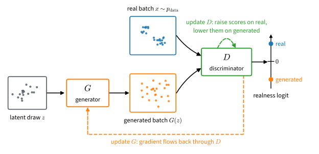

# Generative Adversarial Networks
:label:`chap_gans`

Almost every model in this book was trained by likelihood: a classifier raises the probability of the correct label, a language model that of the next token. The reward model of :numref:`sec_regularized` learned differently, from which of two answers a judge preferred, through the Bradley--Terry model, which turns the difference of two scores into the probability that one answer wins. Now consider a network that turns a hundred random numbers into an image in one forward pass. Nothing in it computes the probability of the image it returns, so there is no likelihood to raise. Can a learned comparison take its place?

:citet:`Goodfellow.Pouget-Abadie.Mirza.ea.2014` proposed that it can. A second network, the critic, learns to tell generated samples from real ones, and the generator learns to make that hard. The critic's output tells the generator where its samples are too dense and where too sparse, although neither density is ever written down.

Diffusion and flow models (:numref:`chap_diffusion`) have since replaced stand-alone GANs for most image synthesis, yet the learned comparison survives: one-step generators distilled from diffusion models, the autoencoders on which many image generators run, and many speech vocoders all train with an adversarial term.

Seven questions organize the chapter. What does the critic compute, and what does the generator then minimize (:numref:`sec_basic_gan`)? Which losses and critics keep a gradient when the generated samples miss the data (:numref:`sec_gan_objectives`)? What changes when the critic ranks a real sample against a generated one (:numref:`sec_gan_relativistic`)? Why does gradient training circle the equilibrium, and what makes it converge (:numref:`sec_gan_convergence`)? Which network turns noise into an image, and how do we score the images (:numref:`sec_dcgan`)? How do we ask for a bird, and check that we got one (:numref:`sec_gan_conditional`)? Why does squared error blur an ambiguous prediction where a learned comparison does not (:numref:`sec_gan_beyond`)? The experiments, in PyTorch and JAX, run on Fashion-MNIST garments, planar Gaussians whose densities we know, game sprites and CIFAR-10.

```toc
:maxdepth: 2

gan
objectives
relativistic
convergence
dcgan
conditional
adversarial-losses
further-reading
```

## Resources and Further Reading {.unnumbered}

These resources accompany particular sections; :numref:`sec_gan-further-reading` turns to the methods the chapter does not teach.

- The [NIPS 2016 tutorial](https://arxiv.org/abs/1701.00160) :cite:`Goodfellow.2016` gives the original intuition and the field in 2016, a companion to :numref:`sec_basic_gan`.
- [GAN Lab](https://poloclub.github.io/ganlab/) :cite:`Kahng.Thorat.Chau.ea.2018` runs two-dimensional games in a browser and shows the critic's decision surface as training proceeds.
- The [GAN stability repository](https://github.com/LMescheder/GAN_stability) of :citet:`Mescheder.Geiger.Nowozin.2018` implements the Dirac-GAN and the $R_1$/$R_2$ penalties of :numref:`sec_gan_convergence`.
- The [R3GAN implementation](https://github.com/brownvc/R3GAN) :cite:`Huang.Gokaslan.Kuleshov.ea.2024` trains the loss and backbone of :numref:`sec_gan_convergence` and :numref:`sec_dcgan` at full scale.
- [StyleGAN3](https://github.com/NVlabs/stylegan3) :cite:`Karras.Aittala.Laine.ea.2021` is a mature StyleGAN implementation with full-scale FID and KID tools.
- :citet:`Lucic.Kurach.Michalski.ea.2018` find that, given equal tuning budgets, many objectives of :numref:`sec_gan_objectives` attain similar scores.
- [ganhacks](https://github.com/soumith/ganhacks), a 2016 training checklist, shows which stabilizers the penalties of :numref:`sec_gan_convergence` later replaced.

<!-- slides -->

::: {.slide}
::: {.cover}
[Dive into Deep Learning · §16]{.kicker}

Generative adversarial networks<br>
**a learned comparison in place of the likelihood · what the critic estimates · what it does with the estimate · how it is constrained**
:::
:::

::: {.slide title="A Hundred Random Numbers Become a Garment or a Sprite, with No Density"}
[The problem]{.kicker}

::: {.cols .vc}
::: {.col}
@!gan-garments-from-noise-3

- $x' = G(z)$, $z$ a vector of 100 Gaussian numbers: one forward pass
  per image.
- Garments: a perceptron trained on Fashion-MNIST. Sprites (right): a
  convolutional generator.
:::

::: {.col .narrow}
@!dcgan-training-with-the-classic-loss-3
:::
:::

::: {.d2l-note .warn}
Nothing computes the probability of $x'$. Can a learned comparison of
samples with data take the place of the likelihood?
:::
:::

::: {.slide title="By the End of This Chapter You Can"}
[Goals]{.kicker}

- read a critic's logit as a log density ratio, and the game's value as a
  divergence;
- say which losses and critics keep a gradient far from the data;
- explain why a critic that ranks pairs changes the push on each sample;
- make gradient training of a game converge, and set the penalty weight;
- train an image generator, score it, and condition it on a class.

**The idea:** train a classifier to tell real from generated, then move the
generator until the classifier fails.
:::

::: {.slide title="A Learned Comparison Replaces the Likelihood"}
[Where this fits]{.kicker}

::: {.cols .vc}
::: {.col}
| part or chapter | the model learns from |
|---|---|
| Basics | the likelihood of observed data |
| Deep Reinforcement Learning | a reward fitted to pairwise preferences |
| **Generative Adversarial Networks** | **a critic that compares samples with data** |
| Diffusion Models | regression against closed-form targets |
:::

::: {.col .narrow}
- **Uses:** logistic regression, the covariate-shift classifier, KL and JS
  divergences, the Bradley--Terry model.
- **Skips:** a survey of architectures; applications.
- **Survives in:** one-step distilled generators, image autoencoders,
  speech vocoders.
:::
:::
:::

::: {.slide title="A Model within 4.6 Nats of the Best Can Emit 99% Noise"}
[Why not likelihood anyway]{.kicker}

- Mix the data density with noise:
  $\tilde p = 0.01\, p_{\textrm{data}} + 0.99\, p_{\textrm{noise}}$.
- Then $\log \tilde p \geq \log p_{\textrm{data}} - \log 100$: within
  4.6 nats of the best model.
- Image log-likelihoods run to thousands of nats, so 4.6 nats is a rounding
  error; yet 99% of the samples are noise.

::: {.d2l-note}
Judging a sampler requires looking at its samples.
:::
:::

::: {.slide title="A Classifier's Logit Is the Log Density Ratio"}
::: {.cols .vc}
::: {.col .narrow}
{width=100%}
:::

::: {.col}
- Label $y = 1$ for a data sample $x \sim p$, $y = 0$ for a generated
  sample $x' \sim q$, half of each.
- The best log-loss classifier has
  $\sigma(D^\star(x)) = \dfrac{p(x)}{p(x) + q(x)}$, so
  $D^\star(x) = \log \dfrac{p(x)}{q(x)}$.
- The generator gets its gradient through $D$.
:::
:::

::: {.d2l-note}
Neither density is written down, yet the ratio tells the generator where
its samples are too dense and where too sparse.
:::
:::

::: {.slide title="Check: Read a Critic's Output"}
[Check]{.kicker}

An optimal critic returns $D(x) = 1.2$ at a point $x$, and
$D(x) = -2$ at another point.

1. What is $p(x)/q(x)$ at each point?
2. Which point should the generator place fewer samples near?

::: {.fragment .fade-up}
1. $e^{1.2} \approx 3.3$: the data is denser there; $e^{-2} \approx 0.14$:
   the generator is about seven times too dense.
2. The second point: $q$ exceeds $p$ there.
:::
:::

::: {.slide title="The Value Stops Changing Once the Samples Miss the Data"}
- The game's value, against the best critic, is a Jensen--Shannon
  divergence: $\max_D V = 2\,\mathrm{JS}(p, q) - 2 \log 2$.
- $p = \mathcal{N}(0, 1)$, $q = \mathcal{N}(\mu, 1)$: JS is 0.11, 0.34 and
  0.63 nats at $\mu = 1, 2, 4$.
- At $\mu = 8$ it equals its ceiling $\log 2 \approx 0.6931$ to four digits.
- Moving $q$ further away changes nothing, so the generator gets no
  gradient.

::: {.d2l-note .warn}
Which losses and which critics keep the generator moving?
:::
:::

::: {.slide title="Three Choices Describe Every Game of the Chapter"}
| choice | options |
|---|---|
| what the critic estimates | the log ratio $\log(p/q)$, or a smoothed difference $p - q$ |
| what it does with the estimate | classify one sample, rank a pair, witness a difference of means |
| how it is constrained | not at all, a fixed ball, a penalty on its gradient |

::: {.d2l-note}
Ranking alone leaves the minima where dropping modes lowers the loss; only a
fixed one-to-one pairing of real and generated samples removes them. The
third choice decides whether a gradient survives separated supports and
training converges.
:::
:::

::: {.slide title="Seven Sections, One Question Each"}
[Chapter map]{.kicker}

| section | question |
|---|---|
| Generative Adversarial Networks | what does the critic compute; what does the generator minimize? |
| Adversarial Objectives | which losses and critics keep a gradient far from the data? |
| Relativistic Objectives | what changes when the critic ranks a real--generated pair? |
| Gradient Penalties | why does training circle, and what makes it converge? |
| Adversarial Image Generation | which network maps noise to an image; how to score it? |
| Conditional Generation | how to ask for a bird, and check that we got one? |
| Adversarial Losses Beyond GANs | why does squared error blur where a comparison does not? |
:::

::: {.slide title="Garments First, Then Densities We Know, Then Images We Score"}
[Running examples]{.kicker}

- **Fashion-MNIST, 60,000 garments at $28 \times 28$:** the first image
  generator, two perceptrons trained in minutes on a CPU.
- **Planar Gaussians and mixtures:** both densities known, so the critic is
  checked against $\log(p/q)$ and the fit is measured in nats.
- **25 Gaussians on a $5 \times 5$ grid:** do the samples cover every mode?
- **40,597 game sprites at $64 \times 64$:** three training recipes on one
  backbone, scored by FID and KID.
- **CIFAR-10 at $32 \times 32$, ten classes:** ask for a bird; a classifier
  checks the request.
:::

::: {.slide title="Check: Which Section Answers Each Symptom?"}
[Check]{.kicker}

1. The generated points sit far from the data, and the generator's gradient
   is almost zero.
2. Both losses rise and fall around $\log 2$ while the generated points
   drift back and forth.
3. Every request for a bird returns the same bird.

::: {.fragment .fade-up}
1. Adversarial Objectives: which games keep a gradient on separated
   supports.
2. Gradient Penalties: simultaneous gradient steps circle the equilibrium.
3. Conditional Generation: a generator can obey every request with one
   image per class.
:::
:::

::: {.slide title="Wrap-up"}
[Wrap-up]{.kicker}

- A generator turns 100 random numbers into a garment or a sprite but gives
  no density.
- A sampler can be within 4.6 nats of the best likelihood and emit 99% noise.
- A classifier of real against generated samples computes $\log(p/q)$
  without either density.
- Every game varies three choices: what the critic estimates, what it does
  with it, how it is constrained.
- Seven sections; garments, planar Gaussians, sprites and CIFAR-10 carry
  them.

**Next:** the log-loss game, solved exactly, then trained on garments.
:::
