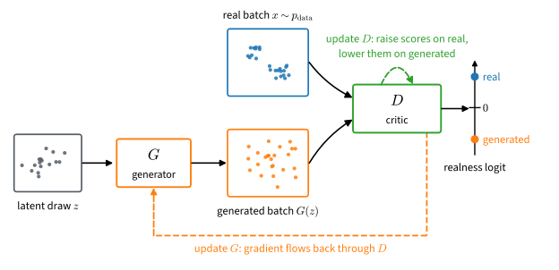

# Generative Adversarial Networks
:label:`chap_gans`

Take a hundred numbers drawn at random, pass them through a network, and out comes a picture of a shoe. Writing such a network down takes a few lines; training it is the hard part. A classifier learns by raising the probability of the correct label, a language model by raising that of the next token. Nothing in our network computes the probability of the image it returns, so there is no likelihood to raise. Can a learned comparison take its place?

We have trained such a comparison before. To correct for covariate shift in :numref:`subsec_covariate-shift-correction`, we taught a classifier to tell training inputs from test inputs, and its logit estimated the log ratio of the two densities, up to a constant. :citet:`Goodfellow.Pouget-Abadie.Mirza.ea.2014` turned this into a way to train a generator: the *generative adversarial network* (GAN) is a game between two networks. The *critic*, which they called the discriminator, learns to tell generated samples from real ones, and the generator learns to make that hard. The critic's output tells the generator where its samples are too dense and where too sparse, although neither density is ever written down.

Diffusion and flow models (:numref:`chap_diffusion`) have since replaced stand-alone GANs for most image synthesis, yet the learned comparison survives. An adversarial term still trains many speech vocoders, the autoencoders on which many image generators run, and several one-step generators distilled from diffusion models.

The chapter moves in three steps. First, what does the game measure, and does the generator still get a signal when its samples miss the data? :numref:`sec_basic_gan` asks this of the original game, :numref:`sec_gan_objectives` of other losses and critics, and :numref:`sec_gan_relativistic` of a critic that compares a real sample with a generated one. Second, does gradient training converge at all? :numref:`sec_gan_convergence` answers on a game with two parameters, and the answer decides how we train everything after it. Last, we build: an image generator and the scores that judge it, a generator that takes a request, and the reason an adversarial term outlived the stand-alone GAN. A reader in a hurry to build can read :numref:`sec_basic_gan` and :numref:`sec_gan_convergence` and go straight to the images. The appendix (:numref:`chap_mdl-information-theory`) proves the divergence facts in general; the chapter reads without it.

From :numref:`sec_gan_convergence` on we train with one recipe, R3GAN :cite:`Huang.Gokaslan.Kuleshov.ea.2024`: a critic that compares a real sample with a generated one, and two penalties that keep its gradient small at both. We chose it because it has few parts and each part has an analysis we can carry out. Its authors report that it beats the far more elaborate StyleGAN2 on faces, ImageNet and CIFAR-10, with compute far beyond ours. Our notebooks show something narrower: on small problems, each part does what its analysis predicts. They do not show that the recipe wins: in our runs, comparing pairs does not visibly help the generator reach every cluster of the data, and on the sprites of :numref:`sec_dcgan` a convolutional network from 2015 scores at least as well. The planar experiments take minutes at most, the image notebooks up to about forty minutes on one GPU, partly because the penalty, a function of the critic's gradient, costs a second backward pass at every critic step.

```toc
:maxdepth: 2

gan
objectives
relativistic
convergence
dcgan
conditional
adversarial-losses
further-reading
```

## Notation {.unnumbered}

:numref:`tab_gan_notation` collects the symbols that carry through the chapter. Letters that live in one paragraph, figure or exercise are local to it, such as the intercept $b$ of a logistic critic or the feature map $h$ of :numref:`sec_gan_conditional`. The last column gives another common notation only where a reader of the literature will meet it.

:Notation of this chapter.
:label:`tab_gan_notation`

| symbol | meaning | first used | often written |
|:--|:--|:--|:--|
| $p$, $q$, $m = \tfrac12(p + q)$ | data, generator and mixture densities | :numref:`sec_basic_gan` | $p_{\textrm{data}}$, $p_g$ for $p$, $q$ |
| $x \sim p$, $x' \sim q$; $y$ | a real and a generated sample; the source label, $1$ for real | :numref:`sec_basic_gan` | |
| $z$, $G$, $d_z$; $d_x$ | latent variable, generator, latent dimension; data dimension | :numref:`sec_basic_gan` | |
| $D$; $V$ | the critic's realness logit; the value of the log-loss game | :numref:`sec_basic_gan` | discriminator for $D$ |
| $\rho = p/q$, $\lambda = \log \rho$ | density ratio and its logarithm | :numref:`sec_basic_gan` | |
| $\mu$; $\delta_\theta$ | a mean; a point mass at $\theta$ | :numref:`sec_basic_gan` | |
| $w_{\textrm{sat}}$, $w_{\textrm{ns}}$ | per-sample weights of the saturating and non-saturating generator updates | :numref:`sec_basic_gan` | |
| $\eta = p/(p + q)$ | class posterior | :numref:`sec_gan_objectives` | |
| $\ell$, $L$, $\Delta_\ell$; $V_\ell$ | payoff of a score, its conditional Bayes risk, its Bayes-risk gap; the value of the game with payoff $\ell$ | :numref:`sec_gan_objectives` | a loss $-\ell$ for $\ell$ |
| $T \in \mathcal{T}$, $\ell_p$, $\ell_q$; $\mathcal{F}$; $d(p, q)$ | a critic and its class, scores of real and generated samples; the class of an integral probability metric; a discrepancy | :numref:`sec_gan_objectives` | $f$ for the functions in $\mathcal{F}$ |
| $f$, $D_f$; $k$, $s$ | divergence function, $f$-divergence; kernel, bandwidth | :numref:`sec_gan_objectives` | $\sigma$ for $s$ |
| $\Phi$, $d_{\mathrm{Rp}}$ | pairing objective, its value at the optimal critic | :numref:`sec_gan_relativistic` | |
| $w_{\textrm{Rp}}$ | per-sample weight of the pairing generator update | :numref:`sec_gan_relativistic` | |
| $(a_1, a_2)$, $P$, $Q$ | a real--generated pair, its orderings $p \otimes q$ and $q \otimes p$ | :numref:`sec_gan_relativistic` | |
| $\mathcal{E}_{\mathrm{GAN}}$, $\mathcal{E}_{\mathrm{diag}}$, $\mathcal{E}_{\mathrm{all}}$ | classical, paired and all-pairs losses at the best response | :numref:`sec_gan_relativistic` | |
| $\gamma$ | weight of a gradient penalty | :numref:`sec_gan_objectives` | |
| $R_1$, $R_2$ | zero-centered gradient penalties at real and at generated samples | :numref:`sec_gan_convergence` | |
| $h$, $\nu_{1,2}$, $\psi$, $\mathbf{u}$; $\omega$ | Dirac-GAN step size, eigenvalues, critic slope, field; a wavenumber or frequency | :numref:`sec_gan_convergence` | $\lambda_{1,2}$ for $\nu_{1,2}$ |
| $\phi$ | a feature map | :numref:`sec_dcgan` | |
| $c$, $e_c$, $a(c)$, $b(c)$, $\psi_0$, $\zeta_c$ | condition, its embedding, modulation scale and shift, unconditional head, per-class constant | :numref:`sec_gan_conditional` | $\gamma(c)$, $\beta(c)$ for $a(c)$, $b(c)$ |
| $g$, $\hat x = g(c)$; $\xi$, $\tau$; $\vartheta$ | predictor of $x$ from $c$ and its prediction; standard normal noise and its scale; a phase | :numref:`sec_gan_beyond` | $\epsilon$ for $\xi$ |

Divergences and entropies are in nats and follow :numref:`chap_mdl-information-theory`: $D_{\textrm{KL}}$ is the Kullback--Leibler divergence, $\mathrm{JS}$ the Jensen--Shannon divergence, $H$ an entropy and $H_b(t)$ that of a coin with bias $t$. For its one use in :numref:`sec_gan_relativistic` we also name the symmetrized form $D_{\mathrm{J}} = D_{\textrm{KL}}(p \,\|\, q) + D_{\textrm{KL}}(q \,\|\, p)$.

## Resources and Further Reading {.unnumbered}

These resources accompany particular sections; :numref:`sec_gan-further-reading` turns to the methods the chapter does not teach.

- The [NIPS 2016 tutorial](https://arxiv.org/abs/1701.00160) :cite:`Goodfellow.2016` explains the original intuition and surveys the field as it stood in 2016, a companion to :numref:`sec_basic_gan`.
- [GAN Lab](https://poloclub.github.io/ganlab/) :cite:`Kahng.Thorat.Chau.ea.2018` runs two-dimensional games in a browser and shows the critic's decision surface as training proceeds. Use it beside :numref:`sec_basic_gan`, and again beside the circling dynamics of :numref:`sec_gan_convergence`.
- The [GAN stability repository](https://github.com/LMescheder/GAN_stability) of :citet:`Mescheder.Geiger.Nowozin.2018` implements the Dirac-GAN and the $R_1$/$R_2$ penalties of :numref:`sec_gan_convergence`.
- The [R3GAN implementation](https://github.com/brownvc/R3GAN) :cite:`Huang.Gokaslan.Kuleshov.ea.2024` is the authors' code for the recipe we adopt from :numref:`sec_gan_convergence` on, at the scale of their paper.
- [StyleGAN3](https://github.com/NVlabs/stylegan3) :cite:`Karras.Aittala.Laine.ea.2021` is a mature StyleGAN implementation whose metric tools compute FID and KID at full scale, the scores that :numref:`sec_dcgan` builds in miniature.
- In [a large-scale study](https://arxiv.org/abs/1711.10337), :citet:`Lucic.Kurach.Michalski.ea.2018` find that, given equal tuning budgets, many objectives of :numref:`sec_gan_objectives` attain similar scores.
- [ganhacks](https://github.com/soumith/ganhacks), a 2016 training checklist, shows the stabilizers that the penalties of :numref:`sec_gan_convergence` are meant to make unnecessary.

<!-- slides -->

::: {.slide}
::: {.cover}
[Dive into Deep Learning · §16]{.kicker}

Generative adversarial networks<br>
**a learned comparison in place of the likelihood · what the game measures · whether training converges · images, requests, and what survives**
:::
:::

::: {.slide title="A Hundred Random Numbers Become an Image; Nothing Gives Its Probability"}
[The problem]{.kicker}

::: {.cols .vc}
::: {.col}
@!gan-garments-from-noise-3

- $x' = G(z)$, $z$ a vector of 100 Gaussian numbers: one forward pass
  per image.
- Garments: a perceptron trained on Fashion-MNIST. Sprites (right): a
  convolutional generator.
- A hundred numbers in, 784 pixels out: the garments lie on a thin surface
  and have no density at all.
:::

::: {.col .narrow}
@!dcgan-training-with-the-classic-loss-3
:::
:::

::: {.d2l-note .warn}
Nothing computes the probability of $x'$. Can a learned comparison of
samples with data take the place of the likelihood?
:::
:::

::: {.slide title="By the End of This Chapter You Can"}
[Goals]{.kicker}

- read a critic's logit as a log density ratio, and the game's value as a
  divergence;
- say which losses and critics keep a gradient far from the data;
- explain why gradient training circles the equilibrium, and damp it with
  a gradient penalty;
- train an image generator, score its quality and its coverage, and
  condition it on a class;
- say why an adversarial term outlived the GAN.

**The idea:** train a classifier to tell real from generated, then move the
generator until the classifier fails.
:::

::: {.slide title="A Learned Comparison Replaces the Likelihood"}
[Where this fits]{.kicker}

::: {.cols .vc}
::: {.col}
| part or chapter | the model learns from |
|---|---|
| Basics | the likelihood of observed data |
| Reinforcement Learning | a reward, in post-training fitted to pairwise preferences |
| **Generative Adversarial Networks** | **a critic that compares samples with data** |
| Diffusion Models | regression against closed-form targets |
:::

::: {.col .narrow}
- **Uses:** logistic regression, the covariate-shift classifier, KL
  divergence; the Bradley--Terry model for pairs.
- **Skips:** a survey of architectures; applications.
- **Survives in:** one-step distilled generators, image autoencoders,
  speech vocoders.
:::
:::
:::

::: {.slide title="A Model within 4.6 Nats of the Best Can Emit 99% Noise"}
[Why not likelihood anyway]{.kicker}

- Mix the data density $p$ with noise:
  $\tilde p = 0.01\, p + 0.99\, p_{\textrm{noise}}$.
- Then $\log \tilde p \geq \log p - \log 100$: within 4.6 nats of the
  best model.
- Image log-likelihoods run to thousands of nats, so 4.6 nats is a rounding
  error; yet 99% of the samples are noise.

::: {.d2l-note}
Judging a sampler requires looking at its samples.
:::
:::

::: {.slide title="A Classifier's Logit Is the Log Density Ratio"}
::: {.cols .vc}
::: {.col .narrow}
{width=100%}
:::

::: {.col}
- Label $y = 1$ for a data sample $x \sim p$, $y = 0$ for a generated
  sample $x' \sim q$, half of each.
- The best log-loss classifier has
  $\sigma(D^\star(x)) = \dfrac{p(x)}{p(x) + q(x)}$, so
  $D^\star(x) = \log \dfrac{p(x)}{q(x)}$.
- The generator gets its gradient through $D$.
:::
:::

::: {.d2l-note}
Neither density is written down, yet the ratio tells the generator where
its samples are too dense and where too sparse.
:::
:::

::: {.slide title="Check: Read a Critic's Output"}
[Check]{.kicker}

An optimal critic returns $D(x) = 1.2$ at a point $x$, and
$D(x) = -2$ at another point.

1. What is $p(x)/q(x)$ at each point?
2. Which point should the generator place fewer samples near?

::: {.fragment .fade-up}
1. $e^{1.2} \approx 3.3$: the data is denser there; $e^{-2} \approx 0.14$:
   the generator is about seven times too dense.
2. The second point: $q$ exceeds $p$ there.
:::
:::

::: {.slide title="The Value Barely Changes Once the Samples Miss the Data"}
- The game's value, against the best critic, is a Jensen--Shannon
  divergence: $\max_D V = 2\,\mathrm{JS}(p, q) - 2 \log 2$.
- $p = \mathcal{N}(0, 1)$, $q = \mathcal{N}(\mu, 1)$: JS is 0.11, 0.34 and
  0.63 nats at $\mu = 1, 2, 4$.
- At $\mu = 8$ it equals its ceiling $\log 2 \approx 0.6931$ to four digits.
- Its slope at $\mu = 7$ is more than a hundred times smaller than at
  $\mu = 1$: a generator that descends this value barely moves.

::: {.d2l-note .warn}
Which losses and which critics keep the generator moving?
:::
:::

::: {.slide title="Three Choices Describe Every Game of the Chapter"}
| choice | options |
|---|---|
| what the critic estimates | the log ratio $\log(p/q)$, or the difference $p - q$, smoothed over a neighborhood |
| how it scores | one sample at a time, a real sample against a generated one, or the average score of each set |
| how it is held in check | not at all, a cap on how fast its score may change, a penalty on its gradient |

::: {.d2l-note}
The first section plays the simplest option of each choice; the next three
sections change them.
:::
:::

::: {.slide title="The Chapter Moves from What the Game Measures to What It Builds"}
[Chapter map]{.kicker}

| movement | sections | question |
|---|---|---|
| what the game measures | Generative Adversarial Networks; Adversarial Objectives and Divergences; Relativistic Objectives | what does each loss and critic measure, and does it keep a gradient far from the data? |
| whether training converges | Gradient Penalties and Convergence | do gradient steps reach the equilibrium, and what makes them settle? |
| what it builds | Adversarial Image Generation; Conditional Generation; Adversarial Losses Beyond GANs | images and their scores, requests, and where the critic survives |

::: {.d2l-note}
In a hurry to build: the first section, Gradient Penalties and Convergence,
then the images.
:::
:::

::: {.slide title="Garments First, Then Densities We Know, Then Images We Score"}
[Running examples]{.kicker}

- **Fashion-MNIST, 60,000 garments at $28 \times 28$:** the first image
  generator, two perceptrons.
- **Planar Gaussians and mixtures:** both densities known, so the critic is
  checked against $\log(p/q)$ and the fit is measured in nats.
- **25 Gaussians on a $5 \times 5$ grid:** do the samples cover every mode?
- **40,597 game sprites at $64 \times 64$:** DCGAN (a convolutional
  network from 2015) and three losses on one backbone, scored by Fréchet
  distance and $\mathrm{MMD}^2$ in features of our own, with precision and
  recall for coverage.
- **CIFAR-10 at $32 \times 32$, ten classes:** ask for a bird; a classifier
  checks the request.
:::

::: {.slide title="One Recipe Serves as Reference, and Our Runs Check Its Parts"}
[What we adopt]{.kicker}

- **Recipe (R3GAN, 2024):** a critic that ranks a real against a generated
  sample; penalties $R_1$ (at real samples) and $R_2$ (at generated ones)
  keep its gradient small.
- **Why:** few parts, each with an analysis we can carry out.
- **Its evidence:** its authors' runs beat StyleGAN2 on faces, ImageNet and
  CIFAR-10, with compute far beyond ours.
- **Shown here:** on small problems, each part does what its analysis
  predicts.
- **Not shown:** that it wins. Ranking pairs does not visibly help coverage
  in our runs, and on sprites the 2015 DCGAN scores at least as well.

::: {.d2l-note}
Cost: 20 to 40 minutes per image notebook on one GPU; the penalty adds a
second backward pass to every critic step.
:::
:::

::: {.slide title="Check: Which Section Answers Each Symptom?"}
[Check]{.kicker}

1. The generated points sit far from the data, and the generator's gradient
   is almost zero.
2. Both losses hover near their equilibrium values while the generated
   points drift back and forth.
3. Every request for a bird returns the same bird.

::: {.fragment .fade-up}
1. Adversarial Objectives and Divergences: which games keep a gradient
   when the samples and the data do not overlap.
2. Gradient Penalties and Convergence: alternating gradient steps circle
   the equilibrium instead of settling; a penalty damps them.
3. Conditional Generation: a generator can obey every request with one
   image per class.
:::
:::

::: {.slide title="Wrap-up"}
[Wrap-up]{.kicker}

- A generator turns 100 random numbers into a garment or a sprite but gives
  no density.
- A sampler can be within 4.6 nats of the best likelihood and emit 99% noise.
- A classifier of real against generated samples estimates $\log(p/q)$
  without either density.
- Three movements: what the game measures, whether training converges,
  what it builds.
- One 2024 recipe, R3GAN, is our reference; our runs check its parts on
  small problems.

**Next:** the log-loss game, solved exactly, then trained on a Gaussian and
on garments.
:::
