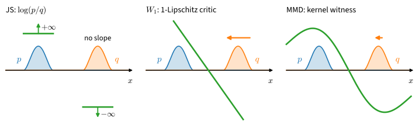

# Adversarial Objectives and Divergences
:label:`sec_gan_objectives`

Most GAN implementations offer several interchangeable training objectives: non-saturating logistic loss, least squares (LSGAN), hinge loss, and Wasserstein loss. :numref:`sec_basic_gan` analyzed the logistic objective, showing that its optimal discriminator recovers the log density ratio $\lambda(x) = \log(p(x)/q(x))$ and its minimax value is the Jensen–Shannon divergence—a quantity that saturates once the supports of $p$ and $q$ cease to overlap. What divergences do the other objectives measure? And when generated samples lie far from the data, does a vanishing gradient stem from the loss function, the critic architecture, or the underlying divergence?

Every objective in this family modifies either the payoff functions applied to the critic's scores or the function class $\mathcal{T}$ over which the critic optimizes. Unconstrained critics paired with classification losses evaluate $f$-divergences, which depend only on the pointwise density ratio $p(x)/q(x)$. Constraining the critic to a smooth function class with linear payoffs instead yields *integral probability metrics* (IPMs), such as Maximum Mean Discrepancy (MMD) and the Wasserstein-1 distance ($W_1$), which remain sensitive to spatial distances even when supports are disjoint. Below, we derive both families and compare their behavior on separated 1D Gaussians and a 2D Gaussian mixture.

```{.python .input #objectives-setup}
%%tab jax
# Deterministic GPU kernels; JAX reads XLA_FLAGS once, before the imports
import os
os.environ['XLA_FLAGS'] = (os.environ.get('XLA_FLAGS', '') +
                           ' --xla_gpu_deterministic_ops=true').strip()
```

```{.python .input #objectives-adversarial-objectives-and-divergences}
%%tab pytorch
import math
import numpy as np
import torch
from torch import nn
from torch.nn import functional as F
from d2l import torch as d2l
```

```{.python .input #objectives-adversarial-objectives-and-divergences}
%%tab jax
import math
import numpy as np
import jax
from jax import numpy as jnp
from flax import nnx
import optax
from d2l import jax as d2l
```

```{.python .input #objectives-adversarial-objectives-and-divergences-1}
%%tab pytorch
from torch.nn.functional import relu, softplus
```

```{.python .input #objectives-adversarial-objectives-and-divergences-1}
%%tab jax
from jax.nn import relu, softplus
```

## A General Template

In :numref:`sec_basic_gan`, the critic received $\log \sigma(D(x))$ on real samples $x \sim p$ and $\log \sigma(-D(x'))$ on generated samples $x' \sim q$. Replacing these log-likelihood terms with general payoff functions $\ell_p$ and $\ell_q$ over a critic class $\mathcal{T}$ yields the general adversarial discrepancy:

$$
\begin{aligned}
d(p, q) &= \sup_{T \in \mathcal{T}} \Big\{ \mathbb{E}_{x \sim p}\big[\ell_p(T(x))\big] \\
&\qquad\qquad + \mathbb{E}_{x' \sim q}\big[\ell_q(T(x'))\big] \Big\}.
\end{aligned}
$$
:eqlabel:`eq_gan_template`

Setting $\ell_p(t) = \log \sigma(t)$ and $\ell_q(t) = \log \sigma(-t)$ with $\mathcal{T}$ unconstrained recovers $2\,\mathrm{JS}(p, q) - 2\log 2$. Throughout this section, the critic maximizes the sum of expected payoffs (equivalently, minimizes the negative payoffs, which we refer to as the critic loss).

:numref:`tab_gan_objective_families` organizes the chapter's objectives along two axes: whether the critic scores individual samples or real–generated pairs, and whether the critic class $\mathcal{T}$ is unconstrained or regularized.

:Taxonomy of adversarial objectives by critic input and function-class constraint.
:label:`tab_gan_objective_families`

| | unconstrained critic | constrained or penalized critic |
|:---|:---|:---|
| **single-sample critic** | classification losses (logistic, least squares, hinge) $\to$ $f$-divergences of $p/q$ | linear payoffs on an RKHS ball (MMD) or Lipschitz ball ($W_1$); hinge loss with spectral normalization |
| **pairwise critic** | relativistic pairing loss (RpGAN, :numref:`sec_gan_relativistic`) | pairing loss with zero-centered gradient penalties $R_1 + R_2$ (R3GAN, :numref:`sec_gan_convergence`, :numref:`sec_dcgan`) |

Note that for any fixed critic $T$, the expectation inside :eqref:`eq_gan_template` is linear in the distribution $q$. Because the supremum of a family of linear functionals is convex, $d(p, q)$ is always convex in the probability measure $q$ for fixed $p$. However, because the set of distributions $\{q_\theta\}$ parameterized by a neural network $G_\theta$ is not convex, convexity in distribution space does not imply convexity in the generator parameters $\theta$ (Exercise :exref:`ex_objectives-convexity-parameterization`).

## Classification Losses and $f$-Divergences

### A Two-Outcome Example

Consider a binary outcome space (heads and tails) with data distribution $p = (\tfrac34, \tfrac14)$ and generator distribution $q = (\tfrac14, \tfrac34)$, sampled with equal prior probability $\tfrac12$. Given an outcome, the Bayes posterior probability that it came from $p$ is $\eta = p/(p + q)$, which equals $\tfrac34$ for heads and $\tfrac14$ for tails. A blind prediction ($D = 0$) predicts $\tfrac12$ regardless of the outcome. The reduction in expected loss from observing the outcome depends on the classification loss:

- *Log loss*: the optimal prediction $\eta$ achieves binary entropy $H_b(\tfrac34) = 0.562$ nats versus $\log 2 = 0.693$ nats for a blind guess, saving $0.131\text{ nats} = \mathrm{JS}(p, q)$.
- *Squared error* on probabilities: predicting $\eta$ achieves expected loss $\tfrac34 \cdot \tfrac14 = \tfrac{3}{16}$ versus $\tfrac14$ for predicting $\tfrac12$, saving $\tfrac{1}{16}$.
- *Hinge loss* on a score $t$: the optimal scores $t = +1$ (heads) and $t = -1$ (tails) achieve expected loss $2 \cdot \tfrac14 = \tfrac12$ versus $1$ at $t = 0$, saving $\tfrac12 = \mathrm{TV}(p, q) = \tfrac12 \sum |p - q|$.

Each loss assigns a different nonnegative divergence to the same pair $(p, q)$ based on the same posterior $\eta$. We now show that every margin-based classification loss defines an $f$-divergence.

### The Bayes-Risk Gap

Symmetric classification losses apply a single margin payoff $\ell$ to $D(x)$ on real samples and to $-D(x')$ on generated samples ($\ell_p(t) = \ell(t)$, $\ell_q(t) = \ell(-t)$):

$$
V_\ell(D) \;=\; \mathbb{E}_{x \sim p}\big[\ell(D(x))\big] + \mathbb{E}_{x' \sim q}\big[\ell(-D(x'))\big].
$$
:eqlabel:`eq_gan_margin`

Here the signed score $t$ ($+D(x)$ on real data, $-D(x')$ on generated data) is the classification *margin*. At each point $x$, $p(x)\ell(t) + q(x)\ell(-t) = 2m(x)\big[\eta(x)\ell(t) + (1 - \eta(x))\ell(-t)\big]$, where $m = (p+q)/2$ and $\eta(x) = p(x)/(p(x)+q(x))$. The minimum pointwise expected loss at posterior $\eta$ is the *conditional Bayes risk*:

$$
L(\eta) \;=\; \inf_{t} \Big\{ \eta \, \big({-\ell(t)}\big) + (1 - \eta)\, \big({-\ell(-t)}\big) \Big\}.
$$
:eqlabel:`eq_gan_bayes_risk`

As an infimum of affine functions of $\eta$, $L(\eta)$ is concave on $[0, 1]$. A constant critic ($t = 0$) achieves risk $L(\tfrac12)$. The reduction in risk from observing $x$ is the *Bayes-risk gap*:

$$
\Delta_\ell(p, q) \;=\; L(\tfrac12) - \mathbb{E}_{x \sim m}\big[L(\eta(x))\big],
$$
:eqlabel:`eq_gan_bayes_gap`

which determines the optimal value $\sup_D V_\ell(D) = 2\Delta_\ell(p, q) - 2L(\tfrac12)$. By Jensen's inequality and $\mathbb{E}_m[\eta] = \tfrac12$, $\Delta_\ell(p, q) \geq 0$.

### Bayes-Risk Gaps as $f$-Divergences

Recall from :numref:`sec_mdl-f-divergences` that an $f$-divergence averages a convex function $f$ (with $f(1) = 0$) of the density ratio $\rho(x) = p(x)/q(x)$ under $q$: $D_f(p \,\|\, q) = \mathbb{E}_{x \sim q}[f(\rho(x))]$.

**Proposition.** *If the conditional Bayes risk $L$ is finite on $[0, 1]$, then*

$$
\begin{aligned}
\Delta_\ell(p, q) &= D_f(p \,\|\, q) \\
\textrm{with}\quad f(u) &= L(\tfrac12) - \frac{u+1}{2}\, L\!\left(\frac{u}{u+1}\right),
\end{aligned}
$$

*where $f$ is convex on $[0, \infty)$ with $f(1) = 0$.*

**Proof.** Substituting $u = \rho = p/q$ gives $m = q\,(u+1)/2$ and $\eta = u/(u+1)$, so

$$
\mathbb{E}_{x \sim m}\big[L(\eta(x))\big] = \int q \, \frac{u+1}{2}\, L\!\left(\frac{u}{u+1}\right),
$$

and moving $L(\tfrac12) = \int q\, L(\tfrac12)$ inside the integral yields $\Delta_\ell(p, q) = \mathbb{E}_q[f(\rho)]$. Writing the concave function $L(v) = \inf_j \{\alpha_j v + \beta_j\}$ as the lower envelope of its tangent lines shows that $(u+1)L(u/(u+1)) = \inf_j \{\alpha_j u + \beta_j(u+1)\}$ is concave in $u$; hence $f(u)$ is convex, and $f(1) = L(\tfrac12) - L(\tfrac12) = 0$. $\blacksquare$

Thus, every symmetric classification loss with an unconstrained critic evaluates an $f$-divergence, and its optimal critic $D^\star(x)$ is a monotone *link function* of the log density ratio $\lambda(x) = \log(p(x)/q(x))$.

### Divergences of Common Classification Losses

:numref:`tab_gan_loss_divergences` summarizes four standard classification losses, their conditional Bayes risks $L(\eta)$, Bayes-risk gaps $\Delta_\ell(p, q)$, optimal critic links $D^\star(\lambda)$, and the practical generator losses used with them.

:Classification losses with an unconstrained critic: margin loss $-\ell(t)$, Bayes risk $L(\eta)$, Bayes-risk gap $\Delta_\ell(p, q)$, optimal critic link $D^\star(\lambda)$, and practical generator loss on $D = D(x')$.
:label:`tab_gan_loss_divergences`

| loss | margin loss $-\ell(t)$ | Bayes risk $L(\eta)$ | gap $\Delta_\ell(p,q)$ | optimal critic link | generator loss |
|:---|:---|:---|:---|:---|:---|
| logistic | $\log(1 + e^{-t})$ | $H_b(\eta)$ | $\mathrm{JS}(p,q)$ | $\lambda$ | $-\log \sigma(D)$ |
| least squares (LSGAN) | $\tfrac14 (1 - t)^2$, $t = 2D - 1$ | $\eta(1-\eta)$ | $\tfrac{1}{8}\int \frac{(p-q)^2}{p+q}$ | $\sigma(\lambda)$ | $\tfrac12 (D - 1)^2$ |
| squared hinge | $\max(0, 1 - t)^2$ | $4\eta(1-\eta)$ | $\tfrac{1}{2}\int \frac{(p-q)^2}{p+q}$ | $\tanh(\lambda/2)$ | $-D$ |
| hinge | $\max(0, 1 - t)$ | $2\min(\eta, 1-\eta)$ | $\mathrm{TV}(p,q)$ | $\operatorname{sign} \lambda$ | $-D$ |

In LSGAN :cite:`Mao.Li.Xie.ea.2017`, the critic regresses onto targets $1$ (real) and $0$ (fake), which under $t = 2D - 1$ corresponds to squared margin loss $\tfrac14(1 - t)^2$ and evaluates one-quarter of the Vincze–Le Cam divergence $\chi^2(p \,\|\, m) = \tfrac12 \int (p-q)^2/(p+q)$. The hinge loss :cite:`Lim.Ye.2017` evaluates total variation $\mathrm{TV}(p, q) = \tfrac12 \int |p - q|$, and its optimal critic outputs $\operatorname{sign} \lambda$ (with any value in $[-1, 1]$ optimal at $\eta = \tfrac12$). The squared hinge loss shares the hinge margin and generator objective $-D(x')$, but its smooth link $\tanh(\lambda/2)$ preserves the magnitude of $\lambda$. In practice, each loss uses a non-saturating generator objective (final column) that shares the equilibrium $q = p$.

### The Fenchel–Young Variational Bound ($f$-GAN)

Because :eqref:`eq_gan_margin` applies the same payoff to $D$ and $-D$, its Bayes risk satisfies $L(\eta) = L(1 - \eta)$, so every classification gap $\Delta_\ell(p, q)$ is symmetric in $p$ and $q$ and bounded above by $L(\tfrac12)$ (Exercise :exref:`ex_objectives-divergences-a-loss-can-reach`). Reaching asymmetric or unbounded $f$-divergences such as the forward KL divergence $D_{\textrm{KL}}(p \,\|\, q)$ requires asymmetric payoffs $\ell_p \neq \ell_q$.

Let $f^*(t) = \sup_u \{ut - f(u)\}$ be the *convex conjugate* of a convex divergence function $f$. By the Fenchel–Young inequality, $f(u) \geq ut - f^*(t)$ for all $u, t$, with equality when $t = f'(u)$. Setting $u = \rho(x) = p(x)/q(x)$ and $t = T(x)$ and taking the expectation under $q$ (using $\mathbb{E}_q[\rho\, T] = \mathbb{E}_p[T]$) yields the variational lower bound of $f$-GAN :cite:`Nowozin.Cseke.Tomioka.2016` (:numref:`sec_mdl-f-gan-dual`):

$$
D_f(p \,\|\, q) \;\geq\; \mathbb{E}_{x \sim p}\big[T(x)\big] - \mathbb{E}_{x' \sim q}\big[f^*(T(x'))\big].
$$
:eqlabel:`eq_gan_fgan_bound`

This matches our template :eqref:`eq_gan_template` with $\ell_p(t) = t$ and $\ell_q(t) = -f^*(t)$, and is tight at the optimal critic $T^\star(x) = f'(\rho(x))$ (Exercise :exref:`ex_objectives-variational-bound-eqref-eq`). For the forward KL divergence, $f(u) = u \log u$ has conjugate $f^*(t) = e^{t-1}$ and optimal critic $T^\star(x) = 1 + \log \rho(x) = 1 + \lambda(x)$.

### Verifying Critic Link Functions Empirically
:label:`subsec_gan_objectives_critics`

We now verify that critics trained under the logistic, least-squares, hinge, and forward-KL objectives learn their respective theoretical link functions of $\lambda(x)$: $\lambda$, $\sigma(\lambda)$, $\operatorname{sign} \lambda$, and $1 + \lambda$. We define $p$ as a uniform mixture of three 2D Gaussians and construct a perturbed 3-component mixture $q$ so that $\lambda(x)$ is known analytically everywhere.

```{.python .input #objectives-one-testbed-four-losses-1}
%%tab pytorch, jax
#@save
mu_p = np.array([[0.0, 2.4], [-2.1, -1.2], [2.1, -1.2]])     # data
A_p = np.stack([0.7 * np.eye(2)] * 3)

mu_q = np.array([[0.2, 2.6], [-2.3, -1.0], [2.0, -1.3]])     # hand-set q
A_q = np.stack([np.diag([0.8, 0.55]), np.diag([0.5, 0.6]),
                np.array([[0.65, 0.2], [-0.1, 0.7]])])

#@save
def mixture_logpdf(x, mus, As):
    """Log density of the uniform mixture of Gaussians N(mu_k, A_k^T A_k)."""
    comps = []
    for mu, A in zip(mus, As):
        Sigma, diff = A.T @ A, x - mu
        sol = np.linalg.solve(Sigma, diff.T).T
        comps.append(-0.5 * ((diff * sol).sum(1)
                             + np.linalg.slogdet(2 * np.pi * Sigma)[1]))
    return np.logaddexp.reduce(np.stack(comps) - np.log(len(mus)), axis=0)

#@save
def sample_mixture(n, mus, As, rng):
    """n draws from the uniform mixture of Gaussians mu_k + z A_k."""
    k = rng.integers(0, len(mus), n)
    z = rng.standard_normal((n, 2))
    return np.einsum('ni,nij->nj', z, As[k]) + mus[k]
```

On a fixed grid, quadrature gives $\mathrm{JS}(p, q)$ for any mixture $q$ of this form. Later in the section the same function scores a trained generator after every step.

```{.python .input #objectives-js-by-quadrature}
%%tab pytorch, jax
#@save
grid_1d = np.linspace(-7.0, 7.0, 281)
grid_2d = np.stack([g.ravel() for g in np.meshgrid(grid_1d, grid_1d)], axis=1)
cell_area = (grid_1d[1] - grid_1d[0]) ** 2

#@save
def js_mixtures(mus_q, As_q, mus_p=mu_p, As_p=A_p):
    """JS(p, q) between two known mixtures, p the data by default, by
    quadrature on grid_2d."""
    logp = mixture_logpdf(grid_2d, mus_p, As_p)
    logq = mixture_logpdf(grid_2d, mus_q, As_q)
    p, q = np.exp(logp), np.exp(logq)
    logm = np.log(np.maximum((p + q) / 2, 1e-300))
    return 0.5 * (p * (logp - logm) + q * (logq - logm)).sum() * cell_area

print(f'JS(p, q) for the hand-set q: {js_mixtures(mu_q, A_q):.3f} nats')
```

The hand-set $q$ is a few hundredths of a nat from the data, a mismatch of the size a generator meets late in training. The critic is a small leaky-ReLU network with two hidden layers of 64 units.

```{.python .input #objectives-one-testbed-four-losses-3}
%%tab pytorch
#@save
TRUNC_STD = 0.8796  # standard deviation of N(0, 1) truncated at +-2

#@save
def make_critic():
    """Leaky-ReLU MLP with LeCun-normal weights and zero biases."""
    D = nn.Sequential(nn.Linear(2, 64), nn.LeakyReLU(0.2),
                      nn.Linear(64, 64), nn.LeakyReLU(0.2), nn.Linear(64, 1))
    for layer in D[::2]:  # weight std 1/sqrt(fan_in) after truncation
        s = layer.in_features ** -0.5 / TRUNC_STD
        nn.init.trunc_normal_(layer.weight, std=s, a=-2 * s, b=2 * s)
        nn.init.zeros_(layer.bias)
    return D
```

```{.python .input #objectives-one-testbed-four-losses-3}
%%tab jax
#@save
def make_critic(rngs):
    """Leaky-ReLU MLP; nnx.Linear gives LeCun-normal weights, zero biases."""
    leaky = lambda x: nnx.leaky_relu(x, 0.2)
    return nnx.Sequential(nnx.Linear(2, 64, rngs=rngs), leaky,
                          nnx.Linear(64, 64, rngs=rngs), leaky,
                          nnx.Linear(64, 1, rngs=rngs))
```

Each loss is stored as a pair, the critic's loss and the generator's loss of :numref:`tab_gan_loss_divergences`, both written on the critic's scores `r` of a real batch and `f` of a generated one.

```{.python .input #objectives-loss-pairs}
%%tab pytorch, jax
losses = {  # name: (critic loss, generator loss), both on the scores r, f
    'logistic': (lambda r, f: (softplus(-r) + softplus(f)).mean(),
                 lambda r, f: softplus(-f).mean()),
    'least squares': (lambda r, f: ((r - 1) ** 2 + f ** 2).mean() / 2,
                      lambda r, f: ((f - 1) ** 2).mean() / 2),
    'hinge': (lambda r, f: (relu(1 - r) + relu(1 + f)).mean(),
              lambda r, f: -f.mean()),
    'squared hinge': (lambda r, f: (relu(1 - r) ** 2 + relu(1 + f) ** 2).mean(),
                      lambda r, f: -f.mean()),
}
```

A link describes the best response to a fixed $q$, so we train a fresh critic against the hand-set $q$ under three of the losses, and a fourth to maximize the forward-KL bound $\mathbb{E}_p[T] - \mathbb{E}_q[e^{T-1}]$.

```{.python .input #objectives-what-each-critic-estimates}
%%tab pytorch
#@save
to_t = lambda a: torch.tensor(a, dtype=torch.float32)

def best_response(critic_loss, seed=0, steps=3000, batch=512, lr=1e-3):
    """Fresh critic trained against the fixed q, as a NumPy function."""
    rng = np.random.default_rng(seed)
    torch.manual_seed(seed)
    D = make_critic()
    opt = torch.optim.Adam(D.parameters(), lr)
    for _ in range(steps):
        X = to_t(sample_mixture(batch, mu_p, A_p, rng))
        Y = to_t(sample_mixture(batch, mu_q, A_q, rng))
        opt.zero_grad()
        critic_loss(D(X), D(Y)).backward()
        opt.step()
    return lambda x: D(to_t(x)).squeeze(-1).detach().numpy()

kl_dual = lambda r, f: -(r.mean() - torch.exp(f - 1).mean())
critics = {name: best_response(losses[name][0])
           for name in ('logistic', 'least squares', 'hinge')}
critics['forward KL'] = best_response(kl_dual)
```

```{.python .input #objectives-what-each-critic-estimates}
%%tab jax
@nnx.jit(static_argnums=0)
def best_response_step(critic_loss, D, opt, X, Y):
    opt.update(D, nnx.grad(lambda D_: critic_loss(D_(X), D_(Y)))(D))

def best_response(critic_loss, seed=0, steps=3000, batch=512, lr=1e-3):
    """Fresh critic trained against the fixed q, as a NumPy function."""
    rng = np.random.default_rng(seed)
    D = make_critic(nnx.Rngs(seed))
    opt = nnx.Optimizer(D, optax.adam(lr), wrt=nnx.Param)
    for _ in range(steps):
        X = jnp.asarray(sample_mixture(batch, mu_p, A_p, rng), jnp.float32)
        Y = jnp.asarray(sample_mixture(batch, mu_q, A_q, rng), jnp.float32)
        best_response_step(critic_loss, D, opt, X, Y)
    return lambda x: np.asarray(D(jnp.asarray(x, jnp.float32))).squeeze(-1)

kl_dual = lambda r, f: -(r.mean() - jnp.exp(f - 1).mean())
critics = {name: best_response(losses[name][0])
           for name in ('logistic', 'least squares', 'hinge')}
critics['forward KL'] = best_response(kl_dual)
```

We evaluate each trained critic at 300 points from $p$ and 300 from $q$, plotting its output against the true log density ratio $\lambda(x)$ alongside the theoretical link function (dashed curve).

```{.python .input #objectives-critic-links-1}
%%tab pytorch, jax
rng = np.random.default_rng(7)
pts = np.concatenate([sample_mixture(300, mu_p, A_p, rng),
                      sample_mixture(300, mu_q, A_q, rng)])
lam = mixture_logpdf(pts, mu_p, A_p) - mixture_logpdf(pts, mu_q, A_q)
lam_line = np.linspace(lam.min(), lam.max(), 200)
links = {'logistic': lambda l: l, 'least squares': lambda l: 1 / (1 + np.exp(-l)),
         'hinge': np.sign, 'forward KL': lambda l: 1 + l}
fig, axes = d2l.plt.subplots(1, 4, figsize=(12, 3))
for ax, (name, link) in zip(axes, links.items()):
    out = critics[name](pts)
    d2l.plot([lam[:300], lam[300:], lam_line],
             [out[:300], out[300:], link(lam_line)], xlabel=r'$\lambda$',
             fmts=('.', '.', 'k--'), axes=ax,
             legend=['x ~ p', "x' ~ q", 'link'] if name == 'logistic' else None)
    ax.set_title(name)
axes[0].set_ylabel('critic output')
fig.tight_layout()
```

All four networks track their predicted theoretical links of $\lambda(x)$: the identity $\lambda$, the sigmoid $\sigma(\lambda)$, the step function $\operatorname{sign} \lambda$, and the shifted identity $1 + \lambda$. Note the wider scatter of the hinge critic near $\lambda = 0$, where any output in $[-1, 1]$ achieves the minimum conditional risk.

## Integral Probability Metrics

Whereas $f$-divergences pair an unconstrained critic with nonlinear payoffs, *integral probability metrics* (IPMs) use linear payoffs $\ell_p(t) = t$ and $\ell_q(t) = -t$ while restricting the critic to a symmetric function class $\mathcal{F}$ (:numref:`sec_mdl-ipm-mmd`):

$$
d_{\mathcal{F}}(p, q) \;=\; \sup_{T \in \mathcal{F}} \Big\{ \mathbb{E}_{x \sim p}\big[T(x)\big] - \mathbb{E}_{x' \sim q}\big[T(x')\big] \Big\}.
$$
:eqlabel:`eq_gan_ipm`

Without a constraint on $\mathcal{F}$, scaling $T$ by an arbitrary positive constant would send the difference of expectations to $+\infty$ whenever $p \neq q$. When $\mathcal{F}$ consists of smooth functions, $d_{\mathcal{F}}(p, q)$ depends on the spatial geometry of $\mathcal{X}$ rather than just the pointwise ratio $p(x)/q(x)$.

### Maximum Mean Discrepancy (MMD)

Given a positive-definite kernel $k(x, x')$—such as the Gaussian RBF kernel $k(x, x') = \exp(-\|x - x'\|^2/(2s^2))$ with bandwidth $s$—choosing $\mathcal{F}$ to be the unit ball of the reproducing kernel Hilbert space (RKHS) associated with $k$ yields the *Maximum Mean Discrepancy* :cite:`Gretton.Borgwardt.Rasch.ea.2012` (:numref:`sec_mdl-ipm-mmd`), whose squared value has a closed form in terms of pairwise kernel expectations:

$$
\begin{aligned}
\mathrm{MMD}^2(p, q)
&= \mathbb{E}_{x, \tilde x \sim p}\big[k(x, \tilde x)\big] + \mathbb{E}_{x', \tilde x' \sim q}\big[k(x', \tilde x')\big] \\
&\quad - 2\, \mathbb{E}_{x \sim p,\, x' \sim q}\big[k(x, x')\big].
\end{aligned}
$$
:eqlabel:`eq_gan_mmd2`

The optimal test function (up to scaling) is the *witness function* $w(x) = \mathbb{E}_{\tilde x \sim p}[k(x, \tilde x)] - \mathbb{E}_{\tilde x' \sim q}[k(x, \tilde x')]$, which measures the difference between a point's average similarity to $p$ and its average similarity to $q$. Because :eqref:`eq_gan_mmd2` requires no critic network, a generator can minimize the unbiased finite-sample estimator `mmd2_unbiased` directly (also used in :numref:`sec_dcgan` to compute KID).

```{.python .input #objectives-maximum-mean-discrepancy}
%%tab pytorch, jax
#@save
def mmd2_unbiased(K_pp, K_qq, K_pq):
    """Unbiased MMD^2 from the kernel matrices within p, within q, and
    across; the diagonals (a point with itself) are left out."""
    m, n = len(K_pp), len(K_qq)
    return ((K_pp.sum() - K_pp.diagonal().sum()) / (m * (m - 1))
            + (K_qq.sum() - K_qq.diagonal().sum()) / (n * (n - 1))
            - 2 * K_pq.mean())
```

### Wasserstein-1 Distance ($W_1$)

Choosing $\mathcal{F}$ to be the class of *1-Lipschitz* functions ($|T(x) - T(y)| \leq \|x - y\|$ for all $x, y$) yields the *Wasserstein-1* (or *Earth Mover's*) distance via Kantorovich–Rubinstein duality (:numref:`sec_mdl-optimal-transport`):

$$
W_1(p, q) \;=\; \inf_{\pi \in \Pi(p, q)} \mathbb{E}_{(x, x') \sim \pi}\big[\|x - x'\|\big],
$$

where $\Pi(p, q)$ is the set of joint transport plans with marginals $p$ and $q$. An optimal 1-Lipschitz critic (a *Kantorovich potential*) has unit gradient norm along the optimal transport rays from $q$ to $p$. In 1D, $W_1(p, q) = \int_{-\infty}^\infty |F_p(t) - F_q(t)|\,dt$, so shifting a distribution by $\mu$ gives $W_1(p, q) = |\mu|$ with constant unit slope at any separation.

In higher dimensions, Wasserstein GANs (WGANs) approximate the 1-Lipschitz constraint on a neural network critic $T$ via three main mechanisms:

1. *Weight clipping* :cite:`Arjovsky.Chintala.Bottou.2017` clamps weights to $[-c, c]$, enforcing $\kappa$-Lipschitzness for an architecture-dependent constant $\kappa$ at the cost of restricting capacity.
2. *Gradient penalty* (WGAN-GP) :cite:`Gulrajani.Ahmed.Arjovsky.ea.2017` adds $\gamma\,\mathbb{E}[(\|\nabla_x T(\tilde x)\| - 1)^2]$ at random interpolants $\tilde x = u x + (1-u)x'$ between real and generated samples.
3. *Spectral normalization* :cite:`Miyato.Kataoka.Koyama.ea.2018` normalizes each weight matrix by its largest singular value $\sigma_{\max}(W)$, bounding the Lipschitz constant of every linear layer by $1$.

Notice that the hinge loss bridges the two families: when $|D(x)| \leq 1$, its payoffs are linear, so an unconstrained hinge critic corresponds to the IPM over functions bounded by $|D(x)| \leq 1$ (evaluating $2\,\mathrm{TV}(p, q) - 2$). Combining the hinge loss with spectral normalization (making $D$ both bounded and $\kappa$-Lipschitz, as in SAGAN and BigGAN) yields a critic whose value grows linearly like $\kappa\,W_1$ up to separation $2/\kappa$ before saturating.

### Sample Complexity in High Dimensions
:label:`subsec_gan_objectives_estimation`

Fixed-kernel MMD and empirical $W_1$ differ sharply in sample complexity: the unbiased $\mathrm{MMD}^2$ estimator converges at the dimension-independent rate $O(n^{-1/2})$ :cite:`Gretton.Borgwardt.Rasch.ea.2012` (although the quantity being estimated, the $\mathrm{MMD}^2$ of a given shift under a fixed kernel, can itself shrink as the dimension grows :cite:`Ramdas.Reddi.Poczos.ea.2015`), whereas the plug-in empirical $W_1$ distance in dimension $d_x > 2$ suffers from the curse of dimensionality at rate $O(n^{-1/d_x})$ :cite:`Weed.Bach.2019`. Meanwhile, variational $f$-divergence estimators can suffer from high variance when $\rho = p/q$ is large: for example, in the forward-KL dual bound, the variance of $e^{T^\star(x') - 1} = \rho(x')$ under $q$ equals $\chi^2(p \,\|\, q)$, which can diverge even when $D_{\textrm{KL}}(p \,\|\, q) < \infty$ (Exercise :exref:`ex_objectives-estimation-and-dimension`).

## Gradients Far from and Near the Data
:label:`subsec_gan_objectives_gradients`

### Divergence Slope versus Separation
:label:`subsec_gan_objectives_separation`

To see how the population divergences behave as two distributions separate, consider $p = \mathcal{N}(0, 1)$ and $q = \mathcal{N}(\mu, 1)$ as a function of the separation $\mu > 0$. Here $W_1(p, q) = \mu$ has constant derivative $1$, $\mathrm{JS}(p, q)$ can be integrated numerically, and $\mathrm{MMD}^2(p, q)$ under the Gaussian RBF kernel of bandwidth $s$ has the exact Gaussian integral:

$$
\mathrm{MMD}^2(p, q) \;=\; \frac{2s}{\sqrt{s^2 + 2}} \left( 1 - \exp\!\left( -\frac{\mu^2}{2(s^2 + 2)} \right) \right),
$$
:eqlabel:`eq_gan_mmd_gauss`

whose derivative with respect to $\mu$ peaks at $\mu = \sqrt{s^2 + 2}$ ($\approx 4.2$ for $s = 4$) before decaying as $e^{-\mu^2/(2(s^2+2))}$.

```{.python .input #objectives-divergence-against-separation}
%%tab pytorch, jax
xs = np.linspace(-10.0, 30.0, 8001)           # fixed quadrature grid

def normal_pdf(x, mu, sigma=1.0):
    return np.exp(-(x - mu) ** 2 / (2 * sigma ** 2)) / np.sqrt(
        2 * np.pi * sigma ** 2)

def js_gap(p, q):
    """log 2 - JS(p, q) on xs, accurate even when tiny: the integral of
    (p log(1 + q/p) + q log(1 + p/q)) / 2, with log(1 + e^a) computed as
    logaddexp(0, a)."""
    a = np.log(q) - np.log(p)
    return 0.5 * np.trapezoid(p * np.logaddexp(0, a) + q * np.logaddexp(0, -a),
                              xs)

def js_1d(p, q):
    return np.log(2) - js_gap(p, q)

s = 4.0                                        # RBF kernel bandwidth
mus = np.linspace(0.1, 20.0, 200)              # separations mu
gaps = np.array([js_gap(normal_pdf(xs, 0.0), normal_pdf(xs, mu))
                 for mu in mus])
mmd2 = 2 * s / np.sqrt(s ** 2 + 2) * (1 - np.exp(-mus ** 2
                                                 / (2 * (s ** 2 + 2))))
slopes = [-np.gradient(gaps, mus), np.gradient(mmd2, mus),
          np.ones_like(mus)]                   # W1 = |mu| has slope one
for mu in (1.0, 7.0, 20.0):
    js = js_1d(normal_pdf(xs, 0.0), normal_pdf(xs, mu))
    print(f'mu = {mu:2.0f}: JS slope {np.interp(mu, mus, slopes[0]):.4g}, '
          f'JS / log 2 = {js / np.log(2):.4f}, '
          f'MMD^2 slope {np.interp(mu, mus, slopes[1]):.4g}')
peak = slopes[1].argmax()
print(f'MMD^2 slope peaks at mu = {mus[peak]:.1f} with {slopes[1][peak]:.3f}')
d2l.plot(mus, slopes, xlabel=r'separation $\mu$', ylabel='slope',
         legend=['JS', 'MMD$^2$', '$W_1$'], yscale='log', figsize=(5, 3))
```

As shown in the plot and :numref:`fig_gan_critics_separated`, the derivative of $\mathrm{JS}(p, q)$ drops by over two orders of magnitude by $\mu = 7$ ($0.0013$ vs. $0.20$ at $\mu = 1$) and reaches $1.5 \times 10^{-22}$ at $\mu = 20$. By contrast, $W_1$ maintains unit slope at every distance, and $\mathrm{MMD}^2$ maintains a strong gradient up to separations on the order of the kernel bandwidth $s$.

![Optimal critics when $p$ (blue) and $q$ (orange) have disjoint supports. Left: the JS optimal critic $\log(p/q)$ takes values $+\infty$ on $\operatorname{supp}(p)$ and $-\infty$ on $\operatorname{supp}(q)$, with zero slope on both. Middle: the $W_1$ Kantorovich potential is a linear ramp of unit slope. Right: the MMD witness $\mathbb{E}_p[k(x, \cdot)] - \mathbb{E}_q[k(x, \cdot)]$ is a smooth difference of kernel bumps whose tail slopes toward $p$.](../img/mdl-gan-critics-separated.svg)
:label:`fig_gan_critics_separated`

### Trained Critics from a Separated Start
:label:`subsec_gan_objectives_separated_start`

Theoretical divergence curves assume an optimal critic over all measurable functions. In practice, the critic is a finite neural network trained for a few steps per generator update. To test how trained critics behave from a distant initialization, we fit a 1D location generator $q_\theta = \mathcal{N}(\theta, 1)$ ($x' = \theta + z$) starting at $\theta_0 = 6$ to $p = \mathcal{N}(0, 1)$, updating $\theta$ by vanilla SGD (so step sizes directly reflect gradient magnitudes) against a 2-hidden-layer ReLU critic updated 5 times per generator step.

```{.python .input #objectives-separated-start-losses}
%%tab pytorch
def mmd2_loss(x, y, bandwidths=(0.5, 1.0, 2.0)):
    """Unbiased MMD^2 under the sum of RBF kernels of the given bandwidths."""
    def kernel(a, b):
        sq_dist = torch.cdist(a, b) ** 2
        return sum(torch.exp(-sq_dist / (2 * s ** 2)) for s in bandwidths)
    return mmd2_unbiased(kernel(x, x), kernel(y, y), kernel(x, y))

def mmd2_median(x, y):
    """MMD^2 with one RBF kernel, its bandwidth the median pairwise distance
    of the pooled batch, held constant in the gradient."""
    xy = torch.cat([x, y])
    return mmd2_loss(x, y, (torch.cdist(xy, xy).median().detach(),))

#@save
def gradient_penalty(D, X, fake, u, one_sided=False):
    """Mean (|D'(x)| - 1)^2 at the points u X + (1 - u) fake (inputs 1-D);
    one-sided, only slopes steeper than one pay: max(0, |D'(x)| - 1)^2."""
    x = (u * X + (1 - u) * fake).requires_grad_()
    grad, = torch.autograd.grad(D(x).sum(), x, create_graph=True)
    excess = grad.abs() - 1
    return ((excess.clamp(min=0) if one_sided else excess) ** 2).mean()
```

```{.python .input #objectives-separated-start-losses}
%%tab jax
def mmd2_loss(x, y, bandwidths=(0.5, 1.0, 2.0)):
    """Unbiased MMD^2 under the sum of RBF kernels of the given bandwidths."""
    def kernel(a, b):
        sq_dist = ((a[:, None] - b[None]) ** 2).sum(-1)
        return sum(jnp.exp(-sq_dist / (2 * s ** 2)) for s in bandwidths)
    return mmd2_unbiased(kernel(x, x), kernel(y, y), kernel(x, y))

def mmd2_median(x, y):
    """MMD^2 with one RBF kernel, its bandwidth the median pairwise distance
    of the pooled batch, held constant in the gradient."""
    xy = jnp.concatenate([x, y])
    dist = jnp.sqrt(((xy[:, None] - xy[None]) ** 2).sum(-1))
    return mmd2_loss(x, y, (jax.lax.stop_gradient(jnp.median(dist)),))

#@save
def gradient_penalty(D, X, fake, u, one_sided=False):
    """Mean (|D'(x)| - 1)^2 at the points u X + (1 - u) fake (inputs 1-D);
    one-sided, only slopes steeper than one pay: max(0, |D'(x)| - 1)^2."""
    grad = jax.grad(lambda x: D(x).sum())(u * X + (1 - u) * fake)
    excess = jnp.abs(grad) - 1
    return ((jnp.maximum(excess, 0) if one_sided else excess) ** 2).mean()
```

`train_shift` gives the critic five Adam steps for every generator step, which keeps it near its best response. The generator takes plain gradient steps with learning rate $0.01$: Adam would rescale every step to about its learning rate and hide the size of the gradient, which is what we want to see. The function records $\theta$ and the generator's gradient at every step. A positive `gp` adds the gradient penalty to the critic loss, and `one_sided=True` charges only slopes steeper than one, $\max(0, |T'| - 1)^2$; with `critic_loss` set to `None`, the generator minimizes `gen_loss` of the two batches.

```{.python .input #objectives-separated-start-train}
%%tab pytorch
#@save
class Shift(nn.Module):
    """The generator x' = theta + z."""
    def __init__(self, theta0):
        super().__init__()
        self.theta = nn.Parameter(torch.tensor(theta0))

    def forward(self, z):
        return self.theta + z

#@save
def train_shift(critic_loss, gen_loss, seed, gp=0.0, one_sided=False,
                theta0=6.0, steps=1500, n_critic=5, batch=256, lr_D=1e-2,
                lr_G=1e-2):
    """Fit x' = theta + z to N(0, 1) by plain gradient steps on theta; return
    theta0 and theta after every step, the gradient of every step, and the
    critic."""
    rng = np.random.default_rng(seed)
    torch.manual_seed(seed)
    G, D = Shift(theta0), d2l.make_mlp([1, 32, 32, 1], nn.ReLU())
    opt_G = torch.optim.SGD(G.parameters(), lr_G)
    opt_D = torch.optim.Adam(D.parameters(), lr_D, betas=(0.5, 0.9))
    n = n_critic if critic_loss else 0
    thetas, grads = [theta0], []
    for _ in range(steps):
        X, Z = (to_t(rng.standard_normal((n + 1, batch, 1))) for _ in range(2))
        U = to_t(rng.uniform(size=(n, batch, 1)))   # interpolation weights
        for i in range(n):
            fake = G(Z[i]).detach()
            loss = critic_loss(D(X[i]), D(fake))
            if gp:
                loss = loss + gp * gradient_penalty(D, X[i], fake, U[i],
                                                    one_sided)
            opt_D.zero_grad()
            loss.backward()
            opt_D.step()
        fake = G(Z[-1])
        loss = (gen_loss(X[-1], fake) if critic_loss is None
                else gen_loss(D(X[-1]), D(fake)))
        opt_G.zero_grad()
        loss.backward()
        grads.append(G.theta.grad.item())
        opt_G.step()
        thetas.append(G.theta.item())
    return np.array(thetas), np.array(grads), D
```

```{.python .input #objectives-separated-start-train}
%%tab jax
#@save
class Shift(nnx.Module):
    """The generator x' = theta + z."""
    def __init__(self, theta0):
        self.theta = nnx.Param(jnp.array(theta0))

    def __call__(self, z):
        return self.theta + z

#@save
@nnx.jit(static_argnums=(0, 1, 2, 3))
def shift_step(critic_loss, gen_loss, gp, one_sided, G, D, opt_G, opt_D, X, Z,
               U):
    """One critic step per row of U, then one generator step; returns the
    generator's gradient."""
    for i in range(len(U)):
        fake = G(Z[i])
        def d_loss(D_):
            loss = critic_loss(D_(X[i]), D_(fake))
            if gp:
                loss = loss + gp * gradient_penalty(D_, X[i], fake, U[i],
                                                    one_sided)
            return loss
        opt_D.update(D, nnx.grad(d_loss)(D))
    def g_loss(G_):
        fake = G_(Z[-1])
        return (gen_loss(X[-1], fake) if critic_loss is None
                else gen_loss(D(X[-1]), D(fake)))
    grad = nnx.grad(g_loss)(G)
    opt_G.update(G, grad)
    return grad.theta[...]

#@save
def train_shift(critic_loss, gen_loss, seed, gp=0.0, one_sided=False,
                theta0=6.0, steps=1500, n_critic=5, batch=256, lr_D=1e-2,
                lr_G=1e-2):
    """Fit x' = theta + z to N(0, 1) by plain gradient steps on theta; return
    theta0 and theta after every step, the gradient of every step, and the
    critic."""
    rng = np.random.default_rng(seed)
    G = Shift(theta0)
    D = d2l.make_mlp([1, 32, 32, 1], nnx.relu, rngs=nnx.Rngs(seed))
    opt_G = nnx.Optimizer(G, optax.sgd(lr_G), wrt=nnx.Param)
    opt_D = nnx.Optimizer(D, optax.adam(lr_D, 0.5, 0.9), wrt=nnx.Param)
    n = n_critic if critic_loss else 0
    thetas, grads = [theta0], []
    for _ in range(steps):
        X, Z = (jnp.asarray(rng.standard_normal((n + 1, batch, 1)),
                            jnp.float32) for _ in range(2))
        U = jnp.asarray(rng.uniform(size=(n, batch, 1)), jnp.float32)
        grad = shift_step(critic_loss, gen_loss, gp, one_sided, G, D, opt_G,
                          opt_D, X, Z, U)
        grads.append(grad)                      # device scalars,
        thetas.append(G.theta[...])             # converted once below
    return np.asarray(jnp.stack(thetas)), np.asarray(jnp.stack(grads)), D
```

We compare six configurations across three seeds each: saturating logistic, non-saturating logistic, hinge, WGAN-GP ($\gamma = 10$, two-sided penalty $(|T'| - 1)^2$), WGAN-GP with a one-sided penalty $\max(0, |T'| - 1)^2$, and median-bandwidth MMD. For each run we report the median generator gradient magnitude over the first 100 steps, the trajectory of $\theta$, the *arrival* step (first step where $|\theta| < 0.5$), and the *farthest* excursion $\max |\theta|$ after arrival.

```{.python .input #objectives-separated-start-runs}
%%tab pytorch, jax
w1 = (lambda r, f: f.mean() - r.mean(), lambda r, f: -f.mean())
arms = {'logistic, sat.': (losses['logistic'][0],
                           lambda r, f: -softplus(f).mean(), {}),
        'logistic, NS': (*losses['logistic'], {}),
        'hinge': (*losses['hinge'], {}),
        'W1 + GP': (*w1, dict(gp=10.0)),
        'W1 + 1-sided GP': (*w1, dict(gp=10.0, one_sided=True)),
        'MMD, median': (None, mmd2_median, {})}
steps, w1_runs = (0, 100, 300, 1000, 1500), []  # (arm, seed, theta, critic)
print(f'{"":17s}|grad|   theta at steps {", ".join(map(str, steps))}'
      '  arrival  farthest')
for name, (critic_loss, gen_loss, kwargs) in arms.items():
    for seed in range(3):
        thetas, grads, D = train_shift(critic_loss, gen_loss, seed, **kwargs)
        if name.startswith('W1'):
            w1_runs.append((name, seed, thetas[-1], D))
        hit = np.flatnonzero(np.abs(thetas) < 0.5)  # arrival: hit[0]
        print(f'{name:16s}{seed}{np.median(np.abs(grads[:100])):7.3f} '
              + ''.join(f'{thetas[t]:7.2f}' for t in steps)
              + (f'{hit[0]:9d}{np.abs(thetas[hit[0]:]).max():10.2f}'
                 if len(hit) else '  not reached'))
```

The results clarify how practical neural critics differ from unconstrained theoretical optima:

- **Saturating vs. non-saturating logistic:** As in :numref:`sec_basic_gan`, the saturating generator gradient is tiny ($\sim 0.01$) and $\theta$ barely moves from $6.0$ to $5.76$, whereas the non-saturating generator receives a strong gradient ($\sim 3$) and reaches the target before step 400.
- **Hinge critic:** Although the theoretical optimal hinge critic $\operatorname{sign} \lambda$ has zero slope inside both clouds, a finite ReLU MLP interpolates smoothly across the gap with slope $1.1\text{--}1.7$, driving the generator to the target by steps $700\text{--}950$.
- **Median-bandwidth MMD:** Besides the saturating arm, this is the only one that has not arrived by step 1,500, where $\theta \approx 1.3$. The generator is slow here, but it has not stalled. Because the median heuristic keeps the bandwidth comparable to the separation, the gradient never vanishes. At $\sim 0.2$ it is about six times smaller than the slope of the $W_1$ critics in the next item, and plain gradient steps of size $0.01$ need correspondingly longer.
- **Two-sided vs. one-sided WGAN-GP:** Both $W_1$ arms pull the generator inward at slope $\approx 1.26$ (minimizing $-ad + 10(a-1)^2$ gives $a = 1 + d/20$) and arrive near step 500. After arrival, however, every two-sided `W1 + GP` run overshoots heavily (`farthest` $> 1$, up to $> 7$), whereas every one-sided run stays within $0.06$ of the origin! Why? Once $\theta$ crosses $0$, the critic must reverse its slope from negative to positive. Because the two-sided penalty $(|T'| - 1)^2$ penalizes a flat critic ($T' = 0$) by $\gamma$, it creates a potential barrier at zero slope that traps the critic on the old slope sign ($1 - d/20$) or causes all ReLU units to die, as confirmed by inspecting the critic slopes and active ReLU counts at step 1,500 below:

```{.python .input #objectives-separated-start-w1-critics}
%%tab pytorch
def slope_and_units(D, x):
    """D'(x) and, per hidden layer, the number of ReLU units active at x."""
    x = h = torch.tensor([[x]], dtype=torch.float32, requires_grad=True)
    active = []
    for layer in D:
        h = layer(h)
        if isinstance(layer, nn.ReLU):
            active.append(int((h > 0).sum()))
    slope, = torch.autograd.grad(h.sum(), x)
    return slope.item(), active

print(f"{'':19s}theta D'(theta)  active    D'(0)  active"
      '  (of 32 units per layer)')
for name, seed, theta, D in w1_runs:
    (s_t, a_t), (s_0, a_0) = (slope_and_units(D, x) for x in (theta, 0.0))
    print(f'{name:16s}{seed}{theta:7.2f}{s_t:10.2f}{a_t[0]:5d}{a_t[1]:3d}'
          f'{s_0:9.2f}{a_0[0]:5d}{a_0[1]:3d}')
```

```{.python .input #objectives-separated-start-w1-critics}
%%tab jax
def slope_and_units(D, x):
    """D'(x) and, per hidden layer, the number of ReLU units active at x."""
    def forward(x):
        h, active = x, []
        for layer in D.layers:
            h = layer(h)
            if not isinstance(layer, nnx.Linear):  # an activation
                active.append((h > 0).sum())
        return h.sum(), active
    slope, active = jax.grad(forward, has_aux=True)(jnp.array([[x]]))
    return float(slope.squeeze()), [int(a) for a in active]

print(f"{'':19s}theta D'(theta)  active    D'(0)  active"
      '  (of 32 units per layer)')
for name, seed, theta, D in w1_runs:
    (s_t, a_t), (s_0, a_0) = (slope_and_units(D, x) for x in (theta, 0.0))
    print(f'{name:16s}{seed}{theta:7.2f}{s_t:10.2f}{a_t[0]:5d}{a_t[1]:3d}'
          f'{s_0:9.2f}{a_0[0]:5d}{a_0[1]:3d}')
```

The one-sided penalty $\max(0, |T'| - 1)^2$ imposes no penalty when $|T'| \leq 1$, allowing the critic to pass freely through zero slope as $\theta$ reaches the data. :numref:`sec_gan_convergence` analyzes zero-centered penalties ($R_1$ and $R_2$) that actively pull the critic slope to zero at equilibrium.

### Comparing Five Objectives on a 2D Gaussian Mixture
:label:`subsec_gan_objectives_testbed`

Next, we compare five objectives when the generator and data supports overlap: non-saturating logistic, least squares, hinge, squared hinge, and multi-bandwidth MMD ($s \in \{0.5, 1.0, 2.0\}$). The generator `MixtureGenerator` parameterizes a 3-component Gaussian mixture initialized with displaced means `mu_0` and narrower scales `A_0 = 0.4 * I` ($\mathrm{JS}(p, q_0) \approx 0.53$ nats).

```{.python .input #objectives-five-losses-on-a-gaussian-mixture-1}
%%tab pytorch, jax
#@save
mu_0 = np.array([[1.0, -1.0], [-4.3, -2.0], [-1.0, 3.8]])  # off the modes
A_0 = np.stack([0.4 * np.eye(2)] * 3)      # below the data's scale of 0.7

print(f'JS(p, q) at the start: {js_mixtures(mu_0, A_0):.3f} nats')
```

The start is about half a nat from the data. The MMD arm minimizes the unbiased minibatch $\mathrm{MMD}^2$ under the sum of three RBF kernels with bandwidths $0.5$, $1$ and $2$, a kernel sensitive at several scales.

```{.python .input #objectives-one-testbed-four-losses-2}
%%tab pytorch
#@save
class MixtureGenerator(nn.Module):
    """x = mu_k + z A_k for a uniformly drawn component k."""
    def __init__(self, mu, A):
        super().__init__()
        self.mu = nn.Parameter(to_t(mu))
        self.A = nn.Parameter(to_t(A))

    def forward(self, z, k):
        return torch.einsum('ni,nij->nj', z, self.A[k]) + self.mu[k]

    def params_np(self):
        return (self.mu.detach().numpy().copy(),
                self.A.detach().numpy().copy())

losses['MMD'] = (None, mmd2_loss)   # no critic: MMD^2 to the real batch
```

```{.python .input #objectives-one-testbed-four-losses-2}
%%tab jax
#@save
class MixtureGenerator(nnx.Module):
    """x = mu_k + z A_k for a uniformly drawn component k."""
    def __init__(self, mu, A):
        self.mu = nnx.Param(jnp.asarray(mu, jnp.float32))
        self.A = nnx.Param(jnp.asarray(A, jnp.float32))

    def __call__(self, z, k):
        return jnp.einsum('ni,nij->nj', z, self.A[k]) + self.mu[k]

    def params_np(self):
        return np.asarray(self.mu[...]), np.asarray(self.A[...])

losses['MMD'] = (None, mmd2_loss)   # no critic: MMD^2 to the real batch
```

`train_toy` takes the two losses as arguments and alternates one critic step with one generator step. The MMD arm, stored with the critic loss `None`, takes only the generator step, on `mmd2_loss(X, fake)` instead of the critic's scores. Every 200 steps it records the exact $\mathrm{JS}(p, q_t)$.

```{.python .input #objectives-one-testbed-four-losses-4}
%%tab pytorch
#@save
def train_toy(critic_loss, gen_loss, seed=0, steps=6000, batch=256, lr=1e-3):
    """Fit a MixtureGenerator from (mu_0, A_0) to the data mixture, one
    critic step per generator step. The losses act on the critic's scores of
    the real and generated batch; with critic_loss None, gen_loss acts on the
    two batches. Returns the exact JS(p, q_t) every 200 steps."""
    rng = np.random.default_rng(seed)
    torch.manual_seed(seed)
    G, D = MixtureGenerator(mu_0, A_0), make_critic()
    opt_G = torch.optim.Adam(G.parameters(), lr)
    opt_D = torch.optim.Adam(D.parameters(), 2 * lr)
    trace = []
    for t in range(steps):
        X = to_t(sample_mixture(batch, mu_p, A_p, rng))
        z = to_t(rng.standard_normal((batch, 2)))
        k = torch.tensor(rng.integers(0, 3, batch))
        if critic_loss is not None:
            opt_D.zero_grad()
            critic_loss(D(X), D(G(z, k).detach())).backward()
            opt_D.step()
        opt_G.zero_grad()
        fake = G(z, k)
        loss = (gen_loss(X, fake) if critic_loss is None
                else gen_loss(D(X), D(fake)))
        loss.backward()
        opt_G.step()
        if t % 200 == 0:
            trace.append(js_mixtures(*G.params_np()))
    return np.array(trace)
```

```{.python .input #objectives-one-testbed-four-losses-4}
%%tab jax
#@save
@nnx.jit(static_argnums=(0, 1))
def train_toy_step(critic_loss, gen_loss, G, D, opt_G, opt_D, X, z, k):
    """A critic step (unless critic_loss is None), then a generator step."""
    if critic_loss is not None:            # the generator is fixed here
        fake = G(z, k)
        opt_D.update(D, nnx.grad(lambda D_: critic_loss(D_(X), D_(fake)))(D))
    def g_loss(G_):
        fake = G_(z, k)
        return (gen_loss(X, fake) if critic_loss is None
                else gen_loss(D(X), D(fake)))
    opt_G.update(G, nnx.grad(g_loss)(G))

#@save
def train_toy(critic_loss, gen_loss, seed=0, steps=6000, batch=256, lr=1e-3):
    """Fit a MixtureGenerator from (mu_0, A_0) to the data mixture, one
    critic step per generator step. The losses act on the critic's scores of
    the real and generated batch; with critic_loss None, gen_loss acts on the
    two batches. Returns the exact JS(p, q_t) every 200 steps."""
    rng = np.random.default_rng(seed)
    G, D = MixtureGenerator(mu_0, A_0), make_critic(nnx.Rngs(seed))
    opt_G = nnx.Optimizer(G, optax.adam(lr), wrt=nnx.Param)
    opt_D = nnx.Optimizer(D, optax.adam(2 * lr), wrt=nnx.Param)
    trace = []
    for t in range(steps):
        X = jnp.asarray(sample_mixture(batch, mu_p, A_p, rng), jnp.float32)
        z = jnp.asarray(rng.standard_normal((batch, 2)), jnp.float32)
        k = jnp.asarray(rng.integers(0, 3, batch))
        train_toy_step(critic_loss, gen_loss, G, D, opt_G, opt_D, X, z, k)
        if t % 200 == 0:
            trace.append(js_mixtures(*G.params_np()))
    return np.array(trace)
```

For each of three seeds per objective, we report the median $\mathrm{JS}(p, q_t)$ over the final 2,000 steps and the first step reaching $\mathrm{JS}(p, q_t) < 0.1$ and $< 0.01$ nats.

```{.python .input #objectives-one-testbed-four-losses-6}
%%tab pytorch, jax
def first_below(trace, level):
    """First recorded step (one record per 200 steps) with JS below level."""
    hits = np.flatnonzero(trace < level)
    return f'{200 * hits[0]:6d}' if len(hits) else '   n/a'

runs = {name: [train_toy(*pair, seed=seed) for seed in range(3)]
        for name, pair in losses.items()}
print(f'{"three runs:":14s}{"median JS, last 2,000 steps":>27s}'
      f'{"first JS < 0.1":>21s}{"first JS < 0.01":>21s}')
for name, traces in runs.items():
    medians = [np.median(trace[-2000 // 200:]) for trace in traces]
    print(f'{name:14s}   ' + ''.join(f'{m:8.4f}' for m in medians)
          + '   ' + ''.join(first_below(trace, 0.1) for trace in traces)
          + '   ' + ''.join(first_below(trace, 0.01) for trace in traces))
d2l.plot(np.arange(len(runs['logistic'][0])) * 200,
         [traces[0] for traces in runs.values()], xlabel='step',
         ylabel='JS(p, q_t)', yscale='log', legend=list(runs), figsize=(5, 3))
```

All five objectives reduce $\mathrm{JS}(p, q_t)$ from $0.53$ nats to a few thousandths of a nat or less. Direct MMD minimization (which does not track a moving critic) achieves the tightest final fit ($0.0001$ nats), while the hinge loss settles slightly higher ($0.003\text{--}0.007$ nats) than the smooth-link objectives (logistic, least squares, and squared hinge, all $\leq 0.0024$ nats; Exercise :exref:`ex_objectives-plateaus-lag`). Next, :numref:`sec_gan_relativistic` examines critics that compare real and generated samples in pairs rather than scoring each sample in isolation.

## Summary

- Every single-sample adversarial objective is a supremum of expected payoffs over a critic class $\mathcal{T}$ (:eqref:`eq_gan_template`), making it convex in the distribution $q$ though nonconvex in the generator parameters $\theta$.
- With an unconstrained critic, symmetric margin classification losses evaluate the $f$-divergence given by their Bayes-risk gap $\Delta_\ell(p, q)$ (:numref:`tab_gan_loss_divergences`), and their optimal critic outputs a monotone link of the log density ratio $\lambda = \log(p/q)$. The Fenchel–Young variational bound (:eqref:`eq_gan_fgan_bound`) extends this to general asymmetric $f$-divergences.
- Linear payoffs over a constrained function class $\mathcal{F}$ define integral probability metrics (IPMs): Maximum Mean Discrepancy ($\mathrm{MMD}$) over an RKHS unit ball and Wasserstein-1 ($W_1$) over 1-Lipschitz functions.
- When supports are separated, $f$-divergences saturate whereas $W_1$ maintains unit slope and $\mathrm{MMD}^2$ maintains a gradient over distances comparable to the kernel bandwidth. In practice, finite neural critics interpolate smoothly across gaps and provide a usable gradient whenever paired with a non-saturating generator loss.

## Exercises

1. [code] **Convexity in distribution space versus parameter space.** Every objective of the form :eqref:`eq_gan_template` is convex in $q$, but a parametric generator varies $\theta$ rather than $q$ directly. Use `normal_pdf`, `js_1d`, and `xs`.
    1. Let $p = \mathcal{N}(0, 1)$ and $q_0 = \mathcal{N}(8, 1)$. Verify via second differences that $\mathrm{JS}(p, q_t)$ is convex in $t \in [0, 1]$ along the linear mixture path $q_t = (1 - t)\, q_0 + t\, p$.
    1. Now let $p = 0.7\, \mathcal{N}(-4, 1) + 0.3\, \mathcal{N}(4, 1)$ and $q_\theta = \mathcal{N}(\theta, 1)$. Plot $\mathrm{JS}(p, q_\theta)$ for $\theta \in [-6, 6]$ and identify its local minima and maxima.
    1. Why do these nonconvex features in $\theta$ not contradict convexity in $q$?
   :exlabel:`ex_objectives-convexity-parameterization`

1. **Jensen–Shannon convex conjugate.** Twice the Jensen–Shannon divergence corresponds to the divergence function $f(u) = u \log u - (u + 1) \log \frac{u + 1}{2}$.
    1. Derive its convex conjugate $f^*(t) = -\log(2 - e^t)$ with domain $t < \log 2$.
    1. Show that under the reparameterization $T(x) = \log(2 \sigma(D(x)))$, the optimal critic $T^\star = f'(\rho)$ corresponds to $D^\star = \lambda$, and the variational bound :eqref:`eq_gan_fgan_bound` becomes $2 \log 2 + V(D)$, where $V(D)$ is the classic GAN objective :eqref:`eq_gan_V`.
   :exlabel:`ex_objectives-variational-bound-eqref-eq`

1. [code] **Generator weights and critic lag on the Gaussian mixture.** ● Use `train_toy` and the five objectives of :numref:`subsec_gan_objectives_testbed`.
    1. Pair the logistic critic loss with the linear generator loss $-D(x')$ (weight $w = 1$) and compare it with the non-saturating loss $-\log \sigma(D(x'))$ across three seeds by the first step at which $\mathrm{JS}(p, q_t) < 0.1$ nats. Explain the difference using their per-sample weights.
    1. Test whether the slightly higher final $\mathrm{JS}$ of the hinge loss is due to critic lag or minibatch noise by running two controls over three seeds: (i) 5 critic updates per generator update, and (ii) $4\times$ larger critic batch size.
   :exlabel:`ex_objectives-plateaus-lag`

1. [code] **Sample complexity and dimension.** ● Let $p = \mathcal{N}(\mathbf{0}, \mathbf{I}_{d_x})$ and $q = \mathcal{N}(\boldsymbol{\mu}, \mathbf{I}_{d_x})$ with $\|\boldsymbol{\mu}\| = 1$, so $W_1(p, q) = 1$ in every dimension $d_x$.
    1. Estimate $W_1$ from two samples of size $n$ via optimal linear assignment (`scipy.optimize.linear_sum_assignment`) for $d_x \in \{1, 2, 10, 50\}$ and $n \in \{100, 400, 1600\}$, and plot the relative error against $n$ on log–log axes. Compare with the unbiased $\mathrm{MMD}^2$ estimator using an RBF kernel of bandwidth $s = \sqrt{d_x}$.
    1. Measure the empirical $W_1$ distance between two independent samples of size $n = 256$ drawn from the *same* distribution $p$ in dimension $d_x = 50$.
    1. Evaluate the forward-KL variational bound :eqref:`eq_gan_fgan_bound` for `critics['forward KL']` by quadrature on `grid_2d` and compare it with the true $D_{\textrm{KL}}(p \,\|\, q) \approx 0.16$ nats and with minibatch estimates of size 512. Why can a finite minibatch from $q$ overestimate the bound when $T(x')$ overshoots $1 + \lambda(x')$ in regions where $q(x')$ is small?
   :exlabel:`ex_objectives-estimation-and-dimension`

1. **Symmetric $f$-divergences from classification losses.** ●● Every margin classification loss :eqref:`eq_gan_margin` has a symmetric Bayes risk $L(\eta) = L(1 - \eta)$ and thus evaluates a symmetric $f$-divergence. Conversely (:citet:`Nguyen.Wainwright.Jordan.2009`, Corollary 3), let $f$ be convex on $(0, \infty)$ with $f(1) = 0$, $f(u) = u f(1/u)$, and $f(0) = \lim_{u \to 0} f(u) < \infty$, and define

   $$
   L(\eta) = 2 f(0) - 2 (1 - \eta)\, f\!\left( \frac{\eta}{1 - \eta} \right), \qquad 0 < \eta < 1.
   $$

    1. Show that $L(\eta)$ is concave, symmetric about $\tfrac12$, vanishes as $\eta \to 0$ or $1$, and has Bayes-risk gap $\Delta_\ell(p, q) = D_f(p \,\|\, q)$.
    1. For differentiable $L$ and $\hat\eta = \sigma(t)$, define the real-sample loss $-\ell(t) = L(\hat\eta) + (1 - \hat\eta) L'(\hat\eta)$. Show that $-\ell(-t) = L(\hat\eta) - \hat\eta L'(\hat\eta)$, that the conditional risk is minimized at $\hat\eta = \eta$ with value $L(\eta)$, and that $-\ell(t) \geq 0$.
    1. Verify that applying this construction to the Jensen–Shannon divergence recovers the logistic loss.
   :exlabel:`ex_objectives-divergences-a-loss-can-reach`

[Discussions](https://d2l.discourse.group/t/36809)

<!-- slides -->

::: {.slide}
::: {.cover}
[Dive into Deep Learning · §16.2]{.kicker}

Adversarial Objectives and Divergences<br>**classification payoffs & $f$-divergences · optimal critic links · Fenchel–Young $f$-GAN dual · MMD & Wasserstein-1 IPMs · gradients on separated supports**
:::
:::

::: {.slide title="Why GAN Codebases Offer a Menu of Objectives"}
[Motivation]{.kicker}

::: {.cols .vc}
::: {.col}
- **1. Population divergence saturation:** When supports separate (e.g., $\mathcal{N}(0, 1)$ vs. $\mathcal{N}(7, 1)$), $\mathrm{JS}(p, q)$ sits within $0.1\%$ of $\log 2$ with derivative $0.0013$.
- **2. Critic function-class geometry ($\mathcal{T}$):** Does the critic $D \in \mathcal{T}$ jump discontinuously between supports, or maintain a nonzero spatial gradient $\nabla_x D(x')$ across the empty gap?
- **3. Generator loss weighting:** Does the generator loss transmit $\nabla_x D(x')$ (`w_ns ≈ 1`) or multiply it by an exponentially vanishing weight (`w_sat ≈ e^D → 0`)?
:::

::: {.col .fig .big}
@fig:ch16-gan-three-stall
:::
:::
:::

::: {.slide title="A General Template for Adversarial Discrepancies"}
[Unifying Formulation]{.kicker}

::: {.cols .vc}
::: {.col}
$$d(p, q) = \sup_{T \in \mathcal{T}} \Big\{ \mathbb{E}_{x \sim p}\big[\ell_p(T(x))\big] + \mathbb{E}_{x' \sim q}\big[\ell_q(T(x'))\big] \Big\}$$

- **Classification payoffs ($\mathcal{T}$ unconstrained):** Nonlinear margin losses $(\ell_p, \ell_q)$ estimate monotone links of $\lambda(x) = \log(p/q)$ and evaluate **$f$-divergences** (or product-space JS under pairing).
- **Integral probability metrics ($\mathcal{T}$ constrained):** Linear payoffs $\ell_p(t) = t, \ell_q(t) = -t$ on an RKHS ball (**MMD**) or 1-Lipschitz ball (**$W_1$**).
- **Convexity in measure space:** As a supremum of linear expectations in $q$, $d(p, q)$ is always convex in $q$ (though nonconvex in generator weights $\theta$).
:::

::: {.col .fig}
@fig:ch16-gan-general-sup
:::
:::
:::

::: {.slide title="From Posterior Probability to Bayes-Risk Gaps"}
[Two-Outcome Intuition]{.kicker}

::: {.cols .vc}
::: {.col}
- **Two-state example ($p = (\frac{3}{4}, \frac{1}{4}), q = (\frac{1}{4}, \frac{3}{4})$):** Every classification loss scores the exact same Bayes posterior $\eta(x) = \frac{p(x)}{p(x) + q(x)}$ ($\frac{3}{4}$ on heads, $\frac{1}{4}$ on tails) against the blind-guess baseline $\eta = \frac{1}{2}$.
- **Induced divergences from the Bayes-risk gap $\Delta_\ell = L(\frac{1}{2}) - \mathbb{E}_m[L(\eta)]$:**
  - **Logistic:** $\log 2 - H_b(\frac{3}{4}) \approx 0.131\text{ nats} = \mathrm{JS}(p, q)$.
  - **Squared (LSGAN):** $\frac{1}{4} - \frac{3}{16} = \frac{1}{16} = \frac{1}{4}\chi^2(p \,\|\, m)$.
  - **Hinge:** $1 - \frac{1}{2} = \frac{1}{2} = \mathrm{TV}(p, q)$.
:::

::: {.col .fig .big}
@fig:ch16-gan-bayes-risk-gap
:::
:::
:::

::: {.slide title="Theorem: Every Classification Loss Is an f-Divergence"}
[The Bayes-Risk Gap]{.kicker}

::: {.cols .vc}
::: {.col}
$$\Delta_\ell(p, q) = D_f(p \,\|\, q), \qquad f(u) = L(\tfrac{1}{2}) - \frac{u + 1}{2}\,L\!\left(\frac{u}{u + 1}\right)$$

- **Concave conditional Bayes risk:** $L(\eta) = \inf_t \{-\eta\,\ell(t) - (1 - \eta)\,\ell(-t)\}$ is concave on $[0, 1]$ as an infimum of affine functions of $\eta$.
- **Convex $f$-divergence generator:** Changing to the density ratio $u = p(x)/q(x)$ (where $\eta = u/(u+1)$) makes $f(u)$ convex on $[0, \infty)$ with $f(1) = 0$.
- **Monotone critic link $D^\star(\lambda)$:** The pointwise optimal critic is a monotone function of the log density ratio $\lambda = \log(p/q)$.
:::

::: {.col .fig}
@fig:ch16-gan-f-divergence
:::
:::
:::

::: {.slide title="Standard Classification Losses and Critic Links"}
[Taxonomy of Margin Losses]{.kicker}

Each margin loss gives a divergence gap $\Delta_\ell$ and an optimal critic $D^\star$, a monotone **link** of $\lambda = \log(p/q)$:

| Objective | Margin Loss $-\ell(t)$ | Bayes Risk $L(\eta)$ | Gap $\Delta_\ell(p, q)$ | Optimal Link $D^\star(\lambda)$ | Practical $G$ Loss |
| :--- | :--- | :--- | :--- | :--- | :--- |
| **Logistic** | $\log(1 + e^{-t})$ | $H_b(\eta)$ | $\mathrm{JS}(p, q)$ | $\lambda$ | $-\log \sigma(D)$ |
| **Least squares** | $\tfrac{1}{4}(1 - t)^2$ ($t = 2D - 1$) | $\eta(1 - \eta)$ | $\tfrac{1}{8}\int \frac{(p-q)^2}{p+q}$ | $\sigma(\lambda)$ | $\tfrac{1}{2}(D - 1)^2$ |
| **Squared hinge** | $\max(0, 1 - t)^2$ | $4\eta(1 - \eta)$ | $\tfrac{1}{2}\int \frac{(p-q)^2}{p+q}$ | $\tanh(\lambda / 2)$ | $-D$ |
| **Hinge** | $\max(0, 1 - t)$ | $2\min(\eta, 1 - \eta)$ | $\mathrm{TV}(p, q)$ | $\operatorname{sign}(\lambda)$ | $-D$ |

@objectives-loss-pairs
:::

::: {.slide title="The Fenchel–Young Variational Bound (f-GAN)"}
[Asymmetric & Unbounded Divergences]{.kicker}

::: {.cols .vc}
::: {.col}
$$D_f(p \,\|\, q) \ge \mathbb{E}_{x \sim p}\big[T(x)\big] - \mathbb{E}_{x' \sim q}\big[f^*(T(x'))\big]$$

- **Why asymmetric payoffs $\ell_p \neq \ell_q$ are needed:** Any symmetric margin loss has bounded gap $\Delta_\ell \le L(\frac{1}{2})$ and cannot represent unbounded asymmetric divergences like forward KL $D_{\textrm{KL}}(p \,\|\, q)$.
- **Fenchel conjugate $f^*(t) = \sup_u \{ut - f(u)\}$:** Tight at $T^\star(x) = f'(p(x)/q(x))$; for forward KL ($f(u) = u\log u$), $f^*(t) = e^{t-1}$ and $T^\star(x) = 1 + \lambda(x)$.
:::

::: {.col .fig}
@fig:ch16-gan-fenchel-dual
:::
:::
:::

::: {.slide title="Empirical Verification of Critic Link Functions"}
[2D Gaussian Mixture Testbed]{.kicker}

We train fresh 3-layer leaky-ReLU MLP critics ($2 \to 64 \to 64 \to 1$) for $3{,}000$ steps against a fixed 3-component 2D Gaussian mixture $q$ ($\mathrm{JS}(p, q) = 0.033$ nats) where $\lambda(x) = \log(p(x)/q(x))$ is known in closed form:

::: {.cols .vc}
::: {.col}
- **Exact link recovery:** Evaluated on $300$ real and $300$ generated draws, all four trained networks track their theoretical link functions of $\lambda$:
  - **Logistic:** Identity $D^\star(\lambda) = \lambda$
  - **Least squares:** Sigmoid $D^\star(\lambda) = \sigma(\lambda)$
  - **Hinge:** Step function $D^\star(\lambda) = \operatorname{sign}(\lambda)$ (with wider scatter near $\lambda = 0$, where any $D \in [-1, 1]$ achieves optimal risk)
  - **Forward KL:** Shifted line $T^\star(\lambda) = 1 + \lambda$
:::

::: {.col .fig .big}
@!objectives-critic-links-1
:::
:::
:::

::: {.slide title="Integral Probability Metrics (IPMs) and MMD"}
[Constraining the Critic Class]{.kicker}

Whereas $f$-divergences pair an unconstrained critic with nonlinear payoffs, **integral probability metrics (IPMs)** use linear payoffs $\ell_p(t) = t$ and $\ell_q(t) = -t$ over a constrained symmetric function class $\mathcal{F}$:

::: {.cols .vc}
::: {.col}
- **IPM definition:**
  $$d_{\mathcal{F}}(p, q) = \sup_{T \in \mathcal{F}} \Big\{ \mathbb{E}_{x \sim p}\big[T(x)\big] - \mathbb{E}_{x' \sim q}\big[T(x')\big] \Big\}$$
- **Maximum Mean Discrepancy (MMD; Gretton et al., 2012):** Choosing $\mathcal{F}$ as the unit ball of an RKHS with positive-definite kernel $k(x, x')$ (e.g., Gaussian RBF $e^{-\|x - x'\|^2 / (2s^2)}$) yields a closed-form squared distance requiring no critic network:
  $$\mathrm{MMD}^2(p, q) = \mathbb{E}_{p,p}[k(x, \tilde{x})] + \mathbb{E}_{q,q}[k(x', \tilde{x}')] - 2\mathbb{E}_{p,q}[k(x, x')]$$
:::

::: {.col .fig}
@objectives-maximum-mean-discrepancy
:::
:::
:::

::: {.slide title="Wasserstein-1 Distance and Lipschitz Critics"}
[Optimal Transport Duality]{.kicker}

::: {.cols .vc}
::: {.col}
$$W_1(p, q) = \sup_{\|T\|_{\mathrm{Lip}} \le 1} \Big\{ \mathbb{E}_{x \sim p}\big[T(x)\big] - \mathbb{E}_{x' \sim q}\big[T(x')\big] \Big\}$$

- **Kantorovich–Rubinstein duality:** Constraining the IPM witness class $\mathcal{F}$ to **1-Lipschitz functions** ($|T(x) - T(y)| \le \|x - y\|$) recovers the Earth Mover's distance $W_1(p, q)$.
- **Three neural enforcement mechanisms:** Weight clipping (restricts capacity), WGAN-GP ray gradient penalty (two-sided unit-slope target creates a barrier at $q = p$), and spectral normalization ($W \leftarrow W/\sigma_{\max}(W)$).
:::

::: {.col .fig}
@fig:ch16-gan-w1-lipschitz
:::
:::
:::

::: {.slide title="Sample Complexity in High Dimensions: MMD vs. W₁"}
[Statistical Scaling Pitfalls]{.kicker}

::: {.cols .vc}
::: {.col}
- **Fixed-kernel MMD ($O(n^{-1/2})$ in any dimension):** The unbiased U-statistic estimator `mmd2_unbiased` converges at the parametric rate $O(n^{-1/2})$ independent of $d_x$.
- **Empirical $W_1$ ($O(n^{-1/d_x})$ for $d_x > 2$):** True empirical optimal transport suffers from the curse of dimensionality (Weed & Bach, 2019); WGAN works in practice because its smooth neural architecture acts as a parametric witness.
- **Variational $f$-GAN variance explosion:** In the forward-KL dual, $e^{T^\star(x')-1} = p(x')/q(x')$ has variance $\chi^2(p \,\|\, q)$, which can diverge even when $D_{\textrm{KL}}(p \,\|\, q) < \infty$.
:::

::: {.col .fig .big}
@fig:ch16-gan-sample-complexity
:::
:::
:::

::: {.slide title="Population Divergence Slope vs. Separation" layout="tight"}
[Gradients Far from the Data]{.kicker}

::: {.cols .vc}
::: {.col}
Comparing 1D unit-variance Gaussians $p = \mathcal{N}(0, 1)$ and $q = \mathcal{N}(\mu, 1)$ across separation $\mu > 0$ shows how each population divergence responds when distributions separate:

- **Wasserstein-1 ($W_1(p, q) = \mu$):** Maintains a constant unit derivative $\frac{d}{d\mu}W_1 = 1$ at every separation $\mu$.
- **Gaussian-kernel $\mathrm{MMD}^2$ (bandwidth $s = 4$):**
  $$\mathrm{MMD}^2(\mu) = \frac{2s}{\sqrt{s^2 + 2}}\!\left(1 - \exp\!\left(-\frac{\mu^2}{2(s^2 + 2)}\right)\right)$$
  Its slope peaks at $\mu = \sqrt{s^2 + 2} \approx 4.2$ before decaying in the Gaussian tail.
- **Jensen–Shannon $\mathrm{JS}(p, q)$:** Its slope drops from $0.20$ at $\mu = 1$ to $0.0013$ at $\mu = 7$ and $1.5 \times 10^{-22}$ at $\mu = 20$.
:::

::: {.col}
@!objectives-divergence-against-separation
:::
:::
:::

::: {.slide title="Geometry of Optimal Critics on Disjoint Supports"}
[Why Smooth Critics Provide Gradients]{.kicker}

{.nostretch width=82%}

- **Left (Unconstrained JS critic $\log(p/q)$):** Evaluates to $+\infty$ on $\operatorname{supp}(p)$ and $-\infty$ on $\operatorname{supp}(q)$, with zero spatial slope on both clouds.
- **Middle ($W_1$ Kantorovich potential):** A linear ramp of unit slope connecting $q$ to $p$, providing a constant restoring gradient across the gap.
- **Right (MMD witness $w(x) = \mathbb{E}_p[k(x, \cdot)] - \mathbb{E}_q[k(x, \cdot)]$):** A smooth difference of kernel bumps whose tail slopes toward $p$ over distances comparable to the bandwidth $s$.
:::

::: {.slide title="Implementing MMD and WGAN-GP Gradient Penalties" layout="tight"}
[Code Primitives]{.kicker}

`mmd2_loss` sums RBF kernels over several bandwidths; `mmd2_median` sets one bandwidth to the median pairwise distance of the pooled minibatch:

@-objectives-separated-start-losses[1-14]
:::

::: {.slide title="Implementing MMD and WGAN-GP Gradient Penalties (cont.)" layout="tight"}
[Code Primitives]{.kicker}

`gradient_penalty` evaluates either the two-sided WGAN-GP penalty $(|D'(x)| - 1)^2$ or the one-sided Lipschitz penalty $\max(0, |D'(x)| - 1)^2$ at random interpolants $\tilde{x} = uX + (1 - u)X'$:

@objectives-separated-start-losses[15-]
:::

::: {.slide title="Trained Neural Critics from a Separated Start" layout="code"}
[Theory vs. Neural Practice]{.kicker}

We fit a 1D location generator $q_\theta = \mathcal{N}(\theta, 1)$ ($x' = \theta + z$) starting at $\theta_0 = 6.0$ to $p = \mathcal{N}(0, 1)$ using vanilla SGD on $\theta$ (so step sizes directly reflect gradient magnitudes) against a 2-layer ReLU MLP critic updated $5$ times per generator step:

@!objectives-separated-start-runs

::: {.d2l-note}
**Why finite neural critics move even under logistic and hinge loss:** Although the *unconstrained* optimal hinge critic $\operatorname{sign}(\lambda)$ is flat on both clouds, a finite ReLU MLP interpolates linearly across the gap with slope $1.1\text{--}1.7$. A distant generator moves whenever its trained critic has a nonzero slope at $x'$ **and** the generator loss does not saturate (`logistic, NS` arrives before step $400$; `logistic, sat.` stalls at $5.76$).
:::
:::

::: {.slide title="Why Two-Sided WGAN-GP Overshoots at Equilibrium"}
[The Unit-Slope Barrier Pitfall]{.kicker}

Both $W_1$ arms pull the generator to $|\theta| < 0.5$ near step $500$, yet every two-sided `W1 + GP` run subsequently overshoots ($|\theta| > 1.1$, up to $> 7$), whereas every one-sided `W1 + 1-sided GP` run settles within $0.06$ of the origin:

@!objectives-separated-start-w1-critics

- **The zero-slope barrier:** Once $\theta$ crosses $0$, the critic must reverse its slope $D'$ from negative to positive. Because the two-sided penalty $\gamma(|D'| - 1)^2$ charges $\gamma$ at $D' = 0$, the critic either remains trapped on its old slope sign (pushing $\theta$ outward!) or kills all hidden ReLU units (`active = 0`).
- **One-sided remedy:** Penalizing $\gamma\max(0, |D'| - 1)^2$ charges nothing when $|D'| \le 1$, allowing the critic slope to pass freely through zero as $q$ reaches $p$.
:::

::: {.slide title="Comparing Five Objectives on a 2D Gaussian Mixture" layout="tight"}
[Overlapping Supports Benchmark]{.kicker}

::: {.cols .vc}
::: {.col}
When the initial generator already overlaps the data ($\mathrm{JS}(p, q_0) = 0.529$ nats on our 3-component 2D Gaussian mixture), we compare five objectives over $6{,}000$ alternating steps across three seeds each:

- **All five non-saturating objectives converge:** Every arm reduces $\mathrm{JS}(p, q_t)$ from $0.529$ nats to a few thousandths of a nat or less.
- **Direct multi-bandwidth MMD ($s \in \{0.5, 1, 2\}$):** Needs no critic network and achieves the tightest final fit ($0.0001$ nats).
- **Smooth links vs. hinge step link:** Logistic, least squares, and squared hinge all reach $\le 0.0024$ nats, whereas the discontinuous hinge link ($\operatorname{sign}\lambda$) plateaus slightly higher ($0.003\text{--}0.007$ nats).
:::

::: {.col}
@!objectives-one-testbed-four-losses-6[out=2]
:::
:::
:::

::: {.slide title="Comparing Five Objectives on a 2D Gaussian Mixture (cont.)"}
[Overlapping Supports Benchmark]{.kicker}

For each objective and seed, the median JS over the last 2,000 steps and the first steps at which JS drops below $0.1$ and $0.01$:

@!objectives-one-testbed-four-losses-6[out=1]
:::

::: {.slide title="Concept Check: Divergences, Links, and Critics"}
[Check Your Understanding]{.kicker}

Test your understanding of adversarial objectives and integral probability metrics:

1. **Zero–one loss vs. forward KL:** The $0\text{--}1$ classification loss has conditional Bayes risk $L(\eta) = \min(\eta, 1 - \eta)$. What is its Bayes-risk gap $\Delta_\ell(p, q)$, and why can no symmetric nonnegative classification loss evaluate the forward KL divergence $D_{\textrm{KL}}(p \,\|\, q)$?
2. **Peak MMD gradient distance:** For 1D unit Gaussians $p = \mathcal{N}(0, 1)$ and $q = \mathcal{N}(\mu, 1)$ under a Gaussian RBF kernel of bandwidth $s = 4$, at what separation $\mu$ is the gradient $\frac{d}{d\mu}\mathrm{MMD}^2(p, q)$ largest?

::: {.d2l-note .fragment .fade-up}
**Answers:**

1. $L(\frac{1}{2}) - \mathbb{E}_m[\min(\eta, 1 - \eta)]$ $= \frac{1}{2}\int |p - q|\,\frac{dx}{2}$ $= \mathbf{\frac{1}{2}\mathrm{TV}(p, q)}$ (half the hinge gap). Any nonnegative loss has $L(\eta) \ge 0$, so its gap is bounded above by $\Delta_\ell(p, q) \le L(\frac{1}{2}) < \infty$, whereas $D_{\textrm{KL}}(p \,\|\, q)$ is unbounded and asymmetric.
2. Differentiating $1 - \exp(-\mu^2 / (2(s^2 + 2)))$ with respect to $\mu$ yields $\propto \mu\exp(-\mu^2 / (2(s^2 + 2)))$, which peaks at $\mu = \sqrt{s^2 + 2} = \sqrt{18} \approx \mathbf{4.24}$.
:::
:::

::: {.slide title="Concept Check: Divergences, Links, and Critics (cont.)"}
[Check Your Understanding]{.kicker}

3. **Why hinge critics still move a separated generator:** At the theoretical optimum $D^\star(x) = \operatorname{sign}(\lambda(x))$, the hinge critic has derivative $0$ everywhere except on the decision boundary. Why did our trained hinge critic still drive $\theta_0 = 6 \to 0$?

::: {.d2l-note .fragment .fade-up}
**Answer:**

3. A finite piecewise-linear ReLU network trained with finite steps does not jump discontinuously from $+1$ to $-1$; it interpolates linearly across the gap between the two clouds with slope $\approx 1.1\text{--}1.7$, and the linear generator loss $-D(x')$ passes that slope directly to $\theta$.
:::
:::

::: {.slide title="Summary: Adversarial Objectives and Divergences"}
[Key Takeaways]{.kicker}

| Objective Family | Critic Loss / Constraint | Population Discrepancy | Optimal Critic $D^\star$ | Behavior on Separated Supports |
| :--- | :--- | :--- | :--- | :--- |
| **Logistic (Non-Sat.)** | $\operatorname{softplus}(-D(x)) + \operatorname{softplus}(D(x'))$ | $\mathrm{JS}(p, q)$ ($G$ descends $2\,D_{\textrm{KL}}(m \,\|\, p)$) | $\lambda(x) = \log \frac{p(x)}{q(x)}$ | Population $\mathrm{JS}$ saturates; neural critic + $w_{\textrm{ns}}$ moves $G$ |
| **Least Squares (LSGAN)** | $\frac{1}{2}(D(x) - 1)^2 + \frac{1}{2}D(x')^2$ | $\frac{1}{8}\int \frac{(p - q)^2}{p + q}$ ($\frac{1}{4}\chi^2(p \,\|\, m)$) | $\sigma(\lambda(x)) = \frac{p(x)}{p(x) + q(x)}$ | Bounded link $\sigma(\lambda) \in (0, 1)$ flattens far in tails |
| **Hinge / Squared Hinge** | $\max(0, 1 - D(x)) + \max(0, 1 + D(x'))$ | $\mathrm{TV}(p, q)$ (or $\chi^2(p \,\|\, m)$ for sq. hinge) | $\operatorname{sign}(\lambda(x))$ (or $\tanh \frac{\lambda}{2}$) | Linear slope out to $2/\kappa$ when paired with $\kappa$-Lipschitz critic |
:::

::: {.slide title="Summary: Adversarial Objectives and Divergences (cont.)"}
[Key Takeaways]{.kicker}

| Objective Family | Critic Loss / Constraint | Population Discrepancy | Optimal Critic $D^\star$ | Behavior on Separated Supports |
| :--- | :--- | :--- | :--- | :--- |
| **$f$-GAN Dual Bound** | $-\mathbb{E}_p[T(x)] + \mathbb{E}_q[f^*(T(x'))]$ | Any $f$-divergence $D_f(p \,\|\, q)$ | $f'(p(x)/q(x))$ | Can target forward KL ($1 + \lambda$), but high estimator variance |
| **Kernel MMD** | Closed-form U-statistic (no critic net) | $\mathrm{MMD}^2(p, q)$ in RKHS ball | Witness $\mathbb{E}_p[k(x, \cdot)] - \mathbb{E}_q[k(x, \cdot)]$ | $O(n^{-1/2})$ in any dimension; strong slope up to bandwidth $s$ |
| **Wasserstein-1 ($W_1$)** | $\mathbb{E}_q[T(x')] - \mathbb{E}_p[T(x)]$ + Lipschitz reg. | $W_1(p, q)$ (Earth Mover's distance) | Kantorovich potential ($\|\nabla T^\star\| = 1$) | Unit slope at all distances; two-sided GP overshoots at $q = p$ |
:::
