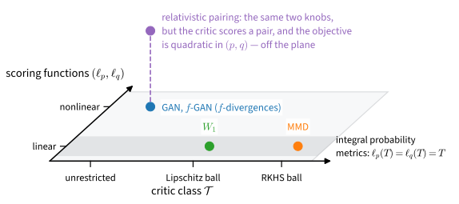
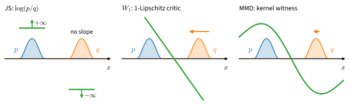

# Adversarial Objectives and Divergences
:label:`sec_gan_objectives`

Open almost any GAN codebase and its training script offers a menu of losses: non-saturating, least squares, hinge, Wasserstein. Practitioners switch between the entries the way they switch optimizers, by trying one and keeping whichever trains. :numref:`sec_basic_gan` analyzed only the first entry. Its critic learned the log ratio of the data density to the generator's density, its game measured the Jensen--Shannon divergence, and its generator stopped receiving a gradient once the generated samples sat far from the data. What do the other entries compute, and does any of them keep moving a generator in that situation?

Every entry changes one of two things: the loss that trains the critic, or the set of functions the critic may be. Changing the loss turns the game into a different divergence and changes what the trained critic reports about the two densities. Restricting the critic turns the game into a distance that compares averages of smooth test functions, and such distances can keep a gradient when data and samples do not overlap. We work out both families, check their predictions on a two-dimensional Gaussian mixture whose densities we know exactly, and train one generator under five entries of the menu. :numref:`sec_gan_relativistic` then changes what the critic compares: a real sample against a generated one.

```{.python .input #objectives-adversarial-objectives-and-divergences}
%%tab pytorch
%matplotlib inline
from d2l import torch as d2l
import numpy as np
import torch
from torch import nn
```

```{.python .input #objectives-adversarial-objectives-and-divergences}
%%tab jax
%matplotlib inline
from d2l import jax as d2l
import jax
from jax import numpy as jnp
from flax import nnx
import numpy as np
import optax
```

## A Common Template and Two Choices

The value function of :numref:`sec_basic_gan` scores a real sample $x \sim p$ through $\log \sigma(D(x))$ and a generated sample $x' \sim q$ through $\log \sigma(-D(x'))$, where $D$ is the critic's logit. We keep that section's notation: the mixture $m = (p+q)/2$, the density ratio $\rho = p/q$, and its logarithm $\lambda = \log \rho$, which is the optimal logit. Replacing the two log-probabilities by general scoring functions, $\ell_p$ for real samples and $\ell_q$ for generated ones, gives the template

$$
d(p, q) \;=\; \sup_{T \in \mathcal{T}} \Big\{ \mathbb{E}_{x \sim p}\big[\ell_p(T(x))\big] - \mathbb{E}_{x' \sim q}\big[\ell_q(T(x'))\big] \Big\},
$$
:eqlabel:`eq_gan_template`

in which the critic $T$ ranges over a class $\mathcal{T}$. The game of :numref:`sec_basic_gan` is the case $\ell_p(t) = \log \sigma(t)$ and $\ell_q(t) = -\log \sigma(-t)$ with $\mathcal{T}$ unrestricted. Each of the two knobs, the scores and the critic class, produces a family of objectives.

The first family keeps the critic unconstrained and varies the scores. The supremum can then be taken separately at each $x$, as in :numref:`sec_basic_gan`, so the result depends on $p$ and $q$ only through the ratio $\rho(x)$. These objectives are f-divergences, and the original GAN's Jensen--Shannon divergence is one of them. The second family uses linear scores, $\ell_p = \ell_q = \mathrm{id}$, and restricts $\mathcal{T}$ to a ball of functions. The constraint couples the critic's values across points, so the supremum no longer splits into pointwise problems. A kernel ball gives the maximum mean discrepancy, and the ball of 1-Lipschitz functions gives the Wasserstein-1 distance (:numref:`fig_gan_template`).

![Two choices define the classical adversarial objectives. One axis varies the scoring functions applied to critic outputs; the other varies the critic class. Nonlinear scores with an unconstrained critic yield f-divergences, including the original GAN and the f-GAN construction. Linear scores with a constrained critic yield integral probability metrics: a kernel ball gives MMD, and a Lipschitz ball gives Wasserstein-1. The relativistic objective of :numref:`sec_gan_relativistic` scores pairs of samples and is bilinear in $(p, q)$; that section shows that convexity in $q$ survives.](../img/mdl-gan-template.svg)
:label:`fig_gan_template`

For a fixed critic, the expression in braces is linear in $q$. For fixed data $p$, every objective of the template is therefore a supremum of functionals linear in $q$, and hence convex in $q$: in the space of distributions, the generator's problem has no spurious local minima. Convexity in $q$ does not make the objective convex in the network parameters that represent $q$ (Exercise :exref:`ex_objectives-convexity-parameterization`).

## Classification Losses and Their Divergences

### Two Outcomes by Hand

Take a world with two outcomes, heads and tails. The data put probabilities $p = (\tfrac34, \tfrac14)$ on them and the generator $q = (\tfrac14, \tfrac34)$. A fair coin decides whether the critic sees a real or a generated draw, and the critic, shown the outcome, must say which source produced it. Seeing heads, the source is real with probability $\eta = p/(p + q) = \tfrac34$; seeing tails, with probability $\tfrac14$. A critic that ignores the outcome can only report the prior, one half. How much looking helps depends on the loss:

- Under the log loss, the best report is the posterior itself. Its expected loss is the binary entropy $H_b(\tfrac34) = 0.562$ nats, against $\log 2 = 0.693$ nats for the blind report. Looking saves $0.131$ nats, which is $\mathrm{JS}(p, q)$.
- Under the squared error of a reported probability, the best report is again the posterior, with expected loss $\tfrac34 \cdot \tfrac14 = \tfrac{3}{16}$ against $\tfrac14$ for the blind report. Looking saves $\tfrac{1}{16}$.
- Under the hinge loss on a score $t$, the best scores are $t = +1$ on heads and $t = -1$ on tails, with expected loss $2 \cdot \tfrac14 = \tfrac12$ against $1$ at $t = 0$. Looking saves $\tfrac12$, which is the total variation distance $\tfrac12 \sum |p - q|$.

The three losses assign three different numbers to one pair of distributions, all from the same posterior, and each saving vanishes when $p = q$, where the posterior is one half everywhere. We now show that every such saving is an f-divergence.

### The Bayes-Risk Gap

The pointwise maximization of :numref:`sec_basic_gan` does not depend on the form of the logistic score. Let $\ell$ be a payoff on critic outputs, so that $-\ell$ is a loss. A real sample earns $\ell(D(x))$ and a generated sample earns $\ell(-D(x'))$:

$$
V_\ell(D) \;=\; \mathbb{E}_{x \sim p}\big[\ell(D(x))\big] + \mathbb{E}_{x' \sim q}\big[\ell(-D(x'))\big].
$$
:eqlabel:`eq_gan_margin`

The choice $\ell = \log \sigma$ recovers the log-loss game. The critic's signed score is $D(x)$ on a real sample and $-D(x')$ on a generated one. A loss that depends on the label only through this signed score, the *margin*, is a *margin loss*, and maximizing $V_\ell$ minimizes the critic's expected margin loss on a balanced mixture of real and generated samples.

The maximization decouples across points. At each $x$ the integrand is $p\,\ell(t) + q\,\ell(-t)$ with $t = D(x)$, and factoring out $p + q = 2m$ leaves $2m(x)$ times an average under the posterior $\eta(x) = p(x)/(p(x)+q(x))$. The smallest expected loss a critic can reach at posterior $\eta$ is the *conditional Bayes risk*

$$
L(\eta) \;=\; \inf_{t} \Big\{ \eta \, \big({-\ell(t)}\big) + (1 - \eta)\, \big({-\ell(-t)}\big) \Big\}.
$$
:eqlabel:`eq_gan_bayes_risk`

Because $L$ is an infimum of functions linear in $\eta$, it is concave for every $\ell$. Substituting the pointwise optimum into :eqref:`eq_gan_margin` gives $\sup_D V_\ell(D) = -2\,\mathbb{E}_{x \sim m}[L(\eta(x))]$.

A critic that ignores its input already reaches the risk $L(\tfrac12)$. Subtracting this baseline leaves what observing the sample contributes, the *Bayes-risk gap*

$$
\Delta_\ell(p, q) \;=\; L(\tfrac12) - \mathbb{E}_{x \sim m}\big[L(\eta(x))\big].
$$
:eqlabel:`eq_gan_bayes_gap`

It fixes the value of the game, $\sup_D V_\ell = 2\Delta_\ell - 2 L(\tfrac12)$, and it is nonnegative by Jensen's inequality, because $L$ is concave and $\mathbb{E}_m[\eta] = \tfrac12$. For the log loss, $L$ is the binary entropy and $L(\tfrac12) = \log 2$, and the gap is the mutual information between a sample and its source, which :numref:`sec_basic_gan` identified with $\mathrm{JS}(p, q)$. The three savings of the coin example are three Bayes-risk gaps.

### Bayes-Risk Gaps as f-Divergences

An f-divergence averages a convex function of the density ratio under $q$, $D_f(p \,\|\, q) = \mathbb{E}_{x \sim q}[f(\rho(x))]$, where $f$ is convex with $f(1) = 0$. :numref:`sec_mdl-f-divergences` proves that $D_f \geq 0$ and fixes the conventions where one density vanishes. We call $f$ the *divergence function*; the appendix and the f-GAN literature call it the generator, a word this chapter keeps for the network.

**Proposition.** *For any loss with concave Bayes risk $L$,*

$$
\Delta_\ell(p, q) \;=\; D_f(p \,\|\, q)
\qquad \textrm{with} \qquad
f(u) \;=\; L(\tfrac12) - \frac{u+1}{2}\, L\!\left(\frac{u}{u+1}\right),
$$

*and this $f$ is convex with $f(1) = 0$.*

**Proof.** Substitute $u = \rho = p/q$, so that $m = q\,(u+1)/2$ and $\eta = u/(u+1)$. Then

$$
\mathbb{E}_{x \sim m}\big[L(\eta(x))\big] = \int q \, \frac{u+1}{2}\, L\!\left(\frac{u}{u+1}\right),
$$

and since $\int q = 1$ the constant $L(\tfrac12)$ can be moved inside the integral, giving $\Delta_\ell = \int q\, f(u) = \mathbb{E}_q[f(\rho)]$. For convexity, write the concave $L$ as the lower envelope of its tangent lines, $L(v) = \inf_s \{\alpha_s v + \beta_s\}$. Then

$$
(u+1)\, L\!\left(\frac{u}{u+1}\right) = \inf_s \big\{ \alpha_s u + \beta_s (u+1) \big\}
$$

is an infimum of affine functions of $u$, hence concave, so $f$ is convex; and $f(1) = L(\tfrac12) - L(\tfrac12) = 0$. $\blacksquare$

Thus the game :eqref:`eq_gan_margin` evaluates the f-divergence whose divergence function is built from the loss's Bayes risk. The optimal critic is still a fixed function of the posterior $\eta(x)$, and hence of the log ratio $\lambda(x)$, but different losses report it through different *links*. The logistic critic reports $\lambda$ itself, as :numref:`sec_basic_gan` derived. The least-squares critic reports the posterior $\sigma(\lambda)$, and the hinge critic reports only the sign of $\lambda$.

### Divergences of Common Losses

:numref:`tab_gan_loss_divergences` evaluates :eqref:`eq_gan_bayes_gap` for four losses in common use, with the binary entropy $H_b(\eta) = -\eta \log \eta - (1-\eta)\log(1-\eta)$ and the total variation distance $\mathrm{TV}(p, q) = \tfrac12 \int |p - q|$. The square row scores a probability against zero--one targets, the coding LSGAN uses. The squared hinge pays $\max(0, 1 - t)^2$ on a margin $t$; its optimum $t = 2\eta - 1$ lies inside the margin, where it agrees with the square loss on $\pm 1$ targets, so its gap is four times the square row's. The hinge's link is its optimum away from $\eta = \tfrac12$, where every score in $[-1, 1]$ is optimal.

:Classification losses in the game of a single critic: the conditional Bayes risk, its value at the prior, the Bayes-risk gap $\Delta_\ell$ (the value of the game is $2\Delta_\ell - 2L(\tfrac12)$), and the optimal critic as a function of the log ratio.
:label:`tab_gan_loss_divergences`

| loss | Bayes risk $L(\eta)$ | $L(\tfrac12)$ | gap $\Delta_\ell(p,q)$ | optimal critic |
|:---|:---|:---|:---|:---|
| logistic | $H_b(\eta)$ | $\log 2$ | $\mathrm{JS}(p,q)$ | $\lambda$ |
| square | $\eta(1-\eta)$ | $1/4$ | $\tfrac{1}{8}\int \frac{(p-q)^2}{p+q}$ | $\sigma(\lambda)$ |
| squared hinge | $4\eta(1-\eta)$ | $1$ | $\tfrac{1}{2}\int \frac{(p-q)^2}{p+q}$ | $\tanh(\lambda/2)$ |
| hinge | $2\min(\eta, 1-\eta)$ | $1$ | $\mathrm{TV}(p,q)$ | $\operatorname{sign} \lambda$ |

At the coin pair the four gaps are $0.131$, $\tfrac{1}{16}$, $\tfrac14$ and $\tfrac12$. LSGAN :cite:`Mao.Li.Xie.ea.2017` derives from its generator's objective a Pearson $\chi^2$ divergence measured against the mixture, $\chi^2(p \,\|\, m) = \tfrac12 \int (p-q)^2/(p+q)$: the square row's quantity up to scale, symmetric and bounded by one, not the unbounded $\chi^2(p \,\|\, q)$ of :numref:`sec_mdl-f-divergences`. The hinge loss entered adversarial training through the Geometric GAN of :citet:`Lim.Ye.2017`, which derived it from the maximum-margin geometry of support vector machines; its game measures total variation.

## f-Divergences from Duality

### The Variational Bound

Some divergences are out of the proposition's reach. The Bayes risk of a nonnegative loss is nonnegative, so every gap is bounded, $\Delta_\ell \leq L(\tfrac12)$, and the unbounded forward KL divergence $D_{\mathrm{KL}}(p \,\|\, q)$ that maximum likelihood minimizes is the gap of no such loss. Fenchel duality builds a game for any divergence function chosen in advance. For a convex $f$ with conjugate $f^*(t) = \sup_u \{ut - f(u)\}$, every critic $T$ gives the lower bound

$$
D_f(p \,\|\, q) \;\geq\; \mathbb{E}_{x \sim p}\big[T(x)\big] - \mathbb{E}_{x' \sim q}\big[f^*(T(x'))\big].
$$
:eqlabel:`eq_gan_fgan_bound`

Thus any critic certifies at least this much divergence, using only expectations that minibatches can estimate. :numref:`sec_mdl-f-gan-dual` proves the bound by applying the Fenchel--Young inequality $f(u) \geq ut - f^*(t)$ at $u = \rho(x)$, $t = T(x)$ and integrating against $q$. Training a network $T$ to maximize the right-hand side, the template with $\ell_p = \mathrm{id}$ and $\ell_q = f^*$, is the f-GAN construction :cite:`Nowozin.Cseke.Tomioka.2016`. Fenchel--Young holds with equality where $t$ is the slope of $f$ at $u$, so for differentiable $f$ the bound is attained by

$$
T^\star(x) \;=\; f'\big(\rho(x)\big).
$$
:eqlabel:`eq_gan_tstar`

The optimal critic is a monotone transform of the density ratio, the link column of :numref:`tab_gan_loss_divergences` in one formula, and an imperfect critic underestimates the divergence. For the forward KL, $f(u) = u \log u$ has conjugate $f^*(t) = e^{t-1}$, so the game is $\sup_T \{ \mathbb{E}_p[T] - \mathbb{E}_q[e^{T-1}] \}$ with optimal critic $T^\star = 1 + \lambda$. Where $f^*$ is finite only on part of the line, the network's output activation must map into that part :cite:`Nowozin.Cseke.Tomioka.2016`.

The family contains the original GAN. Twice the Jensen--Shannon divergence has the divergence function $f(u) = u \log u - (u+1)\log\frac{u+1}{2}$, with conjugate $f^*(t) = -\log(2 - e^t)$ for $t < \log 2$. Writing the critic through a logit, $T = \log(2\sigma(D))$, keeps it in that range and turns the bound into $2\log 2 + V(D)$, the value function of :numref:`sec_basic_gan` shifted by a constant (Exercise :exref:`ex_objectives-variational-bound-eqref-eq`). The original GAN is the Jensen--Shannon member of the f-GAN family.

### Critic Links
:label:`subsec_gan_objectives_critics`

The links predict what a trained critic outputs, and we can test them point by point when both densities are known. The data $p$ are a uniform mixture of three Gaussians in the plane. For $q$ we set a second three-component mixture by hand, with each mean moved by about $0.3$ and the components made wider, narrower and sheared. Then $\lambda = \log p - \log q$ is available in closed form at every point, and $\mathrm{JS}(p, q)$ can be computed by quadrature on a fixed grid.

```{.python .input #objectives-one-testbed-four-losses-1}
%%tab pytorch, jax
mu_p = np.array([[0.0, 2.4], [-2.1, -1.2], [2.1, -1.2]])     # data
A_p = np.stack([0.7 * np.eye(2)] * 3)
mu_q = np.array([[0.2, 2.6], [-2.3, -1.0], [2.0, -1.3]])     # hand-set q
A_q = np.stack([np.diag([0.8, 0.55]), np.diag([0.5, 0.6]),
                np.array([[0.65, 0.2], [-0.1, 0.7]])])

def mixture_logpdf(x, mus, As):
    """Log density of the uniform mixture of Gaussians N(mu_k, A_k^T A_k)."""
    comps = []
    for mu, A in zip(mus, As):
        Sigma, diff = A.T @ A, x - mu
        sol = np.linalg.solve(Sigma, diff.T).T
        comps.append(-0.5 * ((diff * sol).sum(1)
                             + np.log(np.linalg.det(2 * np.pi * Sigma))))
    comps = np.stack(comps) - np.log(len(mus))
    cmax = comps.max(axis=0)
    return cmax + np.log(np.exp(comps - cmax).sum(axis=0))

def sample_mixture(n, mus, As, rng):
    k = rng.integers(0, len(mus), n)
    z = rng.standard_normal((n, 2))
    return np.einsum('ni,nij->nj', z, As[k]) + mus[k]

grid_1d = np.linspace(-7.0, 7.0, 281)
gx, gy = np.meshgrid(grid_1d, grid_1d)
grid_2d = np.stack([gx.ravel(), gy.ravel()], axis=1)
cell_area = (grid_1d[1] - grid_1d[0]) ** 2

def js_mixtures(mus_q, As_q):
    """JS(p, q) between the data and a known mixture, by quadrature."""
    logp = mixture_logpdf(grid_2d, mu_p, A_p)
    logq = mixture_logpdf(grid_2d, mus_q, As_q)
    p, q = np.exp(logp), np.exp(logq)
    logm = np.log(np.maximum((p + q) / 2, 1e-300))
    return 0.5 * (p * (logp - logm) + q * (logq - logm)).sum() * cell_area

print(f'JS(p, q) for the hand-set q: {js_mixtures(mu_q, A_q):.3f} nats')
```

The hand-set $q$ is a few hundredths of a nat from the data, a mismatch of the size a generator meets late in training. The critic is a small leaky-ReLU network with the same initialization in both frameworks. Each loss is stored as a pair: the critic's loss on the scores of real and generated samples, and the generator loss that :numref:`subsec_gan_objectives_testbed` trains with.

```{.python .input #objectives-one-testbed-four-losses-3}
%%tab pytorch
def make_critic():
    """Leaky-ReLU MLP with LeCun-normal weights and zero biases."""
    D = nn.Sequential(nn.Linear(2, 64), nn.LeakyReLU(0.2),
                      nn.Linear(64, 64), nn.LeakyReLU(0.2), nn.Linear(64, 1))
    for layer in D[::2]:
        s = layer.in_features ** -0.5 / 0.8796   # truncated at two std
        nn.init.trunc_normal_(layer.weight, std=s, a=-2 * s, b=2 * s)
        nn.init.zeros_(layer.bias)
    return D

softplus, relu = nn.functional.softplus, torch.relu
losses = {  # name: (critic loss, generator loss), both on critic scores
    'logistic': (lambda r, f: (softplus(-r) + softplus(f)).mean(),
                 lambda f: softplus(-f).mean()),
    'least squares': (lambda r, f: ((r - 1) ** 2 + f ** 2).mean() / 2,
                      lambda f: ((f - 1) ** 2).mean() / 2),
    'hinge': (lambda r, f: (relu(1 - r) + relu(1 + f)).mean(),
              lambda f: -f.mean()),
    'squared hinge': (lambda r, f: (relu(1 - r) ** 2 + relu(1 + f) ** 2).mean(),
                      lambda f: -f.mean()),
}
```

```{.python .input #objectives-one-testbed-four-losses-3}
%%tab jax
class Critic(nnx.Module):
    """Leaky-ReLU MLP; nnx.Linear gives LeCun-normal weights, zero biases."""
    def __init__(self, rngs):
        self.h1 = nnx.Linear(2, 64, rngs=rngs)
        self.h2 = nnx.Linear(64, 64, rngs=rngs)
        self.out = nnx.Linear(64, 1, rngs=rngs)

    def __call__(self, x):
        h = nnx.leaky_relu(self.h1(x), 0.2)
        return self.out(nnx.leaky_relu(self.h2(h), 0.2))

softplus, relu = jax.nn.softplus, jax.nn.relu
losses = {  # name: (critic loss, generator loss), both on critic scores
    'logistic': (lambda r, f: (softplus(-r) + softplus(f)).mean(),
                 lambda f: softplus(-f).mean()),
    'least squares': (lambda r, f: ((r - 1) ** 2 + f ** 2).mean() / 2,
                      lambda f: ((f - 1) ** 2).mean() / 2),
    'hinge': (lambda r, f: (relu(1 - r) + relu(1 + f)).mean(),
              lambda f: -f.mean()),
    'squared hinge': (lambda r, f: (relu(1 - r) ** 2 + relu(1 + f) ** 2).mean(),
                      lambda f: -f.mean()),
}
```

The links describe the best response to a fixed $q$, so we train a fresh critic against the hand-set $q$ under three of the losses. A fourth critic maximizes the forward-KL bound $\mathbb{E}_p[T] - \mathbb{E}_q[e^{T-1}]$, whose conjugate is finite on the whole line and needs no output activation.

```{.python .input #objectives-what-each-critic-estimates}
%%tab pytorch
to_t = lambda a: torch.tensor(a, dtype=torch.float32)

def best_response(critic_loss, seed=0, steps=3000, batch=512, lr=1e-3):
    """Fresh critic trained against the fixed q, as a NumPy function."""
    rng = np.random.default_rng(seed)
    torch.manual_seed(seed)
    D = make_critic()
    opt = torch.optim.Adam(D.parameters(), lr)
    for _ in range(steps):
        X = to_t(sample_mixture(batch, mu_p, A_p, rng))
        Y = to_t(sample_mixture(batch, mu_q, A_q, rng))
        opt.zero_grad()
        critic_loss(D(X), D(Y)).backward()
        opt.step()
    return lambda x: D(to_t(x)).squeeze(-1).detach().numpy()

kl_dual = lambda r, f: -(r.mean() - torch.exp(f - 1).mean())
critics = {name: best_response(losses[name][0])
           for name in ('logistic', 'least squares', 'hinge')}
critics['forward KL'] = best_response(kl_dual)
```

```{.python .input #objectives-what-each-critic-estimates}
%%tab jax
@nnx.jit(static_argnums=0)
def critic_step(critic_loss, D, opt, X, Y):
    opt.update(D, nnx.grad(lambda D_: critic_loss(D_(X), D_(Y)))(D))

def best_response(critic_loss, seed=0, steps=3000, batch=512, lr=1e-3):
    """Fresh critic trained against the fixed q, as a NumPy function."""
    rng = np.random.default_rng(seed)
    D = Critic(nnx.Rngs(seed))
    opt = nnx.Optimizer(D, optax.adam(lr), wrt=nnx.Param)
    for _ in range(steps):
        X = jnp.asarray(sample_mixture(batch, mu_p, A_p, rng), jnp.float32)
        Y = jnp.asarray(sample_mixture(batch, mu_q, A_q, rng), jnp.float32)
        critic_step(critic_loss, D, opt, X, Y)
    return lambda x: np.asarray(D(jnp.asarray(x, jnp.float32))).squeeze(-1)

kl_dual = lambda r, f: -(r.mean() - jnp.exp(f - 1).mean())
critics = {name: best_response(losses[name][0])
           for name in ('logistic', 'least squares', 'hinge')}
critics['forward KL'] = best_response(kl_dual)
```

We evaluate each critic at 300 points drawn from $p$ and 300 from $q$ and plot its output against the analytic $\lambda$, with the predicted link as a dashed line.

```{.python .input #objectives-critic-links-1}
%%tab pytorch, jax
rng = np.random.default_rng(7)
pts = np.concatenate([sample_mixture(300, mu_p, A_p, rng),
                      sample_mixture(300, mu_q, A_q, rng)])
lam = mixture_logpdf(pts, mu_p, A_p) - mixture_logpdf(pts, mu_q, A_q)
lam_line = np.linspace(lam.min(), lam.max(), 200)
links = {'logistic': lambda l: l, 'least squares': lambda l: 1 / (1 + np.exp(-l)),
         'hinge': np.sign, 'forward KL': lambda l: 1 + l}
fig, axes = d2l.plt.subplots(1, 4, figsize=(12, 3))
for ax, (name, link) in zip(axes, links.items()):
    out = critics[name](pts)
    d2l.plot([lam[:300], lam[300:], lam_line],
             [out[:300], out[300:], link(lam_line)], xlabel=r'$\lambda$',
             fmts=('.', '.', 'k--'), axes=ax,
             legend=['x ~ p', "x' ~ q", 'link'] if name == 'logistic' else None)
    ax.set_title(name)
axes[0].set_ylabel('critic output')
```

Each critic follows its own transform of the same function: the logistic critic the identity, the least-squares critic the sigmoid, the hinge critic a step at $\lambda = 0$, and the forward-KL critic the line $1 + \lambda$. All four drift from their links where $|\lambda|$ is large: few samples land there, and the objective constrains a critic only where samples land. The hinge critic is the least determined. Beyond the margin its risk grows only at rate $\min(\eta, 1 - \eta)$, and inside the margin at rate $|1 - 2\eta|$, so it is weakly pinned both where one class dominates and where the two classes nearly balance. Its step is smeared near $\lambda = 0$, and its plateaus scatter.

The forward-KL critic also estimates the divergence itself. We evaluate its bound :eqref:`eq_gan_fgan_bound` by quadrature on the grid, so the comparison with the exact $D_{\mathrm{KL}}(p \,\|\, q)$ carries no sampling error.

```{.python .input #objectives-critic-links-2}
%%tab pytorch, jax
logp = mixture_logpdf(grid_2d, mu_p, A_p)
logq = mixture_logpdf(grid_2d, mu_q, A_q)
T = critics['forward KL'](grid_2d).astype(np.float64)
bound = (np.exp(logp) * T - np.exp(logq + T - 1)).sum() * cell_area
kl = (np.exp(logp) * (logp - logq)).sum() * cell_area
print(f'KL(p || q) = {kl:.3f} nats, attained bound = {bound:.3f} nats')
```

The attained bound lies below the exact divergence, as the duality argument requires, and recovers more than four fifths of it. The missing part comes mostly from unfinished optimization where the samples are dense, and training the critic longer closes most of it. A critic that overshoots $1 + \lambda$ where $q$ almost never samples is penalized by the quadrature but not by a minibatch estimate, which can therefore flatter the critic.

## Integral Probability Metrics

The second family keeps linear scores and constrains the critic. The objective becomes

$$
d_{\mathcal{F}}(p, q) \;=\; \sup_{T \in \mathcal{F}} \Big\{ \mathbb{E}_{x \sim p}\big[T(x)\big] - \mathbb{E}_{x' \sim q}\big[T(x')\big] \Big\},
$$
:eqlabel:`eq_gan_ipm`

the largest difference in expectation that a test function in $\mathcal{F}$ can detect, an *integral probability metric* (:numref:`sec_mdl-ipm-mmd`). For a class closed under negation, $d_{\mathcal{F}}$ is symmetric and satisfies the triangle inequality. Its value no longer reduces to the pointwise ratio $\rho(x)$; it depends on which functions $\mathcal{F}$ contains.

### Maximum Mean Discrepancy

Taking $\mathcal{F}$ to be the unit ball of a reproducing kernel Hilbert space with kernel $k$ gives the maximum mean discrepancy (MMD). The supremum has a closed form :cite:`Gretton.Borgwardt.Rasch.ea.2012`, and :numref:`sec_mdl-ipm-mmd` derives its square as three kernel averages,

$$
\mathrm{MMD}^2(p, q) \;=\; \mathbb{E}_{x, \tilde x \sim p}\big[k(x, \tilde x)\big] + \mathbb{E}_{x', \tilde x' \sim q}\big[k(x', \tilde x')\big] - 2\, \mathbb{E}_{x \sim p,\, x' \sim q}\big[k(x, x')\big],
$$
:eqlabel:`eq_gan_mmd2`

with the two samples in each average drawn independently: similarity within each distribution minus twice the similarity across them. For a fixed kernel, a generator can minimize $\mathrm{MMD}^2$ directly, with no critic network and no inner loop, and the kernel alone decides what the discrepancy can see. The unbiased minibatch estimate uses all pairs within the batch, $O(n^2)$ kernel evaluations for batch size $n$.

### Wasserstein-1

Taking $\mathcal{F}$ to be the 1-Lipschitz functions gives the Wasserstein-1 distance $W_1$, by Kantorovich--Rubinstein duality the least average distance over which the mass of $p$ must be moved to turn it into $q$ (:numref:`sec_mdl-optimal-transport`). On the line, $W_1$ is the area between the two cumulative distribution functions,

$$
W_1(p, q) \;=\; \int_{-\infty}^{\infty} \big| F_p(t) - F_q(t) \big| \, dt,
$$

so a translation by $\delta$ costs exactly $|\delta|$. In higher dimensions there is no closed form, so a WGAN trains a critic network and enforces the constraint approximately :cite:`Arjovsky.Chintala.Bottou.2017`, by weight clipping, a gradient penalty :cite:`Gulrajani.Ahmed.Arjovsky.ea.2017` or spectral normalization :cite:`Miyato.Kataoka.Koyama.ea.2018`. The squared Wasserstein-2 distance between two Gaussians also has a closed form, and we will use it to score generated images.

## Gradients Far from and Near the Data
:label:`subsec_gan_objectives_gradients`

The two families disagree about the failure that closed :numref:`sec_basic_gan`. An f-divergence integrates a function of the pointwise ratio $\rho(x)$, which on disjoint supports is $0$ or $\infty$ at every point. No pointwise quantity then records how far apart the supports are, so the divergence stays at its ceiling and the generator's gradient vanishes; two point masses have Jensen--Shannon divergence $\log 2$ at every separation. An integral probability metric averages one test function under both distributions, and if the test functions vary smoothly in space, its value changes as the supports move. Smoothness is the condition, not the family. Total variation is the integral probability metric of the functions bounded by $\tfrac12$ :cite:`Sriperumbudur.Fukumizu.Gretton.ea.2009`, yet it saturates on disjoint supports, because that class contains functions as sharp as indicators.

### Divergence against Separation
:label:`subsec_gan_objectives_separation`

We can measure how much gradient each objective keeps. Give the two point masses unit width, $p = \mathcal{N}(0, 1)$ and $q = \mathcal{N}(\delta, 1)$, and move them apart. All three objectives can be evaluated without sampling error: Jensen--Shannon by quadrature on a fixed grid, and $W_1 = |\delta|$ exactly, with slope one. For the RBF kernel $k(x, x') = \exp(-(x - x')^2/(2s^2))$ with bandwidth $s$, the kernel averages in :eqref:`eq_gan_mmd2` are Gaussian integrals, which give

$$
\mathrm{MMD}^2(p, q) \;=\; \frac{2s}{\sqrt{s^2 + 2}} \left( 1 - \exp\!\left( -\frac{\delta^2}{2(s^2 + 2)} \right) \right).
$$
:eqlabel:`eq_gan_mmd_gauss`

We plot each objective's slope with respect to $\delta$, the gradient a generator that controls $\delta$ receives, on a log axis, with bandwidth $s = 4$.

```{.python .input #objectives-divergence-against-separation}
%%tab pytorch, jax
xs = np.linspace(-10.0, 18.0, 5601)           # fixed quadrature grid

def normal_pdf(x, mu, sigma=1.0):
    return np.exp(-(x - mu) ** 2 / (2 * sigma ** 2)) / np.sqrt(
        2 * np.pi * sigma ** 2)

def js_1d(p, q):
    m = (p + q) / 2
    return 0.5 * np.trapezoid(p * np.log(p / m) + q * np.log(q / m), xs)

s = 4.0                                        # RBF kernel bandwidth
deltas = np.linspace(0.1, 8.0, 80)
js = np.array([js_1d(normal_pdf(xs, 0.0), normal_pdf(xs, d)) for d in deltas])
mmd2 = 2 * s / np.sqrt(s ** 2 + 2) * (1 - np.exp(-deltas ** 2
                                                 / (2 * (s ** 2 + 2))))
slopes = [np.gradient(js, deltas), np.gradient(mmd2, deltas),
          np.ones_like(deltas)]                # W1 = |delta| has slope one
for d in (1.0, 7.0):
    print(f'delta = {d:.0f}: JS slope {np.interp(d, deltas, slopes[0]):.4f}, '
          f'JS / log 2 = {np.interp(d, deltas, js) / np.log(2):.4f}')
d2l.plot(deltas, slopes, xlabel=r'separation $\delta$', ylabel='slope',
         legend=['JS', 'MMD$^2$', '$W_1$'], yscale='log', figsize=(5, 3))
```

The Jensen--Shannon slope is largest while the densities overlap and then collapses. At $\delta = 7$ it is more than a hundred times smaller than at $\delta = 1$, and the divergence is within a tenth of a percent of $\log 2$. A generator at that separation receives almost no signal about which way to move. The $W_1$ slope stays at one. The $\mathrm{MMD}^2$ slope rises to a maximum at a separation set by the bandwidth and then decays like a Gaussian in $\delta$, so the bandwidth sets the range over which MMD gives a gradient.

### Optimal Critics on Separated Supports

Why do the slopes differ? :numref:`fig_gan_critics_separated` draws the three optimal critics for two separated densities. The Jensen--Shannon critic is $\lambda$: $+\infty$ on the data's support and $-\infty$ on the generator's, flat on each. Moving $q$ a little leaves every generated sample on the same flat level, so the critic carries no information about direction. The $W_1$ critic is a ramp of unit slope, so every generated sample sits on a slope that points toward the data, however far away it is. The MMD witness $\mathbb{E}_{x \sim p}[k(x, \cdot)] - \mathbb{E}_{x' \sim q}[k(x', \cdot)]$ is a smooth difference of kernel bumps. It slopes toward the data as long as the kernel reaches across the gap and flattens once the gap exceeds a few bandwidths.

![Optimal critics when the data density $p$ (blue) and the generated density $q$ (orange) have disjoint supports. Left: the Jensen--Shannon critic $\log(p/q)$ is $+\infty$ on the support of $p$ and $-\infty$ on that of $q$, and it is flat on both, so it gives the generator no slope. Middle: the optimal 1-Lipschitz critic of $W_1$ is a ramp of slope one. Right: the MMD witness $\mathbb{E}_{p}[k(x,\cdot)] - \mathbb{E}_{q}[k(x,\cdot)]$ is a smooth difference of kernel bumps (bandwidth half the separation, shown at an arbitrary scale), and its slope at $q$ still points toward $p$. The orange arrows mark the slope of each critic at $q$, the direction in which the generator moves.](../img/mdl-gan-critics-separated.svg)
:label:`fig_gan_critics_separated`

### Five Losses on a Gaussian Mixture
:label:`subsec_gan_objectives_testbed`

Every divergence in :numref:`tab_gan_loss_divergences` vanishes at $q = p$, so with overlapping supports every loss should drive a generator to the data. Near the end, though, the logistic and least-squares critics report how large the remaining mismatch is, the hinge critic only its sign. We test what this does to training by fitting one generator to the three-mode mixture of :numref:`subsec_gan_objectives_critics` under five objectives: the non-saturating logistic loss of :numref:`sec_basic_gan`, least squares :cite:`Mao.Li.Xie.ea.2017`, hinge :cite:`Lim.Ye.2017`, the squared hinge, and MMD with a fixed kernel and no critic. The squared hinge keeps the hinge's margin and its generator loss $-D$ but has the link $\tanh(\lambda/2)$, which carries magnitude, so comparing it with the hinge isolates the link. All five runs share the architecture, learning rates, step counts and initialization; none is tuned separately.

The generator draws one of three components uniformly and applies that component's learned affine map to Gaussian noise, so $q$ stays a three-component Gaussian mixture and $\mathrm{JS}(p, q_t)$ can be evaluated exactly after every step. The means start at three data points spread out by a farthest-point traversal of one batch, and the maps start well below the data's scale, so positions, scales and shapes all remain to be learned.

```{.python .input #objectives-five-losses-on-a-gaussian-mixture-1}
%%tab pytorch, jax
def farthest_point_init(X, K):
    idx = [0]
    for _ in range(K - 1):
        dist = np.min(np.linalg.norm(X[:, None] - X[idx][None], axis=2),
                      axis=1)
        idx.append(int(np.argmax(dist)))
    return X[idx]

def init_generator(rng):
    """Means at three spread-out data points; maps below the data's scale."""
    mu = farthest_point_init(sample_mixture(256, mu_p, A_p, rng), 3)
    return mu, 0.4 * np.eye(2) + 0.05 * rng.standard_normal((3, 2, 2))

init = init_generator(np.random.default_rng(0))
print(f'JS(p, q) at initialization: {js_mixtures(*init):.3f} nats')
```

The MMD arm minimizes the unbiased minibatch $\mathrm{MMD}^2$ of :eqref:`eq_gan_mmd2`, summed over RBF kernels with bandwidths $0.5$, $1$ and $2$ so that the fixed kernel is sensitive at several scales.

```{.python .input #objectives-one-testbed-four-losses-2}
%%tab pytorch
class MixtureGenerator(nn.Module):
    """x = mu_k + z A_k for a uniformly drawn component k."""
    def __init__(self, mu, A):
        super().__init__()
        self.mu = nn.Parameter(torch.tensor(mu, dtype=torch.float32))
        self.A = nn.Parameter(torch.tensor(A, dtype=torch.float32))

    def forward(self, z, k):
        return torch.einsum('ni,nij->nj', z, self.A[k]) + self.mu[k]

    def params_np(self):
        return (self.mu.detach().numpy().copy(),
                self.A.detach().numpy().copy())

def mmd2_loss(x, y, bandwidths=(0.5, 1.0, 2.0)):
    """Unbiased MMD^2, summed over three RBF bandwidths."""
    n, m = len(x), len(y)
    dxx, dyy, dxy = (torch.cdist(x, x) ** 2, torch.cdist(y, y) ** 2,
                     torch.cdist(x, y) ** 2)
    val = 0.0
    for s in bandwidths:
        kxx, kyy, kxy = [torch.exp(-dist / (2 * s ** 2))
                         for dist in (dxx, dyy, dxy)]
        val = val + ((kxx.sum() - kxx.diag().sum()) / (n * (n - 1))
                     + (kyy.sum() - kyy.diag().sum()) / (m * (m - 1))
                     - 2 * kxy.mean())
    return val

losses['MMD'] = (None, None)   # no critic: the generator minimizes MMD^2
```

```{.python .input #objectives-one-testbed-four-losses-2}
%%tab jax
class MixtureGenerator(nnx.Module):
    """x = mu_k + z A_k for a uniformly drawn component k."""
    def __init__(self, mu, A):
        self.mu = nnx.Param(jnp.asarray(mu, jnp.float32))
        self.A = nnx.Param(jnp.asarray(A, jnp.float32))

    def __call__(self, z, k):
        return jnp.einsum('ni,nij->nj', z, self.A[k]) + self.mu[k]

    def params_np(self):
        return np.asarray(self.mu[...]), np.asarray(self.A[...])

def mmd2_loss(x, y, bandwidths=(0.5, 1.0, 2.0)):
    """Unbiased MMD^2, summed over three RBF bandwidths."""
    n, m = len(x), len(y)
    dxx = ((x[:, None] - x[None]) ** 2).sum(-1)
    dyy = ((y[:, None] - y[None]) ** 2).sum(-1)
    dxy = ((x[:, None] - y[None]) ** 2).sum(-1)
    val = 0.0
    for s in bandwidths:
        kxx, kyy, kxy = [jnp.exp(-dist / (2 * s ** 2))
                         for dist in (dxx, dyy, dxy)]
        val = val + ((kxx.sum() - jnp.trace(kxx)) / (n * (n - 1))
                     + (kyy.sum() - jnp.trace(kyy)) / (m * (m - 1))
                     - 2 * kxy.mean())
    return val

losses['MMD'] = (None, None)   # no critic: the generator minimizes MMD^2
```

The training loop alternates one critic step and one generator step; the MMD arm takes only the generator step. Every 200 steps it records the exact $\mathrm{JS}(p, q_t)$. Near the end of a run the divergence fluctuates from step to step, so we report its median over the last 2,000 steps.

```{.python .input #objectives-one-testbed-four-losses-4}
%%tab pytorch
def train_toy(name, seed=0, steps=6000, batch=256, lr=1e-3):
    critic_loss, gen_loss = losses[name]
    rng = np.random.default_rng(seed)
    torch.manual_seed(seed)
    G, D = MixtureGenerator(*init_generator(rng)), make_critic()
    opt_G = torch.optim.Adam(G.parameters(), lr)
    opt_D = torch.optim.Adam(D.parameters(), 2 * lr)
    trace = []
    for t in range(steps):
        X = to_t(sample_mixture(batch, mu_p, A_p, rng))
        z = to_t(rng.standard_normal((batch, 2)))
        k = torch.tensor(rng.integers(0, 3, batch))
        if critic_loss is not None:
            opt_D.zero_grad()
            critic_loss(D(X), D(G(z, k).detach())).backward()
            opt_D.step()
        opt_G.zero_grad()
        fake = G(z, k)
        loss = mmd2_loss(X, fake) if gen_loss is None else gen_loss(D(fake))
        loss.backward()
        opt_G.step()
        if t % 200 == 0:
            trace.append(js_mixtures(*G.params_np()))
    return np.array(trace)

runs = {name: train_toy(name) for name in losses}
for name, trace in runs.items():
    print(f'{name:14s} median JS(p, q) over the last 2,000 steps: '
          f'{np.median(trace[-10:]):.4f} nats')
```

```{.python .input #objectives-one-testbed-four-losses-4}
%%tab jax
@nnx.jit(static_argnums=0)
def train_step(name, G, D, opt_G, opt_D, X, z, k):
    critic_loss, gen_loss = losses[name]
    if critic_loss is not None:            # the generator is fixed here
        fake = G(z, k)
        opt_D.update(D, nnx.grad(lambda D_: critic_loss(D_(X), D_(fake)))(D))
    def g_loss(G_):
        fake = G_(z, k)
        return mmd2_loss(X, fake) if gen_loss is None else gen_loss(D(fake))
    opt_G.update(G, nnx.grad(g_loss)(G))

def train_toy(name, seed=0, steps=6000, batch=256, lr=1e-3):
    rng = np.random.default_rng(seed)
    G, D = MixtureGenerator(*init_generator(rng)), Critic(nnx.Rngs(seed))
    opt_G = nnx.Optimizer(G, optax.adam(lr), wrt=nnx.Param)
    opt_D = nnx.Optimizer(D, optax.adam(2 * lr), wrt=nnx.Param)
    trace = []
    for t in range(steps):
        X = jnp.asarray(sample_mixture(batch, mu_p, A_p, rng), jnp.float32)
        z = jnp.asarray(rng.standard_normal((batch, 2)), jnp.float32)
        k = jnp.asarray(rng.integers(0, 3, batch))
        train_step(name, G, D, opt_G, opt_D, X, z, k)
        if t % 200 == 0:
            trace.append(js_mixtures(*G.params_np()))
    return np.array(trace)

runs = {name: train_toy(name) for name in losses}
for name, trace in runs.items():
    print(f'{name:14s} median JS(p, q) over the last 2,000 steps: '
          f'{np.median(trace[-10:]):.4f} nats')
```

The traces of $\mathrm{JS}(p, q_t)$ show how each run gets there.

```{.python .input #objectives-one-testbed-four-losses-6}
%%tab pytorch, jax
d2l.plot(np.arange(len(runs['logistic'])) * 200, list(runs.values()),
         xlabel='step', ylabel='JS(p, q_t)', yscale='log',
         legend=list(runs), figsize=(5, 3))
```

Every objective takes the generator from about half a nat to a hundredth of a nat or less, but the residuals differ. The hinge game stalls at a residual several times larger than the others, about $0.005$ nats against about $0.001$. The squared hinge, with the same margin and the same generator loss, ends as low as the logistic and least-squares games. MMD, which has no critic to keep up with, ends lowest. The logistic and least-squares runs also stay on their initial plateau longer than the other three.

The hinge stall comes from what its critic must track. The hinge critic's target $\operatorname{sign} \lambda$ is a full-margin step however small the mismatch, and inside the margin the hinge risk pulls the critic toward it with slope $|1 - 2\eta| \approx |\lambda|/2$, which vanishes as $q$ approaches $p$. The critic falls behind the generator, and the generator keeps following a stale push of full size. The squared hinge's target $\tanh(\lambda/2)$ shrinks with the mismatch, and its quadratic risk pulls in proportion to the error, so the critic keeps up. All five losses share the minimizer $q = p$; what the critic reports near it decides how closely the generator can approach it. Exercise :exref:`ex_objectives-plateaus-lag` tests the lag directly.

### Estimation from Samples
:label:`subsec_gan_objectives_estimation`

Estimation from samples can reverse the ordering that gradients suggest. The unbiased MMD estimate converges at the rate $O(n^{-1/2})$ in any dimension :cite:`Gretton.Borgwardt.Rasch.ea.2012`, whereas the empirical $W_1$ in dimension $d_x > 2$ converges at the rate $n^{-1/d_x}$ :cite:`Weed.Bach.2019`, so halving its error can take $2^{d_x}$ times as many samples. Density-ratio objectives are hardest to estimate where the ratio is extreme: the forward-KL bound averages $e^{T}$ under $q$, which at the optimum means moments of the density ratio, and these can be infinite even when the divergence is finite.

The loss menu now reads as a list of choices with known consequences. A classification loss with a free critic evaluates an f-divergence and its critic reports a fixed link of $\lambda$, while a constrained critic evaluates an integral probability metric. With overlapping supports all of them reach the data, and studies that give every loss the same tuning budget find them comparable in final quality :cite:`Lucic.Kurach.Michalski.ea.2018`. Practice has since converged on the other knob: constraining the critic with penalties and normalization. The divergence function also decides which mismatch costs most. The reverse KL $D_{\mathrm{KL}}(q \,\|\, p)$, the leading term of what the non-saturating generator of :numref:`sec_basic_gan` descends, charges little for a data mode that $q$ misses, while the forward KL charges heavily; the first is called mode-seeking and the second mass-covering. The next section keeps the log loss and changes what the critic scores: a real sample against a generated one.

## Summary

Every adversarial objective of this section is a supremum, over a critic class, of a difference of expected scores, and for fixed data it is convex in the generator's distribution. With an unconstrained critic, a classification loss evaluates the f-divergence given by its Bayes-risk gap, and the trained critic reports a fixed link of the log ratio: $\lambda$ for the logistic loss, $\sigma(\lambda)$ for least squares, $\tanh(\lambda/2)$ for the squared hinge and $\operatorname{sign} \lambda$ for the hinge; Fenchel duality extends the construction to any divergence function, with optimal critic $f'(\rho)$. Constraining the critic under linear scores gives integral probability metrics: MMD for a kernel ball and $W_1$ for the Lipschitz ball. When the supports separate, the ratio-based objectives saturate, while $W_1$ keeps unit slope and MMD keeps a slope over separations set by its bandwidth, at the cost of a kernel choice or a hard estimation problem. When the supports overlap, all five losses tested reach the data, but the hinge critic, which reports only a sign, leaves a residual several times larger than the squared hinge, whose link carries magnitude.

## Exercises

1. [code] **Convexity and parameterization.** For a fixed critic, the
   expression in braces in :eqref:`eq_gan_template` is linear in $q$, so
   every objective of that form is convex in $q$. A generator, however,
   moves $q$ through its parameters. Use `normal_pdf`, `js_1d`, and the grid
   `xs` of :numref:`subsec_gan_objectives_separation`.
    1. Let $p = \mathcal{N}(0, 1)$ and $q_0 = \mathcal{N}(8, 1)$, and move
       the generator along the mixture path
       $q_t = (1 - t)\, q_0 + t\, p$ for $t \in [0, 1]$. Evaluate
       $\mathrm{JS}(p, q_t)$ on a grid of $t$ and check with second
       differences that it is convex in $t$.
    1. Now let the data be the unbalanced mixture
       $p = 0.7\, \mathcal{N}(-4, 1) + 0.3\, \mathcal{N}(4, 1)$ and the
       generator the location family $q_\theta = \mathcal{N}(\theta, 1)$.
       Plot $\mathrm{JS}(p, q_\theta)$ for $\theta \in [-6, 6]$, and locate
       its local minima and their values.
    1. Explain why the minima of the second plot do not contradict the
       convexity of the first. Which property of the set
       $\{q_\theta : \theta \in \mathbb{R}\}$ does the convexity argument
       need? Does the location family have it?
   :exlabel:`ex_objectives-convexity-parameterization`
1. [code] **More rows of the table.** The Brier score predicts a probability
   $s \in (0, 1)$ and pays $(y - s)^2$ against the label $y \in \{0, 1\}$.
   This is the zero--one target coding of the square row of the
   table :numref:`tab_gan_loss_divergences`.
    1. Show that the conditional Bayes risk :eqref:`eq_gan_bayes_risk` of
       this loss is $L(\eta) = \eta(1 - \eta)$, attained at $s = \eta$, so
       that the optimal critic reports $\sigma(\lambda)$, and evaluate
       :eqref:`eq_gan_bayes_gap` to obtain
       $\Delta = \tfrac18 \int (p - q)^2/(p + q)$. Confirm the factor
       $\tfrac18$ numerically on random pairs of discrete distributions,
       for example Dirichlet draws on five outcomes.
    1. The exponential loss pays $e^{-t}$ on a margin $t$, and the
       zero--one loss pays one for a negative margin. Show that their
       Bayes risks are $2\sqrt{\eta(1 - \eta)}$ and $\min(\eta, 1 - \eta)$,
       that their gaps are the squared Hellinger distance
       $1 - \int \sqrt{pq}$ and $\tfrac12\, \mathrm{TV}(p, q)$, and that the
       optimal exponential critic is $\lambda/2$. Explain from the Bayes
       risks alone why the hinge gap is exactly twice the zero--one gap.
       Evaluate both gaps for $p = (\tfrac34, \tfrac14)$ and
       $q = (\tfrac14, \tfrac34)$.
    1. Evaluate the square-row $\Delta$ for two distributions with
       disjoint supports. LSGAN was motivated by the observation that the
       square loss keeps penalizing generated samples that the
       discriminator already places on the real-data side of its decision
       boundary but that lie far from the real data
       :cite:`Mao.Li.Xie.ea.2017`. What gradient does the optimal critic of
       the first part give the generator when the supports are disjoint?
       Which kind of critic does the LSGAN argument therefore assume?
   :exlabel:`ex_objectives-verify-numerically-that-lsgan`
1. **Symmetric gaps.** The game :eqref:`eq_gan_margin` scores real and
   generated samples with the same function $\ell$, applied to $D$ and to
   $-D$.
    1. Show that the conditional Bayes risk :eqref:`eq_gan_bayes_risk` of
       every loss satisfies $L(\eta) = L(1 - \eta)$, and conclude that
       $\Delta_\ell(p, q) = \Delta_\ell(q, p)$.
    1. Use the first part to give a second reason, independent of
       boundedness, why neither forward nor reverse KL is the value of a
       game :eqref:`eq_gan_margin`. Which change to
       :eqref:`eq_gan_margin` would admit an asymmetric divergence?
   :exlabel:`ex_objectives-symmetric-gaps`
1. **Jensen--Shannon conjugate.** The f-GAN construction recovers the
   original GAN with the divergence function
   $f(u) = u \log u - (u + 1) \log \frac{u + 1}{2}$, for which
   $D_f = 2\, \mathrm{JS}$.
    1. Derive the conjugate $f^*(t) = -\log(2 - e^t)$ and show that it is
       finite exactly for $t < \log 2$.
    1. Compute the optimal critic $T^\star = f'(\rho)$ of
       :eqref:`eq_gan_tstar` for this $f$. Show that under the
       reparameterization $T = \log(2 \sigma(D))$ it corresponds to
       $D^\star = \lambda$, the optimal critic of :numref:`sec_basic_gan`,
       and that substituting this $T$ into :eqref:`eq_gan_fgan_bound` gives
       $2 \log 2 + V(D)$ with the value function $V$ of that section.
    1. Show for any differentiable convex $f$ that every slope $f'(u)$
       lies in the domain of $f^*$. For this $f$, show that $f'(u)$
       takes every value $t < \log 2$ as $u$ ranges over $(0, \infty)$, so
       that the activation $\log 2 - \mathrm{softplus}$ covers exactly the
       slopes. The activation $-\mathrm{softplus}$ also maps into the
       domain of $f^*$. Which values of $T^\star$ does it exclude, and at
       which points $x$ do they occur? What does it do to the bound
       :eqref:`eq_gan_fgan_bound` whenever $p \neq q$?
   :exlabel:`ex_objectives-variational-bound-eqref-eq`
1. [code] **MMD gradient range.** :eqref:`eq_gan_mmd_gauss` gives
   $\mathrm{MMD}^2$ between two unit-variance Gaussians at separation
   $\delta$.
    1. Differentiate it with respect to $\delta$ and show that the
       derivative is largest at $\delta^\star = \sqrt{s^2 + 2}$. How fast
       does it decay beyond $\delta^\star$?
    1. The training loss `mmd2_loss` of
       :numref:`subsec_gan_objectives_testbed` sums RBF kernels with
       bandwidths $0.5$, $1$, and $2$. For the same pair of Gaussians, plot
       the derivative of the summed $\mathrm{MMD}^2$ for
       $\delta \in [0, 20]$, and find the separation beyond which it stays
       below 1% of its maximum. Compare this range with that of the single
       kernel with $s = 4$ used in the separation sweep
       (:numref:`subsec_gan_objectives_separation`).
   :exlabel:`ex_objectives-mmd-gradient-range`
1. **Lipschitz hinge critics.** ● Total variation is the integral
   probability metric of a sup-norm ball and saturates on disjoint
   supports (:numref:`subsec_gan_objectives_gradients`).
   :citet:`Miyato.Kataoka.Koyama.ea.2018` report that GANs with spectrally
   normalized critics score higher with the hinge loss than with the
   logistic loss of the original GAN. Such a critic combines the loss of
   an f-divergence with a constrained critic class. Write the hinge game as
   $V(D) = \mathbb{E}_p[-\max(0, 1 - D)] + \mathbb{E}_q[-\max(0, 1 + D)]$.
    1. Show that $V(D) = \mathbb{E}_p[D] - \mathbb{E}_q[D] - 2$ for every critic with
       $|D| \leq 1$, and that clipping any critic to $[-1, 1]$ never
       lowers $V$. Conclude that the unconstrained hinge game is the
       integral probability metric :eqref:`eq_gan_ipm` of the ball
       $\{T : \|T\|_\infty \leq 1\}$, shifted by $-2$, and check its value
       against :numref:`tab_gan_loss_divergences`.
    1. Restrict the critic to $\kappa$-Lipschitz functions. Show that
       clipping preserves the Lipschitz constant, so that the game becomes,
       up to the same shift, the integral probability metric of the
       $\kappa$-Lipschitz functions bounded by $1$.
    1. Evaluate this value for the point masses at $0$ and at $\delta > 0$
       as a function of $\delta$. Over which separations does the
       constrained hinge game give the generator a gradient? Compare this
       range with those of $W_1$ and of an RBF MMD with bandwidth $s$.
   :exlabel:`ex_objectives-hinge-lipschitz`
1. [code] **Plateaus and critic lag.** ● The traces of
   :numref:`subsec_gan_objectives_testbed` show two features besides the
   final residuals.
    1. The logistic run stays near its starting divergence longer than the
       hinge run. Add an entry to `losses` that pairs the logistic critic
       loss with the generator loss $-D$, and compare it with the
       non-saturating logistic entry over three seeds: record the first
       step at which $\mathrm{JS}(p, q_t)$ falls below $0.3$ nats. Explain
       the difference from the per-sample weight that each generator loss
       gives a generated sample, $\sigma(-D(x'))$ against $1$
       (:numref:`sec_basic_gan`), and from the critic's scores on generated
       samples early in training.
    1. The text attributes the hinge residual to a critic that lags the
       generator. Test this with two controls over three seeds: quadruple
       the critic's batch, and give the critic five steps per generator
       step. Which control lowers the hinge residual? Which competing
       explanation, minibatch noise in the critic or lag behind the
       generator, does the outcome rule out?
   :exlabel:`ex_objectives-plateaus-lag`
1. [code] **Estimation and dimension.** ●
   :numref:`subsec_gan_objectives_estimation` quotes estimation rates
   without measuring them. Let $p = \mathcal{N}(\mathbf{0}, \mathbf{I}_{d_x})$
   and $q = \mathcal{N}(\boldsymbol{\delta}, \mathbf{I}_{d_x})$ with
   $\|\boldsymbol{\delta}\| = 1$. The shift coupling and the 1-Lipschitz
   test function $T(\mathbf{x}) = \boldsymbol{\delta}^\top \mathbf{x}$ show
   that $W_1(p, q) = 1$ in every dimension.
    1. For two samples of equal size $n$, the empirical $W_1$ is the mean
       matched distance of an optimal assignment, which
       `scipy.optimize.linear_sum_assignment` computes. Estimate $W_1$ for
       $d_x \in \{1, 2, 10, 50\}$ and $n \in \{100, 400, 1600\}$, average
       over a few repetitions, and plot the relative error against $n$ on
       log--log axes.
    1. For the RBF kernel with bandwidth $s = \sqrt{d_x}$, the population
       value is

       $$
       \mathrm{MMD}^2(p, q) = 2 \left( \frac{s^2}{s^2 + 2} \right)^{d_x/2} \left( 1 - \exp\!\left( -\frac{1}{2(s^2 + 2)} \right) \right).
       $$

       Repeat the measurement with the unbiased estimator of
       :eqref:`eq_gan_mmd2`, and compare the slopes of both sets of curves
       with the rates quoted in the subsection.
    1. Why does the empirical $W_1$ overestimate $W_1(p, q)$? Measure the
       empirical $W_1$ between two samples of size 256 drawn from $p$
       itself in dimension 50, and compare it with the distance
       $W_1(p, q) = 1$ that a minibatch critic is meant to resolve.
   :exlabel:`ex_objectives-estimation-and-dimension`
1. **Divergences a loss can reach.** ●● Exercise
   :exref:`ex_objectives-symmetric-gaps` shows that every value of
   :eqref:`eq_gan_margin` is a symmetric f-divergence, and the value of a
   nonnegative loss is at most $L(\tfrac12)$ because its Bayes risk is
   nonnegative. Corollary 3 of :citet:`Nguyen.Wainwright.Jordan.2009`
   shows that, for convex $f$ continuous on $[0, \infty)$, $D_f$ is the
   value of some margin loss exactly when it is symmetric. This problem
   proves the direction from symmetry to a loss and constructs a loss that
   is nonnegative. Let the divergence function $f$ be
   convex on $(0, \infty)$ with $f(1) = 0$, $f(u) = u f(1/u)$ for all
   $u > 0$, and $f(0) = \lim_{u \to 0} f(u) < \infty$. Define

   $$
   L(\eta) = 2 f(0) - 2 (1 - \eta)\, f\!\left( \frac{\eta}{1 - \eta} \right), \qquad 0 < \eta < 1.
   $$

    1. Show that $L$ is concave, satisfies $L(\eta) = L(1 - \eta)$, and
       tends to $0$ as $\eta \to 0$ and as $\eta \to 1$. Show that its
       Bayes-risk gap :eqref:`eq_gan_bayes_gap` equals $D_f(p \,\|\, q)$.
    1. Assume that $L$ is differentiable. For a score $t$, let
       $\hat\eta = \sigma(t)$, and let a real sample cost
       $c(t) = L(\hat\eta) + (1 - \hat\eta) L'(\hat\eta)$, so that
       $\ell = -c$ in :eqref:`eq_gan_margin`. Show that a generated sample
       then costs $L(\hat\eta) - \hat\eta L'(\hat\eta)$, that the conditional
       risk at posterior $\eta$ is minimized at $\hat\eta = \eta$ with value
       $L(\eta)$, and that $c \geq 0$. Conclude that every such $D_f$ is the
       value of a game :eqref:`eq_gan_margin` with a nonnegative loss.
    1. Apply the construction to the Jensen--Shannon divergence function
       of :numref:`sec_mdl-f-divergences`, and show that it returns the
       logistic loss.
    1. Show that a symmetric divergence function satisfies
       $D_f \leq 2 f(0)$, with equality on disjoint supports under the
       boundary convention of :numref:`sec_mdl-f-divergences`, so that
       $f(0) < \infty$ is also necessary for a nonnegative loss. The
       Jeffreys divergence
       $D_{\mathrm{KL}}(p \,\|\, q) + D_{\mathrm{KL}}(q \,\|\, p)$, with
       divergence function $f(u) = (u - 1) \log u$, is symmetric with
       $f(0) = \infty$, and :citet:`Nguyen.Wainwright.Jordan.2009` realize
       it with a margin loss nonetheless. Which property must such a loss
       give up?
   :exlabel:`ex_objectives-divergences-a-loss-can-reach`
1. [extended] **Separated initializations.** ●●
   :numref:`subsec_gan_objectives_separation` compares population
   objectives as the supports separate, while the five losses of
   :numref:`subsec_gan_objectives_testbed` train only from overlapping
   supports. Close the gap with a one-dimensional experiment. The data are
   $p = \mathcal{N}(0, 1)$, and the generator $q = \mathcal{N}(\mu, \tau^2)$
   learns $\mu$ and $\log \tau$, starting from $\tau = 1$ and
   $\mu_0 \in \{2, 5, 10, 20\}$. Compare the logistic, least-squares, and
   hinge games of `losses` with the critic of
   :numref:`subsec_gan_objectives_critics`, changed to a one-dimensional
   input, the hinge game with a spectrally normalized critic
   :cite:`Miyato.Kataoka.Koyama.ea.2018`, and MMD with single RBF kernels
   of bandwidths $1$ and $4$ and with the three-bandwidth kernel of
   `mmd2_loss`. Keep the optimizer, learning rates, and a budget of 5,000
   generator steps fixed across runs. The deliverable is a table, over
   three seeds, of the number of steps until $\mathrm{JS}(p, q) < 0.01$ for
   every objective and starting point, and an explanation of every row
   from the analysis of this section. Which runs stall, and does the
   population analysis predict them? Where does a trained, imperfect critic
   behave differently from the optimal critic that the analysis assumes?
   Relate the spectrally normalized hinge rows to exercise
   :exref:`ex_objectives-hinge-lipschitz` and the MMD rows to
   exercise :exref:`ex_objectives-mmd-gradient-range`.
   :exlabel:`ex_objectives-separated-initializations`

[Discussions](https://d2l.discourse.group/t/36809)

<!-- slides -->

::: {.slide}
::: {.cover}
[Dive into Deep Learning · §16.2]{.kicker}

Adversarial Objectives and Divergences<br>
**the loss menu · every loss is a divergence · critics report links of p/q · which objectives keep a gradient**
:::
:::

::: {.slide title="GAN Codebases Offer a Menu of Losses"}
[The problem]{.kicker}

`non-saturating | least squares | hinge | Wasserstein`: practitioners
switch entries like optimizers.

- The log-loss game measures Jensen--Shannon (JS); its critic learns
  $\lambda = \log(p/q)$.
- Between $\mathcal{N}(0, 1)$ and $\mathcal{N}(7, 1)$, JS is within 0.1% of
  its ceiling $\log 2$: the generator gets almost no gradient.

::: {.d2l-note}
What do the other entries compute, and which keep moving the generator?
:::
:::

::: {.slide title="By the End of This Deck You Can"}
[Goals]{.kicker}

- compute the divergence of any classification loss from its Bayes risk;
- read off what its optimal critic reports about $p/q$ (the *link*);
- build a game for any f-divergence by duality;
- say which objectives keep a gradient when supports separate;
- explain why the hinge game stalls near the solution.

**Running example:** a three-mode Gaussian mixture in the plane, with
densities known exactly.
:::

::: {.slide title="Two Knobs on One Game"}
[Where this fits]{.kicker}

::: {.cols .vc}
::: {.col}
| section | adds |
|---|---|
| Generative Adversarial Networks | the log-loss game, $D^\star = \lambda$ |
| **Adversarial Objectives** | **other losses, constrained critics** |
| Relativistic Objectives | critics that rank pairs |
| Gradient Penalties and Convergence | dynamics and penalties |
:::

::: {.col .narrow}
- **Uses:** the log-loss game, JS, KL.
- **Skips:** architectures, image experiments.
:::
:::
:::

::: {.slide title="One Template Generates the Classical Objectives"}
$$d(p, q) = \sup_{T \in \mathcal{T}} \big\{ \mathbb{E}_{x \sim p}[\ell_p(T(x))] - \mathbb{E}_{x' \sim q}[\ell_q(T(x'))] \big\}$$

{width=60%}

- Free critic, nonlinear scores $\ell_p, \ell_q$: **f-divergences**.
- Linear scores, critic in a ball: **integral probability metrics**.
:::

::: {.slide title="Looking at the Sample Saves Loss: Two Outcomes"}
$p = (\tfrac34, \tfrac14)$, $q = (\tfrac14, \tfrac34)$; a fair coin picks the
source. Seeing heads, the posterior of "real" is $\eta = \tfrac34$.

| loss | blind critic | best critic | saving |
|:--|:--|:--|:--|
| log loss | $\log 2 = 0.693$ | $H_b(\tfrac34) = 0.562$ | $0.131 = \mathrm{JS}$ |
| squared error | $\tfrac14$ | $\tfrac{3}{16}$ | $\tfrac{1}{16}$ |
| hinge | $1$ | $\tfrac12$ | $\tfrac12 = \mathrm{TV}$ |

::: {.d2l-note}
One posterior, three numbers; each is zero when $p = q$.
:::
:::

::: {.slide title="Every Margin Loss Measures an f-Divergence"}
Bayes risk $L(\eta)$: the smallest expected loss at posterior
$\eta = p/(p+q)$. The **Bayes-risk gap** is what looking saves:

$$\Delta_\ell(p, q) = L(\tfrac12) - \mathbb{E}_{x \sim m}\big[L(\eta(x))\big]$$

**Proposition.** $\Delta_\ell = \mathbb{E}_q[f(p/q)]$ with
$f(u) = L(\tfrac12) - \tfrac{u+1}{2} L\big(\tfrac{u}{u+1}\big)$, convex,
$f(1) = 0$.

Proof: substitute $u = p/q$; $L$ is concave, so $f$ is convex.
:::

::: {.slide title="Each Loss Picks a Divergence and a Link"}
| loss | gap $\Delta_\ell$ | optimal critic | coin |
|:---|:---|:---|:--|
| logistic | $\mathrm{JS}(p,q)$ | $\lambda$ | $0.131$ |
| square | $\tfrac18 \int (p-q)^2/(p+q)$ | $\sigma(\lambda)$ | $\tfrac1{16}$ |
| squared hinge | $\tfrac12 \int (p-q)^2/(p+q)$ | $\tanh(\lambda/2)$ | $\tfrac14$ |
| hinge | $\mathrm{TV}(p,q)$ | $\operatorname{sign}\lambda$ | $\tfrac12$ |

::: {.d2l-note}
Same posterior, different **links**: the hinge critic keeps only the sign.
:::
:::

::: {.slide title="Check: Two Divergences No Table Row Gives"}
[Check]{.kicker}

1. The zero--one loss has Bayes risk $\min(\eta, 1-\eta)$. Which gap?
2. Why can no nonnegative loss give the forward KL $D_{\mathrm{KL}}(p\|q)$?

::: {.fragment .fade-up}
::: {.d2l-note}
**Answer.** (1) $\tfrac12\mathrm{TV}$, half the hinge's. (2) A nonnegative
loss has $L \geq 0$, so $\Delta_\ell \leq L(\tfrac12)$ is bounded; forward
KL is not.
:::
:::
:::

::: {.slide title="Duality Builds a Game for Any Divergence"}
For convex $f$ with conjugate $f^*(t) = \sup_u\{ut - f(u)\}$:

$$D_f(p \,\|\, q) \;\geq\; \mathbb{E}_p[T] - \mathbb{E}_q[f^*(T)]
\quad \text{for every critic } T$$

- Equality at $T^\star = f'(p/q)$: a monotone transform of the ratio.
- Forward KL: $f^* (t) = e^{t-1}$, so $T^\star = 1 + \lambda$.
- JS row with $T = \log(2\sigma(D))$: the original GAN.

::: {.d2l-note}
An imperfect critic only **underestimates** the divergence.
:::
:::

::: {.slide title="Trained Critics Recover Their Links"}
Fresh critics against a fixed $q$ (JS 0.033 nats) with known densities:

@!objectives-critic-links-1

Identity, sigmoid, step, $1 + \lambda$; all drift where $|\lambda|$ is large
and samples are rare.
:::

::: {.slide title="The KL Bound Stays Below the Divergence"}
The forward-KL critic's bound, evaluated by quadrature:

@!objectives-critic-links-2

- Below the exact KL, as duality requires; recovers more than four fifths.
- The gap is mostly unfinished training where samples are dense.
:::

::: {.slide title="Check: Read a Ratio off a Critic"}
[Check]{.kicker}

A squared-hinge critic outputs $0.2$ at a point $x$. What is $p(x)/q(x)$?
What would a hinge critic output there?

::: {.fragment .fade-up}
::: {.d2l-note}
**Answer.** $\tanh(\lambda/2) = 0.2$ gives $\lambda = 2\,\mathrm{artanh}(0.2)
= 0.405$, so $p/q = e^{0.405} = 1.5$. The hinge critic outputs $+1$: it
reports only that $p > q$.
:::
:::
:::

::: {.slide title="Constrain the Critic Instead: Integral Probability Metrics"}
$$d_{\mathcal{F}}(p, q) = \sup_{T \in \mathcal{F}} \big\{ \mathbb{E}_p[T] - \mathbb{E}_q[T] \big\}$$

- **Kernel ball, MMD:** closed form, no critic network;
  $\mathrm{MMD}^2 = \mathbb{E}\,k(x, \tilde x) + \mathbb{E}\,k(x', \tilde x') - 2\,\mathbb{E}\,k(x, x')$.
- **1-Lipschitz ball, $W_1$:** the cost of moving $p$ onto $q$; on the line
  $\int |F_p - F_q|$. A network critic needs clipping, a penalty or
  spectral normalization.
:::

::: {.slide title="JS Loses Its Slope as Supports Separate; W1 Keeps It"}
$p = \mathcal{N}(0, 1)$, $q = \mathcal{N}(\delta, 1)$; slope of each
objective in $\delta$, kernel bandwidth $s = 4$:

@!objectives-divergence-against-separation

JS slope: 0.2 at $\delta = 1$, 0.0013 at $\delta = 7$. $W_1$: always 1.
MMD: peaks, then decays beyond a few bandwidths.
:::

::: {.slide title="Only Critics That Slope across the Gap Move the Generator"}
{width=100%}

- JS critic: flat $\pm\infty$ on each support, no direction.
- $W_1$ critic: unit-slope ramp. MMD witness: smooth kernel bumps.
:::

::: {.slide title="Check: Where Does MMD Give the Most Gradient?"}
[Check]{.kicker}

For unit Gaussians and an RBF kernel of bandwidth $s$,
$\mathrm{MMD}^2 \propto 1 - \exp\big(-\delta^2 / (2(s^2+2))\big)$. At which
separation $\delta$ is its slope largest when $s = 4$?

::: {.fragment .fade-up}
::: {.d2l-note}
**Answer.** The slope $\propto \delta\, e^{-\delta^2/(2(s^2+2))}$ peaks at
$\delta = \sqrt{s^2 + 2} = \sqrt{18} \approx 4.2$.
:::
:::
:::

::: {.slide title="Hinge Stalls Several Times above the Squared Hinge"}
One generator, three-mode mixture, five objectives, same initialization:

@!objectives-one-testbed-four-losses-6

All reach about $10^{-3}$ nats or less; hinge stalls near $0.005$, squared
hinge ends with logistic and least squares; MMD lowest.
:::

::: {.slide title="The Hinge Critic Falls behind the Generator"}
- Hinge target $\operatorname{sign}\lambda$: a full-margin step however small
  the mismatch.
- Inside the margin its risk pulls with slope $|1 - 2\eta| \approx |\lambda|/2$,
  which vanishes as $q \to p$.
- The critic lags; the generator follows a stale, full-size push.
- Squared hinge: target $\tanh(\lambda/2)$ shrinks with the mismatch, and
  the pull is proportional to the error.

::: {.d2l-note}
Same minimizer, same margin, same generator loss: the link decides the finish.
:::
:::

::: {.slide title="Estimation from Samples Can Reverse the Ordering"}
- MMD: error $O(n^{-1/2})$ in any dimension.
- $W_1$: error $n^{-1/d_x}$ in dimension $d_x > 2$; halving it can take
  $2^{d_x}$ times the samples.
- Density ratio: needs moments of $p/q$, which can be infinite even when the
  divergence is finite.
:::

::: {.slide title="Wrap-up"}
[Wrap-up]{.kicker}

- **Template:** sup over a critic class of a score difference; convex in $q$.
- **Free critic:** each loss gives an f-divergence and a link of $\lambda$;
  coin pair: 0.131 (JS), $\tfrac1{16}$, $\tfrac14$, $\tfrac12$ (TV).
- **Duality:** any $f$, critic $f'(p/q)$; the KL bound stays below KL.
- **Constrained critic:** JS slope falls from 0.2 to 0.0013 between
  $\delta = 1$ and 7; $W_1$ keeps slope 1, MMD up to its bandwidth.
- **Training:** hinge stalls near 0.005 nats, squared hinge near 0.001.

**Next:** a critic that ranks a real sample against a generated one.
:::
