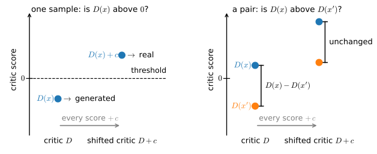

# Relativistic Objectives
:label:`sec_gan_relativistic`

:numref:`sec_gan_objectives` kept the critic's task fixed while varying its loss. A relativistic critic makes the complementary change: it assigns scalar scores as before, but evaluates the difference between the scores of one real and one generated sample. We derive the value of this pairing objective at the optimal critic by reducing it to the log-loss game of :numref:`sec_basic_gan`. The resulting value is the Jensen--Shannon divergence between the two possible orderings of a real--generated pair. Pairing also replaces the generator's threshold-based update weight with a rank statistic, which changes the loss landscape. This property motivates the R3GAN objective :cite:`Huang.Gokaslan.Kuleshov.ea.2024`, developed further in :numref:`sec_gan_convergence` and tested on images in :numref:`sec_dcgan`. Pairing does not, however, prevent saturation on disjoint supports.

```{.python .input #relativistic-relativistic-objectives}
%%tab pytorch
%matplotlib inline
from d2l import torch as d2l
import numpy as np
```

```{.python .input #relativistic-relativistic-objectives}
%%tab jax
%matplotlib inline
from d2l import jax as d2l
import numpy as np
```

## Scoring Pairs

The construction is due to :citet:`Jolicoeur-Martineau.2019`, who called the resulting critic *relativistic*: it scores a sample relative to a sample from the opposing distribution rather than against an absolute standard. The paired form used here is abbreviated RpGAN, for relativistic *paired*, and the divergence derived below inherits the subscript. We keep the notation of :numref:`sec_basic_gan`: data density $p$, generator density $q$, ratio $\rho = p/q$, log ratio $\lambda = \log \rho$, and a critic $D$ whose value is a realness logit. Draw a real sample $x \sim p$ and a generated sample $x' \sim q$ independently, and score the pair by the difference of the two critic values:

$$
\Phi(D) \;=\; E_{x \sim p,\; x' \sim q}\big[\log \sigma\big(D(x) - D(x')\big)\big].
$$
:eqlabel:`eq_gan_rp`

The critic maximizes $\Phi$, whereas the generator minimizes it. The quantity $\sigma(D(x) - D(x'))$ is the critic's probability that the pair is correctly ordered, with the real sample ranked above the generated sample. Thus the critic maximizes the log probability of the correct order, while the generator reduces the critic's ability to distinguish the order.

The probability model in :eqref:`eq_gan_rp` is the Bradley--Terry model :cite:`Bradley.Terry.1952`. Under the score function $D$, it assigns probability $\sigma(D(x) - D(x'))$ to preferring $x$ over $x'$. Section :numref:`sec_regularized` uses the same comparison model in :eqref:`eq_bradley_terry` to fit reward models from human preferences. Here $\Phi$ is the pairwise logistic log-likelihood of ranking real samples above generated ones, so the critic learns a ranking rather than a classification rule. Elo-style evaluations of generative models use the same construction at the model level by fitting Bradley--Terry scores to pairwise human votes.

Ranking introduces an additive-shift symmetry absent from the classification objective. :numref:`fig_gan_pairing` compares the two uses of the critic scores.


:label:`fig_gan_pairing`

Formally, replacing $D$ by $D + b$ for any constant $b$ leaves every score difference, and therefore $\Phi$, unchanged. The pairing game consequently identifies the critic only up to an additive constant. By contrast, the classical game of :numref:`sec_basic_gan` determines this constant as well; shifting its optimal critic strictly decreases the objective, as Exercise :exref:`ex_gan-log-loss-game-identifies`b of :numref:`sec_basic_gan` shows. This invariance also appears in the equilibrium condition of :citet:`Huang.Gokaslan.Kuleshov.ea.2024`, which requires only that the critic be constant on the support of the data. The paper uses $D$ as a fakeness logit, so its equations match ours after the substitution $D \mapsto -D$. The released implementation already uses the realness convention adopted here.

The objective also depends differently on the two distributions. The expectation in :eqref:`eq_gan_rp` is taken under the product measure $p \otimes q$, making $\Phi$ quadratic rather than affine in $(p, q)$. The objectives in :numref:`sec_gan_objectives` were suprema of functionals affine in $(p, q)$, a property used to establish pointwise decoupling, joint convexity, and their interpretation as f-divergences. Those results do not apply directly to the pairing game, whose value we now compute.

## The Value of the Pairing Game

### The Optimal Critic
:label:`subsec_gan_rp_optimal_critic`

The inner maximization no longer decouples across points, because each critic value $D(t)$ interacts with every other through the differences. Concavity substitutes for decoupling.

**Proposition.** *$\Phi$ is concave in $D$, and if $p$ and $q$ share a common support it is maximized at $D^\star = \lambda$, uniquely up to an additive constant.*

**Proof.** The map $D \mapsto D(x) - D(x')$ is linear and $\log \sigma$ is concave, so the integrand of :eqref:`eq_gan_rp` is concave in $D$ for every pair, and the expectation preserves concavity; a stationary point is therefore a global maximum. Perturbing $D$ at a single point $t$, that point enters $\Phi$ once as the real member of a pair and once, with opposite sign, as the generated member, and $\tfrac{d}{du} \log \sigma(u) = \sigma(-u)$ gives the functional derivative

$$
\frac{\delta \Phi}{\delta D(t)}
\;=\; p(t)\, E_{x' \sim q}\big[\sigma(D(x') - D(t))\big]
\;-\; q(t)\, E_{x \sim p}\big[\sigma(D(t) - D(x))\big].
$$
:eqlabel:`eq_gan_rp_stationarity`

At $D = \lambda$, we have $\sigma(\lambda(x') - \lambda(t)) = \rho(x')/(\rho(x') + \rho(t))$. The identity $q\rho = p$ converts the first term of :eqref:`eq_gan_rp_stationarity` to $p(t) \int p(x')/(\rho(x') + \rho(t))\, dx'$. It converts the second to $q(t)\, \rho(t) \int p(x)/(\rho(t) + \rho(x))\, dx$, which is the same expression because $q(t)\rho(t)=p(t)$. The derivative therefore vanishes everywhere, so $\lambda$ is a maximizer. Strict concavity of $\log \sigma$ in the score differences makes this maximizer unique up to an additive shift. $\blacksquare$

The ranking and classification objectives estimate the same log density ratio. Equation :eqref:`eq_gan_dstar` gives $D^\star = \lambda$ for the log-loss classifier, and the pairing objective gives the same result up to its undetermined additive constant. Replacing classification with ranking therefore preserves both the optimal critic and, as the theorem below confirms, the fixed point $q = p$. It changes the value and the shape of the objective away from that fixed point.

### The Lifted Game

$\Phi$ is the expectation of a fixed function of the pair $(x, x')$ under $p \otimes q$, which suggests treating the pair itself as the observation. Let $P = p \otimes q$ and $Q = q \otimes p$ denote the two orderings of an independent real--fake pair, viewed as distributions on $\mathcal{X} \times \mathcal{X}$: under $P$ the real sample sits first, under $Q$ it sits second. These two distributions can play the log-loss game of :numref:`sec_basic_gan` on the pair space, with a pair critic $\mathcal{D}: \mathcal{X} \times \mathcal{X} \to \mathbb{R}$ in place of $D$ and the value function $V_{P,Q}(\mathcal{D})$ given by :eqref:`eq_gan_V` with $(P, Q)$ substituted for $(p, q)$. The following lemma connects that game to $\Phi$.

**Lemma (lifting).** *Let $P = p \otimes q$ and $Q = q \otimes p$. Then: (i) the log ratio of the two orderings separates, $\log \frac{dP}{dQ}(a_1, a_2) = \lambda(a_1) - \lambda(a_2)$, an antisymmetric difference of single-sample scores; (ii) every difference critic $\mathcal{D}(a_1, a_2) = D(a_1) - D(a_2)$ satisfies $V_{P,Q}(\mathcal{D}) = 2\,\Phi(D)$; (iii) restricting the pair critic to differences does not lower the supremum, $\sup_{\mathcal{D}} V_{P,Q}(\mathcal{D}) = \sup_{D} V_{P,Q}\big(D(a_1) - D(a_2)\big)$.*

**Proof.** *The product ratio separates.* The two product densities contain the same factors in opposite order:

$$
\frac{dP}{dQ}(a_1, a_2)
= \frac{p(a_1)\, q(a_2)}{q(a_1)\, p(a_2)}
= \frac{\rho(a_1)}{\rho(a_2)}.
$$

Taking logarithms proves (i).

*The swap symmetry doubles the objective.* Under $P$, the first term of $V_{P,Q}(\mathcal{D})$ is $E[\log \sigma(D(a_1)-D(a_2))] = \Phi(D)$. Under $Q$, we have $a_1 \sim q$ and $a_2 \sim p$. Antisymmetry gives $-\mathcal{D}(a_1,a_2)=D(a_2)-D(a_1)$, and relabeling $(x,x')=(a_2,a_1)$ turns the second term into $\Phi(D)$ as well. Hence $V_{P,Q}(\mathcal{D})=2\Phi(D)$, proving (ii).

*Differences suffice.* Pointwise maximization of the log-loss game on $\mathcal{X} \times \mathcal{X}$ gives the optimal pair critic $\log(dP/dQ)$ wherever both densities are positive. By (i), this critic has the difference form with $D=\lambda$. Restricting the supremum to difference critics therefore does not change its value. $\blacksquare$

Part (iii) depends on the logistic payoff: the pointwise optimum on the pair space is separable because the log ratio of two product measures is a sum of per-coordinate terms. Under other payoffs the Bayes-optimal pair critic is a nonlinear function of that log ratio, no longer a difference of single-sample scores, and the corresponding relativistic objective only bounds its lifted divergence from below. Exercise :exref:`ex_relativistic-separability-choice-loss-replace` works this out. With the lemma in hand, the value of the pairing game follows from results already proved.

**Theorem.** *Define the pairing divergence $d_{\mathrm{Rp}}(p, q) := \sup_D \Phi(D) + \log 2$. Then*

$$
d_{\mathrm{Rp}}(p, q)
\;=\; \mathrm{JS}\big(p \otimes q,\; q \otimes p\big)
\;=\; H\Big[\tfrac{1}{2}\big(p \otimes q + q \otimes p\big)\Big] - H[p] - H[q].
$$
:eqlabel:`eq_gan_rp_value`

**Proof.** *Apply the value formula on the pair space.* Parts (ii) and (iii) of the lemma give $2 \sup_D \Phi(D) = \sup_{\mathcal{D}} V_{P,Q}(\mathcal{D})$. Equation :eqref:`eq_gan_js_value`, applied to $(P, Q)$, evaluates the right-hand side as $2\, \mathrm{JS}(P, Q) - 2 \log 2$. Halving and adding $\log 2$ proves the first equality.

*Collapse the pair entropies.* Applying :eqref:`eq_gan_entropy_gap` on $\mathcal{X} \times \mathcal{X}$ subtracts $\tfrac12(H[P] + H[Q])$ from the mixture entropy. Since each product measure has independent components, $H[P] = H[Q] = H[p] + H[q]$, which gives the second equality. This entropy calculation assumes the displayed entropies are finite; the measure-level first equality does not. $\blacksquare$

The additive constant in $d_{\mathrm{Rp}}$ calibrates the objective against a constant critic. Such a critic assigns probability one half to either ordering and obtains $\Phi = \log \sigma(0) = -\log 2$; it is optimal when $p = q$. Thus $d_{\mathrm{Rp}}$ measures the reduction in ordering uncertainty relative to random guessing. :citet:`Jolicoeur-Martineau.2020` proved that this calibrated value is nonnegative and vanishes exactly at $q = p$ for every concave function $\ell$ satisfying $\ell(0) = 0$, $\ell'(0) \neq 0$, and a positive supremum attained at a positive argument. Her theorem establishes the divergence property without computing its value. The theorem above supplies the value for the logistic objective, for which the lifting argument is exact.

Substituting the optimal critic $D^\star = \lambda$ into :eqref:`eq_gan_rp` directly, using $\sigma(\lambda(x) - \lambda(x')) = \rho(x)/(\rho(x) + \rho(x'))$, gives the same value in a form that is convenient for expansions:

$$
d_{\mathrm{Rp}}(p, q)
\;=\; \log 2 \;-\; E_{x \sim p,\; x' \sim q}\Big[\log\Big(1 + \frac{q(x)\, p(x')}{p(x)\, q(x')}\Big)\Big].
$$
:eqlabel:`eq_gan_rp_explicit`

The mutual-information reading of :numref:`sec_basic_gan` lifts along with the value. Draw $x \sim p$ and $x' \sim q$, present the two samples in a uniformly random order, and let the bit $y$ record which position holds the real one, just as $y$ labeled the origin of a single sample in :numref:`sec_basic_gan`. The ordered pair $(a_1, a_2)$ is then a sample from the balanced mixture of $P$ and $Q$ with label $y$, and the identification of the divergence with a mutual information, applied on the pair space, gives

$$
d_{\mathrm{Rp}}(p, q) \;=\; I\big((a_1, a_2);\, y\big) \;=\; \log 2 - H\big(y \mid a_1, a_2\big).
$$
:eqlabel:`eq_gan_rp_mi`

The pairing divergence is the number of nats a randomly ordered pair carries about which member is real, just as $\mathrm{JS}(p, q)$ measures the information a single sample carries about its origin. It follows that $0 \leq d_{\mathrm{Rp}} \leq \log 2$: the ordering label contains at most one bit.

**Remark (normalization).** :citet:`Jolicoeur-Martineau.2020` defines the relativistic divergence with a leading factor of two and shifts the payoff so that $\ell(0) = 0$, taking $\log \sigma(z) + \log 2$ in the logistic case. Her divergence equals $2\, d_{\mathrm{Rp}}$, and her upper bound is $2 \log 2$ where ours is $\log 2$. Numerical comparisons across the two conventions must account for the factor.

### Bounds, Local Behavior, and Saturation
:label:`subsec_gan_rp_bounds`

The closed form permits an exact comparison between the pairing game and the corresponding single-sample game.

**Proposition.** *For all $p$ and $q$:*

*(a) $\mathrm{JS}(p, q) \;\leq\; d_{\mathrm{Rp}}(p, q) \;\leq\; \log 2$;*

*(b) if $q = p\,(1 + \epsilon h)$ with $E_p[h] = 0$ and $h$ bounded, then $d_{\mathrm{Rp}}(p, q) = \tfrac{\epsilon^2}{4} E_p[h^2] + O(\epsilon^3) = 2\, \mathrm{JS}(p, q) + O(\epsilon^3)$;*

*(c) if $p$ and $q$ have disjoint supports, then $d_{\mathrm{Rp}}(p, q) = \log 2$, independently of how far apart the supports lie.*

**Proof.** (a) The map $(a_1, a_2) \mapsto a_1$ pushes $P$ forward to $p$ and $Q$ forward to $q$. Since $\mathrm{JS}$ is an f-divergence, the data-processing inequality of :numref:`sec_mdl-tv-pinsker` gives $\mathrm{JS}(p, q) \leq \mathrm{JS}(P, Q) = d_{\mathrm{Rp}}$. Equation :eqref:`eq_gan_rp_mi` gives the upper bound because $I\big((a_1, a_2); y\big) \leq H(y) = \log 2$.

(b) In :eqref:`eq_gan_rp_explicit`, set $u = \lambda(x') - \lambda(x)$ and expand $\log(1 + e^u) = \log 2 + \tfrac{u}{2} + \tfrac{u^2}{8} + O(u^4)$. The moments satisfy $E[u] = -\epsilon^2 E_p[h^2] + O(\epsilon^3)$ and $E[u^2] = 2 \epsilon^2 E_p[h^2] + O(\epsilon^3)$. Substitution gives $d_{\mathrm{Rp}} = \tfrac{\epsilon^2}{4} E_p[h^2] + O(\epsilon^3)$. Applying the corresponding expansion to :eqref:`eq_gan_entropy_gap` gives $\mathrm{JS} = \tfrac{\epsilon^2}{8} E_p[h^2] + O(\epsilon^3)$. Exercise :exref:`ex_relativistic-local-expansion-let-e` supplies the moment calculations.

(c) A real-first pair lies in $\operatorname{supp} p \times \operatorname{supp} q$, whereas a fake-first pair lies in $\operatorname{supp} q \times \operatorname{supp} p$. These product sets are disjoint when the original supports are disjoint. Thus $P$ and $Q$ are mutually singular, the pair determines its ordering with certainty, and $\mathrm{JS}(P, Q) = \log 2$. $\blacksquare$

Part (a) shows that a pair containing one sample from each distribution provides at least as much information about its ordering as a single sample provides about its origin. This quantitatively refines the ordering proved by :citet:`Jolicoeur-Martineau.2020` for general concave objectives: convergence of the relativistic divergence to zero forces convergence of the pointwise divergence.

Near $q = p$, part (b) shows that the two members provide independent evidence to second order, so the ratio $d_{\mathrm{Rp}}/\mathrm{JS}$ tends to 2 under nonzero local perturbations. More generally, this ratio lies in $[1, 2]$ whenever $p \neq q$. The upper bound follows from :eqref:`eq_gan_rp_mi`: conditional on the label, the two samples are independent, so the pair's information equals $2\, \mathrm{JS}(p, q)$ minus their nonnegative unconditional dependence (exercise :exref:`ex_relativistic-gap-twice-js`). The finite example below gives a ratio of about 1.6.

Part (c) shows that pairing does not resolve support saturation. For the point masses $p = \delta_0$ and $q_\theta = \delta_\theta$ from :numref:`sec_basic_gan`, the pairing value equals $\log 2$ for every $\theta \neq 0$ and therefore supplies no gradient in $\theta$. With a linear critic, the relativistic and classical objectives differ only by an additive constant, so their gradient fields coincide exactly, as :citet:`Huang.Gokaslan.Kuleshov.ea.2024` observe. The same authors show that gradient training of the unregularized pairing game need not converge. Pairing instead changes the loss landscape over generator configurations, as discussed next. Critic regularization addresses convergence in :numref:`sec_gan_convergence`.

## Ranking and Mode Coverage

The loss of :numref:`sec_gan_objectives`'s template structure is not total. For fixed $p$ the map $q \mapsto d_{\mathrm{Rp}}(p, q)$ is convex, because $q \mapsto p \otimes q$ is linear and grouping :eqref:`eq_gan_rp` by the generated member,

$$
d_{\mathrm{Rp}}(p, q) \;=\; \log 2 + \sup_D\, E_{x' \sim q}\big[g_D(x')\big],
\qquad
g_D(x') := E_{x \sim p}\big[\log \sigma\big(D(x) - D(x')\big)\big],
$$

exhibits the objective as a supremum of functionals linear in $q$, the structural property that made the metrics of :numref:`sec_gan_objectives` convex in the generator's distribution. What does not survive is the fixed test class: each $g_D$ is built from the data distribution itself, and it scores $x'$ by a smoothed comparison against the entire real population. The outer minimization over $q$ is therefore as well posed as it was for the template objectives, and the rank structure of the test functions is what changes the generator's incentives.

To see the change, differentiate $\Phi$ through $x' = G(z)$ as :numref:`sec_basic_gan` did for the classical game. Playing the zero-sum game literally, with the generator minimizing $\Phi$, moves each generated sample up the critic's score surface with a per-sample weight, and comparing that weight with the classical saturating weight of :eqref:`eq_gan_weights` isolates what pairing changed:

$$
w_{\mathrm{Rp}}(x') = E_{x \sim p}\big[\sigma\big(D(x') - D(x)\big)\big],
\qquad
w_{\mathrm{GAN}}(x') = \sigma\big(D(x')\big).
$$
:eqlabel:`eq_gan_rp_weights`

The classical weight compares a sample with the critic's zero level, which is determined by the classical game but arbitrary under the pairing objective. The relativistic weight instead equals the probability that $x'$ outranks a random real sample. This rank statistic is invariant to an additive shift of the critic.

This distinction changes the incentives for mode collapse. A generator can place all its mass beyond one decision boundary, making every generated sample receive a high threshold weight without matching the data distribution across modes. Concentrating on a few high-scoring points has this form. A rank statistic cannot be increased in the same way because it compares generated scores with the entire distribution of real scores.

:citet:`Sun.Fang.Schwing.2020` turn this observation into a result about the empirical loss landscape. For $n$ data points and $n$ generated points, the classical objective has at least $n^n - n!$ suboptimal strict local minima, one for every mode-dropping assignment with at least one collision. For the relativistic loss that pairs the $i$-th data point with the $i$-th generated point, every configuration has a continuous path to a global minimum along which the loss never increases. We use this result without reproducing its proof. It applies to a finite-sample, best-response setting and neither contradicts nor follows from part (c) of the proposition above. Pairing changes where optimization can become trapped; it does not change the objective's value on separated supports.

The rank weight still saturates. If $D(x')$ is far below every real score, then $w_{\mathrm{Rp}}(x') \approx 0$, so the generated samples requiring the largest change receive the smallest updates. As in the classical game, a non-saturating objective reverses this weighting. Maximizing $E[\log \sigma(D(x') - D(x))]$ rather than minimizing $\Phi$ gives the same update direction with the complementary weight. Repeating the calculation from :eqref:`eq_gan_weights` with a score difference gives

| generator objective | weight on the update of $x'$ | on a badly ranked sample |
|:---|:---|:---|
| zero-sum: minimize $\Phi$ | $E_{x \sim p}[\sigma(D(x') - D(x))]$ | weight $\to 0$: the update vanishes |
| non-saturating: maximize $E[\log \sigma(D(x') - D(x))]$ | $E_{x \sim p}[\sigma(D(x) - D(x'))]$ | weight $\to 1$: the update is largest |

The non-saturating swap is part of the original relativistic construction: :citet:`Jolicoeur-Martineau.2019` trains the generator this way from the start. Paper and code nevertheless differ in the modern reference. The R3GAN paper presents a zero-sum minimax game over $\Phi$, which places the generator on the saturating row of the table. Its official implementation instead maximizes $E[\log \sigma(D(x') - D(x))]$ for the generator while maximizing $\Phi$ for the critic. The implemented game is therefore not zero-sum.

The two variants share their fixed point. :numref:`sec_basic_gan` established this for the classical pair by evaluating the non-saturating loss at the optimal critic. The same calculation works here. At $D^\star = \lambda$, Jensen's inequality bounds the swapped generator loss below by $\log(1 + e^J)$, where $J = \mathrm{KL}(p \,\|\, q) + \mathrm{KL}(q \,\|\, p) \geq 0$. The loss exceeds $\log 2$ whenever $q \neq p$ and attains $\log 2$ at $q = p$.

The variants differ most at the start of training, when generated samples rank badly. Implementing the paper's displayed minimax equation literally gives the weaker, saturating update. This distinction is invisible in the equilibrium analysis but consequential during the first epochs.

The expectation over $p \otimes q$ can be estimated in two natural ways. Given $n$ real and $n$ generated samples, one may pair the $i$-th real sample with the $i$-th generated sample, giving $n$ terms, or average over all $n^2$ cross pairs. By the two-sample U-statistic theorem, the all-pairs average is the minimum-variance unbiased estimator :cite:`Jolicoeur-Martineau.2020`, but it averages $n^2$ terms rather than $n$; the unbiased MMD estimate of :numref:`sec_gan_objectives` likewise sums over $O(n^2)$ pairs. In the experiments of :citet:`Jolicoeur-Martineau.2020`, the lower-variance estimator did not improve the generator and was sometimes worse. The diagonal estimator is therefore the standard choice. The finite verification below uses neither estimator because it can evaluate $\Phi$ exactly.

## Verifying the Closed Form
:label:`subsec_gan_rp_verification`

Because the theorem is an identity, a finite example can verify it to numerical precision without sampling error. Let $p$ and $q$ be fixed probability vectors on a five-element space, and represent the critic by $D \in \mathbb{R}^5$. Then $\Phi$ is an exact sum over 25 pairs, and $\mathrm{JS}(p \otimes q, q \otimes p)$ is an entropy calculation on 25 atoms. We maximize $\Phi$ by gradient ascent using the functional derivative :eqref:`eq_gan_rp_stationarity`. The maximized value plus $\log 2$, the product-space Jensen--Shannon divergence, and the entropy expression in :eqref:`eq_gan_rp_value` should agree. The optimized critic should also equal $\lambda$ up to an additive constant.

```{.python .input #relativistic-verifying-the-closed-form-1}
%%tab pytorch, jax
p = np.array([0.35, 0.25, 0.20, 0.12, 0.08])   # data distribution
q = np.array([0.02, 0.05, 0.13, 0.30, 0.50])   # generator distribution
lam = np.log(p / q)

def entropy(v):
    return -(v * np.log(v)).sum()

def js(a, b):
    return entropy((a + b) / 2) - (entropy(a) + entropy(b)) / 2

def sigma(t):
    return 1 / (1 + np.exp(-t))

D = np.zeros(5)
for _ in range(400):   # ascend Phi along its functional derivative
    R = sigma(D[None, :] - D[:, None])         # R[i, j] = sigma(D_j - D_i)
    D += 20.0 * (p * (R @ q) - q * (p @ R))
U = D[:, None] - D[None, :]                    # U[i, j] = D_i - D_j
phi = (np.outer(p, q) * (-np.logaddexp(0.0, -U))).sum()
P, Q = np.outer(p, q).ravel(), np.outer(q, p).ravel()
print(f'sup Phi + log 2, by gradient ascent:    {phi + np.log(2):.9f}')
print(f'JS(p (x) q, q (x) p), computed directly: {js(P, Q):.9f}')
print(f'entropy form H[(P+Q)/2] - H[p] - H[q]:  '
      f'{entropy((P + Q) / 2) - entropy(p) - entropy(q):.9f}')
print(f'JS(p, q) = {js(p, q):.6f},  log 2 = {np.log(2):.6f}')
D_c, lam_c = D - D.mean(), lam - lam.mean()
print(f'max |D - lambda|, both centered:        '
      f'{np.abs(D_c - lam_c).max():.1e}')
```

The three computations of $d_{\mathrm{Rp}}$ agree to nine decimal places, and after centering, the recovered critic matches $\lambda$ to double-precision round-off. The value also satisfies the bounds in part (a): $\mathrm{JS}(p, q) \approx 0.23 < d_{\mathrm{Rp}} \approx 0.38 < \log 2 \approx 0.69$. For these distributions, a pair carries about 1.6 times as much information about the label as a single sample. This ratio lies between its limiting value 2 under local perturbations of $q = p$ and the value 1 attained when both divergences saturate.

The same atoms make the ranking discussion concrete without training anything. With the recovered critic, both weights of :eqref:`eq_gan_rp_weights` are explicit functions of a generated sample's score $t$: the threshold weight $\sigma(t)$, and the rank weight $\sum_x p(x)\, \sigma(t - D^\star(x))$, a mixture of sigmoids anchored at the real atoms' scores. The plot draws both, marking those scores.

```{.python .input #relativistic-verifying-the-closed-form-2}
%%tab pytorch, jax
ts = np.linspace(-7.0, 7.0, 401)
w_thresh = sigma(ts)
w_rank = (p[:, None] * sigma(ts[None, :] - D_c[:, None])).sum(axis=0)
d2l.set_figsize((5.5, 3.2))
d2l.plt.plot(ts, w_thresh, label=r'threshold weight $\sigma(t)$')
d2l.plt.plot(ts, w_rank,
             label=r'rank weight $E_{x \sim p}[\sigma(t - D^\star(x))]$')
for i, v in enumerate(D_c):
    d2l.plt.axvline(v, ls=':', c='gray', lw=1,
                    label='real-atom scores' if i == 0 else None)
d2l.plt.xlabel('critic score $t$ of a generated sample')
d2l.plt.ylabel('weight')
d2l.plt.legend();
```

The curves differ as predicted. The threshold weight is a single sigmoid centered at zero, even though the pairing game does not determine that level. It exceeds 0.9 by the highest real score and is otherwise independent of the distribution of real scores. The rank weight instead changes across the dotted lines marking those scores, with each transition weighted by the corresponding mass $p(x)$. At the highest real score it is only about 0.75, so it still distinguishes samples that the threshold weight treats as nearly equivalent. The rank weight approaches one only when a generated sample outranks nearly the entire real population. Adding a constant to all critic scores changes the threshold weight but shifts both the generated and real scores equally, leaving the rank weight unchanged.

## Summary

The pairing objective :eqref:`eq_gan_rp` is the Bradley--Terry log-likelihood of ranking a real sample above a generated one. Because it depends only on score differences, the critic is identified up to an additive constant. The objective also depends on the distributions through $p \otimes q$, outside the affine framework of :numref:`sec_gan_objectives`. Despite these changes, the optimal critic remains the log density ratio $\lambda$ up to a constant.

Lifting an ordered pair to a single observation turns the pairing objective into the log-loss game of :numref:`sec_basic_gan` between $p \otimes q$ and $q \otimes p$. Its calibrated value is therefore $d_{\mathrm{Rp}} = \mathrm{JS}(p \otimes q, q \otimes p)$, which measures how much information the ordered pair provides about the position of the real sample. It satisfies $\mathrm{JS}(p, q) \leq d_{\mathrm{Rp}} \leq \log 2$, equals twice $\mathrm{JS}$ locally near $q = p$, and reaches $\log 2$ on disjoint supports. Pairing thus preserves the support-saturation limitation of the classical game.

Pairing changes the generator's per-sample weight from a comparison with one threshold to a rank statistic over the real population. In finite-sample best-response analysis, the relativistic loss that pairs each data point with one generated point has none of the mode-dropping strict local minima of the classical loss :cite:`Sun.Fang.Schwing.2020`. The saturating and non-saturating variants nevertheless remain distinct. R3GAN states a zero-sum objective in the paper but uses the non-saturating generator update in its reference implementation, so reproducing the displayed minimax equation gives a different early-training update. The finite example verifies the closed form to nine decimal places and illustrates the two weights. This value analysis does not imply convergence of alternating gradient updates; :numref:`sec_gan_convergence` analyzes that problem and introduces regularization that restores local convergence.

## Exercises

1. **Shift invariance in training.** Adding a constant to the critic leaves
   $\Phi$ unchanged (:numref:`fig_gan_pairing`), so nothing in the pairing
   game fixes the overall level of the critic's scores.
    1. Show that the functional derivative :eqref:`eq_gan_rp_stationarity`
       integrates to zero over $t$ for every critic $D$. What does this imply
       for `D.mean()` during the ascent loop of
       :numref:`subsec_gan_rp_verification`? Print it to check.
    1. Let a network critic end in a scalar output bias,
       $D(x) = g(x) + c$. Show that every minibatch estimate of $\Phi$,
       whether it pairs the $i$-th real sample with the $i$-th generated
       sample or averages over all cross pairs, has zero gradient with
       respect to $c$. What then determines the level of the critic's
       scores during training?
    1. For a classical critic, the fraction of generated samples with
       $D(x') > 0$ is the fraction that the critic classifies as real. Why
       is this statistic uninformative for a critic trained on $\Phi$, and
       which statistic of the same minibatch scores replaces it?
   :exlabel:`ex_relativistic-prove-shift-invariance-ev`

1. **Local expansion.** Let $q = p\,(1 + \epsilon h)$ with $E_p[h] = 0$
   and $h$ bounded.
    1. Starting from :eqref:`eq_gan_rp_explicit`, write
       $u = \lambda(x') - \lambda(x)$ and expand
       $\log(1 + e^u) = \log 2 + \tfrac{u}{2} + \tfrac{u^2}{8} + O(u^4)$.
       Compute $E[u] = E_q[\lambda] - E_p[\lambda]$ and $E[u^2]$ to second
       order in $\epsilon$, and conclude that
       $d_{\mathrm{Rp}} = \tfrac{\epsilon^2}{4} E_p[h^2] + O(\epsilon^3)$.
    1. Apply the corresponding expansion to the entropy form
       :eqref:`eq_gan_entropy_gap` to show that
       $\mathrm{JS}(p, q) = \tfrac{\epsilon^2}{8} E_p[h^2] + O(\epsilon^3)$,
       so that locally $d_{\mathrm{Rp}} = 2\, \mathrm{JS} + O(\epsilon^3)$.
   :exlabel:`ex_relativistic-local-expansion-let-e`

1. **Two Gaussians.** Let $p = \mathcal{N}(0, I)$ and
   $q = \mathcal{N}(\mu, I)$ on $\mathbb{R}^d$, two distributions that
   differ by a translation of length $\|\mu\|$.
    1. Show that $\lambda$ is affine in $x$ and that
       $u = \lambda(x') - \lambda(x)$ in :eqref:`eq_gan_rp_explicit` is
       Gaussian. Find its mean and variance.
    1. Write $\mathrm{JS}(p, q)$ in the same form, as $\log 2$ minus the
       expectation of $\log(1 + e^v)$ for a Gaussian $v$. Find the constant
       $c$ for which
       $\mathrm{JS}\big(p, \mathcal{N}(c\mu, I)\big) = d_{\mathrm{Rp}}(p, q)$
       holds for every $\mu$.
    1. Evaluate $d_{\mathrm{Rp}}$ and $\mathrm{JS}$ by one-dimensional
       quadrature for $\|\mu\| \in \{0.1, 1, 2, 4\}$. Relate the ratio
       $d_{\mathrm{Rp}} / \mathrm{JS}$ to the local limit and to the
       saturation of :numref:`subsec_gan_rp_bounds`.

1. [code] **Zero-sum and non-saturating weights.** The zero-sum generator
   minimizes $\Phi$ and updates each generated sample with the weight
   $w_{\mathrm{Rp}}$ of :eqref:`eq_gan_rp_weights`. The non-saturating
   generator instead maximizes
   $E_{x \sim p,\, x' \sim q}\big[\log \sigma\big(D(x') - D(x)\big)\big]$,
   which updates each generated sample with the complementary weight
   $1 - w_{\mathrm{Rp}}(x')$.
    1. Treat each of the five atoms of
       :numref:`subsec_gan_rp_verification` as a generated sample and
       evaluate both weights with the recovered critic `D_c`. On which
       atoms does each variant place its largest weight, and how do these
       atoms relate to the atoms where $q$ exceeds $p$? By what factor does
       the $q$-average of the non-saturating weight exceed that of
       $w_{\mathrm{Rp}}$?
    1. Let the critic be optimal, $D = \lambda$, and write $P = p \otimes q$
       and $Q = q \otimes p$ for the densities of the lifted game. Show that
       the $q$-average of $w_{\mathrm{Rp}}$ equals
       $\iint \frac{P Q}{P + Q}\, da_1\, da_2$, and that it is at most
       $\tfrac12$, with equality only at $q = p$. What does it tend to as
       the supports of $p$ and $q$ separate, and what does this imply for
       the zero-sum generator's average update early in training?

1. [code] **Atoms outside the generator's support.** ● The proposition of
   :numref:`subsec_gan_rp_optimal_critic` assumes that $p$ and $q$ share a
   common support. In the code of :numref:`subsec_gan_rp_verification`,
   replace `q` by $(0, 0.05, 0.13, 0.30, 0.52)$, keep `p`, and use the
   convention $0 \log 0 = 0$ in `entropy`.
    1. Which entries of $\lambda$ are finite? Is the supremum of $\Phi$
       attained?
    1. Run the ascent loop for $10^2$, $10^3$, $10^4$, and $10^5$
       iterations. At each count, record three quantities: the score of
       the first atom minus the mean score of the other four, the gap
       between $\mathrm{JS}(p \otimes q, q \otimes p)$ and
       $\Phi + \log 2$, and the largest deviation between the other four
       scores and the corresponding entries of $\lambda$, both centered over
       those four atoms. How does each quantity scale with the number of
       iterations?
    1. Explain the growth rate of the first atom's score from the
       functional derivative :eqref:`eq_gan_rp_stationarity` at that atom.

1. **Separability of the pair critic.** ● Replace the logistic payoff
   in :eqref:`eq_gan_rp` by a concave payoff $\ell$, giving
   $\Phi_\ell(D) = E_{x \sim p,\, x' \sim q}[\ell(D(x) - D(x'))]$. The
   corresponding game on the pair space lets an unrestricted pair critic
   $\mathcal{D}$ collect $\ell(\mathcal{D})$ on pairs from $P = p \otimes q$
   and $\ell(-\mathcal{D})$ on pairs from $Q = q \otimes p$. The proof of
   part (ii) of the lifting lemma carries over to every $\ell$: the
   difference critic built from $D$ earns $2\, \Phi_\ell(D)$, so restricting
   the pair critic to differences can only lower the supremum. Part (iii)
   shows that the restriction costs nothing for the logistic payoff.
    1. For the least-squares payoff $\ell(t) = -(1 - t)^2$, show that the
       pointwise optimum of the pair-space game is $2\eta - 1$ with
       $\eta = P/(P + Q) = \sigma(\lambda(a_1) - \lambda(a_2))$. Show that
       this optimal pair score,
       $\tanh\big(\tfrac{\lambda(a_1) - \lambda(a_2)}{2}\big)$, is not
       additively separable, and conclude that a relativistic least-squares
       game over difference critics optimizes a strict lower bound on its
       lifted divergence in general.
    1. Measure this gap on the five atoms of
       :numref:`subsec_gan_rp_verification`. Evaluate the unrestricted
       pair-space value at the pointwise optimum, and maximize
       $2\, \Phi_\ell(D)$ over $D \in \mathbb{R}^5$ by gradient ascent, as
       the code there does for $\Phi$. How large is the gap relative to the
       unrestricted value?
    1. Return to the logistic payoff and present the pair real-first with
       probability $\alpha \neq \tfrac12$, so that the log loss weights
       pairs from $P$ by $\alpha$ and pairs from $Q$ by $1 - \alpha$.
       Derive the Bayes-optimal pair critic. Can a difference critic attain
       it? Which extension of the difference class can?
   :exlabel:`ex_relativistic-separability-choice-loss-replace`

1. **More negatives.** ● Draw $K$ real samples
   $x_1, \ldots, x_K \sim p$ and one generated sample $x' \sim q$, place all
   $K + 1$ samples in a uniformly random order $(a_1, \ldots, a_{K+1})$, and
   let the critic predict which position holds the generated sample.
    1. Show that the Bayes posterior for position $j$ is the softmax
       $e^{-\lambda(a_j)} / \sum_k e^{-\lambda(a_k)}$, so that a
       single-sample score again suffices.
    1. Repeat the lifting argument with $K + 1$ hypotheses in place of two.
       Show that the chance-level log loss $\log(K + 1)$ minus the optimal
       expected log loss is the generalized Jensen--Shannon divergence of the $K + 1$ product measures
       $P_j = p^{\otimes (j-1)} \otimes q \otimes p^{\otimes (K + 1 - j)}$,

       $$d_K(p, q) = H\Big[\tfrac{1}{K+1} \textstyle\sum_j P_j\Big] - K\, H[p] - H[q],$$

       and that $0 \leq d_K \leq \log(K + 1)$. Use
       $H[P_j] = K\, H[p] + H[q]$.
    1. Compare the game with the InfoNCE loss :eqref:`eq_mdl-infonce_def`
       of :numref:`sec_mdl-infonce`. Which sample and which densities play
       the roles of the positive pair, the negatives, and the density ratio
       that the optimal InfoNCE critic recovers?

1. **Gap to twice Jensen--Shannon.** ● Take the randomly ordered
   pair $(a_1, a_2)$ and its label $y$ from :eqref:`eq_gan_rp_mi`.
    1. Show that $a_1$ and $a_2$ are conditionally independent given $y$,
       and that each position alone carries
       $I(a_k; y) = \mathrm{JS}(p, q)$.
    1. Use the chain rule of mutual information to show that
       $d_{\mathrm{Rp}}(p, q) = 2\, \mathrm{JS}(p, q) - I(a_1; a_2)$.
    1. Apply the data-processing inequality to the Markov chain
       $a_1 - y - a_2$ to obtain the lower bound
       $\mathrm{JS}(p, q) \leq d_{\mathrm{Rp}}(p, q)$ of
       :numref:`subsec_gan_rp_bounds` without the pushforward argument.
       What is $I(a_1; a_2)$ when $p$ and $q$ have disjoint supports?
    1. Compute $I(a_1; a_2)$ for the five atoms of
       :numref:`subsec_gan_rp_verification` from the 25-atom distribution
       $\tfrac12 (P + Q)$, and check that
       $2\, \mathrm{JS}(p, q) - I(a_1; a_2)$ reproduces the printed value of
       $d_{\mathrm{Rp}}$.
   :exlabel:`ex_relativistic-gap-twice-js`

1. [code] **Diagonal versus all-pairs estimates.** ● Draw real samples
   $x_1, \ldots, x_n \sim p$ and generated samples
   $x'_1, \ldots, x'_n \sim q$, and let
   $f(x, x') = \log \sigma(D(x) - D(x'))$. The diagonal estimate of $\Phi$
   averages $f(x_i, x'_i)$ over $i$, and the all-pairs estimate averages
   $f(x_i, x'_j)$ over all $n^2$ index pairs. Write $v = \mathrm{Var}[f(x, x')]$,
   $v_{10} = \mathrm{Var}_x\big[E_{x'}[f(x, x')]\big]$, and
   $v_{01} = \mathrm{Var}_{x'}\big[E_x[f(x, x')]\big]$.
    1. Show that both estimates are unbiased, that the diagonal estimate
       has variance $v / n$, and that the all-pairs estimate has variance

       $$\frac{v + (n - 1)(v_{10} + v_{01})}{n^2}.$$

    1. Compute $v$, $v_{10}$, and $v_{01}$ exactly for the five atoms of
       :numref:`subsec_gan_rp_verification` with the critic `D_c`, and
       confirm both variances by simulation for
       $n \in \{8, 32, 128, 512\}$. Which variance ratio do the formulas
       predict as $n \to \infty$? Compare it with the factor $n$ by which
       the all-pairs estimate has more terms.
    1. Both estimates evaluate the critic network once per sample. Count
       the additional operations of the all-pairs estimate in the forward
       and the backward pass, and compare them with the $n^2$ kernel
       evaluations of the MMD estimate of :numref:`sec_gan_objectives` on
       $d$-dimensional features. Is computational cost a good reason to
       prefer the diagonal estimate?

1. [code] **Particle landscapes.** ●● :citet:`Sun.Fang.Schwing.2020` study
   an empirical game in which $n$ distinct data points
   $x_1, \ldots, x_n$ face $n$ freely movable generated points
   $x'_1, \ldots, x'_n$, and each loss is evaluated at its best-response
   critic over all functions $D$:

   $$
   \begin{aligned}
   g_{\mathrm{GAN}} &= \sup_D \tfrac{1}{2n} \textstyle\sum_{i} \big[\log \sigma(D(x_i)) + \log \sigma(-D(x'_i))\big],\\
   g_{\mathrm{diag}} &= \sup_D \tfrac{1}{n} \textstyle\sum_{i} \log \sigma\big(D(x_i) - D(x'_i)\big),\\
   g_{\mathrm{all}} &= \sup_D \tfrac{1}{n^2} \textstyle\sum_{i, j} \log \sigma\big(D(x_i) - D(x'_j)\big).
   \end{aligned}
   $$

   The generator minimizes each loss over the positions $x'_1, \ldots, x'_n$.
   They prove that $g_{\mathrm{GAN}}$ has $n^n - n!$ suboptimal strict local
   minima, namely the configurations in which every generated point sits on
   a data point and at least two of them coincide, and that from every
   configuration of $g_{\mathrm{diag}}$ a continuous path along which the
   loss never increases leads to a global minimum. The all-pairs loss
   $g_{\mathrm{all}}$ averages over all $n^2$ cross pairs, as the
   minimum-variance estimate of :eqref:`eq_gan_rp` does.
    1. For $n = 2$, evaluate the three losses at the collision
       $x'_1 = x'_2 = x_1$ and at the configurations that a small move
       reaches from it, in which one or both generated points leave $x_1$
       for locations that hold no data point. Which losses make the
       collision a strict local minimum?
    1. Write a program that evaluates the three losses for $n = 3$ at all
       27 assignments of generated points to data points and at every small
       perturbation of each assignment. A small perturbation leaves each
       generated point in place or moves it to a location without data,
       and coincident generated points may move together or apart.
       Approximate each supremum by gradient ascent over the critic values
       at the occupied locations, as in
       :numref:`subsec_gan_rp_verification`. Some best-response critic
       values diverge, for example to $+\infty$ at a location that holds
       only data points and to $-\infty$ at one that holds only generated
       points, and there the error of the ascent decays only like the
       inverse of the number of steps. Treat two loss values as equal when
       they differ by less than $10^{-3}$. Count the suboptimal strict local
       minima of each loss,
       and compare the count for $g_{\mathrm{GAN}}$ with $n^n - n!$.
    1. Is the landscape guarantee a property of the pairing objective
       :eqref:`eq_gan_rp` or of its diagonal estimate? Which feature of
       $g_{\mathrm{diag}}$ lets a colliding generated point leave its data
       point without raising the loss?

[Discussions](https://d2l.discourse.group/)

<!-- slides -->

::: {.slide}
::: {.cover}
[Dive into Deep Learning · §16.3]{.kicker}

Relativistic objectives<br>
**the critic ranks pairs · the value is JS of the two orderings · rank weight replaces threshold weight · paper versus code**
:::
:::

::: {.slide title="The Critic Scores a Real–Fake Pair"}
$$\Phi(D) = E_{x \sim p,\; x' \sim q}\big[\log \sigma\big(D(x) - D(x')\big)\big]$$

- $\sigma(D(x) - D(x'))$: the Bradley–Terry probability that $x$ is preferred
  to $x'$ — the reward-model likelihood of :numref:`sec_regularized`.
- The same scalar realness score as before, entering only through differences.
- The critic solves a **ranking** problem, not a classification problem.
:::

::: {.slide title="Two Symmetries With Consequences"}
{width=75%}

- Additive shift: $\Phi(D + b) = \Phi(D)$ — the critic is identified only
  **up to a constant**, where the log-loss game pinned it exactly.
- $\Phi$ depends on $(p, q)$ through $p \otimes q$ and is quadratic in
  the pair. The affine results of :numref:`sec_gan_objectives` therefore do
  not apply directly.
:::

::: {.slide title="The Optimal Critic Is Still the Log Ratio"}
Because $\Phi$ is concave in $D$, any stationary point is a global
maximum. Its functional derivative is

$$\frac{\delta \Phi}{\delta D(t)}
= p(t)\, E_{x' \sim q}[\sigma(D(x') - D(t))]
- q(t)\, E_{x \sim p}[\sigma(D(t) - D(x))]$$

. . .

$$D^\star = \lambda = \log \frac{p}{q}
\quad \text{up to an additive constant}$$

Ranking estimates the same density ratio as classification. What changes is
the value of the game.
:::

::: {.slide title="Lifting: Play the Log-Loss Game on Pairs"}
$P = p \otimes q$, $Q = q \otimes p$: the two orderings of an independent
real–fake pair.

. . .

- *The product ratio separates:*
  $\log \frac{dP}{dQ}(a_1, a_2) = \lambda(a_1) - \lambda(a_2)$.
- *The swap symmetry doubles the objective:*
  $V_{P,Q}\big(D(a_1) - D(a_2)\big) = 2\,\Phi(D)$.
- *Differences lose nothing:* restricting the pair critic to differences
  does not lower the supremum.
:::

::: {.slide title="The Value Is JS Between the Two Orderings"}
$$d_{\mathrm{Rp}}(p, q) := \sup_D \Phi + \log 2
= \mathrm{JS}(p \otimes q,\, q \otimes p)
= H\big[\tfrac12(p \otimes q + q \otimes p)\big] - H[p] - H[q]$$

- Information interpretation: the divergence equals the mutual information
  between a randomly ordered pair and the position of its real member.
- The divergence property is :citet:`Jolicoeur-Martineau.2020` (general
  concave payoffs, value not computed); the closed form above is computed
  here, for the logistic payoff.
:::

::: {.slide title="Effects and Limits of Pairing"}
| property | statement |
|:---|:---|
| sandwich | $\mathrm{JS}(p, q) \leq d_{\mathrm{Rp}} \leq \log 2$ |
| near $q = p$ | $d_{\mathrm{Rp}} = 2\,\mathrm{JS} + O(\epsilon^3)$: a pair carries twice the information |
| disjoint supports | $d_{\mathrm{Rp}} = \log 2$: saturates exactly as JS does |

Pairing still saturates on disjoint supports, and unregularized RpGAN
training need not converge. Section :numref:`sec_gan_convergence` analyzes
the training dynamics.
:::

::: {.slide title="Rank Weight Replaces Threshold Weight"}
$$w_{\mathrm{Rp}}(x') = E_{x \sim p}[\sigma(D(x') - D(x))]
\qquad
w_{\mathrm{GAN}}(x') = \sigma(D(x'))$$

- A threshold weight can remain high when generated mass concentrates beyond
  one decision boundary without matching the data distribution across modes.
- Rank: anchored to the real population's scores, invariant to the critic's
  constant.
- :citet:`Sun.Fang.Schwing.2020`: $n^n - n!$ mode-dropping local minima for
  the classical loss; none for the relativistic one.
:::

::: {.slide title="The Closed Form, Checked Exactly"}
@!relativistic-verifying-the-closed-form-1

Gradient ascent using the stationarity condition agrees with the direct
product-space JS computation to nine decimal places. The recovered critic
equals $\lambda$ up to a constant.
:::

::: {.slide title="The Two Weights on the Same Atoms"}
@!relativistic-verifying-the-closed-form-2

The threshold weight changes around the arbitrary zero level. The rank
weight changes across the distribution of real scores and continues to
distinguish samples after the threshold weight is nearly saturated.
:::

::: {.slide title="Saturating Paper, Non-Saturating Code"}
| generator plays | weight | badly ranked sample |
|:---|:---|:---|
| minimize $\Phi$ (paper's zero-sum Eq. 2) | $E_{x \sim p}[\sigma(D(x') - D(x))]$ | $\to 0$: stalls |
| maximize $E[\log \sigma(D(x') - D(x))]$ (the code) | $E_{x \sim p}[\sigma(D(x) - D(x'))]$ | $\to 1$: largest |

Both variants have the same fixed point, but the paper's displayed
zero-sum objective gives smaller updates to badly ranked samples early in
training.
:::

::: {.slide title="Recap"}
- Pairing objective $\Phi$: Bradley–Terry ranking of real above fake, shift
  invariant, a function of $p \otimes q$ only.
- Optimal critic: the same $\lambda$, now up to a constant.
- Value: $d_{\mathrm{Rp}} = \mathrm{JS}(p \otimes q, q \otimes p)$ — the
  log-loss game lifted to the two orderings of a pair.
- $\mathrm{JS} \leq d_{\mathrm{Rp}} \leq \log 2$, locally $2\,\mathrm{JS}$,
  still saturating on disjoint supports.
- The generator weight is a rank statistic rather than a threshold
  statistic; the finite-sample mode-dropping basins disappear.
- The five-atom example verifies the value to nine decimal places.
  Convergence requires the analysis of :numref:`sec_gan_convergence`.
:::
