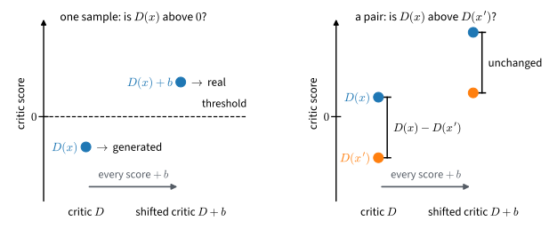

# Relativistic Objectives
:label:`sec_gan_relativistic`

In the previous two sections the critic scored one sample at a time. People rarely judge subtle differences that way. A taster who cannot say whether one glass holds the expensive wine can often say which of two glasses does, and a chess rating is built from who beat whom, not from an absolute score per player. The statistical model behind such ratings, the Bradley--Terry model, is the one :numref:`sec_regularized` used to fit a reward model to human preferences. :citet:`Jolicoeur-Martineau.2019` gave the GAN critic the same comparative task: show it one real and one generated sample, and reward it for ranking the real one higher.

This section asks what the change does to the game. Does the best ranking critic still estimate the density ratio of :numref:`sec_basic_gan`? Does a pair reveal more about which sample is real than a single sample does, and does that help when the two distributions are far apart? And how does comparison change the push that each generated sample receives? The answers say what pairing changes in the modern recipe of the next two sections, and what it leaves for :numref:`sec_gan_convergence` to fix.

```{.python .input #relativistic-relativistic-objectives}
%%tab pytorch
%matplotlib inline
from d2l import torch as d2l
import itertools
import math
import numpy as np
```

```{.python .input #relativistic-relativistic-objectives}
%%tab jax
%matplotlib inline
from d2l import jax as d2l
import itertools
import math
import numpy as np
```

## Scoring Pairs

### The Bradley--Terry Critic

We keep the notation of :numref:`sec_basic_gan`: data density $p$, generator density $q$, ratio $\rho = p/q$, log ratio $\lambda = \log \rho$, and a critic $D$ whose value is a realness logit. Draw a real sample $x \sim p$ and a generated sample $x' \sim q$ independently, and score the pair by the difference of the two critic values:

$$
\Phi(D) \;=\; \mathbb{E}_{x \sim p,\; x' \sim q}\big[\log \sigma\big(D(x) - D(x')\big)\big].
$$
:eqlabel:`eq_gan_rp`

The critic maximizes $\Phi$, whereas the generator minimizes it. The quantity $\sigma(D(x) - D(x'))$ is the critic's probability that the pair is correctly ordered, with the real sample ranked above the generated sample. This is the Bradley--Terry model :cite:`Bradley.Terry.1952`: given a score $D$ for every item, it assigns probability $\sigma(D(x) - D(x'))$ to $x$ beating $x'$. Thus $\Phi$ is the pairwise logistic log-likelihood of ranking real samples above generated ones, and the critic learns a ranking rather than a classification rule. Jolicoeur-Martineau called such a critic *relativistic*: it scores a sample relative to a sample from the opposing distribution rather than against an absolute standard. The paired form used here is abbreviated RpGAN, for relativistic *paired*, and the divergence derived below inherits the subscript. Comparing one generated sample with several real ones instead of one turns the same construction into the InfoNCE loss of contrastive learning (Exercise :exref:`ex_relativistic-more-negatives`).

### Shift Invariance and Bilinearity

Ranking ignores the level of the critic's scores, which classification does not. :numref:`fig_gan_pairing` compares the two uses of the critic scores.


:label:`fig_gan_pairing`

Formally, replacing $D$ by $D + b$ for any constant $b$ leaves every score difference, and therefore $\Phi$, unchanged. The pairing game consequently identifies the critic only up to an additive constant. By contrast, the classical game of :numref:`sec_basic_gan` determines this constant as well; shifting its optimal critic strictly decreases the objective, as Exercise :exref:`ex_gan-log-loss-game-identifies`b of :numref:`sec_basic_gan` shows. This invariance also appears in the equilibrium condition of :citet:`Huang.Gokaslan.Kuleshov.ea.2024`, which requires only that the critic be constant on the support of the data.

The objective also depends differently on the two distributions. The expectation in :eqref:`eq_gan_rp` is taken under the product measure $p \otimes q$, so $\Phi$ is *bilinear* in $(p, q)$: linear in each distribution while the other is held fixed, but not affine in the pair. The objectives of :numref:`sec_gan_objectives` were suprema of functionals affine in $(p, q)$, a property used there to decouple the critic's problem pointwise, to prove joint convexity, and to read each value as an $f$-divergence. Those results do not apply directly to the pairing game, whose value we now compute.

## The Value of the Pairing Game

### The Optimal Critic
:label:`subsec_gan_rp_optimal_critic`

The inner maximization no longer decouples across points, because each critic value $D(t)$ interacts with every other through the differences. Concavity substitutes for decoupling.

**Proposition.** *$\Phi$ is concave in $D$, and if $p$ and $q$ share a common support it is maximized at $D^\star = \lambda$, uniquely up to an additive constant.*

**Proof.** The map $D \mapsto D(x) - D(x')$ is linear and $\log \sigma$ is concave, so the integrand of :eqref:`eq_gan_rp` is concave in $D$ for every pair, and the expectation preserves concavity; a stationary point is therefore a global maximum. Perturbing $D$ at a single point $t$, that point enters $\Phi$ once as the real member of a pair and once, with opposite sign, as the generated member, and $\tfrac{d}{du} \log \sigma(u) = \sigma(-u)$ gives the functional derivative

$$
\frac{\delta \Phi}{\delta D(t)}
\;=\; p(t)\, \mathbb{E}_{x' \sim q}\big[\sigma(D(x') - D(t))\big]
\;-\; q(t)\, \mathbb{E}_{x \sim p}\big[\sigma(D(t) - D(x))\big].
$$
:eqlabel:`eq_gan_rp_stationarity`

At $D = \lambda$, we have $\sigma(\lambda(x') - \lambda(t)) = \rho(x')/(\rho(x') + \rho(t))$. The identity $q\rho = p$ converts the first term of :eqref:`eq_gan_rp_stationarity` to $p(t) \int p(x')/(\rho(x') + \rho(t))\, dx'$. It converts the second to $q(t)\, \rho(t) \int p(x)/(\rho(t) + \rho(x))\, dx$, which is the same expression because $q(t)\rho(t)=p(t)$. The derivative therefore vanishes everywhere, so $\lambda$ is a maximizer. Strict concavity of $\log \sigma$ in the score differences makes this maximizer unique up to an additive shift. $\blacksquare$

The ranking and classification objectives estimate the same log density ratio. The log-loss critic of :numref:`sec_basic_gan` has the optimal logit $D^\star = \lambda$ (:eqref:`eq_gan_dstar`), and the pairing objective gives the same result up to its undetermined additive constant. Replacing classification with ranking therefore preserves both the optimal critic and, as the theorem below confirms, the fixed point $q = p$. It changes the value and the shape of the objective away from that fixed point.

### Two Atoms by Hand

Before computing the value in general, take the smallest case. Let the space hold two atoms, $0$ and $1$, with the data distribution $p = (0.8, 0.2)$ and the generator distribution $q = (0.2, 0.8)$. A single sample at atom $0$ is real with probability $p(0)/(p(0) + q(0)) = 0.8$, and a sample at atom $1$ with probability $0.2$. Now draw one real and one generated sample and look at them as an ordered pair $(a_1, a_2)$. The table lists the probability of each pair when the real sample comes first, $P(a_1, a_2) = p(a_1)\, q(a_2)$, and when it comes second, $Q(a_1, a_2) = q(a_1)\, p(a_2)$:

| pair $(a_1, a_2)$ | $(0, 0)$ | $(1, 1)$ | $(0, 1)$ | $(1, 0)$ |
|:--|:--|:--|:--|:--|
| $P$: real sample first | 0.16 | 0.16 | 0.64 | 0.04 |
| $Q$: real sample second | 0.16 | 0.16 | 0.04 | 0.64 |

A pair of equal atoms is equally likely in both orders and says nothing about which member is real. The mixed pairs carry the information. When the pair reads $(0, 1)$, the real sample is the first with probability $0.64/(0.64 + 0.04) = 16/17 \approx 0.94$, more than the $0.8$ that a single sample at atom $0$ gives.

The optimal critic turns this into a value. Only the score difference $d = D(0) - D(1)$ matters, and the critic maximizes

$$
\Phi = 0.32 \log \sigma(0) + 0.64 \log \sigma(d) + 0.04 \log \sigma(-d).
$$

Setting the derivative $0.64\, \sigma(-d) - 0.04\, \sigma(d)$ to zero gives $e^d = 16$, so $d = \log 16 = \lambda(0) - \lambda(1)$, as the proposition predicts. Substituting back and writing $H_b(t) = -t \log t - (1 - t) \log(1 - t)$ for the entropy of a coin with bias $t$,

$$
\sup_D \Phi + \log 2 = 0.68 \big(\log 2 - H_b(\tfrac{1}{17})\big) \approx 0.319 \text{ nats}.
$$

Read this as information. The mixed pairs, which occur with probability $0.68$, turn a fair coin about the real sample's position into a coin with bias $1/17$; the equal pairs leave it fair. For a single sample the same reading gives the Jensen--Shannon divergence, which :numref:`sec_basic_gan` identified with the information one sample carries about its source: $\mathrm{JS}(p, q) = \log 2 - H_b(0.8) \approx 0.193$ nats. The pair carries 1.66 times as much. The cell below checks the three numbers; its `js` computes the divergence of two probability vectors from the entropy form $\mathrm{JS}(a, b) = H\big(\tfrac12 (a + b)\big) - \tfrac12 \big(H(a) + H(b)\big)$ of :numref:`sec_basic_gan`.

```{.python .input #relativistic-two-atoms-by-hand}
%%tab pytorch, jax
def entropy(v):
    v = v[v > 0]                       # the convention 0 log 0 = 0
    return -(v * np.log(v)).sum()

def js(a, b):
    return entropy((a + b) / 2) - (entropy(a) + entropy(b)) / 2

p, q = np.array([0.8, 0.2]), np.array([0.2, 0.8])
P, Q = np.outer(p, q), np.outer(q, p)  # P[i, j]: real sample at i, generated at j
lam = np.log(p / q)                    # the optimal critic: lam[0] - lam[1] = log 16
U = lam[:, None] - lam[None, :]        # U[i, j] = D(i) - D(j)
phi = (P * -np.logaddexp(0, -U)).sum() # Phi = E_P[log sigma(D(a_1) - D(a_2))]
print(f'JS(p, q) = {js(p, q):.3f}   JS(P, Q) = {js(P.ravel(), Q.ravel()):.3f}   '
      f'sup Phi + log 2 = {phi + np.log(2):.3f}')
```

The last two numbers agree. The value of the pairing game equals the Jensen--Shannon divergence between the two orderings $P$ and $Q$, and the next subsection proves that this holds for every $p$ and $q$.

### The Lifted Game

The two-atom table treated the ordered pair as a single observation. In general, $\Phi$ is the expectation of a fixed function of the pair $(x, x')$ under $p \otimes q$, which suggests doing the same. Let $P = p \otimes q$ and $Q = q \otimes p$ denote the two orderings of an independent real--fake pair, viewed as distributions on $\mathcal{X} \times \mathcal{X}$: under $P$ the real sample sits first, under $Q$ it sits second. These two distributions can play the log-loss game of :numref:`sec_basic_gan` on the pair space, with a pair critic $\mathcal{D}: \mathcal{X} \times \mathcal{X} \to \mathbb{R}$ in place of $D$ and the value function

$$
V_{P,Q}(\mathcal{D}) = \mathbb{E}_{(a_1, a_2) \sim P}\big[\log \sigma(\mathcal{D}(a_1, a_2))\big] + \mathbb{E}_{(a_1, a_2) \sim Q}\big[\log \sigma(-\mathcal{D}(a_1, a_2))\big],
$$

which is :eqref:`eq_gan_V` with $(P, Q)$ substituted for $(p, q)$. The following lemma connects that game to $\Phi$.

**Lemma (lifting).** *Let $P = p \otimes q$ and $Q = q \otimes p$. Then: (i) the log ratio of the two orderings separates, $\log \frac{dP}{dQ}(a_1, a_2) = \lambda(a_1) - \lambda(a_2)$, an antisymmetric difference of single-sample scores; (ii) every difference critic $\mathcal{D}(a_1, a_2) = D(a_1) - D(a_2)$ satisfies $V_{P,Q}(\mathcal{D}) = 2\,\Phi(D)$; (iii) restricting the pair critic to differences does not lower the supremum, $\sup_{\mathcal{D}} V_{P,Q}(\mathcal{D}) = \sup_{D} V_{P,Q}\big(D(a_1) - D(a_2)\big)$.*

**Proof.** *The product ratio separates.* The two product densities contain the same factors in opposite order:

$$
\frac{dP}{dQ}(a_1, a_2)
= \frac{p(a_1)\, q(a_2)}{q(a_1)\, p(a_2)}
= \frac{\rho(a_1)}{\rho(a_2)}.
$$

Taking logarithms proves (i).

*The swap symmetry doubles the objective.* Under $P$, the first term of $V_{P,Q}(\mathcal{D})$ is $\mathbb{E}[\log \sigma(D(a_1)-D(a_2))] = \Phi(D)$. Under $Q$, we have $a_1 \sim q$ and $a_2 \sim p$. Antisymmetry gives $-\mathcal{D}(a_1,a_2)=D(a_2)-D(a_1)$, and relabeling $(x,x')=(a_2,a_1)$ turns the second term into $\Phi(D)$ as well. Hence $V_{P,Q}(\mathcal{D})=2\Phi(D)$, proving (ii).

*Differences suffice.* Pointwise maximization of the log-loss game on $\mathcal{X} \times \mathcal{X}$ gives the optimal pair critic $\log(dP/dQ)$ wherever both densities are positive. Where one of them vanishes the optimal pair critic is infinite, and since $P > 0$ requires $p(a_1)\, q(a_2) > 0$, the difference $\lambda(a_1) - \lambda(a_2)$ takes the same infinite value there. By (i), this critic has the difference form with $D=\lambda$. Restricting the supremum to difference critics therefore does not change its value. $\blacksquare$

Part (iii) depends on the logistic payoff: the pointwise optimum on the pair space is separable because the log ratio of two product measures is a sum of per-coordinate terms. Under other payoffs the Bayes-optimal pair critic is a nonlinear function of that log ratio, no longer a difference of single-sample scores, and the corresponding relativistic objective only bounds its lifted divergence from below. Exercise :exref:`ex_relativistic-separability-choice-loss-replace` works this out. With the lemma in hand, the value of the pairing game follows from results already proved.

**Theorem.** *Define the pairing divergence $d_{\mathrm{Rp}}(p, q) := \sup_D \Phi(D) + \log 2$. Then*

$$
d_{\mathrm{Rp}}(p, q)
\;=\; \mathrm{JS}\big(p \otimes q,\; q \otimes p\big)
\;=\; H\Big(\tfrac{1}{2}\big(p \otimes q + q \otimes p\big)\Big) - H(p) - H(q).
$$
:eqlabel:`eq_gan_rp_value`

**Proof.** *Apply the value formula on the pair space.* Parts (ii) and (iii) of the lemma give $2 \sup_D \Phi(D) = \sup_{\mathcal{D}} V_{P,Q}(\mathcal{D})$. The value of the log-loss game, $\sup V = 2\, \mathrm{JS} - 2 \log 2$ (:eqref:`eq_gan_js_value`), applied to $(P, Q)$ evaluates the right-hand side as $2\, \mathrm{JS}(P, Q) - 2 \log 2$. Halving and adding $\log 2$ proves the first equality.

*Collapse the pair entropies.* The entropy form :eqref:`eq_gan_entropy_gap`, applied on $\mathcal{X} \times \mathcal{X}$, writes $\mathrm{JS}(P, Q)$ as the mixture entropy minus $\tfrac12 \big(H(P) + H(Q)\big)$. Since each product measure has independent components, $H(P) = H(Q) = H(p) + H(q)$, which gives the second equality. This entropy calculation assumes the displayed entropies are finite; the measure-level first equality does not. $\blacksquare$

The additive constant in $d_{\mathrm{Rp}}$ calibrates the objective against a constant critic. Such a critic assigns probability one half to either ordering and obtains $\Phi = \log \sigma(0) = -\log 2$; it is optimal when $p = q$. Thus $d_{\mathrm{Rp}}$ measures the reduction in ordering uncertainty relative to random guessing. :citet:`Jolicoeur-Martineau.2020` proved that this calibrated value is nonnegative and vanishes exactly at $q = p$ for every concave payoff $\ell$ with $\ell(0) = 0$, $\ell'(0) \neq 0$, $\sup \ell > 0$ and $\arg\sup \ell > 0$, where the supremum may be approached only as the argument grows without bound, as for the logistic payoff $\log \sigma(t) + \log 2$. Her theorem establishes the divergence property without computing its value; her normalization carries a leading factor of two, so her divergence is $2\, d_{\mathrm{Rp}}$. The theorem above supplies the value for the logistic objective, for which the lifting argument is exact.

Substituting the optimal critic $D^\star = \lambda$ into :eqref:`eq_gan_rp` directly, using $\sigma(\lambda(x) - \lambda(x')) = \rho(x)/(\rho(x) + \rho(x'))$, gives the same value in a form that is convenient for expansions:

$$
d_{\mathrm{Rp}}(p, q)
\;=\; \log 2 \;-\; \mathbb{E}_{x \sim p,\; x' \sim q}\Big[\log\Big(1 + \frac{q(x)\, p(x')}{p(x)\, q(x')}\Big)\Big].
$$
:eqlabel:`eq_gan_rp_explicit`

The mutual-information reading of :numref:`sec_basic_gan` lifts along with the value. Draw $x \sim p$ and $x' \sim q$, present the two samples in a uniformly random order, and let the bit $y$ record which position holds the real one, just as $y$ labeled the origin of a single sample in :numref:`sec_basic_gan`. The ordered pair $(a_1, a_2)$ is then a sample from the balanced mixture of $P$ and $Q$ with label $y$, and the identification of the divergence with a mutual information, applied on the pair space, gives

$$
d_{\mathrm{Rp}}(p, q) \;=\; I\big((a_1, a_2);\, y\big) \;=\; \log 2 - H\big(y \mid a_1, a_2\big).
$$
:eqlabel:`eq_gan_rp_mi`

The pairing divergence is the number of nats a randomly ordered pair carries about which member is real, just as $\mathrm{JS}(p, q)$ measures the information a single sample carries about its origin. The two-atom calculation above was this formula evaluated by hand.

### Bounds, Local Behavior, and Saturation
:label:`subsec_gan_rp_bounds`

The closed form permits an exact comparison between the pairing game and the corresponding single-sample game.

**Proposition.** *For all $p$ and $q$:*

*(a) $\mathrm{JS}(p, q) \;\leq\; d_{\mathrm{Rp}}(p, q) \;\leq\; \log 2$;*

*(b) if $q = p\,(1 + \epsilon v)$ with $\mathbb{E}_p[v] = 0$ and $v$ bounded, then $d_{\mathrm{Rp}}(p, q) = \tfrac{\epsilon^2}{4} \mathbb{E}_p[v^2] + O(\epsilon^3) = 2\, \mathrm{JS}(p, q) + O(\epsilon^3)$;*

*(c) if $p$ and $q$ have disjoint supports, then $d_{\mathrm{Rp}}(p, q) = \log 2$, independently of how far apart the supports lie.*

**Proof.** (a) The map $(a_1, a_2) \mapsto a_1$ pushes $P$ forward to $p$ and $Q$ forward to $q$. Since $\mathrm{JS}$ is an f-divergence, the data-processing inequality of :numref:`sec_mdl-tv-pinsker` gives $\mathrm{JS}(p, q) \leq \mathrm{JS}(P, Q) = d_{\mathrm{Rp}}$. :eqref:`eq_gan_rp_mi` gives the upper bound because $I\big((a_1, a_2); y\big) \leq H(y) = \log 2$.

(b) In :eqref:`eq_gan_rp_explicit`, set $u = \lambda(x') - \lambda(x)$ and expand $\log(1 + e^u) = \log 2 + \tfrac{u}{2} + \tfrac{u^2}{8} + O(u^4)$. The first moment is exact: $\mathbb{E}[u] = \mathbb{E}_q[\lambda] - \mathbb{E}_p[\lambda] = -D_{\mathrm{J}}$ with $D_{\mathrm{J}} = D_{\mathrm{KL}}(p \,\|\, q) + D_{\mathrm{KL}}(q \,\|\, p)$, and here $D_{\mathrm{J}} = \epsilon^2 \mathbb{E}_p[v^2] + O(\epsilon^3)$. The second moment is $\mathbb{E}[u^2] = 2 \epsilon^2 \mathbb{E}_p[v^2] + O(\epsilon^3)$. Substitution gives $d_{\mathrm{Rp}} = \tfrac{\epsilon^2}{4} \mathbb{E}_p[v^2] + O(\epsilon^3)$. Applying the corresponding expansion to :eqref:`eq_gan_entropy_gap` gives $\mathrm{JS} = \tfrac{\epsilon^2}{8} \mathbb{E}_p[v^2] + O(\epsilon^3)$. Exercise :exref:`ex_relativistic-local-expansion-let-e` supplies the moment calculations.

(c) A real-first pair lies in $\operatorname{supp} p \times \operatorname{supp} q$, whereas a fake-first pair lies in $\operatorname{supp} q \times \operatorname{supp} p$. These product sets are disjoint when the original supports are disjoint. Thus $P$ and $Q$ are mutually singular, the pair determines its ordering with certainty, and $\mathrm{JS}(P, Q) = \log 2$. $\blacksquare$

Part (a) shows that a pair containing one sample from each distribution provides at least as much information about its ordering as a single sample provides about its origin.

Near $q = p$, part (b) shows that the two members provide independent evidence to second order, so the ratio $d_{\mathrm{Rp}}/\mathrm{JS}$ tends to 2 under nonzero local perturbations. More generally, this ratio lies in $[1, 2]$ whenever $p \neq q$. The upper bound follows from :eqref:`eq_gan_rp_mi`: conditional on the label, the two samples are independent, so the pair's information equals $2\, \mathrm{JS}(p, q)$ minus their nonnegative unconditional dependence (Exercise :exref:`ex_relativistic-gap-twice-js`). The two atoms gave a ratio of 1.66, and the five atoms of the next subsection give about 1.6.

Part (c) shows that pairing does not resolve support saturation. For the point masses $p = \delta_0$ and $q_\theta = \delta_\theta$ of :numref:`sec_basic_gan`, the pairing value equals $\log 2$ for every $\theta \neq 0$ and therefore supplies no gradient in $\theta$. In this example, with the linear critic $D(x) = \psi x$, the relativistic and classical objectives differ only by an additive constant, so their gradient fields coincide exactly, as :citet:`Huang.Gokaslan.Kuleshov.ea.2024` observe. The same authors show that gradient training of the unregularized pairing game need not converge.

### Verification on Five Atoms
:label:`subsec_gan_rp_verification`

Because the theorem is an identity, a finite example can verify it to numerical precision without sampling error. Let $p$ and $q$ be fixed probability vectors on a five-element space, and represent the critic by $D \in \mathbb{R}^5$. Then $\Phi$ is an exact sum over 25 pairs, and $\mathrm{JS}(p \otimes q, q \otimes p)$ is an entropy calculation on 25 atoms. We maximize $\Phi$ by gradient ascent using the functional derivative :eqref:`eq_gan_rp_stationarity`. The maximized value plus $\log 2$, the product-space Jensen--Shannon divergence, and the entropy expression in :eqref:`eq_gan_rp_value` should agree. The optimized critic should also equal $\lambda$ up to an additive constant.

```{.python .input #relativistic-verifying-the-closed-form-1}
%%tab pytorch, jax
p = np.array([0.35, 0.25, 0.20, 0.12, 0.08])   # data distribution
q = np.array([0.02, 0.05, 0.13, 0.30, 0.50])   # generator distribution
lam = np.log(p / q)

def sigma(t):
    return 1 / (1 + np.exp(-t))

D = np.zeros(5)
for _ in range(400):   # ascend Phi along its functional derivative
    R = sigma(D[None, :] - D[:, None])         # R[i, j] = sigma(D_j - D_i)
    D += 20.0 * (p * (R @ q) - q * (p @ R))
U = D[:, None] - D[None, :]                    # U[i, j] = D_i - D_j
phi = (np.outer(p, q) * (-np.logaddexp(0.0, -U))).sum()
P, Q = np.outer(p, q).ravel(), np.outer(q, p).ravel()
print(f'sup Phi + log 2, by gradient ascent:    {phi + np.log(2):.9f}')
print(f'JS(p (x) q, q (x) p), computed directly: {js(P, Q):.9f}')
print(f'entropy form H((P+Q)/2) - H(p) - H(q):  '
      f'{entropy((P + Q) / 2) - entropy(p) - entropy(q):.9f}')
print(f'JS(p, q) = {js(p, q):.6f},  log 2 = {np.log(2):.6f}')
D_c, lam_c = D - D.mean(), lam - lam.mean()
print(f'max |D - lambda|, both centered:        '
      f'{np.abs(D_c - lam_c).max():.1e}')
```

The three computations of $d_{\mathrm{Rp}}$ agree to nine decimal places, and after centering, the recovered critic matches $\lambda$ to double-precision round-off. The value also satisfies the bounds in part (a): $\mathrm{JS}(p, q) \approx 0.23 < d_{\mathrm{Rp}} \approx 0.38 < \log 2 \approx 0.69$. For these distributions, a pair carries about 1.6 times as much information about the label as a single sample. This ratio lies between its limiting value 2 under local perturbations of $q = p$ and the value 1 attained when both divergences saturate. What pairing changes lies elsewhere: in the push each generated sample receives and, for a fixed one-to-one coupling of real and generated samples, in which configurations can trap the generator.

## Ranking and Mode Coverage

### Convexity in the Generator's Distribution

Pairing made $\Phi$ bilinear in $(p, q)$, so the joint convexity of :numref:`sec_gan_objectives` is lost. Convexity in the generator's distribution, which is what the generator's minimization needs, survives. For fixed $p$, group :eqref:`eq_gan_rp` by the generated member:

$$
d_{\mathrm{Rp}}(p, q) \;=\; \log 2 + \sup_D\, \mathbb{E}_{x' \sim q}\big[T_D(x')\big],
\qquad
T_D(x') := \mathbb{E}_{x \sim p}\big[\log \sigma\big(D(x) - D(x')\big)\big].
$$

This exhibits the objective as a supremum of functionals linear in $q$, the structural property that made the metrics of :numref:`sec_gan_objectives` convex in the generator's distribution, so $q \mapsto d_{\mathrm{Rp}}(p, q)$ is convex. What does not survive is the fixed test class: each test function $T_D$ is built from the data distribution itself, and it scores $x'$ by a smoothed comparison against the entire real population.

Convexity in $q$ is a statement about mixtures. Along the path $q_t = (1 - t)\, q + t\, p$ the divergence is at most $(1 - t)\, d_{\mathrm{Rp}}(p, q)$, so it falls steadily to zero, and no mixture path can get stuck. A generator, however, does not move probability mass by mixing; it moves samples. Carrying a sample from one data point to another takes it through positions that hold no data, and the distributions along the way are not mixtures of the two endpoints. Convexity in $q$ therefore does not exclude local minima in the positions of the generated samples. The paired landscapes below show that such minima exist, and which form of the pairing loss avoids them.

### The Rank Weight
:label:`subsec_gan_rp_rank_weight`

To see what pairing changes for the generator, differentiate $\Phi$ through $x' = G(z)$, as :numref:`sec_basic_gan` did for the classical game. Playing the zero-sum game literally, with the generator minimizing $\Phi$, moves each generated sample up the critic's score surface, along $\nabla_\theta D(G(z))$, with a per-sample weight. :numref:`sec_basic_gan` found the classical saturating weight $w_{\textrm{sat}}(x') = \sigma(D(x'))$ for the same direction (:eqref:`eq_gan_weights`). Side by side, the two weights are

$$
w_{\textrm{Rp}}(x') = \mathbb{E}_{x \sim p}\big[\sigma\big(D(x') - D(x)\big)\big],
\qquad
w_{\textrm{sat}}(x') = \sigma\big(D(x')\big).
$$
:eqlabel:`eq_gan_rp_weights`

The classical weight compares a sample with the critic's zero level, which the classical game fixes but the pairing game leaves arbitrary. The relativistic weight equals the probability that $x'$ outranks a random real sample. This *rank weight* is invariant to an additive shift of the critic, and it is graded across the real scores: a generated sample is judged against the whole real population, not against one level.

The five atoms of :numref:`subsec_gan_rp_verification` make the two weights of :eqref:`eq_gan_rp_weights` concrete without training anything. Take the critic at the classical optimum, $D = \lambda$, and the shifted critic $D = \lambda + 2$, which the pairing game cannot tell apart. For a generated sample whose score under $\lambda$ is $t$, the threshold weight is $\sigma(t)$ under the first critic and $\sigma(t + 2)$ under the second. The rank weight $\sum_x p(x)\, \sigma(t - \lambda(x))$ is the same under both, because the shift moves the real scores too. The plot draws the four curves and marks the real atoms at their scores.

```{.python .input #relativistic-verifying-the-closed-form-2}
%%tab pytorch, jax
def rank_weight(t, D, p):   # E_{x ~ p}[sigma(t - D(x))], generated scores t
    return (p[:, None] * sigma(t[None, :] - D[:, None])).sum(axis=0)

ts = np.linspace(-6.0, 8.0, 281)   # scores of generated samples under lambda
d2l.plot([ts] * 4 + [lam],
         [sigma(ts), sigma(ts + 2), rank_weight(ts, lam, p),
          rank_weight(ts + 2, lam + 2, p), rank_weight(lam, lam, p)],
         r'score of a generated sample under $D = \lambda$', 'weight',
         legend=[r'threshold, $\lambda$', r'threshold, $\lambda + 2$',
                 r'rank, $\lambda$', r'rank, $\lambda + 2$', 'real atoms'],
         fmts=('C2-', 'C2--', 'C3-', 'k:', 'C0o'), figsize=(5.5, 3.2))
top = lam.max()   # the highest real score
print(f'highest real score: threshold {sigma(top):.2f} at lambda, '
      f'{sigma(top + 2):.2f} at lambda + 2; '
      f'rank {rank_weight(np.array([top]), lam, p)[0]:.2f} at both')
```

Shifting the critic moves the threshold curve two units to the left: at the highest real score the threshold weight rises from 0.95 to 0.99, although the pairing game has not changed. The two rank curves coincide. The rank weight changes across the real atoms' scores, each step weighted by that atom's mass $p(x)$, and at the highest real score it is still only 0.75. It therefore distinguishes samples that the threshold weight treats as nearly equivalent, and it approaches one only for a generated sample that outranks nearly the whole real population.

The two weights read a collapsed generator differently. Suppose the generator places all its samples at one point that the critic scores above zero, near one mode of the data. The classical verdict, as :numref:`subsec_gan_mode_dropping` observed, calls every sample real, whatever the data's other modes look like. The rank weight records instead where that point falls among the real scores. Neither weight by itself forbids collapse, however. Against a fixed critic, every one of these generator losses is an expectation over $x' \sim q$ of a function that decreases as $D(x')$ grows, so each is linear in $q$ and smallest when all generated mass sits at the point with the critic's highest score. The losses differ only in how the critic responds once the generator moves, which is the subject of the next subsection.

### Paired Landscapes
:label:`subsec_gan_rp_landscapes`

Whether a collapsed generator is trapped depends on what the critic does when the generator moves. :citet:`Sun.Fang.Schwing.2020` answered this in the smallest setting where it can be settled exactly. Take $n$ distinct data points $x_1, \ldots, x_n$ and $n$ generated points $x'_1, \ldots, x'_n$ that the generator may place anywhere, and evaluate each loss at the critic's best response over all functions $D$. We write $\mathcal{E}$ for these best-response losses:

$$
\begin{aligned}
\mathcal{E}_{\mathrm{GAN}} &= \sup_D \tfrac{1}{2n} \textstyle\sum_{i} \big[\log \sigma(D(x_i)) + \log \sigma(-D(x'_i))\big],\\
\mathcal{E}_{\mathrm{diag}} &= \sup_D \tfrac{1}{n} \textstyle\sum_{i} \log \sigma\big(D(x_i) - D(x'_i)\big),\\
\mathcal{E}_{\mathrm{all}} &= \sup_D \tfrac{1}{n^2} \textstyle\sum_{i, j} \log \sigma\big(D(x_i) - D(x'_j)\big).
\end{aligned}
$$
:eqlabel:`eq_gan_rp_landscape`

The first is the classical loss. The second, the *paired loss*, pairs the $i$-th real point with the $i$-th generated point, as a minibatch implementation does within one batch. The third averages over all $n^2$ cross pairs, so its generator weight is the rank weight of :eqref:`eq_gan_rp_weights` computed against the whole real sample. The generator minimizes each loss over the positions of its points, and each loss reaches its smallest value, $-\log 2$, when the generated points cover the data points one each. Sun et al. proved that every configuration in which each generated point sits on a data point and at least two of them coincide, so that some data point is left uncovered, is a suboptimal strict local minimum of $\mathcal{E}_{\mathrm{GAN}}$; there are $n^n - n!$ of them. For $\mathcal{E}_{\mathrm{diag}}$ they proved that from every configuration a path along which the loss never increases leads to a global minimum.

Two data points show the mechanism. Put both generated points on $x_1$. Half of the all-pairs comparisons are then ties between $x_1$ and itself, and the other half can be separated completely, so $\mathcal{E}_{\mathrm{all}} = -\tfrac12 \log 2$. Moving either generated point off $x_1$ leaves only a quarter of the pairs tied and raises the loss to $-\tfrac14 \log 2$, so the collision is a strict local minimum. In the paired loss, $x'_1$ ties with its partner $x_1$, but $x'_2$ sits on $x_1$ rather than on its own partner $x_2$. The critic scores $x_2$ above $x_1$ without limit, so $x'_2$ is already scored as fully fake and its term is zero. Moving $x'_2$ off $x_1$ leaves it fully fake, so the loss stays at $-\tfrac12 \log 2$ until $x'_2$ reaches $x_2$, where it falls to $-\log 2$.

Larger $n$ needs a computation, and for two of the three losses the chapter has already done it. Let $\hat p$ and $\hat q$ put mass $1/n$ on each data point and on each generated point. The value of the log-loss game gives $\mathcal{E}_{\mathrm{GAN}} = \mathrm{JS}(\hat p, \hat q) - \log 2$, and the theorem of this section gives $\mathcal{E}_{\mathrm{all}} = \mathrm{JS}(\hat p \otimes \hat q, \hat q \otimes \hat p) - \log 2$.

The paired loss has a picture instead. Draw an arrow from each real point to the position of its generated partner. Wherever the arrows can be ordered consistently, the critic scores each tail above its head without limit and that pair's term vanishes, as for $x'_2$ above. Arrows that close a cycle cannot all point downhill: the score differences around a cycle sum to zero, and by the concavity of $\log \sigma$ the critic does best with all of them zero, a tie costing $\log 2$ per pair. A generated point on its own partner is a cycle of length one. Hence $\mathcal{E}_{\mathrm{diag}}$ is $-\log 2$ times the fraction of pairs whose arrow lies on a cycle. The cell below implements the three losses, with real point $i$ at position $i$ and generated point $i$ at position `gen[i]`.

```{.python .input #relativistic-paired-landscapes-1}
%%tab pytorch, jax
def on_cycle(i, gen):
    """Does the arrow from real point i to its partner's position close a cycle?"""
    j = gen[i]
    for _ in range(len(gen)):
        if j == i:
            return True
        if j not in range(len(gen)):  # a position that holds no data point
            return False
        j = gen[j]                    # follow the arrow of the real point at j
    return False

def losses(gen):
    """Best-response classical, all-pairs and paired losses of a configuration."""
    n = len(gen)
    support = sorted(set(range(n)) | set(gen))
    p_hat = np.isin(support, range(n)) / n
    q_hat = np.array([gen.count(s) for s in support]) / n
    P, Q = np.outer(p_hat, q_hat).ravel(), np.outer(q_hat, p_hat).ravel()
    paired = -np.log(2) * np.mean([on_cycle(i, gen) for i in range(n)])
    return np.array([js(p_hat, q_hat) - np.log(2), js(P, Q) - np.log(2), paired])
```

A configuration is a strict local minimum if every small move raises the loss. A small move lets each generated point stay or step to a nearby position that holds no data; coincident generated points may move together or apart. The count runs over all $n^n$ assignments of generated points to data points and keeps those that are strict local minima without being global ones.

```{.python .input #relativistic-paired-landscapes-2}
%%tab pytorch, jax
def small_moves(gen):
    """Each generated point stays or steps to one of n fresh positions next to it."""
    n = len(gen)
    for steps in itertools.product(range(n + 1), repeat=n):
        if any(steps):
            yield [g + k / 10 if k else g for g, k in zip(gen, steps)]

def count_bad_minima(n):
    """Suboptimal strict local minima among the assignments, per loss."""
    best, count = losses(list(range(n))), np.zeros(3, dtype=int)
    for gen in itertools.product(range(n), repeat=n):
        value = losses(list(gen))
        rises = np.all([losses(m) > value + 1e-9 for m in small_moves(list(gen))],
                       axis=0)
        count += rises & (value > best + 1e-9)
    return count
```

At $n = 2$ the count should reproduce the hand calculation above; at $n = 3$ it checks the theorem.

```{.python .input #relativistic-paired-landscapes-3}
%%tab pytorch, jax
for n in (2, 3):
    c = count_bad_minima(n)
    print(f'n = {n}: classical {c[0]}, all pairs {c[1]}, paired {c[2]};  '
          f'n^n - n! = {n**n - math.factorial(n)}')
```

At $n = 2$ and $3$ the classical and all-pairs losses each have the $n^n - n!$ collision minima, the number Sun et al. proved for the classical loss at every $n$, and the paired loss has none. The guarantee of :citet:`Sun.Fang.Schwing.2020` belongs to the one-to-one coupling of real and generated samples, not to the rank weight: the all-pairs loss, which weights each generated sample by its rank among all real ones, has as many mode-dropping minima as the classical loss. In the paired loss, every collision leaves at least one generated point whose arrow lies on no cycle. The critic already scores that point as fully fake, so moving it toward its own partner never raises the loss. The all-pairs count also shows the gap between mixtures and particles: $\mathcal{E}_{\mathrm{all}} = d_{\mathrm{Rp}}(\hat p, \hat q) - \log 2$ is convex in $\hat q$ along mixtures, and still has 21 minima in the positions of the generated points at $n = 3$. Minibatch training, however, redraws the pairs at every step. Averaged over all $n!$ pairings $\pi$, the paired objective is exactly the all-pairs objective, $\tfrac{1}{n!} \sum_\pi \tfrac{1}{n} \sum_i \log \sigma\big(D(x_i) - D(x'_{\pi(i)})\big) = \tfrac{1}{n^2} \sum_{i, j} \log \sigma\big(D(x_i) - D(x'_j)\big)$, so a critic that responds to the average faces a landscape with as many mode-dropping minima as the classical loss, 21 at $n = 3$ (Exercise :exref:`ex_relativistic-random-repairing`). The one-to-one guarantee belongs to a fixed coupling, and whether training with fresh pairs behaves like this average is not settled; on the sprites of :numref:`sec_dcgan`, the classical and pairing losses reach the same quality once both are penalized.

### Saturating and Non-Saturating Generators

The rank weight still saturates. If $D(x')$ is far below every real score, then $w_{\textrm{Rp}}(x') \approx 0$, so the generated samples requiring the largest change receive the smallest updates. As in the classical game, a non-saturating objective reverses this weighting. Maximizing $\mathbb{E}[\log \sigma(D(x') - D(x))]$ rather than minimizing $\Phi$ gives the same update direction with the complementary weight. Repeating the calculation from :eqref:`eq_gan_weights` with a score difference gives

| generator objective | weight on the update of $x'$ | on a badly ranked sample |
|:---|:---|:---|
| zero-sum: minimize $\Phi$ | $\mathbb{E}_{x \sim p}[\sigma(D(x') - D(x))]$ | weight $\to 0$: the update vanishes |
| non-saturating: maximize $\mathbb{E}[\log \sigma(D(x') - D(x))]$ | $\mathbb{E}_{x \sim p}[\sigma(D(x) - D(x'))]$ | weight $\to 1$: the update is largest |

The non-saturating swap is part of the original relativistic construction: :citet:`Jolicoeur-Martineau.2019` trains the generator this way from the start. The R3GAN recipe of :citet:`Huang.Gokaslan.Kuleshov.ea.2024`, the modern baseline that the next two sections build on, writes its objective as the zero-sum minimax over $\Phi$, and implementing that equation literally puts the generator on the saturating row. Train the generator on the non-saturating form instead, as the R3GAN reference implementation does.

The two variants share their fixed point. :numref:`sec_basic_gan` established this for the classical pair by evaluating the non-saturating loss at the optimal critic, and the same calculation works here. At $D^\star = \lambda$, the function $u \mapsto \log(1 + e^u)$ is convex, and Jensen's inequality bounds the non-saturating pairing loss from below:

$$
-\mathbb{E}_{x \sim p,\, x' \sim q}\big[\log \sigma\big(\lambda(x') - \lambda(x)\big)\big]
= \mathbb{E}\big[\log\big(1 + e^{\lambda(x) - \lambda(x')}\big)\big]
\;\geq\; \log\big(1 + e^{D_{\mathrm{J}}}\big),
$$

where $D_{\mathrm{J}} = \mathbb{E}_p[\lambda] - \mathbb{E}_q[\lambda] = D_{\mathrm{KL}}(p \,\|\, q) + D_{\mathrm{KL}}(q \,\|\, p) \geq 0$. The bound exceeds $\log 2$ whenever $q \neq p$, and the loss equals $\log 2$ at $q = p$, so the non-saturating generator, too, is minimized only at the data.

The variants differ most when generated samples rank badly. At the optimal critic, the $q$-average of the zero-sum weight $w_{\textrm{Rp}}$ equals $\iint PQ/(P + Q)$ over the pair space, which is at most $\tfrac12$ and tends to zero as the supports separate (Exercise :exref:`ex_relativistic-zero-sum-weights`). For the two atoms, the equal pairs contribute $2 \times 0.16^2/0.32 = 0.16$ and the mixed pairs $2 \times 0.64 \times 0.04/0.68 \approx 0.075$, so the zero-sum weight averages about $0.24$ against $0.76$ for the non-saturating weight. In the image experiments of :numref:`sec_dcgan`, the average rank weight $w_{\textrm{Rp}}$ of an unpenalized critic sits near zero: the critic ranks nearly every generated sample far below every real one, so the weight no longer tells better samples from worse ones. With a gradient penalty that limits the critic's slope, it stays between about a quarter and two fifths.

### Diagonal and All-Pairs Estimates

The landscapes above also settle a practical choice. Given $n$ real and $n$ generated samples, $\Phi$ can be estimated by pairing the $i$-th real sample with the $i$-th generated sample, giving $n$ terms, or by averaging over all $n^2$ cross pairs. By the two-sample U-statistic theorem, the all-pairs average is the minimum-variance unbiased estimator :cite:`Jolicoeur-Martineau.2020`, at the cost of $n^2$ terms; the unbiased MMD estimate of :numref:`sec_gan_objectives` likewise sums over $O(n^2)$ pairs. In the experiments of :citet:`Jolicoeur-Martineau.2020`, the lower-variance estimate did not improve the generator and was sometimes worse. The landscapes above do not decide this. With fresh pairs at every step, the diagonal estimate averages to the all-pairs objective, so in training the two differ only in variance; only for a fixed pairing does the diagonal estimate have the better landscape. The diagonal estimate is cheaper and is the standard choice; it is the paired loss the rest of the chapter trains with.

We can now compute the value of a pairing game, read a critic through both weights, and say what pairing changes: the optimal critic stays the log density ratio, a pair carries up to twice the information of a sample, the generator's weight becomes a rank, and the one-to-one paired loss with a fixed coupling has no collapse minima in the best-response landscape. Pairing does not change the value on separated supports, still $\log 2$ at every distance, and it does not make gradient training converge; :numref:`sec_gan_convergence` takes up both.

## Summary

The pairing objective is the Bradley--Terry log-likelihood of ranking a real sample above a generated one; it identifies the critic only up to a constant, and its optimal critic is still the log density ratio $\lambda$. Treating the ordered pair as one observation turns it into the log-loss game between $p \otimes q$ and $q \otimes p$, so its value is $d_{\mathrm{Rp}} = \mathrm{JS}(p \otimes q, q \otimes p)$, the information a randomly ordered pair carries about which member is real. This value lies between $\mathrm{JS}(p, q)$ and $\log 2$, is twice $\mathrm{JS}$ near $q = p$, and equals $\log 2$ on disjoint supports, so pairing keeps the saturation of the classical game. The generator's weight becomes the rank of a generated sample among the real scores; with best-response critics, the paired loss with a fixed coupling of each real sample to one generated sample has no mode-dropping minima, while the classical loss has $n^n - n!$ of them, and the all-pairs loss as many in every case we counted. Redrawing the pairs at every step, as minibatch training does, averages the paired loss to the all-pairs loss. The generator should be trained on the non-saturating form, which shares the fixed point and gives badly ranked samples the largest weight.

## Exercises

1. **Shift invariance in training.** Adding a constant to the critic leaves
   $\Phi$ unchanged (:numref:`fig_gan_pairing`), so nothing in the pairing
   game fixes the overall level of the critic's scores.
    1. Show that the functional derivative :eqref:`eq_gan_rp_stationarity`
       integrates to zero over $t$ for every critic $D$. What does this imply
       for `D.mean()` during the ascent loop of
       :numref:`subsec_gan_rp_verification`? Print it to check.
    1. Let a network critic end in a scalar output bias,
       $D(x) = D_0(x) + b$. Show that every minibatch estimate of $\Phi$,
       whether it pairs the $i$-th real sample with the $i$-th generated
       sample or averages over all cross pairs, has zero gradient with
       respect to $b$. What then determines the level of the critic's
       scores during training?
    1. For a classical critic, the fraction of generated samples with
       $D(x') > 0$ is the fraction that the critic classifies as real. Why
       is this statistic uninformative for a critic trained on $\Phi$, and
       which statistic of the same minibatch scores replaces it?
   :exlabel:`ex_relativistic-prove-shift-invariance-ev`

1. **Local expansion.** Let $q = p\,(1 + \epsilon v)$ with $\mathbb{E}_p[v] = 0$
   and $v$ bounded.
    1. Starting from :eqref:`eq_gan_rp_explicit`, write
       $u = \lambda(x') - \lambda(x)$ and expand
       $\log(1 + e^u) = \log 2 + \tfrac{u}{2} + \tfrac{u^2}{8} + O(u^4)$.
       Compute $\mathbb{E}[u] = \mathbb{E}_q[\lambda] - \mathbb{E}_p[\lambda]$ and $\mathbb{E}[u^2]$ to second
       order in $\epsilon$, and conclude that
       $d_{\mathrm{Rp}} = \tfrac{\epsilon^2}{4} \mathbb{E}_p[v^2] + O(\epsilon^3)$.
    1. Apply the corresponding expansion to the entropy form
       :eqref:`eq_gan_entropy_gap` to show that
       $\mathrm{JS}(p, q) = \tfrac{\epsilon^2}{8} \mathbb{E}_p[v^2] + O(\epsilon^3)$,
       so that locally $d_{\mathrm{Rp}} = 2\, \mathrm{JS} + O(\epsilon^3)$.
   :exlabel:`ex_relativistic-local-expansion-let-e`

1. **Two Gaussians.** Let $p = \mathcal{N}(0, I)$ and
   $q = \mathcal{N}(\mu, I)$ on $\mathbb{R}^d$, two distributions that
   differ by a translation of length $\|\mu\|$.
    1. Show that $\lambda$ is affine in $x$ and that
       $u = \lambda(x') - \lambda(x)$ in :eqref:`eq_gan_rp_explicit` is
       Gaussian. Find its mean and variance.
    1. Write $\mathrm{JS}(p, q)$ in the same form, as $\log 2$ minus the
       expectation of $\log(1 + e^t)$ for a Gaussian $t$. Find the constant
       $c$ for which
       $\mathrm{JS}\big(p, \mathcal{N}(c\mu, I)\big) = d_{\mathrm{Rp}}(p, q)$
       holds for every $\mu$.
    1. Evaluate $d_{\mathrm{Rp}}$ and $\mathrm{JS}$ by one-dimensional
       quadrature for $\|\mu\| \in \{0.1, 1, 2, 4\}$. Relate the ratio
       $d_{\mathrm{Rp}} / \mathrm{JS}$ to the local limit and to the
       saturation of :numref:`subsec_gan_rp_bounds`.
   :exlabel:`ex_relativistic-two-gaussians`

1. [code] **Zero-sum and non-saturating weights.** The zero-sum generator
   minimizes $\Phi$ and updates each generated sample with the weight
   $w_{\mathrm{Rp}}$ of :eqref:`eq_gan_rp_weights`. The non-saturating
   generator instead maximizes
   $\mathbb{E}_{x \sim p,\, x' \sim q}\big[\log \sigma\big(D(x') - D(x)\big)\big]$,
   which updates each generated sample with the complementary weight
   $1 - w_{\mathrm{Rp}}(x')$.
    1. Treat each of the five atoms of
       :numref:`subsec_gan_rp_verification` as a generated sample and
       evaluate both weights with the recovered critic `D_c`. On which
       atoms does each variant place its largest weight, and how do these
       atoms relate to the atoms where $q$ exceeds $p$? By what factor does
       the $q$-average of the non-saturating weight exceed that of
       $w_{\mathrm{Rp}}$?
    1. Let the critic be optimal, $D = \lambda$, and write $P = p \otimes q$
       and $Q = q \otimes p$ for the densities of the lifted game. Show that
       the $q$-average of $w_{\mathrm{Rp}}$ equals
       $\iint \frac{P Q}{P + Q}\, da_1\, da_2$, and that it is at most
       $\tfrac12$, with equality only at $q = p$. What does it tend to as
       the supports of $p$ and $q$ separate, and what does this imply for
       the zero-sum generator's average update early in training?
   :exlabel:`ex_relativistic-zero-sum-weights`

1. [code] **Atoms outside the generator's support.** ● The proposition of
   :numref:`subsec_gan_rp_optimal_critic` assumes that $p$ and $q$ share a
   common support. In the code of :numref:`subsec_gan_rp_verification`,
   replace `q` by $(0, 0.05, 0.13, 0.30, 0.52)$ and keep `p`; `entropy`
   already uses the convention $0 \log 0 = 0$.
    1. Which entries of $\lambda$ are finite? Is the supremum of $\Phi$
       attained?
    1. Run the ascent loop for $10^2$, $10^3$, $10^4$, and $10^5$
       iterations. At each count, record three quantities: the score of
       the first atom minus the mean score of the other four, the gap
       between $\mathrm{JS}(p \otimes q, q \otimes p)$ and
       $\Phi + \log 2$, and the largest deviation between the other four
       scores and the corresponding entries of $\lambda$, both centered over
       those four atoms. How does each quantity scale with the number of
       iterations?
    1. Explain the growth rate of the first atom's score from the
       functional derivative :eqref:`eq_gan_rp_stationarity` at that atom.
   :exlabel:`ex_relativistic-atoms-outside-support`

1. **Separability of the pair critic.** ● Replace the logistic payoff
   in :eqref:`eq_gan_rp` by a concave payoff $\ell$, giving
   $\Phi_\ell(D) = \mathbb{E}_{x \sim p,\, x' \sim q}[\ell(D(x) - D(x'))]$. The
   corresponding game on the pair space lets an unrestricted pair critic
   $\mathcal{D}$ collect $\ell(\mathcal{D})$ on pairs from $P = p \otimes q$
   and $\ell(-\mathcal{D})$ on pairs from $Q = q \otimes p$. The proof of
   part (ii) of the lifting lemma carries over to every $\ell$: the
   difference critic built from $D$ earns $2\, \Phi_\ell(D)$, so restricting
   the pair critic to differences can only lower the supremum. Part (iii)
   shows that the restriction costs nothing for the logistic payoff.
    1. For the least-squares payoff $\ell(t) = -(1 - t)^2$, show that the
       pointwise optimum of the pair-space game is $2\eta - 1$ with
       $\eta = P/(P + Q) = \sigma(\lambda(a_1) - \lambda(a_2))$. Show that
       this optimal pair score,
       $\tanh\big(\tfrac{\lambda(a_1) - \lambda(a_2)}{2}\big)$, is not
       additively separable, and conclude that a relativistic least-squares
       game over difference critics optimizes a strict lower bound on its
       lifted divergence in general.
    1. Measure this gap on the five
       atoms of :numref:`subsec_gan_rp_verification`. Evaluate the unrestricted
       pair-space value at the pointwise optimum, and maximize
       $2\, \Phi_\ell(D)$ over $D \in \mathbb{R}^5$ by gradient ascent, as
       the code there does for $\Phi$. How large is the gap relative to the
       unrestricted value?
    1. Return to the logistic payoff and present the pair real-first with
       probability $\alpha \neq \tfrac12$, so that the log loss weights
       pairs from $P$ by $\alpha$ and pairs from $Q$ by $1 - \alpha$.
       Derive the Bayes-optimal pair critic. Can a difference critic attain
       it? Which extension of the difference class can?
   :exlabel:`ex_relativistic-separability-choice-loss-replace`

1. **More negatives.** ● Draw $K$ real samples
   $x_1, \ldots, x_K \sim p$ and one generated sample $x' \sim q$, place all
   $K + 1$ samples in a uniformly random order $(a_1, \ldots, a_{K+1})$, and
   let the critic predict which position holds the generated sample.
    1. Show that the Bayes posterior for position $j$ is the softmax
       $e^{-\lambda(a_j)} / \sum_k e^{-\lambda(a_k)}$, so that a
       single-sample score again suffices.
    1. Repeat the lifting argument with $K + 1$ hypotheses in place of two.
       Show that the chance-level log loss $\log(K + 1)$ minus the optimal
       expected log loss is the generalized Jensen--Shannon divergence of the $K + 1$ product measures
       $P_j = p^{\otimes (j-1)} \otimes q \otimes p^{\otimes (K + 1 - j)}$,

       $$d_K(p, q) = H\Big(\tfrac{1}{K+1} \textstyle\sum_j P_j\Big) - K\, H(p) - H(q),$$

       and that $0 \leq d_K \leq \log(K + 1)$. Use
       $H(P_j) = K\, H(p) + H(q)$.
    1. Compare the game with the InfoNCE loss :eqref:`eq_mdl-infonce_def`
       of :numref:`sec_mdl-infonce`. Which sample and which densities play
       the roles of the positive pair, the negatives, and the density ratio
       that the optimal InfoNCE critic recovers?
   :exlabel:`ex_relativistic-more-negatives`

1. **Gap to twice Jensen--Shannon.** ● Take the randomly ordered
   pair $(a_1, a_2)$ and its label $y$ from :eqref:`eq_gan_rp_mi`.
    1. Show that $a_1$ and $a_2$ are conditionally independent given $y$,
       and that each position alone carries
       $I(a_k; y) = \mathrm{JS}(p, q)$.
    1. Use the chain rule of mutual information to show that
       $d_{\mathrm{Rp}}(p, q) = 2\, \mathrm{JS}(p, q) - I(a_1; a_2)$.
    1. Apply the data-processing inequality to the Markov chain
       $a_1 - y - a_2$ to obtain the lower bound
       $\mathrm{JS}(p, q) \leq d_{\mathrm{Rp}}(p, q)$ of
       :numref:`subsec_gan_rp_bounds` without the pushforward argument.
       What is $I(a_1; a_2)$ when $p$ and $q$ have disjoint supports?
    1. Compute $I(a_1; a_2)$ for the five atoms of
       :numref:`subsec_gan_rp_verification` from the 25-atom distribution
       $\tfrac12 (P + Q)$, and check that
       $2\, \mathrm{JS}(p, q) - I(a_1; a_2)$ reproduces the printed value of
       $d_{\mathrm{Rp}}$.
   :exlabel:`ex_relativistic-gap-twice-js`

1. [code] **Diagonal versus all-pairs estimates.** ● Draw real samples
   $x_1, \ldots, x_n \sim p$ and generated samples
   $x'_1, \ldots, x'_n \sim q$, and let
   $f(x, x') = \log \sigma(D(x) - D(x'))$. The diagonal estimate of $\Phi$
   averages $f(x_i, x'_i)$ over $i$, and the all-pairs estimate averages
   $f(x_i, x'_j)$ over all $n^2$ index pairs. Write $\tau^2 = \textrm{Var}[f(x, x')]$,
   $\tau^2_{10} = \textrm{Var}_x\big[\mathbb{E}_{x'}[f(x, x')]\big]$, and
   $\tau^2_{01} = \textrm{Var}_{x'}\big[\mathbb{E}_x[f(x, x')]\big]$.
    1. Show that both estimates are unbiased, that the diagonal estimate
       has variance $\tau^2 / n$, and that the all-pairs estimate has variance

       $$\frac{\tau^2 + (n - 1)(\tau^2_{10} + \tau^2_{01})}{n^2}.$$

    1. Compute $\tau^2$, $\tau^2_{10}$, and $\tau^2_{01}$ exactly for the five atoms of
       :numref:`subsec_gan_rp_verification` with the critic `D_c`, and
       confirm both variances by simulation for
       $n \in \{8, 32, 128, 512\}$. Which variance ratio do the formulas
       predict as $n \to \infty$? Compare it with the factor $n$ by which
       the all-pairs estimate has more terms.
    1. Both estimates evaluate the critic network once per sample. Count
       the additional operations of the all-pairs estimate in the forward
       and the backward pass, and compare them with the $n^2$ kernel
       evaluations of the MMD estimate of :numref:`sec_gan_objectives` on
       $d$-dimensional features. Is computational cost a good reason to
       prefer the diagonal estimate?
   :exlabel:`ex_relativistic-diagonal-all-pairs`

1. [code] **Random re-pairing.** ●● The enumeration of
   :numref:`subsec_gan_rp_landscapes` fixes the coupling: the $i$-th real
   point is always paired with the $i$-th generated point. Minibatch
   training draws a new pairing at every step.
    1. Extend the count to $n = 4$, that is, 256 assignments. Do the
       classical and all-pairs counts still equal $n^n - n!$, and does the
       paired loss still have none?
    1. Model a critic that best-responds to each pairing separately. For a
       permutation $\pi$ of $\{1, \ldots, n\}$, let
       $\mathcal{E}_\pi = \sup_D \tfrac{1}{n} \sum_i \log \sigma\big(D(x_i) - D(x'_{\pi(i)})\big)$,
       and let the generator minimize the average of $\mathcal{E}_\pi$ over all $n!$
       permutations. Adapt `losses` and `count_bad_minima` to count the
       suboptimal strict local minima of this average for $n = 3$. For
       $n = 2$, trace what happens at the collision $x'_1 = x'_2 = x_1$ when
       one generated point moves away.
    1. A critic trained over many minibatches responds instead to the
       pairing-averaged objective, whose best response is
       $\mathcal{E}_{\mathrm{all}}$ (:numref:`subsec_gan_rp_landscapes`).
       Which of the two models, the per-pairing best response of (b) or the
       average, is closer to minibatch training with a fresh pairing per
       step, and what do your counts suggest about the landscape guarantee
       in training?
   :exlabel:`ex_relativistic-random-repairing`

[Discussions](https://d2l.discourse.group/t/36810)

<!-- slides -->

::: {.slide}
::: {.cover}
[Dive into Deep Learning · §16.3]{.kicker}

Relativistic Objectives<br>
**the critic ranks pairs · the value is JS of the two orderings · a rank weight replaces a threshold · one-to-one pairing and collapse**
:::
:::

::: {.slide title="Shift Every Score by 2 and a Threshold Verdict Flips; a Ranking Does Not"}
[The problem]{.kicker}

{width=70%}

- The classical critic calls $x$ real when $D(x) > 0$: one sample, one level.
- A taster who cannot grade one glass can often say which of two is better.

::: {.d2l-note}
What does a critic that ranks a real sample against a generated one estimate,
and how does ranking change the push on the generator?
:::
:::

::: {.slide title="By the End of This Deck You Can"}
[Goals]{.kicker}

- show that the best ranking critic is still $\log p/q$, up to a constant;
- compute the value of the pairing game, by hand for two atoms;
- bound it between one sample's information and one bit;
- compare the threshold weight and the rank weight on the same critic;
- count collapse minima of three losses, and say which pairing avoids them.

**Running examples:** two atoms, $p = (0.8, 0.2)$ against $q = (0.2, 0.8)$;
five atoms. **Idea:** score a pair, not a sample.
:::

::: {.slide title="Ranking Pairs Is the Third of Seven Questions about Adversarial Training"}
[Where this fits]{.kicker}

| section | asks |
|---|---|
| Generative Adversarial Networks | what a classifier of samples computes |
| Adversarial Objectives and Divergences | which loss gives which distance |
| **Relativistic Objectives** | **what changes when the critic ranks pairs** |
| Gradient Penalties and Convergence | why training circles, and what stops it |
| Adversarial Image Generation | which network, and how to score images |
| Conditional Generation | how to ask for a class |
| Adversarial Losses Beyond GANs | where a learned comparison remains |
:::

::: {.slide title="The Critic Maximizes the Log-Likelihood of Ranking Real above Generated"}
$$\Phi(D) = \mathbb{E}_{x \sim p,\; x' \sim q}\big[\log \sigma\big(D(x) - D(x')\big)\big]$$

- $p$ data, $q$ generator, $D$ a realness score; the generator minimizes $\Phi$.
- $\sigma(D(x) - D(x'))$: the Bradley–Terry probability that $x$ beats $x'$,
  the model behind chess ratings and reward models fitted from preferences.
- One generated sample against $K$ real ones gives the InfoNCE loss.
:::

::: {.slide title="Adding a Constant to Every Score Changes Nothing"}
- $\Phi(D + b) = \Phi(D)$ for every constant $b$: the critic is fixed only
  **up to a constant**.
- The log-loss game pins the constant: shifting its optimal critic lowers
  its value.
- $\Phi$ depends on $(p, q)$ through $p \otimes q$: linear in each, not in
  the pair. The $f$-divergence results do not apply directly.
:::

::: {.slide title="The Best Ranker Is Still the Log Density Ratio"}
$\Phi$ is concave in $D$, so a stationary point is a global maximum:

$$\frac{\delta \Phi}{\delta D(t)}
= p(t)\, \mathbb{E}_{x' \sim q}[\sigma(D(x') - D(t))]
- q(t)\, \mathbb{E}_{x \sim p}[\sigma(D(t) - D(x))]$$

. . .

At $D = \lambda = \log(p/q)$ both terms equal
$p(t) \int p(x')/(\rho(x') + \rho(t))\,dx'$, with $\rho = p/q$:

$$D^\star = \lambda + c \quad \text{for any constant } c$$
:::

::: {.slide title="Two Atoms: Equal Pairs Say Nothing, Mixed Pairs Say Almost Everything"}
$p = (0.8, 0.2)$, $q = (0.2, 0.8)$; $P$: real sample first, $Q$: real second.

| pair | $(0, 0)$ | $(1, 1)$ | $(0, 1)$ | $(1, 0)$ |
|:--|:--|:--|:--|:--|
| $P = p(a_1)\,q(a_2)$ | 0.16 | 0.16 | 0.64 | 0.04 |
| $Q = q(a_1)\,p(a_2)$ | 0.16 | 0.16 | 0.04 | 0.64 |

- Pair $(0, 1)$: the first member is real with probability $16/17 \approx 0.94$.
- One sample at atom 0: real with probability $0.8$.
:::

::: {.slide title="Two Atoms: a Pair Carries 0.319 Nats, One Sample 0.193"}
- Only $d = D(0) - D(1)$ matters. Optimal: $0.64\,\sigma(-d) = 0.04\,\sigma(d)$,
  so $d = \log 16 = \lambda(0) - \lambda(1)$.
- With $H_b(t)$ the entropy of a coin with bias $t$:

$$\sup \Phi + \log 2 = 0.68\,\big(\log 2 - H_b(\tfrac{1}{17})\big),
\qquad \mathrm{JS}(p, q) = \log 2 - H_b(0.8)$$

@!relativistic-two-atoms-by-hand

::: {.d2l-note}
The value of the pairing game equals JS between the two orderings $P$ and $Q$.
:::
:::

::: {.slide title="Check: Which Pairs Tell You Nothing about the Order?"}
[Check]{.kicker}

For any $p$ and $q$, which ordered pairs $(a_1, a_2)$ have $P = Q$, and so
carry no information about which member is real?

::: {.fragment .fade-up}
Pairs with $\rho(a_1) = \rho(a_2)$, since $P/Q = \rho(a_1)/\rho(a_2)$; in
particular every pair of two equal atoms.
:::
:::

::: {.slide title="Lifting: the Pairing Game Is the Log-Loss Game on Ordered Pairs"}
$P = p \otimes q$, $Q = q \otimes p$; a pair critic $\mathcal{D}(a_1, a_2)$
plays the log-loss game between $P$ and $Q$.

. . .

- *The ratio separates:* $\log \frac{dP}{dQ}(a_1, a_2) = \lambda(a_1) - \lambda(a_2)$.
- *Swapping doubles:* the difference critic $D(a_1) - D(a_2)$ earns $2\,\Phi(D)$.
- *Differences lose nothing:* the best pair critic is a difference.
:::

::: {.slide title="The Value Is the Jensen–Shannon Divergence between the Two Orderings"}
$$d_{\mathrm{Rp}}(p, q) := \sup_D \Phi + \log 2
= \mathrm{JS}(p \otimes q,\, q \otimes p)$$

$$= H\big(\tfrac12(p \otimes q + q \otimes p)\big) - H(p) - H(q)$$

- Present the pair in random order: $d_{\mathrm{Rp}}$ is the information, in
  nats, that the pair carries about which position is real.
- One sample carries $\mathrm{JS}(p, q)$ about its source; the lemma lifts
  that game to pairs.
:::

::: {.slide title="Five Atoms: the Three Forms Agree to Nine Digits"}
@!relativistic-verifying-the-closed-form-1

- Gradient ascent on $\Phi$, JS on 25 pair atoms, the entropy form.
- The recovered critic equals $\lambda$ after centering.
:::

::: {.slide title="$\mathrm{JS} \leq d_{\mathrm{Rp}} \leq \log 2$, Twice JS near $q = p$, $\log 2$ on Disjoint Supports"}
| case | value |
|:--|:--|
| always | $\mathrm{JS}(p, q) \leq d_{\mathrm{Rp}} \leq \log 2$ |
| $q = p(1 + \epsilon v)$ | $d_{\mathrm{Rp}} = 2\,\mathrm{JS} + O(\epsilon^3)$ |
| disjoint supports | $d_{\mathrm{Rp}} = \log 2$, at every distance |

- Ratio $d_{\mathrm{Rp}}/\mathrm{JS}$: 1.66 on two atoms, 1.61 on five.
- $p = \delta_0$, $q = \delta_\theta$: $\log 2$ for every $\theta \neq 0$, no
  gradient. Pairing keeps the saturation.
:::

::: {.slide title="Check: What Pushes the Ratio toward 1, and What toward 2?"}
[Check]{.kicker}

On five atoms $d_{\mathrm{Rp}}/\mathrm{JS} \approx 1.61$. Move $q$ toward
$p$, or pull their supports apart: where does the ratio go?

::: {.fragment .fade-up}
Toward 2 as $q \to p$: the two members are nearly independent evidence.
Toward 1 as the supports separate: both divergences reach $\log 2$.
:::
:::

::: {.slide title="The Generator's Weight Becomes a Rank among the Real Scores"}
$$w_{\textrm{Rp}}(x') = \mathbb{E}_{x \sim p}[\sigma(D(x') - D(x))]
\qquad w_{\textrm{sat}}(x') = \sigma(D(x'))$$

@!relativistic-verifying-the-closed-form-2

- Shift the critic by 2: the threshold weight moves, the rank weight does not.
:::

::: {.slide title="Against a Fixed Critic, Every Generator Loss Rewards Collapse"}
- Each loss is $\mathbb{E}_{x' \sim q}$ of a function decreasing in $D(x')$:
  linear in $q$.
- So each is smallest with all generated mass at the critic's top score,
  whether the weight is a threshold or a rank.
- The losses differ only in how the critic **responds** when the generator
  moves.

::: {.d2l-note}
Neither weight by itself forbids collapse.
:::
:::

::: {.slide title="Collapse Minima: Classical 21, All Pairs 21, One-to-One Pairing 0"}
$n$ data points, $n$ movable generated points, best-response critics.

@!relativistic-paired-landscapes-3

- Two points, both generated on $x_1$: in the paired loss $x'_2$ is already
  fully fake against its partner $x_2$, so moving it costs nothing.
- The guarantee comes from the one-to-one coupling, not from the rank.
- Redrawn every step, pairings average to the all-pairs loss: 21 minima again.
:::

::: {.slide title="Zero-Sum Pairing Saturates; Train the Generator Non-Saturating"}
| generator | weight on $x'$ | badly ranked $x'$ |
|:---|:---|:---|
| minimize $\Phi$ | $\mathbb{E}_x[\sigma(D(x') - D(x))]$ | $\to 0$: stalls |
| maximize $\mathbb{E}[\log \sigma(D(x') - D(x))]$ | $\mathbb{E}_x[\sigma(D(x) - D(x'))]$ | $\to 1$: largest |

- Same fixed point: at $D = \lambda$ the second loss is $\geq \log(1 + e^{D_{\mathrm{J}}})$,
  $D_{\mathrm{J}} = D_{\mathrm{KL}}(p\|q) + D_{\mathrm{KL}}(q\|p)$.
- Two atoms, optimal critic: average weight 0.24 against 0.76.
- The R3GAN recipe's paper writes the zero-sum game; its code trains the
  second row.
:::

::: {.slide title="Check: Which Estimate of $\Phi$ Keeps the Landscape Guarantee?"}
[Check]{.kicker}

From $n$ real and $n$ generated samples: pair $i$ with $i$ ($n$ terms), or
average all $n^2$ cross pairs (minimum variance). Which is cheaper, and which
has no collapse minima?

::: {.fragment .fade-up}
The diagonal one is cheaper. Only for a fixed pairing does it avoid collapse
minima; with pairs redrawn every step, both estimate the same objective.
:::
:::

::: {.slide title="Wrap-up"}
[Wrap-up]{.kicker}

- Ranking pairs: Bradley–Terry; the critic is $\log p/q$ up to a constant.
- Value: $d_{\mathrm{Rp}} = \mathrm{JS}(p \otimes q, q \otimes p)$; two atoms
  0.319 against 0.193 nats, five atoms 0.377 against 0.234.
- Between JS and $\log 2$, twice JS near $q = p$, $\log 2$ on disjoint supports.
- The rank weight ignores the critic's constant; best-response collapse
  minima at $n = 3$: classical 21, all pairs 21, one-to-one pairing 0 for a
  fixed coupling.
- Train the generator on the non-saturating form.

**Next:** pairing still saturates and gradient play still circles; a penalty
on the critic's slope makes it converge.
:::
