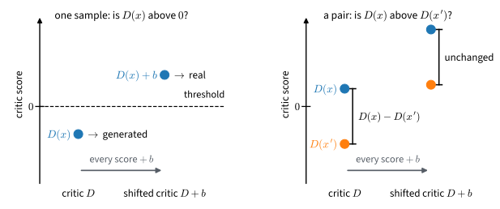

# Relativistic Objectives
:label:`sec_gan_relativistic`

A standard classifier critic scores each sample against a fixed zero threshold ($D(x') > 0$). In many settings, however, pairwise comparisons are more natural than absolute scores—much like Bradley–Terry preference models (:numref:`sec_regularized`), which turn the score difference between two candidates into a win probability. :citet:`Jolicoeur-Martineau.2019` introduced *relativistic* GAN critics that take a real sample $x \sim p$ and a generated sample $x' \sim q$ and predict which one is real from their score difference $D(x) - D(x')$.

Because the modern R3GAN recipe we will build in :numref:`sec_gan_convergence` and use throughout the rest of the chapter relies on this pairwise objective, we analyze three questions here:

1. Does the optimal pairwise ranking critic still recover the log density ratio $\lambda(x) = \log(p(x)/q(x))$?
2. What divergence does the pairwise objective measure at its optimum, and how does it compare to $\mathrm{JS}(p, q)$?
3. Under what conditions does pairwise ranking eliminate mode-dropping local minima?

```{.python .input #relativistic-relativistic-objectives}
%%tab pytorch
import math
import numpy as np
import torch
from torch import nn
from torch.nn import functional as F
from d2l import torch as d2l
```

```{.python .input #relativistic-relativistic-objectives}
%%tab jax
import math
import numpy as np
import jax
from jax import numpy as jnp
from flax import nnx
import optax
from d2l import jax as d2l
```

```{.python .input #relativistic-relativistic-objectives-1}
%%tab pytorch, jax
import itertools
```

## Scoring Pairs

### The Bradley–Terry Pairing Critic

Given an independent pair $(x, x')$ with $x \sim p$ and $x' \sim q$, the *relativistic pairing* objective (RpGAN, :citet:`Jolicoeur-Martineau.2019,Jolicoeur-Martineau.2020`) models the probability that $x$ is more realistic than $x'$ via the Bradley–Terry likelihood $\sigma(D(x) - D(x'))$ :cite:`Bradley.Terry.1952`:

$$
\Phi(D) \;=\; \mathbb{E}_{x \sim p,\; x' \sim q}\big[\log \sigma\big(D(x) - D(x')\big)\big].
$$
:eqlabel:`eq_gan_rp`

The critic maximizes $\Phi(D)$ (minimizes $-\Phi(D)$). On a minibatch, `rpgan_loss_D` averages $-\log \sigma(D(x_i) - D(x'_i)) = \operatorname{softplus}(D(x'_i) - D(x_i))$ over aligned pairs $(x_i, x'_i)$, while `rpgan_loss_G` implements the non-saturating generator loss by swapping the arguments:

```{.python .input #relativistic-the-bradley-terry-critic}
%%tab pytorch
#@save
def rpgan_loss_D(critic, real, fake):
    """Relativistic pairing critic loss -E[log sigma(D(x) - D(x'))]."""
    return F.softplus(critic(fake) - critic(real)).mean()

#@save
def rpgan_loss_G(critic, real, fake):
    """Non-saturating pairing loss for the generator."""
    return F.softplus(critic(real) - critic(fake)).mean()
```

```{.python .input #relativistic-the-bradley-terry-critic}
%%tab jax
#@save
def rpgan_loss_D(critic, real, fake):
    """Relativistic pairing critic loss -E[log sigma(D(x) - D(x'))]."""
    return jax.nn.softplus(critic(fake) - critic(real)).mean()

#@save
def rpgan_loss_G(critic, real, fake):
    """Non-saturating pairing loss for the generator."""
    return jax.nn.softplus(critic(real) - critic(fake)).mean()
```

### Shift Invariance and the Optimal Critic
:label:`subsec_gan_rp_optimal_critic`

Unlike a single-sample classifier whose zero threshold is fixed by the log loss, a pairwise ranking objective depends only on differences $D(x) - D(x')$ (:numref:`fig_gan_pairing`). Adding any constant $b$ to $D$ leaves $\Phi(D + b) = \Phi(D)$ unchanged. Consequently, the sign of an individual score $D(x')$ is arbitrary; the natural accuracy metric is instead the pairwise ranking accuracy $P(D(x) > D(x'))$.


:label:`fig_gan_pairing`

In the single-sample log-loss objective, maximizing $V(D)$ decoupled pointwise across $x$. In :eqref:`eq_gan_rp`, all points are coupled through the differences $D(x) - D(x')$, but concavity still yields a closed-form optimum.

**Proposition.** *$\Phi(D)$ is concave in $D$, and when $p$ and $q$ share the same support, it is maximized by $D^\star(x) = \lambda(x) = \log(p(x)/q(x))$, uniquely up to an additive constant.*

**Proof.** Because $D \mapsto D(x) - D(x')$ is linear and $\log \sigma$ is strictly concave, $\Phi(D)$ is concave in $D$ and strictly concave in the score differences. Taking the functional derivative of $\Phi(D)$ with respect to $D(t)$ (where $t$ appears both as the real sample $x$ and as the generated sample $x'$) and using $\tfrac{d}{du} \log \sigma(u) = \sigma(-u)$ gives:

$$
\begin{aligned}
\frac{\delta \Phi}{\delta D(t)}
&= p(t)\, \mathbb{E}_{x' \sim q}\big[\sigma(D(x') - D(t))\big] \\
&\quad - q(t)\, \mathbb{E}_{x \sim p}\big[\sigma(D(t) - D(x))\big].
\end{aligned}
$$
:eqlabel:`eq_gan_rp_stationarity`

Evaluating at $D = \lambda = \log \rho$ (where $\rho = p/q$) gives $\sigma(\lambda(x') - \lambda(t)) = \rho(x')/(\rho(x') + \rho(t))$. Using $q\rho = p$, both terms in :eqref:`eq_gan_rp_stationarity` equal $p(t) \int \frac{p(x)}{\rho(x) + \rho(t)}\,dx$, so $\frac{\delta \Phi}{\delta D(t)} = 0$ everywhere. By strict concavity of $\log \sigma$ in the score differences, $D^\star = \lambda + c$ is the unique maximizer up to a constant shift $c$. $\blacksquare$

## The Pairing Divergence

### A Two-State Example

To see how the optimal value of $\Phi(D)$ relates to the Jensen–Shannon divergence, consider a two-state space $\{0, 1\}$ with $p = (0.8, 0.2)$ and $q = (0.2, 0.8)$. An ordered pair $(a_1, a_2)$ drawn with the real sample first follows the product distribution $P(a_1, a_2) = p(a_1)q(a_2)$, whereas a pair with the real sample second follows $Q(a_1, a_2) = q(a_1)p(a_2)$:

| pair $(a_1, a_2)$ | $(0, 0)$ | $(1, 1)$ | $(0, 1)$ | $(1, 0)$ |
|:--|:--|:--|:--|:--|
| $P = p \otimes q$ (real first) | 0.16 | 0.16 | 0.64 | 0.04 |
| $Q = q \otimes p$ (real second) | 0.16 | 0.16 | 0.04 | 0.64 |

Tied pairs $(0, 0)$ and $(1, 1)$ carry no information about which element is real, while mixed pairs $(0, 1)$ and $(1, 0)$ identify the real element with posterior probability $0.64/(0.64 + 0.04) = 16/17 \approx 0.94$ (compared to $0.80$ from observing a single sample). At the optimal score difference $d = D^\star(0) - D^\star(1) = \lambda(0) - \lambda(1) = \log 16$, the gain over random guessing ($\Phi(0) = -\log 2$) is $\sup_D \Phi(D) + \log 2 = 0.68\big(\log 2 - H_b(\tfrac{1}{17})\big) \approx 0.319$ nats—which is $1.66\times$ larger than $\mathrm{JS}(p, q) = \log 2 - H_b(0.8) \approx 0.193$ nats, and exactly equal to $\mathrm{JS}(P, Q)$ between the two pair distributions $P$ and $Q$:

```{.python .input #relativistic-two-atoms-by-hand}
%%tab pytorch, jax
def entropy(v):
    v = v[v > 0]                       # the convention 0 log 0 = 0
    return -(v * np.log(v)).sum()

def js(a, b):
    return entropy((a + b) / 2) - (entropy(a) + entropy(b)) / 2

p, q = np.array([0.8, 0.2]), np.array([0.2, 0.8])
P, Q = np.outer(p, q), np.outer(q, p)  # P[i, j]: real sample at i, generated at j
lam = np.log(p / q)                    # the optimal critic: lam[0] - lam[1] = log 16
U = lam[:, None] - lam[None, :]        # U[i, j] = D(i) - D(j)
phi = (P * -np.logaddexp(0, -U)).sum() # Phi = E_P[log sigma(D(a_1) - D(a_2))]
print(f'JS(p, q) = {js(p, q):.3f}   JS(P, Q) = {js(P.ravel(), Q.ravel()):.3f}   '
      f'sup Phi + log 2 = {phi + np.log(2):.3f}')
```

### Lifting to Product Measures

We can prove this equivalence in general by viewing the ordered pair $(a_1, a_2) \in \mathcal{X} \times \mathcal{X}$ as a single observation drawn either from $P = p \otimes q$ (real first) or from $Q = q \otimes p$ (real second), and considering the standard log-loss objective :eqref:`eq_gan_V` on $\mathcal{X} \times \mathcal{X}$ with a pair critic $\mathcal{D}(a_1, a_2)$:

$$
\begin{aligned}
V_{P,Q}(\mathcal{D})
&= \mathbb{E}_{(a_1, a_2) \sim P}\big[\log \sigma(\mathcal{D}(a_1, a_2))\big] \\
&\quad + \mathbb{E}_{(a_1, a_2) \sim Q}\big[\log \sigma(-\mathcal{D}(a_1, a_2))\big].
\end{aligned}
$$

**Lemma (Lifting to Product Space).** *Let $P = p \otimes q$ and $Q = q \otimes p$. Then:*

1. *The log density ratio on the product space separates additively: $\log \frac{dP}{dQ}(a_1, a_2) = \lambda(a_1) - \lambda(a_2)$.*
2. *Every antisymmetric difference critic $\mathcal{D}(a_1, a_2) = D(a_1) - D(a_2)$ satisfies $V_{P,Q}(\mathcal{D}) = 2\,\Phi(D)$.*
3. *Restricting $\mathcal{D}$ to difference critics $D(a_1) - D(a_2)$ does not reduce the supremum: $\sup_{\mathcal{D}} V_{P,Q}(\mathcal{D}) = \sup_{D} V_{P,Q}\big(D(a_1) - D(a_2)\big)$.*

**Proof.** (1) follows immediately from $\frac{dP}{dQ}(a_1, a_2) = \frac{p(a_1)q(a_2)}{q(a_1)p(a_2)} = \frac{\rho(a_1)}{\rho(a_2)}$. For (2), under $Q$ we have $(a_1, a_2) \sim q \otimes p$ and $-\mathcal{D}(a_1, a_2) = D(a_2) - D(a_1)$, so both expectations in $V_{P,Q}(\mathcal{D})$ equal $\Phi(D)$. For (3), the unconstrained maximizer of $V_{P,Q}(\mathcal{D})$ is $\mathcal{D}^\star(a_1, a_2) = \log \frac{dP}{dQ}(a_1, a_2)$, which by (1) already has the difference form $\lambda(a_1) - \lambda(a_2)$. $\blacksquare$

(Note that Property 3 relies specifically on the logarithmic link of the logistic payoff; for other payoffs such as least squares, the optimal pair critic is a nonlinear function of $\lambda(a_1) - \lambda(a_2)$ that is not additively separable; see Exercise :exref:`ex_relativistic-separability-choice-loss-replace`.)

**Theorem.** *The calibrated pairing divergence $d_{\mathrm{Rp}}(p, q) := \sup_D \Phi(D) + \log 2$ satisfies*

$$
\begin{aligned}
d_{\mathrm{Rp}}(p, q)
&= \mathrm{JS}\big(p \otimes q,\; q \otimes p\big) \\
&= H\Big(\tfrac{1}{2}\big(p \otimes q + q \otimes p\big)\Big) - H(p) - H(q).
\end{aligned}
$$
:eqlabel:`eq_gan_rp_value`

**Proof.** Combining Parts 2 and 3 of the Lifting Lemma with :eqref:`eq_gan_js_value` applied to $(P, Q)$ gives $2\sup_D \Phi(D) = \sup_{\mathcal{D}} V_{P,Q}(\mathcal{D}) = 2\,\mathrm{JS}(P, Q) - 2\log 2$, proving the first equality. Applying :eqref:`eq_gan_entropy_gap` to $(P, Q)$ and using $H(p \otimes q) = H(q \otimes p) = H(p) + H(q)$ yields the second equality. $\blacksquare$

Substituting $D^\star = \lambda$ directly into :eqref:`eq_gan_rp` also yields the explicit expectation form:

$$
\begin{aligned}
d_{\mathrm{Rp}}(p, q)
&= \log 2 - \mathbb{E}_{x \sim p,\; x' \sim q}\Big[\log\Big(1 + \frac{q(x)\, p(x')}{p(x)\, q(x')}\Big)\Big],
\end{aligned}
$$
:eqlabel:`eq_gan_rp_explicit`

and the mutual-information identity :eqref:`eq_gan_entropy_gap` on the pair space shows that for a randomly ordered pair $(a_1, a_2)$ with ordering label $y \in \{0, 1\}$,

$$
\begin{aligned}
d_{\mathrm{Rp}}(p, q) &= I\big((a_1, a_2);\, y\big) = \log 2 - H\big(y \mid a_1, a_2\big).
\end{aligned}
$$
:eqlabel:`eq_gan_rp_mi`

### Information Bounds
:label:`subsec_gan_rp_bounds`

Using :eqref:`eq_gan_rp_mi`, we can relate $d_{\mathrm{Rp}}(p, q)$ directly to $\mathrm{JS}(p, q)$. Each marginal element $a_k$ of the randomly ordered pair has distribution $m = (p+q)/2$ and carries $I(a_k; y) = \mathrm{JS}(p, q)$ nats about the ordering label $y$, while $a_1$ and $a_2$ are conditionally independent given $y$ ($H(a_2 \mid a_1, y) = H(a_2 \mid y)$). By the chain rule of mutual information:

$$
\begin{aligned}
d_{\mathrm{Rp}}(p, q) &= I(a_1; y) + I(a_2; y \mid a_1) \\
&= I(a_1; y) + I(a_2; y) - I(a_1; a_2) \\
&= 2\, \mathrm{JS}(p, q) - I(a_1; a_2).
\end{aligned}
$$

Because $I(a_2; y \mid a_1) \geq 0$, $I(a_1; a_2) \geq 0$, and $d_{\mathrm{Rp}}(p, q) \leq \log 2$, we obtain the tight sandwich bounds:

$$
\begin{aligned}
\mathrm{JS}(p, q) &\leq d_{\mathrm{Rp}}(p, q) \leq \min\big(2\,\mathrm{JS}(p, q),\, \log 2\big).
\end{aligned}
$$

Near equilibrium ($q \to p$), $I(a_1; a_2)$ is fourth-order in $p - q$ while $\mathrm{JS}(p, q)$ is second-order, so $d_{\mathrm{Rp}}(p, q) \approx 2\,\mathrm{JS}(p, q)$ (Exercise :exref:`ex_relativistic-gap-twice-js`). When $p$ and $q$ have disjoint supports, both $\mathrm{JS}(p, q)$ and $d_{\mathrm{Rp}}(p, q)$ saturate at $\log 2$.

## Ranking and Mode Coverage

### The Relativistic Rank Weight

Differentiating $\Phi(D)$ with respect to the generator parameters $\theta$ through $x' = G(z)$ yields:

$$
\begin{aligned}
\nabla_\theta \Phi &= -\,\mathbb{E}_{z}\big[w_{\textrm{Rp}}(G(z))\, \nabla_\theta D(G(z))\big], \\
w_{\textrm{Rp}}(x') &= \mathbb{E}_{x \sim p}\big[\sigma\big(D(x') - D(x)\big)\big].
\end{aligned}
$$
:eqlabel:`eq_gan_rp_weights`

In the saturating zero-sum formulation (minimizing $\Phi$), each generated sample is pushed along $\nabla_\theta D(G(z))$ with weight $w_{\textrm{Rp}}(x')$—the softened probability that $x'$ outranks a randomly drawn real sample $x \sim p$. In the non-saturating formulation (`rpgan_loss_G`, minimizing $-\mathbb{E}[\log \sigma(D(x') - D(x))]$), the weight becomes $1 - w_{\textrm{Rp}}(x') = \mathbb{E}_{x \sim p}[\sigma(D(x) - D(x'))]$. Unlike the single-sample weights $\sigma(\pm D(x'))$, which compare $D(x')$ only against zero, the relativistic weight compares $D(x')$ against the distribution of real scores $D(x)$ and is invariant to constant shifts of $D$.

### Fixed-Pairing versus All-Pairs Landscapes
:label:`subsec_gan_rp_landscapes`

Does pairwise ranking eliminate mode-dropping local minima? :citet:`Sun.Fang.Schwing.2020` analyzed the discrete setting of $n$ distinct real points $x_1, \ldots, x_n$ and $n$ freely movable generated points $x'_1, \ldots, x'_n$ evaluated at the exact best-response critic $D$:

$$
\begin{aligned}
\mathcal{E}_{\mathrm{GAN}} &= \sup_D \tfrac{1}{2n} \textstyle\sum_{i} \big[\log \sigma(D(x_i)) + \log \sigma(-D(x'_i))\big],\\
\mathcal{E}_{\mathrm{diag}} &= \sup_D \tfrac{1}{n} \textstyle\sum_{i} \log \sigma\big(D(x_i) - D(x'_i)\big),\\
\mathcal{E}_{\mathrm{all}} &= \sup_D \tfrac{1}{n^2} \textstyle\sum_{i, j} \log \sigma\big(D(x_i) - D(x'_j)\big).
\end{aligned}
$$
:eqlabel:`eq_gan_rp_landscape`

Here $\mathcal{E}_{\mathrm{GAN}}$ is the classic single-sample objective, $\mathcal{E}_{\mathrm{diag}}$ is the *fixed-pairing* objective (where real point $x_i$ is permanently paired with generated point $x'_i$), and $\mathcal{E}_{\mathrm{all}}$ averages over all $n^2$ real–generated pairs. A configuration where all $x'_i$ land on real points but at least two coincide (leaving some real point uncovered) is called a *collision*. :citet:`Sun.Fang.Schwing.2020` proved that every collision ($n^n - n!$ of them) is a strict local minimum of $\mathcal{E}_{\mathrm{GAN}}$, whereas $\mathcal{E}_{\mathrm{diag}}$ has a non-increasing escape path from every collision to the global minimum $-\log 2$.

We can verify this directly for $n = 2$ and $n = 3$. With empirical distributions $\hat p$ and $\hat q$, $\mathcal{E}_{\mathrm{GAN}} = \mathrm{JS}(\hat p, \hat q) - \log 2$ and $\mathcal{E}_{\mathrm{all}} = \mathrm{JS}(\hat p \otimes \hat q, \hat q \otimes \hat p) - \log 2$, while $\mathcal{E}_{\mathrm{diag}}$ equals $-\log 2$ times the fraction of directed edges $i \to \text{gen}[i]$ that lie on a cycle (Exercise :exref:`ex_relativistic-random-repairing`).

```{.python .input #relativistic-paired-landscapes-1}
%%tab pytorch, jax
def on_cycle(i, gen):
    """Does the arrow from real point i to its partner's position close a cycle?"""
    j = gen[i]
    for _ in range(len(gen)):
        if j == i:
            return True
        if j not in range(len(gen)):  # a position that holds no data point
            return False
        j = gen[j]                    # follow the arrow of the real point at j
    return False

def losses(gen):
    """Best-response classical, all-pairs and paired losses of a configuration."""
    n = len(gen)
    support = sorted(set(range(n)) | set(gen))
    p_hat = np.isin(support, range(n)) / n
    q_hat = np.array([gen.count(s) for s in support]) / n
    P, Q = np.outer(p_hat, q_hat).ravel(), np.outer(q_hat, p_hat).ravel()
    paired = -np.log(2) * np.mean([on_cycle(i, gen) for i in range(n)])
    return np.array([js(p_hat, q_hat) - np.log(2), js(P, Q) - np.log(2), paired])

print('gen         classical, all pairs, paired: nats, multiples of log 2')
for gen in ([0, 0], [0, 0.1]):   # both on x_1; then x'_2 steps off it
    value = losses(gen)
    print(f'{str(gen):12s}{np.round(value, 3)}  {np.round(value / np.log(2), 2)}')
```

Moving $x'_2$ from $0$ to $0.1$ raises the classical and all-pairs losses
(confirming that the collision `[0, 0]` is a strict local minimum for both)
while leaving the fixed-pairing loss unchanged at $-\frac{1}{2}\log 2$. To
check all $n^n$ configurations systematically, `count_bad_minima(n)` tests
every assignment against local perturbations from `small_moves(gen)`:

```{.python .input #relativistic-paired-landscapes-2}
%%tab pytorch, jax
def small_moves(gen):
    """Each generated point stays or steps to one of n fresh positions next to it."""
    n = len(gen)
    for steps in itertools.product(range(n + 1), repeat=n):
        if any(steps):
            yield [g + k / 10 if k else g for g, k in zip(gen, steps)]

def count_bad_minima(n):
    """Suboptimal strict local minima among the assignments, per loss."""
    best, count = losses(list(range(n))), np.zeros(3, dtype=int)
    for gen in itertools.product(range(n), repeat=n):
        value = losses(list(gen))
        rises = np.all([losses(m) > value + 1e-9 for m in small_moves(list(gen))],
                       axis=0)
        count += rises & (value > best + 1e-9)
    return count
```

Running `count_bad_minima` for $n \in \{2, 3\}$ compares the number of
suboptimal strict local minima under each objective against the theoretical
collision count $n^n - n!$:

```{.python .input #relativistic-paired-landscapes-3}
%%tab pytorch, jax
for n in (2, 3):
    c = count_bad_minima(n)
    print(f'n = {n}: classical {c[0]}, all pairs {c[1]}, paired {c[2]};  '
          f'n^n - n! = {n**n - math.factorial(n)}')
```

Crucially, the enumeration shows that while the fixed-coupling loss $\mathcal{E}_{\mathrm{diag}}$ has zero collision minima, the all-pairs loss $\mathcal{E}_{\mathrm{all}}$ has all $n^n - n!$ collision minima—just like $\mathcal{E}_{\mathrm{GAN}}$! Because standard minibatch training resamples independent real and generated minibatches at every step, its expected objective over random pairings is $\mathcal{E}_{\mathrm{all}}$, not $\mathcal{E}_{\mathrm{diag}}$ (Exercise :exref:`ex_relativistic-random-repairing`). Thus, the landscape theorem of :citet:`Sun.Fang.Schwing.2020` applies only to a fixed one-to-one coupling, and any mode-coverage benefit of minibatch RpGAN must be tested empirically (:numref:`sec_gan_convergence`).

### Saturating versus Non-Saturating Pairing in Training
:label:`subsec_gan_rp_trained`

Both the saturating generator loss ($\Phi$) and the non-saturating generator loss (`rpgan_loss_G`) share the global minimum $q = p$. When $p$ and $q$ already overlap—as on the 3-mode Gaussian mixture testbed of :numref:`subsec_gan_objectives_testbed`—both variants converge to within a few thousandths of a nat:

```{.python .input #relativistic-pairing-on-the-mixture-testbed}
%%tab pytorch, jax
scores = lambda s: s   # train_toy passes scores, so the critic is the identity
arms = {'non-saturating': (lambda r, f: d2l.rpgan_loss_D(scores, r, f),
                           lambda r, f: d2l.rpgan_loss_G(scores, r, f)),
        'saturating': (lambda r, f: d2l.rpgan_loss_D(scores, r, f),
                       lambda r, f: -d2l.rpgan_loss_D(scores, r, f))}

def first_step_below(trace, level=0.01, every=200):
    below = np.flatnonzero(trace < level)
    return f'{every * below[0]:5d}' if len(below) else ' none'

print('pairing critic; generator loss, runs 0, 1, 2')
for name, (critic_loss, gen_loss) in arms.items():
    traces = [d2l.train_toy(critic_loss, gen_loss, seed) for seed in range(3)]
    medians = ' '.join(f'{np.median(t[-2000 // 200:]):.4f}' for t in traces)
    firsts = ' '.join(first_step_below(t) for t in traces)
    print(f'{name:15s} median JS {medians}   first JS < 0.01 {firsts}')
```

Both arms fit, to a few thousandths of a nat or less. The non-saturating runs cross 0.01 nats between steps 2,200 and 2,600, as the logistic loss of :numref:`sec_gan_objectives` did, so pairing loses nothing in fit, and the saturating ones, whose weight is not small near the data, cross first, at step 1,800 in every run.

However, when the generator starts far from the data ($\theta_0 = 6$ in `d2l.train_shift` from :numref:`subsec_gan_objectives_separated_start`), every generated sample is ranked far below every real sample ($D(x') \ll D(x)$), driving the saturating rank weight $w_{\textrm{Rp}}(x')$ to zero:

```{.python .input #relativistic-pairing-on-the-separated-start}
%%tab pytorch, jax
steps = (0, 100, 300, 1000, 1500)
print(f'{"":20s}|gradient|   theta at steps {steps}   first |theta| < 0.5')
for name, (critic_loss, gen_loss) in arms.items():
    for seed in range(3):
        thetas, grads, _ = d2l.train_shift(critic_loss, gen_loss, seed)
        hit = np.flatnonzero(np.abs(thetas) < 0.5)
        print(f'{name:15s} {seed}   {np.median(np.abs(grads[:100])):8.3f}   '
              + ''.join(f'{thetas[t]:7.2f}' for t in steps) + '   '
              + (f'{hit[0]:5d}' if len(hit) else 'not reached'))
```

From $\theta_0 = 6$, the saturating pairing generator has a median gradient below $5 \times 10^{-4}$ and remains stuck at $\theta \approx 6.00$ after 1,500 steps, whereas the non-saturating pairing generator (`rpgan_loss_G`) receives gradients of $\sim 3$ and reaches $|\theta| < 0.5$ around step 330 across all seeds. We therefore use the non-saturating pairing loss throughout the rest of the chapter.

## Summary

- The relativistic pairing objective (RpGAN) maximizes the Bradley–Terry log-likelihood $\Phi(D) = \mathbb{E}_{x \sim p, x' \sim q}[\log \sigma(D(x) - D(x'))]$ of ranking a real sample above a generated sample.
- Its optimal critic is still the log density ratio $D^\star(x) = \lambda(x) = \log(p(x)/q(x))$, now determined only up to an additive constant.
- By lifting the pair $(a_1, a_2)$ to the product space $\mathcal{X} \times \mathcal{X}$, the calibrated optimal value $d_{\mathrm{Rp}}(p, q) = \sup_D \Phi(D) + \log 2$ equals $\mathrm{JS}(p \otimes q, q \otimes p) = 2\,\mathrm{JS}(p, q) - I(a_1; a_2)$, which satisfies $\mathrm{JS}(p, q) \leq d_{\mathrm{Rp}}(p, q) \leq \min(2\,\mathrm{JS}(p, q), \log 2)$.
- While a fixed one-to-one coupling $\mathcal{E}_{\mathrm{diag}}$ eliminates discrete mode-dropping collision minima at the best-response critic, random minibatch re-pairing averages back to the all-pairs objective $\mathcal{E}_{\mathrm{all}}$, which retains those collision minima.
- Far from the data, the saturating rank weight $w_{\textrm{Rp}}(x') = \mathbb{E}_{x \sim p}[\sigma(D(x') - D(x))]$ vanishes; the non-saturating weight $1 - w_{\textrm{Rp}}(x')$ stays near $1$ and preserves the generator gradient.

## Exercises

1. [code] **Saturating and non-saturating rank weights.** Consider a 5-state discrete space with data distribution $p = (0.35, 0.25, 0.20, 0.12, 0.08)$ and generator distribution $q = (0.02, 0.05, 0.13, 0.30, 0.50)$.
    1. Using `js` from the two-state cell, compute $\mathrm{JS}(p, q)$ and $d_{\mathrm{Rp}}(p, q)$, verifying that $\mathrm{JS}(P, Q)$ on the 25 pair states matches $\sup_D \Phi(D) + \log 2$ at $D = \lambda$ ($\approx 0.234$ and $0.377$).
    1. Evaluate the saturating weight $w_{\mathrm{Rp}}$ (:eqref:`eq_gan_rp_weights`) and non-saturating weight $1 - w_{\mathrm{Rp}}$ at each state under $D = \lambda$, and compare their $q$-expectations.
    1. At $D = \lambda$, show that $\mathbb{E}_{x' \sim q}[w_{\mathrm{Rp}}(x')] = \iint \frac{P Q}{P + Q}\, da_1\, da_2 \leq \tfrac12$, with equality if and only if $q = p$, and that it vanishes as the supports of $p$ and $q$ separate.
    1. Run `d2l.train_shift` with the pairing critic and both generator losses from initial offsets `theta0` $\in \{1, 2, 3, 4\}$ (three seeds each) to find the separation at which the saturating generator stalls.
   :exlabel:`ex_relativistic-zero-sum-weights`

1. **Gap between $d_{\mathrm{Rp}}$ and $2\,\mathrm{JS}(p, q)$.** ● Consider the randomly ordered pair $(a_1, a_2)$ and its ordering label $y$ from :eqref:`eq_gan_rp_mi`.
    1. Show that $a_1$ and $a_2$ are conditionally independent given $y$ and that $I(a_k; y) = \mathrm{JS}(p, q)$ for $k \in \{1, 2\}$.
    1. When $p$ and $q$ have disjoint supports, compute $I(a_1; a_2)$ directly from the pair mixture $\tfrac12(P + Q)$ and verify that $I(a_1; a_2) = \mathrm{JS}(p, q) = \log 2$.
    1. For a local perturbation $q = p\,(1 + \epsilon v)$ with $\mathbb{E}_p[v] = 0$, show that $\mathrm{JS}(p, q) = \Theta(\epsilon^2)$ whereas $I(a_1; a_2) = \Theta(\epsilon^4)$, so $d_{\mathrm{Rp}}(p, q) / \mathrm{JS}(p, q) \to 2$ as $\epsilon \to 0$.
    1. Verify $d_{\mathrm{Rp}}(p, q) = 2\,\mathrm{JS}(p, q) - I(a_1; a_2)$ numerically on the 5-state distribution of Exercise :exref:`ex_relativistic-zero-sum-weights`.
   :exlabel:`ex_relativistic-gap-twice-js`

1. **Two Gaussians.** Let $p = \mathcal{N}(0, I_d)$ and $q = \mathcal{N}(\mu, I_d)$ on $\mathbb{R}^d$.
    1. Show that $\lambda(x)$ is affine in $x$ and that $u = \lambda(x') - \lambda(x)$ in :eqref:`eq_gan_rp_explicit` is Gaussian; find its mean and variance.
    1. Express $\mathrm{JS}(p, q)$ in the same form and find the scaling constant $c$ for which $\mathrm{JS}\big(p, \mathcal{N}(c\mu, I_d)\big) = d_{\mathrm{Rp}}(p, q)$ for all $\mu$.
    1. Evaluate $d_{\mathrm{Rp}}(p, q)$ and $\mathrm{JS}(p, q)$ by 1D quadrature for $\|\mu\| \in \{0.1, 1, 2, 4\}$ and compare their ratio against the local and large-separation limits.
   :exlabel:`ex_relativistic-two-gaussians`

1. **Separability of the pair critic.** ● Replace $\log \sigma$ in :eqref:`eq_gan_rp` with a general concave payoff $\ell$, giving $\Phi_\ell(D) = \mathbb{E}_{x \sim p, x' \sim q}[\ell(D(x) - D(x'))]$.
    1. For the least-squares payoff $\ell(t) = -(1 - t)^2$, show that the unconstrained optimal pair critic on $\mathcal{X} \times \mathcal{X}$ is $2\eta - 1 = \tanh\big(\tfrac{\lambda(a_1) - \lambda(a_2)}{2}\big)$ with $\eta = P/(P + Q)$, which is not additively separable as $D(a_1) - D(a_2)$.
    1. On the 5-state example of Exercise :exref:`ex_relativistic-zero-sum-weights`, compute the gap between the unconstrained pair optimum and $\sup_{D \in \mathbb{R}^5} 2\,\Phi_\ell(D)$.
    1. Under the logistic payoff with unbalanced ordering prior $\alpha \neq \tfrac12$, derive the Bayes-optimal pair critic and show how the difference class $D(a_1) - D(a_2)$ must be augmented to attain it.
   :exlabel:`ex_relativistic-separability-choice-loss-replace`

1. [code] **Fixed coupling versus random re-pairing.** ●●
    1. Prove the cycle rule used in `losses` for $\mathcal{E}_{\mathrm{diag}}$: on any directed acyclic edge, the critic can make $D(x_i) - D(x'_i) \to +\infty$ so its loss vanishes, whereas around a $k$-cycle the differences sum to zero and concavity of $\log \sigma$ gives a maximum of $-k\log 2$ at equal scores.
    1. Extend `count_bad_minima` to $n = 4$ (256 configurations) and verify the counts for $\mathcal{E}_{\mathrm{GAN}}$, $\mathcal{E}_{\mathrm{all}}$, and $\mathcal{E}_{\mathrm{diag}}$.
    1. Define the permutation-averaged best-response objective $\frac{1}{n!} \sum_\pi \sup_D \frac{1}{n} \sum_i \log \sigma(D(x_i) - D(x'_{\pi(i)}))$ and count its strict suboptimal local minima for $n = 3$. Compare this regime with a critic that adapts slowly across many random-pairing minibatches (which faces $\mathcal{E}_{\mathrm{all}}$).
   :exlabel:`ex_relativistic-random-repairing`

[Discussions](https://d2l.discourse.group/t/36810)

<!-- slides -->

::: {.slide}
::: {.cover}
[Dive into Deep Learning · §16.3]{.kicker}

Relativistic Objectives and Pairwise Ranking<br>**Bradley–Terry pairing critic · shift invariance · product-measure JS divergence · information bounds · fixed vs. random pairing landscapes**
:::
:::

::: {.slide title="From Absolute Thresholds to Pairwise Ranking"}
[Motivation]{.kicker}

A single-sample discriminator scores each observation $x$ against a fixed zero threshold ($D(x) \gtrless 0$), whereas pairwise preference models—such as Bradley–Terry reward models in RLHF—predict which of two candidates is better from their score difference:

::: {.cols .vc}
::: {.col}
- **Threshold fragility under score shifts:** Adding a constant $b$ to all critic scores flips single-sample threshold verdicts against $0$, even though the relative ordering of real and generated samples has not changed.
- **Relativistic pairing (RpGAN; Jolicoeur-Martineau, 2019):** Pairs a real sample $x \sim p$ with a generated sample $x' \sim q$ and predicts which member is real from their difference $D(x) - D(x')$.
- **Three core questions:** (1) Does the optimal ranker still estimate $\lambda(x) = \log(p(x)/q(x))$? (2) What divergence does it measure? (3) When does pairwise ranking prevent mode collapse?
:::

::: {.col .fig}
{.nostretch width=100%}
:::
:::
:::

::: {.slide title="The Bradley–Terry Pairing Objective (RpGAN)"}
[Formulation & Implementation]{.kicker}

Given an independent pair $(x, x')$ with $x \sim p$ and $x' \sim q$, the relativistic pairing objective models the probability that $x$ outranks $x'$ via the **Bradley–Terry likelihood** $\sigma(D(x) - D(x'))$:

$$\Phi(D) = \mathbb{E}_{x \sim p,\; x' \sim q}\Big[\log \sigma\big(D(x) - D(x')\big)\Big]$$

- The critic maximizes $\Phi(D)$ (minimizes $-\Phi(D) = \mathbb{E}[\operatorname{softplus}(D(x') - D(x))]$ over aligned minibatch pairs $(x_i, x'_i)$), while the practical non-saturating generator loss `rpgan_loss_G` swaps the arguments:

@relativistic-the-bradley-terry-critic
:::

::: {.slide title="Shift Invariance and the Optimal Pairing Critic"}
[Optimality Theorem]{.kicker}

::: {.cols .vc}
::: {.col}
$$\frac{\delta \Phi}{\delta D(t)} = 0 \quad \Longleftrightarrow \quad D^\star(x) = \log \frac{p(x)}{q(x)} + c = \lambda(x) + c$$

- **Shift invariance:** For any constant $b \in \mathbb{R}$, $\Phi(D + b) = \Phi(D)$. The sign of an individual score $D(x')$ is arbitrary; monitor the **pairwise ranking accuracy** $P(D(x) > D(x'))$.
- **Unique optimal ranker:** Because $\log \sigma$ is strictly concave, setting the functional derivative $\delta \Phi / \delta D(t)$ to zero identifies $D^\star(x) = \lambda(x) + c$ uniquely up to an additive shift $c$.
:::

::: {.col .fig}
@fig:ch16-gan-shift-invariance
:::
:::
:::

::: {.slide title="Worked Example: Pairwise Ranking on Two States"}
[Concrete Calculation]{.kicker}

Consider a two-state space $\{0, 1\}$ with $p = (0.8, 0.2)$ and $q = (0.2, 0.8)$. Compare the product distribution $P = p \otimes q$ (real sample first) against $Q = q \otimes p$ (real sample second):

| Ordered Pair $(a_1, a_2)$ | $(0, 0)$ (Tied) | $(1, 1)$ (Tied) | $(0, 1)$ (Mixed) | $(1, 0)$ (Mixed) |
| :--- | :--- | :--- | :--- | :--- |
| **$P = p \otimes q$ (real first)** | $0.16$ | $0.16$ | **$0.64$** | $0.04$ |
| **$Q = q \otimes p$ (real second)** | $0.16$ | $0.16$ | $0.04$ | **$0.64$** |

- Tied pairs $(0, 0)$ and $(1, 1)$ carry zero ordering information, while mixed pair $(0, 1)$ identifies the real element with posterior probability $\frac{0.64}{0.64 + 0.04} = \frac{16}{17} \approx 94.1\%$ (vs. $80\%$ from a single sample).
- At $D^\star(0) - D^\star(1) = \lambda(0) - \lambda(1) = \log 16$, the gain $\sup_D \Phi(D) + \log 2 \approx 0.319$ nats equals $\mathrm{JS}(P, Q)$ ($1.66\times$ larger than $\mathrm{JS}(p, q) \approx 0.193$ nats):

@!relativistic-two-atoms-by-hand
:::

::: {.slide title="Lifting to Product Space: Why Differences Suffice"}
[The Lifting Lemma]{.kicker}

::: {.cols .vc}
::: {.col}
$$\log \frac{dP}{dQ}(a_1, a_2) = \log \frac{p(a_1)\,q(a_2)}{q(a_1)\,p(a_2)} = \lambda(a_1) - \lambda(a_2)$$

- **Product-space log-loss game:** View an ordered pair $(a_1, a_2)$ as a single draw from $P = p \otimes q$ (real first) vs. $Q = q \otimes p$ (real second).
- **Zero restriction gap:** Because the unconstrained pair maximizer $\mathcal{D}^\star(a_1, a_2) = \lambda(a_1) - \lambda(a_2)$ already has difference form, restricting critics to $\mathcal{D}(a_1, a_2) = D(a_1) - D(a_2)$ achieves the exact supremum $V_{P,Q} = 2\,\Phi(D)$.
:::

::: {.col .fig}
@fig:ch16-gan-lifting-product
:::
:::
:::

::: {.slide title="Theorem: The Calibrated Pairing Divergence"}
[Product-Space Jensen–Shannon]{.kicker}

::: {.cols .vc}
::: {.col}
$$d_{\mathrm{Rp}}(p, q) := \sup_D \Phi(D) + \log 2 = \mathrm{JS}\big(p \otimes q,\; q \otimes p\big)$$

- **Entropy and explicit expectation forms:** Equals $H(\frac{1}{2}(p \otimes q + q \otimes p)) - H(p) - H(q) = \log 2 - \mathbb{E}_{p,q}[\log(1 + \frac{q(x)p(x')}{p(x)q(x')})]$.
- **Mutual-information interpretation:** For a randomly ordered pair $(a_1, a_2)$ with ordering label $y \in \{0, 1\}$, $d_{\mathrm{Rp}}(p, q) = I((a_1, a_2); y)$ is the information the pair carries about which member is real.
:::

::: {.col .fig}
@fig:ch16-gan-drp-entropy
:::
:::
:::

::: {.slide title="Information Bounds: Comparing d_Rp and JS"}
[Chain Rule of Mutual Information]{.kicker}

::: {.cols .vc}
::: {.col}
$$d_{\mathrm{Rp}}(p, q) = I(a_1; y) + I(a_2; y \mid a_1) = 2\,\mathrm{JS}(p, q) - I(a_1; a_2)$$

- **Near equilibrium ($q \to p$):** Redundancy $I(a_1; a_2) = \Theta(\|p - q\|^4)$ vanishes faster than $\mathrm{JS}(p, q) = \Theta(\|p - q\|^2)$, so $d_{\mathrm{Rp}}(p, q) \approx 2\,\mathrm{JS}(p, q)$.
- **General sandwich bound:** $\mathrm{JS}(p, q) \le d_{\mathrm{Rp}}(p, q) \le \min(2\,\mathrm{JS}(p, q), \log 2)$, still saturating at $\log 2$ on disjoint supports.
:::

::: {.col .fig}
@fig:ch16-gan-mi-sandwich
:::
:::
:::

::: {.slide title="The Relativistic Rank Weight in Generator Updates"}
[Per-Sample Gradient Weighting]{.kicker}

::: {.cols .vc}
::: {.col}
$$\nabla_\theta \Phi = -\mathbb{E}_z\Big[w_{\textrm{Rp}}(G_\theta(z))\,\nabla_\theta D(G_\theta(z))\Big], \quad w_{\textrm{Rp}}(x') = \mathbb{E}_{x \sim p}\Big[\sigma\big(D(x') - D(x)\big)\Big]$$

- **Saturating vs. non-saturating rank weight:** $w_{\textrm{Rp}}(x')$ is the expected win probability of $x'$ against real data $x \sim p$; `rpgan_loss_G` uses $1 - w_{\textrm{Rp}}(x') = \mathbb{E}_p[\sigma(D(x) - D(x'))] \approx 1$ when $D(x') \ll D(x)$.
- **Shift-invariant comparison:** Compares $D(x')$ against the live distribution of real scores $D(x)$ rather than a fixed zero threshold.
:::

::: {.col .fig}
@fig:ch16-gan-rank-weight
:::
:::
:::

::: {.slide title="Discrete Mode-Coverage Landscapes: Three Objectives"}
[Sun, Fang, and Schwing Analysis]{.kicker}

::: {.cols .vc}
::: {.col}
$$\mathcal{E}_{\mathrm{diag}} = \sup_D \frac{1}{n}\sum_{i=1}^n \log\sigma\big(D(x_i) - D(x'_i)\big), \qquad \mathcal{E}_{\mathrm{all}} = \sup_D \frac{1}{n^2}\sum_{i,j=1}^n \log\sigma\big(D(x_i) - D(x'_j)\big)$$

- **Three coupling regimes:** $\mathcal{E}_{\mathrm{GAN}} = \mathrm{JS}(\hat{p}, \hat{q}) - \log 2$ (single-sample), $\mathcal{E}_{\mathrm{diag}}$ (permanent 1-to-1 coupling $x_i \leftrightarrow x'_i$), and $\mathcal{E}_{\mathrm{all}} = d_{\mathrm{Rp}}(\hat{p}, \hat{q}) - \log 2$ (all $n^2$ pairs).
- **Collisions ($n^n - n!$ configurations):** Every $x'_i$ sits on a real point $\{x_1, \ldots, x_n\}$ but at least two coincide, leaving a real mode uncovered.
:::

::: {.col .fig}
@fig:ch16-gan-collision-graphs
:::
:::
:::

::: {.slide title="Stepping Off a Collision: Fixed vs. All-Pairs"}
[Cycle Rule on Directed Graphs]{.kicker}

Under fixed pairing $\mathcal{E}_{\mathrm{diag}}$, draw a directed arrow from each real index $i$ to the position of its paired generated point $x'_i$. Around any directed cycle, score differences $\sum (D(x_i) - D(x'_i)) = 0$ cancel, so concavity of $\log\sigma$ forces tied scores ($-\log 2$ per cycle edge); on acyclic arrows, $D(x_i) - D(x'_i) \to +\infty$ achieves $0$:

@!relativistic-paired-landscapes-1

- When both generated points collide on $x_1$ (`[0, 0]`) and $x'_2$ steps off toward $x_2$ (`[0, 0.1]`), both $\mathcal{E}_{\mathrm{GAN}}$ and $\mathcal{E}_{\mathrm{all}}$ strictly **increase** (from $-0.562$ and $-0.440$ to $-0.382$ and $-0.220$), trapping $x'_2$ at the collision.
- Under fixed pairing $\mathcal{E}_{\mathrm{diag}}$, the self-loop $1 \to 1$ stays tied at $-\log 2$ while the acyclic edge $2 \to x'_2$ stays at $0$, so the loss remains **completely flat** at $-0.5\log 2 \approx -0.347$ all the way to $x_2$!
:::

::: {.slide title="Enumerating Suboptimal Collision Minima"}
[Fixed Coupling vs. Minibatch Re-Pairing]{.kicker}

Counting, over all assignments in $\{0, \ldots, n-1\}^n$ ($n = 2, 3$), the collisions that are strict local minima:

@relativistic-paired-landscapes-2

@!relativistic-paired-landscapes-3
:::

::: {.slide title="Why Minibatch Training Faces All-Pairs Collisions"}
[Practical Pitfall]{.kicker}

::: {.cols .vc}
::: {.col}
- **What Sun et al. (2020) proved:** The fixed one-to-one coupling objective $\mathcal{E}_{\mathrm{diag}}$ has **$0$** suboptimal collision local minima ($0$ vs. $n^n - n!$), because any colliding point $x'_i$ not on a directed cycle can move toward $x_i$ along a flat plateau.
- **What happens under minibatch re-pairing:** Drawing fresh independent minibatches from $p$ and $q$ at every step averages over random pairings, evaluating the **all-pairs expectation** $\mathcal{E}_{\mathrm{all}} = d_{\mathrm{Rp}}(\hat{p}, \hat{q}) - \log 2$ (which retains all $n^n - n!$ collision minima!).
- **Takeaway:** In §{sec_gan_convergence}, our $2 \times 2$ experiment on 25 Gaussians confirms that $R_1 + R_2$ gradient penalties—not pairing alone—drive mode coverage.
:::

::: {.col .fig}
@fig:ch16-gan-minibatch-repair
:::
:::
:::

::: {.slide title="Saturating vs. Non-Saturating Pairing Near Data"}
[Overlapping Mixture Benchmark]{.kicker}

When $p$ and $q$ already overlap—as on the 3-component 2D Gaussian mixture testbed ($\mathrm{JS}(p, q_0) = 0.529$ nats)—both the saturating pairing generator loss ($\min_G \Phi(D)$, weight $w_{\textrm{Rp}}$) and the non-saturating pairing loss (`rpgan_loss_G`, weight $1 - w_{\textrm{Rp}}$) converge to within a few thousandths of a nat:

@!relativistic-pairing-on-the-mixture-testbed

- Near the data distribution, generated samples frequently outrank real samples ($w_{\textrm{Rp}}(x') \approx \frac{1}{2}$), so neither weight saturates, and the saturating arm actually crosses $\mathrm{JS} < 0.01$ nats slightly earlier (step $1{,}800$ vs. $2{,}200\text{--}2{,}600$).
:::

::: {.slide title="Six Units Away: Saturating Pairing Stalls"}
[Separated Start Benchmark]{.kicker}

When initialized far from the data at $\theta_0 = 6.0$ on the 1D Gaussian shift problem ($p = \mathcal{N}(0, 1)$, $q_\theta = \mathcal{N}(\theta, 1)$), every generated sample ranks far below every real sample ($D(x') \ll D(x)$), driving $w_{\textrm{Rp}}(x') = \mathbb{E}_p[\sigma(D(x') - D(x))] \to 0$:

@!relativistic-pairing-on-the-separated-start

::: {.d2l-note}
**Why we always use `rpgan_loss_G`:** At $\theta_0 = 6.0$, the saturating pairing generator receives a median gradient below $5 \times 10^{-4}$ and remains stuck at $\theta = 6.00$ after $1{,}500$ steps, whereas the non-saturating pairing generator ($1 - w_{\textrm{Rp}} \approx 1$) receives gradient $\approx 3.1$ and reaches $|\theta| < 0.5$ around step $330$.
:::
:::

::: {.slide title="Concept Check: Relativistic Critics and Pairings"}
[Check Your Understanding]{.kicker}

Test your understanding of relativistic pairwise objectives:

1. **Behavior of the divergence ratio $d_{\mathrm{Rp}}(p, q) / \mathrm{JS}(p, q)$:** On our two-state example, $d_{\mathrm{Rp}}(p, q) / \mathrm{JS}(p, q) = 0.319 / 0.193 \approx 1.66$. What value does this ratio approach as $q \to p$, and what value does it approach when $p$ and $q$ have disjoint supports?
2. **Escape path under fixed pairing:** For $n = 2$ with fixed pairing $x_1 \leftrightarrow x'_1$ and $x_2 \leftrightarrow x'_2$, suppose both generated points collide on $x_1$ ($x'_1 = x'_2 = x_1$). What is the best-response paired loss $\mathcal{E}_{\mathrm{diag}}$, and how does it behave as $x'_2$ moves continuously from $x_1$ to $x_2$?

::: {.d2l-note .fragment .fade-up}
**Answers:**

1. By $d_{\mathrm{Rp}}(p, q) = 2\,\mathrm{JS}(p, q) - I(a_1; a_2)$: as $q \to p$, $I(a_1; a_2) = \Theta(\|p - q\|^4)$ $\ll$ $\mathrm{JS}(p, q) = \Theta(\|p - q\|^2)$, so the ratio approaches **$2$**. On disjoint supports, both $d_{\mathrm{Rp}}$ and $\mathrm{JS}$ saturate at $\log 2$, so the ratio approaches **$1$**.
2. At $x'_1 = x'_2 = x_1$, edge $1 \to 1$ forms a 1-cycle (contributing $-\frac{1}{2}\log 2$) while edge $2 \to 1$ is acyclic (contributing $0$), giving $\mathcal{E}_{\mathrm{diag}} = -\frac{1}{2}\log 2 \approx -0.347$. As $x'_2$ moves across empty space toward $x_2$, $\mathcal{E}_{\mathrm{diag}}$ stays **completely flat** at $-\frac{1}{2}\log 2$ and then drops to $-\log 2$ once $x'_2$ lands on $x_2$ (closing the second 1-cycle $2 \to 2$).
:::
:::

::: {.slide title="Concept Check: Relativistic Critics and Pairings (cont.)"}
[Check Your Understanding]{.kicker}

3. **Interpreting individual critic scores:** After training an RpGAN critic, you evaluate $D(x') = +3.5$ on a generated image. Does $D(x') > 0$ mean the critic classifies $x'$ as more likely real than generated?

::: {.d2l-note .fragment .fade-up}
**Answer:**

3. **No.** Because $\Phi(D + b) = \Phi(D)$ is shift-invariant, the zero level of $D$ is arbitrary. Only pairwise differences $D(x) - D(x')$ (or the ranking accuracy $P(D(x) > D(x'))$) are meaningful.
:::
:::

::: {.slide title="Summary: Relativistic Pairing Objectives"}
[Key Takeaways]{.kicker}

| Concept / Property | Mathematical Expression | Relation to Classic Log-Loss GAN | Practical Implication |
| :--- | :--- | :--- | :--- |
| **Bradley–Terry Critic ($\Phi$)** | $\Phi(D) = \mathbb{E}_{x \sim p,\, x' \sim q}[\log\sigma(D(x) - D(x'))]$ | Replaces threshold $D(x) \gtrless 0$ with pair ranking | Invariant to constant shifts $D \mapsto D + b$ |
| **Optimal Ranking Critic** | $D^\star(x) = \lambda(x) + c = \log \frac{p(x)}{q(x)} + c$ | Identical log density ratio up to shift $c$ | Monitor pairwise accuracy $P(D(x) > D(x'))$, not signs |
| **Calibrated Pairing Divergence** | $d_{\mathrm{Rp}}(p, q) = \sup_D \Phi(D) + \log 2$ $= \mathrm{JS}(p \otimes q, q \otimes p)$ | $d_{\mathrm{Rp}}(p, q) = 2\,\mathrm{JS}(p, q) - I(a_1; a_2)$ | $\mathrm{JS} \le d_{\mathrm{Rp}} \le \min(2\,\mathrm{JS}, \log 2)$; saturates at $\log 2$ |
| **Relativistic Rank Weight** | $w_{\textrm{Rp}}(x') = \mathbb{E}_{x \sim p}[\sigma(D(x') - D(x))]$ | Compares $D(x')$ against real distribution $D(x)$ | Use non-saturating weight $1 - w_{\textrm{Rp}}(x')$ (`rpgan_loss_G`) |
| **Fixed vs. All-Pairs Landscape** | $\mathcal{E}_{\mathrm{diag}}$ (fixed $x_i \leftrightarrow x'_i$) vs. $\mathcal{E}_{\mathrm{all}}$ ($n^2$ pairs) | $\mathcal{E}_{\mathrm{diag}}$ has $0$ collision minima; $\mathcal{E}_{\mathrm{all}}$ has $n^n - n!$ | Random minibatch re-pairing averages to $\mathcal{E}_{\mathrm{all}}$ |
:::
