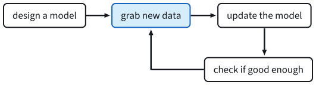
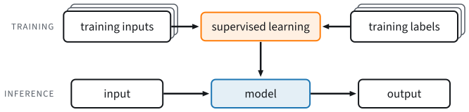
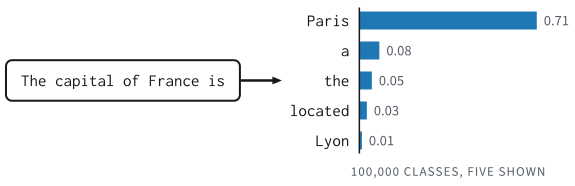
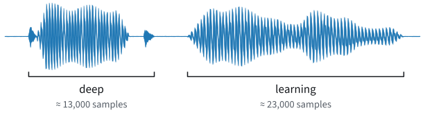
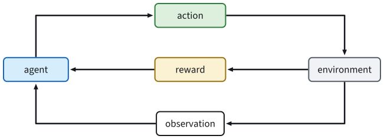

# Introduction
:label:`chap_introduction`

Until recently, nearly every computer program that you interacted with during an ordinary day was coded up as a rigid set of rules specifying how it should behave. Say that we wanted to write an application to run an online store. After huddling around a whiteboard for a few hours, we might settle on the broad strokes of a working design: users interact with the store through a browser or mobile app; a database tracks inventories, customer carts, and past orders; and at the heart of the system, the *business logic* spells out rules mapping every anticipated event to the corresponding action. When a customer clicks to add an item to their cart, the program inserts a row linking that user's ID to the product's ID. We step through corner cases (what happens if someone checks out with an empty cart?), fix a few bugs in testing, and launch the system *before* ever seeing a real customer. When you can devise explicit rules that work $100\%$ of the time, you should not be worrying about machine learning.

Fortunately for the machine learning community, many tasks that we would love to automate do not bend so easily to human ingenuity. Imagine returning to that whiteboard with the smartest programmers you know to tackle any of the following problems:

* Write a program that predicts tomorrow's weather given geographic information, satellite imagery, and a trailing window of past observations.
* Write a program that takes a question in free-form text and answers it accurately, writing and running code when the answer requires a calculation.
* Write a program that identifies every person and vehicle in a street scene and traces an outline around each one.
* Write a program that recommends books or music a user will enjoy, drawn from millions of candidates they would never encounter on their own.
* Write a program that predicts the three-dimensional structure into which a protein folds from its sequence of amino acids alone.

For each of these tasks, even elite programmers would struggle to write explicit rules from scratch. Sometimes the underlying pattern shifts over time, so any successful system must adapt continuously. More often, the relationship between inputs and outputs, whether between raw pixels and object boundaries or between amino-acid sequences and folded geometries, depends on millions of subtle interactions whose rules we cannot state consciously, even when our own eyes and ears solve the task effortlessly.

*Machine learning* is the study of algorithms that improve at a task through experience, typically in the form of observational data or interaction with an environment. Whereas a rule-based store behaves identically on its millionth customer as on its first until a developer rewrites the code, a machine learning system refines its behavior from data. This book teaches the foundations and practice of *deep learning*: the family of multi-layered learning methods driving modern advances across language, vision, speech, science, and decision-making.

## A Motivating Example

Suppose you hop into a car, call out *"Hey Siri"*, and ask for directions to the nearest coffee shop. Within a second or two, the phone wakes up, transcribes your request, chooses a route, and estimates your arrival time. That brief exchange already engages several machine learning models.

Consider just the first step: responding to a *wake word* such as *"Alexa"*, *"OK Google"*, or *"Hey Siri"* (:numref:`fig_wake_word`). Imagine sitting down in a quiet room with nothing but a computer and a code editor to write a wake-word recognizer from first principles. Every second, a phone microphone records roughly $16{,}000$ numbers (or $44{,}100$ on compact-disc audio), each measuring air-pressure amplitude at an instant. What explicit rule could map a one-second array of $16{,}000$ raw numbers reliably to $\{\textrm{yes}, \textrm{no}\}$ across different voices, accents, rooms, and background traffic? If you are stuck, do not worry. Nobody knows how to write that rule by hand either.


:label:`fig_wake_word`

Here is the trick. Even though we cannot spell out the rule mapping sound waves to words, we can effortlessly label examples ourselves. We can therefore collect a *dataset* of thousands of audio snippets paired with labels indicating whether each snippet contains the wake word. Rather than hard-coding a recognizer, we write a flexible program whose input--output behavior is governed by adjustable numerical *parameters*, which act like knobs that we can turn. Once the parameters are fixed, we call the program a *model*; the set of all mappings reachable by turning the knobs is a *model family*; and the meta-program that adjusts the knobs using data is a *learning algorithm*.

Chosen well, the same model family could recognize *"Alexa"* under one setting of its knobs and *"Apricot"* under another. With random knob settings, of course, it recognizes neither. *Training* is the iterative loop by which data guide the knobs toward useful values (:numref:`fig_ml_loop`):

1. Initialize the model's parameters randomly, so it starts out knowing nothing.
1. Sample examples from the dataset (audio snippets paired with $\{\textrm{yes}, \textrm{no}\}$ labels).
1. Adjust the parameters slightly so the model's predictions better match the labels on those examples.
1. Repeat Steps 2 and 3 until performance stops improving.


:label:`fig_ml_loop`

You can think of this paradigm as *programming with data*. Remarkably, looking back at :numref:`fig_wake_word`, this exact same recipe powers both ends of your spoken request: the tiny wake-word detector running continuously on milliwatts on the phone (with roughly a hundred thousand parameters) and the conversational assistant in a data center (with hundreds of billions of parameters) capable of answering open-ended questions, translating languages, or debugging software.


## Key Components

Predicting known labels from inputs, as in wake-word detection, is called *supervised learning*. Across supervised learning and every other paradigm in this book, four core ingredients recur:

1. **Data** from which to learn.
1. A **model** specifying how inputs are transformed into outputs.
1. An **objective function** quantifying how well the model performs.
1. An **optimization algorithm** that adjusts the model's parameters to improve the objective.

### Data

A dataset is a collection of *examples* (also called *data points*, *instances*, or *samples*). Each example carries numerical attributes called *features* (or *inputs* / *covariates*), and in supervised problems a designated target called the *label*.

Sometimes every example has the same number of features, forming a fixed-length vector whose length is the *dimensionality* of the input. A $200 \times 200$ color photograph holds $200 \times 200 \times 3 = 120{,}000$ brightness values across red, green, and blue channels; a hospital patient's admission record might collect a fixed vector of vital signs, lab measurements, and diagnoses to predict 30-day survival. Fixed-length vectors are convenient, yet much of the world refuses to fit neatly into a fixed box. Photographs on the web come in every resolution and aspect ratio, and customer reviews range from two words (*"it stinks!"*) to several pages. In practice, we split text into discrete *tokens* (words or subword pieces) and represent each document as a variable-length sequence of token IDs. A signature strength of deep learning is how naturally modern architectures handle variable-length images, audio, and text directly.

Both quantity and quality of data matter. Expressive deep networks thrive on scale: modern language models train on corpora of order ten trillion ($10^{13}$) tokens, where rigid simplifying assumptions can give way to rich learned structure. Yet volume never rescues corrupt or unrepresentative data (*garbage in, garbage out*). A skin-lesion classifier trained exclusively on light skin will fail dangerously on dark skin, and a resume screener trained on biased historical hiring decisions will inadvertently automate past prejudices without any engineer intending it. Asking what a dataset covers, and whom it leaves out, is part of engineering the system rather than an afterthought.

### Models

A *model* is the parameterized computational mapping that transforms inputs of one type into predictions of another. Deep learning models chain many parameterized layers of linear and nonlinear transformations from bottom to top, giving *deep* learning its name, and range in scale from two numbers specifying a line to hundreds of billions of *weights* in a frontier language model.

### Objective Functions

To speak mathematically about "improving with experience", we need a scalar measure of error called an *objective function* (or, because by convention lower values are better, a *loss function*). For continuous numerical targets, the workhorse loss is *squared error*, the squared gap between prediction and truth. For classification, our ultimate interest is often the error rate (the fraction of misclassified examples), which changes discontinuously as parameters move and therefore provides no smooth slope to follow. Instead, we minimize a smooth *surrogate* loss, most commonly *cross-entropy*, which penalizes the model whenever it assigns low probability to the true class (:numref:`chap_mdl-information-theory`).

Crucially, driving loss to zero on the examples used to tune the knobs does not guarantee accuracy on new inputs. What we care about is *generalization* to unseen examples. Just as a student who memorizes last year's practice exam can still bomb a final exam containing fresh questions, a high-capacity model can memorize quirks of its training examples, a failure called *overfitting*. We therefore partition data into a *training set* used to fit parameters and a held-out *test set* (plus, in practice, a *validation set* for model selection) used solely to measure how well the learned model generalizes.

### Optimization Algorithms

Given data, a model family, and a loss function, we need an algorithm to search for good parameter values. Nearly every model in this book is trained by variants of *gradient descent*: at each step, we compute how a tiny nudge to each parameter would change the loss and step in the downhill direction. Because averaging that calculation over millions or trillions of training examples per step would be prohibitively slow, we estimate it on a small randomly sampled *minibatch* of examples at each update. This algorithm is *stochastic gradient descent* (SGD), whose modern adaptive relatives (:numref:`chap_optimization`) train every deep network we will meet. Once training finishes and the weights are frozen, running the model forward on new inputs is called *inference*.


## Kinds of Machine Learning Problems

With these four components in hand, let us tour the main problem formulations you will encounter throughout the book.

### Supervised Learning

In supervised learning, a dataset of feature--label pairs teaches a learning algorithm to output a model mapping new inputs to predicted labels (:numref:`fig_supervised_learning`), or probabilistically, to estimate the conditional distribution of the label given the features. A remarkably wide range of practical decisions fit this mold, from diagnosing tumors in CT scans to forecasting next hour's electricity demand.


:label:`fig_supervised_learning`

#### Regression

Whenever the target is a continuous number, answering *how much?* or *how many?*, the task is *regression*. Consider estimating a home's sale price from `[square footage, bedrooms, bathrooms, walk-minutes to downtown]`: perhaps `[600, 1, 1, 60]` in Manhattan versus `[3000, 4, 3, 10]` in Pittsburgh. Predicting hospital length of stay, operation duration, or six-hour rainfall follows the same template. Because unmeasured factors always introduce variability, predictions rarely hit targets on the nose; minimizing squared error corresponds, as we will see, to modeling those residuals as Gaussian noise.

#### Classification

Whenever the target picks from a discrete set of categories, answering *which one?*, the task is *classification*: *binary* for two classes (`{cat, dog}` or `{benign, malignant}`) and *multiclass* for more (such as digits `{0, ..., 9}`). Rather than emitting a brittle hard label, classifiers output a probability distribution across classes, expressing calibrated confidence ($90\%$ cat, $10\%$ dog) that can be trained smoothly via cross-entropy.

Probabilities are not yet decisions, however, because different mistakes carry wildly different costs. Suppose you spot a mushroom in your yard (:numref:`fig_death_cap`) and a photo classifier estimates a $0.2$ probability that it is a deadly death cap ($80\%$ likely safe).


:width:`200px`
:label:`fig_death_cap`

Picking the most probable class says *"eat it"*---and you would be a fool to listen. A delicious dinner is not worth a $20\%$ chance of liver failure: the expected loss of eating ($0.2 \times \infty + 0.8 \times 0 = \infty$) dwarfs the minor regret of tossing a good mushroom ($0.8$). Rational decisions weigh predicted probabilities by asymmetric action costs. Here that caution saves your life, as :numref:`fig_death_cap` really is a death cap.

Multiclass classification also scales to huge label sets. At heart, a modern *language model* is a multiclass classifier over a vocabulary of roughly $100{,}000$ tokens, repeatedly answering one question: *given the text so far, which token comes next?* (:numref:`fig_next_token`). Sampling a token from that distribution, appending it to the prompt, and repeating generates coherent prose, equations, or code one token at a time.


:label:`fig_next_token`

#### Detection, Segmentation, and Tagging

Single-label classification assumes one category describes an entire input. Even a near-perfect cat-versus-dog classifier runs into trouble when handed an illustration of the *Town Musicians of Bremen* (:numref:`fig_stackedanimals`), showing a rooster perched on a cat standing on a dog standing on a donkey.


:width:`300px`
:label:`fig_stackedanimals`

What output do we actually want on a complex scene? If we only care *which* categories appear without regard to location, *multi-label classification* (or *tagging*) predicts an independent binary probability for every candidate label (`donkey`, `dog`, `cat`, `rooster`). In computer vision (:numref:`chap_cv`), however, we usually want spatial structure too: *object detection* predicts a bounding box and category for each individual animal, *instance segmentation* traces pixel-accurate masks even where one animal overlaps another, and multimodal vision--language models describe their arrangement directly in natural language.

#### Search, Ranking, and Recommendation
:label:`subsec_recommender_systems`

In search and retrieval, the goal is to score candidates against a query and return the most relevant items at the top, whether ranking web pages or retrieving reference passages from a document collection so a language model can ground its answers (:numref:`chap_lm_encoders`). *Recommender systems* add *personalization*: matching millions of movies, songs, or products to individual tastes using both explicit feedback (star ratings) and implicit signals (clicks, watch time, skipped tracks).

Naive predictive recommenders harbor subtle traps. Feedback is *censored*, because people rate movies they loved or hated far more often than mediocre ones. Worse, deployed recommendations alter what users see next, creating *feedback loops* in which popular items accrue clicks simply because they were shown, which in turn makes a retrained model push them harder still.

#### Sequence Learning

Regression and image classification treat successive inputs as independent: once an example is scored, the model forgets it. Yet speech, text, video, and ICU vital-sign streams are *variable-length sequences* whose meaning lives in temporal order and long-range context. *Sequence-to-sequence* problems map an input sequence to an output sequence whose length and alignment can differ dramatically:

* **Automatic speech recognition and synthesis.** A spoken phrase (:numref:`fig_speech`) spans tens of thousands of audio samples per second for just a handful of text characters, with no one-to-one alignment between samples and letters; text-to-speech runs the mapping in reverse.


:label:`fig_speech`

* **Machine translation and language tasks.** Translating between languages reorders clauses non-monotonically. German, for instance, famously parks verbs at the end of the clause:

```text
German:           Haben Sie sich schon dieses grossartige Lehrwerk angeschaut?
English:          Have you already looked at this excellent textbook?
Word-for-word:    Have you yourself already this excellent textbook looked at?
```

Whereas a decade ago speech transcription, translation, summarization, and dialogue each demanded a bespoke pipeline, modern sequence architectures (:numref:`chap_rnn` through :numref:`chap_modern_rnn`) allow a single pretrained model to handle all of them.

### Unsupervised and Self-Supervised Learning

Human-annotated labels are expensive and task-specific; raw text, images, audio, and scientific measurements are abundant. *Unsupervised learning* asks what structure we can extract from unlabeled data alone:

* **Clustering and subspace estimation:** grouping photos or customer behaviors into coherent clusters without predefined categories, or finding low-dimensional coordinates (*principal component analysis* and nonlinear manifolds) that capture the essential degrees of freedom of high-dimensional observations.
* **Representation learning:** embedding discrete symbols or multimodal objects into Euclidean space so semantic relationships become geometric, classically illustrated by vector analogies such as `"Rome"` $-$ `"Italy"` $+$ `"France"` $\approx$ `"Paris"`.
* **Generative modeling:** whereas a *discriminative* model maps high-dimensional data to a label (photo in, `"cat"` out), a *generative* model learns the data distribution well enough to synthesize realistic new samples (:numref:`fig_discriminative_generative`). Following early breakthroughs with *variational autoencoders* :cite:`Kingma.Welling.2014,rezende2014stochastic`, *generative adversarial networks* :cite:`Goodfellow.Pouget-Abadie.Mirza.ea.2014`, and *normalizing flows* :cite:`dinh2014nice,dinh2017density`, *diffusion* and flow-matching models :cite:`sohl2015deep,song2019generative,ho2020denoising,song2021score` now generate high-resolution images, audio, video, and molecular structures by learning to turn random noise step by step into structured data.


:label:`fig_discriminative_generative`

Most consequential of all has been *self-supervised learning*, which manufactures supervisory targets directly from unlabeled data: predicting the next token in web text, filling in masked words :cite:`Devlin.Chang.Lee.ea.2018`, or reconstructing masked image patches :cite:`he2022masked`. Predicting every next token across trillions of words forces a single network to internalize syntax, world knowledge, code structure, and reasoning patterns without a single manual label. Training such a general-purpose *base model* once is called *pretraining*; adapting it afterward via supervised *fine-tuning*, human-preference alignment, and tool access turns one pretrained backbone into a classifier, an assistant, or an autonomous coding agent (:numref:`fig_pretrain_adapt`).


:label:`fig_pretrain_adapt`

### Interacting with an Environment

Supervised and self-supervised pretraining operate *offline*: data are collected once from the world, and learning proceeds inside a closed room (:numref:`fig_data_collection`).


:label:`fig_data_collection`

Once a model is deployed into the world, however, that tidy separation breaks down. Environments change naturally over time, and adversaries or users react to the model itself. Spammers craft messages specifically to slip past yesterday's spam filter, creating *distribution shift* between training and deployment data.

### Reinforcement Learning and Agents

When a system must choose *actions* whose consequences alter future states of the world, we enter *reinforcement learning* (:numref:`fig_rl-environment`). At each step, an *agent* receives an *observation*, selects an *action* according to its *policy*, and receives a scalar *reward* while the environment transitions to a new state.


:label:`fig_rl-environment`

Deep reinforcement learning first captured public imagination by mastering Atari games from pixels :cite:`mnih2015human` and defeating the human world champion at Go :cite:`Silver.Huang.Maddison.ea.2016`. Today it also sits at the core of post-training language models: candidate responses are scored either by learned human-preference models :cite:`Christiano.Leike.Brown.ea.2017,ouyang2022training` or by automated verifiers that execute unit tests or check mathematical proofs :cite:`DeepSeekAI.2025`. Equipped with external *tools* (running shell commands, reading files, querying search engines) in a multi-turn observation--action loop, a language model becomes an autonomous *agent* (:numref:`chap_lm_agents`).

Reinforcement learning confronts three challenges absent from standard supervised learning: *credit assignment* (when a chess game ends in a win or loss after 60 moves, which earlier move deserved the credit or blame?), *partial observability* (observations may hide parts of the true world state), and the tension between *exploitation* (collecting reward from the best known strategy) and *exploration* (trying unfamiliar actions that might prove better). Useful special cases arise when full state is observed (*Markov decision processes*), when actions do not alter future states (*contextual bandits*), or when there is no state at all (*multi-armed bandits*).


## The Road to Deep Learning

While modern architectures are recent, the mathematical impulse to learn from noisy data runs deep through science: Bernoulli's probability calculus, Legendre and Gauss's method of least squares :cite:`Legendre.1805`, Shannon's information theory, Turing's 1950 formulation of machine intelligence :cite:`Turing.1950`, and Hebb's hypothesis on synaptic reinforcement :cite:`Hebb.1949`. Inspired loosely by biological circuits :cite:`McCulloch.Pitts.1943`, early *neural networks* established two enduring pillars: alternating linear transformations with elementwise nonlinearities across stacked *layers*, and differentiating the whole stack end to end via the chain rule, known as *backpropagation* :cite:`Rumelhart.Hinton.Williams.ea.1988`.

Yet between roughly 1995 and 2005, neural networks largely lost out to kernel methods, decision trees, and graphical models, which offered stronger guarantees and trained reliably on small datasets (Fisher's 150 Iris flowers from 1936 still appeared regularly in papers, and 60,000 MNIST digits counted as "large"). What reversed that verdict was a multi-decade explosion in digital data from the Web and cheap sensors alongside parallel computation on GPUs originally built for video games (:numref:`tab_intro_decade`). Because compute grew far faster than memory bandwidth or capacity, parameter-rich neural networks trained by many passes of minibatch SGD hit the hardware sweet spot, reviving core ideas from convolutional networks :cite:`LeCun.Bottou.Bengio.ea.1998`, gated recurrences :cite:`Hochreiter.Schmidhuber.1997`, and Q-learning :cite:`Watkins.Dayan.1992` at vastly greater scale.

:Datasets, the largest models trained on them, and the compute spent on one training run, by order of magnitude. Dataset sizes are in examples (flowers, digits, images) or tokens.
:label:`tab_intro_decade`

|Year|Dataset|Largest trained model (parameters)|Compute per training run (floating-point operations)|
|:--|:-|:-|:-|
|1970|Iris, $10^2$ flowers|$10^1$|$10^5$|
|1998|MNIST, $10^5$ handwritten digits|$10^5$|$10^{13}$|
|2012|ImageNet, $10^6$ labeled images|$10^8$|$10^{18}$|
|2020|Web text, $10^{11}$ tokens|$10^{11}$|$10^{23}$|
|2025|Web text, $10^{13}$ tokens|$10^{12}$|$10^{26}$|

Raw scale alone was not enough; several algorithmic and systems breakthroughs unlocked modern deep learning:

* **End-to-end visual hierarchies.** In 2012, AlexNet, an eight-layer convolutional network trained on two gaming GPUs, cut the ImageNet top-5 error rate from roughly $26\%$ to $15\%$ :cite:`Krizhevsky.Sutskever.Hinton.2012` (soon driven below $3\%$ :cite:`Hu.Shen.Sun.2018`). Learned filters trained directly on pixels outperformed decades of hand-engineered vision pipelines, aided by regularization techniques such as *dropout* :cite:`Bishop.1995,Srivastava.Hinton.Krizhevsky.ea.2014`.
* **Attention and the Transformer.** *Attention mechanisms* :cite:`Bahdanau.Cho.Bengio.2014` freed sequence models from squeezing arbitrarily long inputs into a single fixed-size vector, acting instead as learnable content-based lookup. Built purely around attention, the *Transformer* :cite:`Vaswani.Shazeer.Parmar.ea.2017` unified modeling across language :cite:`Devlin.Chang.Lee.ea.2018,brown2020language`, vision :cite:`Dosovitskiy.Beyer.Kolesnikov.ea.2021,liu2021swin`, speech :cite:`gulati2020conformer`, and decision-making :cite:`chen2021decision`.
* **Foundation models, alignment, and reasoning.** Next-token pretraining on web-scale corpora :cite:`brown2020language,hoffmann2022training`, followed by preference alignment :cite:`Christiano.Leike.Brown.ea.2017,ouyang2022training` and reinforcement learning against code and math verifiers :cite:`DeepSeekAI.2025`, turned language models into general-purpose assistants and multi-step reasoning agents.
* **Deep generative synthesis.** Adversarial training :cite:`Goodfellow.Pouget-Abadie.Mirza.ea.2014` and iterative denoising via *diffusion models* :cite:`sohl2015deep,ho2020denoising,song2021score` made photorealistic synthesis of images, audio, and video from text descriptions routine :cite:`Rombach.Blattmann.Lorenz.ea.2022,ramesh2022hierarchical,saharia2022photorealistic`.
* **Distributed systems and open frameworks.** Distributed training algorithms now coordinate thousands of accelerators on a single run, while imperative NumPy-like frameworks with automatic differentiation and compilation (PyTorch, JAX, and TensorFlow) compressed what was a week-long Ph.D. assignment at Carnegie Mellon in 2014 into half a dozen readable lines of Python.


## The Essence of Deep Learning

What ultimately sets deep learning apart from classical pipelines is *end-to-end representation learning*. Before 2012, applied machine learning in vision or speech meant spending years hand-crafting domain-specific feature extractors, such as Canny edge detectors :cite:`Canny.1987` or SIFT descriptors :cite:`Lowe.2004`, and feeding their fixed outputs to a shallow classifier. Deep learning replaces the entire pipeline with differentiable layers tuned jointly toward the final objective. Removing domain-specific feature engineering also dissolved the walls separating fields: variations of the same core architectures now translate speech :cite:`Xiong.Wu.Alleva.ea.2018`, forecast ten-day global weather in seconds, and predict three-dimensional structures for over two hundred million catalogued proteins---a breakthrough recognized with half of the 2024 Nobel Prize in Chemistry.

Equally striking is *predictable scaling* (:numref:`fig_scaling_schematic`). As model size, dataset size, and training compute grow in tandem, cross-entropy loss follows a smooth power-law frontier on logarithmic axes :cite:`kaplan2020scaling,hoffmann2022training`. Scaling up became a quantitative engineering discipline rather than a shot in the dark, illustrating what Rich Sutton (2019) termed the *bitter lesson*: general learning and search methods that scale with computation consistently overtake approaches built around hand-coded human heuristics. Of course, scale does not design itself; crafting architectures that use memory and compute efficiently, and objectives that elicit reliable behavior, motivates the Advanced and Language Models parts of this book.


:label:`fig_scaling_schematic`

Real-world deployment nonetheless demands humility. Even as autonomous vehicles operate commercially in several cities, full autonomy everywhere remains hard because of the *long tail*: rare, one-in-a-million street scenarios with no close precedent in training logs. More broadly, AI systems are neither magic nor incipiently sentient; they are statistical models optimizing human-chosen objectives on finite human-collected data. When models screen loans, assist clinicians, or automate routine cognitive work, the questions that matter are concrete: *who chose the objective, what did the training data cover, and how does the system behave when handed an input outside its experience?*

From the start, progress in deep learning has been accelerated by a culture of open sharing: publishing architectures, releasing open-source libraries and model weights, and making reproducible code accessible across academic and industrial boundaries. It is in that spirit that every chapter of this book pairs mathematical foundations directly with runnable notebooks. Let us get started.


## Summary

Machine learning builds programs whose behavior improves through data and interaction rather than hand-written rules. Every formulation combines four ingredients: data, a parameterized model, an objective (loss) function, and an optimization algorithm (almost always a minibatch variant of stochastic gradient descent), evaluated on held-out data to test generalization. Across supervised learning (regression, classification, structured spatial perception, ranking, and sequence transduction), unsupervised and self-supervised pretraining, generative modeling, and reinforcement learning, deep learning stands out by learning multi-layered representations *end to end* from raw inputs. Fuelled by web-scale datasets, parallel GPU computation, predictable scaling laws, and open-source automatic-differentiation frameworks, a unified set of architectures now powers modern AI across language, vision, science, and autonomous agents.

## Exercises

1. **Rules versus learning.** Which parts of code that you are currently writing could be "learned", i.e., improved by learning and automatically determining design choices that are made in your code? Does your code include heuristic design choices (such as a hand-tuned threshold or priority rule)?
    1. State one such decision as a mapping from inputs to outputs, and describe an input on which the heuristic fails.
    1. What data and labels might you collect to learn the desired behavior instead, what objective function would you minimize during training, and how would you evaluate the learned model against the heuristic?
1. **Problem formulations.** Assign each task below to one of the formulations in this chapter (*regression*, *classification*, *multi-label classification*, *object detection*, *sequence-to-sequence learning*, *clustering*, or *reinforcement learning*), and state whether the model learns from a label, a reward, or neither:
    1. Estimating the resale price of a used car from its age, mileage, and model.
    1. Drawing a bounding box and category label around every traffic sign in a dashcam frame.
    1. Assigning to each incoming support email every product area, from a fixed list, that the email concerns.
    1. Writing a one-paragraph summary of a news article.
    1. Grouping genes by their expression patterns across many experiments when no groups are defined in advance.
    1. Adjusting a building's heating every ten minutes to reduce energy use while keeping rooms comfortable, learning only from the energy readings and comfort complaints that follow each adjustment.
1. **Decision threshold.** A classifier outputs the probability $p$ that a mushroom is a death cap. Eating a death cap incurs a loss of $L > 0$, and discarding an edible mushroom incurs a loss of $1$. Eating an edible mushroom and discarding a death cap incur no loss.
    1. Derive, as a function of $L$, the threshold on $p$ above which discarding the mushroom has a lower expected loss than eating it.
    1. Evaluate the threshold for $L = 1$ and for $L = 1000$, and compare each threshold with the rule that simply picks the more probable class.
1. **Algorithms, data, and computation.** Using :numref:`tab_intro_decade`, where $n$ is the dataset size (examples or tokens), $p$ is the parameter count of the largest model, and $c$ is the compute of one training run in floating-point operations:
    1. For each row, compute the parameters per datum $p/n$ and the compute per parameter $c/p$, and describe how these ratios evolved from 1970 to 2025.
    1. A dense transformer that processes each token once spends roughly $6p$ operations per token ($2p$ in the forward pass and $4p$ in the backward pass), or about $6pn$ operations per pass over the data. Check this estimate against the 2020 and 2025 rows, and explain why it underestimates the 2012 ImageNet row (a convolutional network trained for roughly 90 passes over the images) by several orders of magnitude.
    1. A method that compares every pair of training examples (as exact kernel methods do) stores an $n \times n$ matrix and requires on the order of $n^2$ operations. For each row, compute the memory required to store an $n \times n$ matrix at 4 bytes per entry, find the first row where that matrix no longer fits in a terabyte ($10^{12}$ bytes), and explain why these trends favored deep neural networks.
1. **End-to-end training.** Consider a driver-assistance system with three stages: a perception network trained to label each camera pixel as vehicle, pedestrian, or background (scored by the fraction of mislabeled pixels), followed by a hand-tuned motion planner and controller.
    1. Describe a pixel-labeling error by the perception network that barely changes the overall fraction of mislabeled pixels but causes the planner to choose a dangerous trajectory.
    1. If the planner and controller were also neural networks trained jointly end to end with the perception network, what data and single objective would be required, and why might engineers still prefer to keep modular stages?
1. **Next-token prediction and pretraining.** Consider a language model with a vocabulary of $100{,}000$ tokens pretrained on web text.
    1. State the problem formulation, input, output, and loss function in the terminology of this chapter, and explain why no manual labeling was required.
    1. Give one task the model can perform after pretraining alone, and one task that requires subsequent fine-tuning or preference alignment.
1. **Feedback loops in recommender systems.** Suppose a recommender system is trained on last year's clicks, deployed for a year, and then retrained on the clicks collected during deployment.
    1. Explain how the new training data differ from an unbiased sample of user preferences, giving an example of an item that the data will overstate and one that they will understate.
    1. Propose an online experiment during the deployment year that would detect and measure this feedback loop.

[Discussions](https://d2l.discourse.group/t/22)
