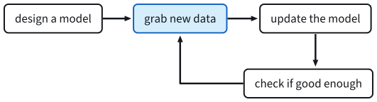
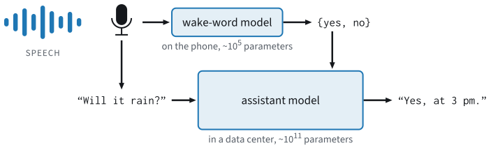
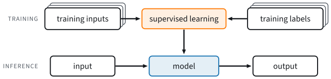
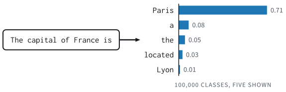
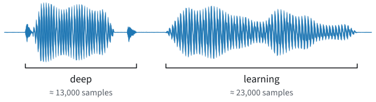
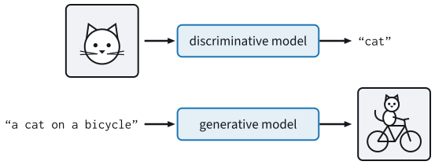
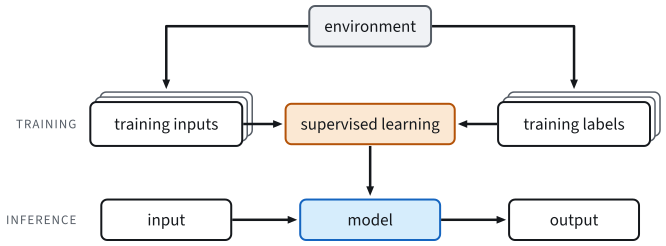
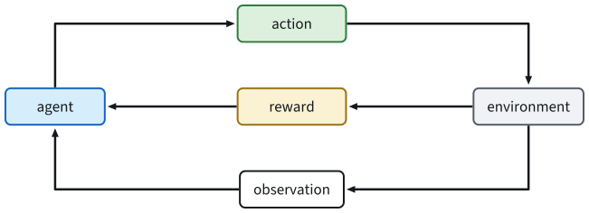
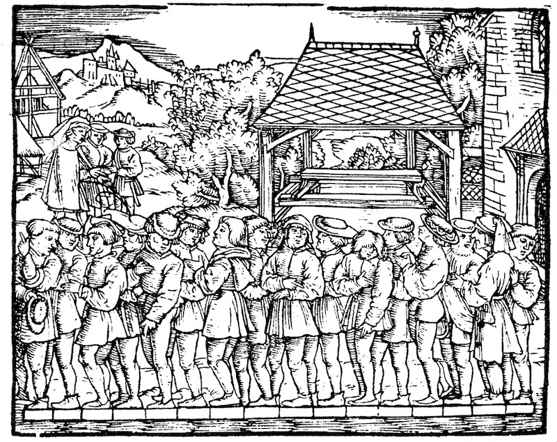

# Introduction
:label:`chap_introduction`

Most conventional computer programs implement rules written by developers.
Consider an application for managing an e-commerce platform. Users interact
with a web or mobile interface; the application stores accounts and
transactions in a database; and its *business logic* maps specified events to
actions. Developers can enumerate common events and define the required
response. When a customer adds an item to a shopping cart, the program records
the user and product identifiers. Tests expose corner cases, such as a request
to purchase an empty cart, and the rules are amended before deployment. When
explicit rules cover the relevant cases and work $100\%$ of the time, machine
learning is usually unnecessary.

Many tasks resist this rule-based approach. Consider the following problems:

* Write a program that predicts tomorrow's weather given geographic information, satellite images, and a trailing window of past weather.
* Write a program that, given a question in plain English, answers it, and if the answer requires a calculation, writes and runs the code.
* Write a program that, given an image, identifies every person depicted in it and draws outlines around each.
* Write a program that, given the sequence of amino acids of a protein, predicts the shape it folds into.

Writing explicit rules for these tasks is hard. The relevant patterns may
change over time, so a useful system must adapt. In other cases the relation
between inputs and outputs, between pixels and semantic categories for
example, is too intricate to specify as a sequence of hand-written rules.
Humans recognize familiar objects without being able to articulate every step
of the computation.

*Machine learning* studies algorithms whose behavior is determined from
experience, usually observational data or interactions with an environment.
Unlike fixed business logic, a trained model changes when it is supplied with
new data and retrained. This book develops the fundamentals of machine
learning with an emphasis on *deep learning*, which is widely used in computer
vision, natural language processing, healthcare, genomics, and other fields.
The same methods now write text and computer programs, generate images from a
description, and answer questions in conversation. This chapter is about what
all of these systems have in common.

## A Motivating Example

Suppose that a driver says "Hey Siri" and then asks for directions to a coffee
shop. The phone must detect the wake phrase, transcribe the request, work out
what was asked, find suitable routes, and estimate their travel times. Today
everything after the wake phrase is usually handled by one large model. The
wake-word detector is a separate, tiny model, because it must listen all the
time on a battery. We begin with the small one.

Consider the task of responding to a *wake word* such as "Alexa", "OK Google",
or "Hey Siri". A microphone collects thousands of amplitude measurements each
second, 16,000 on a phone and 44,100 on a compact disc. It is hard to write
explicit rules that map a segment of these raw samples reliably to
$\{\textrm{yes}, \textrm{no}\}$ according to whether it contains the wake
word. Machine learning offers a different way to construct this mapping.

Although we cannot state the recognition rules, we can label examples by
listening to them. We therefore collect a *dataset* of audio segments together
with labels that indicate which segments contain the wake word. Rather than
encode the recognition procedure explicitly, we define a flexible program whose
behavior depends on numerical *parameters*, and let the data determine
parameter values that perform well according to a chosen measure. Once the
parameters are fixed, the program is a *model*. The set of input--output
mappings obtainable by varying the parameters is a *family* of models, and a
*learning algorithm* uses the dataset to select one member of the family. Here
the model receives an audio segment as *input* and selects an *output* from
$\{\textrm{yes}, \textrm{no}\}$.

An appropriate model family should contain a parameter setting that recognizes
"Alexa" reliably. Because the exact choice of the wake word is arbitrary, we
will probably need a family rich enough that, via another setting of the
knobs, it could fire "yes" only upon hearing the word "Apricot". We expect the
same family to serve for "Alexa" and for "Apricot" because the two tasks seem,
intuitively, similar. Fundamentally different inputs or outputs, say images
to captions, or English sentences to Chinese sentences, might need a different
family entirely.

Random parameter values are unlikely to make the model recognize "Alexa",
"Apricot", or any other English word. *Learning* is the process of selecting
parameter values that produce the desired behavior; we *train* the model with
data. A typical training process (:numref:`fig_ml_loop`) proceeds as follows:

1. Initialize the model parameters.
1. Select some data (e.g., audio segments and the corresponding $\{\textrm{yes}, \textrm{no}\}$ labels).
1. Adjust the parameters to improve the model's performance on those examples.
1. Repeat Steps 2 and 3 until a stopping criterion is met.


:label:`fig_ml_loop`

Rather than specifying a wake-word recognizer as rules, we specify a program
that learns from a large labeled dataset, which is sometimes called
*programming with data*. A cat detector trained on many examples of cats and
dogs may learn to emit a very large positive number if it is a cat, a very
large negative number if it is a dog, and something closer to zero if it is
not sure.

Now look at both ends of our interaction in :numref:`fig_wake_word`. The two
models could hardly be more different. The wake-word detector has a hundred
thousand or so parameters, lives on the phone, runs on a sliver of battery,
and answers one question, yes or no. The assistant that takes over once it
fires has hundreds of billions of parameters, some over a trillion, lives in a
data center, and answers almost any question put to it in words, in the figure
whether it will rain. Yet both were
built the same way: pick a flexible program, collect examples, adjust the
parameters until the program does what the examples do. The same four steps
train both; what changes is the size of each step. The rest of this chapter is
about that recipe. The rest of this book is about making it work at both ends.


:label:`fig_wake_word`


## Key Components

The wake-word example used audio segments and binary labels to train a model
that maps each segment to a class. Problems of this sort, where we predict a
designated unknown label from known inputs, given a dataset of examples for
which the labels are known, are called *supervised learning*. It is one of
several kinds of machine learning problem. Across all of them, four components
recur:

1. The *data* that we can learn from.
1. A *model* of how to transform the data.
1. An *objective function* that quantifies how well (or badly) the model is doing.
1. An *algorithm* to adjust the model's parameters to optimize the objective function.

### Data

A dataset is a collection of examples. Each *example* (or *data point*,
*sample*) consists of a set of attributes called *features* (or *covariates*,
or *inputs*) from which the model must make its prediction. In supervised
learning our goal is to predict a special attribute, the *label* (or
*target*), that is not part of the model's input.

With image data, each example might consist of a photograph (the features) and
a number indicating its category (the label). The photograph is represented as
three grids of numbers, the brightness of red, green, and blue light at each
pixel, so a $200\times 200$ pixel color photograph consists of
$200\times200\times3=120000$ values. With electronic health records, we might
predict whether a patient will survive the next 30 days; the features would be
age, vital signs, comorbidities, medications, and recent procedures, and the
label whether each patient in the historical data survived the window.

When every example has the same number of features, the inputs are
fixed-length vectors and their length is the *dimensionality* of the data.
Fixed-length inputs simplify batching and model design, but not all data come
that way. Images mined from the Internet come in every resolution and shape,
and cropping them to a standard size throws information away. Text resists
fixed-length representations even more stubbornly. Consider the customer
reviews on a shopping site. Some are short: "it stinks!". Others ramble for
pages. We cut text into *tokens*, pieces that are usually a word or part of a
word, and represent a document as a *sequence* of token identifiers. Some
documents have ten tokens, some ten thousand. Modern deep learning models take
the sequence as it is.

More data supports larger models and lets us rely less on assumptions built in
by hand; the move from datasets of thousands of examples to billions
contributed as much to modern deep learning as any algorithm. The largest
language models are trained on text corpora of the order of ten trillion
tokens, almost none of which anybody labeled. How a model learns from
unlabeled text is the subject of a later section.

Quantity alone is insufficient; the data must also be relevant and reliable.
If the data are full of mistakes, or if the chosen features are not predictive
of the target, learning will fail. In sensitive applications, like predictive
policing, resume screening, and risk models used for lending, we must examine
both coverage and embedded bias. A skin-cancer recognition system trained
without examples from people with darker skin tones may fail for those
patients. Data can also encode historical prejudice: a model trained on past
hiring decisions to screen resumes can reproduce and automate historical
injustice without its developers intending or recognizing the effect.


### Models

Most machine learning systems transform one representation into another. A
system might process photographs and estimate whether each depicts a smile, or
process sensor readings and assign an anomaly score. A *model* is the
computational mechanism that maps input data to predictions; we are
interested in *statistical models*, which can be estimated from data. We
describe the size of a model by its number of parameters, from two in the
simplest regression line to hundreds of billions in a conversational
assistant; in code, the parameters are usually called *weights*. Simple models
are perfectly capable of addressing appropriately simple problems, but the
problems that we focus on in this book stretch the limits of classical
methods. Deep learning focuses on models that compose many successive
transformations, hence the term *deep*.

### Objective Functions

Learning requires a quantitative definition of improvement, which an
*objective function* supplies. By convention lower is better (negate a score
for which higher is better), and objectives in this form are called *loss
functions*.

When predicting numerical values, the most common loss is *squared error*, the
square of the difference between the prediction and the ground truth. For
classification, the most common objective is to minimize the error rate, the
fraction of examples on which our predictions disagree with the ground truth.
Squared error can be optimized directly; error rate cannot, because it is not
differentiable, so in practice we optimize a *surrogate objective*. For
classification the usual surrogate is the *cross-entropy*, which penalizes the
model for the probability it did not assign to the class that actually
occurred; the name is explained in :numref:`chap_mdl-information-theory`. The
same loss trains a classifier that says cat or dog and a language model that
predicts the next word of a sentence. Only the number of classes differs.

During optimization we think of the loss as a function of the parameters, with
the training data held fixed, and minimize it over the examples collected for
training. Doing well on the training data, however, does not guarantee that
we will do well on unseen data. Doing well on unseen data is called
*generalization*. It is what we are after; the training loss is only what we
can compute. So we typically split the available data into a *training set*,
for learning the parameters, and a *test set*, held out for evaluation.
Think of training performance as the scores a student achieves on the practice
exams used to prepare for the real final. Over the course of studying, the
student might begin to memorize the practice questions, appearing to master
the topic but faltering on the unseen questions of the actual exam. When a
model performs well on the training set but fails to generalize to unseen
data, we say that it is *overfitting*.


### Optimization Algorithms

Given data, a model, and an objective function, we need an algorithm that
searches for parameters that minimize the loss. The optimization algorithms
of deep learning are based on *gradient descent*. At each step, gradient
descent estimates how the training loss changes under a small change to each
parameter, then moves the parameters in the direction that reduces the loss.
Computing this change over a large dataset at every step would take hours, so
in practice each step looks at a small random *minibatch* of examples. The
resulting algorithm is *stochastic gradient descent*. With the refinements of
:numref:`chap_optimization`, it trains every model in this book, from a
two-parameter line to the assistant in a data center.

Once training stops, using the model on new inputs is called *inference*.
Training happens once, on the data we collected; inference happens every time
a user speaks to the phone. Much of the engineering in the later parts of the
book is about making one of the two cheap.


## Kinds of Machine Learning Problems

Machine learning encompasses several problem formulations, and the following
overview establishes the terminology used throughout the book. We start with
the kind our wake-word example belongs to, where every example comes with a
label, and end with models that act in the world and are told only whether
the outcome was good.

### Supervised Learning

In *supervised learning* we are given a dataset of features and labels and
asked to produce a model that predicts the label from the features. The
supervision is the labels: we, the supervisors, provide them. Supervised
learning accounts for most successful applications of machine learning in
industry, partly because so many tasks can be described crisply as predicting
something unknown from something available:

* Predict cancer vs. not cancer, given a computer tomography image.
* Predict the correct translation in French, given a sentence in English.
* Predict how long a patient will stay in hospital, given the admission record.

One description covers all three, but an image of fixed size, a sentence of
arbitrary length, and a table of patient attributes each call for a model of
their own, and much of this book is about those designs.

Informally, the process looks like this. First, grab a big collection of
examples for which the features are known and acquire the ground truth label
for each. Sometimes the labels are already available (did a patient die within
the following year?) and sometimes we need human annotators (assigning images
to categories). We feed the resulting training set to a supervised learning
algorithm, a function that takes a dataset as input and outputs another
function: the learned model. Finally, we feed unseen inputs to the learned
model and use its outputs as predictions. :numref:`fig_supervised_learning`
draws the process; the upper row is training and the lower row is inference.


:label:`fig_supervised_learning`

#### Regression

One common supervised learning task is *regression*. Consider a table of home
sales in which each row is a house and each column an attribute: square
footage, the number of bedrooms, the number of bathrooms, and the number of
minutes (walking) to the center of town. A compact urban apartment might have
the feature vector $[600, 1, 1, 60]$; a larger suburban house,
$[3000, 4, 3, 10]$. If you are in the market for a home, you might want to
estimate its fair market value from these features; the training data are
historical listings and the labels are the observed sale prices.

What makes a problem a regression is the form of the target: labels that take
on arbitrary numerical values, even within some interval. A good rule of
thumb is that any *how much?* or *how many?* problem is likely to be
regression:

* How many hours will this surgery take?
* How much rainfall will this town have in the next six hours?

Regression also arises in ordinary estimation. Suppose a contractor spent 3
hours removing gunk from your sewage pipes and sent you a bill of 350 dollars.
A second job took 2 hours and received a bill of 250 dollars. If someone then
asked you how much to expect on their upcoming gunk-removal invoice, you might
make some reasonable assumptions, such as that more hours worked costs more
dollars. You might also assume that there is some base charge and that the
contractor then charges per hour. If these assumptions held true, then from
these two examples you could already identify the contractor's pricing
structure: 100 dollars per hour plus 50 dollars to show up at your house. This
inference captures the central idea of *linear* regression.

Here two examples fixed the parameters exactly. Usually they do not, because
some of the variation arises from factors beyond our features, and we instead
choose the parameters that minimize the distance between predictions and
observed values, in most chapters the squared error. As shown later, this loss
corresponds to the assumption that our data were corrupted by Gaussian noise.

#### Classification

While regression models are great for *how many?* questions, lots of problems
do not fit this template. A bank that lets its customers deposit a check by
photographing it must read the handwritten amount, that is, decide for each
patch of the image which of ten digits it shows. These *which one?* problems
are called *classification*, and they need some tools of their own, although
many carry over from regression.

In classification, the model looks at features, such as the pixel values in an
image, and predicts to which *category* (or *class*) among some discrete set
the example belongs: ten classes for handwritten digits, or two for images of
animals labeled $\textrm{\{cat, dog\}}$. The latter is *binary
classification*; with more than two classes, we speak of *multiclass
classification*. A model that can only output a *firm* assignment, "cat" or
"dog", is difficult to optimize, for reasons that we will get into as the book
gets more technical. It is much easier to let the model assign a probability
to each class. A classifier might see an image and output 0.9 for cat: it is
90\% sure, and the size of that number conveys its uncertainty.

The most likely class need not determine the action. Assume that you find a
beautiful mushroom in your backyard as shown in :numref:`fig_death_cap`.


:width:`200px`
:label:`fig_death_cap`

Suppose a classifier trained to recognize poisonous mushrooms from a
photograph says that the probability that :numref:`fig_death_cap` shows a
death cap is 0.2, so it is 80\% sure that our mushroom is safe. Eating it
would still be unwise: the possible benefit of a meal does not justify a 20\%
risk of death. To decide, we need the expected detriment of each action, which
depends on the likely outcomes and on the harm of each. The detriment incurred
by eating the mushroom might be $0.2 \times \infty + 0.8 \times 0 = \infty$,
whereas the loss of discarding it is $0.2 \times 0 + 0.8 \times 1 = 0.8$. Our
caution was justified: as any mycologist would tell us, the mushroom in
:numref:`fig_death_cap` is actually a death cap.

Not all errors are equal, either. It might not be so bad to mistake a poodle
for a schnauzer, but our model would pay a huge penalty if it confused a
poodle with a dinosaur, and a loss that knows how the classes are organized,
the way Linnaeus organized the animals, can say so. This is *hierarchical
classification*. Which hierarchy is relevant depends on the use. Rattlesnakes
and garter snakes are close on the phylogenetic tree, but mistaking a rattler
for a garter could be fatal.

A classifier can have many classes. A *language model* is a classifier with
about a hundred thousand classes, one per token in its vocabulary, asked a
single question again and again: which token comes next?
:numref:`fig_next_token` shows the question asked once. The input is the text
so far, the output is a probability for every token in the vocabulary, and
the figure shows the five largest. Pick a token according to these
probabilities, append it to the input, and ask again, and the model writes.
Everything the assistant in our opening example says, it says this way, one
token at a time.


:label:`fig_next_token`

#### Tagging

A binary classifier that distinguishes cats from dogs, however accurate, is in
trouble when it encounters an image of the *Town Musicians of Bremen*, a
popular German fairy tale featuring four animals
(:numref:`fig_stackedanimals`).


:width:`300px`
:label:`fig_stackedanimals`

The image contains a cat, a rooster, a dog, and a donkey, with some trees in
the background. If we anticipate such images, we should give the model the
option of saying that the image depicts a cat, a dog, a donkey, *and* a
rooster. Learning to predict classes that are not mutually exclusive is called
*multi-label classification*, and auto-tagging problems are typically best
described this way. Think of the tags people apply to posts on a technical
blog: "machine learning", "technology", "gadgets", "programming languages",
"Linux", "cloud computing". A typical article carries 5--10 tags, and the
tags are correlated: posts about "machine learning" are likely to mention
"GPUs". A good tagger uses that correlation rather than deciding each tag on
its own.

#### Sequence Learning

So far, we have looked at problems with a fixed number of inputs and a fixed
number of outputs: a house price from four features, class probabilities from
an image of fixed size. Each test example is fed in and immediately forgotten,
since we assumed that successive observations were independent and there was
no context to hold on to.

But how should we deal with video snippets? Each snippet has a different
number of frames, and our guess of what is going on in one frame is much
stronger if we take into account the frames before and after it. The same goes
for the sentences of a text to be translated, and for medicine: a model that
monitors patients in the intensive care unit and fires an alert whenever their
risk of dying in the next 24 hours exceeds some threshold should not throw
away the patient's history every hour and predict from the latest measurements
alone.

These are instances of *sequence learning*. They require a model either to
ingest sequences of inputs or to emit sequences of outputs (or both).
*Sequence-to-sequence learning* is the case where both the inputs and the
outputs are variable-length sequences. Three cases are worth knowing by name.

**Automatic Speech Recognition**.
The input sequence is an audio recording of a speaker and the output is a
transcript of what the speaker said. :numref:`fig_speech` shows the waveform
of two spoken words. At the sampling rate of a compact disc, "deep" spans
about 13,000 samples and "learning" about 23,000; a phone samples less often,
but a word is still thousands of samples, so the output is far shorter than
the input and no sample corresponds to any one letter. What makes the problem
hard is everything the training data lacked: an accent, a noisy café, two
people talking at once.


:label:`fig_speech`

**Text to Speech**.
This is the inverse: the input is text and the output is an audio file, which
is much longer than the input.

**Machine Translation**.
In speech recognition the input and output occur in the same order. In
translation they need not: the two sequences have different lengths, and
corresponding regions may appear in a different order. Consider the peculiar
tendency of Germans to place the verbs at the end of sentences:

```text
German:           Haben Sie sich schon dieses grossartige Lehrwerk angeschaut?
English:          Have you already looked at this excellent textbook?
Wrong alignment:  Have you yourself already this excellent textbook looked at?
```

Ten years ago each of these was its own field with its own models: a
translation system, a speech recognizer, a summarizer, a question answerer.
Today they are mostly one model. A language model trained to continue text,
given the prompt "Translate into German:" followed by an English sentence,
continues with the German. The problem kinds in this section have not gone
away; they have become things one asks a single model to do. How a model
trained only to continue text came to be able to do them is the subject of the
next section.

### Self-Supervised Learning and Pretraining

Every problem so far needed labels, and labels are expensive. A radiologist's
hour is dear; even "cat or dog" costs a few seconds of someone's attention per
image, and a million images is a lot of seconds. Text, by contrast, is free.
The web holds more of it than anyone could read, and nobody labeled a word of
it.

Here is the trick that made the assistant in our opening example possible.
Nobody labeled the trillions of tokens it learned from. The label of each
token is simply the token that follows it in the text, and the text was
already written. A model trained to predict the next word of every sentence on
the web must learn spelling, grammar, facts, arithmetic, and the conventions
of a thousand file formats, because all of them help with the prediction.
Learning in which the data supply their own labels is called
*self-supervised learning*. The next token is the most consequential example
but not the only one: a model can be asked to fill in a word that was masked
out :cite:`Devlin.Chang.Lee.ea.2018`, or to say where two patches cut from the
same image sit relative to each other :cite:`Doersch.Gupta.Efros.2015`. In
each case the answer is in the data; we merely hid it.

Self-supervised learning has an older relative. *Unsupervised learning*
seeks structure in unlabeled data without a prediction target at all. Given a
set of photos, can we group them into landscapes, dogs, babies, and mountain
peaks? This is *clustering*. Can a few numbers describe each example well, as
a tailor describes a body by a handful of measurements? When the description
is linear, this is *principal component analysis*. Both remain useful and
both appear later in the book. But the model that changed the field learned
from unlabeled data by predicting it, and that is self-supervision.

Training once on a huge unlabeled corpus is called *pretraining*, and the
model it produces knows a great deal and does nothing in particular. It
continues text. Ask it a question and it may answer with three more questions,
because that is what a page of frequently asked questions looks like. Turning
it into something useful takes a second, much shorter stage, *fine-tuning*, on
examples of the behavior we want, which is where labels come back in: a few
thousand questions with good answers, or a few thousand reviews with their
sentiment. Because many different systems are built on one pretrained model,
it is often called a *base model* or a *foundation model*.
:numref:`fig_pretrain_adapt` shows the two stages: on the left the single
expensive pretraining run, on the right the cheap adaptations that branch from
it, which differ in where their training signal comes from.


:label:`fig_pretrain_adapt`

Fine-tuning on a few thousand written answers teaches the model the form of an
answer. It does not teach it which of two correct answers is the better one,
or when to decline a request, because nobody can write down what a good
answer is in general. Where that signal comes from is the subject of the
reinforcement learning section below; the last branch of the figure belongs
to the section on agents.

### Generative Models

Every model so far takes data and produces a label: an image in, "cat" out.
A model of this kind is *discriminative*; it only has to tell the classes
apart. A *generative* model runs the other way. It produces data: an image
from the description "a cat on a bicycle", a voice from a sentence, a protein
sequence from a desired shape. :numref:`fig_discriminative_generative` shows
the two side by side, with the same cat in both rows. The arrow is reversed,
and so is the difficulty. There are a few ways to say "cat" and a practically
unlimited number of images of cats, and the model must give each of them its
due probability.


:label:`fig_discriminative_generative`

This is also why generative models need chapters of their own. A classifier
is scored by whether it got the label right. A generative model is scored by
whether its samples could have come from the data, and that question has no
label attached to it; it is a question about two distributions, the model's
and the world's. Each family answers it in a different way. *Variational autoencoders*
:cite:`Kingma.Welling.2014,rezende2014stochastic` compress data into a small
code and decode it back; *generative adversarial networks*
:cite:`Goodfellow.Pouget-Abadie.Mirza.ea.2014` train a second network to tell
real samples from generated ones and use its verdict as the loss;
*normalizing flows* :cite:`dinh2014nice,dinh2017density` make the probability
of every sample computable; and *diffusion models*
:cite:`sohl2015deep,song2019generative,ho2020denoising,song2021score` learn
to remove a little noise from data, so that a sample is made by starting from
pure noise and removing it step by step. Diffusion models underlie many of the
leading systems that produce images and video from text. The language model
of the previous section is a generative model too. It happens to be one in
which the probability of the next piece is cheap to compute, which is why we
could treat it as a classifier.


### Interacting with an Environment

So far, we have treated data as fixed and have not considered how a model's
outputs affect future observations. Supervised, unsupervised, and
self-supervised learning all collect data first and train afterwards, with the
algorithm disconnected from the environment, which is why they are sometimes
called *offline learning*. Supervised learning, for example, assumes the
simple interaction pattern of :numref:`fig_data_collection`: data flow in
once, and nothing flows back.


:label:`fig_data_collection`

Offline learning lets us study pattern recognition in isolation, but the
formulation is limiting. If you grew up reading Asimov's Robot novels, you
picture an intelligent *agent* that not only predicts but acts, and whose
actions affect the environment. To train one, we must account for the way its
actions change what it will observe next, and offline learning cannot.

The environment need not be a robot's. A recommender system trained on last
year's purchases decides what customers see this year, and so decides what
they can buy. Next year's training data are then not a sample of what people
want but a record of what the recommender showed them. An item it favored
sells more, looks better in the data, and is favored again. Feedback loops of
this kind form wherever a model's output becomes its own future input, and a
model trained as if the data were fixed never notices.

Considering the interaction with an environment opens a whole set of new
modeling questions:

* Does the environment remember what we did previously?
* Does the environment want to help us, e.g., a user reading text into a speech recognizer?
* Does the environment want to beat us, e.g., spammers adapting their emails to evade spam filters?
* Does the environment have shifting dynamics? Would future data always resemble the past, or would the patterns change over time, either naturally or in response to our automated tools?

These questions raise the problem of *distribution shift*, where training and
test data differ. Many of us have met it when taking an exam written by the
lecturer after doing homework composed by the teaching assistants. A model
whose own actions change what it will see next needs a framework in which the
loop is explicit, and that is reinforcement learning.


### Reinforcement Learning

*Reinforcement learning* is the framework for developing an agent that
interacts with an environment and takes actions. It covers robotics, game
playing, and the control of anything from a heating system to a chemical
plant. *Deep reinforcement learning* first drew wide attention when a network
learned to play Atari games from the screen pixels alone :cite:`mnih2015human`
and when AlphaGo beat a professional Go player
:cite:`Silver.Huang.Maddison.ea.2016` and, the following year, the world
champion.

The most widely used reinforcement learning agent today is not a game player
but a chatbot. A pretrained language model is shown two of its own answers; a
person says which is better; the preference is the reward
:cite:`Christiano.Leike.Brown.ea.2017,ouyang2022training`. A short stage of
fine-tuning on written demonstrations comes first; then hundreds of thousands,
sometimes millions, of such comparisons turn a model that continues text into
one that answers, declines, and apologizes. More recently, the reward has come
from a checker rather than a person: a math problem has a right answer, a
program has tests, and a model rewarded for getting them right learns to work
through a problem in steps before answering :cite:`DeepSeekAI.2025`. This
answers the question left open two sections ago: the signal for behavior
nobody can write down comes from judging outcomes rather than from labeling
inputs.

The general statement of the problem is this. An agent interacts with an
environment over a series of time steps. At each step, the agent receives an
*observation* from the environment, chooses an *action*, and receives a
*reward*; then the next observation arrives, and so on
(:numref:`fig_rl-environment`). The agent's behavior is governed by a
*policy*, a function from observations to actions, and the goal of
reinforcement learning is to find a good one.


:label:`fig_rl-environment`

Unlike supervised learning, reinforcement learning does not tell the agent the
right action for each observation. It receives a reward, and the environment
may not even say which actions earned it. Consider the game of chess. The only
real reward signal comes at the end of the game, when we either win, earning a
reward of, say, $1$, or lose, receiving a reward of, say, $-1$. So
reinforcement learners must deal with the *credit assignment* problem:
determining which actions to credit or blame for an outcome. The same goes for
an employee who gets a promotion on October 11. That promotion likely reflects
a number of well-chosen actions over the previous year. Getting promoted in
the future requires figuring out which actions along the way led to the
earlier promotions.

The agent may also face *partial observability*: the current observation does
not tell it everything about its state. Say your cleaning robot found itself
trapped in one of many identical closets in your house. Rescuing the robot
involves inferring its precise location, which might require considering
earlier observations prior to its entering the closet.

Finally, an agent that knows one good policy has no way of knowing whether a
better one exists among those it never tried. It must constantly choose
whether to *exploit* the best known strategy or to *explore*, giving up some
short-term reward in exchange for knowledge.

Not every practical problem exhibits all this complexity, and the special
cases have names. When the environment is fully observed, the problem is a
*Markov decision process*. When the state does not depend on the previous
actions, it is a *contextual bandit problem*. When there is no state, just a
set of available actions with initially unknown rewards, we have the classic
*multi-armed bandit problem*.

### Agents

An *agent*, in the sense the word has taken on in the 2020s, is a model that
acts. Give a language model a few *tools* (run this command, read this file,
search the web) and let it see what comes back, and the loop in
:numref:`fig_rl-environment` reappears: the observation is the tool's output,
the action is the next call. A coding agent asked to fix a failing test reads
the error, edits a file, runs the tests again, and keeps going until they
pass. This is how the code in the second edition of this book was brought up
to date.

Nothing new was needed beyond a model good enough at predicting the next
token to predict a useful tool call. The questions of the previous two
sections, however, return, and they are harder. What should the reward be,
when the task takes a thousand steps and only the last one can be checked?
And what happens when the agent's actions change the world it is observing,
as a coding agent's edits change the code it reads next? These are the
questions of :numref:`chap_lm_agents`, and they are open.

## Roots

Although many deep learning methods are recent inventions, the core ideas
behind learning from data have shaped natural science and mathematics for
centuries. Two examples are the Bernoulli distribution, named after
[Jacob Bernoulli (1655--1705)](https://en.wikipedia.org/wiki/Jacob_Bernoulli),
and the Gaussian distribution, which
[Carl Friedrich Gauss (1777--1855)](https://en.wikipedia.org/wiki/Carl_Friedrich_Gauss)
used to model measurement error. Gauss developed the method of least squares
independently of Legendre, who published it first :cite:`Legendre.1805`, and
it was Gauss who justified it by that distribution of the errors. The method
is still used for everything from insurance calculations to medical
diagnostics, and such tools enhanced the experimental approach in the natural
sciences: Ohm's law relating current and voltage in a resistor is perfectly
described by a linear model.

Mathematicians of the early sixteenth century already had a keen intuition of
estimates. The geometry book of
[Jacob Köbel (1460--1533)](https://www.maa.org/press/periodicals/convergence/mathematical-treasures-jacob-kobels-geometry)
illustrates averaging the length of 16 adult men's feet to estimate the
typical foot length in the population (:numref:`fig_koebel`).


:width:`500px`
:label:`fig_koebel`

As the congregation left church, 16 men were asked to line up and have their
feet measured; the sum divided by 16 became what is now called one foot. A
statistician worried about a misshapen foot or two would send the men with the
shortest and the longest feet away and average over the remainder, which is
what we now call a *trimmed mean*.

Statistics developed rapidly as larger collections of data became available.
One of its pioneers,
[Ronald Fisher (1890--1962)](https://en.wikipedia.org/wiki/Ronald_Fisher),
contributed to its theory and to its applications in genetics; linear
discriminant analysis and the Fisher information matrix are his, and the Iris
measurements that Edgar Anderson collected and Fisher analyzed in 1936 are
still used to demonstrate machine learning algorithms. Fisher was also a
proponent of eugenics, which should remind us that the morally dubious use of
data science has as long and enduring a history as its productive use in
industry and the natural sciences.

Other influences came from the information theory of
[Claude Shannon (1916--2001)](https://en.wikipedia.org/wiki/Claude_Shannon)
and the theory of computation of
[Alan Turing (1912--1954)](https://en.wikipedia.org/wiki/Alan_Turing).
Turing posed the question "can machines think?" in his famous paper
*Computing Machinery and Intelligence* :cite:`Turing.1950`. In what is now
known as the Turing test, he proposed that a machine can be considered
*intelligent* if a human evaluator, exchanging written messages with it,
finds it hard to tell its replies from a person's. Systems that pass versions
of his test, in short conversations, now exist. Whether that settles his
question is a different matter, and he suspected it might not.

Neuroscience and psychology provided further influences. One of the first
biologically inspired algorithms was formulated by
[Donald Hebb (1904--1985)](https://en.wikipedia.org/wiki/Donald_O._Hebb). In
his groundbreaking book *The Organization of Behavior* :cite:`Hebb.1949`, he
posited that neurons learn by positive reinforcement, the Hebbian learning
rule. It inspired Rosenblatt's perceptron and, in spirit, the stochastic
gradient descent algorithms that underpin deep learning today: reinforce
desirable behavior and diminish undesirable behavior to obtain good settings
of the parameters.

Biological inspiration is what gave *neural networks* their name. For over a
century (dating back to the models of Alexander Bain, 1873, and William
James, 1890), researchers have tried to assemble computational circuits that
resemble networks of interacting neurons. The interpretation of biology has
become less literal over time, but the name persisted. Most modern networks
share two principles:

* The alternation of linear and nonlinear processing units, often referred to as *layers*.
* The use of the chain rule (also known as *backpropagation*) for adjusting parameters in the entire network at once :cite:`Rumelhart.Hinton.Williams.ea.1988`.

Both were in place by the end of the 1980s. Then research in neural networks
languished for a decade, from around 1995 until 2005. Training a network was
computationally expensive, and datasets were small: Fisher's Iris data were
still a popular test, and MNIST with its 60,000 handwritten digits was
considered huge. With data and computation that scarce, kernel methods,
decision trees, and graphical models trained in minutes rather than weeks,
came with theoretical guarantees, and won in most applications. What changed
is the subject of the next section.


## The Road to Deep Learning

Much of this changed with the availability of massive amounts of data, thanks
to the World Wide Web, the first companies that served the whole world online,
cheap high-quality sensors, inexpensive data storage (Kryder's law), and cheap
computation (Moore's law). In particular, GPUs engineered for computer gaming
revolutionized the computation available to deep learning, and algorithms and
models that had seemed infeasible were suddenly within reach. The trend is
summarized in :numref:`tab_intro_decade`. Read it by columns: over half a
century the datasets grew by eleven orders of magnitude, the models by about
the same, and the compute spent on one training run by twenty-one, because
every example is shown to every parameter.

:Datasets, the largest models trained on them, and the compute spent on one training run, by order of magnitude. Dataset sizes are in examples (flowers, digits, images) or tokens.
:label:`tab_intro_decade`

|Year|Dataset|Largest trained model (parameters)|Compute per training run (floating-point operations)|
|:--|:-|:-|:-|
|1970|Iris, $10^2$ flowers|$10^1$|$10^5$|
|1998|MNIST, $10^5$ handwritten digits|$10^5$|$10^{13}$|
|2012|ImageNet, $10^6$ labeled images|$10^8$|$10^{18}$|
|2020|Web text, $10^{11}$ tokens|$10^{11}$|$10^{23}$|
|2025|Web text, $10^{13}$ tokens|$10^{12}$|$10^{26}$|


Computational power has grown faster than the datasets since 2000, and
random-access memory more slowly than either, so models had to become more
memory efficient and could afford far more computer cycles per example.
Consequently, the sweet spot in machine learning and statistics moved from
(generalized) linear models and kernel methods to deep neural networks. This
is also why many of the mainstays of deep learning,
the artificial neuron :cite:`McCulloch.Pitts.1943`, multilayer perceptrons
trained by backpropagation :cite:`Rumelhart.Hinton.Williams.ea.1988`,
convolutional neural networks :cite:`LeCun.Bottou.Bengio.ea.1998`, long
short-term memory :cite:`Hochreiter.Schmidhuber.1997`, and Q-learning
:cite:`Watkins.Dayan.1992`, were "rediscovered" in the 2010s after lying
dormant for a considerable time.

The progress did not result from applying more resources to old algorithms
alone. Looking back from 2026, five moments changed what the recipe of this
chapter is, and each change is still visible in how models are built.

In 2012, a convolutional network with eight layers, trained for five to six
days on two gaming GPUs, won the ImageNet image-classification contest by a
margin nobody had seen before :cite:`Krizhevsky.Sutskever.Hinton.2012`. It
cut the error of the best hand-engineered pipeline from about 26% to 15%,
with an architecture that dated from the 1990s. For the first time on a
problem of that size, more data and more compute, applied end to end to raw
pixels, had beaten a decade of feature engineering. Within three years nearly
every competitive computer vision system was a deep network.

Over the following decade the recipe for text changed twice. Recurrent
networks had to squeeze a whole sentence into a fixed-size state before
translating it, and long sentences did not fit. *Attention*
:cite:`Bahdanau.Cho.Bengio.2014` let the model look back at any earlier
position when it needed it, a learned pointer rather than a compressed memory,
and in 2017 the *transformer* :cite:`Vaswani.Shazeer.Parmar.ea.2017` built a
whole architecture out of nothing else. It worked for text, then for images,
audio, and proteins. That was the first change. The second came when the
transformer was pretrained on the text of the web, as in the self-supervised
learning section: pretraining replaced labeled datasets as the starting point
for almost every language task
:cite:`Devlin.Chang.Lee.ea.2018,brown2020language`, and when models, data, and
compute were grown together, the loss fell predictably enough to plan a budget
around :cite:`kaplan2020scaling,hoffmann2022training`. Scale had become a
method.

Between 2020 and 2022, *diffusion models* learned to generate images by
reversing a process that adds noise :cite:`sohl2015deep,ho2020denoising`, and
by 2022 a sentence of description produced a photograph that had never been
taken :cite:`Rombach.Blattmann.Lorenz.ea.2022,ramesh2022hierarchical,saharia2022photorealistic`.
Generation needs an objective with no label in it, and a piece of physics
supplied one.

In 2022, a pretrained language model was trained further on human
preferences, by the method of the reinforcement learning section, and the
result was a conversational assistant :cite:`ouyang2022training`. The model
already knew how to answer; the training taught it to do so when asked, and to
say when it should not. The objective, it turned out, is a design choice like
any other, and the reward can come from people.

In 2024 and 2025, the reward came from a checker instead, and models learned
to work through a problem in written steps before answering
:cite:`DeepSeekAI.2025`. Given tools, the same models became agents. The
environment loop of reinforcement learning, which the field had set aside
while labels were plentiful, was back, with the language model as the agent.

Implementation became simpler along the way. Open-source frameworks, built by
systems researchers for the statistical modelers, turned a week of C++ into
an afternoon of Python; this book uses four of them. Training a linear
logistic regression model used to be a nontrivial homework problem, worthy to
give to new machine learning Ph.D. students at Carnegie Mellon University in
2014. By now, this task can be accomplished with three lines of code, and an
agent will write them for you.


## Success Stories

Artificial intelligence has a long history of delivering results that would
be hard to accomplish otherwise. Mail sorting systems using optical character
recognition have been deployed since the 1990s, and the MNIST digits that most
students train on first were drawn from handwriting collections gathered by
the US National Institute of Standards and Technology in the same era. The
same applies to reading checks for bank deposits and scoring the
creditworthiness of applicants. Every electronic payment system checks
transactions for fraud automatically, and search, recommendation,
personalization, and ranking on the Internet all run on machine learning. It
is therefore pervasive, although often invisible to users. As of this
edition, it has also become visible. The systems a reader in 2026 has used
are, each of them, one of the problems of this chapter:

* **Assistants that read and write.** A conversational assistant drafts a
  letter, explains an error message, translates a menu from a photograph,
  and summarizes a forty-page report. It is the far end of
  :numref:`fig_wake_word`: one pretrained language model, adapted to human
  preferences, predicting one token at a time.
* **Programs that write programs.** Given a description of a change and
  access to a repository, a coding agent reads the code, edits it, runs the
  tests, and reads the failures. A programmer reviews the result.
* **Images and video from a sentence.** Diffusion models trained on captioned
  images produce a photograph, a painting, or a few seconds of film from a
  description. They are the generative models of this chapter at scale.
* **Protein structure.** In 2020 a deep network predicted the
  three-dimensional structure of proteins from their amino-acid sequences, in
  most cases about as accurately as a laboratory measurement, and by 2022 the
  predicted structures of more than two hundred million proteins, nearly
  every one catalogued, had been published. Half of the 2024 Nobel Prize in
  Chemistry went to this work, the fourth problem on the first page of this
  chapter.
* **Weather.** Since 2023, forecasters trained on four decades of past weather
  have matched or beaten the best physics-based systems at lead times of up
  to about ten days, at a small fraction of the computing cost. They still
  start from the physics-based estimate of the current state of the
  atmosphere; what they learned is how that state evolves. The first problem
  on the first page now has an excellent supervised solution.
* **Games.** Prowess in games long provided a measuring stick for human
  ability. TD-Gammon learned backgammon from self-play with reinforcement
  learning in the early 1990s :cite:`Tesauro.1995`; Deep Blue beat Garry
  Kasparov at chess in 1997 with search and special-purpose hardware
  :cite:`Campbell.Hoane-Jr.Hsu.2002`; AlphaGo, combining deep networks with
  tree search, beat a professional Go player in 2015
  :cite:`Silver.Huang.Maddison.ea.2016` and the world champion in 2016.
* **Driving.** Driverless taxis carry paying passengers in cities across the
  United States and China. What remains hard is the long tail: the situation
  that occurs once in a million miles and has no precedent in the training
  data.

Beyond these, machine learning has become a standard tool in robotics,
logistics, computational biology, particle physics, and astronomy.

Popular discussions often concern what these systems might become. The
present deserves more of a reader's attention. Automated systems already
affect people's lives: creditworthiness is assessed automatically, decisions
about whether to grant bail use statistical models as input, and resumes are
screened by them. Every such system was trained toward an objective someone
chose, on data someone collected, so the questions worth asking about any one
of them are concrete: who chose the objective, what the data covered, and what
the model does on inputs the data did not cover. Statistical models applied
without care can lead to racial, gender, or age bias, and they raise
reasonable concerns about procedural fairness when they drive consequential
decisions. The automation under way is of routine cognitive work: drafting,
summarizing, translating, writing and checking code, answering support
requests. How much of such work there is, and what happens to the people who
did it, are now questions of evidence rather than speculation, and the
evidence is being gathered as this edition goes to press.


## The Essence of Deep Learning

Thus far, we have talked in broad terms about machine learning. Deep learning
is the subset concerned with models based on many-layered neural networks. It
is *deep* in the sense that its models learn many *layers* of
transformations. Arguably, all machine learning has many layers of
computation, the first consisting of feature processing steps. What
differentiates deep learning is that the operations at all of the layers are
learned jointly from data.

The problems that we have discussed so far, learning from the raw audio
signal, from the raw pixel values of images, or mapping between sentences of
arbitrary length and their counterparts in foreign languages, are those where
deep learning excels and traditional methods falter. The most significant
commonality in deep learning methods is *end-to-end training*: rather than
assembling a system from components that are tuned one at a time, one builds
the system and then tunes its performance jointly. In computer vision, for
instance, scientists used to separate *feature engineering* from the building
of machine learning models. The Canny edge detector :cite:`Canny.1987` and
Lowe's SIFT feature extractor :cite:`Lowe.2004` reigned supreme for over a
decade as algorithms for mapping images into feature vectors. When deep
learning took over, they were replaced by automatically tuned filters that
yielded superior accuracy, because automated optimization can evaluate far
more alternatives than a person designing features by hand. Deep learning
thus replaces not only the shallow models at the end of traditional learning
pipelines but also the labor-intensive process of feature engineering, and by
replacing the domain-specific preprocessing it has eliminated many of the
boundaries that separated computer vision, speech recognition, natural
language processing, medical informatics, and other application areas.

Beyond end-to-end training, we are experiencing a transition from parametric
statistical descriptions to fully nonparametric models. When data are scarce,
one needs simplifying assumptions about reality to obtain useful models. When
data are abundant, nonparametric models fit the data better. This mirrors the
progress that physics made in the middle of the previous century once
computers were available: rather than solving by hand parametric
approximations of how electrons behave, one simulates the partial
differential equations numerically, which gives much more accurate models,
often at the expense of interpretation.

The 2020s added one more change. One model now serves many tasks, and its
loss falls predictably as model size, data, and compute grow together. :numref:`fig_scaling_schematic` shows the shape of this regularity.
Each curve is one model size, trained with more compute as we move to the
right; its loss levels off once the model holds what it can. The dashed line
traces the best model for each budget, and on logarithmic axes it is straight.
A bigger model thereby became a reliable bet rather than a gamble, and
training budgets were planned accordingly. There is a less comfortable reading
of the same history, which Sutton (2019) called the bitter lesson: general
methods that convert computation into performance, through search and
learning, have beaten, again and again, methods that encode what we know about
a problem.

We do not think it is the whole story, since the architectures that absorb
compute well were themselves designed for efficiency. In fact, the Advanced
and Language Models parts are organized around it. Likewise, picking the
right training objectives can make all the difference in model quality.


:label:`fig_scaling_schematic`

Another difference from previous work is the acceptance of suboptimal
solutions to nonconvex optimization problems, and the willingness to try
things before proving them. This new-found empiricism, combined with a rapid
influx of talent, has led to rapid progress in practical algorithms, albeit in
many cases at the expense of re-inventing tools that existed for decades. The
deep learning community routinely shares libraries, models, and trained
networks across academic and corporate boundaries. In the same spirit, the
notebooks in this book are freely available for distribution and use.


## The Problems in This Book

The problem kinds of this chapter map onto the parts of the book, whose
dependencies :numref:`fig_book_org` in the preface draws. Supervised learning
on fixed-length inputs, the two-parameter line and the ten-class digit
classifier, opens the Basics with :numref:`chap_regression` and
:numref:`chap_classification`; images and sequences follow in
:numref:`chap_cnn` and :numref:`chap_rnn`. The Advanced part takes each
component of the recipe to the scale of the assistant: optimization in
:numref:`chap_optimization`, the attention and transformer architectures in
:numref:`chap_attention` and :numref:`chap_transformers`, learning from
rewards in :numref:`chap_reinforcement_learning` and :numref:`chap_deep_rl`,
and generative models in :numref:`chap_gans` and :numref:`chap_diffusion`.
The Language Models part follows :numref:`fig_pretrain_adapt` from left to
right: pretraining in :numref:`chap_lm_pretraining`, fine-tuning in
:numref:`chap_lm_finetuning`, learning from preferences and verifiable
rewards in :numref:`chap_lm_rl`, agents in :numref:`chap_lm_agents`, and
serving the result in :numref:`chap_lm_serving`. Detection and segmentation,
the problem of drawing outlines around every person in an image, are in
:numref:`chap_cv`. The mathematics that the proofs need, from the linear
algebra of :numref:`chap_mdl-linear-algebra` to the differential equations
behind diffusion in :numref:`chap_mdl-dynamics`, is collected in the
appendix, and the hardware and tooling in :numref:`chap_appendix_tools`.


## Summary

Machine learning studies how computer systems can use experience, usually
data, to improve at a task, and deep learning is the part of it in which the
model is a neural network with many layers whose transformations are learned
jointly from data. Four components recur in every problem: the data, a model
with parameters, an objective that scores the model, and an algorithm, almost
always a form of stochastic gradient descent, that adjusts the parameters to
improve the score. For a decade the data meant labeled examples; the largest
models today learn from text that labels itself, by predicting what comes
next, and are then shaped by feedback on the outcomes of what they say and
do. Scale, in data, parameters, and compute together, is what turned the
recipe from a classifier into an assistant, and the rest of this book is
about making the recipe work at every scale.

## Exercises

1. **Rules versus learning.** Programs often make decisions through
   heuristics, such as a hand-tuned threshold or a fixed priority rule.
   Choose such a heuristic from a program that you have written or used.
   The decision it makes should have many recorded examples of correct
   outcomes, and no known rule should be correct in every case.
    1. State the decision as a mapping from inputs to outputs, and
       describe one input on which the heuristic fails.
    1. Describe how a model could learn this mapping instead. Name the
       data and labels you would collect, the objective function you
       would minimize during training, and the held-out data on which
       you would compare the trained model with the heuristic.
1. **Problem formulations.** Assign each task below one of the
   formulations of this chapter: regression, classification, multi-label
   classification, sequence-to-sequence learning, clustering, or
   reinforcement learning. State what the model learns from: a label, a
   reward, or neither. For each reinforcement learning task, also state
   whether it is a contextual bandit problem.
    1. Estimating the resale price of a used car from its age, mileage,
       and model.
    1. Assigning to each incoming support email every product area, from
       a fixed list, that the email concerns.
    1. Writing a one-paragraph summary of a news article.
    1. Grouping genes by their expression patterns across many
       experiments when no groups are defined in advance.
    1. Choosing which of five discount offers to show each visitor to an
       online shop, when the only feedback is whether that visitor buys.
    1. Adjusting a building's heating every ten minutes to reduce energy
       use while keeping rooms comfortable, learning only from the energy
       readings and comfort complaints that follow each adjustment.
1. **Decision threshold.** A classifier outputs the probability $p$ that
   a mushroom is a death cap. Eating a death cap incurs a loss of $L > 0$,
   and discarding an edible mushroom incurs a loss of $1$. Eating an
   edible mushroom and discarding a death cap incur no loss.
    1. Derive, as a function of $L$, the threshold on $p$ above which
       discarding the mushroom has a lower expected loss than eating it.
    1. Evaluate the threshold for $L = 1$ and for $L = 1000$. Compare each
       threshold with the rule that picks the more probable class.
1. **Data, parameters, and compute.** :numref:`tab_intro_decade` lists,
   for five years, a dataset size $n$ (examples or tokens), the parameter
   count $p$ of the largest model trained on it, and the compute $c$ of
   one training run in floating-point operations, all to the nearest power
   of ten.
    1. For each row, compute the parameters per example $p/n$ and the
       compute per parameter $c/p$. Describe how each ratio moved between
       consecutive rows, and name the steps in which $p/n$ fell.
    1. A model that reads each token once spends about $6p$ operations
       per token, two for the forward pass and four for the backward pass,
       so one pass over the data costs about $6pn$. Check this estimate
       against the last two rows. Then explain why it underestimates the
       compute of the 2012 row by a large factor, given that the model of
       that row was a convolutional network trained for about a hundred
       passes over the data.
    1. A method that compares every pair of training examples, as some
       kernel methods do, stores an $n \times n$ matrix and needs about
       $n^2$ operations per pass. For each row, compute the memory of that
       matrix at four bytes per entry and compare $n^2$ with the compute
       of the row's training run. Find the first row in which the matrix
       no longer fits in a terabyte, and explain which of the two methods
       the trends in the table favor and why.
1. **End-to-end training.** A driver-assistance system has three stages.
   A perception network labels each pixel of a camera image as vehicle,
   pedestrian, or background. It is trained on annotated images, and its
   quality is measured by the fraction of mislabeled pixels. A planner
   then chooses a trajectory from the detected objects, and a controller
   converts the trajectory into steering and braking commands. Engineers
   tune the planner and the controller by hand.
    1. Describe an error of the perception network that barely changes
       the fraction of mislabeled pixels but leads the planner to a
       dangerous trajectory.
    1. Suppose that the planner and the controller were also networks,
       trained jointly with the perception network. State the data and
       the single objective that this end-to-end training would require,
       and give one reason why engineers might keep the stages separate.
1. **Next-token prediction as classification.** A language model has a
   vocabulary of 100,000 tokens and is trained on web text.
    1. State the problem kind, the input, the output, and the loss
       function, in the terms of this chapter.
    1. Explain why no labeling was needed, and estimate how many training
       examples a corpus of $10^{13}$ tokens provides.
    1. Give one task the model can do after pretraining alone, and one it
       can do only after fine-tuning. For the second, say what the
       fine-tuning examples look like and who produces them.
1. **Feedback loops.** A recommender system is trained on last year's
   clicks and deployed for a year, after which it is retrained on the
   clicks it collected.
    1. Name the mechanism by which the new training data differ from a
       random sample of what users would have clicked, and give one item
       that the data will overstate and one that they will understate.
    1. Propose an experiment, run during the deployment year, that would
       detect the effect. Say what is shown to whom, what is measured,
       and what result would show that the loop is present.

[Discussions](https://d2l.discourse.group/t/22)
