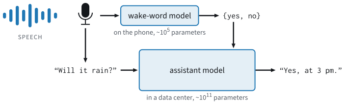
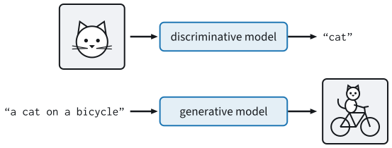
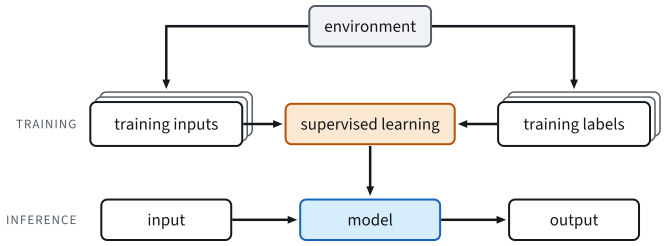

# Introduction
:label:`chap_introduction`

Until recently, nearly every computer program that you interacted with during an ordinary day was coded up as a rigid set of rules specifying precisely how it should behave. Say that we wanted to write an application to manage an e-commerce platform. After huddling around a whiteboard for a few hours to ponder the problem, we might settle on the broad strokes of a working solution: (i) users interact with the application through an interface running in a web browser or mobile app; (ii) our application interacts with a commercial-grade database engine to keep track of each user's state and maintain records of historical transactions; and (iii) at the heart of our application, the *business logic* (you might say, the *brains*) of our system spells out a set of rules that map every conceivable circumstance to the corresponding action that our program should take.

To build the brains of our application, we might enumerate all the common events that our program should handle. For example, whenever a customer clicks to add an item to their shopping cart, our program should add an entry to the shopping cart database table, associating that user's ID with the requested product's ID. We might then attempt to step through every possible corner case, testing the appropriateness of our rules and making any necessary modifications. What happens if a user initiates a purchase with an empty cart? While few developers ever get it completely right the first time (it might take some test runs to work out the kinks), for the most part we can write such programs and confidently launch them *before* ever seeing a real customer. Our ability to manually design automated systems that drive functioning products, often in novel situations, is a remarkable cognitive feat. And when you are able to devise explicit solutions that work $100\%$ of the time, you typically should not be worrying about machine learning.

Fortunately for the growing community of machine learning scientists, many tasks that we would like to automate do not bend so easily to human ingenuity. Imagine huddling around the whiteboard with the smartest minds you know, but this time you are tackling one of the following problems:

* Write a program that predicts tomorrow's weather given geographic information, satellite images, and a trailing window of past weather.
* Write a program that takes in a question, expressed in free-form text, and answers it correctly---writing and running code if the answer requires a calculation.
* Write a program that, given an image, identifies every person depicted in it and draws outlines around each.
* Write a program that presents users with products that they are likely to enjoy but unlikely, in the natural course of browsing, to encounter.
* Write a program that, given the sequence of amino acids of a protein, predicts the three-dimensional shape it folds into.

For these problems, even elite programmers would struggle to code up solutions from scratch. The reasons can vary. Sometimes the program that we are looking for follows a pattern that changes over time, so there is no fixed right answer! In such cases, any successful solution must adapt gracefully to a changing world. At other times, the relationship (say, between raw pixels and abstract categories, or between amino-acid sequences and folded proteins) may be too complicated, requiring millions or billions of computations and following principles that we do not know how to write down explicitly. In the case of image recognition, the precise steps required to perform the task lie beyond our conscious understanding, even though our subconscious cognitive processes execute the task effortlessly.

*Machine learning* is the study of algorithms that can learn from experience. As a machine learning algorithm accumulates more experience, typically in the form of observational data or interactions with an environment, its performance improves. Contrast this with our deterministic e-commerce platform, which follows the exact same business logic no matter how much experience accrues, until the developers themselves learn and decide that it is time to update the software. In this book, we will teach you the fundamentals of machine learning, focusing in particular on *deep learning*, a powerful set of techniques driving innovations in areas as diverse as computer vision, natural language processing, speech recognition, structural biology, healthcare, and autonomous control.

## A Motivating Example

Before beginning writing, the authors of this book, like much of the workforce, had to become caffeinated. We hopped in the car and started driving. Using an iPhone, Alex called out *"Hey Siri"*, awakening the phone's voice recognition system. Then Mu commanded *"directions to Blue Bottle coffee shop"*. The phone quickly displayed the transcription of his command. It also recognized that we were asking for directions and launched the Maps application to fulfill our request. Once launched, the Maps app identified a number of routes. Next to each route, the phone displayed a predicted transit time. While this story was fabricated for pedagogical convenience, it demonstrates that in the span of just a few seconds, our everyday interactions with a smartphone can engage several machine learning models.

Imagine just writing a program to respond to a *wake word* such as *"Alexa"*, *"OK Google"*, or *"Hey Siri"*. Try coding it up in a room by yourself with nothing but a computer and a code editor, as illustrated in :numref:`fig_wake_word`. How would you write such a program from first principles? Think about it... the problem is hard. Every second, the microphone collects roughly 16,000 samples on a phone (or 44,100 on a compact disc). Each sample is a measurement of the amplitude of the sound wave. What explicit rule could map reliably from a snippet of raw audio to confident predictions $\{\textrm{yes}, \textrm{no}\}$ about whether the snippet contains the wake word? If you are stuck, do not worry. We do not know how to write such a program from scratch either. That is why we use machine learning.


:label:`fig_wake_word`

Here is the trick. Often, even when we do not know how to tell a computer explicitly how to map from inputs to outputs, we are nonetheless capable of performing the cognitive feat ourselves. In other words, even if you do not know how to program a computer to recognize the word *"Alexa"*, you yourself are able to recognize it. Armed with this ability, we can collect a large *dataset* containing examples of audio snippets and associated labels, indicating which snippets contain the wake word. In the currently dominant approach to machine learning, we do not attempt to design a system *explicitly* to recognize wake words. Instead, we define a flexible program whose behavior is determined by a number of numerical *parameters*. Then we use the dataset to determine the best possible parameter values---those that improve the performance of our program with respect to a chosen performance measure.

You can think of the parameters as knobs that we can turn, manipulating the behavior of the program. Once the parameters are fixed, we call the program a *model*. The set of all distinct programs (input--output mappings) that we can produce just by manipulating the parameters is called a *family* of models. And the "meta-program" that uses our dataset to choose the parameters is called a *learning algorithm*.

Before we can go ahead and engage the learning algorithm, we have to define the problem precisely, pinning down the exact nature of the inputs and outputs, and choosing an appropriate model family. In this case, our model receives a snippet of audio as *input*, and generates a selection among $\{\textrm{yes}, \textrm{no}\}$ as *output*. If all goes according to plan, the model's guesses will typically be correct as to whether the snippet contains the wake word.

If we choose the right family of models, there should exist one setting of the knobs such that the model fires `"yes"` every time it hears the word *"Alexa"*. Because the exact choice of the wake word is arbitrary, we will probably need a model family sufficiently rich that, via another setting of the knobs, it could fire `"yes"` only upon hearing the word *"Apricot"*. We expect that the same model family should be suitable for *"Alexa"* recognition and *"Apricot"* recognition because they seem, intuitively, to be similar tasks. However, we might need a different family of models entirely if we want to deal with fundamentally different inputs or outputs, say if we wanted to map from images to captions, or from English sentences to Chinese sentences.

As you might guess, if we just set all of the knobs randomly, it is unlikely that our model will recognize *"Alexa"*, *"Apricot"*, or any other English word. In machine learning, *learning* is the process by which we discover the right setting of the knobs for coercing the desired behavior from our model. In other words, we *train* our model with data. As shown in :numref:`fig_ml_loop`, the training process usually looks like the following:

1. Start off with a randomly initialized model that cannot do anything useful.
1. Grab some of your data (e.g., audio snippets and corresponding $\{\textrm{yes}, \textrm{no}\}$ labels).
1. Tweak the knobs to make the model perform better as assessed on those examples.
1. Repeat Steps 2 and 3 until the model is awesome.


:label:`fig_ml_loop`

To summarize, rather than code up a wake-word recognizer by hand, we code up a program that can *learn* to recognize wake words when presented with a large labeled dataset. You can think of this act of determining a program's behavior by presenting it with a dataset as *programming with data*. That is to say, we can "program" a cat detector by providing our machine learning system with many examples of cats and dogs. This way the detector will eventually learn to emit a very large positive number if it is a cat, a very large negative number if it is a dog, and something closer to zero if it is not sure.

In fact, if you look again at both ends of our spoken request in :numref:`fig_wake_word`, this exact same recipe powers both the tiny wake-word detector on the phone (which has around a hundred thousand parameters and runs continuously on a sliver of battery power) and the massive conversational assistant in the data center (which may have hundreds of billions of parameters and can answer almost any question posed to it in natural language). Both start as flexible parameterized programs, and both are trained by adjusting their parameters on data. This barely scratches the surface of what machine learning can do.


## Key Components

In our wake-word example, we described a dataset consisting of audio snippets and binary labels, and we gave a high-level sense of how we might train a model to approximate a mapping from snippets to classifications. This sort of problem, where we try to predict a designated unknown label based on known inputs given a dataset of examples for which the labels are known, is called *supervised learning*. This is just one among many kinds of machine learning problems. Before we explore other varieties, we would like to shed more light on four core components that will follow us around no matter what kind of machine learning problem we tackle:

1. The *data* that we can learn from.
1. A *model* of how to transform the data.
1. An *objective function* that quantifies how well (or badly) the model is doing.
1. An *algorithm* to adjust the model's parameters to optimize the objective function.

### Data

It might go without saying that you cannot do data science without data. We could lose hundreds of pages pondering what precisely data *is*, but for now we will focus on the key properties of the datasets that we will be concerned with. Generally, we are concerned with a collection of examples. In order to work with data usefully, we typically need to come up with a suitable numerical representation. Each *example* (or *data point*, *data instance*, *sample*) typically consists of a set of attributes called *features* (sometimes called *covariates* or *inputs*), based on which the model must make its predictions. In supervised learning problems, our goal is to predict the value of a special attribute, called the *label* (or *target*), that is not part of the model's input.

If we were working with image data, each example might consist of an individual photograph (the features) and a number indicating the category to which the photograph belongs (the label). The photograph would be represented numerically as three grids of numerical values representing the brightness of red, green, and blue light at each pixel location. For example, a $200\times 200$ pixel color photograph would consist of $200\times200\times3=120{,}000$ numerical values.

Alternatively, we might work with electronic health record data and tackle the task of predicting the likelihood that a given patient will survive the next 30 days. Here, our features might consist of a collection of readily available attributes and frequently recorded measurements, including age, vital signs, comorbidities, current medications, and recent procedures. The label available for training would be a binary value indicating whether each patient in the historical data survived within the 30-day window.

In such cases, when every example is characterized by the same number of numerical features, we say that the inputs are fixed-length vectors and we call the constant length of the vectors the *dimensionality* of the data. As you might imagine, fixed-length inputs can be convenient, giving us one less complication to worry about.

However, not all data can easily be represented as *fixed-length* vectors. While we might expect microscope images to come from standard equipment, we cannot expect images mined from the Internet all to have the same resolution or shape. For images, we might consider cropping them to a standard size, but that strategy only gets us so far: we risk losing information in the cropped-out portions. Moreover, text data resists fixed-length representations even more stubbornly. Consider the customer reviews left on e-commerce sites such as Amazon, IMDb, and TripAdvisor. Some are short: *"it stinks!"*. Others ramble for pages. In practice, we split text into discrete pieces called *tokens* (typically words or subword fragments) and represent each document as a variable-length *sequence* of token identifiers. One major advantage of deep learning over traditional methods is the comparative grace with which modern models can handle *varying-length* data directly.

Generally, the more data we have, the easier our job becomes. When we have more data, we can train more powerful models and rely less heavily on preconceived assumptions. The regime change from (comparatively) small to big data is a major contributor to the success of modern deep learning. To drive the point home, many of the most exciting models in deep learning do not work without large datasets---the largest language models today are trained on text corpora of the order of ten trillion tokens. Some others might work in the small-data regime, but are no better than traditional approaches.

Finally, it is not enough to have lots of data and to process it cleverly. We need the *right* data. If the data are full of mistakes, or if the chosen features are not predictive of the target quantity of interest, learning is going to fail. The situation is captured well by the cliché: *garbage in, garbage out*. Moreover, poor predictive performance is not the only potential consequence. In sensitive applications of machine learning, like predictive policing, resume screening, and risk models used for lending, we must be especially alert to the consequences of garbage data. One commonly occurring failure mode concerns datasets where some groups of people are unrepresented in the training data. Imagine applying a skin-cancer recognition system that had never seen dark skin before. Failure can also occur when the data not only under-represent some groups but reflect societal prejudices. For example, if past hiring decisions are used to train a predictive model that will be used to screen resumes, then machine learning models could inadvertently capture and automate historical injustices. Note that this can all happen without the data scientist actively conspiring, or even being aware.


### Models

Most machine learning involves transforming the data in some sense. We might want to build a system that ingests photos and predicts "smiley-ness". Alternatively, we might want to ingest a set of sensor readings and predict how normal vs. anomalous the readings are. By *model*, we denote the computational machinery for ingesting data of one type and spitting out predictions of a possibly different type. In particular, we are interested in *statistical models* that can be estimated from data, whose size we often describe by their number of adjustable parameters (commonly called *weights* in code), ranging from two parameters in a simple regression line to hundreds of billions in a large language model. While simple models are perfectly capable of addressing appropriately simple problems, the problems that we focus on in this book stretch the limits of classical methods. Deep learning is differentiated from classical approaches principally by the set of powerful models that it focuses on. These models consist of many successive transformations of the data that are chained together top to bottom, thus the name *deep learning*. On our way to discussing deep models, we will also discuss some more traditional methods.

### Objective Functions

Earlier, we introduced machine learning as learning from experience. By *learning* here, we mean improving at some task over time. But who is to say what constitutes an improvement? You might imagine that we could propose updating our model, and some people might disagree on whether our proposal constituted an improvement or not.

In order to develop a formal mathematical system of learning machines, we need to have formal measures of how good (or bad) our models are. In machine learning, and optimization more generally, we call these *objective functions*. By convention, we usually define objective functions so that lower is better. This is merely a convention: you can take any function for which higher is better and turn it into a new function that is qualitatively identical, but for which lower is better, simply by flipping the sign. Because we choose lower to be better, these functions are commonly called *loss functions*.

When trying to predict numerical values, the most common loss function is *squared error*, i.e., the square of the difference between the prediction and the ground-truth target. For classification, the most common overarching goal is to minimize the error rate, i.e., the fraction of examples on which our predictions disagree with the ground truth. Some objectives (e.g., squared error) are easy to optimize directly, while others (e.g., error rate) are difficult to optimize directly, owing to non-differentiability or other complications. In these cases, it is common instead to optimize a smooth *surrogate objective*. For classification, the standard surrogate loss is *cross-entropy*, which penalizes the model according to the probability it failed to assign to the true class (we demystify its name and properties in :numref:`chap_mdl-information-theory`).

During optimization, we think of the loss as a function of the model's parameters, and treat the training dataset as a constant. We learn the best values of our model's parameters by minimizing the loss incurred on a set consisting of some number of examples collected for training. However, doing well on the training data does not guarantee that we will do well on unseen data---a property called *generalization*. So we will typically want to split the available data into two partitions: the *training dataset* (or *training set*), for learning model parameters; and the *test dataset* (or *test set*), which is held out for evaluation. At the end of the day, we typically report how our models perform on both partitions. You could think of training performance as analogous to the scores that a student achieves on the practice exams used to prepare for some real final exam. Even if the results are encouraging, that does not guarantee success on the final exam. Over the course of studying, the student might begin to memorize the practice questions, appearing to master the topic but faltering when faced with previously unseen questions on the actual final exam. When a model performs well on the training set but fails to generalize to unseen data, we say that it is *overfitting* to the training data.


### Optimization Algorithms

Once we have got some data source and representation, a model, and a well-defined objective function, we need an algorithm capable of searching for the best possible parameters for minimizing the loss function. Popular optimization algorithms for deep learning are based on an approach called *gradient descent*. In brief, at each step, this method checks to see, for each parameter, how the training-set loss would change if you perturbed that parameter by just a small amount. It then updates the parameter in the direction that lowers the loss. Because evaluating this change over an entire massive dataset at every step would be prohibitively slow, in practice we estimate it on a small randomly sampled *minibatch* of examples at each step---an algorithm called *stochastic gradient descent* (SGD), whose modern variants (:numref:`chap_optimization`) train every model in this book. Once training is complete and the parameters are fixed, applying the trained model to new inputs is called *inference*.


## Kinds of Machine Learning Problems

The wake-word problem in our motivating example is just one among many that machine learning can tackle. To motivate the reader further and provide us with some common language that will follow us throughout the book, we now provide a broad overview of the landscape of machine learning problems.

### Supervised Learning

Supervised learning describes tasks where we are given a dataset containing both features and labels and asked to produce a model that predicts the labels when given input features. Each feature--label pair is called an example. Sometimes, when the context is clear, we may use the term *examples* to refer to a collection of inputs even when the corresponding labels are unknown. The supervision comes into play because, for choosing the parameters, we (the supervisors) provide the model with a dataset consisting of labeled examples. In probabilistic terms, we typically are interested in estimating the conditional probability of a label given input features. While it is just one among several paradigms, supervised learning accounts for the majority of successful applications of machine learning in industry. Partly that is because many important tasks can be described crisply as estimating the probability of something unknown given a particular set of available data:

* Predict cancer vs. not cancer, given a computed tomography image.
* Predict the correct translation in French, given a sentence in English.
* Predict the price of a stock next month based on this month's financial reporting data.

While all supervised learning problems are captured by the simple description "predicting the labels given input features", supervised learning itself can take diverse forms and require many modeling decisions, depending on (among other considerations) the type, size, and quantity of the inputs and outputs. For example, we use different models for processing sequences of arbitrary lengths and fixed-length vector representations. We will visit many of these problems in depth throughout this book.

Informally, the learning process looks something like the following. First, grab a big collection of examples for which the features are known and select from them a subset, acquiring the ground-truth labels for each. Sometimes these labels might be available data that have already been collected (e.g., did a patient die within the following year?) and other times we might need to employ human annotators to label the data (e.g., assigning images to categories). Together, these inputs and corresponding labels comprise the training set. We feed the training dataset into a supervised learning algorithm, a function that takes as input a dataset and outputs another function: the learned model. Finally, we can feed previously unseen inputs to the learned model, using its outputs as predictions of the corresponding label. The full process is drawn in :numref:`fig_supervised_learning`.


:label:`fig_supervised_learning`

#### Regression

Perhaps the simplest supervised learning task to wrap your head around is *regression*. Consider, for example, a set of data harvested from a database of home sales. We might construct a table in which each row corresponds to a different house, and each column corresponds to some relevant attribute, such as the square footage of a house, the number of bedrooms, the number of bathrooms, and the number of minutes (walking) to the center of town. In this dataset, each example would be a specific house, and the corresponding feature vector would be one row in the table. If you live in New York or San Francisco, and you are not the CEO of Amazon, Google, Microsoft, or Meta, the (sq. footage, no. of bedrooms, no. of bathrooms, walking distance) feature vector for your home might look something like $[600, 1, 1, 60]$. However, if you live in Pittsburgh, it might look more like $[3000, 4, 3, 10]$. Fixed-length feature vectors like this are essential for most classic machine learning algorithms.

What makes a problem a regression is actually the form of the target. Say that you are in the market for a new home. You might want to estimate the fair market value of a house, given some features such as above. The data here might consist of historical home listings and the labels might be the observed sales prices. When labels take on arbitrary numerical values (even within some interval), we call this a *regression* problem. The goal is to produce a model whose predictions closely approximate the actual label values.

Lots of practical problems are easily described as regression problems. Predicting the rating that a user will assign to a movie can be thought of as a regression problem, and if you designed a great algorithm to accomplish this feat in 2009, you might have won the [1-million-dollar Netflix prize](https://en.wikipedia.org/wiki/Netflix_Prize). Predicting the length of stay for patients in the hospital is also a regression problem. A good rule of thumb is that any *how much?* or *how many?* problem is likely to be regression. For example:

* How many hours will this surgery take?
* How much rainfall will this town have in the next six hours?

Even if you have never worked with machine learning before, you have probably worked through a regression problem informally. Imagine, for example, that you had your drains repaired and that your contractor spent 3 hours removing gunk from your sewage pipes. Then they sent you a bill of 350 dollars. Now imagine that your friend hired the same contractor for 2 hours and received a bill of 250 dollars. If someone then asked you how much to expect on their upcoming gunk-removal invoice, you might make some reasonable assumptions, such as that more hours worked costs more dollars. You might also assume that there is some base charge and that the contractor then charges per hour. If these assumptions held true, then given these two data examples, you could already identify the contractor's pricing structure: 100 dollars per hour plus 50 dollars to show up at your house. If you followed that much, then you already understand the high-level idea behind *linear* regression.

In this case, we could produce the parameters that exactly matched the contractor's prices. Sometimes this is not possible, e.g., if some of the variation arises from factors beyond your two features. In these cases, we will try to learn models that minimize the distance between our predictions and the observed values. In most of our chapters, we will focus on minimizing the squared error loss function. As we will see later, this loss corresponds to the assumption that our data were corrupted by Gaussian noise.

#### Classification

While regression models are great for addressing *how many?* questions, lots of problems do not fit comfortably in this template. Consider, for example, a bank that wants to develop a check-scanning feature for its mobile app. Ideally, the customer would simply snap a photo of a check and the app would automatically recognize the text from the image. Assuming that we had some ability to segment out image patches corresponding to each handwritten character, then the primary remaining task would be to determine which character among some known set is depicted in each image patch. These kinds of *which one?* problems are called *classification* and require a different set of tools from those used for regression, although many techniques will carry over.

In *classification*, we want our model to look at features, e.g., the pixel values in an image, and then predict to which *category* (sometimes called a *class*), among some discrete set of options, an example belongs. For handwritten digits, we might have ten classes, corresponding to the digits 0 through 9. The simplest form of classification is when there are only two classes, a problem which we call *binary classification*. For example, our dataset could consist of images of animals and our labels might be the classes $\textrm{\{cat, dog\}}$. Whereas in regression we sought a regressor to output a numerical value, in classification we seek a classifier, whose output is the predicted class assignment.

For reasons that we will get into as the book gets more technical, it can be difficult to optimize a model that can only output a *firm* categorical assignment, e.g., either `"cat"` or `"dog"`. In these cases, it is usually much easier to express our model in the language of probabilities. Given features of an example, our model assigns a probability to each possible class. Returning to our animal classification example where the classes are $\textrm{\{cat, dog\}}$, a classifier might see an image and output the probability that the image is a cat as $0.9$. We can interpret this number by saying that the classifier is $90\%$ sure that the image depicts a cat. The magnitude of the probability for the predicted class conveys a notion of uncertainty. It is not the only notion of uncertainty available, and we will discuss others in chapters dealing with more advanced topics.

When we have more than two possible classes, we call the problem *multiclass classification*. Common examples include handwritten character recognition $\textrm{\{0, 1, 2, ... 9, a, b, c, ...\}}$. While we attacked regression problems by trying to minimize the squared error loss function, the common loss function for classification problems is called *cross-entropy*, whose name will be demystified when we introduce information theory in later chapters.

Note that the most likely class is not necessarily the one that you are going to use for your decision. Assume that you find a beautiful mushroom in your backyard as shown in :numref:`fig_death_cap`.


:width:`200px`
:label:`fig_death_cap`

Now, assume that you built a classifier and trained it to predict whether a mushroom is poisonous based on a photograph. Say our poison-detection classifier outputs that the probability that :numref:`fig_death_cap` shows a death cap is $0.2$. In other words, the classifier is $80\%$ sure that our mushroom is not a death cap. Still, you would have to be a fool to eat it. That is because the certain benefit of a delicious dinner is not worth a $20\%$ risk of dying from it. In other words, the effect of the uncertain risk outweighs the benefit by far. Thus, in order to make a decision about whether to eat the mushroom, we need to compute the expected detriment associated with each action, which depends both on the likely outcomes and on the benefits or harms associated with each. In this case, the detriment incurred by eating the mushroom might be $0.2 \times \infty + 0.8 \times 0 = \infty$, whereas the loss of discarding it is $0.2 \times 0 + 0.8 \times 1 = 0.8$. Our caution was justified: as any mycologist would tell us, the mushroom in :numref:`fig_death_cap` is actually a death cap.

Classification can get much more complicated than just binary or multiclass classification. For instance, there are some variants of classification for addressing hierarchically structured classes. In such cases not all errors are equal---if we must err, we might prefer to misclassify to a related class rather than a distant class. Usually, this is referred to as *hierarchical classification*. For inspiration, you might think of [Linnaeus](https://en.wikipedia.org/wiki/Carl_Linnaeus), who organized fauna in a hierarchy.

In the case of animal classification, it might not be so bad to mistake a poodle for a schnauzer, but our model would pay a huge penalty if it confused a poodle with a dinosaur. Which hierarchy is relevant might depend on how you plan to use the model. For example, rattlesnakes and garter snakes might be close on the phylogenetic tree, but mistaking a rattler for a garter could have fatal consequences.

Finally, the number of classes in a multiclass problem can be very large. A modern *language model* is, at heart, a multiclass classifier over a vocabulary of roughly $100{,}000$ tokens, repeatedly answering a single question: *given the text so far, which token comes next?* (:numref:`fig_next_token`). By sampling a token from the predicted probability distribution, appending it to the input, and asking the same question again, the model generates text one token at a time.


:label:`fig_next_token`

#### Tagging

Some classification problems fit neatly into the binary or multiclass classification setups. For example, we could train a normal binary classifier to distinguish cats from dogs. Given the current state of computer vision, we can do this easily, with off-the-shelf tools. Nonetheless, no matter how accurate our model gets, we might find ourselves in trouble when the classifier encounters an image of the *Town Musicians of Bremen*, a popular German fairy tale featuring four animals (:numref:`fig_stackedanimals`).


:width:`300px`
:label:`fig_stackedanimals`

As you can see, the illustration features a cat, a rooster, a dog, and a donkey, with some trees in the background. If we anticipate encountering such images, multiclass classification might not be the right problem formulation. Instead, we might want to give the model the option of saying the image depicts a cat, a dog, a donkey, *and* a rooster.

The problem of learning to predict classes that are not mutually exclusive is called *multi-label classification*. Auto-tagging problems are typically best described in terms of multi-label classification. Think of the tags people might apply to posts on a technical blog, e.g., `"machine learning"`, `"technology"`, `"gadgets"`, `"programming languages"`, `"Linux"`, `"cloud computing"`, `"AWS"`. A typical article might have 5--10 tags applied because these concepts are correlated. Posts about `"cloud computing"` are likely to mention `"AWS"`, and posts about `"machine learning"` are likely to mention `"GPUs"`.

Sometimes such tagging problems draw on enormous label sets. The National Library of Medicine employs many professional annotators who associate each article to be indexed in PubMed with a set of tags drawn from the Medical Subject Headings (MeSH) ontology, a collection of roughly 28,000 tags. Correctly tagging articles is important because it allows researchers to conduct exhaustive reviews of the literature. This is a time-consuming process and typically there is a one-year lag between archiving and tagging. Machine learning can provide provisional tags until each article has a proper manual review. Indeed, for several years, the BioASQ organization has [hosted competitions](http://bioasq.org/) for this task.

#### Search

In the field of information retrieval, we often impose ranks on sets of items. Take web search, for example. The goal is less to determine *whether* a particular page is relevant for a query, but rather which, among a set of relevant results, should be shown most prominently to a particular user. One way of doing this might be to first assign a score to every element in the set and then to retrieve the top-rated elements. [PageRank](https://en.wikipedia.org/wiki/PageRank), the original secret sauce behind the Google search engine, was an early example of such a scoring system. Weirdly, the scoring provided by PageRank did not depend on the actual query. Instead, they relied on a simple relevance filter to identify the set of relevant candidates and then used PageRank to prioritize the more authoritative pages. Nowadays, search engines use machine learning and behavioral models to obtain query-dependent relevance scores. There are entire academic conferences devoted to this subject.

#### Recommender Systems
:label:`subsec_recommender_systems`

Recommender systems are another problem setting that is related to search and ranking. The problems are similar insofar as the goal is to display a set of items relevant to the user. The main difference is the emphasis on *personalization* to specific users in the context of recommender systems. For instance, for movie recommendations, the results page for a science-fiction fan and the results page for a connoisseur of Peter Sellers comedies might differ significantly. Similar problems pop up in other recommendation settings, e.g., for retail products, music, and news recommendation.

In some cases, customers provide explicit feedback, communicating how much they liked a particular product (e.g., the product ratings and reviews on Amazon, IMDb, or Goodreads). In other cases, they provide implicit feedback, e.g., by skipping titles on a playlist, which might indicate dissatisfaction or maybe just indicate that the song was inappropriate in context. In the simplest formulations, these systems are trained to estimate some score, such as an expected star rating or the probability that a given user will purchase a particular item.

Given such a model, for any given user, we could retrieve the set of objects with the largest scores, which could then be recommended to the user. Production systems are considerably more advanced and take detailed user activity and item characteristics into account when computing such scores.

Despite their tremendous economic value, recommender systems naively built on top of predictive models suffer some serious conceptual flaws. To start, we only observe *censored feedback*: users preferentially rate movies that they feel strongly about. For example, on a five-point scale, you might notice that items receive many one- and five-star ratings, but that there are conspicuously few three-star ratings. Moreover, current purchase habits are often a result of the recommendation algorithm currently in place, but learning algorithms do not always take this detail into account. Thus it is possible for feedback loops to form where a recommender system preferentially pushes an item that is then taken to be better (due to greater purchases) and in turn is recommended even more frequently. Many of these problems---about how to deal with censoring, incentives, and feedback loops---are important open research questions.

#### Sequence Learning

So far, we have looked at problems where we have some fixed number of inputs and produce a fixed number of outputs. For example, we considered predicting house prices given a fixed set of features: square footage, number of bedrooms, number of bathrooms, and the transit time to downtown. We also discussed mapping from an image (of fixed dimension) to the predicted probabilities that it belongs to each among a fixed number of classes, and predicting star ratings associated with purchases based on the user ID and product ID alone. In these cases, once our model is trained, after each test example is fed into our model, it is immediately forgotten. We assumed that successive observations were independent and thus there was no need to hold on to this context.

But how should we deal with video snippets? In this case, each snippet might consist of a different number of frames. And our guess of what is going on in each frame might be much stronger if we take into account the previous or succeeding frames. The same goes for language. For example, one popular deep learning problem is machine translation: the task of ingesting sentences in some source language and predicting their translations in another language.

Such problems also occur in medicine. We might want a model to monitor patients in the intensive care unit and to fire off alerts whenever their risk of dying in the next 24 hours exceeds some threshold. Here, we would not throw away everything that we know about the patient history every hour, because we might not want to make predictions based only on the most recent measurements.

Questions like these are among the most exciting applications of machine learning and they are instances of *sequence learning*. They require a model either to ingest sequences of inputs or to emit sequences of outputs (or both). Specifically, *sequence-to-sequence learning* considers problems where both inputs and outputs consist of variable-length sequences. Examples include machine translation and speech-to-text transcription. While it is impossible to consider all types of sequence transformations, the following special cases are worth mentioning.

**Tagging and Parsing.** This involves annotating a text sequence with attributes. Here, the inputs and outputs are *aligned*, i.e., they are of the same number and occur in a corresponding order. For instance, in *part-of-speech (PoS) tagging*, we annotate every word in a sentence with the corresponding part of speech, i.e., `"noun"` or `"direct object"`. Alternatively, we might want to know which groups of contiguous words refer to named entities, like *people*, *places*, or *organizations*. In the cartoonishly simple example below, we might just want to indicate whether or not any word in the sentence is part of a named entity (tagged as `"Ent"`):

```text
Tom has dinner in Washington with Sally
Ent  -    -    -     Ent      -    Ent
```

**Automatic Speech Recognition.** With speech recognition, the input sequence is an audio recording of a speaker (:numref:`fig_speech`), and the output is a transcript of what the speaker said. The challenge is that there are many more audio frames (sound is typically sampled at $8\textrm{ kHz}$, $16\textrm{ kHz}$, or $44.1\textrm{ kHz}$ on a compact disc) than text characters, i.e., there is no 1:1 correspondence between audio and text, since thousands of samples may correspond to a single spoken word. These are sequence-to-sequence learning problems where the output is much shorter than the input. While humans are remarkably good at recognizing speech, even from low-quality audio, getting computers to perform the same feat is a formidable challenge.


:label:`fig_speech`

**Text to Speech.** This is the inverse of automatic speech recognition. Here, the input is text and the output is an audio file. In this case, the output is much longer than the input.

**Machine Translation.** Unlike the case of speech recognition, where corresponding inputs and outputs occur in the same order, in machine translation, unaligned data poses a new challenge. Here the input and output sequences can have different lengths, and the corresponding regions of the respective sequences may appear in a different order. Consider the following illustrative example of the peculiar tendency of Germans to place the verbs at the end of sentences:

```text
German:           Haben Sie sich schon dieses grossartige Lehrwerk angeschaut?
English:          Have you already looked at this excellent textbook?
Wrong alignment:  Have you yourself already this excellent textbook looked at?
```

Many related problems pop up in other learning tasks. For instance, determining the order in which a user reads a webpage is a two-dimensional layout analysis problem. Dialogue problems exhibit all kinds of additional complications, where determining what to say next requires taking into account real-world knowledge and the prior state of the conversation across long temporal distances. Moreover, while a decade ago each of these sequence tasks required its own dedicated system, today a single pretrained language model can often perform translation, summarization, and question answering simply by being prompted with the appropriate instructions.

### Unsupervised and Self-Supervised Learning

The previous examples focused on supervised learning, where we feed the model a giant dataset containing both the features and corresponding label values. You could think of the supervised learner as having an extremely specialized job and an extremely dictatorial boss. The boss stands over the learner's shoulder and tells them exactly what to do in every situation until they learn to map from situations to actions. Working for such a boss sounds pretty lame. On the other hand, pleasing such a boss is pretty easy: you just recognize the pattern as quickly as possible and imitate the boss's actions.

Considering the opposite situation, it could be frustrating to work for a boss who has no idea what they want you to do. However, if you plan to be a data scientist, you had better get used to it. The boss might just hand you a giant dump of data and tell you to *do some data science with it!* This sounds vague because it is vague. We call this class of problems *unsupervised learning*, and the type and number of questions we can ask is limited only by our creativity. We will address unsupervised learning techniques in later chapters. To whet your appetite for now, we describe a few of the questions you might ask:

* *Can we find a small number of prototypes that accurately summarize the data?* Given a set of photos, can we group them into landscape photos, pictures of dogs, babies, cats, and mountain peaks? Likewise, given a collection of users' browsing activities, can we group them into users with similar behavior? This problem is typically known as *clustering*.
* *Can we find a small number of parameters that accurately capture the relevant properties of the data?* The trajectories of a ball are well described by the velocity, diameter, and mass of the ball. Tailors have developed a small number of parameters that describe human body shape fairly accurately for the purpose of fitting clothes. These problems are referred to as *subspace estimation*. If the dependence is linear, it is called *principal component analysis*.
* *Is there a representation of (arbitrarily structured) objects in Euclidean space such that symbolic properties can be well matched?* This can be used to describe entities and their relations, such as `"Rome"` $-$ `"Italy"` $+$ `"France"` $=$ `"Paris"`.
* *Is there a description of the root causes of much of the data that we observe?* For instance, if we have demographic data about house prices, pollution, crime, location, education, and salaries, can we discover how they are related simply based on empirical data? The fields concerned with *causality* and *probabilistic graphical models* tackle such questions.
* *Can we model the distribution of the data well enough to generate new examples?* A major development in unsupervised and representation learning is the rise of *deep generative models*. Whereas a *discriminative* model takes high-dimensional data and predicts a label (an image in, `"cat"` out), a *generative* model runs the other way, estimating the density of the data either explicitly or implicitly so that we can sample realistic synthetic examples---such as generating an image from a text description (:numref:`fig_discriminative_generative`). Early deep learning breakthroughs in generative modeling came with the invention of *variational autoencoders* :cite:`Kingma.Welling.2014,rezende2014stochastic` and continued with the development of *generative adversarial networks* :cite:`Goodfellow.Pouget-Abadie.Mirza.ea.2014`. More recent advances include *normalizing flows* :cite:`dinh2014nice,dinh2017density` and *diffusion models* :cite:`sohl2015deep,song2019generative,ho2020denoising,song2021score`, which learn to gradually denoise random Gaussian noise into coherent images, audio, or video.


:label:`fig_discriminative_generative`

A particularly consequential development growing out of unsupervised learning has been the rise of *self-supervised learning*: techniques that leverage the internal structure of unlabeled data to provide their own supervisory signal. Human-annotated labels are expensive to collect, whereas raw text and images on the web are abundant. For text, we can train models to predict the next token in a document, or to "fill in the blanks" by predicting randomly masked words using their surrounding context in massive corpora without any manual labeling effort :cite:`Devlin.Chang.Lee.ea.2018`! To predict the next word across trillions of tokens of web text, a model is forced to absorb grammar, factual knowledge, reasoning patterns, and programming syntax. For images, we may train models to tell the relative position between two cropped regions of the same image :cite:`Doersch.Gupta.Efros.2015`, to predict an occluded part of an image based on the remaining portions, or to predict whether two views are perturbed versions of the same underlying image.

Training a large model once on a massive unlabeled corpus via self-supervision is called *pretraining*. Because the resulting *base model* (or *foundation model*) captures rich general-purpose representations, it can subsequently be adapted to many different tasks via *fine-tuning* on a much smaller set of labeled examples, alignment with human preferences, or access to external tools (:numref:`fig_pretrain_adapt`).


:label:`fig_pretrain_adapt`


### Interacting with an Environment

So far, we have not discussed where data actually come from, or what actually happens when a machine learning model generates an output. That is because supervised learning, unsupervised learning, and self-supervised pretraining do not address these issues in a very sophisticated way. In each case, we grab a big pile of data up front, then set our pattern-recognition machines in motion without ever interacting with the environment again. Because all of the learning takes place after the algorithm is disconnected from the environment, this is sometimes called *offline learning*. For example, supervised learning assumes the simple one-way interaction pattern depicted in :numref:`fig_data_collection`.


:label:`fig_data_collection`

This simplicity of offline learning has its charms. The upside is that we can worry about pattern recognition in isolation, with no concern about complications arising from interactions with a dynamic environment. But this problem formulation is limiting. If you grew up reading Asimov's Robot novels, then you probably picture artificially intelligent agents capable not only of making predictions, but also of taking actions in the world. We want to think about intelligent *agents*, not just predictive models. This means that we need to think about choosing *actions*, not just making predictions. In contrast to mere predictions, actions actually impact the environment. If we want to train an intelligent agent, we must account for the way its actions might impact the future observations of the agent, and so offline learning is inappropriate.

Considering the interaction with an environment opens a whole set of new modeling questions. The following are just a few examples:

* Does the environment remember what we did previously?
* Does the environment want to help us, e.g., a user reading text into a speech recognizer?
* Does the environment want to beat us, e.g., spammers adapting their emails to evade spam filters?
* Does the environment have shifting dynamics? For example, would future data always resemble the past or would the patterns change over time, either naturally or in response to our automated tools?

These questions raise the problem of *distribution shift*, where training and test data are different. An example of this, that many of us may have met, is when taking exams written by a lecturer while the homework was composed by their teaching assistants. Next, we briefly describe reinforcement learning and autonomous agents, rich frameworks for posing learning problems in which an agent interacts with an environment.


### Reinforcement Learning and Agents

If you are interested in using machine learning to develop an agent that interacts with an environment and takes actions, then you are probably going to wind up focusing on *reinforcement learning*. This might include applications to robotics, to dialogue systems, and even to developing artificial intelligence for video games. *Deep reinforcement learning*, which applies deep learning to reinforcement learning problems, has surged in popularity. The breakthrough deep Q-network that beat humans at Atari games using only the visual input :cite:`mnih2015human`, and the AlphaGo program that dethroned the world champion at the board game Go :cite:`Silver.Huang.Maddison.ea.2016`, are two prominent examples.

Today, reinforcement learning also plays a central role in training conversational assistants and reasoning models. After a language model is pretrained on web text and fine-tuned on written demonstrations, it can be refined by generating candidate answers and receiving rewards based either on human preference comparisons :cite:`Christiano.Leike.Brown.ea.2017,ouyang2022training` or on automated verifiers that check whether a mathematical proof or computer program is actually correct :cite:`DeepSeekAI.2025`. Furthermore, when a language model is given access to external *tools*---such as running a command, reading a file, executing tests, or searching the web---and allowed to observe the tool outputs in a loop, it acts as an autonomous *agent* (:numref:`chap_lm_agents`).

Reinforcement learning gives a very general statement of a problem in which an agent interacts with an environment over a series of time steps. At each time step, the agent receives some *observation* from the environment and must choose an *action* that is subsequently transmitted back to the environment via some mechanism (sometimes called an *actuator*), after which the agent receives a *reward* from the environment. This process is illustrated in :numref:`fig_rl-environment`. The agent then receives a subsequent observation, chooses a subsequent action, and so on. The behavior of a reinforcement learning agent is governed by a *policy*. In brief, a *policy* is just a function that maps from observations of the environment to actions. The goal of reinforcement learning is to produce good policies.


:label:`fig_rl-environment`

It is hard to overstate the generality of the reinforcement learning framework. For example, supervised learning can be recast as reinforcement learning. Say we had a classification problem. We could create a reinforcement learning agent with one action corresponding to each class. We could then create an environment that gave a reward exactly equal to the negative loss function from the original supervised learning problem.

Further, reinforcement learning can also address many problems that supervised learning cannot. For example, in supervised learning, we always expect that the training input comes associated with the correct label. But in reinforcement learning, we do not assume that for each observation the environment tells us the optimal action. In general, we just get some reward. Moreover, the environment may not even tell us which actions led to the reward.

Consider the game of chess. The only real reward signal comes at the end of the game when we either win, earning a reward of, say, $1$, or when we lose, receiving a reward of, say, $-1$. So reinforcement learners must deal with the *credit assignment* problem: determining which actions to credit or blame for an outcome. The same goes for an employee who gets a promotion on October 11. That promotion likely reflects a number of well-chosen actions over the previous year. Getting promoted in the future requires figuring out which actions along the way led to the earlier promotions.

Reinforcement learners may also have to deal with the problem of *partial observability*. That is, the current observation might not tell you everything about your current state. Say your cleaning robot found itself trapped in one of many identical closets in your house. Rescuing the robot involves inferring its precise location, which might require considering earlier observations prior to its entering the closet.

Finally, at any given point, reinforcement learners might know of one good policy, but there might be many other better policies that the agent has never tried. The reinforcement learner must constantly choose whether to *exploit* the best currently known strategy as a policy, or to *explore* the space of strategies, potentially giving up some short-term reward in exchange for knowledge.

The general reinforcement learning problem is a very general setting. Actions affect subsequent observations. Rewards are only observed when they correspond to the chosen actions. The environment may be either fully or partially observed. Accounting for all this complexity at once may be asking too much. Moreover, not every practical problem exhibits all this complexity. As a result, researchers have studied a number of special cases of reinforcement learning problems:

* When the environment is fully observed, we call the reinforcement learning problem a *Markov decision process*.
* When the state does not depend on the previous actions, we call it a *contextual bandit problem*.
* When there is no state, just a set of available actions with initially unknown rewards, we have the classic *multi-armed bandit problem*.

## Roots

We have just reviewed a small subset of problems that machine learning can address. For a diverse set of machine learning problems, deep learning provides powerful tools for their solution. Although many deep learning methods are recent inventions, the core ideas behind learning from data have been studied for centuries. In fact, humans have held the desire to analyze data and to predict future outcomes for ages, and it is this desire that is at the root of much of natural science and mathematics. Two examples are the Bernoulli distribution, named after [Jacob Bernoulli (1655--1705)](https://en.wikipedia.org/wiki/Jacob_Bernoulli), and the Gaussian distribution, which [Carl Friedrich Gauss (1777--1855)](https://en.wikipedia.org/wiki/Carl_Friedrich_Gauss) used to model measurement error. Gauss developed the method of least squares independently of Adrien-Marie Legendre, who published it first :cite:`Legendre.1805`, and it is still used today for a multitude of problems from insurance calculations to medical diagnostics. Such tools enhanced the experimental approach in the natural sciences---for instance, Ohm's law relating current and voltage in a resistor is perfectly described by a linear model.

Even in the early sixteenth century, mathematicians had a keen intuition of estimates. For instance, the geometry book of [Jacob Köbel (1460--1533)](https://www.maa.org/press/periodicals/convergence/mathematical-treasures-jacob-kobels-geometry) illustrates averaging the length of 16 adult men's feet to estimate the typical foot length in the population (:numref:`fig_koebel`).


:width:`500px`
:label:`fig_koebel`

As a group of individuals exited a church, 16 adult men were asked to line up in a row and have their feet measured. The sum of these measurements was then divided by 16 to obtain an estimate for what now is called one foot. This "algorithm" was later improved to deal with misshapen feet: the two men with the shortest and longest feet were sent away, averaging only over the remainder. This is among the earliest examples of a *trimmed mean* estimate.

Statistics really took off with the availability and collection of data. One of its pioneers, [Ronald Fisher (1890--1962)](https://en.wikipedia.org/wiki/Ronald_Fisher), contributed significantly to its theory and also its applications in genetics. Many of his algorithms (such as linear discriminant analysis) and concepts (such as the Fisher information matrix) still hold a prominent place in the foundations of modern statistics. Even his data resources had a lasting impact: the Iris dataset that Edgar Anderson collected and Fisher analyzed in 1936 is still sometimes used to demonstrate machine learning algorithms. Fisher was also a proponent of eugenics, which should remind us that the morally dubious use of data science has as long and enduring a history as its productive use in industry and the natural sciences.

Other influences for machine learning came from the information theory of [Claude Shannon (1916--2001)](https://en.wikipedia.org/wiki/Claude_Shannon) and the theory of computation proposed by [Alan Turing (1912--1954)](https://en.wikipedia.org/wiki/Alan_Turing). Turing posed the question *"Can machines think?"* in his famous paper *Computing Machinery and Intelligence* :cite:`Turing.1950`. Describing what is now known as the Turing test, he proposed that a machine can be considered *intelligent* if it is difficult for a human evaluator to distinguish between the replies from a machine and those of a human, based purely on textual interactions.

Further influences came from neuroscience and psychology. After all, humans clearly exhibit intelligent behavior. Many scholars have asked whether one could explain and possibly reverse engineer this capacity. One of the first biologically inspired algorithms was formulated by [Donald Hebb (1904--1985)](https://en.wikipedia.org/wiki/Donald_O._Hebb). In his groundbreaking book *The Organization of Behavior* :cite:`Hebb.1949`, he posited that neurons learn by positive reinforcement. This became known as the Hebbian learning rule. These ideas inspired later work, such as Rosenblatt's perceptron learning algorithm, and laid the foundations of many stochastic gradient descent algorithms that underpin deep learning today: reinforce desirable behavior and diminish undesirable behavior to obtain good settings of the parameters in a neural network.

Biological inspiration is what gave *neural networks* their name. For over a century (dating back to the models of Alexander Bain, 1873, and William James, 1890), researchers have tried to assemble computational circuits that resemble networks of interacting neurons. Over time, the interpretation of biology has become less literal, but the name stuck. At its heart lie a few key principles that can be found in most networks today:

* The alternation of linear and nonlinear processing units, often referred to as *layers*.
* The use of the chain rule (also known as *backpropagation*) for adjusting parameters in the entire network at once :cite:`Rumelhart.Hinton.Williams.ea.1988`.

After initial rapid progress, research in neural networks languished from around 1995 until 2005. This was mainly due to two reasons. First, training a network is computationally very expensive. While random-access memory was plentiful at the end of the past century, computational power was scarce. Second, datasets were relatively small. In fact, Fisher's Iris dataset from 1936 was still a popular tool for testing the efficacy of algorithms. The MNIST dataset with its 60,000 handwritten digits was considered huge.

Given the scarcity of data and computation, strong statistical tools such as kernel methods, decision trees, and graphical models proved empirically superior in many applications. Moreover, unlike neural networks, they did not require weeks to train and provided predictable results with strong theoretical guarantees.


## The Road to Deep Learning

Much of this changed with the availability of massive amounts of data, thanks to the World Wide Web, the advent of companies serving hundreds of millions of users online, a dissemination of low-cost, high-quality sensors, inexpensive data storage (Kryder's law), and cheap computation (Moore's law). In particular, the landscape of computation in deep learning was revolutionized by advances in GPUs that were originally engineered for computer gaming. Suddenly algorithms and models that seemed computationally infeasible were within reach. This trajectory across half a century is illustrated in :numref:`tab_intro_decade`.

:Datasets, the largest models trained on them, and the compute spent on one training run, by order of magnitude. Dataset sizes are in examples (flowers, digits, images) or tokens.
:label:`tab_intro_decade`

|Year|Dataset|Largest trained model (parameters)|Compute per training run (floating-point operations)|
|:--|:-|:-|:-|
|1970|Iris, $10^2$ flowers|$10^1$|$10^5$|
|1998|MNIST, $10^5$ handwritten digits|$10^5$|$10^{13}$|
|2012|ImageNet, $10^6$ labeled images|$10^8$|$10^{18}$|
|2020|Web text, $10^{11}$ tokens|$10^{11}$|$10^{23}$|
|2025|Web text, $10^{13}$ tokens|$10^{12}$|$10^{26}$|


Note that random-access memory has not kept pace with the growth in data. At the same time, increases in computational power have outpaced the growth in datasets. This means that statistical models needed to become more memory efficient, and so they are free to spend more computer cycles optimizing parameters, thanks to the increased compute budget. Consequently, the sweet spot in machine learning and statistics moved from (generalized) linear models and kernel methods to deep neural networks. This is also one of the reasons why many of the mainstays of deep learning, such as the artificial neuron :cite:`McCulloch.Pitts.1943`, multilayer perceptrons trained by backpropagation :cite:`Rumelhart.Hinton.Williams.ea.1988`, convolutional neural networks :cite:`LeCun.Bottou.Bengio.ea.1998`, long short-term memory :cite:`Hochreiter.Schmidhuber.1997`, and Q-learning :cite:`Watkins.Dayan.1992`, were essentially "rediscovered" in the 2010s, after lying comparatively dormant for a considerable time.

The recent progress in statistical models, applications, and algorithms has sometimes been likened to the Cambrian explosion: a moment of rapid progress in the evolution of species. Indeed, the state of the art is not just a mere consequence of available resources applied to decades-old algorithms. The list of ideas below barely scratches the surface of what has helped researchers achieve tremendous progress over the past decade and a half:

* **End-to-end visual representation learning and capacity control.** In 2012, AlexNet---an eight-layer convolutional network trained on two gaming GPUs---slashed the ImageNet classification error rate from roughly $26\%$ to $15\%$ :cite:`Krizhevsky.Sutskever.Hinton.2012`, demonstrating that end-to-end learning on raw pixels could beat a decade of hand-crafted feature pipelines. Novel methods for capacity control, such as *dropout* :cite:`Srivastava.Hinton.Krizhevsky.ea.2014`, helped mitigate overfitting by injecting noise :cite:`Bishop.1995` throughout the neural network during training.
* **Attention mechanisms.** Attention solved a problem that had plagued statistics for over a century: how to increase the memory and complexity of a system without increasing the number of learnable parameters. Researchers found an elegant solution by using what can only be viewed as a *learnable pointer structure* :cite:`Bahdanau.Cho.Bengio.2014`. Rather than having to compress an entire text sequence into a fixed-dimensional vector for machine translation, all that needed to be stored was a pointer to the intermediate states of the source sentence. This allowed for significantly increased accuracy on long sequences, since the model no longer needed to squeeze the entire sequence into a bottleneck before generating a translation.
* **The Transformer and predictable scaling.** Built solely on attention mechanisms, the *Transformer* architecture :cite:`Vaswani.Shazeer.Parmar.ea.2017` demonstrated remarkable *scaling* behavior: its performance improves smoothly and predictably as dataset size, model size, and training compute grow together :cite:`kaplan2020scaling,hoffmann2022training`. This architecture has achieved compelling success across natural language processing :cite:`Devlin.Chang.Lee.ea.2018,brown2020language`, computer vision :cite:`Dosovitskiy.Beyer.Kolesnikov.ea.2021,liu2021swin`, speech recognition :cite:`gulati2020conformer`, reinforcement learning :cite:`chen2021decision`, and protein folding.
* **Large language models, preference alignment, and reasoning agents.** By modeling the probabilities of text sequences via next-token prediction on web-scale corpora, *language models* unlocked a growing repertoire of general-purpose capabilities :cite:`brown2020language,hoffmann2022training`. Subsequent post-training---first by aligning models with human preferences via reinforcement learning :cite:`Christiano.Leike.Brown.ea.2017,ouyang2022training`, and more recently by rewarding models against automated verifiers for mathematics and programming :cite:`DeepSeekAI.2025`---turned pretrained models into conversational assistants and multi-step reasoning agents capable of debugging code, using software tools, and working through complex problems step by step.
* **Generative adversarial networks and diffusion models.** A key development in *deep generative modeling* was the invention of *generative adversarial networks* (GANs) :cite:`Goodfellow.Pouget-Abadie.Mirza.ea.2014`, which replaced explicit density estimation with a game between a differentiable generator network and a discriminator trained to distinguish fake from real data. More recently, *diffusion models* :cite:`sohl2015deep,ho2020denoising,song2021score`---which gradually add random noise to data and train a network to reverse the process step by step---have become the dominant engine behind high-resolution image, audio, and video synthesis from text descriptions :cite:`Rombach.Blattmann.Lorenz.ea.2022,ramesh2022hierarchical,saharia2022photorealistic`.
* **Parallel and distributed training.** In many cases, a single GPU is insufficient for processing the massive amounts of data and parameters involved in modern training runs. Over the past decade, distributed training algorithms have advanced dramatically, allowing thousands of accelerators to cooperate on a single training run and turning computations that would take centuries on a single processor into a matter of days or weeks.
* **Deep learning frameworks.** Open-source frameworks have played a crucial role in disseminating ideas. The first generation of frameworks for neural network modeling consisted of [Caffe](https://github.com/BVLC/caffe), [Torch](https://github.com/torch), and [Theano](https://github.com/Theano/Theano). These were followed by [TensorFlow](https://github.com/tensorflow/tensorflow) (often used via its high-level API [Keras](https://github.com/keras-team/keras)), [CNTK](https://github.com/Microsoft/CNTK), [Caffe 2](https://github.com/caffe2/caffe2), and [Apache MXNet](https://github.com/apache/incubator-mxnet). The third generation of frameworks consists of *imperative* and functional tools that use a syntax similar to Python's NumPy to describe models---a trend ignited by [Chainer](https://github.com/chainer/chainer) and adopted by [PyTorch](https://github.com/pytorch/pytorch), the [Gluon API](https://github.com/apache/incubator-mxnet) of MXNet, and [JAX](https://github.com/google/jax).

The division of labor between systems researchers building better tools and statistical modelers building better neural networks has greatly simplified things. For instance, training a linear logistic regression model used to be a nontrivial homework problem, worthy to give to new machine learning Ph.D. students at Carnegie Mellon University in 2014. By now, this task can be accomplished with just a few lines of code---and a coding agent can write them for you in seconds.


## Success Stories

Artificial intelligence has a long history of delivering results that would be difficult to accomplish otherwise. For instance, mail-sorting systems using optical character recognition have been deployed since the 1990s (and the famous MNIST dataset of handwritten digits was drawn from collections gathered by the US National Institute of Standards and Technology during that era). The same applies to reading checks for bank deposits and scoring the creditworthiness of applicants. Financial transactions are checked for fraud automatically, forming the backbone of electronic payment systems such as PayPal, Stripe, AliPay, WeChat, Apple, Visa, and MasterCard. Computer programs for chess have been competitive for decades. Machine learning feeds search, recommendation, personalization, and ranking on the Internet. In other words, machine learning is pervasive, albeit often hidden from sight.

In recent years, AI has stepped squarely into the limelight, mostly due to solutions to problems that were considered intractable previously and that interact directly with consumers and scientists. Many of these advances are attributed to deep learning:

* **Conversational assistants and coding agents.** Intelligent assistants---from voice interfaces such as Apple's Siri, Amazon's Alexa, and Google Assistant to large language model assistants such as ChatGPT, Claude, and Gemini---can answer complex questions, draft documents, translate menus from a photograph, summarize long reports, and write and debug software across entire code repositories.
* **Speech and object recognition.** A key ingredient in digital assistants is their ability to recognize speech accurately, achieving parity with humans across many applications :cite:`Xiong.Wu.Alleva.ea.2018`. Object recognition and image generation have likewise come a long way: identifying the object in a picture was a fairly challenging task in 2010, when researchers achieved a top-five error rate of $28\%$ on the ImageNet benchmark :cite:`Lin.Lv.Zhu.ea.2010`; within a few years that error rate fell below $3\%$ :cite:`Hu.Shen.Sun.2018`, and modern diffusion models now synthesize photorealistic images and video directly from a sentence of description.
* **Protein structure and weather forecasting.** In 2020, AlphaFold predicted the three-dimensional structure of proteins from their amino-acid sequences nearly as accurately as laboratory measurements, and by 2022 predicted structures for over two hundred million catalogued proteins had been released---work recognized with half of the 2024 Nobel Prize in Chemistry. Similarly, since 2023, deep networks trained on four decades of historical weather data have matched or surpassed the best physics-based supercomputer forecasts at lead times of up to ten days, at a tiny fraction of the computational cost.
* **Prowess in games.** Games have long provided a measuring stick for human and machine ability. Starting from TD-Gammon :cite:`Tesauro.1995`, a program for playing backgammon using temporal-difference reinforcement learning, algorithmic and computational progress has conquered increasingly complex games. Compared with backgammon, chess has a much more complex state space and set of actions; Deep Blue beat Garry Kasparov using massive parallelism, special-purpose hardware, and efficient search through the game tree :cite:`Campbell.Hoane-Jr.Hsu.2002`. Go is more difficult still, due to its astronomical state space; AlphaGo reached superhuman play in 2015--2016 using deep learning combined with Monte Carlo tree search :cite:`Silver.Huang.Maddison.ea.2016`. In poker, where the state space is large and only partially observed (we do not know the opponents' cards), Libratus exceeded human performance using structured game-theoretic strategies :cite:`Brown.Sandholm.2017`.
* **Self-driving vehicles.** Another visible sign of progress in AI is the deployment of autonomous vehicles. With companies such as Waymo, Tesla, Baidu, and NVIDIA deploying systems that provide partial or full driverless operation in cities across the United States and China, autonomous driving has moved from research labs onto public streets. What makes full autonomy across all conditions so challenging is the *long tail*: proper driving requires perceiving, reasoning, and handling rare, one-in-a-million situations that have no close precedent in the training data.

This barely scratches the surface of significant applications of machine learning. For instance, robotics, logistics, computational biology, particle physics, and astronomy owe some of their most impressive recent advances at least in part to machine learning, which is thus becoming a ubiquitous tool for engineers and scientists.

Frequently, questions about a coming AI apocalypse and the plausibility of a *singularity* have been raised in popular articles. The fear is that somehow machine learning systems will become sentient and make decisions, independently of their programmers, that directly impact the lives of humans. To some extent, AI already affects the livelihood of humans in direct ways: creditworthiness is assessed automatically, autopilots navigate vehicles, resumes are screened algorithmically, and decisions about whether to grant bail use statistical models as input. More frivolously, we can ask a voice assistant to switch on the coffee machine.

Fortunately, we are far from a sentient AI system that could deliberately manipulate its human creators out of its own desires. AI systems are engineered, trained, and deployed toward specific objectives chosen by humans, on datasets collected by humans. While their behavior can give a compelling impression of general intelligence, it is statistical models, optimization objectives, and engineering pipelines that underlie the design.

A much more pressing concern is how AI is being used in our daily lives right now. Many routine tasks---both physical and cognitive, from harvesting crops to drafting text, translating documents, writing boilerplate code, and answering support requests---can and will be automated. This phase of the industrial revolution may have profound consequences for large swaths of society. Furthermore, statistical models, when applied without care, can lead to racial, gender, or age bias and raise reasonable concerns about procedural fairness if automated to drive consequential decisions. The questions worth asking about any deployed system are concrete: who chose the objective, what the training data covered, and how the model behaves on inputs the data did not cover. Ensuring that these algorithms are used with care strikes us as a much more immediate responsibility than speculating about malevolent superintelligence.


## The Essence of Deep Learning

Thus far, we have talked in broad terms about machine learning. Deep learning is the subset of machine learning concerned with models based on many-layered neural networks. It is *deep* in precisely the sense that its models learn many *layers* of transformations. While this might sound narrow, deep learning has given rise to a dizzying array of models, techniques, problem formulations, and applications. Many intuitions have been developed to explain the benefits of depth. Arguably, all machine learning has many layers of computation, the first consisting of feature-processing steps. What differentiates deep learning is that the operations learned at each of the many layers of representation are learned jointly from data.

The problems that we have discussed so far---such as learning from the raw audio signal, the raw pixel values of images, or mapping between sentences of arbitrary lengths and their counterparts in foreign languages---are those where deep learning excels and traditional methods falter. It turns out that these many-layered models are capable of addressing low-level perceptual and linguistic data in a way that previous tools could not. Arguably the most significant commonality in deep learning methods is *end-to-end training*. That is, rather than assembling a system based on components that are individually tuned, one builds the system and then tunes their performance jointly. For instance, in computer vision, scientists used to separate the process of *feature engineering* from the process of building machine learning models. The Canny edge detector :cite:`Canny.1987` and Lowe's SIFT feature extractor :cite:`Lowe.2004` reigned supreme for over a decade as algorithms for mapping images into feature vectors. In bygone days, the crucial part of applying machine learning to these problems consisted of coming up with manually engineered ways of transforming the data into some form amenable to shallow models. Unfortunately, there is only so much that humans can accomplish by ingenuity in comparison with a consistent evaluation over millions of choices carried out automatically by an algorithm. When deep learning took over, these feature extractors were replaced by automatically tuned filters that yielded superior accuracy.

Thus, one key advantage of deep learning is that it replaces not only the shallow models at the end of traditional learning pipelines, but also the labor-intensive process of feature engineering. Moreover, by replacing much of the domain-specific preprocessing, deep learning has eliminated many of the boundaries that previously separated computer vision, speech recognition, natural language processing, medical informatics, and other application areas, thereby offering a unified set of tools for tackling diverse problems.

Beyond end-to-end training, we are experiencing a transition from parametric statistical descriptions to flexible, high-capacity models that behave nonparametrically. When data are scarce, one needs to rely on simplifying assumptions about reality in order to obtain useful models. When data are abundant, these can be replaced by expressive models that better fit the data. To some extent, this mirrors the progress that physics experienced in the middle of the previous century with the availability of computers. Rather than solving by hand parametric approximations of how electrons behave, one can now resort to numerical simulations of the associated partial differential equations. This has led to much more accurate models, albeit often at the expense of simple analytical interpretation.

The 2020s highlighted a closely related phenomenon: a single general-purpose architecture can serve many tasks, and its loss falls predictably as model size, dataset size, and training compute grow together (:numref:`fig_scaling_schematic`). Each curve in :numref:`fig_scaling_schematic` traces one model size trained with increasing compute from left to right until its capacity saturates; the dashed envelope tracing the best model for each compute budget forms a straight line on logarithmic axes. Scaling up therefore became a predictable engineering strategy rather than a blind gamble. In a famous essay, Rich Sutton (2019) called the historical pattern behind this trend the *bitter lesson*: general methods that leverage computation through search and learning have repeatedly outperformed methods that attempt to hard-code human domain knowledge. Of course, scale is not the whole story---designing architectures that absorb computation efficiently, and choosing the right training objectives, remain at the heart of deep learning research and organize the Advanced and Language Models parts of this book.


:label:`fig_scaling_schematic`

Another difference from previous work is the acceptance of suboptimal solutions, dealing with nonconvex nonlinear optimization problems, and the willingness to try things before proving them. This new-found empiricism in dealing with statistical problems, combined with a rapid influx of talent, has led to rapid progress in the development of practical algorithms, albeit in many cases at the expense of modifying and re-inventing tools that existed for decades.

In the end, the deep learning community prides itself on sharing tools across academic and corporate boundaries, releasing many excellent libraries, statistical models, and trained networks as open source. It is in this spirit that the notebooks forming this book are freely available for distribution and use. We have worked hard to lower the barriers of access for anyone wishing to learn about deep learning, and we hope that our readers will benefit from this.


## Summary

Machine learning studies how computer systems can leverage experience (often data) to improve performance at specific tasks. It combines ideas from statistics, data mining, and optimization. Across every problem, four core components recur: the data, a parameterized model, an objective function that measures performance, and an optimization algorithm (almost always a variant of stochastic gradient descent) that adjusts the parameters. As a class of machine learning, representation learning focuses on how to automatically find the appropriate way to represent data. Considered as multi-level representation learning through many layers of transformations learned jointly end to end, deep learning replaces not only the shallow models at the end of traditional machine learning pipelines, but also the labor-intensive process of feature engineering. Much of the progress in deep learning has been triggered by an abundance of data---including vast unlabeled corpora used for self-supervised pretraining---and by rapid advances in parallel computation on GPUs, combined with open-source deep learning frameworks that make whole-system design and optimization accessible to everyone.

## Exercises

1. **Rules versus learning.** Which parts of code that you are currently writing could be "learned", i.e., improved by learning and automatically determining design choices that are made in your code? Does your code include heuristic design choices (such as a hand-tuned threshold or priority rule)?
    1. State one such decision as a mapping from inputs to outputs, and describe an input on which the heuristic fails.
    1. What data and labels might you collect to learn the desired behavior instead, what objective function would you minimize during training, and how would you evaluate the learned model against the heuristic?
1. **Problem formulations.** Which everyday problems that you encounter have many examples for their solution, yet no specific rule-based way of automating them? Assign each task below to one of the formulations in this chapter (*regression*, *classification*, *multi-label classification*, *sequence-to-sequence learning*, *clustering*, or *reinforcement learning*), and state whether the model learns from a label, a reward, or neither:
    1. Estimating the resale price of a used car from its age, mileage, and model.
    1. Assigning to each incoming support email every product area, from a fixed list, that the email concerns.
    1. Writing a one-paragraph summary of a news article.
    1. Grouping genes by their expression patterns across many experiments when no groups are defined in advance.
    1. Choosing which of five discount offers to show each visitor to an online shop, when the only feedback is whether that visitor buys.
    1. Adjusting a building's heating every ten minutes to reduce energy use while keeping rooms comfortable, learning only from the energy readings and comfort complaints that follow each adjustment.
1. **Decision threshold.** A classifier outputs the probability $p$ that a mushroom is a death cap. Eating a death cap incurs a loss of $L > 0$, and discarding an edible mushroom incurs a loss of $1$. Eating an edible mushroom and discarding a death cap incur no loss.
    1. Derive, as a function of $L$, the threshold on $p$ above which discarding the mushroom has a lower expected loss than eating it.
    1. Evaluate the threshold for $L = 1$ and for $L = 1000$, and compare each threshold with the rule that simply picks the more probable class.
1. **Algorithms, data, and computation.** Describe the relationships between algorithms, data, and computation. How do characteristics of the data and the currently available computational resources influence the appropriateness of various algorithms? Using :numref:`tab_intro_decade`, where $n$ is the dataset size (examples or tokens), $p$ is the parameter count of the largest model, and $c$ is the compute of one training run in floating-point operations:
    1. For each row, compute the parameters per datum $p/n$ and the compute per parameter $c/p$, and describe how these ratios evolved from 1970 to 2025.
    1. A dense transformer that processes each token once spends roughly $6p$ operations per token ($2p$ in the forward pass and $4p$ in the backward pass), or about $6pn$ operations per pass over the data. Check this estimate against the 2020 and 2025 rows, and explain why it underestimates the 2012 ImageNet row (a convolutional network trained for roughly 90 passes over the images) by several orders of magnitude.
    1. A method that compares every pair of training examples (as exact kernel methods do) stores an $n \times n$ matrix and requires on the order of $n^2$ operations. For each row, compute the memory required to store an $n \times n$ matrix at 4 bytes per entry, find the first row where that matrix no longer fits in a terabyte ($10^{12}$ bytes), and explain why these trends favored deep neural networks.
1. **End-to-end training.** Name some settings where end-to-end training is not currently the default approach, or where engineers still separate a system into stages, and discuss where end-to-end training might be useful. For example, consider a driver-assistance system with three stages: a perception network trained to label each camera pixel as vehicle, pedestrian, or background (scored by the fraction of mislabeled pixels), followed by a hand-tuned motion planner and controller.
    1. Describe a pixel-labeling error by the perception network that barely changes the overall fraction of mislabeled pixels but causes the planner to choose a dangerous trajectory.
    1. If the planner and controller were also neural networks trained jointly end to end with the perception network, what data and single objective would be required, and why might engineers still prefer to keep modular stages?
1. **Next-token prediction and pretraining.** Consider a language model with a vocabulary of $100{,}000$ tokens pretrained on web text.
    1. State the problem formulation, input, output, and loss function in the terminology of this chapter, and explain why no manual labeling was required.
    1. Give one task the model can perform after pretraining alone, and one task that requires subsequent fine-tuning or preference alignment.
1. **Feedback loops in recommender systems.** Suppose a recommender system is trained on last year's clicks, deployed for a year, and then retrained on the clicks collected during deployment.
    1. Explain how the new training data differ from an unbiased sample of user preferences, giving an example of an item that the data will overstate and one that they will understate.
    1. Propose an online experiment during the deployment year that would detect and measure this feedback loop.

[Discussions](https://d2l.discourse.group/t/22)
