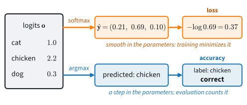

```{.python .input}
%load_ext d2lbook.tab
tab.interact_select('mxnet', 'pytorch', 'tensorflow', 'jax')
```

# Measuring Classifiers
:label:`sec_classification`

Training a classifier lowers its cross-entropy loss, but the user of a
classifier asks a different question: how often is its decision right? The
two can disagree. Raising the probability of the correct class of an image
from $0.51$ to $0.99$ changes no decision, since that class had the largest
probability already, yet it lowers the loss from $0.67$ to $0.01$
(:numref:`sec_softmax`). The number the user wants is the *accuracy*: the
fraction of examples whose predicted class, the class with the largest
logit, is the true class.

Every classifier in this book therefore reports both numbers on validation
data, the loss because training lowers it and the accuracy because users ask
for it, and most classifiers train with the same optimizer. We write this
code once, in a base class `Classifier` that extends the `Module` class of
:numref:`sec_oo-design`, so that each model supplies only its network and
its loss. Accuracy has blind spots of its own. When one class is rare, or
when some mistakes cost more than others, it can rank a useless classifier
above a useful one. The last part of the section shows such a case and what
to measure instead.

```{.python .input #classification-the-base-classification-model}
%%tab mxnet
from d2l import mxnet as d2l
from mxnet import gluon, np, npx
npx.set_np()
```

```{.python .input #classification-the-base-classification-model}
%%tab pytorch
from d2l import torch as d2l
import torch
```

```{.python .input #classification-the-base-classification-model}
%%tab tensorflow
from d2l import tensorflow as d2l
import tensorflow as tf
```

```{.python .input #classification-the-base-classification-model}
%%tab jax
from d2l import jax as d2l
import optax
```

## Loss and Accuracy

A classifier for $q$ classes computes a vector of logits
$\mathbf{o} \in \mathbb{R}^q$ for each example and predicts the class with
the largest logit. Since the softmax preserves the order of the logits, this
is also the class with the largest probability. Let
$y^{(i)} \in \{1, \ldots, q\}$ be the class of example $i$. The accuracy on
$n$ examples is the fraction of examples whose largest logit belongs to the
true class,

$$\textrm{accuracy} = \frac{1}{n} \sum_{i=1}^n \mathbf{1}\Big(\mathop{\mathrm{argmax}}_j o^{(i)}_j = y^{(i)}\Big),$$
:eqlabel:`eq_accuracy`

where $\mathbf{1}(\cdot)$ is 1 if its argument is true and 0 otherwise. Each
example contributes 1 if its prediction is right and 0 otherwise, and the
accuracy averages these contributions. A classifier that labels 9,000 of the
10,000 Fashion-MNIST test images correctly has accuracy 0.9; its error rate,
one minus the accuracy, is 0.1.

We report the accuracy but never train on it. As :numref:`sec_softmax`
showed, whether an example is classified correctly changes in a step when
its *margin*, the logit of the true class minus the largest other logit,
crosses zero. The accuracy is therefore a step function of the parameters,
and its gradient is zero wherever it exists. The cross-entropy loss is a
smooth, decreasing function of the margin, and the sum of the losses divided
by $\log 2$ is an upper bound on the number of training errors.
:numref:`fig_mdl-clf-loss-accuracy` shows how one vector of logits serves
both purposes.


:label:`fig_mdl-clf-loss-accuracy`

The two numbers can move in opposite directions. A model that becomes
confidently wrong on a few validation examples pays a large loss on each of
them, so its validation loss can rise while its accuracy still improves. We
therefore report both.

## The `Classifier` Class

Every classification model in the book evaluates itself the same way: on
each validation minibatch it computes the loss and the accuracy. `Classifier`
does this once for all of them. Its `validation_step` replaces that of
`Module`, which returns only the loss, by one that returns a dictionary with
both metrics. The `Trainer` of :numref:`sec_oo-design` averages each metric
that a step returns over the validation set, weighting every minibatch by
its number of examples. The reported loss and accuracy are therefore exact
means over the validation set, even when the last minibatch is smaller than
the others: with minibatches of 64, the 10,000 Fashion-MNIST test images end
in a minibatch of 16. After each epoch, the `Trainer` appends the two means
to `trainer.history['val_loss']` and `trainer.history['val_acc']`.

:begin_tab:`tensorflow`
As in `Module`, the validation step calls the model with `training=False`.
:end_tab:

:begin_tab:`jax`
The `Trainer` compiles the validation step, which returns both metrics as
arrays; it averages them over the minibatches outside the compiled
function.
:end_tab:

```{.python .input #classification-the-classifier-class-1}
%%tab pytorch, mxnet, jax
class Classifier(d2l.Module):  #@save
    """The base class of classification models."""
    def validation_step(self, batch):
        Y_hat = self(*batch[:-1])
        return {'loss': self.loss(Y_hat, batch[-1]),
                'acc': self.accuracy(Y_hat, batch[-1])}
```

```{.python .input #classification-the-classifier-class-1}
%%tab tensorflow
class Classifier(d2l.Module):  #@save
    """The base class of classification models."""
    def validation_step(self, batch):
        Y_hat = self(*batch[:-1], training=False)
        return {'loss': self.loss(Y_hat, batch[-1]),
                'acc': self.accuracy(Y_hat, batch[-1])}
```

The class leaves the network and the loss to its subclasses: the next
section writes both for softmax regression.

### Computing Accuracy

The method `accuracy` evaluates :eqref:`eq_accuracy` on a minibatch. `Y_hat`
holds the logits, one row per example (more leading axes are flattened
first). `argmax` along the class axis gives the predicted classes, which we
cast to the data type of the labels `Y`, since some frameworks compare only
values of the same type. The comparison yields 1 for each correct
prediction and 0 for each wrong one, and the mean of these values is the
accuracy. With `averaged=False` the method returns the vector of 0s and 1s
itself, which tells us which examples the model gets wrong.

```{.python .input #classification-accuracy-1  n=9}
@d2l.add_to_class(Classifier)  #@save
def accuracy(self, Y_hat, Y, averaged=True):
    """Compute the fraction of correct predictions."""
    Y_hat = d2l.reshape(Y_hat, (-1, Y_hat.shape[-1]))
    preds = d2l.astype(d2l.argmax(Y_hat, axis=1), Y.dtype)
    compare = d2l.astype(preds == d2l.reshape(Y, (-1,)), d2l.float32)
    return d2l.reduce_mean(compare) if averaged else compare
```

:begin_tab:`jax`
The validation step that calls `accuracy` is compiled, so `accuracy` needs no
`jit` of its own.
:end_tab:

### The Default Optimizer

Unless a model asks for something else, it trains with minibatch stochastic
gradient descent at its learning rate `self.lr`, as the linear regression of
:numref:`chap_regression` did. The `Trainer` obtains the optimizer once, at
the start of training, by calling the model's method `configure_optimizers`.
We install the default on `Module` rather than on `Classifier`, so that
regression models inherit it as well; later chapters override it to train
with other optimizers.

```{.python .input #classification-the-classifier-class-2}
%%tab mxnet
@d2l.add_to_class(d2l.Module)  #@save
def configure_optimizers(self):
    return gluon.Trainer(self.collect_params(), 'sgd',
                         {'learning_rate': self.lr})
```

```{.python .input #classification-the-classifier-class-2}
%%tab pytorch
@d2l.add_to_class(d2l.Module)  #@save
def configure_optimizers(self):
    return torch.optim.SGD(self.parameters(), lr=self.lr)
```

```{.python .input #classification-the-classifier-class-2}
%%tab tensorflow
@d2l.add_to_class(d2l.Module)  #@save
def configure_optimizers(self):
    return tf.keras.optimizers.SGD(float(self.lr))
```

```{.python .input #classification-the-classifier-class-2}
%%tab jax
@d2l.add_to_class(d2l.Module)  #@save
def configure_optimizers(self):
    return optax.sgd(self.lr)
```

:begin_tab:`mxnet`
The MXNet default hands the parameters that `collect_params` finds to a
Gluon `Trainer` with the SGD update rule. `collect_params` lists every
parameter declared as a Gluon `Parameter`, including those of a model
written from scratch, such as the one in the next section, which reads their
values with `data()`.
:end_tab:

## Beyond Accuracy
:label:`subsec_beyond-accuracy`

Accuracy counts every example once and treats every mistake alike. Three
kinds of decision problem break these assumptions: one class is much rarer
than the others, some mistakes cost more than others, and the decision uses
the predicted probabilities themselves rather than only the predicted
class. Each calls for a different measurement.

### Class Imbalance

Consider screening for a disease that affects 1% of the population. A
classifier that ignores its input and always predicts *healthy* is right
for 99% of the people, an accuracy of 0.99, and finds no sick patient. Now
take a screening test that detects 90% of the sick and wrongly flags 5% of
the healthy. Among 100,000 people, 1,000 of them sick, it finds 900 and
misses 100, and it flags 4,950 of the 99,000 healthy people. We count the
four possible outcomes in a table whose rows are the predictions and whose
columns are the true classes:

| | sick | healthy |
|:--|--:|--:|
| **predicted sick** | 900 | 4,950 |
| **predicted healthy** | 100 | 94,050 |

Such a table of counts is a *confusion matrix*. With the sick as the *positive*
class, the four cells are the *true positives* (TP, 900), *false positives*
(FP, 4,950), *false negatives* (FN, 100), and *true negatives* (TN, 94,050).
The test is right for the 94,950 people on the diagonal, an accuracy of
0.95. Accuracy ranks the useless classifier above the useful one. Every
person counts once, so the 1,000 sick people make up only 1% of the
accuracy, however well or badly a classifier treats them.

Two ratios focus on the sick. The *recall* is the fraction of the
sick that the classifier finds, and the *precision* is the fraction of the
flagged people who are sick:

$$\textrm{recall} = \frac{\textrm{TP}}{\textrm{TP} + \textrm{FN}}, \qquad \textrm{precision} = \frac{\textrm{TP}}{\textrm{TP} + \textrm{FP}}.$$

Recall reads the first column of the table, and precision reads its first
row. We compute all three numbers for both classifiers.

```{.python .input #classification-beyond-accuracy}
def report(name, tp, fp, fn, tn):
    """Print the accuracy, recall, and precision of a 2x2 confusion table."""
    accuracy = (tp + tn) / (tp + fp + fn + tn)
    recall = tp / (tp + fn)                                # Sick found
    precision = tp / (tp + fp) if tp + fp else float('nan')  # Flags right
    print(f'{name}: accuracy {accuracy:.3f}, recall {recall:.3f}, '
          f'precision {precision:.3f}')

report('always healthy', tp=0, fp=0, fn=1000, tn=99000)
report('screening test', tp=900, fp=4950, fn=100, tn=94050)
```

Recall separates the two classifiers: 0 for the one that never flags
anybody, 0.9 for the test. The precision of the always-healthy classifier is
undefined, since it flags nobody. The precision of the test is the
probability that a flagged person is sick, and it is only 0.15. This is the
effect of Bayes' theorem that :numref:`subsec_probability_hiv_app` showed
for an HIV test: when a disease is rare, the false positives from the many
healthy people outnumber the true positives, even for an accurate test. A
test with high recall and low precision is still useful for screening, where
every flagged person gets a second, more specific test.

### Asymmetric Costs

Missing a sick patient is worse than a false alarm. Suppose that a false
negative costs 100 times as much as a false positive, $\kappa_\textrm{FN} = 100$
and $\kappa_\textrm{FP} = 1$. The cost of a classifier weights the cells of its
confusion matrix by these costs. Per person, the always-healthy classifier
costs $100 \cdot 1{,}000 / 100{,}000 = 1$ and the screening test
$(100 \cdot 100 + 1 \cdot 4{,}950) / 100{,}000 \approx 0.15$, almost seven
times less. With costs, the useful classifier wins.

Costs also change the decision itself. Suppose a model estimates the
probability $p$ that a patient is sick. Predicting *healthy* costs
$\kappa_\textrm{FN}$ with probability $p$, and predicting *sick* costs
$\kappa_\textrm{FP}$ with probability $1 - p$, so the expected cost is smaller
when we predict *sick* exactly if

$$p \, \kappa_\textrm{FN} > (1 - p)\, \kappa_\textrm{FP}, \quad \textrm{that is,} \quad p > \frac{\kappa_\textrm{FP}}{\kappa_\textrm{FP} + \kappa_\textrm{FN}}.$$
:eqlabel:`eq_cost-threshold`

With equal costs the threshold is $\frac{1}{2}$, and for two classes the
rule picks the class with the larger probability, as accuracy assumes. With
$\kappa_\textrm{FN} = 100$ and $\kappa_\textrm{FP} = 1$, the threshold drops to
$1/101 \approx 0.01$: a patient with a 2% chance of being sick should be
flagged. Lowering the threshold raises the recall and lowers the
precision, since more people are flagged. When the costs are unknown,
practitioners often report precision and recall together, or their harmonic
mean, the *F1 score* $2PR/(P + R)$, which is high only when both are.

For $q$ classes the confusion matrix $\mathbf{N}$ has $q \times q$ entries.
With $\hat{y}^{(m)}$ the predicted class of example $m$, the class with the
largest logit,

$$N_{ij} = \sum_{m=1}^n \mathbf{1}\big(\hat{y}^{(m)} = i\big)\, \mathbf{1}\big(y^{(m)} = j\big)$$
:eqlabel:`eq_confusion-matrix`

counts the examples of class $j$ predicted as class $i$: rows are predicted
classes and columns true classes, as in the table above. Not every library
agrees: scikit-learn's `confusion_matrix` stores the transpose, with the
true classes in the rows, so check the orientation before reading off recall
and precision. The diagonal holds
the correct predictions, so the accuracy is the sum of the diagonal divided
by $n$. Each off-diagonal entry counts one kind of mistake, and costs
$\kappa_{ij}$ for predicting $i$ when the class is $j$ weight these entries
as in the binary case. Dividing each column by its sum gives the matrix
$\mathbf{C}$ with $C_{ij} = N_{ij} / \sum_{i'} N_{i'j}$, the fraction of
the examples of class $j$ that are predicted as class $i$, an estimate of
$P(\hat{y} = i \mid y = j)$. Its diagonal holds the recall of each class.
:numref:`sec_softmax_scratch` computes these matrices for a classifier
trained on Fashion-MNIST and reads off which garments it confuses.

:begin_tab:`tensorflow`
`tf.math.confusion_matrix` also puts the true classes in the rows and the
predicted classes in the columns, the transpose of $\mathbf{N}$.
:end_tab:

### Calibration

The rule :eqref:`eq_cost-threshold` acts on the probability $p$ itself, so
it gives the cheapest decisions only if the probabilities are right. A
model that reports $p = 0.02$ for a group of patients of whom only 0.2% are
sick flags all of them, although at the threshold of $0.01$ none of them
should be flagged. :numref:`sec_softmax` called a classifier *calibrated*
if its probabilities match frequencies, so that of all predictions made
with confidence 0.9, 90% are correct, and noted that networks trained on
cross-entropy tend to be overconfident. The *confidence* of a prediction is
the probability of the predicted class, the largest predicted probability.
A check of the confidence covers only that one probability. The threshold
rule :eqref:`eq_cost-threshold` needs $p(\textrm{sick})$ itself to be
calibrated, also when it is small, and we check it the same way, binning the
examples by $p(\textrm{sick})$ and comparing each bin with the fraction of
sick patients in it.

To check calibration on validation data, we sort the examples into bins by
their confidence, for instance $[0.5, 0.7)$, $[0.7, 0.9)$, and $[0.9, 1]$, and
compute in each bin the mean confidence and the accuracy. A *reliability
diagram* plots the accuracy of each bin against its mean confidence. A
calibrated classifier lies on the diagonal; points below it mean that the
classifier is more confident than it is right, or *overconfident*. Here is
such a check for a hypothetical classifier on 10,000 examples:

| confidence bin | examples | mean confidence | accuracy |
|:--|--:|--:|--:|
| $[0.5, 0.7)$ | 1,000 | 0.61 | 0.55 |
| $[0.7, 0.9)$ | 2,000 | 0.81 | 0.70 |
| $[0.9, 1]$ | 7,000 | 0.97 | 0.90 |

In every bin the accuracy falls short of the confidence. The classifier
reports a mean confidence of $0.902$ but is right on only $0.825$ of the
examples. The weighted mean gap between the two columns,
$0.1 \cdot 0.06 + 0.2 \cdot 0.11 + 0.7 \cdot 0.07 = 0.077$, is the *expected
calibration error*, a common one-number summary of the diagram.

Accuracy cannot reveal miscalibration, since it uses only the predicted
class; the reliability diagram can, and it also checks a remedy.
Temperature scaling (:numref:`sec_softmax`) divides all logits by one number
$T > 0$, fitted on held-out data, before the softmax. It keeps the order of
the logits, so every prediction and the accuracy stay the same, and with
$T > 1$ it lowers the confidences of an overconfident classifier toward its
accuracy :cite:`Guo.Pleiss.Sun.Weinberger.2017`. A reliability diagram of
the scaled model shows whether the gap has closed.

We can now train a classifier and measure it with more than one number: the
loss that training lowers, the accuracy that users ask about, and, where
classes are rare or mistakes differ in cost, the confusion matrix and the
calibration that accuracy hides. Each of these numbers is measured on a
finite test set, and how far it can be trusted for new data is a question we
return to once a model is trained. The next section writes softmax
regression from scratch as a subclass of `Classifier` and trains it on
Fashion-MNIST.

## Summary

A classifier is trained on its loss but judged by its decisions, so every
classification model in the book reports the cross-entropy loss and the
accuracy, the fraction of examples whose predicted class matches the label.
Accuracy is constant almost everywhere as a function of the parameters and
cannot be trained on directly. The base class `Classifier` returns both
metrics from its validation step, the `Trainer` computes their exact means over
the validation set, and a default `configure_optimizers` supplies minibatch
SGD; a model then provides only its network and its loss. When one class is
rare, accuracy can rank a useless classifier above a useful one; the
confusion matrix, recall, and precision show which mistakes a classifier
makes, costs turn them into a decision threshold, and a reliability diagram
checks whether the predicted probabilities can be trusted.

## Exercises

1. **Optimal decisions and rejection.** In a multiclass problem, let
   $\kappa_{ij}$ be the cost of predicting class $i$ when the true class is
   $j$, and let $p(j \mid x)$ be the probability of class $j$ given the
   input $x$.
    1. Write the expected cost of predicting $i$ in terms of the costs and
       $p(j \mid x)$, and state the rule that selects the optimal $i$.
       Check that it reduces to :eqref:`eq_cost-threshold` for two classes.
    1. Let a correct guess cost $0$ and a wrong guess cost $\lambda_s$,
       and allow the classifier to *abstain* instead of guessing, at a
       fixed cost $\lambda_r < \lambda_s$. Derive the threshold on the
       top-class probability above which guessing beats abstaining.
    1. In medical diagnosis, deferring to a specialist is cheap relative to
       a misdiagnosis, say $\lambda_r/\lambda_s = 0.05$. Compute the
       threshold and state what the classifier should do with a prediction
       at $0.9$ confidence. Then describe a case in which reporting the
       full distribution $p(y \mid x)$ serves the physician better than
       either guessing or abstaining.

    *Adapted from Kevin Murphy,
    [Probabilistic Machine Learning: An Introduction](https://probml.github.io/pml-book/book1.html),
    Exercise 5.1.*
1. **Loss at equal accuracy.** Two classifiers $A$ and $B$ both achieve
   90% accuracy on a ten-class test set. On every example that $A$
   classifies correctly, it assigns probability $0.91$ to the correct
   class. On every example that $B$ classifies correctly, it assigns
   $0.51$.
    1. Compute the average cross-entropy loss of each classifier on its
       correctly classified examples. Why would knowing only that $B$'s
       *average* correct-class probability is $0.51$ not have sufficed to
       compute $B$'s loss?
    1. Explain why these numbers do not decide which classifier is safer
       to deploy, and list the further information about the two
       classifiers you would need.
    1. Temperature scaling (:numref:`sec_softmax`) divides $B$'s logits
       by $T > 0$ before the softmax and leaves every one of its decisions
       unchanged. Assume
       that on every example the largest logit of $B$ is unique. Show that
       as $T \to 0$ the cross-entropy of $B$ tends to $0$ on the correctly
       classified examples and to $\infty$ on the misclassified ones. What
       does this imply about comparing classifiers by loss alone?
1. **Class-weighted loss.** In the screening example of
   :numref:`subsec_beyond-accuracy`, missing a sick patient costs much
   more than a false alarm. Give each class $j$ a weight $w_j > 0$ and
   train $f$ on the class-weighted empirical risk

   $$\frac{1}{n} \sum_{i=1}^n w_{y_i}\, l(f(\mathbf{x}_i), y_i),$$

   where $l$ is the cross-entropy loss and $y_i$ is the class of example
   $i$. This is the weighted empirical risk minimization of
   :numref:`sec_environment-and-distribution-shift` with weights
   $w_{y_i}$ that depend only on the class.
    1. Let the training examples be drawn with class prior $p(y)$ and
       class-conditional densities $p(\mathbf{x} \mid y)$. Show that the
       expected class-weighted loss is proportional to the expected
       unweighted loss under the distribution with the same
       class-conditionals and class prior proportional to $w_y\, p(y)$.
       Name the change to the training data, rather than to the loss,
       that has the same effect.
    1. Fix an input $\mathbf{x}$ with class probabilities
       $p(j \mid \mathbf{x})$, and suppose the model can output any
       distribution $\hat{\mathbf{y}}$. Show that the expected weighted loss
       $$-\sum_j w_j\, p(j \mid \mathbf{x}) \log \hat{y}_j$$
       is minimized by $\hat{y}_j \propto w_j\, p(j \mid \mathbf{x})$.
    1. For the two classes healthy and sick, find the threshold on
       $p(\textrm{sick} \mid \mathbf{x})$ above which the $\arg\max$ of
       this $\hat{\mathbf{y}}$ is sick, and choose the weights so that the
       threshold equals that of :eqref:`eq_cost-threshold`. Explain why
       choosing $w_\textrm{sick} > w_\textrm{healthy}$ raises recall, and
       what it does to the number of false positives.
1. **Calibration and usefulness.** A ten-class problem has the same number
   of examples in every class.
    1. A classifier ignores its input and outputs the probability $0.1$ for
       every class, breaking ties at random. Show that it is calibrated,
       and compute its accuracy.
    1. Another classifier is right on 95% of the examples and always
       reports confidence $1$. Draw its reliability diagram and compute its
       expected calibration error.
    1. Explain why calibration and accuracy measure different things, and
       why neither can replace the other when a decision uses the
       threshold :eqref:`eq_cost-threshold`.
1. [code] **ROC curves.** A binary classifier that outputs a score
   $s \in (0, 1)$ for the positive class can be thresholded at any
   $\tau \in [0, 1]$, not just $\frac{1}{2}$: predict positive whenever
   $s > \tau$. The *receiver operating characteristic* (ROC) curve plots
   the true-positive rate (recall) against the false-positive rate
   $\textrm{FP}/(\textrm{FP}+\textrm{TN})$ as $\tau$ sweeps from $1$ down
   to $0$. Simulate $1000$ positive and $1000$ negative examples with
   scores $s = \sigma(z)$, where $\sigma(z) = 1/(1 + \exp(-z))$ is the
   sigmoid, $z \sim \mathcal{N}(\mu, 1)$ for positives, and
   $z \sim \mathcal{N}(0, 1)$ for negatives.
    1. Compute and plot the ROC curve for $\mu \in \{0, 1, 2\}$, and state
       which points of the plot the endpoints $\tau = 1$ and $\tau = 0$
       give.
    1. Show that a classifier whose scores are independent of the labels
       traces the diagonal in expectation.
    1. For $\mu = 2$, plot the *precision-recall curve*, precision against
       recall as $\tau$ sweeps, once with equal numbers of positives and
       negatives and once with positives making up 1% of the examples
       (keep 1000 negatives and draw 10 positives, or reweight). Explain why
       the ROC curve does not change with the prevalence while the
       precision-recall curve drops, and which of the two describes the
       screening test of this section better.
   :exlabel:`ex_classification-roc-curves`
1. [code] **AUC as ranking probability.** ● This problem uses the ROC
   curves and simulated scores of problem :exref:`ex_classification-roc-curves`.
    1. Show that, when no two scores tie, the area under the ROC curve
       equals the probability that a randomly chosen positive example
       receives a higher score than a randomly chosen negative one, which
       makes it a threshold-free summary of ranking quality.
    1. Compute this probability in closed form for the simulated scores
       and compare it with the trapezoidal area under each of the curves.
   :exlabel:`ex_classification-auc-ranking-probability`

:begin_tab:`mxnet`
[Discussions](https://d2l.discourse.group/t/6808)
:end_tab:

:begin_tab:`pytorch`
[Discussions](https://d2l.discourse.group/t/6809)
:end_tab:

:begin_tab:`tensorflow`
[Discussions](https://d2l.discourse.group/t/6810)
:end_tab:

:begin_tab:`jax`
[Discussions](https://d2l.discourse.group/t/17981)
:end_tab:

<!-- slides -->

::: {.slide}
::: {.cover}
[Dive into Deep Learning · §3.3]{.kicker}

Measuring Classifiers<br>**loss and accuracy · the `Classifier` class · imbalance, costs, calibration**
:::
:::

::: {.slide title="The Loss Can Change While Every Decision Stays the Same"}
[The problem]{.kicker}

Two models give the correct class of an image probability $0.51$ and
$0.99$.

- Both predict that class: both decisions are **right**.
- Their losses: $-\log 0.51 \approx 0.67$ and $-\log 0.99 \approx 0.01$.

. . .

The user asks a different question: **how often is the decision right?**
And that number can mislead too: a screener that finds no sick patient
scores 99%.

::: {.d2l-note}
Train on the loss, report the accuracy, and know when accuracy is not
enough.
:::
:::

::: {.slide title="By the End of This Deck You Can"}
[Goals]{.kicker}

- compute the accuracy of a minibatch from its logits and labels;
- explain why we train on the loss and report the accuracy;
- write a model that inherits loss and accuracy reporting;
- read a confusion matrix: recall, precision, and the cost of mistakes;
- derive the decision threshold that costs imply;
- check calibration with a reliability diagram.

**Running examples:** the 10,000 Fashion-MNIST test images in minibatches
of 64; screening 100,000 people for a disease that 1% have.
:::

::: {.slide title="How to Measure the Classifiers of This Chapter"}
[Where this fits]{.kicker}

::: {.cols .vc}
::: {.col}
| section | adds |
|---|---|
| Softmax Regression | probabilities over classes, cross-entropy |
| Image Classification Data | Fashion-MNIST in minibatches |
| **Measuring Classifiers** | **accuracy, costs, calibration, the `Classifier` class** |
| Softmax Regression from Scratch | softmax regression by hand |
| Concise Implementation | framework layers, a stable loss |
| Generalization in Classification | error bars, test-set reuse, VC dimension |
| Environment and Distribution Shift | correcting for shifted data |
:::

::: {.col .narrow}
- **Uses:** softmax and cross-entropy; `Module` and `Trainer`; Bayes'
  theorem.
- **Skips:** ROC curves (exercises), several labels per example, ranking
  metrics.
:::
:::
:::

::: {.slide title="Accuracy Is the Fraction of Correct Predictions"}
[Loss and accuracy]{.kicker}

Predicted class: the largest logit (the softmax keeps the order). With
logits $\mathbf{o}^{(i)}$ and classes $y^{(i)} \in \{1, \ldots, q\}$:

$$\textrm{accuracy} = \frac{1}{n} \sum_{i=1}^n \mathbf{1}\Big(\mathop{\mathrm{argmax}}_j o^{(i)}_j = y^{(i)}\Big)$$

- 9,000 of 10,000 test images right: accuracy $0.9$, error rate $0.1$.
:::

::: {.slide title="Accuracy Has Zero Gradient Almost Everywhere"}
[Loss and accuracy]{.kicker}

- Margin $m = o_y - \max_{j \neq y} o_j$: right if $m > 0$, wrong if
  $m < 0$.
- Accuracy is a **step** function of the margins, hence of the parameters:
  its gradient is zero wherever it exists.
- Cross-entropy is **smooth** and decreasing in $m$; total loss$/\log 2$
  bounds the number of training errors.

::: {.d2l-note .rule}
Gradient descent lowers the loss; we watch the accuracy alongside.
:::
:::

::: {.slide title="One Logit Vector, Two Uses"}
[Loss and accuracy]{.kicker}



Training reads the top branch, evaluation the bottom one.
:::

::: {.slide title="Check: What Changed?"}
[Check]{.kicker}

Between two epochs:

1. the validation loss falls from $0.40$ to $0.35$; the accuracy stays at
   88%;
2. the validation loss rises from $0.45$ to $0.50$; the accuracy rises from
   87% to 88%.

What happened in each case?

::: {.fragment .fade-up}
::: {.d2l-note}
**Answers.** 1. The model grew more confident on examples it already gets
right. 2. It fixed a few mistakes but became confidently wrong on some
others, each costing a large loss.
:::
:::
:::

::: {.slide title="Every Classifier Reports Loss and Accuracy"}
[The `Classifier` class]{.kicker}

@classification-the-classifier-class-1

- Overrides `Module.validation_step`, which returned only the loss.
- A subclass supplies its network and its loss; the next section writes
  both for softmax regression.
:::

::: {.slide title="The Trainer Averages Over Examples, Not Minibatches"}
[The `Classifier` class]{.kicker}

$10{,}000 = 156 \times 64 + 16$: the last validation minibatch holds 16
images. With $n_b$ examples and mean metric $m_b$ in minibatch $b$:

$$\bar{m} = \frac{\sum_b n_b\, m_b}{\sum_b n_b}$$

- This is the exact mean over all 10,000 images.
- An unweighted mean of the $m_b$ would count the 16 images like 64.
- Stored per epoch in `trainer.history['val_loss']`, `['val_acc']`.
:::

::: {.slide title="Accuracy in Four Lines"}
[The `Classifier` class]{.kicker}

`argmax` over the classes, compare with the labels, average the 0s and 1s:

@classification-accuracy-1

- Cast to the label type first: some frameworks compare only equal types.
- `averaged=False` returns the 0/1 vector: which examples are wrong.
:::

::: {.slide title="A Default Optimizer, Installed Once on Module"}
[The `Classifier` class]{.kicker}

The `Trainer` calls `configure_optimizers` once, at the start of training:

@classification-the-classifier-class-2

- Minibatch SGD at the model's learning rate `self.lr`.
- On `Module`, so regression models inherit it too; later chapters
  override it.
:::

::: {.slide title="A Useless Screener Scores 99%, a Useful One 95%"}
[Class imbalance]{.kicker}

1% of 100,000 people are sick. A test finds 90% of them and flags 5% of the
healthy:

| | sick | healthy |
|:--|--:|--:|
| **predicted sick** | 900 (TP) | 4,950 (FP) |
| **predicted healthy** | 100 (FN) | 94,050 (TN) |

- Test: accuracy $94{,}950 / 100{,}000 = 0.95$.
- Always *healthy*: accuracy $0.99$, and it finds nobody.

::: {.d2l-note .warn}
Each person counts once: the 1,000 sick are 1% of the accuracy.
:::
:::

::: {.slide title="Recall and Precision Look at the Sick Separately"}
[Class imbalance]{.kicker}

$$\textrm{recall} = \frac{\textrm{TP}}{\textrm{TP} + \textrm{FN}} \;\;(\textrm{sick found}), \qquad \textrm{precision} = \frac{\textrm{TP}}{\textrm{TP} + \textrm{FP}} \;\;(\textrm{flags right})$$

@!classification-beyond-accuracy

- Precision is $P(\textrm{sick} \mid \textrm{flagged})$: Bayes' theorem
  again. The rare disease makes false positives outnumber true ones.
:::

::: {.slide title="Check: A Test With Fewer False Alarms"}
[Check]{.kicker}

The test now flags only **1%** of the healthy and still finds 90% of the
sick. Compute its accuracy and precision. Does it beat *always healthy* on
accuracy?

::: {.fragment .fade-up}
::: {.d2l-note}
**Answers.** FP $= 990$, TN $= 98{,}010$. Accuracy
$(900 + 98{,}010)/100{,}000 = 0.989$: still below $0.99$. Precision
$900 / 1{,}890 \approx 0.48$.
:::
:::
:::

::: {.slide title="Costs Move the Decision Threshold From ½ to 1%"}
[Asymmetric costs]{.kicker}

A missed patient costs 100 false alarms: $\kappa_\textrm{FN} = 100$,
$\kappa_\textrm{FP} = 1$.

- Cost per person: always *healthy* $1.0$; the test $0.15$.
- With $p = P(\textrm{sick} \mid \mathbf{x})$, flag the patient if

$$p\, \kappa_\textrm{FN} > (1 - p)\, \kappa_\textrm{FP} \quad\Longleftrightarrow\quad p > \frac{\kappa_\textrm{FP}}{\kappa_\textrm{FP} + \kappa_\textrm{FN}} = \frac{1}{101}.$$

::: {.d2l-note .rule}
Equal costs give $\frac{1}{2}$, the argmax. A lower threshold raises recall
and lowers precision.
:::
:::

::: {.slide title="The Confusion Matrix Itemizes Every Mistake"}
[Asymmetric costs]{.kicker}

For $q$ classes, $N_{ij}$ counts examples of class $j$ predicted as $i$
($\hat{y}^{(m)}$: predicted class of example $m$):

$$N_{ij} = \sum_{m=1}^n \mathbf{1}\big(\hat{y}^{(m)} = i\big)\,\mathbf{1}\big(y^{(m)} = j\big)$$

- Accuracy: the sum of the diagonal divided by $n$.
- Columns divided by their sums: $C_{ij} \approx P(\hat{y} = i \mid y = j)$;
  its diagonal is the recall of each class.
- Costs $\kappa_{ij}$ weight the off-diagonal mistakes.
- Next deck: this matrix for Fashion-MNIST.
:::

::: {.slide title="Calibrated Probabilities Match Frequencies"}
[Calibration]{.kicker}

Bin examples by **confidence**, the largest predicted probability; compare
with the accuracy in each bin:

| confidence | examples | mean confidence | accuracy |
|:--|--:|--:|--:|
| $[0.5, 0.7)$ | 1,000 | 0.61 | 0.55 |
| $[0.7, 0.9)$ | 2,000 | 0.81 | 0.70 |
| $[0.9, 1]$ | 7,000 | 0.97 | 0.90 |

- Below the diagonal in every bin: **overconfident**.
- Claims $0.902$ on average, right on $0.825$; expected calibration error
  $0.077$.
:::

::: {.slide title="Temperature Scaling Changes Confidence, Not Decisions"}
[Calibration]{.kicker}

- The threshold rule uses $p$ itself: it needs calibrated probabilities.
- Accuracy cannot see miscalibration; deep networks trained on
  cross-entropy are often overconfident on new data.
- **Temperature scaling:** softmax of $\mathbf{o} / T$, with one $T > 0$
  fitted on held-out data; then redraw the reliability diagram.

::: {.d2l-note .rule}
Dividing by $T$ keeps the order of the logits: the same predictions, the
same accuracy; only the confidences change.
:::
:::

::: {.slide title="Check: Calibrated but Useless?"}
[Check]{.kicker}

Ten balanced classes. A classifier ignores its input and outputs $0.1$ for
every class, breaking ties at random. Is it calibrated? What is its
accuracy?

::: {.fragment .fade-up}
::: {.d2l-note}
**Answer.** Confidence $0.1$ on every example, and right on 10% of them:
perfectly calibrated, accuracy $0.1$. Calibration and accuracy measure
different things.
:::
:::
:::

::: {.slide title="Recap"}
[Wrap-up]{.kicker}

| idea | running example |
|---|---|
| train on the loss, report the accuracy | $0.51$ and $0.99$: same decision, losses $0.67$ and $0.01$ |
| `Classifier`: loss and accuracy per minibatch | exact means over 10,000 images, last minibatch 16 |
| imbalance: recall and precision | always *healthy* $0.99$, test $0.95$; test recall $0.9$, precision $0.15$ |
| costs set the threshold | $\kappa_\textrm{FN} = 100$, $\kappa_\textrm{FP} = 1$: flag if $p > 1/101$ |
| calibration | reliability diagram; temperature keeps the accuracy |

**Next:** softmax regression from scratch, trained on Fashion-MNIST.
:::
