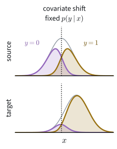
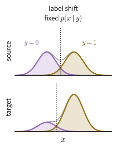

```{.python .input}
%load_ext d2lbook.tab
tab.interact_select('mxnet', 'pytorch', 'tensorflow', 'jax')
```

# Environment and Distribution Shift
:label:`sec_environment-and-distribution-shift`

Every guarantee in :numref:`chap_classification_generalization` rested on one quiet assumption: that deployment data are drawn from the exact same distribution as our training and test sets. In the real world, that assumption breaks constantly. Scanners and cameras get upgraded, seasonal flu waves alter disease prevalence overnight, regional slang evolves, and worse yet, deploying a model can *itself* cause the population to change its behavior. Suppose a bank discovers in historical records that loan applicants wearing Oxfords repay more often than applicants in sneakers, and deploys a classifier that approves Oxfords and rejects sneakers; within weeks, every applicant shows up in Oxfords while the underlying default rate never budges—a textbook example of *Goodhart's law* (when a statistical correlate becomes a decision target, it ceases to be a valid correlate).

In this section, we study how to detect and correct distribution shift between a *source distribution* $p_S(\mathbf{x}, y)$ (where we have labeled training data) and a *target distribution* $p_T(\mathbf{x}, y)$ (where we observe only unlabeled deployment inputs $\mathbf{x}$). We organize the three canonical types of passive shift by which factor of the joint distribution remains invariant, derive and implement *importance-weighted covariate shift correction* and *confusion-matrix label shift correction*, and close with concept shift and feedback loops.

```{.python .input #environment-and-distribution-shift-a-two-dimensional-example-1}
%%tab pytorch
import math
import numpy as np
import torch
from torch import nn
from torch.nn import functional as F
from d2l import torch as d2l
```

```{.python .input #environment-and-distribution-shift-a-two-dimensional-example-1}
%%tab tensorflow
import math
import numpy as np
import tensorflow as tf
from d2l import tensorflow as d2l
```

```{.python .input #environment-and-distribution-shift-a-two-dimensional-example-1}
%%tab jax
import math
import numpy as np
import jax
from jax import numpy as jnp
from flax import nnx
import optax
from d2l import jax as d2l
```

```{.python .input #environment-and-distribution-shift-a-two-dimensional-example-1}
%%tab mxnet
import math
import numpy as np
from mxnet import autograd, gluon, init, np as mnp, npx
from mxnet.gluon import nn
from d2l import mxnet as d2l
npx.set_np()
```

## Types of Distribution Shift

Without *some* structural assumption connecting $p_S(\mathbf{x}, y)$ and $p_T(\mathbf{x}, y)$, adapting to an unlabeled target domain is mathematically impossible: if $p_T(\mathbf{x}) = p_S(\mathbf{x})$ stays identical while the labels of cats and dogs secretly swap overnight ($p_T(y = \textrm{cat} \mid \mathbf{x}) = p_S(y = \textrm{dog} \mid \mathbf{x})$), no algorithm looking only at unlabeled target images can ever detect the swap.

Every joint distribution factors in two ways:

$$p(\mathbf{x}, y) = p(\mathbf{x})\, p(y \mid \mathbf{x}) = p(y)\, p(\mathbf{x} \mid y).$$

Holding one conditional factor invariant while the marginal drifts defines the three classic regimes of distribution shift (:numref:`fig_mdl-clf-shift-types`):

| Shift regime | What changes | What stays fixed | Natural causal setting |
|:--|:--|:--|:--|
| **Covariate shift** | $p(\mathbf{x})$ | $p(y \mid \mathbf{x})$ | features $\mathbf{x}$ cause label $y$ |
| **Label shift** | $p(y)$ | $p(\mathbf{x} \mid y)$ | label $y$ causes features $\mathbf{x}$ |
| **Concept shift** | $p(y \mid \mathbf{x})$ | often $p(\mathbf{x})$ | label definition drifts over time or space |


:label:`fig_mdl-clf-shift-types`

### Covariate Shift, Label Shift, and Concept Shift

1. **Covariate shift ($p(y \mid \mathbf{x})$ invariant):** Natural whenever $\mathbf{x}$ causes $y$. Suppose we train a cat-versus-dog classifier on real photographs (:numref:`fig_cat-dog-train`) and deploy it on cartoons (:numref:`fig_cat-dog-test`). A cartoon cat is still a cat ($p(y \mid \mathbf{x})$ is unchanged), but the marginal input distribution $p(\mathbf{x})$ has shifted into a new region of pixel space. Even though the true Bayes boundary has not moved, a misspecified or capacity-limited model fitted to source photos will focus its accuracy where $p_S(\mathbf{x})$ is dense and can fail badly where $p_T(\mathbf{x})$ lives.
2. **Label shift ($p(\mathbf{x} \mid y)$ invariant):** Natural whenever $y$ causes $\mathbf{x}$—for instance, diseases cause symptoms, so during a flu epidemic the prevalence $p(y)$ of influenza surges while the symptom distribution $p(\mathbf{x} \mid y)$ of a flu patient stays unchanged. By Bayes' theorem, $p(y \mid \mathbf{x}) \propto p(\mathbf{x} \mid y)\,p(y)$, so a shift in class priors shifts the optimal decision boundary! Happily, correcting label shift requires estimating only $q$ class-prior ratios rather than a high-dimensional density ratio over $\mathbf{x}$.
3. **Concept shift ($p(y \mid \mathbf{x})$ changes):** The meaning of the label itself changes across geography or time—whether regional names for soft drinks across U.S. counties (:numref:`fig_popvssoda`), evolving diagnostic criteria, or seasonal shopping intent.


:label:`fig_cat-dog-train`


:label:`fig_cat-dog-test`


:label:`fig_popvssoda`

## Covariate Shift Correction
:label:`subsec_covariate-shift-correction`

### Importance Weights

At deployment we want to minimize the *target risk* $R_T[f] = \mathbb{E}_{(\mathbf{x}, y) \sim p_T}[l(f(\mathbf{x}), y)]$. Under covariate shift ($p_T(y \mid \mathbf{x}) = p_S(y \mid \mathbf{x}) = p(y \mid \mathbf{x})$), whenever the source support covers the target ($p_S(\mathbf{x}) > 0$ wherever $p_T(\mathbf{x}) > 0$), multiplying and dividing by $p_S(\mathbf{x})$ rewrites the target risk as an expectation over the *source* distribution :cite:`Shimodaira.2000`:

$$
\begin{aligned}
R_T[f] &= \sum_{y} \int l(f(\mathbf{x}), y)\, p(y \mid \mathbf{x})\, p_T(\mathbf{x}) \;d\mathbf{x} \\
&= \sum_{y} \int l(f(\mathbf{x}), y)\, p(y \mid \mathbf{x})\, p_S(\mathbf{x})\, \frac{p_T(\mathbf{x})}{p_S(\mathbf{x})} \;d\mathbf{x}
= \mathbb{E}_{(\mathbf{x}, y) \sim p_S}\left[\beta(\mathbf{x})\, l(f(\mathbf{x}), y)\right],
\end{aligned}
$$
:eqlabel:`eq_covariate-shift-identity`

where $\beta(\mathbf{x}) = p_T(\mathbf{x}) / p_S(\mathbf{x})$ is the *importance weight* of input $\mathbf{x}$. Approximating :eqref:`eq_covariate-shift-identity` on our $n$ labeled source examples gives *weighted empirical risk minimization*:

$$\mathop{\mathrm{minimize}}_f \; \frac{1}{n} \sum_{i=1}^n \beta_i\, l(f(\mathbf{x}^{(i)}), y^{(i)}), \qquad \textrm{where } \beta_i = \frac{p_T(\mathbf{x}^{(i)})}{p_S(\mathbf{x}^{(i)})}.$$
:eqlabel:`eq_weighted-empirical-risk-min`

Notice why *support overlap* ($p_S(\mathbf{x}) > 0$ wherever $p_T(\mathbf{x}) > 0$) is non-negotiable: if a medical startup collects diseased blood samples from elderly patients and healthy control samples exclusively from 20-year-old university students, no reweighting can ever manufacture healthy elderly controls where $p_S(\mathbf{x}) = 0$. Even when support overlaps, extreme right-tail ratios (:numref:`fig_mdl-clf-density-ratio`) can cause a handful of points to dominate the sum, collapsing the *effective sample size* $n_{\textrm{eff}} = (\sum_i \beta_i)^2 / \sum_i \beta_i^2$; clipping weights at a cap $\min(\beta_i, c)$ trades a sliver of bias for a much larger $n_{\textrm{eff}}$.


:label:`fig_mdl-clf-density-ratio`

### Estimating Weights with a Domain Classifier

How can we estimate $\beta(\mathbf{x}) = p_T(\mathbf{x}) / p_S(\mathbf{x})$ without estimating high-dimensional densities $p_S$ and $p_T$ separately? Pool the $n$ source inputs (assigned domain label $z = 0$) with $m$ unlabeled target inputs (assigned domain label $z = 1$) and train a binary logistic regression *domain classifier* $P(z = 1 \mid \mathbf{x}) = \sigma(h(\mathbf{x}))$ with logit $h(\mathbf{x})$. By Bayes' theorem,

$$\frac{P(z = 1 \mid \mathbf{x})}{P(z = 0 \mid \mathbf{x})} = \frac{m}{n}\,\frac{p_T(\mathbf{x})}{p_S(\mathbf{x})} = \exp(h(\mathbf{x})), \qquad \textrm{so} \qquad \beta(\mathbf{x}) = \frac{n}{m}\exp(h(\mathbf{x})).$$

Dropping the constant factor $n/m$ (which scales the objective without moving its minimizer), we simply weight each source example by $\beta_i = \exp(h(\mathbf{x}^{(i)}))$ (or $\min(\exp(h(\mathbf{x}^{(i)})), c)$)!

### A Two-Dimensional Example

Let us watch domain-classifier reweighting rescue a linear classifier on a 2D problem where $p_S = \mathcal{N}(\mathbf{0}, \mathbf{I}_2)$, $p_T = \mathcal{N}((2, 0)^\top, \mathbf{I}_2)$, and the true label is $y = \mathbf{1}(x_2 > \frac{1}{2}x_1^2 - 1)$. Because the true parabolic boundary curves upward, the best linear boundary near $(0, 0)$ is nearly horizontal and fails miserably near $(2, 0)$. We generate $n = 1{,}000$ source and $1{,}000$ target points, fit the logistic domain classifier $h(\mathbf{x})$ to estimate $\beta_i = \exp(h(\mathbf{x}^{(i)}))$, and compare unweighted, importance-weighted, and clipped ($c = 5$) logistic regression:

```{.python .input #environment-and-distribution-shift-covariate-shift-correction-1}
rng = np.random.default_rng()
n = 1000
X_src = rng.normal(0, 1, (n, 2))            # source p_S: centered at (0, 0)
X_tgt = rng.normal(0, 1, (n, 2)) + [2, 0]   # target p_T: centered at (2, 0)
label = lambda X: (X[:, 1] > 0.5 * X[:, 0]**2 - 1).astype(float)
y_src, y_tgt = label(X_src), label(X_tgt)   # one labeling rule for both
```

Our sole learning primitive is weighted logistic regression trained by
gradient descent. By :numref:`subsec_softmax_and_derivatives`, the
cross-entropy gradient with respect to the logit is the residual
$\sigma(\mathbf{w}^\top \mathbf{x} + b) - y$, so weighting example $i$ by
$\beta_i$ simply multiplies its residual by $\beta_i$.

```{.python .input #environment-and-distribution-shift-a-two-dimensional-example-2}
def fit_logreg(X, y, weights=None, lr=0.1, steps=2000):
    """Logistic regression by gradient descent on the weighted mean loss."""
    w, b = np.zeros(X.shape[1]), 0.0
    v = np.ones(len(y)) if weights is None else weights / weights.mean()
    for _ in range(steps):
        r = v * (1 / (1 + np.exp(-(X @ w + b))) - y)   # weighted error
        w -= lr * X.T @ r / len(y)
        b -= lr * r.mean()
    return w, b
```

```{.python .input #environment-and-distribution-shift-covariate-shift-correction-2}
z = np.concatenate([np.zeros(n), np.ones(n)])      # domain label: 1 = target
w_h, b_h = fit_logreg(np.concatenate([X_src, X_tgt]), z)
beta = np.exp(X_src @ w_h + b_h)                   # weights of source examples
ess = lambda v: v.sum()**2 / (v**2).sum()          # effective sample size
print(f'learned h(x) = {w_h[0]:.2f} x1 {w_h[1]:+.2f} x2 {b_h:+.2f}'
      f'   (true log-ratio: 2 x1 - 2)')
print(f'largest weight: {beta.max():.0f}; effective sample size: '
      f'{ess(beta):.0f} of {n}, {ess(np.minimum(beta, 5)):.0f} if clipped at 5')
```


```{.python .input #environment-and-distribution-shift-covariate-shift-correction-3}
acc = lambda wb, X, y: ((X @ wb[0] + wb[1] > 0) == (y == 1)).mean()
models = {name: fit_logreg(X_src, y_src, v) for name, v in [
    ('unweighted', None), ('weighted', beta), ('clipped', np.minimum(beta, 5))]}
for name, wb in models.items():
    print(f'{name:10s}  target accuracy {acc(wb, X_tgt, y_tgt):.3f}'
          f'   source accuracy {acc(wb, X_src, y_src):.3f}')
print(f'always predicting the most common target class: '
      f'{max(y_tgt.mean(), 1 - y_tgt.mean()):.3f}')
```

```{.python .input #environment-and-distribution-shift-a-two-dimensional-example-3}
x1 = np.linspace(-2.5, 4.5, 50)
d2l.set_figsize((4.5, 3.5))
d2l.plt.scatter(*X_tgt.T, s=2, c='C1', label='target')
d2l.plt.scatter(*X_src.T, s=np.clip(beta, 0.2, 20), c='C0',
                label=r'source, area $\propto \beta$')
d2l.plt.plot(x1, 0.5 * x1**2 - 1, 'k--', label='true boundary')
for name, fmt in [('unweighted', 'C2'), ('weighted', 'C3')]:
    (w1, w2), b = models[name]
    d2l.plt.plot(x1, -(w1 * x1 + b) / w2, fmt, label=name)
d2l.plt.xlabel('$x_1$'), d2l.plt.ylabel('$x_2$'), d2l.plt.ylim(-3, 5)
d2l.plt.legend();
```


Look at the result: on the shifted target cloud, unweighted training scores only $\sim 50\%$–$60\%$ (worse than always guessing the majority class at $\sim 70\%$), whereas importance reweighting tilts the linear decision boundary along the right arm of the parabola and boosts target accuracy to $\sim 95\%$—using *zero* target labels!

## Label Shift Correction
:label:`subsec_label-shift-correction`

Under label shift ($p_T(\mathbf{x} \mid y) = p_S(\mathbf{x} \mid y)$ while class proportions $p_T(y) \neq p_S(y)$ shift), the exact same importance-weighting identity weights each source example of class $y$ by the class-prior ratio $\beta(y) = p_T(y) / p_S(y)$. Since $p_S(y)$ is known from the training labels, the only challenge is estimating the target class proportions $\mathbf{p}_T \in \mathbb{R}^q$ from *unlabeled* target data.

### Estimating Target Proportions via the Confusion Matrix

Let $\mathbf{C} \in \mathbb{R}^{q \times q}$ be our source classifier's column-normalized confusion matrix from :numref:`sec_softmax_scratch`, with entries $C_{ij} = P_S(\hat{c} = i \mid y = j)$ estimated on labeled source validation data. Because $\hat{c}$ is a function of $\mathbf{x}$ alone and $p(\mathbf{x} \mid y)$ is invariant under label shift, $P_T(\hat{c} = i \mid y = j) = C_{ij}$ holds on the target domain as well! By the law of total probability, the vector $\boldsymbol{\mu} \in \mathbb{R}^q$ of predicted class frequencies on the unlabeled target inputs satisfies :cite:`Saerens.Latinne.Decaestecker.2002,Lipton.Wang.Smola.2018`

$$\mu_i = \sum_{j=1}^q P(\hat{c} = i \mid y = j)\, p_T(y = j) = \sum_{j=1}^q C_{ij}\, p_T(y = j), \qquad \textrm{or} \qquad \mathbf{C}\, \mathbf{p}_T = \boldsymbol{\mu}.$$
:eqlabel:`eq_label-shift-system`

Whenever $\mathbf{C}$ is invertible (which is guaranteed if the classifier gets more than half of each class right, $C_{jj} > 1/2$; see Exercise :exref:`ex_environment-and-distribution-shift-label-shift-system`), solving the $q \times q$ linear system $\hat{\mathbf{p}}_T = \mathbf{C}^{-1}\boldsymbol{\mu}$ recovers the unknown target class proportions without a single target label! Furthermore, if the source classifier's probabilities are calibrated, Bayes' rule adapts its predictions to the target domain instantly—without even retraining—by adding the log-prior shift $\log(\hat{p}_T(y) / p_S(y))$ to each class's logit.

Let us test confusion-matrix inversion and Bayes logit adjustment on Fashion-MNIST by splitting the $10{,}000$ validation images into a $5{,}000$-image balanced source validation set (to estimate $\mathbf{C}$) and a skewed target set where $50\%$ of all garments are shirts ($400$ shirts and $45$ of each other class):

```{.python .input #environment-and-distribution-shift-label-shift-on-fashion-mnist}
data = d2l.FashionMNIST(batch_size=256)
model = d2l.SoftmaxRegression(num_outputs=10, lr=0.1)
trainer = d2l.Trainer(max_epochs=10)
trainer.board.display = False
trainer.fit(model, data)
O, y = [], []
for X, Y in data.val_dataloader():
    O.append(d2l.numpy(model(X)))
    y.append(d2l.numpy(Y))
O, y = np.concatenate(O), np.concatenate(y)
pred = O.argmax(axis=1)
```

```{.python .input #environment-and-distribution-shift-label-shift-on-fashion-mnist-2}
perm = rng.permutation(len(y))
src, pool = perm[:5000], perm[5000:]  # Source validation set; target pool
C = np.zeros((10, 10))
np.add.at(C, (pred[src], y[src]), 1)  # The confusion matrix of the source
C /= C.sum(axis=0, keepdims=True)     # Each column sums to 1
counts = np.full(10, 45)
counts[6] = 400                       # Half of the target images are shirts
p_T = counts / counts.sum()
tgt = np.concatenate([rng.choice(pool[y[pool] == j], counts[j], replace=False)
                      for j in range(10)])
mu = np.bincount(pred[tgt], minlength=10) / len(tgt)  # Needs no labels
p_hat = np.linalg.solve(C, mu)
for j, name in enumerate(data.text_labels(range(10))):
    print(f'{name:10s} true {p_T[j]:.2f}, predicted {mu[j]:.3f}, '
          f'estimated {p_hat[j]:.3f}')
```


```{.python .input #environment-and-distribution-shift-label-shift-on-fashion-mnist-3}
log_w = np.log(np.maximum(p_hat, 1e-6) / 0.1)  # log p_T(y) - log p_S(y)
accuracy = lambda O: (O.argmax(axis=1) == y[tgt]).mean()
print(f'target accuracy: {accuracy(O[tgt]):.3f} as trained, '
      f'{accuracy(O[tgt] + log_w):.3f} adapted to the estimated proportions')
```


Even though the raw classifier predicts "shirt" on only $\sim 25\%$–$40\%$ of the target images (spilling the rest into look-alike tops), $\mathbf{C}^{-1}\boldsymbol{\mu}$ unscrambles that confusion to recover the true $0.50$ shirt proportion within a few hundredths, and adding $\log(\hat{\mathbf{p}}_T / 0.1)$ to the logits lifts target accuracy by several percentage points with zero target labels and zero gradient steps!

## Concept Shift and Feedback

When *concept shift* alters $p(y \mid \mathbf{x})$ itself, historical labels are outdated and no importance reweighting of old data can teach the new labeling rule; continuous monitoring on a trickle of freshly labeled examples and periodic fine-tuning or retraining are essential.

Even more care is needed when a model's predictions trigger *actions that reshape future training data* (*performative prediction* and *feedback loops*). In predictive policing (:numref:`fig_mdl-clf-feedback-loop`), dispatching extra patrols to neighborhoods with high predicted crime causes more incidents to be recorded there; feeding those biased arrest records back into the next training round reinforces the forecast in a runaway loop. Breaking or auditing such loops requires randomized exploration or independent data collection—and ultimately crosses from passive supervised learning into *reinforcement learning* (:numref:`chap_reinforcement_learning`).


:label:`fig_mdl-clf-feedback-loop`

## Summary

- **No transfer without structure:** Every distribution-shift correction relies on an invariance assumption factoring $p(\mathbf{x}, y) = p(\mathbf{x})p(y \mid \mathbf{x}) = p(y)p(\mathbf{x} \mid y)$ into covariate shift ($p(y \mid \mathbf{x})$ fixed), label shift ($p(\mathbf{x} \mid y)$ fixed), or concept shift ($p(y \mid \mathbf{x})$ drifts).
- **Covariate shift correction:** Reweighting source losses by $\beta(\mathbf{x}) = p_T(\mathbf{x})/p_S(\mathbf{x}) \propto \exp(h(\mathbf{x}))$—estimated via a logistic domain classifier distinguishing source ($z=0$) from unlabeled target ($z=1$) inputs—aligns training with the target risk when support overlaps.
- **Label shift correction:** Solving $\mathbf{C}\,\mathbf{p}_T = \boldsymbol{\mu}$ with the source column-normalized confusion matrix $\mathbf{C}$ and target prediction frequencies $\boldsymbol{\mu}$ recovers target class priors from unlabeled target inputs and enables instant Bayes logit adjustment $\mathbf{o} + \log(\hat{\mathbf{p}}_T / \mathbf{p}_S)$.

## Exercises

1. **Missing support.** Suppose that $p_S(\mathbf{x}) = 0$ on a region
   $\mathcal{A}$ of inputs that has probability $\pi > 0$ under the target,
   and that $p_S(\mathbf{x}) > 0$ everywhere else. Define
   $\beta(\mathbf{x}) = p_T(\mathbf{x})/p_S(\mathbf{x})$ outside
   $\mathcal{A}$.
    1. Show that the weighted source risk
       $\mathbb{E}_{(\mathbf{x}, y) \sim p_S}[\beta(\mathbf{x})\, l(f(\mathbf{x}), y)]$
       equals the target risk with the contribution of $\mathcal{A}$
       removed. Write the missing term as $\pi$ times a conditional
       expectation.
    1. Explain why no choice of weights on source examples can recover the
       missing term. Construct two models that agree outside
       $\mathcal{A}$ and have the same weighted source risk but different
       target risks.

1. [code] **When reweighting fails.** The code of
   :numref:`subsec_covariate-shift-correction` (`fit_logreg`, `X_src`,
   `X_tgt`, `label`) places the target mean at $(2, 0)$. Sweep the target
   mean over $(s, 0)$ for $s \in \{0, 0.5, 1, 2, 3, 4, 6\}$, keeping
   $n = 1000$ and the labeling rule fixed.
    1. For each $s$, report the accuracy of the domain classifier $h$ on
       held-out pooled data, and interpret its growth with $s$ in terms of
       how detectable the shift is.
    1. For each $s$, record the target accuracy of the unweighted,
       weighted, and clipped ($c = 5$) models, and of always predicting the
       most common target class. Explain why target accuracy alone cannot
       show whether reweighting worked at large $s$.
   :exlabel:`ex_environment-and-distribution-shift-when-reweighting-fails`

1. **The label shift system.** Let $\mathbf{C}$ be the column-normalized
   confusion matrix of :eqref:`eq_label-shift-system`.
    1. Show that $\mathbf{C}$ is invertible whenever $C_{jj} > \frac{1}{2}$
       for every class $j$. Hint: suppose that $\mathbf{v}^\top \mathbf{C} = \mathbf{0}$
       for some $\mathbf{v} \neq \mathbf{0}$, look at the column $j$ for
       which $|v_j|$ is largest, and use that the column sums to 1.
    1. Give an example of a classifier for which $\mathbf{C}$ is singular,
       and describe what $\boldsymbol{\mu}$ can still reveal about
       $\mathbf{p}_T$ in that case.
    1. For two classes, show that an error $\delta$ in the fraction
       $\mu_1$ of positive predictions changes the estimated fraction of
       positives by $\delta/(C_{11} - C_{10})$. Using the standard error
       $\sqrt{\mu_1 (1 - \mu_1)/m}$ of a fraction estimated from $m$ target
       inputs, find how many target inputs the screening example needs for
       a standard error of 0.01 in the estimated fraction of sick patients.
       Repeat for a weaker test with $C_{11} = 0.6$ and $C_{10} = 0.4$ on
       the same population.
   :exlabel:`ex_environment-and-distribution-shift-label-shift-system`


1. [code] **Learned versus true weights.** ● Reuse the sweep of exercise
   :exref:`ex_environment-and-distribution-shift-when-reweighting-fails`
   over target means $(s, 0)$.
    1. Derive the true log-ratio $\log(p_T(\mathbf{x})/p_S(\mathbf{x}))$ as
       a function of $s$, and compare it with the learned $h$ at each $s$.
       Explain how the domain classifier can reach high accuracy at large
       $s$ while $h$ is far from the true log-ratio.
    1. Show that under the source the true weights satisfy
       $\mathbb{E}[\beta(\mathbf{x})] = 1$ and $\mathbb{E}[\beta(\mathbf{x})^2] = e^{s^2}$, so
       that for large $n$ their effective sample size is about
       $n e^{-s^2}$. Evaluate this for $n = 1000$ and $s = 1, 2, 3$.
    1. For each $s$, compute the effective sample size of the true weights
       and of the learned weights on the actual source sample. Explain why
       at $s = 2$ the sample value is usually much larger than
       $1000\, e^{-4} \approx 18$, and what this means for judging the
       reliability of a reweighted fit from the sample alone. Does clipping
       at $c = 5$ repair the shortage?
   :exlabel:`ex_environment-and-distribution-shift-learned-true-weights`

1. **Shift assumptions from unlabeled data.** ● In a binary source domain,
   $p_S(y = 1) = p_S(y = 0) = \frac{1}{2}$, and the scalar input satisfies
   $x \mid y = 1 \sim \mathcal{N}(1, 1)$ and
   $x \mid y = 0 \sim \mathcal{N}(-1, 1)$. Hence
   $p_S(y = 1 \mid x) = 1/(1 + \exp(-2x))$. Unlabeled target inputs follow
   the mixture

   $$p_T(x) = 0.8\, \mathcal{N}(x; 1, 1) + 0.2\, \mathcal{N}(x; -1, 1).$$

    1. Assume label shift. Give $p_T(y = 1)$ and the threshold on $x$ of
       the Bayes-optimal target classifier.
    1. Assume instead covariate shift with the same $p_T(x)$. Compute
       $p_T(y = 1)$ numerically and give the Bayes-optimal threshold.
    1. Use your results to explain why no statistic of the unlabeled
       target sample can decide which of the two corrections of this
       section applies.


[Discussions](https://d2l.discourse.group/t/105)

<!-- slides -->

::: {.slide}
::: {.cover}
[Dive into Deep Learning · §3.7]{.kicker}

Models deployed on data unlike their training data<br>
**covariate, label, and concept shift · importance weights · label-shift correction · feedback loops**
:::
:::

::: {.slide title="Right on the Test Set, Wrong in Deployment"}
[The problem]{.kicker}

::: {.cols .vc}
::: {.col}
{width=100%}
:::

::: {.col}
{width=100%}
:::
:::

- Same labels, different inputs: a test set drawn like the training data
  gives **no warning**.
- Running example: a linear classifier is right on about **85%** of source
  data and only **about half** of shifted target data, below the **~70%**
  of always guessing the most common class.
:::

::: {.slide title="By the End of This Deck You Can"}
[Goals]{.kicker}

- name a shift by the part of the joint distribution of inputs and labels
  that changes, and explain why some assumption is needed;
- derive importance weights, the ratio of target to source density, and
  estimate them with a classifier;
- correct label shift with a classifier's confusion matrix;
- tell when only fresh labels, or an analysis of the decisions, can help.

**Running example:** source inputs from a standard Gaussian in the plane,
target inputs from the same Gaussian centered at $(2, 0)$, label $y = 1$
above the parabola $x_2 = \frac{1}{2}x_1^2 - 1$.
:::

::: {.slide title="Distribution Shift Breaks the Assumption Behind Every Test Set"}
[Where this fits]{.kicker}

::: {.cols .vc}
::: {.col}
| section | adds |
|---|---|
| Softmax Regression | probabilities over classes, cross-entropy |
| Image Classification Data | Fashion-MNIST in minibatches |
| Softmax Regression from Scratch | softmax regression by hand, the `Classifier` class |
| Concise Implementation | framework layers, a stable loss |
| Measuring Classifiers | precision, recall, costs, calibration |
| Generalization in Classification | error bars, test-set reuse, VC dimension |
| **Environment and Distribution Shift** | **correcting for shifted data** |
:::

::: {.col .narrow}
- **Uses:** risk and empirical risk, two-class softmax (logistic
  regression), Bayes' theorem, the confusion matrix.
- **Skips:** adapting deep features to a new domain; online and
  reinforcement learning; formal fairness criteria.
:::
:::
:::

::: {.slide}
::: {.divider}
[01]{.dnum}

[Kinds of Shift]{.dtitle}

[which factor of the joint distribution moves]{.dsub}
:::
:::

::: {.slide title="Nothing Transfers Without an Assumption"}
[Kinds of shift]{.kicker}

Train on the **source** density $p_S(\mathbf{x}, y)$, deploy on the
**target** density $p_T(\mathbf{x}, y)$. At deployment we see inputs, not
labels.

. . .

**Label flip:** keep the inputs, $p_T(\mathbf{x}) = p_S(\mathbf{x})$, but
swap the classes,
$p_T(\textrm{cat} \mid \mathbf{x}) = p_S(\textrm{dog} \mid \mathbf{x})$.

- Unlabeled target inputs look exactly like source inputs: no statistic
  detects the flip.
- A classifier that is perfect on the source is always wrong on the target.

::: {.d2l-note .warn}
Every correction starts from an assumption about **what stays fixed**.
:::
:::

::: {.slide title="Three Shifts, Three Invariants"}
[Kinds of shift]{.kicker}

$$p(\mathbf{x}, y) = p(\mathbf{x})\, p(y \mid \mathbf{x}) = p(y)\, p(\mathbf{x} \mid y)$$

| shift | changes | stays fixed | natural when | example |
|:--|:--|:--|:--|:--|
| covariate | $p(\mathbf{x})$ | $p(y \mid \mathbf{x})$ | input causes label | photos → cartoons |
| label | $p(y)$ | $p(\mathbf{x} \mid y)$ | label causes input | influenza epidemic |
| concept | $p(y \mid \mathbf{x})$ | often $p(\mathbf{x})$ | label's meaning changes | new diagnostic criteria |

::: {.d2l-note}
The first factorization reads "draw an input, then label it"; the second,
"draw a class, then an input of that class".
:::
:::

::: {.slide title="Covariate Shift: Inputs Move, the Labeling Rule Stays"}
[Kinds of shift]{.kicker}

::: {.cols .vc}
::: {.col}
- $p(\mathbf{x})$ changes; $p(y \mid \mathbf{x})$ is shared.
- Natural when the input causes the label: a drawn cat is still a cat.
- Training fits the model where the **source** lies; errors where only the
  **target** lies are barely penalized.

::: {.d2l-note}
Probability of each class at each input, source above target. The dotted
boundary, where both classes are equally likely, does not move.
:::
:::

::: {.col .fig}
{width=80% fig-alt="Joint densities of two classes under covariate shift, source above target."}
:::
:::
:::

::: {.slide title="Label Shift: Class Proportions Move, Each Class Looks the Same"}
[Kinds of shift]{.kicker}

::: {.cols .vc}
::: {.col}
- $p(y)$ changes; $p(\mathbf{x} \mid y)$ is shared.
- Natural when the label causes the input: in an epidemic, influenza is
  more common and its symptoms are the same.
- Bayes' theorem, $p(y \mid \mathbf{x}) \propto p(\mathbf{x} \mid y)\, p(y)$:
  the boundary **moves** toward the rarer class.

::: {.d2l-note}
Class proportions go from 50/50 to 20/80. Corrections act on one number per
class, not on million-dimensional inputs.
:::
:::

::: {.col .fig}
{width=80% fig-alt="Joint densities of two classes under label shift, source above target."}
:::
:::
:::

::: {.slide title="Concept Shift: The Labeling Rule Itself Moves"}
[Kinds of shift]{.kicker}

::: {.cols .vc}
::: {.col}
- $p(y \mid \mathbf{x})$ changes: the same input gets a new label.
- Over time: diagnostic criteria, job titles, fashion.
- Over place: the same drink is "pop", "soda", or "coke".
- If $p(\mathbf{x})$ stays put, unlabeled data cannot reveal it: a partial
  label flip.
:::

::: {.col .fig .big}
{width=100%}
:::
:::
:::

::: {.slide title="Check: Which Shift Is It?"}
[Check]{.kicker}

A deployed classifier meets each change below. Which factor of
$p(\mathbf{x}, y)$ moved?

1. A traffic camera is replaced by a sharper model.
2. An outbreak doubles the share of patients with influenza.
3. New diagnostic criteria redefine a disorder.

::: {.fragment .fade-up}
::: {.d2l-note}
**Answer.** (1) Covariate: the images change, what they show does not.
(2) Label: $p(y)$ rises, the symptoms of each disease stay. (3) Concept:
the same patient record gets a new label.
:::
:::
:::

::: {.slide}
::: {.divider}
[02]{.dnum}

[Covariate Shift Correction]{.dtitle}

[reweight the source to stand in for the target]{.dsub}
:::
:::

::: {.slide title="Reweighting Turns Source Risk into Target Risk"}
[Covariate shift correction]{.kicker}

Target risk of a model $f$ with loss $l$, using the shared rule
$p(y \mid \mathbf{x})$:

$$
\begin{aligned}
R_T[f] &= \int\int l(f(\mathbf{x}), y)\, p(y \mid \mathbf{x})\, p_T(\mathbf{x}) \;d\mathbf{x}\,dy \\
&= \int\int l(f(\mathbf{x}), y)\, \underbrace{p(y \mid \mathbf{x})\, p_S(\mathbf{x})}_{p_S(\mathbf{x}, y)}\, \beta(\mathbf{x}) \;d\mathbf{x}\,dy
= \mathbb{E}_{p_S}\left[\beta(\mathbf{x})\, l(f(\mathbf{x}), y)\right]
\end{aligned}
$$

with the importance weight $\beta(\mathbf{x}) = p_T(\mathbf{x})/p_S(\mathbf{x})$.

. . .

::: {.d2l-note .rule}
Train by weighted empirical risk,
$\min_f \frac{1}{n}\sum_i \beta_i\, l(f(\mathbf{x}^{(i)}), y^{(i)})$.
Requires $p_S > 0$ wherever $p_T > 0$: no weight can create missing data.
:::
:::

::: {.slide title="Weights Explode Where the Source Is Thin"}
[Covariate shift correction]{.kicker}

::: {.cols .vc}
::: {.col .fig .big}
{width=100%}
:::

::: {.col}
| $x_1$ | 0 | 1 | 2 | 3 |
|:--|--:|--:|--:|--:|
| $\beta$ | 0.14 | 1 | 7.4 | 55 |

- A few huge weights make the weighted average noisy. Effective sample
  size: $n_\textrm{eff} = (\sum_i \beta_i)^2 / \sum_i \beta_i^2$, equal to
  $n$ for equal weights, near 1 if one weight dominates.
- **Clip** $\beta_i \leftarrow \min(\beta_i, c)$: a little bias, less
  variance.
:::
:::
:::

::: {.slide title="A Source-Against-Target Classifier Estimates the Weights"}
[Covariate shift correction]{.kicker}

Pool $n$ source inputs ($z = 0$) with $m$ unlabeled target inputs
($z = 1$). By Bayes' theorem,

$$\frac{P(z = 1 \mid \mathbf{x})}{P(z = 0 \mid \mathbf{x})} = \frac{m\, p_T(\mathbf{x})}{n\, p_S(\mathbf{x})} = \frac{m}{n}\, \beta(\mathbf{x}).$$

. . .

Logistic regression, $P(z = 1 \mid \mathbf{x}) = \sigma(h(\mathbf{x}))$, has
odds $e^{h(\mathbf{x})}$, so

$$\beta(\mathbf{x}) = \frac{n}{m}\, e^{h(\mathbf{x})}.$$

::: {.d2l-note .rule}
Only **unlabeled** target inputs are needed. The constant $n/m$ scales all
weights alike and does not change the weighted minimizer.
:::
:::

::: {.slide title="The Learned Log-Ratio Matches the True One"}
[Running example]{.kicker}

Source $\mathcal{N}(\mathbf{0}, \mathbf{I})$, target centered at $(2, 0)$,
1,000 inputs each, drawn fresh every run. True log-ratio:
$\log \beta = 2x_1 - 2$, linear, so logistic regression can represent it.

@!environment-and-distribution-shift-covariate-shift-correction-2

::: {.d2l-note}
The learned coefficients land near $(2, 0, -2)$. The 1,000 source examples
are worth a few dozen, in an unlucky draw barely ten; clipping at 5 raises
the effective sample size to about 200.
:::
:::

::: {.slide title="Reweighting Lifts Target Accuracy from About Half to About 95%"}
[Running example]{.kicker}

Label $y = 1$ above $x_2 = \frac{1}{2}x_1^2 - 1$ in both domains. Logistic
regression on the labeled source, three ways:

@!environment-and-distribution-shift-covariate-shift-correction-3

::: {.d2l-note .rule}
Unweighted: **45–65%** on the target, below the ~70% constant guess.
Weighted: **about 95%**, for a few points of source accuracy. Clipping
moves it by a point or two either way.
:::
:::

::: {.slide title="Weighting Moves the Boundary to Where the Target Lies"}
[Running example]{.kicker}

::: {.cols .vc}
::: {.col .fig .big}
@!environment-and-distribution-shift-a-two-dimensional-example-3
:::

::: {.col}
- **Unweighted:** nearly horizontal at $x_2 \approx -0.6$, the best line
  for the bottom of the parabola.
- **Weighted:** climbs to the right with a slope of roughly 1, sometimes
  steeper, along the right arm of the parabola, where the target lies.
- Source points near the origin carry almost no weight.
:::
:::
:::

::: {.slide title="Check: How Much More Does a Point at (3, 0) Count?"}
[Check]{.kicker}

In the running example $\beta(\mathbf{x}) = e^{2x_1 - 2}$. A source sample
holds one point at $(1, 0)$ and one at $(3, 0)$. How much more does the
second count in the weighted risk, and what do such points do to the
effective sample size?

::: {.fragment .fade-up}
::: {.d2l-note}
**Answer.** $\beta = e^{0} = 1$ against $e^{4} \approx 55$: the second
counts 55 times as much. A few such points dominate
$\sum_i \beta_i^2$, so $n_\textrm{eff}$ falls far below $n$.
:::
:::
:::

::: {.slide}
::: {.divider}
[03]{.dnum}

[Label Shift Correction]{.dtitle}

[weights on classes, proportions from a linear system]{.dsub}
:::
:::

::: {.slide title="Label Shift Needs Only the Target Class Proportions"}
[Label shift correction]{.kicker}

With $p(\mathbf{x} \mid y)$ shared, weight each example by its class,
$\beta_i = p_T(y^{(i)}) / p_S(y^{(i)})$. Unknown: the target proportions
$p_T(y)$.

. . .

- $C_{ij} = P(\hat{c} = i \mid y = j)$: column-normalized confusion matrix
  $\mathbf{C}$ of a source classifier, on source validation data
  ($\hat{c}$: the predicted class).
- $\mu_i$: fraction of **unlabeled** target inputs predicted as class $i$.
- $\hat{c}$ depends only on $\mathbf{x}$, so $\mathbf{C}$ holds on the
  target too. By total probability,

$$\mu_i = \sum_j C_{ij}\, p_T(y = j), \quad \textrm{i.e.,} \quad \mathbf{C}\,\mathbf{p}_T = \boldsymbol{\mu}.$$
:::

::: {.slide title="A Test That Flags 13.5% Means 10% Are Sick"}
[Label shift correction · worked example]{.kicker}

The screening test of the previous deck, validated on a balanced sample:
detects 90% of the sick, flags 5% of the healthy. Order (healthy, sick):

$$\mathbf{C} = \begin{pmatrix} 0.95 & 0.10 \\ 0.05 & 0.90 \end{pmatrix}, \qquad \boldsymbol{\mu} = (0.865,\ 0.135).$$

. . .

Second row: $0.05\,(1 - p) + 0.90\,p = 0.135$, so $p = 0.085/0.85 = 0.10$.

::: {.d2l-note .rule}
Flagged $= 4.5\%$ false alarms $+\ 9\%$ true alarms; the solve trades the
one against the 1% missed. Retrain with weights $0.1/0.5 = 0.2$ (sick) and
$0.9/0.5 = 1.8$ (healthy).
:::
:::

::: {.slide title="On Fashion-MNIST, Solving for p_T Undoes the Mixing"}
[Label shift correction · Fashion-MNIST]{.kicker}

Softmax regression; $\mathbf{C}$ from 5,000 labeled validation images;
$\boldsymbol{\mu}$ from 805 unlabeled target images, half of them shirts:

@!environment-and-distribution-shift-label-shift-on-fashion-mnist-2

::: {.d2l-note}
Adding $\log(\hat{p}_T(y)/p_S(y))$ to the logits adapts the classifier
without retraining. It needs an invertible $\mathbf{C}$, which holds if
$C_{jj} > \frac{1}{2}$ for every class $j$.
:::
:::

::: {.slide title="Concept Shift Needs Fresh Labels, and Decisions Feed Back"}
[Concept shift and feedback]{.kicker}

**Concept shift:** old labels are now wrong. Gradual change: keep training
on recent labels. Abrupt change: retrain. Either way, monitor accuracy on
fresh labels.

{width=80%}

::: {.d2l-note .warn}
Reweighting assumes a target that exists without the model; here the model
helps produce it. Detect the loop with data its decisions did not select,
and judge the decisions, not only the statistics.
:::
:::

::: {.slide title="Recap: Name the Shift, Then Pick the Fix"}
[Wrap-up]{.kicker}

| shift | stays fixed | fix | needs |
|:--|:--|:--|:--|
| covariate | $p(y \mid \mathbf{x})$ | weight by $p_T(\mathbf{x})/p_S(\mathbf{x})$ from a domain classifier | unlabeled target inputs, source covering the target |
| label | $p(\mathbf{x} \mid y)$ | weight by $p_T(y)/p_S(y)$ from $\mathbf{C}\,\mathbf{p}_T = \boldsymbol{\mu}$ | unlabeled target inputs, invertible $\mathbf{C}$ |
| concept | neither | keep training on fresh labels, or retrain | labeled target data |
| feedback | nothing: the model shapes the data | data the model did not select; judge the decisions | monitoring |

- Running examples: reweighting lifts target accuracy from about half to
  about 95%; on Fashion-MNIST with half the images shirts, the estimated
  shirt fraction lands near 0.5 and the adapted classifier gains several
  points, without one target label.

**Next:** the multilayer perceptron keeps the loss and replaces the linear
model by a deeper network.
:::
