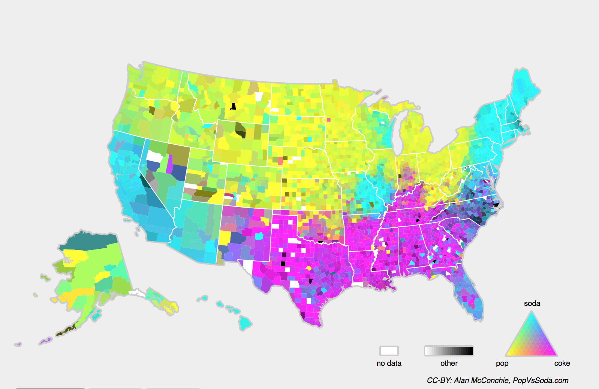
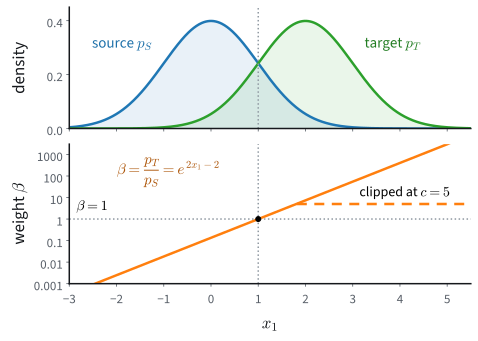
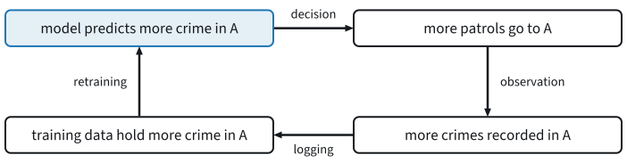
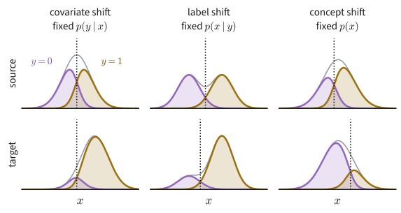

```{.python .input}
%load_ext d2lbook.tab
tab.interact_select('mxnet', 'pytorch', 'tensorflow', 'jax')
```

# Environment and Distribution Shift
:label:`sec_environment-and-distribution-shift`

Every guarantee in :numref:`chap_classification_generalization` rested on one quiet assumption: that deployment data are drawn from the exact same distribution as our training and test sets. In the real world, that assumption breaks constantly. Scanners and cameras get upgraded, seasonal flu waves alter disease prevalence overnight, regional slang evolves, and worse yet, deploying a model can *itself* cause the population to change its behavior. Suppose a bank discovers in historical records that loan applicants wearing Oxfords repay more often than applicants in sneakers, and deploys a classifier that approves Oxfords and rejects sneakers; within weeks, every applicant shows up in Oxfords while the underlying default rate never budges—a textbook example of *Goodhart's law* (when a statistical correlate becomes a decision target, it ceases to be a valid correlate).

In this section, we study how to detect and correct distribution shift between a *source distribution* $p_S(\mathbf{x}, y)$ (where we have labeled training data) and a *target distribution* $p_T(\mathbf{x}, y)$ (where we observe only unlabeled deployment inputs $\mathbf{x}$). We organize the three canonical types of passive shift by which factor of the joint distribution remains invariant, derive and implement *importance-weighted covariate shift correction* and *confusion-matrix label shift correction*, and close with concept shift and feedback loops.

```{.python .input #environment-and-distribution-shift-a-two-dimensional-example-1}
%%tab pytorch
import math
import numpy as np
import torch
from torch import nn
from torch.nn import functional as F
from d2l import torch as d2l
```

```{.python .input #environment-and-distribution-shift-a-two-dimensional-example-1}
%%tab tensorflow
import math
import numpy as np
import tensorflow as tf
from d2l import tensorflow as d2l
```

```{.python .input #environment-and-distribution-shift-a-two-dimensional-example-1}
%%tab jax
import math
import numpy as np
import jax
from jax import numpy as jnp
from flax import nnx
import optax
from d2l import jax as d2l
```

```{.python .input #environment-and-distribution-shift-a-two-dimensional-example-1}
%%tab mxnet
import math
import numpy as np
from mxnet import autograd, gluon, init, np as mnp, npx
from mxnet.gluon import nn
from d2l import mxnet as d2l
npx.set_np()
```

## Types of Distribution Shift

Without *some* structural assumption connecting $p_S(\mathbf{x}, y)$ and $p_T(\mathbf{x}, y)$, adapting to an unlabeled target domain is mathematically impossible: if $p_T(\mathbf{x}) = p_S(\mathbf{x})$ stays identical while the labels of cats and dogs secretly swap overnight ($p_T(y = \textrm{cat} \mid \mathbf{x}) = p_S(y = \textrm{dog} \mid \mathbf{x})$), no algorithm looking only at unlabeled target images can ever detect the swap.

Every joint distribution factors in two ways:

$$p(\mathbf{x}, y) = p(\mathbf{x})\, p(y \mid \mathbf{x}) = p(y)\, p(\mathbf{x} \mid y).$$

Holding one conditional factor invariant while the marginal drifts defines the three classic regimes of distribution shift (:numref:`fig_mdl-clf-shift-types`):

| Shift regime | What changes | What stays fixed | Natural causal setting |
|:--|:--|:--|:--|
| **Covariate shift** | $p(\mathbf{x})$ | $p(y \mid \mathbf{x})$ | features $\mathbf{x}$ cause label $y$ |
| **Label shift** | $p(y)$ | $p(\mathbf{x} \mid y)$ | label $y$ causes features $\mathbf{x}$ |
| **Concept shift** | $p(y \mid \mathbf{x})$ | often $p(\mathbf{x})$ | label definition drifts over time or space |


:label:`fig_mdl-clf-shift-types`

### Covariate Shift, Label Shift, and Concept Shift

1. **Covariate shift ($p(y \mid \mathbf{x})$ invariant):** Natural whenever $\mathbf{x}$ causes $y$. Suppose we train a cat-versus-dog classifier on real photographs (:numref:`fig_cat-dog-train`) and deploy it on cartoons (:numref:`fig_cat-dog-test`). A cartoon cat is still a cat ($p(y \mid \mathbf{x})$ is unchanged), but the marginal input distribution $p(\mathbf{x})$ has shifted into a new region of pixel space. Even though the true Bayes boundary has not moved, a misspecified or capacity-limited model fitted to source photos will focus its accuracy where $p_S(\mathbf{x})$ is dense and can fail badly where $p_T(\mathbf{x})$ lives.
2. **Label shift ($p(\mathbf{x} \mid y)$ invariant):** Natural whenever $y$ causes $\mathbf{x}$—for instance, diseases cause symptoms, so during a flu epidemic the prevalence $p(y)$ of influenza surges while the symptom distribution $p(\mathbf{x} \mid y)$ of a flu patient stays unchanged. By Bayes' theorem, $p(y \mid \mathbf{x}) \propto p(\mathbf{x} \mid y)\,p(y)$, so a shift in class priors shifts the optimal decision boundary! Happily, correcting label shift requires estimating only $q$ class-prior ratios rather than a high-dimensional density ratio over $\mathbf{x}$.
3. **Concept shift ($p(y \mid \mathbf{x})$ changes):** The meaning of the label itself changes across geography or time—whether regional names for soft drinks across U.S. counties (:numref:`fig_popvssoda`), evolving diagnostic criteria, or seasonal shopping intent.


:label:`fig_cat-dog-train`


:label:`fig_cat-dog-test`


:label:`fig_popvssoda`

## Covariate Shift Correction
:label:`subsec_covariate-shift-correction`

### Importance Weights

At deployment we want to minimize the *target risk* $R_T[f] = \mathbb{E}_{(\mathbf{x}, y) \sim p_T}[l(f(\mathbf{x}), y)]$. Under covariate shift ($p_T(y \mid \mathbf{x}) = p_S(y \mid \mathbf{x}) = p(y \mid \mathbf{x})$), whenever the source support covers the target ($p_S(\mathbf{x}) > 0$ wherever $p_T(\mathbf{x}) > 0$), multiplying and dividing by $p_S(\mathbf{x})$ rewrites the target risk as an expectation over the *source* distribution :cite:`Shimodaira.2000`:

$$
\begin{aligned}
R_T[f] &= \sum_{y} \int l(f(\mathbf{x}), y)\, p(y \mid \mathbf{x})\, p_T(\mathbf{x}) \;d\mathbf{x} \\
&= \sum_{y} \int l(f(\mathbf{x}), y)\, p(y \mid \mathbf{x})\, p_S(\mathbf{x})\, \frac{p_T(\mathbf{x})}{p_S(\mathbf{x})} \;d\mathbf{x} \\
&= \mathbb{E}_{(\mathbf{x}, y) \sim p_S}\left[\beta(\mathbf{x})\, l(f(\mathbf{x}), y)\right],
\end{aligned}
$$
:eqlabel:`eq_covariate-shift-identity`

where $\beta(\mathbf{x}) = p_T(\mathbf{x}) / p_S(\mathbf{x})$ is the *importance weight* of input $\mathbf{x}$. Approximating :eqref:`eq_covariate-shift-identity` on our $n$ labeled source examples gives *weighted empirical risk minimization*:

$$
\begin{aligned}
\mathop{\mathrm{minimize}}_f \; &\frac{1}{n} \sum_{i=1}^n \beta_i\, l(f(\mathbf{x}^{(i)}), y^{(i)}), \\
\textrm{where } &\beta_i = \frac{p_T(\mathbf{x}^{(i)})}{p_S(\mathbf{x}^{(i)})}.
\end{aligned}
$$
:eqlabel:`eq_weighted-empirical-risk-min`

Notice why *support overlap* ($p_S(\mathbf{x}) > 0$ wherever $p_T(\mathbf{x}) > 0$) is non-negotiable: if a medical startup collects diseased blood samples from elderly patients and healthy control samples exclusively from 20-year-old university students, no reweighting can ever manufacture healthy elderly controls where $p_S(\mathbf{x}) = 0$. Even when support overlaps, extreme right-tail ratios (:numref:`fig_mdl-clf-density-ratio`) can cause a handful of points to dominate the sum, collapsing the *effective sample size* $n_{\textrm{eff}} = (\sum_i \beta_i)^2 / \sum_i \beta_i^2$; clipping weights at a cap $\min(\beta_i, c)$ trades a sliver of bias for a much larger $n_{\textrm{eff}}$.


:label:`fig_mdl-clf-density-ratio`

### Estimating Weights with a Domain Classifier

How can we estimate $\beta(\mathbf{x}) = p_T(\mathbf{x}) / p_S(\mathbf{x})$ without estimating high-dimensional densities $p_S$ and $p_T$ separately? Pool the $n$ source inputs (assigned domain label $z = 0$) with $m$ unlabeled target inputs (assigned domain label $z = 1$) and train a binary logistic regression *domain classifier* $P(z = 1 \mid \mathbf{x}) = \sigma(h(\mathbf{x}))$ with logit $h(\mathbf{x})$. By Bayes' theorem,

$$
\begin{aligned}
\frac{P(z = 1 \mid \mathbf{x})}{P(z = 0 \mid \mathbf{x})} &= \frac{m}{n}\,\frac{p_T(\mathbf{x})}{p_S(\mathbf{x})} = \exp(h(\mathbf{x})), \\
\textrm{so} \quad \beta(\mathbf{x}) &= \frac{n}{m}\exp(h(\mathbf{x})).
\end{aligned}
$$

Dropping the constant factor $n/m$ (which scales the objective without moving its minimizer), we simply weight each source example by $\beta_i = \exp(h(\mathbf{x}^{(i)}))$ (or $\min(\exp(h(\mathbf{x}^{(i)})), c)$)!

### A Two-Dimensional Example

Let us watch domain-classifier reweighting rescue a linear classifier on a 2D problem where $p_S = \mathcal{N}(\mathbf{0}, \mathbf{I}_2)$, $p_T = \mathcal{N}((2, 0)^\top, \mathbf{I}_2)$, and the true label is $y = \mathbf{1}(x_2 > \frac{1}{2}x_1^2 - 1)$. Because the true parabolic boundary curves upward, the best linear boundary near $(0, 0)$ is nearly horizontal and fails miserably near $(2, 0)$. We generate $n = 1{,}000$ source and $1{,}000$ target points, fit the logistic domain classifier $h(\mathbf{x})$ to estimate $\beta_i = \exp(h(\mathbf{x}^{(i)}))$, and compare unweighted, importance-weighted, and clipped ($c = 5$) logistic regression:

```{.python .input #environment-and-distribution-shift-covariate-shift-correction-1}
rng = np.random.default_rng()
n = 1000
X_src = rng.normal(0, 1, (n, 2))            # source p_S: centered at (0, 0)
X_tgt = rng.normal(0, 1, (n, 2)) + [2, 0]   # target p_T: centered at (2, 0)
label = lambda X: (X[:, 1] > 0.5 * X[:, 0]**2 - 1).astype(float)
y_src, y_tgt = label(X_src), label(X_tgt)   # one labeling rule for both
```

Our sole learning primitive is weighted logistic regression trained by
gradient descent. By :numref:`subsec_softmax_and_derivatives`, the
cross-entropy gradient with respect to the logit is the residual
$\sigma(\mathbf{w}^\top \mathbf{x} + b) - y$, so weighting example $i$ by
$\beta_i$ simply multiplies its residual by $\beta_i$.

```{.python .input #environment-and-distribution-shift-a-two-dimensional-example-2}
def fit_logreg(X, y, weights=None, lr=0.1, steps=2000):
    """Logistic regression by gradient descent on the weighted mean loss."""
    w, b = np.zeros(X.shape[1]), 0.0
    v = np.ones(len(y)) if weights is None else weights / weights.mean()
    for _ in range(steps):
        r = v * (1 / (1 + np.exp(-(X @ w + b))) - y)   # weighted error
        w -= lr * X.T @ r / len(y)
        b -= lr * r.mean()
    return w, b
```

```{.python .input #environment-and-distribution-shift-covariate-shift-correction-2}
z = np.concatenate([np.zeros(n), np.ones(n)])      # domain label: 1 = target
w_h, b_h = fit_logreg(np.concatenate([X_src, X_tgt]), z)
beta = np.exp(X_src @ w_h + b_h)                   # weights of source examples
ess = lambda v: v.sum()**2 / (v**2).sum()          # effective sample size
print(f'learned h(x) = {w_h[0]:.2f} x1 {w_h[1]:+.2f} x2 {b_h:+.2f}'
      f'   (true log-ratio: 2 x1 - 2)')
print(f'largest weight: {beta.max():.0f}; effective sample size: '
      f'{ess(beta):.0f} of {n}, {ess(np.minimum(beta, 5)):.0f} if clipped at 5')
```


```{.python .input #environment-and-distribution-shift-covariate-shift-correction-3}
acc = lambda wb, X, y: ((X @ wb[0] + wb[1] > 0) == (y == 1)).mean()
models = {name: fit_logreg(X_src, y_src, v) for name, v in [
    ('unweighted', None), ('weighted', beta), ('clipped', np.minimum(beta, 5))]}
for name, wb in models.items():
    print(f'{name:10s}  target accuracy {acc(wb, X_tgt, y_tgt):.3f}'
          f'   source accuracy {acc(wb, X_src, y_src):.3f}')
print(f'always predicting the most common target class: '
      f'{max(y_tgt.mean(), 1 - y_tgt.mean()):.3f}')
```

```{.python .input #environment-and-distribution-shift-a-two-dimensional-example-3}
x1 = np.linspace(-2.5, 4.5, 50)
d2l.set_figsize((4.5, 3.5))
d2l.plt.scatter(*X_tgt.T, s=2, c='C1', label='target')
d2l.plt.scatter(*X_src.T, s=np.clip(beta, 0.2, 20), c='C0',
                label=r'source, area $\propto \beta$')
d2l.plt.plot(x1, 0.5 * x1**2 - 1, 'k--', label='true boundary')
for name, fmt in [('unweighted', 'C2'), ('weighted', 'C3')]:
    (w1, w2), b = models[name]
    d2l.plt.plot(x1, -(w1 * x1 + b) / w2, fmt, label=name)
d2l.plt.xlabel('$x_1$'), d2l.plt.ylabel('$x_2$'), d2l.plt.ylim(-3, 5)
d2l.plt.legend();
```


Look at the result: on the shifted target cloud, unweighted training scores only $\sim 50\%$–$60\%$ (worse than always guessing the majority class at $\sim 70\%$), whereas importance reweighting tilts the linear decision boundary along the right arm of the parabola and boosts target accuracy to $\sim 95\%$—using *zero* target labels!

## Label Shift Correction
:label:`subsec_label-shift-correction`

Under label shift ($p_T(\mathbf{x} \mid y) = p_S(\mathbf{x} \mid y)$ while class proportions $p_T(y) \neq p_S(y)$ shift), the exact same importance-weighting identity weights each source example of class $y$ by the class-prior ratio $\beta(y) = p_T(y) / p_S(y)$. Since $p_S(y)$ is known from the training labels, the only challenge is estimating the target class proportions $\mathbf{p}_T \in \mathbb{R}^q$ from *unlabeled* target data.

### Estimating Target Proportions via the Confusion Matrix

Let $\mathbf{C} \in \mathbb{R}^{q \times q}$ be our source classifier's column-normalized confusion matrix from :numref:`sec_softmax_scratch`, with entries $C_{ij} = P_S(\hat{c} = i \mid y = j)$ estimated on labeled source validation data. Because $\hat{c}$ is a function of $\mathbf{x}$ alone and $p(\mathbf{x} \mid y)$ is invariant under label shift, $P_T(\hat{c} = i \mid y = j) = C_{ij}$ holds on the target domain as well! By the law of total probability, the vector $\boldsymbol{\mu} \in \mathbb{R}^q$ of predicted class frequencies on the unlabeled target inputs satisfies :cite:`Saerens.Latinne.Decaestecker.2002,Lipton.Wang.Smola.2018`

$$
\begin{aligned}
\mu_i &= \sum_{j=1}^q P(\hat{c} = i \mid y = j)\, p_T(y = j) = \sum_{j=1}^q C_{ij}\, p_T(y = j), \\
\textrm{or} \quad \mathbf{C}\, \mathbf{p}_T &= \boldsymbol{\mu}.
\end{aligned}
$$
:eqlabel:`eq_label-shift-system`

Whenever $\mathbf{C}$ is invertible (which is guaranteed if the classifier gets more than half of each class right, $C_{jj} > 1/2$; see Exercise :exref:`ex_environment-and-distribution-shift-label-shift-system`), solving the $q \times q$ linear system $\hat{\mathbf{p}}_T = \mathbf{C}^{-1}\boldsymbol{\mu}$ recovers the unknown target class proportions without a single target label! Furthermore, if the source classifier's probabilities are calibrated, Bayes' rule adapts its predictions to the target domain instantly—without even retraining—by adding the log-prior shift $\log(\hat{p}_T(y) / p_S(y))$ to each class's logit.

Let us test confusion-matrix inversion and Bayes logit adjustment on Fashion-MNIST by splitting the $10{,}000$ validation images into a $5{,}000$-image balanced source validation set (to estimate $\mathbf{C}$) and a skewed target set where $50\%$ of all garments are shirts ($400$ shirts and $45$ of each other class):

```{.python .input #environment-and-distribution-shift-label-shift-on-fashion-mnist}
data = d2l.FashionMNIST(batch_size=256)
model = d2l.SoftmaxRegression(num_outputs=10, lr=0.1)
trainer = d2l.Trainer(max_epochs=10)
trainer.board.display = False
trainer.fit(model, data)
O, y = [], []
for X, Y in data.val_dataloader():
    O.append(d2l.numpy(model(X)))
    y.append(d2l.numpy(Y))
O, y = np.concatenate(O), np.concatenate(y)
pred = O.argmax(axis=1)
```

```{.python .input #environment-and-distribution-shift-label-shift-on-fashion-mnist-2}
perm = rng.permutation(len(y))
src, pool = perm[:5000], perm[5000:]  # Source validation set; target pool
C = np.zeros((10, 10))
np.add.at(C, (pred[src], y[src]), 1)  # The confusion matrix of the source
C /= C.sum(axis=0, keepdims=True)     # Each column sums to 1
counts = np.full(10, 45)
counts[6] = 400                       # Half of the target images are shirts
p_T = counts / counts.sum()
tgt = np.concatenate([rng.choice(pool[y[pool] == j], counts[j], replace=False)
                      for j in range(10)])
mu = np.bincount(pred[tgt], minlength=10) / len(tgt)  # Needs no labels
p_hat = np.linalg.solve(C, mu)
for j, name in enumerate(data.text_labels(range(10))):
    print(f'{name:10s} true {p_T[j]:.2f}, predicted {mu[j]:.3f}, '
          f'estimated {p_hat[j]:.3f}')
```


```{.python .input #environment-and-distribution-shift-label-shift-on-fashion-mnist-3}
log_w = np.log(np.maximum(p_hat, 1e-6) / 0.1)  # log p_T(y) - log p_S(y)
accuracy = lambda O: (O.argmax(axis=1) == y[tgt]).mean()
print(f'target accuracy: {accuracy(O[tgt]):.3f} as trained, '
      f'{accuracy(O[tgt] + log_w):.3f} adapted to the estimated proportions')
```


Even though the raw classifier predicts "shirt" on only $\sim 25\%$–$40\%$ of the target images (spilling the rest into look-alike tops), $\mathbf{C}^{-1}\boldsymbol{\mu}$ unscrambles that confusion to recover the true $0.50$ shirt proportion within a few hundredths, and adding $\log(\hat{\mathbf{p}}_T / 0.1)$ to the logits lifts target accuracy by several percentage points with zero target labels and zero gradient steps!

## Concept Shift and Feedback

When *concept shift* alters $p(y \mid \mathbf{x})$ itself, historical labels are outdated and no importance reweighting of old data can teach the new labeling rule; continuous monitoring on a trickle of freshly labeled examples and periodic fine-tuning or retraining are essential.

Even more care is needed when a model's predictions trigger *actions that reshape future training data* (*performative prediction* and *feedback loops*). In predictive policing (:numref:`fig_mdl-clf-feedback-loop`), dispatching extra patrols to neighborhoods with high predicted crime causes more incidents to be recorded there; feeding those biased arrest records back into the next training round reinforces the forecast in a runaway loop. Breaking or auditing such loops requires randomized exploration or independent data collection—and ultimately crosses from passive supervised learning into *reinforcement learning* (:numref:`chap_reinforcement_learning`).


:label:`fig_mdl-clf-feedback-loop`

## Summary

- **No transfer without structure:** Every distribution-shift correction relies on an invariance assumption factoring $p(\mathbf{x}, y) = p(\mathbf{x})p(y \mid \mathbf{x}) = p(y)p(\mathbf{x} \mid y)$ into covariate shift ($p(y \mid \mathbf{x})$ fixed), label shift ($p(\mathbf{x} \mid y)$ fixed), or concept shift ($p(y \mid \mathbf{x})$ drifts).
- **Covariate shift correction:** Reweighting source losses by $\beta(\mathbf{x}) = p_T(\mathbf{x})/p_S(\mathbf{x}) \propto \exp(h(\mathbf{x}))$—estimated via a logistic domain classifier distinguishing source ($z=0$) from unlabeled target ($z=1$) inputs—aligns training with the target risk when support overlaps.
- **Label shift correction:** Solving $\mathbf{C}\,\mathbf{p}_T = \boldsymbol{\mu}$ with the source column-normalized confusion matrix $\mathbf{C}$ and target prediction frequencies $\boldsymbol{\mu}$ recovers target class priors from unlabeled target inputs and enables instant Bayes logit adjustment $\mathbf{o} + \log(\hat{\mathbf{p}}_T / \mathbf{p}_S)$.

## Exercises

1. **Missing support.** Suppose that $p_S(\mathbf{x}) = 0$ on a region
   $\mathcal{A}$ of inputs that has probability $\pi > 0$ under the target,
   and that $p_S(\mathbf{x}) > 0$ everywhere else. Define
   $\beta(\mathbf{x}) = p_T(\mathbf{x})/p_S(\mathbf{x})$ outside
   $\mathcal{A}$.
    1. Show that the weighted source risk
       $\mathbb{E}_{(\mathbf{x}, y) \sim p_S}[\beta(\mathbf{x})\, l(f(\mathbf{x}), y)]$
       equals the target risk with the contribution of $\mathcal{A}$
       removed. Write the missing term as $\pi$ times a conditional
       expectation.
    1. Explain why no choice of weights on source examples can recover the
       missing term. Construct two models that agree outside
       $\mathcal{A}$ and have the same weighted source risk but different
       target risks.

1. [code] **When reweighting fails.** The code of
   :numref:`subsec_covariate-shift-correction` (`fit_logreg`, `X_src`,
   `X_tgt`, `label`) places the target mean at $(2, 0)$. Sweep the target
   mean over $(s, 0)$ for $s \in \{0, 0.5, 1, 2, 3, 4, 6\}$, keeping
   $n = 1000$ and the labeling rule fixed.
    1. For each $s$, report the accuracy of the domain classifier $h$ on
       held-out pooled data, and interpret its growth with $s$ in terms of
       how detectable the shift is.
    1. For each $s$, record the target accuracy of the unweighted,
       weighted, and clipped ($c = 5$) models, and of always predicting the
       most common target class. Explain why target accuracy alone cannot
       show whether reweighting worked at large $s$.
   :exlabel:`ex_environment-and-distribution-shift-when-reweighting-fails`

1. **The label shift system.** Let $\mathbf{C}$ be the column-normalized
   confusion matrix of :eqref:`eq_label-shift-system`.
    1. Show that $\mathbf{C}$ is invertible whenever $C_{jj} > \frac{1}{2}$
       for every class $j$. Hint: suppose that $\mathbf{v}^\top \mathbf{C} = \mathbf{0}$
       for some $\mathbf{v} \neq \mathbf{0}$, look at the column $j$ for
       which $|v_j|$ is largest, and use that the column sums to 1.
    1. Give an example of a classifier for which $\mathbf{C}$ is singular,
       and describe what $\boldsymbol{\mu}$ can still reveal about
       $\mathbf{p}_T$ in that case.
    1. For two classes, show that an error $\delta$ in the fraction
       $\mu_1$ of positive predictions changes the estimated fraction of
       positives by $\delta/(C_{11} - C_{10})$. Using the standard error
       $\sqrt{\mu_1 (1 - \mu_1)/m}$ of a fraction estimated from $m$ target
       inputs, find how many target inputs the screening example needs for
       a standard error of 0.01 in the estimated fraction of sick patients.
       Repeat for a weaker test with $C_{11} = 0.6$ and $C_{10} = 0.4$ on
       the same population.
   :exlabel:`ex_environment-and-distribution-shift-label-shift-system`


1. [code] **Learned versus true weights.** ● Reuse the sweep of exercise
   :exref:`ex_environment-and-distribution-shift-when-reweighting-fails`
   over target means $(s, 0)$.
    1. Derive the true log-ratio $\log(p_T(\mathbf{x})/p_S(\mathbf{x}))$ as
       a function of $s$, and compare it with the learned $h$ at each $s$.
       Explain how the domain classifier can reach high accuracy at large
       $s$ while $h$ is far from the true log-ratio.
    1. Show that under the source the true weights satisfy
       $\mathbb{E}[\beta(\mathbf{x})] = 1$ and $\mathbb{E}[\beta(\mathbf{x})^2] = e^{s^2}$, so
       that for large $n$ their effective sample size is about
       $n e^{-s^2}$. Evaluate this for $n = 1000$ and $s = 1, 2, 3$.
    1. For each $s$, compute the effective sample size of the true weights
       and of the learned weights on the actual source sample. Explain why
       at $s = 2$ the sample value is usually much larger than
       $1000\, e^{-4} \approx 18$, and what this means for judging the
       reliability of a reweighted fit from the sample alone. Does clipping
       at $c = 5$ repair the shortage?
   :exlabel:`ex_environment-and-distribution-shift-learned-true-weights`

1. **Shift assumptions from unlabeled data.** ● In a binary source domain,
   $p_S(y = 1) = p_S(y = 0) = \frac{1}{2}$, and the scalar input satisfies
   $x \mid y = 1 \sim \mathcal{N}(1, 1)$ and
   $x \mid y = 0 \sim \mathcal{N}(-1, 1)$. Hence
   $p_S(y = 1 \mid x) = 1/(1 + \exp(-2x))$. Unlabeled target inputs follow
   the mixture

   $$p_T(x) = 0.8\, \mathcal{N}(x; 1, 1) + 0.2\, \mathcal{N}(x; -1, 1).$$

    1. Assume label shift. Give $p_T(y = 1)$ and the threshold on $x$ of
       the Bayes-optimal target classifier.
    1. Assume instead covariate shift with the same $p_T(x)$. Compute
       $p_T(y = 1)$ numerically and give the Bayes-optimal threshold.
    1. Use your results to explain why no statistic of the unlabeled
       target sample can decide which of the two corrections of this
       section applies.


[Discussions](https://d2l.discourse.group/t/105)

<!-- slides -->

::: {.slide}
::: {.cover}
[Dive into Deep Learning · §3.6]{.kicker}

Environment & Distribution Shift: Covariate, Label & Concept Shift<br>**joint factorizations · covariate shift · density-ratio importance weighting · domain classifier · label-shift inversion · feedback loops**
:::
:::

::: {.slide title="When High Test Accuracy Collapses in Deployment"}
[The Deployment Gap]{.kicker}

Every statistical guarantee in §3.5 assumed that deployment data come from the exact same distribution $p_S(\mathbf{x}, y)$ as our training and test splits. In practice, deployment distributions $p_T(\mathbf{x}, y)$ drift constantly:

::: {.cols .vc}
::: {.col}
{.nostretch width=100%}
:::

::: {.col}
{.nostretch width=100%}
:::
:::

- **Passive & active shifts:** Cameras and hospital scanners are upgraded (photos $\to$ cartoons), seasonal epidemics alter disease prevalence overnight, and deployed decision rules trigger strategic human adaptation (*Goodhart's law*: approving loans for Oxford shoes causes applicants to switch shoes without lowering default risk).
:::

::: {.slide title="Why Unlabeled Adaptation Needs Invariance Assumptions"}
[Impossibility of Assumption-Free Transfer]{.kicker}

At deployment, we observe labeled **source** examples $\{(\mathbf{x}^{(i)}, y^{(i)})\}_{i=1}^n \sim p_S(\mathbf{x}, y)$ alongside **unlabeled target** inputs $\{\tilde{\mathbf{x}}^{(j)}\}_{j=1}^m \sim p_T(\mathbf{x})$. Can an algorithm adapt to $p_T$ without any structural assumption linking $p_S$ and $p_T$?

- **The adversarial label-flip counterexample:** Suppose the marginal input distribution stays identical ($p_T(\mathbf{x}) = p_S(\mathbf{x})$), while the conditional labels of cats and dogs secretly swap overnight:
  $$p_T(y = \text{cat} \mid \mathbf{x}) = p_S(y = \text{dog} \mid \mathbf{x})$$
- **Unidentifiability from unlabeled inputs:** Because $p_T(\mathbf{x}) = p_S(\mathbf{x})$, no statistical test on unlabeled target inputs can ever detect the swap, and a classifier with $100\%$ source accuracy gets $0\%$ target accuracy!

::: {.d2l-note .rule}
**Fundamental rule of domain adaptation:** Adapting using unlabeled target data is possible *only* when one conditional factor of $p(\mathbf{x}, y)$ remains invariant between source and target.
:::
:::

::: {.slide title="Two Factorizations Define Three Shift Regimes"}
[Taxonomy of Distribution Shift]{.kicker}

Every joint distribution $p(\mathbf{x}, y)$ factors in two causal directions—*(1)* draw input $\mathbf{x}$, then label it ($p(\mathbf{x})p(y \mid \mathbf{x})$); or *(2)* draw class $y$, then generate its features ($p(y)p(\mathbf{x} \mid y)$):

$$p(\mathbf{x}, y) = p(\mathbf{x})\,p(y \mid \mathbf{x}) = p(y)\,p(\mathbf{x} \mid y)$$

| Shift Regime | What Drifts | What Stays Invariant | Natural Causal Direction & Example |
|:--|:--|:--|:--|
| **Covariate shift** | $p_T(\mathbf{x}) \neq p_S(\mathbf{x})$ | $p_T(y \mid \mathbf{x}) = p_S(y \mid \mathbf{x})$ | $\mathbf{x} \to y$: image pixels determine animal species (photos $\to$ cartoons) |
| **Label shift** | $p_T(y) \neq p_S(y)$ | $p_T(\mathbf{x} \mid y) = p_S(\mathbf{x} \mid y)$ | $y \to \mathbf{x}$: disease causes symptoms (flu prevalence surges in winter) |
| **Concept shift** | $p_T(y \mid \mathbf{x}) \neq p_S(y \mid \mathbf{x})$ | Often $p_T(\mathbf{x}) \approx p_S(\mathbf{x})$ | Meaning of $y$ drifts across geography or time ("soda" vs. "pop") |
:::

::: {.slide title="Comparing the Three Shift Regimes Geometrically"}
[1D Input Densities and Optimal Bayes Boundaries]{.kicker}

Comparing source (top row) and target (bottom row) joint densities $p(x, y)$ for two classes shows how each shift affects the Bayes-optimal decision boundary (dotted vertical line):

{.nostretch width=82% fig-align="center"}

- **Covariate shift (left):** $p(x)$ shifts right while $p(y \mid x)$ and the true Bayes boundary stay fixed—yet a misspecified linear model fitted where $p_S(x)$ is dense can fail badly where $p_T(x)$ lives.
- **Label shift (middle) & Concept shift (right):** Changing $p(y)$ shifts the Bayes boundary toward the rarer class via $p(y \mid x) \propto p(x \mid y)p(y)$, whereas concept shift alters $p(y \mid x)$ directly.
:::

::: {.slide title="Covariate vs. Label Shift in Detail"}
[Why Misspecified Models Need Reweighting]{.kicker}

::: {.cols .vc}
::: {.col}
- **Covariate shift ($p(y \mid \mathbf{x})$ fixed):** If our hypothesis class $\mathcal{F}$ contained the exact true $p(y \mid \mathbf{x})$, fitting on infinite source data would already be optimal everywhere. In practice, models have limited capacity (e.g., fitting a line to a curved boundary), so unweighted ERM sacrifices accuracy in target regions where $p_S(\mathbf{x})$ is small.
- **Label shift ($p(\mathbf{x} \mid y)$ fixed):** Because $y \in \{1, \ldots, q\}$ is discrete, adaptation requires estimating only **$q$ scalar class proportions** $p_T(y)$ rather than a high-dimensional density ratio over $\mathbb{R}^d$.
:::

::: {.col .fig}
{.nostretch width=88%}
:::
:::
:::

::: {.slide title="Concept Shift: When the Labeling Rule Moves"}
[Geographic and Temporal Drift]{.kicker}

::: {.cols .vc}
::: {.col}
- **Shifting label semantics:** In concept shift, the conditional distribution $p(y \mid \mathbf{x})$ itself changes—identical product features or beverage descriptions map to `"pop"` in the Midwest, `"soda"` in the Northeast, and `"coke"` in the South.
- **Why unlabeled inputs cannot fix concept shift:** When $p(y \mid \mathbf{x})$ drifts without changing $p(\mathbf{x})$, historical labels are outdated; adaptation requires collecting a trickle of fresh target labels and fine-tuning or retraining continuously.
:::

::: {.col .fig}
{.nostretch width=100%}
:::
:::
:::

::: {.slide title="Importance Weighting Under Covariate Shift"}
[Aligning Source Training with Target Risk]{.kicker}

Under covariate shift ($p_T(y \mid \mathbf{x}) = p_S(y \mid \mathbf{x}) = p(y \mid \mathbf{x})$), whenever the source support covers the target ($p_S(\mathbf{x}) > 0$ wherever $p_T(\mathbf{x}) > 0$), multiplying and dividing by $p_S(\mathbf{x})$ rewrites the **target risk** $R_T[f]$ as a weighted expectation over the **source distribution** (Shimodaira, 2000):

$$R_T[f] = \sum_y \int l(f(\mathbf{x}), y)\,p(y \mid \mathbf{x})\,p_T(\mathbf{x})\,d\mathbf{x} = \mathbb{E}_{(\mathbf{x}, y)\sim p_S}\!\Big[\beta(\mathbf{x})\,l(f(\mathbf{x}), y)\Big]$$

where $\beta(\mathbf{x}) = \frac{p_T(\mathbf{x})}{p_S(\mathbf{x})}$ is the **density-ratio importance weight**.

- **Weighted Empirical Risk Minimization (Weighted ERM):** On $n$ labeled source examples, we minimize:
  $$\min_{f \in \mathcal{F}} \;\frac{1}{n}\sum_{i=1}^n \beta_i\,l\!\big(f(\mathbf{x}^{(i)}), y^{(i)}\big), \qquad \beta_i = \frac{p_T(\mathbf{x}^{(i)})}{p_S(\mathbf{x}^{(i)})}$$
:::

::: {.slide title="Support Overlap, Right-Tail Explosion & Weight Clipping"}
[Variance and Effective Sample Size]{.kicker}

Importance weighting faces two fundamental statistical hazards:

::: {.cols .vc}
::: {.col}
- **Missing support ($p_S(\mathbf{x}) = 0$ where $p_T(\mathbf{x}) > 0$):** If source controls include only 20-year-olds while target patients are 70-year-olds, $\beta(\mathbf{x})$ is undefined and no reweighting of 20-year-olds can manufacture 70-year-old data.
- **Weight explosion & effective sample size ($n_{\text{eff}}$):** For $p_S = \mathcal{N}(0,1)$ and $p_T = \mathcal{N}(2,1)$, $\beta(x_1) = e^{2x_1 - 2}$ reaches $55$ at $x_1 = 3$, collapsing:
  $$n_{\mathrm{eff}} = \frac{\big(\sum_{i=1}^n \beta_i\big)^2}{\sum_{i=1}^n \beta_i^2} \ll n$$
- **Weight clipping:** Capping $\tilde{\beta}_i = \min(\beta_i, c)$ (e.g., $c = 5$) trades a small bias for a large reduction in variance.
:::

::: {.col .fig}
{.nostretch width=100%}
:::
:::
:::

::: {.slide title="Estimating Density Ratios via a Domain Classifier"}
[Avoiding High-Dimensional Density Estimation]{.kicker}

Estimating $p_S(\mathbf{x})$ and $p_T(\mathbf{x})$ separately in $\mathbb{R}^d$ and dividing them amplifies estimation noise catastrophically. Instead, we pool the $n$ source inputs (assigned domain label $z = 0$) with $m$ unlabeled target inputs (assigned domain label $z = 1$) and train a logistic **domain classifier** $P(z = 1 \mid \mathbf{x}) = \sigma(h(\mathbf{x}))$ with logit $h(\mathbf{x})$:

$$\frac{P(z = 1 \mid \mathbf{x})}{P(z = 0 \mid \mathbf{x})} = \frac{P(z = 1)\,p(\mathbf{x} \mid z = 1)}{P(z = 0)\,p(\mathbf{x} \mid z = 0)} = \frac{m}{n}\,\frac{p_T(\mathbf{x})}{p_S(\mathbf{x})} = \exp\!\big(h(\mathbf{x})\big)$$

Solving for $\beta(\mathbf{x}) = p_T(\mathbf{x}) / p_S(\mathbf{x})$ directly from the domain logit $h(\mathbf{x})$ gives:

$$\beta(\mathbf{x}) = \frac{n}{m}\exp\!\big(h(\mathbf{x})\big) \;\propto\; \exp\!\big(h(\mathbf{x})\big)$$

::: {.d2l-note .rule}
**Zero target labels required:** Training the domain classifier $h(\mathbf{x})$ uses only unlabeled inputs $\mathbf{x}$, and the constant factor $n/m$ scales all weights equally without changing the weighted ERM minimizer.
:::
:::

::: {.slide title="2D Covariate Shift Benchmark: Setup & Domain Classifier"}
[Parabolic True Boundary Under a Shifted Gaussian]{.kicker}

Let $p_S = \mathcal{N}(\mathbf{0}, \mathbf{I}_2)$, $p_T = \mathcal{N}((2, 0)^\top, \mathbf{I}_2)$, and let the true invariant rule be $y = \mathbf{1}(x_2 > \frac{1}{2}x_1^2 - 1)$. We fit a logistic domain classifier $h(\mathbf{x})$ to distinguish $n = 1{,}000$ source from $1{,}000$ unlabeled target inputs:

@-environment-and-distribution-shift-covariate-shift-correction-1

@environment-and-distribution-shift-covariate-shift-correction-2

- **Recovering the exact log-ratio:** The learned domain logit $h(\mathbf{x}) \approx 2x_1 - 2$ matches the true analytical log-density ratio $\log(p_T(\mathbf{x})/p_S(\mathbf{x})) = 2x_1 - 2$, while clipping $\beta_i$ at $c = 5$ lifts $n_{\mathrm{eff}}$ from a few dozen to $\sim 200$.
:::

::: {.slide title="Weighted Logistic Regression Lifts Target Accuracy"}
[Unweighted vs. Importance-Weighted vs. Clipped ERM]{.kicker}

Weighting each source example's gradient residual by $\beta_i = \exp(h(\mathbf{x}^{(i)}))$ inside `fit_logreg` dramatically improves target accuracy without a single target label:

@-environment-and-distribution-shift-a-two-dimensional-example-2

@environment-and-distribution-shift-covariate-shift-correction-3
:::

::: {.slide title="How Importance Weights Tilt the Linear Decision Boundary"}
[Geometric Effect of Covariate Shift Correction]{.kicker}

Plotting the source cloud (circle area $\propto \beta_i$), the shifted target cloud (orange), and the fitted linear boundaries explains the $40$-point accuracy jump:

::: {.cols .vc}
::: {.col}
- **Unweighted linear boundary (green):** Fits the bottom of the parabola near $(0, 0)$ with a nearly horizontal line ($x_2 \approx -0.6$), misclassifying almost half the target cloud around $(2, 0)$.
- **Importance-weighted boundary (red):** Downweights points near $x_1 \le 0$ and emphasizes source points in the right tail ($x_1 > 1$), tilting the line to hug the right arm of the parabola where the target data live!
:::

::: {.col .fig}
@!environment-and-distribution-shift-a-two-dimensional-example-3
:::
:::
:::

::: {.slide title="Label Shift Correction via the Confusion Matrix"}
[Black-Box Shift Estimation (BBSE / Saerens et al.)]{.kicker}

Under **label shift** ($p_T(\mathbf{x} \mid y) = p_S(\mathbf{x} \mid y)$ while class priors $p_T(y) \neq p_S(y)$ change), the importance weight of a source example depends only on its class label, $\beta(y) = p_T(y) / p_S(y)$. How do we estimate the unknown target class priors $\mathbf{p}_T \in \mathbb{R}^q$ from **unlabeled** target data?

- **Invariance of the column-normalized confusion matrix $\mathbf{C}$:** Let $\hat{c}(\mathbf{x}) = \operatorname{argmax}_k f_k(\mathbf{x})$ be our fixed source classifier. Because $\hat{c}(\mathbf{x})$ depends only on $\mathbf{x}$ and $p(\mathbf{x} \mid y)$ is invariant, the conditional confusion probabilities match on source and target:
  $$C_{ij} = P_S(\hat{c}(\mathbf{x}) = i \mid y = j) = P_T(\hat{c}(\mathbf{x}) = i \mid y = j)$$
- **Law of total probability on target predictions $\boldsymbol{\mu} \in \mathbb{R}^q$:** Let $\mu_i = P_T(\hat{c}(\mathbf{x}) = i)$ be the empirical fraction of unlabeled target inputs predicted as class $i$. Then:
  $$\mu_i = \sum_{j=1}^q P_T(\hat{c} = i \mid y = j)\,p_T(y = j) = \sum_{j=1}^q C_{ij}\,p_T(y = j) \quad \Longleftrightarrow \quad \mathbf{C}\,\mathbf{p}_T = \boldsymbol{\mu}$$
:::

::: {.slide title="Inverting C to Recover Target Class Proportions"}
[Worked Clinical Example & Invertibility Condition]{.kicker}

Whenever $\mathbf{C}$ is invertible (guaranteed if diagonal recall satisfies $C_{jj} > 1/2$ for all $j$ by strict diagonal dominance), solving the $q \times q$ linear system $\hat{\mathbf{p}}_T = \mathbf{C}^{-1}\boldsymbol{\mu}$ recovers the target class priors without a single target label!

- **Worked clinical screening example:** Recall our test from §3.4 with $90\%$ sensitivity ($C_{22} = 0.90$) and $5\%$ false-alarm rate ($C_{21} = 0.05$). In a new winter clinic, the test flags $\mu_2 = 13.5\%$ of incoming patients:
  $$\mathbf{C}\,\mathbf{p}_T = \begin{pmatrix} 0.95 & 0.10 \\ 0.05 & 0.90 \end{pmatrix}\begin{pmatrix} 1 - p \\ p \end{pmatrix} = \begin{pmatrix} 0.865 \\ 0.135 \end{pmatrix}$$
- **Solving the second row:** $0.05(1 - p) + 0.90p = 0.135$ $\implies$ $0.85p = 0.085$ $\implies$ $p = 0.10$ ($10\%$ true flu prevalence, unscrambled from the $4.5\%$ false alarms and $1\%$ missed cases!).
:::

::: {.slide title="Unscrambling Label Shift on Fashion-MNIST"}
[50% Shirt Surge & Instant Bayes Logit Adjustment]{.kicker}

We test $\hat{\mathbf{p}}_T = \mathbf{C}^{-1}\boldsymbol{\mu}$ on Fashion-MNIST by estimating $\mathbf{C}$ on $5{,}000$ balanced validation images and evaluating on an unlabeled target set where **shirts surge from $10\%$ to $50\%$** ($400$ shirts + $45$ of each other garment):

@!environment-and-distribution-shift-label-shift-on-fashion-mnist-2

@environment-and-distribution-shift-label-shift-on-fashion-mnist-3

- **Instant Bayes adaptation without retraining:** Because $p_T(y \mid \mathbf{x}) \propto p_S(y \mid \mathbf{x})\,\frac{p_T(y)}{p_S(y)}$, simply adding the log-prior ratio $\log\frac{\hat{p}_T(y)}{p_S(y)}$ to each class's logit lifts target accuracy by $\sim 5\text{--}7$ percentage points in zero gradient steps!
:::

::: {.slide title="Concept Shift and Performative Feedback Loops"}
[When the Model Reshapes Its Own Environment]{.kicker}

In deployed socio-technical systems, predictions do not merely observe the world—they trigger **actions** that alter future data distributions (*performative prediction*):

::: {.cols .vc}
::: {.col}
- **Runaway feedback loop in predictive policing:** High predicted crime in neighborhood $A$ dispatches extra patrols to $A$; increased patrol presence records more minor offenses in $A$ while leaving neighborhood $B$ unpatrolled; retraining on logged arrests reinforces the initial bias.
- **Breaking feedback loops:** Passive importance reweighting cannot fix data censored by the model's own decisions; auditing requires randomized exploration (bandits / RL) or independent outcome measurement.
:::

::: {.col .fig}
{.nostretch width=100%}
:::
:::
:::

::: {.slide title="Concept Check: Diagnosing & Fixing Distribution Shift"}
[Concept Check]{.kicker}

Test your diagnostic and mathematical understanding of distribution shift:

1. **Classifying shifts:** Identify whether each scenario is *covariate shift*, *label shift*, or *concept shift*: *(a)* upgrading a highway toll camera to higher contrast; *(b)* a summer heatwave tripling the share of sandal orders in an online store; *(c)* a psychiatry manual revising the diagnostic criteria for a condition.
2. **Importance weight ratio:** In our 2D Gaussian example where $\beta(\mathbf{x}) = \exp(2x_1 - 2)$, how many times more weight does a source point at $(3, 0)$ carry compared to a source point at $(1, 0)$, and what is the theoretical large-$n$ effective sample size $n_{\text{eff}} / n = 1 / \mathbb{E}_S[\beta^2]$ for shift distance $s = 2$ ($\mathbb{E}_S[\beta^2] = e^{s^2}$)?
3. **Unidentifiability without causal knowledge (Exercise 5):** If unlabeled target inputs $x$ shift toward positive values, can any statistical test on the unlabeled target inputs tell you whether *covariate shift* or *label shift* occurred?

::: {.d2l-note .fragment .fade-up}
**Answers:** **(1)** *(a)* Covariate shift ($p(\mathbf{x})$ changes, vehicle identity $p(y\mid\mathbf{x})$ stays fixed); *(b)* Label shift ($p(y)$ changes, product photo $p(\mathbf{x}\mid y)$ stays fixed); *(c)* Concept shift ($p(y\mid\mathbf{x})$ changes). **(2)** $\beta(3,0) = e^4 \approx 54.6$ vs. $\beta(1,0) = e^0 = 1$ ($54.6\times$ more weight); theoretically $n_{\mathrm{eff}} \approx n e^{-s^2} = 1000 e^{-4} \approx 18.3$ effective examples! **(3)** No: the exact same target marginal $p_T(x)$ can arise either from $p_T(x)$ shifting with $p(y\mid x)$ fixed (where the optimal threshold stays fixed) or from $p_T(y=1)$ rising with $p(x\mid y)$ fixed (where the optimal threshold moves). Choosing the right correction requires causal domain knowledge.
:::
:::

::: {.slide title="Summary: Distribution Shift Regimes and Corrections"}
[Section Summary]{.kicker}

| Shift Regime | Invariant Factor | Correction Algorithm | Key Requirement & Pitfall |
|:--|:--|:--|:--|
| **Covariate shift** | $p(y \mid \mathbf{x})$ fixed ($p(\mathbf{x})$ shifts) | Weighted ERM with $\beta(\mathbf{x}) = \frac{p_T(\mathbf{x})}{p_S(\mathbf{x})} \propto \exp(h(\mathbf{x}))$ from logistic domain classifier | Requires support overlap ($p_S > 0$ where $p_T > 0$); clip $\min(\beta_i, c)$ to preserve $n_{\mathrm{eff}}$ |
| **Label shift** | $p(\mathbf{x} \mid y)$ fixed ($p(y)$ shifts) | Solve $\mathbf{C}\,\hat{\mathbf{p}}_T = \boldsymbol{\mu}$ for target priors; reweight by $\hat{p}_T(y)/p_S(y)$ or shift logits by $+\log\frac{\hat{p}_T(y)}{p_S(y)}$ | Requires invertible source confusion matrix $\mathbf{C}$ (guaranteed if per-class recall $C_{jj} > 1/2$) |
| **Concept shift** | Neither ($p(y \mid \mathbf{x})$ drifts) | Continuous monitoring on freshly labeled target data + periodic fine-tuning / retraining | Unlabeled target inputs cannot detect concept shift when $p(\mathbf{x})$ is unchanged |
| **Feedback loops** | Performative: model actions alter $p_T(\mathbf{x}, y)$ | Collect independent holdout data not filtered by model decisions; use randomized exploration | Retraining on model-censored logs creates self-confirming runaway loops |
:::
