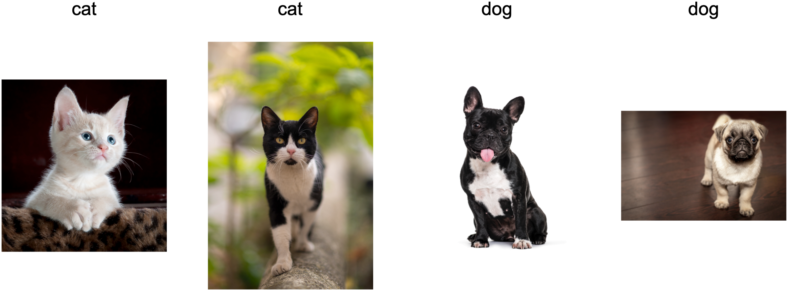

```{.python .input}
%load_ext d2lbook.tab
tab.interact_select('mxnet', 'pytorch', 'tensorflow', 'jax')
```

# Environment and Distribution Shift
:label:`sec_environment-and-distribution-shift`

So far we have treated our datasets as gifts from heaven, focusing on how
to fit models and measure their held-out accuracy without asking where the
data came from or what happens once our predictions are acted upon. Too
many failed machine learning deployments trace right back to that blind
spot. The test error of :numref:`chap_classification_generalization`
certifies future performance *only* when deployment data come from the
exact same distribution as the test set. In the real world that condition
breaks constantly, even when our model is a passive observer: a hospital
upgrades its MRI scanner, a flu epidemic alters disease prevalence
overnight, or everyday slang shifts the meaning of words. When the
distribution shifts, a pristine offline test set gives zero warning. Can we
still detect the change—or even adapt our model to handle it?

More insidiously, deploying a model can *itself* alter the data it sees.
Suppose a bank trains a classifier to predict loan repayment and discovers
a quirky pattern in historical data: applicants wearing Oxfords almost
always repay, whereas applicants in sneakers tend to default. The model
shines on held-out test records, so the bank starts approving everyone in
Oxfords and rejecting everyone in sneakers. Applicants quickly catch on,
shoe stores sell out of Oxfords, and before long *everyone* applies in
Oxfords while the underlying default rate never budges. An ill-considered
leap from pattern recognition to decision-making broke the very pattern
the model relied on—a classic instance of *Goodhart's law*: when a measure
becomes a target, it ceases to be a good measure.

In this section, we first show why nothing can carry over from training to
deployment unless we make an explicit structural assumption about how the
two distributions relate, organizing the three canonical types of shift by
which factor of the joint distribution stays invariant. Under two of them
(*covariate shift* and *label shift*), unlabeled deployment inputs alone
suffice to estimate importance weights and adapt our classifier; under the
third (*concept shift*), only fresh labels can help. Finally, we examine
feedback loops where a model's own decisions reshape its environment—the
boundary where passive statistical correction ends and policy, fairness,
and reinforcement learning begin.

```{.python .input #environment-and-distribution-shift-a-two-dimensional-example-1}
%%tab pytorch
import math
import numpy as np
import torch
from torch import nn
from torch.nn import functional as F
from d2l import torch as d2l
```

```{.python .input #environment-and-distribution-shift-a-two-dimensional-example-1}
%%tab tensorflow
import math
import numpy as np
import tensorflow as tf
from d2l import tensorflow as d2l
```

```{.python .input #environment-and-distribution-shift-a-two-dimensional-example-1}
%%tab jax
import math
import numpy as np
import jax
from jax import numpy as jnp
from flax import nnx
import optax
from d2l import jax as d2l
```

```{.python .input #environment-and-distribution-shift-a-two-dimensional-example-1}
%%tab mxnet
import math
import numpy as np
from mxnet import autograd, gluon, init, np as mnp, npx
from mxnet.gluon import nn
from d2l import mxnet as d2l
npx.set_np()
```

## Types of Distribution Shift

Let us begin in the passive prediction setting and establish clean
notation. Our labeled training examples come from a *source distribution*
$p_S(\mathbf{x}, y)$, while at deployment we encounter examples drawn from
a *target distribution* $p_T(\mathbf{x}, y)$—where we observe unlabeled
inputs $\mathbf{x}$, but (at least initially) no labels $y$.

Right away we face a sobering impossibility: without *some* assumption
linking $p_S$ and $p_T$, adapting to the target is mathematically
impossible. This is no mere technicality. Imagine classifying cats versus
dogs when the input distribution stays completely unchanged,
$p_T(\mathbf{x}) = p_S(\mathbf{x})$, yet overnight the labels swap so that
every cat is now called a dog and vice versa:
$p_T(y = \textrm{cat} \mid \mathbf{x}) = p_S(y = \textrm{dog} \mid \mathbf{x})$.
Because unlabeled target images look statistically identical to source
images, no algorithm on earth can distinguish this flipped world from a
world with zero shift—yet a classifier with 100% source accuracy scores 0%
on the target. Every adaptation method therefore rests on an explicit
assumption about *which part* of the joint distribution remains invariant.

Recall that any joint distribution factors in two ways:

$$p(\mathbf{x}, y) = p(\mathbf{x})\, p(y \mid \mathbf{x}) = p(y)\, p(\mathbf{x} \mid y).$$

The first factorization mirrors generating an input $\mathbf{x}$ and then
labeling it; the second mirrors picking a class $y$ and then generating an
input characteristic of that class. The three classical forms of
distribution shift correspond to letting one factor drift while holding
another fixed:

| Shift | Changes | Stays fixed | Natural when |
|:--|:--|:--|:--|
| covariate shift | $p(\mathbf{x})$ | $p(y \mid \mathbf{x})$ | the input causes the label |
| label shift | $p(y)$ | $p(\mathbf{x} \mid y)$ | the label causes the input |
| concept shift | $p(y \mid \mathbf{x})$ | often $p(\mathbf{x})$ | the meaning of the label changes |

:numref:`fig_mdl-clf-shift-types` illustrates all three regimes for a
one-dimensional input and two classes.

![Three kinds of distribution shift for a scalar input $x$ and two classes. Each panel plots $p(x, y = 0)$ and $p(x, y = 1)$, whose sum $p(x)$ is the gray outline; the top row is the source, the bottom row the target, and the dotted line marks the decision boundary, where both classes are equally likely. Covariate shift moves the inputs but not the boundary. Label shift keeps the shape of each class but changes the class proportions, which moves the boundary. Concept shift keeps $p(x)$ and moves the boundary.](../img/mdl-clf-shift-types.svg)
:label:`fig_mdl-clf-shift-types`

### Covariate Shift

Under *covariate shift*—named after statisticians' term *covariates* for
input features—the input distribution $p(\mathbf{x})$ changes while the
conditional labeling rule $p(y \mid \mathbf{x})$ remains invariant. This
assumption fits naturally whenever $\mathbf{x}$ causes $y$: an image
depicts a cat because a cat was photographed or drawn. A classic example is
training a cat-versus-dog classifier on photographs
(:numref:`fig_cat-dog-train`) and deploying it on cartoons
(:numref:`fig_cat-dog-test`). A cartoon cat is still unmistakably a cat, so
$p(y \mid \mathbf{x})$ has not changed, yet cartoons inhabit a corner of
image space that training photographs scarcely touch. Standard training
focuses its capacity where $p_S(\mathbf{x})$ puts mass, leaving errors in
target-only regions largely unchecked.


:label:`fig_cat-dog-train`


:label:`fig_cat-dog-test`

### Label Shift

*Label shift* flips the roles: the class proportions $p(y)$ shift, while
the class-conditional appearance $p(\mathbf{x} \mid y)$ of every class
stays fixed. This assumption is natural whenever the label $y$ causes the
input $\mathbf{x}$. Diseases cause symptoms: during a winter flu surge, the
fraction of clinic visitors with influenza climbs sharply, yet the symptoms
of influenza itself do not change. Likewise, a benchmark classifier trained
on perfectly balanced classes may be deployed in a marketplace where one
category accounts for half of all traffic.

Do not let the fixed $p(\mathbf{x} \mid y)$ fool you into thinking the
optimal classifier stays unchanged: by Bayes' theorem,
$p(y \mid \mathbf{x}) \propto p(\mathbf{x} \mid y)\, p(y)$, so a model
trained on the source has the source class priors baked directly into its
decision boundary (notice how the boundary slides toward the rarer class in
the middle panel of :numref:`fig_mdl-clf-shift-types`). Happily,
correcting label shift only requires estimating *one scalar per class*
rather than a density ratio over thousands or millions of image dimensions,
making it far easier to handle than general covariate shift.

### Concept Shift

Under *concept shift*, the very definition of the labels—the conditional
rule $p(y \mid \mathbf{x})$—drifts over time or geography. While a cat
remains a cat, human-defined categories shift constantly: psychiatric
diagnostic criteria are periodically revised so the exact same patient
history earns a different label, job titles evolve, and even the word for a
sweetened carbonated beverage changes across counties in the United States
(:numref:`fig_popvssoda`), confronting a beverage-labeling system with
geographic concept shift.


:label:`fig_popvssoda`

Often concept shift unfolds gradually as a *nonstationary distribution*—for
instance, a product recommender trained through December that keeps pushing
Santa hats in mid-January misses how user intent changed given the exact
same browsing history. Whenever $p(\mathbf{x})$ stays fixed while
$p(y \mid \mathbf{x})$ drifts (right panel of
:numref:`fig_mdl-clf-shift-types`), unlabeled target inputs alone cannot
detect the shift—just a milder version of the cat/dog label swap we began
with.

## Covariate Shift Correction
:label:`subsec_covariate-shift-correction`

Recall from :numref:`subsec_empirical-risk-and-risk` that a model's risk is
its expected loss on a fresh example, which training approximates by
averaging over the training set (*empirical risk*). Once distributions
shift, we must specify *which* distribution the expectation averages over.
At deployment we want to minimize the *target risk*

$$R_T[f] = \mathbb{E}_{(\mathbf{x}, y) \sim p_T}\left[l(f(\mathbf{x}), y)\right],$$

whereas plain training minimizes an empirical estimate of the source risk
$R_S[f]$. Under covariate shift, labeled source data paired with unlabeled
target inputs suffice to turn the target risk into a tractable source
expectation.

### Importance Weights

Because covariate shift keeps the conditional labeling rule
$p(y \mid \mathbf{x})$ identical across domains, multiplying and dividing
the target risk integrand by $p_S(\mathbf{x})$ rewrites $R_T[f]$ as a
weighted expectation over the source :cite:`Shimodaira.2000`:

$$
\begin{aligned}
R_T[f] &= \sum_{y} \int l(f(\mathbf{x}), y)\, p(y \mid \mathbf{x})\, p_T(\mathbf{x}) \;d\mathbf{x} \\
&= \sum_{y} \int l(f(\mathbf{x}), y)\, p(y \mid \mathbf{x})\, p_S(\mathbf{x})\, \frac{p_T(\mathbf{x})}{p_S(\mathbf{x})} \;d\mathbf{x}
= \mathbb{E}_{(\mathbf{x}, y) \sim p_S}\left[\beta(\mathbf{x})\, l(f(\mathbf{x}), y)\right],
\end{aligned}
$$
:eqlabel:`eq_covariate-shift-identity`

where the density ratio

$$\beta(\mathbf{x}) = \frac{p_T(\mathbf{x})}{p_S(\mathbf{x})}$$

is the *importance weight* of input $\mathbf{x}$. The final equality uses
covariate shift directly: $p(y \mid \mathbf{x})\,p_S(\mathbf{x})$ equals
$p_S(\mathbf{x}, y)$ precisely because the labeling rule did not change.
Intuitively, each source example is weighted by how much more likely it is
to appear in deployment than in training. Replacing the expectation with
an empirical average over our $n$ labeled source examples yields *weighted
empirical risk minimization*:

$$\mathop{\mathrm{minimize}}_f \; \frac{1}{n} \sum_{i=1}^n \beta_i\, l(f(\mathbf{x}^{(i)}), y^{(i)}), \quad \textrm{where } \beta_i = \beta(\mathbf{x}^{(i)}).$$
:eqlabel:`eq_weighted-empirical-risk-min`

Let us plug in concrete numbers from our upcoming 2D running example, where
the source is a standard Gaussian centered at the origin and the target is
the exact same Gaussian shifted to $(2, 0)$:

$$\beta(\mathbf{x}) = \frac{\exp\left(-\frac{1}{2}\|\mathbf{x} - (2, 0)\|^2\right)}{\exp\left(-\frac{1}{2}\|\mathbf{x}\|^2\right)} = \exp(2x_1 - 2).$$

The ratio depends solely on the shifted coordinate $x_1$. A typical source
point at the origin receives weight $e^{-2} \approx 0.14$; a typical target
point at $(2, 0)$ receives weight $e^{2} \approx 7.4$; and a rare right-tail
source point at $(3, 0)$ receives weight $e^{4} \approx 55$
(:numref:`fig_mdl-clf-density-ratio`)—counting as much as 400 points at the
origin!


:label:`fig_mdl-clf-density-ratio`

Notice a critical prerequisite hidden in that division by $p_S(\mathbf{x})$:
we need *support overlap*, meaning $p_S(\mathbf{x}) > 0$ wherever
$p_T(\mathbf{x}) > 0$. Every deployment input must at least be *possible*
under the training distribution; if the target populates a region where the
source has zero examples, no reweighting can conjure data out of thin air.
A medical startup that some of us worked with learned this lesson the hard
way. Building a blood test for a disease affecting older men, they easily
collected blood from sick older patients—but struggling to recruit healthy
older controls, they collected healthy blood donations from university
students instead. A classifier separated the two cohorts with near-perfect
accuracy, simply by picking up on age, hormone levels, and diet rather than
disease. Because the training set contained *zero* healthy older men, no
reweighting of twenty-year-old students could ever salvage the test.

### Estimating Weights with a Domain Classifier

At first glance, computing $\beta(\mathbf{x}) = p_T(\mathbf{x})/p_S(\mathbf{x})$
looks daunting: estimating high-dimensional densities like $p(\mathbf{x})$
over images is vastly harder than classification itself. Remarkably, we do
not need either density individually—we only need their *ratio*, and a
simple binary classifier can estimate a density ratio directly! Pool our
$n$ source inputs (assigned *domain label* $z = 0$) with $m$ unlabeled
target inputs (assigned $z = 1$), and train a classifier to predict $z$
from $\mathbf{x}$. By Bayes' theorem, with target prior $m/(n + m)$,

$$P(z = 1 \mid \mathbf{x}) = \frac{m\, p_T(\mathbf{x})}{m\, p_T(\mathbf{x}) + n\, p_S(\mathbf{x})}, \quad \textrm{so} \quad \frac{P(z = 1 \mid \mathbf{x})}{P(z = 0 \mid \mathbf{x})} = \frac{m}{n}\, \beta(\mathbf{x}).$$

In other words, the predicted odds that an input came from the target
rather than the source equal the importance weight up to the constant ratio
$m/n$: inputs that look unmistakably target-like earn large weights, while
indistinguishable inputs earn equal weights.

Logistic regression (:numref:`sec_softmax`) parameterizes those log-odds
directly: $P(z = 1 \mid \mathbf{x}) = \sigma(h(\mathbf{x}))$ where
$\sigma(o) = 1/(1 + \exp(-o))$ and $h(\mathbf{x}) = \mathbf{w}^\top \mathbf{x} + b$
is the logit. Hence the odds are simply $\exp(h(\mathbf{x}))$, giving

$$\beta(\mathbf{x}) = \frac{n}{m} \exp(h(\mathbf{x})).$$

Because the constant factor $n/m$ scales every term identically without
moving the minimizer of :eqref:`eq_weighted-empirical-risk-min`, we can
drop it. Notice that the domain classifier never touches a single label
$y$. Putting everything together yields a clean four-step recipe:

1. Pool the source inputs (labeled $z = 0$) with the unlabeled target inputs (labeled $z = 1$).
1. Train a binary logistic regression domain classifier $h$ to predict $z$ from $\mathbf{x}$.
1. Assign each labeled source example the weight $\beta_i = \exp(h(\mathbf{x}^{(i)}))$, or a clipped weight $\beta_i = \min(\exp(h(\mathbf{x}^{(i)})), c)$ for some cap $c$.
1. Train the task model $f$ on the labeled source set via weighted empirical risk minimization :eqref:`eq_weighted-empirical-risk-min`.

Why consider clipping weights at $c$? Because a handful of extreme
right-tail weights can drown out the rest of the dataset, inflating
estimation variance. Specifically, for $n$ independent losses with equal
variance, the weighted mean $\sum_i \beta_i l_i / \sum_i \beta_i$ has the
same variance as an unweighted mean over only

$$n_\textrm{eff} = \frac{\left(\sum_{i=1}^n \beta_i\right)^2}{\sum_{i=1}^n \beta_i^2}$$

examples—the *effective sample size*. When all weights are equal,
$n_\textrm{eff} = n$; when one weight dwarfs the others, $n_\textrm{eff}$
collapses toward 1. Clipping trades a small amount of bias in the tail for
a dramatic jump in effective sample size.

### A Two-Dimensional Example

Let us watch all four steps in action on our shifted-Gaussian running
example, where we know the exact density ratio $e^{2x_1 - 2}$. Both domains
share the exact same nonlinear labeling rule: $y = 1$ above the parabola
$x_2 = \frac{1}{2}x_1^2 - 1$ and $y = 0$ below it, guaranteeing covariate
shift by construction. Because the true boundary is curved, no linear
classifier can fit it globally: the best straight line near the origin (the
source cloud) slopes very differently from the best straight line near
$(2, 0)$ (the target cloud). Plain NumPy suffices for the entire experiment.

We generate 1,000 labeled source points and 1,000 target points (holding
back the target labels strictly for evaluation). We intentionally leave the
random generator unseeded—seeing how much the numbers fluctuate from run to
run is itself part of the lesson.

```{.python .input #environment-and-distribution-shift-covariate-shift-correction-1}
rng = np.random.default_rng()
n = 1000
X_src = rng.normal(0, 1, (n, 2))            # source p_S: centered at (0, 0)
X_tgt = rng.normal(0, 1, (n, 2)) + [2, 0]   # target p_T: centered at (2, 0)
label = lambda X: (X[:, 1] > 0.5 * X[:, 0]**2 - 1).astype(float)
y_src, y_tgt = label(X_src), label(X_tgt)   # one labeling rule for both
```

Our sole learning primitive is weighted logistic regression trained by
gradient descent. By :numref:`subsec_softmax_and_derivatives`, the
cross-entropy gradient with respect to the logit is the residual
$\sigma(\mathbf{w}^\top \mathbf{x} + b) - y$, so weighting example $i$ by
$\beta_i$ simply multiplies its residual by $\beta_i$.

```{.python .input #environment-and-distribution-shift-a-two-dimensional-example-2}
def fit_logreg(X, y, weights=None, lr=0.1, steps=2000):
    """Logistic regression by gradient descent on the weighted mean loss."""
    w, b = np.zeros(X.shape[1]), 0.0
    v = np.ones(len(y)) if weights is None else weights / weights.mean()
    for _ in range(steps):
        r = v * (1 / (1 + np.exp(-(X @ w + b))) - y)   # weighted error
        w -= lr * X.T @ r / len(y)
        b -= lr * r.mean()
    return w, b
```

First, we pool source and target inputs and train the domain classifier $h$
(steps 1 and 2). Because the log density ratio of two equal-covariance
Gaussians is strictly linear ($2x_1 - 2$), logistic regression is properly
specified here and can recover the true weights directly. Let us inspect
the learned $h$, the peak weight, and the effective sample size before and
after clipping at $c = 5$.

```{.python .input #environment-and-distribution-shift-covariate-shift-correction-2}
z = np.concatenate([np.zeros(n), np.ones(n)])      # domain label: 1 = target
w_h, b_h = fit_logreg(np.concatenate([X_src, X_tgt]), z)
beta = np.exp(X_src @ w_h + b_h)                   # weights of source examples
ess = lambda v: v.sum()**2 / (v**2).sum()          # effective sample size
print(f'learned h(x) = {w_h[0]:.2f} x1 {w_h[1]:+.2f} x2 {b_h:+.2f}'
      f'   (true log-ratio: 2 x1 - 2)')
print(f'largest weight: {beta.max():.0f}; effective sample size: '
      f'{ess(beta):.0f} of {n}, {ess(np.minimum(beta, 5)):.0f} if clipped at 5')
```

Sure enough, the learned $h(\mathbf{x})$ lands close to $2x_1 - 2$. Look,
however, at what happens to sample efficiency: because the weights span
orders of magnitude, our 1,000 source examples collapse to an effective
sample size of only a few dozen—and on an unlucky draw, barely ten!
Clipping at $c = 5$ lifts $n_\textrm{eff}$ back to around 200. Re-run the
cell a few times and watch the maximum weight swing wildly from dozens to
hundreds, dragging the unclipped effective sample size along with it: a
handful of lucky right-tail source points dominate the entire weighted sum,
exposing the notorious high variance of importance weighting.

Next, step 4 trains three task classifiers on the labeled source set—unweighted,
importance-weighted, and clipped at $c = 5$—and compares their target and
source accuracies against a trivial majority-class baseline on the target.

```{.python .input #environment-and-distribution-shift-covariate-shift-correction-3}
acc = lambda wb, X, y: ((X @ wb[0] + wb[1] > 0) == (y == 1)).mean()
models = {name: fit_logreg(X_src, y_src, v) for name, v in [
    ('unweighted', None), ('weighted', beta), ('clipped', np.minimum(beta, 5))]}
for name, wb in models.items():
    print(f'{name:10s}  target accuracy {acc(wb, X_tgt, y_tgt):.3f}'
          f'   source accuracy {acc(wb, X_src, y_src):.3f}')
print(f'always predicting the most common target class: '
      f'{max(y_tgt.mean(), 1 - y_tgt.mean()):.3f}')
```

On the shifted target, the unweighted classifier performs *worse* than
blindly guessing the majority class: only 45%–65% accuracy versus ~70% for
the trivial baseline! Importance reweighting rockets target accuracy up to
roughly 95% while sacrificing only a few points on the source—trading away
a tiny bit of fit near the origin to excel where deployment actually lives,
just as :eqref:`eq_covariate-shift-identity` promises. Clipping makes
hardly a dent here (within a point or two), because a 2D line has only
three parameters and even a dozen effective points pin it down (exercise
:exref:`ex_environment-and-distribution-shift-when-reweighting-fails`
pushes the target farther out to see where reweighting breaks down). Let us
plot both decision boundaries over the two clouds, sizing each source dot
in proportion to its importance weight.

```{.python .input #environment-and-distribution-shift-a-two-dimensional-example-3}
x1 = np.linspace(-2.5, 4.5, 50)
d2l.set_figsize((4.5, 3.5))
d2l.plt.scatter(*X_tgt.T, s=2, c='C1', label='target')
d2l.plt.scatter(*X_src.T, s=np.clip(beta, 0.2, 20), c='C0',
                label=r'source, area $\propto \beta$')
d2l.plt.plot(x1, 0.5 * x1**2 - 1, 'k--', label='true boundary')
for name, fmt in [('unweighted', 'C2'), ('weighted', 'C3')]:
    (w1, w2), b = models[name]
    d2l.plt.plot(x1, -(w1 * x1 + b) / w2, fmt, label=name)
d2l.plt.xlabel('$x_1$'), d2l.plt.ylabel('$x_2$'), d2l.plt.ylim(-3, 5)
d2l.plt.legend();
```

The picture makes the geometry unmistakable. The unweighted boundary settles
into a nearly horizontal line around $x_2 = -0.6$—ideal for the flat trough
of the parabola where most source points sit, yet disastrous near $(2, 0)$
where the parabola shoots upward and leaves swarms of target points on the
wrong side. Reweighting tilts the boundary sharply upward along the right
arm of the parabola, anchored almost entirely by the oversized dots along
the right edge of the source cloud while the dense cluster near the origin
barely whispers.

## Label Shift Correction
:label:`subsec_label-shift-correction`

Under label shift, the class-conditional distribution
$p(\mathbf{x} \mid y)$ stays invariant while class proportions $p(y)$
change. Running the exact same importance-weighting derivation—now
multiplying and dividing by $p_S(y)$—yields

$$R_T[f] = \sum_{y} p_T(y) \int l(f(\mathbf{x}), y)\, p(\mathbf{x} \mid y) \;d\mathbf{x} = \mathbb{E}_{(\mathbf{x}, y) \sim p_S}\left[\frac{p_T(y)}{p_S(y)}\, l(f(\mathbf{x}), y)\right].$$

Each training example now carries the weight
$\beta_i = p_T(y^{(i)})/p_S(y^{(i)})$, the ratio of target-to-source
prevalence for its class, and weighted empirical risk minimization proceeds
just as before. Reading off the source frequencies $p_S(y)$ from training
labels is trivial; the catch is estimating the target proportions $p_T(y)$
when target data arrive *without labels*.

### Estimating the Target Class Proportions

Remarkably, any reasonably accurate source classifier can recover
$\mathbf{p}_T$ from unlabeled target inputs alone—without ever touching the
ambient image dimension—as long as we characterize its error pattern. That
error profile is precisely the column-normalized confusion matrix
$\mathbf{C}$ from :numref:`sec_softmax_scratch`, whose entry
$C_{ij} = P(\hat{c} = i \mid y = j)$ is estimated on a labeled source
validation split.

Here is the crucial insight: because $\hat{c}$ depends only on $\mathbf{x}$
and $p(\mathbf{x} \mid y)$ is unchanged under label shift, the exact same
confusion matrix $\mathbf{C}$ governs the classifier's behavior on the
target domain! Let $\mu_i$ be the fraction of unlabeled target inputs that
our classifier predicts as class $i$. By the law of total probability,

$$\mu_i = \sum_{j=1}^q P(\hat{c} = i \mid y = j)\, p_T(y = j) = \sum_{j=1}^q C_{ij}\, p_T(y = j), \quad \textrm{that is,} \quad \mathbf{C}\, \mathbf{p}_T = \boldsymbol{\mu},$$
:eqlabel:`eq_label-shift-system`

where $\mathbf{p}_T$ and $\boldsymbol{\mu}$ are the $q$-dimensional vectors
of true target class proportions and predicted target frequencies. (Now you
see why we placed true classes along the *columns* of $\mathbf{C}$ back in
:numref:`sec_softmax_scratch`!) The predicted frequencies we observe at
deployment are simply the true target class proportions scrambled by
$\mathbf{C}$; whenever $\mathbf{C}$ is invertible, solving
$\mathbf{p}_T = \mathbf{C}^{-1} \boldsymbol{\mu}$ cleanly unscrambles them.

Try this by hand on our screening test from :numref:`sec_classification`
(90% recall, 5% false-alarm rate), validated on a balanced 50/50 source
sample of healthy ($y = 0$) and sick ($y = 1$) patients:

$$\mathbf{C} = \begin{pmatrix} 0.95 & 0.10 \\ 0.05 & 0.90 \end{pmatrix}.$$

Suppose in deployment the test flags 13.5% of patients, so
$\boldsymbol{\mu} = (0.865, 0.135)$. Letting $p$ denote the unknown target
prevalence of disease, the second row of :eqref:`eq_label-shift-system`
says $0.05\,(1 - p) + 0.90\,p = 0.135$, giving $p = 0.085/0.85 = 0.10$.
Notice why raw predictions (13.5%) overstated the true 10% prevalence:
false alarms ($0.05 \times 0.90 = 4.5\%$) outnumbered missed cases
($0.10 \times 0.10 = 1\%$), and inverting $\mathbf{C}$ cancelled both
effects exactly. To retrain for the target, we weight sick training
examples by $0.1/0.5 = 0.2$ and healthy ones by $0.9/0.5 = 1.8$.

Let us test this linear-system estimator on Fashion-MNIST using our concise
`SoftmaxRegression` model from :numref:`sec_softmax_concise`, saving its
validation logits and labels as NumPy arrays.

```{.python .input #environment-and-distribution-shift-label-shift-on-fashion-mnist}
data = d2l.FashionMNIST(batch_size=256)
model = d2l.SoftmaxRegression(num_outputs=10, lr=0.1)
trainer = d2l.Trainer(max_epochs=10)
trainer.board.display = False
trainer.fit(model, data)
O, y = [], []
for X, Y in data.val_dataloader():
    O.append(d2l.numpy(model(X)))
    y.append(d2l.numpy(Y))
O, y = np.concatenate(O), np.concatenate(y)
pred = O.argmax(axis=1)
```

We split the 10,000 validation images randomly in half: the first half
serves as our labeled source validation set to estimate $\mathbf{C}$ (where
all 10 classes appear equally at proportion 0.1), while from the second
half we draw a heavily skewed target set where half of all images are
shirts (400 shirts and 45 of each other garment). Target labels are hidden
from the estimator and used only to verify its accuracy.

```{.python .input #environment-and-distribution-shift-label-shift-on-fashion-mnist-2}
perm = rng.permutation(len(y))
src, pool = perm[:5000], perm[5000:]  # Source validation set; target pool
C = np.zeros((10, 10))
np.add.at(C, (pred[src], y[src]), 1)  # The confusion matrix of the source
C /= C.sum(axis=0, keepdims=True)     # Each column sums to 1
counts = np.full(10, 45)
counts[6] = 400                       # Half of the target images are shirts
p_T = counts / counts.sum()
tgt = np.concatenate([rng.choice(pool[y[pool] == j], counts[j], replace=False)
                      for j in range(10)])
mu = np.bincount(pred[tgt], minlength=10) / len(tgt)  # Needs no labels
p_hat = np.linalg.solve(C, mu)
for j, name in enumerate(data.text_labels(range(10))):
    print(f'{name:10s} true {p_T[j]:.2f}, predicted {mu[j]:.3f}, '
          f'estimated {p_hat[j]:.3f}')
```

Look at the raw predictions first: because shirts are the hardest garment
for softmax regression to recognize, the classifier predicts "shirt" on
only about a quarter to two-fifths of the target images, spilling the rest
into T-shirts, pullovers, and coats. Solving
$\mathbf{C}\,\mathbf{p}_T = \boldsymbol{\mu}$ neatly reverses that
leakage—putting the estimated shirt share right back near 0.50 and every
other class within a few hundredths of its true frequency!

Even better, once we have $\hat{\mathbf{p}}_T$, we can adapt a *calibrated*
classifier on the fly without retraining a single weight. By Bayes'
theorem, multiplying class $y$'s predicted source probability by
$p_T(y)/p_S(y)$ and renormalizing yields the exact target posterior
(recall from :numref:`sec_classification` that our softmax regression is
already well calibrated). In logit space, multiplying probabilities by
$p_T(y)/p_S(y)$ simply *adds* $\log(p_T(y)/p_S(y))$ to each class's logit!

```{.python .input #environment-and-distribution-shift-label-shift-on-fashion-mnist-3}
log_w = np.log(np.maximum(p_hat, 1e-6) / 0.1)  # log p_T(y) - log p_S(y)
accuracy = lambda O: (O.argmax(axis=1) == y[tgt]).mean()
print(f'target accuracy: {accuracy(O[tgt]):.3f} as trained, '
      f'{accuracy(O[tgt] + log_w):.3f} adapted to the estimated proportions')
```

Simply adding that log-prior shift boosts target accuracy by several
percentage points—using zero target labels and zero gradient steps!

Keep three caveats in mind when applying this method: label shift must
actually hold, no brand-new class absent from the source may appear in the
target, and $\mathbf{C}$ must be invertible. Invertibility is guaranteed
whenever the classifier gets more than half of every class right
($C_{jj} > \frac{1}{2}$ for all $j$; see exercise
:exref:`ex_environment-and-distribution-shift-label-shift-system`), yet if
$\mathbf{C}$ is ill-conditioned, small sampling fluctuations in
$\boldsymbol{\mu}$ or $\mathbf{C}$ magnify into noisy estimates of
$\mathbf{p}_T$. For very rare classes, raw linear inversion can even dip
below zero: in our screening example, $\hat{p} = (\mu_1 - 0.05)/0.85$, and
at 1% true prevalence ($\mathbb{E}[\mu_1] = 0.0585$, standard error
$0.0074$ on 1,000 patients), roughly one sample in eight sees
$\mu_1 < 0.05$ and produces a negative estimate! In practice, one clips
negative entries to zero and renormalizes—or solves a simplex-constrained
least-squares problem. Prior-shift adjustment dates back at least to
:citet:`Saerens.Latinne.Decaestecker.2002`, and
:citet:`Lipton.Wang.Smola.2018` proved that confusion-matrix inversion is
statistically consistent for any fixed classifier with invertible
$\mathbf{C}$.

Finally, class labels are not the only proportions that can shift. Under
*subpopulation shift*, demographic groups, hospital sites, or spurious
background contexts (such as waterbirds photographed on land versus water)
appear in different mixes at test time; a classifier that relies on
background shortcuts can boast high *average* accuracy while failing badly
on minority subgroups :cite:`Sagawa.Koh.Hashimoto.ea.2020`. Whenever
subgroups are annotated, group reweighting mirrors class reweighting, and
modern shift benchmarks evaluate *worst-group* accuracy alongside average
accuracy :cite:`Koh.Sagawa.Marklund.ea.2021`.

## Concept Shift and Feedback

Two deployment hazards remain where no amount of importance reweighting can
save us: when the labeling rule itself drifts, and when our model's own
actions reshape the world around it.

### Updating with Fresh Labels

Because concept shift alters $p(y \mid \mathbf{x})$ itself, historical
source labels become stale—reweighting outdated answers cannot teach a
model the new definitions. Only fresh labeled data can repair it. When
concept shift is gradual (as in evolving news topics or seasonal shopping
trends), teams typically keep existing weights and continue fine-tuning on
recent labeled streams. When shift is abrupt (such as revised medical
diagnostic standards), legacy labels describe a different task altogether
and retraining from scratch on freshly labeled data is required. Either
way, you will never catch concept shift without continuously monitoring
accuracy on a trickle of freshly annotated examples.

### Decisions That Change the Data

Deploying a predictive model turns probabilities into real-world *actions*,
and actions can alter the very stream of data the model receives tomorrow.
Our loan-scoring footwear story showed applicants gaming features
directly; in predictive policing, the feedback acts on the *observed
labels* (:numref:`fig_mdl-clf-feedback-loop`). Dispatching extra patrols to
neighborhoods with high forecasted crime leads officers to record more
incidents there; feeding those newly logged incidents back into the
training pipeline convinces the retrained model to send even more patrols,
creating a *runaway feedback loop*. Because recorded arrests reflect where
police looked as much as where crimes occurred, the loop can rapidly
amplify a tiny initial discrepancy between two otherwise identical
neighborhoods.


:label:`fig_mdl-clf-feedback-loop`

None of our passive shift corrections applies here, because importance
weighting presupposes an external target distribution independent of our
model. Breaking or even detecting such a loop requires data collected
independently of the model's policy—for example, sending a fraction of
patrols to randomly selected areas. And beyond statistical detection lie
value judgments that mathematics alone cannot settle: deciding whether an
automated system pursues a legitimate objective and weighing how its errors
distribute across populations. A clinical classifier must be evaluated by
the real-world cost of its mistakes within *every* patient subgroup, not
just its global average—and as a fundamental impossibility result shows,
when disease prevalence differs across two groups, no imperfect test can
simultaneously equalize false-positive rate, false-negative rate, and
precision across both. When a learner's actions continually reshape its
environment and future observations, we cross out of passive supervised
learning into *reinforcement learning*
(:numref:`chap_reinforcement_learning`).

## Summary

A held-out test set guarantees deployment performance only when test and
deployment data share the same distribution—and without an explicit
structural assumption about what stays fixed, nothing can transfer across a
shift. Under *covariate shift* ($p(y \mid \mathbf{x})$ invariant),
reweighting source training examples by the density ratio
$p_T(\mathbf{x})/p_S(\mathbf{x})$—estimated via a binary domain classifier
without target labels—aligns training with the target risk (boosting target
accuracy from roughly 50% to 95% in our 2D parabola example), provided
source support covers the target and extreme weights do not collapse the
effective sample size. Under *label shift* ($p(\mathbf{x} \mid y)$
invariant), inverting the source confusion matrix
$\mathbf{C}\,\mathbf{p}_T = \boldsymbol{\mu}$ recovers target class
proportions from unlabeled target predictions alone, enabling either
reweighted retraining or instant Bayes logit adjustment. *Concept shift*
demands ongoing fresh labels, and whenever a model's decisions feed back
into its own data stream, passive statistical fixes must give way to active
monitoring, ethical scrutiny, and sequential decision-making.

## Exercises

1. **Feedback loops.** A search engine changes how it ranks results. It
   then retrains its ranker on the clicks logged under the new ranking,
   with a query-document pair as the input $\mathbf{x}$ and a click as the
   label $y$.
    1. Describe one way users and one way advertisers might respond to
       the new ranking.
    1. For each response, state whether it changes $p(\mathbf{x})$,
       $p(y \mid \mathbf{x})$, or both in the next training set. Then
       decide whether the response is an instance of Goodhart's law.

1. **Missing support.** Suppose that $p_S(\mathbf{x}) = 0$ on a region
   $\mathcal{A}$ of inputs that has probability $\pi > 0$ under the target,
   and that $p_S(\mathbf{x}) > 0$ everywhere else. Define
   $\beta(\mathbf{x}) = p_T(\mathbf{x})/p_S(\mathbf{x})$ outside
   $\mathcal{A}$.
    1. Show that the weighted source risk
       $\mathbb{E}_{(\mathbf{x}, y) \sim p_S}[\beta(\mathbf{x})\, l(f(\mathbf{x}), y)]$
       equals the target risk with the contribution of $\mathcal{A}$
       removed. Write the missing term as $\pi$ times a conditional
       expectation.
    1. Explain why no choice of weights on source examples can recover the
       missing term. Construct two models that agree outside
       $\mathcal{A}$ and have the same weighted source risk but different
       target risks.

1. [code] **When reweighting fails.** The code of
   :numref:`subsec_covariate-shift-correction` (`fit_logreg`, `X_src`,
   `X_tgt`, `label`) places the target mean at $(2, 0)$. Sweep the target
   mean over $(s, 0)$ for $s \in \{0, 0.5, 1, 2, 3, 4, 6\}$, keeping
   $n = 1000$ and the labeling rule fixed.
    1. For each $s$, report the accuracy of the domain classifier $h$ on
       held-out pooled data, and interpret its growth with $s$ in terms of
       how detectable the shift is.
    1. For each $s$, record the target accuracy of the unweighted,
       weighted, and clipped ($c = 5$) models, and of always predicting the
       most common target class. Explain why target accuracy alone cannot
       show whether reweighting worked at large $s$.
   :exlabel:`ex_environment-and-distribution-shift-when-reweighting-fails`

1. **The label shift system.** Let $\mathbf{C}$ be the column-normalized
   confusion matrix of :eqref:`eq_label-shift-system`.
    1. Show that $\mathbf{C}$ is invertible whenever $C_{jj} > \frac{1}{2}$
       for every class $j$. Hint: suppose that $\mathbf{v}^\top \mathbf{C} = \mathbf{0}$
       for some $\mathbf{v} \neq \mathbf{0}$, look at the column $j$ for
       which $|v_j|$ is largest, and use that the column sums to 1.
    1. Give an example of a classifier for which $\mathbf{C}$ is singular,
       and describe what $\boldsymbol{\mu}$ can still reveal about
       $\mathbf{p}_T$ in that case.
    1. For two classes, show that an error $\delta$ in the fraction
       $\mu_1$ of positive predictions changes the estimated fraction of
       positives by $\delta/(C_{11} - C_{10})$. Using the standard error
       $\sqrt{\mu_1 (1 - \mu_1)/m}$ of a fraction estimated from $m$ target
       inputs, find how many target inputs the screening example needs for
       a standard error of 0.01 in the estimated fraction of sick patients.
       Repeat for a weaker test with $C_{11} = 0.6$ and $C_{10} = 0.4$ on
       the same population.
   :exlabel:`ex_environment-and-distribution-shift-label-shift-system`

1. **Features missing at serving time.** A model forecasts a store's daily
   revenue at the start of each day. Its training records hold each past
   day's final customer count as a feature, and the model performs well in
   offline evaluation on held-out records. At serving time the pipeline
   fills this feature with the number of customers counted so far that day.
    1. Compare the distribution of this feature, and its relation to
       revenue, in the training records and at serving time. State which
       of the section's shift assumptions, if any, holds between the two.
    1. Explain why the offline evaluation could not reveal this mismatch,
       and why the reweighting of
       :numref:`subsec_covariate-shift-correction` cannot repair it.
    1. Propose a rule for selecting training features that avoids this
       failure.

    *Adapted from Google's Machine Learning Crash Course,
    ["Monitoring pipelines"](https://developers.google.com/machine-learning/crash-course/production-ml-systems/monitoring).*

1. [code] **Learned versus true weights.** ● Reuse the sweep of exercise
   :exref:`ex_environment-and-distribution-shift-when-reweighting-fails`
   over target means $(s, 0)$.
    1. Derive the true log-ratio $\log(p_T(\mathbf{x})/p_S(\mathbf{x}))$ as
       a function of $s$, and compare it with the learned $h$ at each $s$.
       Explain how the domain classifier can reach high accuracy at large
       $s$ while $h$ is far from the true log-ratio.
    1. Show that under the source the true weights satisfy
       $\mathbb{E}[\beta(\mathbf{x})] = 1$ and $\mathbb{E}[\beta(\mathbf{x})^2] = e^{s^2}$, so
       that for large $n$ their effective sample size is about
       $n e^{-s^2}$. Evaluate this for $n = 1000$ and $s = 1, 2, 3$.
    1. For each $s$, compute the effective sample size of the true weights
       and of the learned weights on the actual source sample. Explain why
       at $s = 2$ the sample value is usually much larger than
       $1000\, e^{-4} \approx 18$, and what this means for judging the
       reliability of a reweighted fit from the sample alone. Does clipping
       at $c = 5$ repair the shortage?
   :exlabel:`ex_environment-and-distribution-shift-learned-true-weights`

1. **Shift assumptions from unlabeled data.** ● In a binary source domain,
   $p_S(y = 1) = p_S(y = 0) = \frac{1}{2}$, and the scalar input satisfies
   $x \mid y = 1 \sim \mathcal{N}(1, 1)$ and
   $x \mid y = 0 \sim \mathcal{N}(-1, 1)$. Hence
   $p_S(y = 1 \mid x) = 1/(1 + \exp(-2x))$. Unlabeled target inputs follow
   the mixture

   $$p_T(x) = 0.8\, \mathcal{N}(x; 1, 1) + 0.2\, \mathcal{N}(x; -1, 1).$$

    1. Assume label shift. Give $p_T(y = 1)$ and the threshold on $x$ of
       the Bayes-optimal target classifier.
    1. Assume instead covariate shift with the same $p_T(x)$. Compute
       $p_T(y = 1)$ numerically and give the Bayes-optimal threshold.
    1. Use your results to explain why no statistic of the unlabeled
       target sample can decide which of the two corrections of this
       section applies.


[Discussions](https://d2l.discourse.group/t/105)

<!-- slides -->

::: {.slide}
::: {.cover}
[Dive into Deep Learning · §3.7]{.kicker}

Models deployed on data unlike their training data<br>
**covariate, label, and concept shift · importance weights · label-shift correction · feedback loops**
:::
:::

::: {.slide title="Right on the Test Set, Wrong in Deployment"}
[The problem]{.kicker}

::: {.cols .vc}
::: {.col}
{width=100%}
:::

::: {.col}
{width=100%}
:::
:::

- Same labels, different inputs: a test set drawn like the training data
  gives **no warning**.
- Running example: a linear classifier is right on about **85%** of source
  data and only **about half** of shifted target data, below the **~70%**
  of always guessing the most common class.
:::

::: {.slide title="By the End of This Deck You Can"}
[Goals]{.kicker}

- name a shift by the part of the joint distribution of inputs and labels
  that changes, and explain why some assumption is needed;
- derive importance weights, the ratio of target to source density, and
  estimate them with a classifier;
- correct label shift with a classifier's confusion matrix;
- tell when only fresh labels, or an analysis of the decisions, can help.

**Running example:** source inputs from a standard Gaussian in the plane,
target inputs from the same Gaussian centered at $(2, 0)$, label $y = 1$
above the parabola $x_2 = \frac{1}{2}x_1^2 - 1$.
:::

::: {.slide title="Distribution Shift Breaks the Assumption Behind Every Test Set"}
[Where this fits]{.kicker}

::: {.cols .vc}
::: {.col}
| section | adds |
|---|---|
| Softmax Regression | probabilities over classes, cross-entropy |
| Image Classification Data | Fashion-MNIST in minibatches |
| Softmax Regression from Scratch | softmax regression by hand, the `Classifier` class |
| Concise Implementation | framework layers, a stable loss |
| Measuring Classifiers | precision, recall, costs, calibration |
| Generalization in Classification | error bars, test-set reuse, VC dimension |
| **Environment and Distribution Shift** | **correcting for shifted data** |
:::

::: {.col .narrow}
- **Uses:** risk and empirical risk, two-class softmax (logistic
  regression), Bayes' theorem, the confusion matrix.
- **Skips:** adapting deep features to a new domain; online and
  reinforcement learning; formal fairness criteria.
:::
:::
:::

::: {.slide}
::: {.divider}
[01]{.dnum}

[Kinds of Shift]{.dtitle}

[which factor of the joint distribution moves]{.dsub}
:::
:::

::: {.slide title="Nothing Transfers Without an Assumption"}
[Kinds of shift]{.kicker}

Train on the **source** density $p_S(\mathbf{x}, y)$, deploy on the
**target** density $p_T(\mathbf{x}, y)$. At deployment we see inputs, not
labels.

. . .

**Label flip:** keep the inputs, $p_T(\mathbf{x}) = p_S(\mathbf{x})$, but
swap the classes,
$p_T(\textrm{cat} \mid \mathbf{x}) = p_S(\textrm{dog} \mid \mathbf{x})$.

- Unlabeled target inputs look exactly like source inputs: no statistic
  detects the flip.
- A classifier that is perfect on the source is always wrong on the target.

::: {.d2l-note .warn}
Every correction starts from an assumption about **what stays fixed**.
:::
:::

::: {.slide title="Three Shifts, Three Invariants"}
[Kinds of shift]{.kicker}

$$p(\mathbf{x}, y) = p(\mathbf{x})\, p(y \mid \mathbf{x}) = p(y)\, p(\mathbf{x} \mid y)$$

| shift | changes | stays fixed | natural when | example |
|:--|:--|:--|:--|:--|
| covariate | $p(\mathbf{x})$ | $p(y \mid \mathbf{x})$ | input causes label | photos → cartoons |
| label | $p(y)$ | $p(\mathbf{x} \mid y)$ | label causes input | influenza epidemic |
| concept | $p(y \mid \mathbf{x})$ | often $p(\mathbf{x})$ | label's meaning changes | new diagnostic criteria |

::: {.d2l-note}
The first factorization reads "draw an input, then label it"; the second,
"draw a class, then an input of that class".
:::
:::

::: {.slide title="Covariate Shift: Inputs Move, the Labeling Rule Stays"}
[Kinds of shift]{.kicker}

::: {.cols .vc}
::: {.col}
- $p(\mathbf{x})$ changes; $p(y \mid \mathbf{x})$ is shared.
- Natural when the input causes the label: a drawn cat is still a cat.
- Training fits the model where the **source** lies; errors where only the
  **target** lies are barely penalized.

::: {.d2l-note}
Probability of each class at each input, source above target. The dotted
boundary, where both classes are equally likely, does not move.
:::
:::

::: {.col .fig}
{width=80% fig-alt="Joint densities of two classes under covariate shift, source above target."}
:::
:::
:::

::: {.slide title="Label Shift: Class Proportions Move, Each Class Looks the Same"}
[Kinds of shift]{.kicker}

::: {.cols .vc}
::: {.col}
- $p(y)$ changes; $p(\mathbf{x} \mid y)$ is shared.
- Natural when the label causes the input: in an epidemic, influenza is
  more common and its symptoms are the same.
- Bayes' theorem, $p(y \mid \mathbf{x}) \propto p(\mathbf{x} \mid y)\, p(y)$:
  the boundary **moves** toward the rarer class.

::: {.d2l-note}
Class proportions go from 50/50 to 20/80. Corrections act on one number per
class, not on million-dimensional inputs.
:::
:::

::: {.col .fig}
{width=80% fig-alt="Joint densities of two classes under label shift, source above target."}
:::
:::
:::

::: {.slide title="Concept Shift: The Labeling Rule Itself Moves"}
[Kinds of shift]{.kicker}

::: {.cols .vc}
::: {.col}
- $p(y \mid \mathbf{x})$ changes: the same input gets a new label.
- Over time: diagnostic criteria, job titles, fashion.
- Over place: the same drink is "pop", "soda", or "coke".
- If $p(\mathbf{x})$ stays put, unlabeled data cannot reveal it: a partial
  label flip.
:::

::: {.col .fig .big}
{width=100%}
:::
:::
:::

::: {.slide title="Check: Which Shift Is It?"}
[Check]{.kicker}

A deployed classifier meets each change below. Which factor of
$p(\mathbf{x}, y)$ moved?

1. A traffic camera is replaced by a sharper model.
2. An outbreak doubles the share of patients with influenza.
3. New diagnostic criteria redefine a disorder.

::: {.fragment .fade-up}
::: {.d2l-note}
**Answer.** (1) Covariate: the images change, what they show does not.
(2) Label: $p(y)$ rises, the symptoms of each disease stay. (3) Concept:
the same patient record gets a new label.
:::
:::
:::

::: {.slide}
::: {.divider}
[02]{.dnum}

[Covariate Shift Correction]{.dtitle}

[reweight the source to stand in for the target]{.dsub}
:::
:::

::: {.slide title="Reweighting Turns Source Risk into Target Risk"}
[Covariate shift correction]{.kicker}

Target risk of a model $f$ with loss $l$, using the shared rule
$p(y \mid \mathbf{x})$:

$$
\begin{aligned}
R_T[f] &= \int\int l(f(\mathbf{x}), y)\, p(y \mid \mathbf{x})\, p_T(\mathbf{x}) \;d\mathbf{x}\,dy \\
&= \int\int l(f(\mathbf{x}), y)\, \underbrace{p(y \mid \mathbf{x})\, p_S(\mathbf{x})}_{p_S(\mathbf{x}, y)}\, \beta(\mathbf{x}) \;d\mathbf{x}\,dy
= \mathbb{E}_{p_S}\left[\beta(\mathbf{x})\, l(f(\mathbf{x}), y)\right]
\end{aligned}
$$

with the importance weight $\beta(\mathbf{x}) = p_T(\mathbf{x})/p_S(\mathbf{x})$.

. . .

::: {.d2l-note .rule}
Train by weighted empirical risk,
$\min_f \frac{1}{n}\sum_i \beta_i\, l(f(\mathbf{x}^{(i)}), y^{(i)})$.
Requires $p_S > 0$ wherever $p_T > 0$: no weight can create missing data.
:::
:::

::: {.slide title="Weights Explode Where the Source Is Thin"}
[Covariate shift correction]{.kicker}

::: {.cols .vc}
::: {.col .fig .big}
{width=100%}
:::

::: {.col}
| $x_1$ | 0 | 1 | 2 | 3 |
|:--|--:|--:|--:|--:|
| $\beta$ | 0.14 | 1 | 7.4 | 55 |

- A few huge weights make the weighted average noisy. Effective sample
  size: $n_\textrm{eff} = (\sum_i \beta_i)^2 / \sum_i \beta_i^2$, equal to
  $n$ for equal weights, near 1 if one weight dominates.
- **Clip** $\beta_i \leftarrow \min(\beta_i, c)$: a little bias, less
  variance.
:::
:::
:::

::: {.slide title="A Source-Against-Target Classifier Estimates the Weights"}
[Covariate shift correction]{.kicker}

Pool $n$ source inputs ($z = 0$) with $m$ unlabeled target inputs
($z = 1$). By Bayes' theorem,

$$\frac{P(z = 1 \mid \mathbf{x})}{P(z = 0 \mid \mathbf{x})} = \frac{m\, p_T(\mathbf{x})}{n\, p_S(\mathbf{x})} = \frac{m}{n}\, \beta(\mathbf{x}).$$

. . .

Logistic regression, $P(z = 1 \mid \mathbf{x}) = \sigma(h(\mathbf{x}))$, has
odds $e^{h(\mathbf{x})}$, so

$$\beta(\mathbf{x}) = \frac{n}{m}\, e^{h(\mathbf{x})}.$$

::: {.d2l-note .rule}
Only **unlabeled** target inputs are needed. The constant $n/m$ scales all
weights alike and does not change the weighted minimizer.
:::
:::

::: {.slide title="The Learned Log-Ratio Matches the True One"}
[Running example]{.kicker}

Source $\mathcal{N}(\mathbf{0}, \mathbf{I})$, target centered at $(2, 0)$,
1,000 inputs each, drawn fresh every run. True log-ratio:
$\log \beta = 2x_1 - 2$, linear, so logistic regression can represent it.

@!environment-and-distribution-shift-covariate-shift-correction-2

::: {.d2l-note}
The learned coefficients land near $(2, 0, -2)$. The 1,000 source examples
are worth a few dozen, in an unlucky draw barely ten; clipping at 5 raises
the effective sample size to about 200.
:::
:::

::: {.slide title="Reweighting Lifts Target Accuracy from About Half to About 95%"}
[Running example]{.kicker}

Label $y = 1$ above $x_2 = \frac{1}{2}x_1^2 - 1$ in both domains. Logistic
regression on the labeled source, three ways:

@!environment-and-distribution-shift-covariate-shift-correction-3

::: {.d2l-note .rule}
Unweighted: **45–65%** on the target, below the ~70% constant guess.
Weighted: **about 95%**, for a few points of source accuracy. Clipping
moves it by a point or two either way.
:::
:::

::: {.slide title="Weighting Moves the Boundary to Where the Target Lies"}
[Running example]{.kicker}

::: {.cols .vc}
::: {.col .fig .big}
@!environment-and-distribution-shift-a-two-dimensional-example-3
:::

::: {.col}
- **Unweighted:** nearly horizontal at $x_2 \approx -0.6$, the best line
  for the bottom of the parabola.
- **Weighted:** climbs to the right with a slope of roughly 1, sometimes
  steeper, along the right arm of the parabola, where the target lies.
- Source points near the origin carry almost no weight.
:::
:::
:::

::: {.slide title="Check: How Much More Does a Point at (3, 0) Count?"}
[Check]{.kicker}

In the running example $\beta(\mathbf{x}) = e^{2x_1 - 2}$. A source sample
holds one point at $(1, 0)$ and one at $(3, 0)$. How much more does the
second count in the weighted risk, and what do such points do to the
effective sample size?

::: {.fragment .fade-up}
::: {.d2l-note}
**Answer.** $\beta = e^{0} = 1$ against $e^{4} \approx 55$: the second
counts 55 times as much. A few such points dominate
$\sum_i \beta_i^2$, so $n_\textrm{eff}$ falls far below $n$.
:::
:::
:::

::: {.slide}
::: {.divider}
[03]{.dnum}

[Label Shift Correction]{.dtitle}

[weights on classes, proportions from a linear system]{.dsub}
:::
:::

::: {.slide title="Label Shift Needs Only the Target Class Proportions"}
[Label shift correction]{.kicker}

With $p(\mathbf{x} \mid y)$ shared, weight each example by its class,
$\beta_i = p_T(y^{(i)}) / p_S(y^{(i)})$. Unknown: the target proportions
$p_T(y)$.

. . .

- $C_{ij} = P(\hat{c} = i \mid y = j)$: column-normalized confusion matrix
  $\mathbf{C}$ of a source classifier, on source validation data
  ($\hat{c}$: the predicted class).
- $\mu_i$: fraction of **unlabeled** target inputs predicted as class $i$.
- $\hat{c}$ depends only on $\mathbf{x}$, so $\mathbf{C}$ holds on the
  target too. By total probability,

$$\mu_i = \sum_j C_{ij}\, p_T(y = j), \quad \textrm{i.e.,} \quad \mathbf{C}\,\mathbf{p}_T = \boldsymbol{\mu}.$$
:::

::: {.slide title="A Test That Flags 13.5% Means 10% Are Sick"}
[Label shift correction · worked example]{.kicker}

The screening test of the previous deck, validated on a balanced sample:
detects 90% of the sick, flags 5% of the healthy. Order (healthy, sick):

$$\mathbf{C} = \begin{pmatrix} 0.95 & 0.10 \\ 0.05 & 0.90 \end{pmatrix}, \qquad \boldsymbol{\mu} = (0.865,\ 0.135).$$

. . .

Second row: $0.05\,(1 - p) + 0.90\,p = 0.135$, so $p = 0.085/0.85 = 0.10$.

::: {.d2l-note .rule}
Flagged $= 4.5\%$ false alarms $+\ 9\%$ true alarms; the solve trades the
one against the 1% missed. Retrain with weights $0.1/0.5 = 0.2$ (sick) and
$0.9/0.5 = 1.8$ (healthy).
:::
:::

::: {.slide title="On Fashion-MNIST, Solving for p_T Undoes the Mixing"}
[Label shift correction · Fashion-MNIST]{.kicker}

Softmax regression; $\mathbf{C}$ from 5,000 labeled validation images;
$\boldsymbol{\mu}$ from 805 unlabeled target images, half of them shirts:

@!environment-and-distribution-shift-label-shift-on-fashion-mnist-2

::: {.d2l-note}
Adding $\log(\hat{p}_T(y)/p_S(y))$ to the logits adapts the classifier
without retraining. It needs an invertible $\mathbf{C}$, which holds if
$C_{jj} > \frac{1}{2}$ for every class $j$.
:::
:::

::: {.slide title="Concept Shift Needs Fresh Labels, and Decisions Feed Back"}
[Concept shift and feedback]{.kicker}

**Concept shift:** old labels are now wrong. Gradual change: keep training
on recent labels. Abrupt change: retrain. Either way, monitor accuracy on
fresh labels.

{width=80%}

::: {.d2l-note .warn}
Reweighting assumes a target that exists without the model; here the model
helps produce it. Detect the loop with data its decisions did not select,
and judge the decisions, not only the statistics.
:::
:::

::: {.slide title="Recap: Name the Shift, Then Pick the Fix"}
[Wrap-up]{.kicker}

| shift | stays fixed | fix | needs |
|:--|:--|:--|:--|
| covariate | $p(y \mid \mathbf{x})$ | weight by $p_T(\mathbf{x})/p_S(\mathbf{x})$ from a domain classifier | unlabeled target inputs, source covering the target |
| label | $p(\mathbf{x} \mid y)$ | weight by $p_T(y)/p_S(y)$ from $\mathbf{C}\,\mathbf{p}_T = \boldsymbol{\mu}$ | unlabeled target inputs, invertible $\mathbf{C}$ |
| concept | neither | keep training on fresh labels, or retrain | labeled target data |
| feedback | nothing: the model shapes the data | data the model did not select; judge the decisions | monitoring |

- Running examples: reweighting lifts target accuracy from about half to
  about 95%; on Fashion-MNIST with half the images shirts, the estimated
  shirt fraction lands near 0.5 and the adapted classifier gains several
  points, without one target label.

**Next:** the multilayer perceptron keeps the loss and replaces the linear
model by a deeper network.
:::
