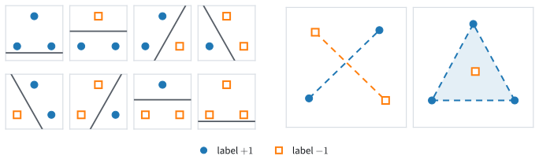

```{.python .input}
%load_ext d2lbook.tab
tab.interact_select('mxnet', 'pytorch', 'tensorflow', 'jax')
```

# Generalization in Classification

:label:`chap_classification_generalization`

Our softmax regression model in :numref:`sec_softmax_concise` classifies
roughly 83% of the 10,000 Fashion-MNIST validation images correctly. We
would naturally like to interpret that number as how accurately the model
will classify unseen garments in the wild, yet two obstacles stand in our
way. First, 10,000 images are only a finite sample: drawing another 10,000
from the exact same source would yield a slightly different accuracy.
Second, high accuracy on data seen during development proves very little on
its own. Whenever every input image is unique—as is true in almost every
high-dimensional dataset—a sufficiently expressive model can score 100% on
the training set simply by memorizing a lookup table of every training
image and its label. Memorization gives us no rule whatsoever for a brand-new
input, leaving such a model to guess at random.

Three urgent questions follow immediately:

1. How many test examples do we need to estimate a classifier's true
   population accuracy reliably?
1. What goes wrong when we evaluate model after model on the very same test
   set?
1. Why should fitting a linear classifier to training data generalize any
   better than simply memorizing it?

A brief note on terminology before we dive in. Those 10,000 images are
officially Fashion-MNIST's test split, and throughout this section we refer
to them as a *test set* to match the statistical theory. Strictly speaking,
because we looked at them while choosing our learning rate and epoch count,
that 83% is a *validation* score in the sense of
:numref:`sec_generalization_basics`. Answering our second question will
reveal what that shortcut costs, and exercise
:exref:`ex_generalization-classification-validation-split` shows how to
keep a true untouched test split.

Where :numref:`sec_generalization_basics` introduced overfitting,
validation sets, and test sets qualitatively for regression, this section
makes those ideas quantitative for classification. The first two questions
yield concrete formulas tied to the test set size and the number of times
we consult it. The third leads us into *statistical learning theory*, which
seeks *a priori* guarantees that bound the generalization gap before we
ever touch a test set, regardless of the underlying data distribution. As
we will see, those guarantees cleanly explain why linear models generalize
whereas memorizers cannot—yet for deep neural networks they become far too
loose to guide practice, which is why deep learning still relies heavily on
careful empirical test-set evaluation.

```{.python .input #generalization-classification-the-test-set-1}
%%tab pytorch
import math
import numpy as np
import torch
from torch import nn
from torch.nn import functional as F
from d2l import torch as d2l
```

```{.python .input #generalization-classification-the-test-set-1}
%%tab tensorflow
import math
import numpy as np
import tensorflow as tf
from d2l import tensorflow as d2l
```

```{.python .input #generalization-classification-the-test-set-1}
%%tab jax
import math
import numpy as np
import jax
from jax import numpy as jnp
from flax import nnx
import optax
from d2l import jax as d2l
```

```{.python .input #generalization-classification-the-test-set-1}
%%tab mxnet
import math
import numpy as np
from mxnet import autograd, gluon, init, np as mnp, npx
from mxnet.gluon import nn
from d2l import mxnet as d2l
npx.set_np()
```

## The Test Set

Since held-out test sets remain our gold standard for assessing
generalization, let us begin by asking how precisely a single test set of
size $n$ measures one fixed classifier.

### Empirical and Population Error

Fix a classifier $f$—without worrying for the moment about how it was
trained—and suppose we hold a *fresh* test set
$\mathcal{D} = \{(\mathbf{x}^{(i)}, y^{(i)})\}_{i=1}^n$ that played zero
role in producing $f$. The *empirical error* of $f$ on $\mathcal{D}$ is
the fraction of examples it misclassifies:

$$\epsilon_\mathcal{D}(f) = \frac{1}{n}\sum_{i=1}^n \mathbf{1}\left(f(\mathbf{x}^{(i)}) \neq y^{(i)}\right).$$

The *population error* is the true probability that $f$ misclassifies a new
example drawn from the underlying data-generating distribution $P(X, Y)$:

$$\epsilon(f) = \mathbb{E}_{(\mathbf{x}, y) \sim P}\left[\mathbf{1}\left(f(\mathbf{x}) \neq y\right)\right] = P\left(f(X) \neq Y\right).$$

Notice that these are simply the empirical risk and true risk of
:numref:`sec_generalization_basics` under the *0--1 loss* (1 for a mistake,
0 for a match). Just as we cannot know a nation's exact average height
without measuring every citizen, we can never observe $\epsilon(f)$
directly; we can only estimate it via $\epsilon_\mathcal{D}(f)$.

Because $f$ was fixed *before* the test examples were drawn independently
from $P$, each indicator $\mathbf{1}(f(\mathbf{x}^{(i)}) \neq y^{(i)})$
behaves like an independent coin toss—a Bernoulli random variable that
lands on 1 with probability $\epsilon(f)$ and 0 otherwise. Estimating
$\epsilon(f)$ from $\epsilon_\mathcal{D}(f)$ is therefore classic mean
estimation (:numref:`sec_prob`), giving us two immediate facts. First, the
test error is unbiased: $\mathbb{E}[\epsilon_\mathcal{D}(f)] = \epsilon(f)$.
Second, because a Bernoulli($\epsilon$) variable has variance
$\epsilon(1 - \epsilon)$, the average of $n$ independent draws has standard
error $\sqrt{\epsilon(f)(1 - \epsilon(f))/n}$.

Plug in realistic numbers: for a classifier with population error $0.15$
(roughly our Fashion-MNIST softmax regression) evaluated on $n = 10{,}000$
test images, the standard error is
$\sqrt{0.15 \cdot 0.85 / 10{,}000} \approx 0.0036$—about a third of a
percentage point. Since $\epsilon(1 - \epsilon)$ peaks at $1/4$ when
$\epsilon = 1/2$, the standard error is *always* at most $0.5/\sqrt{n}$, no
matter the classifier. That $1/\sqrt{n}$ rate is a hard statistical tax:
cutting your measurement uncertainty in half requires *four times* as many
test examples, and collecting more test data never improves the classifier
itself—it only narrows our uncertainty about how good it is.

### Confidence Intervals

A standard error tells us the typical size of fluctuations, but how often
does a fluctuation exceed a given threshold? By the *central limit theorem*
(:numref:`subsec_mdl-gaussian-clt`), for large $n$ the sample average
$\epsilon_\mathcal{D}(f)$ is approximately normally distributed around
$\epsilon(f)$ with standard deviation equal to its standard error. Since a
normal variable falls within $1.96$ standard deviations of its mean 95% of
the time, we obtain

$$P\left(|\epsilon_\mathcal{D}(f) - \epsilon(f)| \leq 1.96\sqrt{\frac{\epsilon(f)(1 - \epsilon(f))}{n}}\right) \approx 0.95.$$

Equivalently, the 95% *confidence interval* extending $1.96$ standard
errors on either side of $\epsilon_\mathcal{D}(f)$—whose half-width we call
its *radius*—captures the true population error for 95% of fresh test sets.
In practice we plug the observed $\epsilon_\mathcal{D}(f)$ in for the
unknown $\epsilon(f)$ inside the square root. For softmax regression on
Fashion-MNIST's 10,000 test images, the radius is
$1.96 \cdot 0.0036 \approx 0.007$, meaning we know its true accuracy to
within roughly $\pm 0.7$ percentage points.

How large a test set do we need to guarantee a 95% radius of at most $0.01$
in the worst case ($\epsilon = 1/2$)? Solving
$1.96 \cdot 0.5 / \sqrt{n} \leq 0.01$ yields $n \geq 9{,}604$. It is no
accident that so many iconic benchmarks—including MNIST, Fashion-MNIST, and
CIFAR-10—feature 10,000-image test sets: that pins a single model's
accuracy down to roughly $\pm 1$ percentage point. Keep that in mind the
next time you see a paper boasting about improving accuracy from 84.31% to
84.37% on a 10,000-example benchmark—those trailing decimal places are pure
sampling noise.

### Finite-Sample Guarantees

The central limit theorem is strictly asymptotic—useful for ballpark
sizing, yet not a guarantee you can take to court at finite $n$. In
particular, the normal approximation breaks down badly when a classifier
makes very few errors (say $\epsilon(f) = 0.001$ on $n = 1{,}000$ examples,
where we expect only a single mistake). Fortunately, because every 0--1
error indicator is bounded in $[0, 1]$, an inequality due to
:citet:`Hoeffding.1963` delivers an exact finite-sample guarantee that
holds for *every* $n$ and *every* data distribution:

$$
P\left(|\epsilon_\mathcal{D}(f) - \epsilon(f)| \geq t\right) \leq 2\exp\left(-2nt^2\right).
$$
:eqlabel:`eq_generalization-classification-hoeffding`

Thus the probability that the test error strays from the population error
by $t$ or more decays exponentially in $nt^2$ (proved in
:numref:`sec_mdl-concentration-generalization`). Setting the right-hand
side to $\delta = 0.05$ and solving for $t$ yields the 95% *Hoeffding
radius* $\sqrt{\log(2/\delta)/(2n)}$. Achieving a radius of $0.01$ now
calls for $n \geq \log(40)/(2 \cdot 0.01^2) \approx 18{,}445$ examples—roughly
18,500, or nearly twice the 9,604 prescribed by the normal approximation.
As is common in statistics, finite-sample guarantees pay for their
distribution-free rigor by being more conservative: Hoeffding uses only the
$[0, 1]$ range of each error term, ignoring its potentially much smaller
variance.

### Simulated Test Sets

How faithful are these two intervals in practice? Let us test both by
simulation on two classifiers: one with population error
$\epsilon(f) = 0.15$ (like our Fashion-MNIST linear model) and a much more
accurate one with $\epsilon(f) = 0.01$. Across a range of test sizes $n$,
we draw 10,000 independent test sets (sampling total error counts directly
from a binomial distribution), compute both the plug-in normal interval and
the Hoeffding interval on each draw, and measure their empirical
*coverage*—the fraction of intervals that actually contain the true
$\epsilon(f)$.

```{.python .input #generalization-classification-the-test-set-2}
rng = np.random.default_rng()
num_sets = 10000
ns = np.array([100, 200, 500, 1000, 2000, 5000, 10000])
curves, legend = [], []
for eps in [0.15, 0.01]:
    # The number of errors on a test set of size n is Binomial(n, eps)
    errs = [rng.binomial(n, eps, num_sets) / n for n in ns]
    normal = [1.96 * np.sqrt(e * (1 - e) / n) for e, n in zip(errs, ns)]
    hoeffding = [np.sqrt(np.log(2 / 0.05) / (2 * n)) for n in ns]
    for name, radii in [('normal', normal), ('Hoeffding', hoeffding)]:
        curves.append([np.mean(np.abs(e - eps) <= r)  # coverage
                       for e, r in zip(errs, radii)])
        legend.append(rf'{name}, $\epsilon = {eps}$')
d2l.plot(ns, curves + [[0.95] * len(ns)], 'test set size n', 'coverage',
         legend=legend + ['0.95'], xscale='log', ylim=(0.5, 1.02),
         fmts=('C0-', 'C0--', 'C1-', 'C1--', 'k:'), figsize=(4.5, 3))
```

At $\epsilon(f) = 0.15$, the plug-in normal interval captures the true
error on 93%–95% of test sets across every sample size—right on target. At
$\epsilon(f) = 0.01$, however, it stumbles badly for small $n$: with 100
test examples it achieves only ~63% coverage (because every zero-error test
set collapses the interval to $[0, 0]$), and it needs roughly 2,000
examples—about 20 expected errors—before climbing back to 95%. Hoeffding's
interval, by contrast, keeps its promise at every sample size and error
rate without requiring any asymptotic faith, paying for that insurance with
roughly double the width (at $\epsilon = 0.15$, the ratio of radii is
$1.94$ for all $n$).

## Test Set Reuse

Suppose you follow every rule above to the letter. You size a pristine test
set, tune all hyperparameters of your first model $f_1$ strictly on a
validation split, evaluate $f_1$ once on the test set, and report a valid
confidence interval. That very night, however, you wake up at 3 a.m. with a
brilliant new architecture $f_2$. The next morning you train $f_2$, tune it
on validation data, and prepare for final evaluation—only to realize a
sinking truth: *you no longer have a fresh test set*.

In real research, test sets get consulted over and over again—to compare
architectures, pick hyperparameters, and rank thousands of papers on public
leaderboards. Reusing a test set undermines our statistical guarantees in
two distinct ways: *selection bias* from picking the winner among many
candidates, and *adaptive overfitting* whenever past test scores steer our
next design choice.

### Selection Among Many Classifiers

First, suppose we evaluate $k$ classifiers $f_1, \ldots, f_k$ that were all
fixed *before* the test set was drawn, and report the winner with the
lowest test error. Individually, each estimate falls inside its 95%
Hoeffding radius with probability at least 0.95—leaving a 5% chance of a
fluke. Yet across $k$ candidates, the chance that *at least one* gets lucky
grows rapidly, and picking the lowest test error specifically cherry-picks
whichever classifier benefited most from random noise (a classic case of
multiple hypothesis testing).

To bound all $k$ estimates simultaneously, we apply the *union bound*: the
probability that at least one of several bad events happens is at most the
sum of their individual probabilities. Summing
:eqref:`eq_generalization-classification-hoeffding` across all $k$
classifiers gives

$$
P\left(\max_{j=1,\ldots,k} |\epsilon_\mathcal{D}(f_j) - \epsilon(f_j)| \geq t\right) \leq 2k\exp\left(-2nt^2\right).
$$
:eqlabel:`eq_generalization-classification-union`

Setting the right-hand side to $\delta$ guarantees that, with probability at
least $1 - \delta$, *all* $k$ test errors stay within
$\sqrt{\log(2k/\delta)/(2n)}$ of their true population errors
simultaneously. Happily, this penalty grows only logarithmically in $k$: on
$10{,}000$ test examples at $\delta = 0.05$, the radius widens gently from
$0.014$ for a single model to $0.023$ for a thousand models and $0.030$ for
a million.

To see pure selection bias in action, consider the starkest possible
experiment: a test set of $n = 1{,}000$ examples whose binary labels are
fair coin flips, scored by $k = 10{,}000$ utterly mindless classifiers that
ignore all inputs and flip their own coins. Every single classifier has
true population accuracy exactly 0.5, and no algorithm on earth can beat
0.5. Yet let us plot the *highest* test accuracy observed among the first
$k$ guessers alongside the theoretical reference curve
$0.5 + \sqrt{\log(k)/(2n)}$.

```{.python .input #generalization-classification-test-set-reuse-1}
n, k = 1000, 10000
labels = rng.random(n) < 0.5            # one test set with coin-flip labels
guesses = rng.random((k, n)) < 0.5      # k classifiers that guess at random
accuracy = (guesses == labels).mean(axis=1)
ks = np.arange(1, k + 1)
d2l.plot(ks, [np.maximum.accumulate(accuracy),
              0.5 + np.sqrt(np.log(ks) / (2 * n))],
         'number of classifiers k', 'best test accuracy',
         legend=['best of k', r'$0.5 + \sqrt{\log(k) / (2n)}$'], xscale='log',
         ylim=(0.4, 0.6))
```

Sure enough, by 10,000 random guessers the best test accuracy climbs to
roughly 0.56, hugging just below the theoretical curve (each one-sided tail
in :eqref:`eq_generalization-classification-hoeffding` is at most
$\exp(-2nt^2)$, so the union bound $k\exp(-2nt^2)$ hits 1 right along the
curve and plunges above it). Not a single classifier learned anything; that
six-point surge came purely from cherry-picking the luckiest coin flipper.
Whenever we select a winning model by comparing many candidates on the same
evaluation set, some fraction of its apparent lead is pure selection
artifact—and the union bound tells us how large that artifact can grow.

### Adaptive Overfitting

Even worse is what happens when our choice of candidate *depends* on
previous test scores. The union bound assumed all $k$ models were locked in
before anyone peeked at the test set. In practice, we inspect $f_1$'s test
score, tweak our ideas, build $f_2$, inspect its score, and repeat. Once
information from the test set leaks back into the modeling loop, the test
set is no longer independent of the models it scores, and optimism can blow
right past the $\sqrt{\log k / (2n)}$ selection rate. This phenomenon is
called *adaptive overfitting* :cite:`Dwork.Feldman.Hardt.ea.2015`.

A deviously simple construction demonstrates how dramatic this leakage can
be using *only* scalar test accuracies :cite:`Blum.Hardt.2015`. Take just
the first 1,000 random guessers from above, filter to those that happened
to score above 0.5 on the test set, and form a new classifier that predicts
their majority vote on each test example. On any *fresh* example, those
kept guessers are still just independent coin flips, so their majority vote
still has true population accuracy 0.5. Watch what happens on the test set:

```{.python .input #generalization-classification-adaptive-overfitting}
kept = guesses[:1000][accuracy[:1000] > 0.5]  # guessers that scored above 0.5
vote = kept.mean(axis=0) > 0.5                # their majority vote
print(f'majority vote: {(vote == labels).mean():.3f}, '
      f'best single guesser: {accuracy[:1000].max():.3f}')
```

The majority vote skyrockets to roughly 0.70 on the test set—trouncing both
the luckiest single guesser among the 1,000 (0.54–0.57) and the luckiest
among all 10,000 (~0.56)—without ever seeing a single test label! Every
scalar test score leaked a tiny bit of information about which random
vectors aligned with the hidden labels, and majority voting aggregated
those leaks across a thousand queries. Exercise
:exref:`ex_generalization-classification-leaking-test-set` pushes this
attack to its logical extreme: roughly $n$ well-chosen accuracy queries
suffice to reconstruct *every single label* in the test set.

The practical safeguard is the strict division of labor from
:numref:`sec_generalization_basics`: absorb all architecture exploration
and hyperparameter tuning on a validation set, consult the test set once at
the very end, and—in recurring benchmark competitions—periodically retire
old test sets into validation sets and introduce fresh ones. Public
benchmarks inevitably get reused anyway, yet encouragingly the worst case
is rarer on large benchmarks than theory fears. When
:citet:`Recht.Roelofs.Schmidt.ea.2019` collected brand-new test sets for
CIFAR-10 and ImageNet following the original protocols, accuracies did fall
by 3 to 15 percentage points, yet model rankings remained remarkably intact,
and subtle distribution shifts between old and new images explained the
drops far better than years of leaderboard reuse. Still, when stakes are
high or test sets are small, adaptive overfitting is a very real hazard.

## Statistical Learning Theory

Held-out test sets are the bedrock of empirical machine learning, yet
relying on them exclusively feels strangely incomplete. Unless you curated
the dataset yourself, someone has probably already peeked at the test set,
and even a pristine test set only certifies generalization *post hoc*—it
cannot explain *why* fitting a model to training data should generalize in
the first place, nor tell us *a priori* how much training data a model
class needs. *Statistical learning theory* tackles those questions directly
by analyzing the training error itself. Because training explicitly picks
whichever classifier minimizes training error, the learner acts like a
modeler who evaluated every candidate in the entire model class on the
training set and kept the best—selection bias pushed to the limit.

A fair warning: this final part of the section is more abstract than the
rest of the chapter, and we state its main theorem without proof. Feel free
to skim it on a first pass and return when you want the deeper theory.

### Uniform Convergence

Let $\mathcal{F}$ denote the *hypothesis class*—the family of classifiers
available to our learner. To state the theory cleanly, consider binary
classifiers with labels in $\{-1, +1\}$; for linear classification,
$\mathcal{F}$ consists of all halfspaces
$f(\mathbf{x}) = \operatorname{sign}(\mathbf{w}^\top \mathbf{x} + b)$.
Write $\mathcal{S}$ for a training set of $n$ examples,
$\epsilon_\mathcal{S}(f)$ for the empirical error of $f$ on $\mathcal{S}$,
and $f_\mathcal{S} \in \mathcal{F}$ for the classifier our learner selects.

Begin with the warm-up case where $\mathcal{F}$ is *finite*. Because the
class $\mathcal{F}$ itself—unlike the learned model $f_\mathcal{S}$—was
fixed before $\mathcal{S}$ was drawn, the union bound
:eqref:`eq_generalization-classification-union` applies directly with
$k = |\mathcal{F}|$ and $\mathcal{S}$ in place of $\mathcal{D}$. With
probability at least $1 - \delta$ over the random draw of $\mathcal{S}$,

$$
|\epsilon_\mathcal{S}(f) - \epsilon(f)| \leq \sqrt{\frac{\log(2|\mathcal{F}|/\delta)}{2n}} \quad \textrm{for every } f \in \mathcal{F}.
$$
:eqlabel:`eq_generalization-classification-finite`

Because this bound holds *simultaneously* for every $f \in \mathcal{F}$, it
automatically holds for whichever $f_\mathcal{S}$ the learning algorithm
chooses! That simultaneous guarantee—called *uniform convergence*—ensures
that training error tracks population error reliably as soon as $n$ dwarfs
$\log|\mathcal{F}|$.

Unfortunately, linear classifiers have continuous real-valued parameters,
making $|\mathcal{F}| = \infty$ and turning
:eqref:`eq_generalization-classification-finite` vacuous. Could a cleverer
proof eliminate the size of $\mathcal{F}$ altogether? No: a memorizer
attains zero training error on every dataset while still suffering
population error $1/2$ on random coin-flip labels, no matter how huge $n$
grows. What separates a well-behaved infinite class like linear halfspaces
from an unconstrained memorizer is not the number of functions it contains,
but how many distinct *labelings* those functions can induce on $n$ data
points.

### The VC Dimension

Any two classifiers that assign the exact same labels to our $n$ training
points share the exact same training error; as far as $\mathcal{S}$ is
concerned, they are indistinguishable. Moreover, on $n$ points, *any*
binary hypothesis class can realize at most $2^n$ distinct labelings, no
matter how uncountably many functions it holds. We say that $\mathcal{F}$
*shatters* a set of $n$ points if it can realize all $2^n$ possible
$\pm 1$ labelings of them. The *Vapnik--Chervonenkis (VC) dimension* of
$\mathcal{F}$ is the size of the largest set of points that $\mathcal{F}$
can shatter :cite:`Vapnik.Chervonenkis.1971`. It captures a model class's
effective flexibility: a lookup-table memorizer shatters every finite set
of distinct points and therefore has infinite VC dimension.

Let us check the VC dimension of lines in the 2D plane
(:numref:`fig_mdl-clf-shattering`). Three non-collinear points can be
shattered: all $2^3 = 8$ labelings are separable by a straight line. Four
points, however, can *never* be shattered regardless of arrangement, because
a halfplane is convex—any halfplane containing a set of points must also
contain the line segments and triangles they span. If the four points form
a convex quadrilateral, no line can separate opposite corners (their
diagonals cross); if one point sits inside the triangle of the other three,
no line can isolate it from the three vertices; and if three lie on a line,
no line can isolate the middle one. Lines in the plane therefore have VC
dimension 3.


:label:`fig_mdl-clf-shattering`

The same geometry extends cleanly to any dimension $d$: linear classifiers
$\operatorname{sign}(\mathbf{w}^\top \mathbf{x} + b)$ on $\mathbb{R}^d$
have VC dimension $d + 1$. Shattering $d + 1$ points is easy to verify on
the origin $\mathbf{0}$ and the standard basis vectors
$\mathbf{e}_1, \ldots, \mathbf{e}_d$: the bias $b$ sets the label of
$\mathbf{0}$, and each weight $w_i$ independently sets the label of
$\mathbf{e}_i$. Proving that no $d + 2$ points can be shattered is a nice
exercise in linear dependence (Exercise
:exref:`ex_generalization-classification-linear-vc`). Notice that for
linear models, VC dimension happens to equal the number of parameters—but
beware treating that as a universal rule: the one-parameter sine family
$\operatorname{sign}(\sin(\omega x))$ on $\mathbb{R}$ has *infinite* VC
dimension!

### The VC Bound

Why does a finite VC dimension matter so much? Because it forces a sudden
phase transition in how fast the number of realizable labelings grows with
$n$. For points in general position in the plane, lines achieve all 8
labelings of 3 points, 14 of 16 for 4 points, and in general only
$n^2 - n + 2$ of the $2^n$ labelings of $n$ points—just 92 out of 1,024 at
$n = 10$, and fewer than $10^4$ out of roughly $10^{30}$ at $n = 100$. Past
the VC dimension, the labeling count shifts from exponential to polynomial.
*Sauer's lemma* makes this universal: any class of VC dimension $v$ induces
at most $(en/v)^v$ distinct labelings on any $n \geq v$ points.

In a landmark breakthrough, :citet:`Vapnik.Chervonenkis.1971` showed how to
run a union bound over those finitely many labelings instead of the
infinitely many classifiers (proved in
:numref:`sec_mdl-generalization-bounds`). Effectively replacing
$\log|\mathcal{F}|$ in :eqref:`eq_generalization-classification-finite`
with $v \log(en/v)$—and sharpening the argument to eliminate the extra
logarithmic factor—yields the famous *VC bound*: there exists a universal
constant $c$ (independent of both the class and the data distribution) such
that with probability at least $1 - \delta$ over the training draw,

$$
\epsilon(f) \leq \epsilon_\mathcal{S}(f) + c\sqrt{\frac{v + \log(1/\delta)}{n}} \quad \textrm{for every } f \in \mathcal{F}.
$$
:eqlabel:`eq_generalization-classification-vc`

Every classifier in $\mathcal{F}$—including the trained model $f_\mathcal{S}$—has
its population error tethered to its training error up to a gap shrinking
as $\sqrt{v/n}$: the familiar $1/\sqrt{n}$ rate, scaled solely by the VC
dimension.

Here, at last, is the answer to our third question. Because linear
classifiers in $\mathbb{R}^d$ have VC dimension $d + 1$, once $n \gg d$ a
low training error genuinely certifies a low population error for *any*
data distribution. A memorizer, by contrast, has infinite VC dimension, so
no such guarantee can exist.

Still, how tight is this bound numerically? Quite loose, as it turns out.
Consider a binary Fashion-MNIST task (say, distinguishing shirts from
everything else) with $d = 784$ pixels and $n = 60{,}000$ training images:
even before multiplying by $c$, the square-root term is
$\sqrt{785/60{,}000} \approx 0.11$, and moving to ten classes widens it
further. Contrast that with reality: in :numref:`sec_softmax_scratch`, our
ten-class linear model hit ~84% on training data and ~83% on test data—a
gap of just one or two percentage points, whereas the worst-case bound
leaves room for $0.11c$. Because the VC bound must hold simultaneously for
the most adversarial distribution imaginable, it vastly overstates the gap
on natural images, whereas a 10,000-image test set pins the error down to
$\pm 0.01$. Think of worst-case bounds as qualitative compasses: they tell
us *which* quantities control generalization ($v$ and $n$), not the exact
numerical gap on real data.

### Limits of Worst-Case Bounds

Once we step up to deep neural networks, classical VC bounds go from loose
to completely vacuous. Modern networks with millions of parameters can
easily memorize completely random labels on their entire training set
:cite:`zhang2021understanding`, proving that their VC dimension is at least
$n$. Yet trained on real labels, those very same networks generalize
remarkably well—and frequently generalize *better* as they grow larger and
deeper! Explaining why requires moving beyond class-only worst-case bounds
toward data- and algorithm-dependent complexity measures (such as the
Rademacher complexity developed alongside our proof of the finite-class
bound in :numref:`sec_mdl-generalization-bounds`). None of these theories
yet delivers sharp practical numbers for deep networks; we revisit the
puzzle of deep learning generalization in :numref:`sec_generalization_deep`.

## Summary

A fresh test set of size $n$ provides an unbiased estimate of a fixed
classifier's population error with standard error at most $0.5/\sqrt{n}$:
pinning accuracy within $\pm 1$ percentage point at 95% confidence takes
roughly 10,000 examples under the central limit theorem (or ~18,500 under
Hoeffding's exact finite-sample inequality, which stays valid even at tiny
error rates). Reusing the same test set erodes those guarantees: picking
the best of $k$ fixed models inflates scores by up to
$\sqrt{\log(k)/(2n)}$, and adaptive decisions informed by past test scores
can leak the test set far more severely, underscoring why model selection
belongs on a validation split. Statistical learning theory extends uniform
convergence to infinite model classes via the *VC dimension*—the largest
number of points a class can shatter. Binary linear classifiers in
$\mathbb{R}^d$ have VC dimension $d + 1$, guaranteeing a generalization gap
scaling as $\sqrt{d/n}$ (unlike unconstrained memorizers). Because such
worst-case bounds become vacuous for overparameterized deep networks,
empirical held-out evaluation remains indispensable.

## Exercises

1. **Two models, one test set.** A paper reports that model A reaches
   91.2% and model B 91.6% on a test set of 10,000 images.
    1. Compute the standard error of each accuracy and the 95% radius of
       the normal approximation. Is the difference of 0.4 points
       meaningful if the two models were evaluated on two independent test
       sets of this size?
    1. Both models were in fact evaluated on the same 10,000 images.
       Explain why the question is now about the images on which the two
       models disagree, and describe how you would decide it if the paper
       reported, for every test image, which models got it right.
    1. How large a test set would make a 0.4-point difference between two
       independently evaluated models lie outside the radius?

1. **Two confidence radii.** Two radii $r$ are meant to make the interval
   $\epsilon_\mathcal{D}(f) \pm r$ contain the population error $\epsilon$
   of a classifier with probability 95%: the radius of the normal
   approximation $1.96\sqrt{\epsilon(1-\epsilon)/n}$ and the Hoeffding radius
   $\sqrt{\log(2/0.05)/(2n)}$.
    1. The standard error $\sqrt{\epsilon(1-\epsilon)/n}$ of
       $\epsilon_\mathcal{D}(f)$ is exact for every $n$. Which ingredient of
       the first interval is then only an asymptotic approximation?
    1. Show that the ratio of the Hoeffding radius to the first radius does
       not depend on $n$, and compute it as a function of $\epsilon$. For
       which $\epsilon$ is Hoeffding's bound least conservative, and by how
       much does it then exceed the first radius?

1. **No errors on the test set.** A classifier makes no error on a test
   set of $n$ examples.
    1. State the interval that the normal approximation, with
       $\epsilon_\mathcal{D}(f)$ in place of $\epsilon(f)$, reports, and
       the Hoeffding interval.
    1. Show that a classifier with population error $\epsilon$ makes no
       error on $n$ independent test examples with probability
       $(1 - \epsilon)^n \leq e^{-n\epsilon}$. Conclude that if
       $\epsilon \geq 3/n$, a test set without errors occurs with
       probability below 0.05 (the "rule of three").
    1. Compare $3/n$ with the Hoeffding radius for $n = 100$ and
       $n = 10{,}000$, and explain the difference.

1. **Leaking a test set.** Somebody else holds a test set $\mathcal{D}$ of
   $n$ examples with binary labels and releases only the inputs. You may
   submit any model $f$, with no restriction on the model class, and you
   receive only its test error $\epsilon_\mathcal{D}(f)$.
    1. Give a strategy that recovers every test label, and hence a model
       with test error $0$ whatever its population error, and count the
       submissions it uses.
    1. Each answer $\epsilon_\mathcal{D}(f)$ takes one of $n+1$ values.
       Use this to lower-bound the number of submissions that any
       strategy needs to distinguish all $2^n$ labelings.
   :exlabel:`ex_generalization-classification-leaking-test-set`

1. [code] **A validation split for Fashion-MNIST.** The chapter selected
   models on the 10,000 test images. Hold out 10,000 of the 60,000 training
   images as a validation split instead, and train softmax regression on
   the remaining 50,000.
    1. Choose the learning rate from $\{0.01, 0.03, 0.1, 0.3, 1\}$ by its
       accuracy on the validation split.
    1. Evaluate the selected model once on the test images, and compare its
       test accuracy with its validation accuracy. Is the difference within
       the radius of the 95% interval for 10,000 examples?
    1. Explain why the test accuracy, measured once after the choice, is an
       unbiased estimate for the selected model, while the best validation
       accuracy is not.
   :exlabel:`ex_generalization-classification-validation-split`

1. **VC dimension of linear classifiers.** ● Consider the linear classifiers
   $f(\mathbf{x}) = \operatorname{sign}(\mathbf{w}^\top \mathbf{x} + b)$ on
   $\mathbb{R}^d$.
    1. Show that they shatter the $d+1$ points
       $\mathbf{0}, \mathbf{e}_1, \ldots, \mathbf{e}_d$. Given arbitrary
       labels $y_0, y_1, \ldots, y_d \in \{\pm 1\}$, construct $b$ and
       $\mathbf{w}$ that produce them. Hint: $f(\mathbf{0})$ depends on $b$
       alone, so choose $b$ first.
    1. Let $\mathbf{x}_1, \ldots, \mathbf{x}_{d+2} \in \mathbb{R}^d$. Show
       that the $d + 2$ vectors $[\mathbf{x}_i, 1] \in \mathbb{R}^{d+1}$,
       each $\mathbf{x}_i$ with a 1 appended, are linearly dependent, so that
       $\sum_i a_i [\mathbf{x}_i, 1] = \mathbf{0}$ for some $a_i$ that are
       not all zero. Let $I$ be the indices with
       $a_i > 0$ and $J$ those with $a_i < 0$. Show that neither is empty and
       that no linear classifier labels the points in $I$ with $+1$ and those
       in $J$ with $-1$. Hint: evaluate
       $\sum_i a_i (\mathbf{w}^\top \mathbf{x}_i + b)$ in two ways.
    1. Conclude that the VC dimension is $d + 1$, and show that the convex
       hulls of $\{\mathbf{x}_i : i \in I\}$ and
       $\{\mathbf{x}_j : j \in J\}$ intersect.
   :exlabel:`ex_generalization-classification-linear-vc`

1. **Collinear points.** In :numref:`fig_mdl-clf-shattering` the three
   shattered points do not lie on a line. Show that three points on a line
   cannot be shattered by halfplanes: which labeling is impossible? Explain
   why this does not contradict the VC dimension of lines in the plane
   being $3$.

1. **VC dimension of polynomials.** What is the VC dimension of the class
   of classifiers $f(x) = \operatorname{sign}(p(x))$ with $p$ a polynomial
   of degree at most five in $x \in \mathbb{R}$? What is it for
   $\mathbf{x} \in \mathbb{R}^d$? Hint: such a classifier is a linear
   classifier on the monomials of $\mathbf{x}$. Then say what the VC
   bound predicts for the training error of a degree-five polynomial
   classifier on Fashion-MNIST, and why nobody trains one.

[Discussions](https://d2l.discourse.group/t/6829)

<!-- slides -->

::: {.slide}
::: {.cover}
[Dive into Deep Learning · §3.6]{.kicker}

Error bars for test scores, guarantees for model classes<br>
**test-set size · test-set reuse · uniform convergence · the VC dimension**
:::
:::

::: {.slide title="A Test Score Is a Sample, and a Training Score Can Be Memorized"}
[The problem]{.kicker}

- Softmax regression labels **about 83%** of the 10,000 Fashion-MNIST
  test images correctly. Another 10,000 images would give a different number.
- A lookup table of the 60,000 training labels scores **100%** on the
  training set and guesses on every new image.

::: {.d2l-note}
1. How many test examples give a trustworthy accuracy?
2. What happens if we evaluate on the same test set again and again?
3. Why should a fitted linear model beat memorization?
:::
:::

::: {.slide title="By the End of This Deck You Can"}
[Goals]{.kicker}

- attach a standard error and a 95% radius to a test error;
- size a test set with the normal approximation and with Hoeffding's bound;
- estimate how much selection and adaptive reuse inflate a test score;
- define shattering and the VC dimension, and show that lines in the plane
  have VC dimension 3;
- read the VC bound, and say why it is vacuous for deep networks.

**Running example:** a classifier with error $0.15$, roughly softmax
regression on Fashion-MNIST, and its 10,000 test images.
:::

::: {.slide title="Error Bars and Guarantees Complete the Classification Pipeline"}
[Where this fits]{.kicker}

::: {.cols .vc}
::: {.col}
| section | adds |
|---|---|
| Softmax Regression | probabilities over classes, cross-entropy |
| Image Classification Data | Fashion-MNIST in minibatches |
| Softmax Regression from Scratch | softmax regression by hand, the `Classifier` class |
| Concise Implementation | framework layers, a stable loss |
| Measuring Classifiers | precision, recall, costs, calibration |
| **Generalization in Classification** | **error bars, test-set reuse, VC dimension** |
| Environment and Distribution Shift | correcting for shifted data |
:::

::: {.col .narrow}
- **Uses:** the standard error of an average, its standard deviation over
  $\sqrt{n}$; training vs. test error; validation sets.
- **Skips:** proofs of Hoeffding's inequality and the VC bound (mathematics
  appendix); why deep networks generalize (next chapter).
:::
:::
:::

::: {.slide}
::: {.divider}
[01]{.dnum}

[The Test Set]{.dtitle}

[how precisely a test set measures one classifier]{.dsub}
:::
:::

::: {.slide title="The Test Error Is the Frequency of Heads of a Biased Coin"}
[The test set]{.kicker}

For a classifier $f$ fixed **before** the test set $\mathcal{D}$ of $n$
examples is drawn:

$$\epsilon_\mathcal{D}(f) = \frac{1}{n}\sum_{i=1}^n \mathbf{1}\left(f(\mathbf{x}^{(i)}) \neq y^{(i)}\right)
\qquad
\epsilon(f) = P\left(f(X) \neq Y\right)$$

- Each term is 1 with probability $\epsilon(f)$: unbiased, with standard
  error $\sqrt{\epsilon(1-\epsilon)/n} \le 0.5/\sqrt{n}$.
- $\epsilon = 0.15$, $n = 10{,}000$: standard error $\approx 0.0036$.

::: {.d2l-note}
Half the error bar takes **four times** the test data.
:::
:::

::: {.slide title="The Central Limit Theorem Turns a Standard Error into a 95% Interval"}
[The test set · confidence]{.kicker}

For large $n$, $\epsilon_\mathcal{D}(f)$ is approximately normal, and a
normal variable lies within 1.96 standard deviations of its mean 95% of the
time:

$$P\left(|\epsilon_\mathcal{D}(f) - \epsilon(f)| \le 1.96\sqrt{\epsilon(1-\epsilon)/n}\right) \approx 0.95$$

- Running example: radius $1.96 \cdot 0.0036 \approx 0.007$.
- Worst case $\epsilon = \tfrac12$: radius $0.01$ needs
  $n \ge (1.96 \cdot 0.5/0.01)^2 = 9{,}604$.

::: {.d2l-note}
A 10,000-image test set knows one model's accuracy to about **±1 point**.
:::
:::

::: {.slide title="Hoeffding Certifies ±1% at 95% with 18,445 Examples"}
[The test set · finite samples]{.kicker}

Each term lies in $[0, 1]$, so at **every** $n$ and for every distribution,
a deviation of $t$ or more has probability

$$P\left(|\epsilon_\mathcal{D}(f) - \epsilon(f)| \ge t\right) \le 2\exp\left(-2nt^2\right).$$

- Set the right side to $\delta = 0.05$: radius $\sqrt{\log(2/\delta)/(2n)}$.
- $t = 0.01$: $n \ge \log 40/(2 \cdot 0.01^2) \approx 18{,}445$, about
  twice the 9,604 of the normal approximation.

::: {.d2l-note}
Hoeffding uses only the **range** of each term, not its variance.
:::
:::

::: {.slide title="At Small Error Rates the Normal Interval Undercovers; Hoeffding Holds"}
[The test set · simulation]{.kicker}

::: {.cols .vc}
::: {.col .narrow}
10,000 simulated test sets per size $n$, true error $0.15$ or $0.01$.
Plotted: the fraction of test sets whose 95% interval contains the true
error.

::: {.d2l-note}
The normal interval, with the measured error plugged in, falls short when
few errors are expected. Hoeffding's interval covers at every $n$, at about
twice the width.
:::
:::

::: {.col .fig .big}
@!generalization-classification-the-test-set-2
:::
:::
:::

::: {.slide title="Check: How Many Test Examples for ±0.5% at 95%?"}
[Check]{.kicker}

Worst case $\epsilon = \tfrac12$. Compute $n$ with the normal approximation
and with Hoeffding's inequality.

::: {.fragment .fade-up}
::: {.d2l-note}
**Answer.** Normal: $(1.96 \cdot 0.5/0.005)^2 = 38{,}416$.
Hoeffding: $\log 40/(2 \cdot 0.005^2) \approx 73{,}778$. Halving the radius
multiplies both by four.
:::
:::
:::

::: {.slide}
::: {.divider}
[02]{.dnum}

[Test Set Reuse]{.dtitle}

[selection and adaptive overfitting]{.dsub}
:::
:::

::: {.slide title="The Union Bound Widens the Radius for k Classifiers by Only √log k"}
[Test set reuse · selection]{.kicker}

$k$ classifiers fixed in advance, one test set. $P(\text{any of } k \text{ events}) \le$ the sum of their probabilities:

$$P\left(\max_j |\epsilon_\mathcal{D}(f_j) - \epsilon(f_j)| \ge t\right) \le 2k\exp\left(-2nt^2\right)$$

All $k$ within $\sqrt{\log(2k/\delta)/(2n)}$ at once. With $n = 10{,}000$,
$\delta = 0.05$:

| $k$ | 1 | 1,000 | 1,000,000 |
|---|---|---|---|
| radius | 0.014 | 0.023 | 0.030 |
:::

::: {.slide title="Selection Alone Lifts Coin-Flip Classifiers to About 0.56"}
[Test set reuse · selection]{.kicker}

::: {.cols .vc}
::: {.col .narrow}
1,000 coin-flip labels; 10,000 classifiers that guess at random (true
accuracy 0.5). Best test accuracy among the first $k$:

::: {.d2l-note .warn}
About **0.56** after 10,000 guessers, tracking
$0.5 + \sqrt{\log(k)/(2n)}$. Nothing was learned.
:::
:::

::: {.col .fig .big}
@!generalization-classification-test-set-reuse-1
:::
:::
:::

::: {.slide title="A Majority Vote of Lucky Guessers Scores About 0.7"}
[Test set reuse · adaptive overfitting]{.kicker}

Keep the guessers among the first 1,000 that scored above 0.5; predict their
majority vote. On new data the vote is still a coin flip.

@!generalization-classification-adaptive-overfitting

::: {.d2l-note .warn}
Using earlier scores to build the next model inflates the score far more
than selection: **about 0.7** from 1,000 scores, vs. 0.54 to 0.57 for the best
single guesser. This is **adaptive overfitting**.
:::
:::

::: {.slide title="Validation Sets Absorb Selection; the Test Set Is Consulted Once"}
[Test set reuse · in practice]{.kicker}

- **Training set** fits, **validation set** selects and tunes, **test set**
  reports, once.
- New test sets for CIFAR-10 and ImageNet (Recht et al., 2019): accuracy
  drops 3 to 15 points, ranking kept; slightly different images, not reuse,
  explain the drops.

::: {.d2l-note}
The worst case is real for **small** test sets queried **often**, such as
public competition leaderboards.
:::
:::

::: {.slide title="Check: How Wide Is the Interval for 100 Models?"}
[Check]{.kicker}

You compare 100 classifiers, fixed in advance, on 10,000 test examples. How
wide must the radius be so that all 100 are within it with probability 95%?

::: {.fragment .fade-up}
::: {.d2l-note}
**Answer.** $\sqrt{\log(2 \cdot 100/0.05)/(2 \cdot 10{,}000)} =
\sqrt{\log 4000/20{,}000} \approx 0.020$, against $0.014$ for one
classifier.
:::
:::
:::

::: {.slide}
::: {.divider}
[03]{.dnum}

[Statistical Learning Theory]{.dtitle}

[guarantees from the model class alone]{.dsub}
:::
:::

::: {.slide title="Training Is Test-Set Reuse Taken to the Extreme"}
[Learning theory · uniform convergence]{.kicker}

The learner picks $f_\mathcal{S}$ from a **hypothesis class** $\mathcal{F}$
to make the training error $\epsilon_\mathcal{S}$ small. For finite
$\mathcal{F}$, the union bound with $k = |\mathcal{F}|$ gives, with
probability $\ge 1 - \delta$,

$$|\epsilon_\mathcal{S}(f) - \epsilon(f)| \le \sqrt{\frac{\log(2|\mathcal{F}|/\delta)}{2n}} \quad \text{for every } f \in \mathcal{F}.$$

::: {.d2l-note}
**Uniform convergence:** it holds for $f_\mathcal{S}$, whichever one the
learner picks.
:::
:::

::: {.slide title="Memorizers and Infinite Classes Break the Finite-Class Bound"}
[Learning theory · uniform convergence]{.kicker}

::: {.cols}
::: {.col}
::: {.d2l-note .warn}
**Memorizer:** training error 0 on every training set; on coin-flip labels
population error $\tfrac12$. No gap bound can shrink with $n$.
:::
:::

::: {.col}
::: {.d2l-note}
**Linear classifiers:** real-valued $\mathbf{w}, b$, so
$|\mathcal{F}| = \infty$. Yet on $n$ points they produce at most $2^n$
labelings. **Count labelings, not classifiers.**
:::
:::
:::
:::

::: {.slide title="Lines in the Plane Shatter Three Points but No Four"}
[Learning theory · VC dimension]{.kicker}

**Shatter:** produce all $2^n$ labelings of the points. **VC dimension:**
the size of the largest shattered set. Dots $+1$, squares $-1$.

{width=90%}

Convex quadrilateral: the diagonals cross. Point inside a triangle: every
line keeps it with the corners.
:::

::: {.slide title="Linear Classifiers in d Dimensions Have VC Dimension d + 1"}
[Learning theory · VC dimension]{.kicker}

$f(\mathbf{x}) = \operatorname{sign}(\mathbf{w}^\top\mathbf{x} + b)$:

- **≥ d + 1:** shatter $\mathbf{0}, \mathbf{e}_1, \ldots, \mathbf{e}_d$;
  $b$ sets the label of $\mathbf{0}$, then $w_i$ the label of
  $\mathbf{e}_i$.
- **≤ d + 1:** any $d + 2$ points split into two groups whose convex hulls
  intersect; no hyperplane separates them.
- A memorizer: VC dimension $\infty$.

::: {.d2l-note}
Not a parameter count: $\operatorname{sign}(\sin(\omega x))$ has one
parameter and VC dimension $\infty$.
:::
:::

::: {.slide title="Beyond the VC Dimension, Labelings Grow Polynomially"}
[Learning theory · counting]{.kicker}

Lines in the plane on $n$ points, no three on a line: $n^2 - n + 2$ of the
$2^n$ labelings.

| $n$ | 3 | 4 | 10 | 100 |
|---|---|---|---|---|
| lines | 8 | 14 | 92 | 9,902 |
| all labelings | 8 | 16 | 1,024 | $\approx 1.3 \times 10^{30}$ |

::: {.d2l-note}
**Sauer's lemma:** VC dimension $v$ $\Rightarrow$ at most $(en/v)^v$
labelings of $n \ge v$ points.
:::
:::

::: {.slide title="The VC Bound Replaces log|F| by the VC Dimension"}
[Learning theory · the bound]{.kicker}

Union bound over labelings, plus a finer analysis: with probability
$\ge 1 - \delta$, for **every** $f \in \mathcal{F}$,

$$\epsilon(f) \le \epsilon_\mathcal{S}(f) + c\sqrt{\frac{v + \log(1/\delta)}{n}},$$

with $c$ the same for every class and distribution.

::: {.d2l-note}
Linear classifiers, $v = d + 1$: for $n \gg d$, training error $\approx$
population error, whatever the data. A memorizer gets no guarantee.
:::
:::

::: {.slide title="Even for a Linear Model the Bound Is Loose"}
[Learning theory · the bound]{.kicker}

Shirts against everything else (a binary problem): $d = 784$ pixels,
$n = 60{,}000$ training images.

$$\sqrt{\frac{785}{60{,}000}} \approx 0.11 \quad \text{before the constant } c$$

- Observed for softmax regression: about 84% on training images, about
  83% on test images, a gap of **one or two points**.
- The bound covers the **worst** distribution; real data are rarely that
  adversarial. A 10,000-image test set pins the error down to about
  $\pm 0.01$.
:::

::: {.slide title="For Deep Networks the VC Bound Is Vacuous"}
[Learning theory · limits]{.kicker}

- Deep networks fit even **random labels** on their whole training set
  (Zhang et al.): VC dimension $\ge n$.
- On real labels they generalize well, often better when larger.
- Bounds that use the data and the algorithm (e.g., Rademacher complexity)
  are research in progress.

::: {.d2l-note}
Deep learning certifies generalization **after** training, with held-out
data.
:::
:::

::: {.slide title="Check: VC Dimension of Quadratic Classifiers in the Plane"}
[Check]{.kicker}

$f(\mathbf{x}) = \operatorname{sign}(p(\mathbf{x}))$ with $p$ a polynomial of
degree at most 2 in $\mathbf{x} \in \mathbb{R}^2$. What is the VC dimension?

::: {.fragment .fade-up}
::: {.d2l-note}
**Answer.** 6. The classifier is linear in the five features
$x_1, x_2, x_1^2, x_1x_2, x_2^2$ plus a bias, so $v = 5 + 1$.
:::
:::
:::

::: {.slide title="Recap"}
[Wrap-up]{.kicker}

::: {.cols}
::: {.col}
- **Test error** of a fixed $f$: unbiased, standard error
  $\le 0.5/\sqrt{n}$. ±0.01 at 95%: about **10,000** examples (normal),
  **18,445** (Hoeffding).
- **Selection** among $k$ fixed models: radius grows like
  $\sqrt{\log k}$. **Adaptive** reuse: much faster (0.5 → 0.7). Select on
  validation data.
:::

::: {.col}
- **Uniform convergence** extends the union bound to a class.
- **VC dimension** = largest shattered set; linear classifiers on
  $\mathbb{R}^d$: $d + 1$. Gap $\lesssim c\sqrt{(v + \log(1/\delta))/n}$.
- **Deep networks:** vacuous bounds; held-out data certify them.
:::
:::

**Next:** what happens when the test data come from a different
distribution than the training data.
:::
