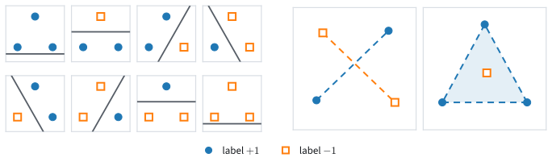

```{.python .input  n=1}
%load_ext d2lbook.tab
tab.interact_select('mxnet', 'pytorch', 'tensorflow', 'jax')
```

# Softmax Regression Implementation from Scratch
:label:`sec_softmax_scratch`

Softmax regression differs from the linear regression of
:numref:`sec_linear_scratch` in three places. The model computes one output
per class instead of a single number, the softmax turns these outputs, the
logits, into probabilities, and the loss is the cross-entropy instead of the
squared error. Everything else carries over. The `Trainer` runs the same
training loop, the default optimizer of `Module` performs the same minibatch
SGD update, the `FashionMNIST` class of :numref:`sec_fashion_mnist` delivers
the images in minibatches, and the `Classifier` class of
:numref:`sec_classification` reports the loss and the accuracy on validation
data. We therefore write only the three new pieces ourselves, with tensors and
automatic differentiation, and train the model on Fashion-MNIST.

Writing the softmax directly from its formula exposes a numerical trap. In
single precision, $\exp(o)$ overflows to infinity once $o$ exceeds about 88,
and the softmax of the logits $(1000, 0, 0)$ comes out as `NaN` instead of
$(1, 0, 0)$. We show this failure and its remedy, and keep the direct formula
in our model, whose logits stay far below that range. The next section builds
a loss that avoids the problem altogether. Once the model is trained, we look
at what it gets wrong: its accuracy on the validation images, some of its
mistakes, and the confusion matrix, which shows which garments it takes for
which.

```{.python .input #softmax-regression-scratch-softmax-regression-implementation-from-scratch}
%%tab mxnet
from d2l import mxnet as d2l
from mxnet import gluon, init, npx
npx.set_np()
```

```{.python .input #softmax-regression-scratch-softmax-regression-implementation-from-scratch}
%%tab pytorch
from d2l import torch as d2l
import torch
from torch import nn
```

```{.python .input #softmax-regression-scratch-softmax-regression-implementation-from-scratch}
%%tab tensorflow
from d2l import tensorflow as d2l
import tensorflow as tf
```

```{.python .input #softmax-regression-scratch-softmax-regression-implementation-from-scratch}
%%tab jax
from d2l import jax as d2l
from flax import nnx
import jax
from jax import numpy as jnp
```

## The Softmax

### Normalizing Each Row

For a minibatch of $n$ examples the logits form a matrix
$\mathbf{O} = \mathbf{X}\mathbf{W} + \mathbf{b}$ with one row per example and
one column per class (:numref:`subsec_softmax_vectorization`). The softmax
acts on each row separately,

$$\mathrm{softmax}(\mathbf{O})_{ij} = \frac{\exp(O_{ij})}{\sum_{k=1}^q \exp(O_{ik})},$$

so entry $(i, j)$ of the result is the probability that the model assigns to
class $j$ for example $i$. Computing it takes three steps: exponentiate every
entry, sum each row, and divide each row by its sum. The row sums are a
reduction over the columns. A sum with `axis=1` collapses the columns, and
`keepdims=True` keeps the collapsed axis with length 1, so the sums form a
column of shape $(n, 1)$ that broadcasts against the $n \times q$ matrix in
the division (:numref:`subsec_broadcasting`). On a small matrix:

```{.python .input #softmax-regression-scratch-the-softmax-1}
X = d2l.tensor([[1.0, 2.0, 3.0], [4.0, 5.0, 6.0]])
d2l.reduce_sum(X, 0, keepdims=True), d2l.reduce_sum(X, 1, keepdims=True)
```

Summing over axis 0 gives a row of shape $(1, 3)$, summing over axis 1 a
column of shape $(2, 1)$. The softmax divides by the column:

```{.python .input #softmax-regression-scratch-the-softmax-2}
def softmax(O):
    O_exp = d2l.exp(O)
    return O_exp / d2l.reduce_sum(O_exp, 1, keepdims=True)  # Broadcast
```

We check it on two rows of logits. The first holds the logits
$(1.0, 2.2, 0.3)$ that :numref:`sec_softmax` computed for an image scored as
cat, chicken, and dog; the second holds three equal logits.

```{.python .input #softmax-regression-scratch-the-softmax-3}
O = d2l.tensor([[1.0, 2.2, 0.3], [0.0, 0.0, 0.0]])
Y_hat = softmax(O)
Y_hat, d2l.reduce_sum(Y_hat, 1)
```

The first row reproduces the probabilities $(0.21, 0.69, 0.10)$ computed by
hand, and equal logits give every class the probability $1/3$. Both rows sum
to 1.

### Overflow

The formula fails for large logits. The largest single-precision number is
about $3.4 \times 10^{38}$, so $\exp(o)$ overflows to infinity once $o$
exceeds $\log(3.4 \times 10^{38}) \approx 88.7$. For the logits
$(1000, 0, 0)$ both the numerator of the first entry and the row sum are
infinite, and $\infty / \infty$ is `NaN`, although the correct answer is
$(1, 0, 0)$ up to rounding. The remedy uses a fact from
:numref:`sec_softmax`: adding the same constant to all logits of a row does
not change their softmax. Subtracting the largest logit of each row makes
every exponent at most 0, so no exponential overflows. The framework's
built-in softmax shifts the logits in the same way. We apply the direct formula, the shifted
formula, and the built-in softmax to the same row:

```{.python .input #softmax-regression-scratch-the-softmax-overflow}
%%tab pytorch
O = d2l.tensor([[1000.0, 0.0, 0.0]])
O_max = O.amax(dim=1, keepdim=True)
softmax(O), softmax(O - O_max), torch.softmax(O, dim=1)
```

```{.python .input #softmax-regression-scratch-the-softmax-overflow}
%%tab mxnet
O = d2l.tensor([[1000.0, 0.0, 0.0]])
O_max = O.max(axis=1, keepdims=True)
softmax(O), softmax(O - O_max), npx.softmax(O, axis=1)
```

```{.python .input #softmax-regression-scratch-the-softmax-overflow}
%%tab tensorflow
O = d2l.tensor([[1000.0, 0.0, 0.0]])
O_max = tf.reduce_max(O, axis=1, keepdims=True)
softmax(O), softmax(O - O_max), tf.nn.softmax(O, axis=1)
```

```{.python .input #softmax-regression-scratch-the-softmax-overflow}
%%tab jax
O = d2l.tensor([[1000.0, 0.0, 0.0]])
O_max = O.max(axis=1, keepdims=True)
softmax(O), softmax(O - O_max), jax.nn.softmax(O, axis=1)
```

The direct formula returns `NaN` in the first entry; the shifted formula and
the built-in softmax return $(1, 0, 0)$. A `NaN` spreads: the loss of the
minibatch becomes `NaN`, then its gradient, and after the update the
parameters. For our model the direct formula is safe, since its inputs are
pixel values between 0 and 1 and its weights stay small, and we keep it
because it shows the three steps plainly. Shifting would not remove a second
problem, which arises in the loss: a probability can underflow to 0, and its
logarithm is $-\infty$. :numref:`sec_softmax_concise` removes both problems
by computing the logarithms of the probabilities directly from the logits.

## The Model and the Loss

### The Parameters

Each $28 \times 28$ image becomes a vector of $d = 784$ pixel values, and
there are $q = 10$ classes. The model therefore has a weight matrix
$\mathbf{W} \in \mathbb{R}^{784 \times 10}$, one column per class, and a bias
vector $\mathbf{b} \in \mathbb{R}^{10}$, together 7,850 parameters. As in
:numref:`sec_linear_scratch`, we draw the weights from a normal distribution
with mean 0 and standard deviation 0.01 and set the biases to 0. Such small
weights give all classes nearly equal logits, so the model starts with
predictions close to uniform, $\hat{y}_j \approx 0.1$, and a loss close to
$\log 10 \approx 2.30$.

We register $\mathbf{W}$ and $\mathbf{b}$ as parameters of the module with
the framework's parameter type, as in :numref:`sec_linear_scratch`. The
default optimizer that `Classifier` inherits from `Module`, minibatch SGD at
the learning rate `lr` (:numref:`sec_classification`), finds registered
parameters by itself, so this model needs no `configure_optimizers` of its
own.

:begin_tab:`pytorch`
`nn.Parameter` registers each tensor with the module, so
`model.parameters()` lists `W` and `b`, and the default optimizer,
`torch.optim.SGD`, updates them.
:end_tab:

:begin_tab:`mxnet`
A Gluon `Parameter` assigned as an attribute of a block is registered with
it, so `model.collect_params()` lists `W` and `b`, and the default optimizer,
Gluon's `Trainer` with the `'sgd'` update, updates them. `initialize`
allocates their values, which `data()` returns.
:end_tab:

:begin_tab:`tensorflow`
`add_weight` creates each variable and registers it with the Keras model, so
`model.trainable_variables` lists `W` and `b`, and the default optimizer,
Keras's `SGD`, updates them.
:end_tab:

:begin_tab:`jax`
`nnx.Param` marks each array as a trainable parameter, so
`nnx.state(model)` contains `W` and `b`, and the default optimizer,
`optax.sgd`, updates them. As in :numref:`sec_linear_scratch`, the argument
`rngs` supplies the random key for the initialization; without it, the model
draws a new one on every run.
:end_tab:

```{.python .input #softmax-regression-scratch-the-model-1}
%%tab pytorch
class SoftmaxRegressionScratch(d2l.Classifier):
    """Softmax regression implemented from scratch."""
    def __init__(self, num_inputs, num_outputs, lr, std=0.01):
        super().__init__()
        self.save_hyperparameters()
        self.W = nn.Parameter(d2l.normal(0, std, (num_inputs, num_outputs)))
        self.b = nn.Parameter(d2l.zeros(num_outputs))
```

```{.python .input #softmax-regression-scratch-the-model-1}
%%tab mxnet
class SoftmaxRegressionScratch(d2l.Classifier):
    """Softmax regression implemented from scratch."""
    def __init__(self, num_inputs, num_outputs, lr, std=0.01):
        super().__init__()
        self.save_hyperparameters()
        self.W = gluon.Parameter('W', shape=(num_inputs, num_outputs),
                                 init=init.Normal(std))
        self.b = gluon.Parameter('b', shape=(num_outputs,), init=init.Zero())
        self.initialize()
```

```{.python .input #softmax-regression-scratch-the-model-1}
%%tab tensorflow
class SoftmaxRegressionScratch(d2l.Classifier):
    """Softmax regression implemented from scratch."""
    def __init__(self, num_inputs, num_outputs, lr, std=0.01):
        super().__init__()
        self.save_hyperparameters()
        normal = tf.keras.initializers.RandomNormal(mean=0, stddev=std)
        self.W = self.add_weight(name='W', shape=(num_inputs, num_outputs),
                                 initializer=normal)
        self.b = self.add_weight(name='b', shape=(num_outputs,),
                                 initializer='zeros')
```

```{.python .input #softmax-regression-scratch-the-model-1}
%%tab jax
class SoftmaxRegressionScratch(d2l.Classifier):
    """Softmax regression implemented from scratch."""
    def __init__(self, num_inputs, num_outputs, lr, std=0.01, rngs=None):
        super().__init__()
        self.save_hyperparameters(ignore=['rngs'])
        rngs = nnx.Rngs(d2l.get_key()) if rngs is None else rngs
        self.W = nnx.Param(
            rngs.params.normal((num_inputs, num_outputs)) * std)
        self.b = nnx.Param(jnp.zeros(num_outputs))
```

### The Forward Pass

A minibatch of $n$ images arrives as a tensor of shape $(n, 1, 28, 28)$ in
PyTorch and MXNet and $(n, 28, 28, 1)$ in TensorFlow and JAX
(:numref:`sec_fashion_mnist`). The method `forward` reshapes it into the
$n \times 784$ matrix $\mathbf{X}$, one flattened image per row, computes the
logits $\mathbf{O} = \mathbf{X}\mathbf{W} + \mathbf{b}$, with the bias added
to every row by broadcasting, and returns their softmax. Flattening discards
which pixels are neighbors. The model cannot use that information; the
convolutional networks of :numref:`chap_cnn` do.

:begin_tab:`mxnet`
The MXNet version reads the values of the parameters with `data()`.
:end_tab:

```{.python .input #softmax-regression-scratch-the-model-2}
%%tab pytorch, tensorflow, jax
@d2l.add_to_class(SoftmaxRegressionScratch)
def forward(self, X):
    X = d2l.reshape(X, (-1, self.num_inputs))  # One flattened image per row
    return softmax(d2l.matmul(X, self.W) + self.b)
```

```{.python .input #softmax-regression-scratch-the-model-2}
%%tab mxnet
@d2l.add_to_class(SoftmaxRegressionScratch)
def forward(self, X):
    X = d2l.reshape(X, (-1, self.num_inputs))  # One flattened image per row
    return softmax(d2l.matmul(X, self.W.data()) + self.b.data())
```

### The Cross-Entropy Loss

The loss of one example is the negative logarithm of the probability that
the model assigns to its true class, $l = -\log \hat{y}_y$
(:numref:`sec_softmax`). For a minibatch we need, from each row of
$\hat{\mathbf{Y}}$, the entry in the column of that example's label.
Indexing does this without a loop: a list of row indices together with the
vector of labels picks one entry per row. In code the labels are class
indices counted from 0. Here are two examples with three classes and labels
0 and 2:

:begin_tab:`tensorflow`
TensorFlow tensors do not support this kind of indexing. `tf.gather` with
`batch_dims=1` picks, in each row, the entry at that row's label.
:end_tab:

```{.python .input #softmax-regression-scratch-the-cross-entropy-loss-1}
%%tab mxnet, pytorch, jax
y = d2l.tensor([0, 2])
y_hat = d2l.tensor([[0.1, 0.3, 0.6], [0.3, 0.2, 0.5]])
y_hat[[0, 1], y]
```

```{.python .input #softmax-regression-scratch-the-cross-entropy-loss-1}
%%tab tensorflow
y_hat = tf.constant([[0.1, 0.3, 0.6], [0.3, 0.2, 0.5]])
y = tf.constant([0, 2])
tf.gather(y_hat, y, batch_dims=1)
```

The first example gives its true class the probability 0.1, the second
0.5. The function `cross_entropy` averages the negative logarithms of these
probabilities over the minibatch. Before taking the logarithm it raises each
probability to at least $10^{-12}$. A probability that has underflowed to 0
would give $\log 0 = -\infty$ and an infinite loss; with the floor, the loss
of such an example is at most $-\log 10^{-12} \approx 27.6$. The floor is a
stopgap. The gradient of a probability raised to the floor is zero, so an
example that the model gets badly wrong stops contributing to training. The
next section replaces the floor by a loss that never forms the probability.

```{.python .input #softmax-regression-scratch-the-cross-entropy-loss-2}
%%tab pytorch
def cross_entropy(y_hat, y):  #@save
    # Tiny clip to keep log finite when softmax outputs underflow to 0.
    p = y_hat[list(range(len(y_hat))), y].clamp(min=1e-12)
    return -d2l.reduce_mean(d2l.log(p))

cross_entropy(y_hat, y)
```

```{.python .input #softmax-regression-scratch-the-cross-entropy-loss-2}
%%tab mxnet
def cross_entropy(y_hat, y):  #@save
    # Tiny clip to keep log finite when softmax outputs underflow to 0.
    p = y_hat[list(range(len(y_hat))), y].clip(min=1e-12)
    return -d2l.reduce_mean(d2l.log(p))

cross_entropy(y_hat, y)
```

```{.python .input #softmax-regression-scratch-the-cross-entropy-loss-2}
%%tab jax
def cross_entropy(y_hat, y):  #@save
    # Tiny clip to keep log finite when softmax outputs underflow to 0.
    p = jnp.clip(jnp.take_along_axis(y_hat, jnp.expand_dims(y, -1),
                                     axis=1).squeeze(-1), min=1e-12)
    return -d2l.reduce_mean(d2l.log(p))

cross_entropy(y_hat, y)
```

```{.python .input #softmax-regression-scratch-the-cross-entropy-loss-2}
%%tab tensorflow
def cross_entropy(y_hat, y):  #@save
    p = tf.gather(y_hat, y, batch_dims=1)
    # Tiny clip to keep log finite when softmax outputs underflow to 0.
    return -tf.reduce_mean(tf.math.log(tf.maximum(p, 1e-12)))

cross_entropy(y_hat, y)
```

The loss is the mean of $-\log 0.1 \approx 2.30$ and
$-\log 0.5 \approx 0.69$, about 1.50. It becomes the loss of our model:

```{.python .input #softmax-regression-scratch-the-cross-entropy-loss-3}
@d2l.add_to_class(SoftmaxRegressionScratch)
def loss(self, y_hat, y):
    return cross_entropy(y_hat, y)
```

## Training and Evaluation

### The Training Run

We train for 10 epochs with minibatches of 256 images at learning rate 0.1.
An epoch takes 235 steps, the last on the 96 images left over
($60{,}000 = 234 \times 256 + 96$). Fashion-MNIST has no separate validation split, so we validate on
its 10,000 test images (:numref:`sec_fashion_mnist`), and the `Trainer`
reports the validation loss and accuracy after every epoch. The number of
epochs, the minibatch size, and the learning rate influence the result,
although training does not learn them. Choosing them by their validation
accuracy is a form of model selection, and
:numref:`chap_classification_generalization` asks what such choices do to
the trustworthiness of the score.

```{.python .input #softmax-regression-scratch-training}
data = d2l.FashionMNIST(batch_size=256)
model = SoftmaxRegressionScratch(num_inputs=784, num_outputs=10, lr=0.1)
trainer = d2l.Trainer(max_epochs=10)
trainer.fit(model, data)
```

The training loss falls quickly during the first epoch and slowly after it.
The validation accuracy is between 75% and 80% after one epoch and about 83%
after ten. From one epoch to the next it can also drop by about a point, since
minibatch SGD keeps moving the parameters. The training and validation
losses end close together, near 0.45 and 0.49. A model with 7,850
parameters fitted to 60,000 images can memorize little of its training
data, so it does almost as well on images it has not seen.

The method `trainer.evaluate` computes the validation metrics of a model,
means over all 10,000 validation images. After training they equal the last
point of each validation curve, which `trainer.history['val_loss'][-1]` and
`trainer.history['val_acc'][-1]` hold.

```{.python .input #softmax-regression-scratch-prediction-accuracy}
trainer.evaluate(model, data)
```

The model labels about 83% of the validation images correctly. Repeated
runs in all four frameworks stay between 82% and 84%: the random
initialization and the order of the minibatches change the result by about
a point.

### Misclassified Images

The accuracy tells us how often the model errs, not on which images. We take
the first minibatch of 256 validation images, predict the class of each, and
count the mistakes.

```{.python .input #softmax-regression-scratch-prediction-1}
X, y = next(iter(data.val_dataloader()))
preds = d2l.astype(d2l.argmax(model(X), axis=1), y.dtype)
wrong = preds != y
print(f'{int(d2l.reduce_sum(d2l.astype(wrong, d2l.int32)))} of {len(y)} wrong')
```

We show the first eight misclassified images. Each title gives the true
class above the predicted one.

```{.python .input #softmax-regression-scratch-prediction-2}
labels = [f'{true}\n→ {pred}' for true, pred in zip(
    data.text_labels(y[wrong]), data.text_labels(preds[wrong]))]
data.visualize([X[wrong], y[wrong]], labels=labels)
```

Between 30 and 45 of the 256 images are misclassified, in line with an
error rate of about 17%. Most mistakes confuse garments of similar outline:
one top for another, such as a coat for a pullover, or one shoe for another.
Some of the images are hard to label at $28 \times 28$ pixels even for a
person.

### The Confusion Matrix

A few images show which mistakes occur; the confusion matrix of
:numref:`sec_classification` counts all of them. Its entry $N_{ij}$ is the
number of validation examples of class $j$ that the model predicts as class
$i$: rows are predicted classes and columns true classes. To count all pairs
at once we use one-hot vectors (:numref:`sec_softmax`). Let the rows of
$\mathbf{P} \in \{0, 1\}^{n \times q}$ be the one-hot encodings of the
predicted classes of a minibatch and the rows of
$\mathbf{Y} \in \{0, 1\}^{n \times q}$ those of the labels. Then

$$(\mathbf{P}^\top \mathbf{Y})_{ij} = \sum_{m=1}^n P_{mi} Y_{mj} = \sum_{m=1}^n \mathbf{1}\big(\hat{y}^{(m)} = i\big)\, \mathbf{1}\big(y^{(m)} = j\big),$$

since a term is 1 exactly when example $m$ is predicted as $i$ and labeled
$j$. One matrix product counts the pairs of a minibatch, and summing the
products over all validation minibatches gives $\mathbf{N}$. The function
`one_hot` builds the one-hot rows by comparing a column of class indices with
the row $(0, 1, \ldots, q-1)$, which broadcasting expands to an $n \times q$
matrix of comparisons.

```{.python .input #softmax-regression-scratch-the-confusion-matrix-1}
def one_hot(y, q):
    """Rows of the q x q identity matrix, one per class index in y."""
    return d2l.astype(d2l.reshape(y, (-1, 1)) == d2l.arange(q, dtype=y.dtype),
                      d2l.float32)

N = d2l.zeros((10, 10))
for X, y in data.val_dataloader():
    P = one_hot(d2l.argmax(model(X), axis=1), 10)
    N += d2l.matmul(d2l.transpose(P), one_hot(y, 10))
int(d2l.reduce_sum(N))
```

The counts add up to the 10,000 validation images. Dividing each column by
its sum gives the matrix $\mathbf{C}$ with $C_{ij} = N_{ij} / \sum_{i'}
N_{i'j}$, the fraction of the examples of class $j$ that are predicted as
class $i$. It estimates the probability that the model predicts class $i$
for an example of class $j$. Each column of $\mathbf{C}$ sums to 1, and its
diagonal holds the recall of each class. The display utility
`d2l.show_heatmaps` draws the matrix as a grid of colored cells. The classes
are numbered from 0 to 9 in the order T-shirt, trouser, pullover, dress,
coat, sandal, shirt, sneaker, bag, ankle boot.

```{.python .input #softmax-regression-scratch-prediction-confusion}
C = N / d2l.reduce_sum(N, 0, keepdims=True)  # Each column sums to 1
d2l.show_heatmaps(d2l.reshape(C, (1, 1, 10, 10)), xlabel='true class',
                  ylabel='predicted class', figsize=(3.5, 3.5), cmap='Blues')
```

The diagonal shows how often each class is recognized. Trousers, bags, and
the three kinds of shoes are recognized about 90% of the time or more, and
shirts only 40% to 70% of the time. The errors form two groups. The
tops, T-shirts, pullovers, coats, and shirts (columns 0, 2, 4, and 6), trade
most of their errors among themselves, and nearly all of the largest
entries off the diagonal lie in this group: shirts taken for T-shirts,
pullovers, or coats, and pullovers and coats taken for each other. Sandals,
sneakers, and ankle boots (columns 5, 7, and 9) form a second, smaller
group, whose errors almost all stay among the three. The four
tops have similar outlines and differ in details such as collars, buttons,
and the length of the sleeves, which change few pixels. A shirt resembles
each of the other three in some of these details, so it collects errors
from all of them.

We have written softmax regression with tensors, trained it to about 83%
validation accuracy, and found where its errors lie: among garments of
similar shape. Two limits remain. The direct softmax and the floor in the
loss make the implementation fragile, which the next section fixes with a
loss computed from the logits. And every class score is a weighted sum of
pixels, so the boundaries between the predicted classes are hyperplanes in
the space of images. Models that first compute features from groups of
pixels, such as the multilayer perceptrons of :numref:`chap_perceptrons`,
separate the classes better.

## Summary

Softmax regression from scratch adds three components to the training code
of linear regression: a weight matrix
$\mathbf{W} \in \mathbb{R}^{784 \times 10}$ and a bias
$\mathbf{b} \in \mathbb{R}^{10}$ registered as parameters, a forward pass
that flattens the images and applies the softmax to each row of
$\mathbf{O} = \mathbf{X}\mathbf{W} + \mathbf{b}$, and the cross-entropy loss,
which picks the probability of the true class in each row by indexing. The
softmax written from its formula returns `NaN` once a logit exceeds about
88; subtracting the largest logit of each row prevents the overflow, and a
floor of $10^{-12}$ keeps the logarithm in the loss finite at the price of a
zero gradient. Ten epochs of minibatch SGD reach about 83% validation
accuracy, which `trainer.evaluate` reports. The confusion matrix, a sum of
products of one-hot matrices, shows that most errors confuse garments of
similar shape, above all shirts with T-shirts, pullovers, and coats.

## Exercises

1. [code] **Underflow.** The `softmax` of this section returns `NaN` on
   the logits $(1000, 0, 0)$, and subtracting the largest logit of the row
   fixes it.
    1. Show that `softmax` also returns `NaN` on the row
       $(-1000, -1000, -1000)$, and identify the operation that produces
       the `NaN` in this case. Check that the shifted version returns
       $(1/3, 1/3, 1/3)$.
    1. Take the logits $(0, -200, 0)$ and the label `y = 1`, the class of
       the logit $-200$. Compute the shifted softmax and `cross_entropy` of
       the result. Then compute the
       gradient of this loss with respect to the logits by automatic
       differentiation, and compare it with the gradient
       $\hat{\mathbf{y}} - \mathbf{y}$ derived in :numref:`sec_softmax`.
       Explain the difference, and what it means for training on an
       example that the model gets badly wrong.

1. [code] **Cross-entropy from one-hot labels.** The `cross_entropy` of this
   section selects the correct-class probability by indexing. Implement an
   alternative that follows the definition $-\sum_j y_j \log \hat{y}_j$
   literally, by converting `y` to a one-hot matrix and taking row-wise
   inner products.
    1. Use it as the `loss` of `SoftmaxRegressionScratch` and confirm that
       training is unchanged.
    1. Time both versions on random probability matrices with $256$ rows
       and $q \in \{10, 10^3, 10^5\}$ columns, and state how the memory
       that each version allocates grows with $q$.
    1. Describe a setting in which the inner-product form applies but the
       indexing form does not.

1. **Large vocabularies.** Suppose that softmax regression predicts the
   next word from a feature vector of dimension $d = 1024$. The vocabulary
   has $V = 10^6$ words, and each minibatch holds $n = 256$ examples.
   List the operations of `forward` and `cross_entropy` whose cost grows
   with $V$. Compute the multiply-adds of the matrix product, the float32
   memory of `W`, and the float32 memory of the $n \times V$ matrix of
   probabilities, and compare each number with the Fashion-MNIST model of
   this section.

1. [code] **Hyperparameter sweep.** Retrain `SoftmaxRegressionScratch` with
   `d2l.Trainer(max_epochs=10)`, varying one hyperparameter at a time, and
   read the final losses from `trainer.history`.
    1. Plot the final validation loss against the learning rate over
       $\{0.01, 0.03, 0.1, 0.3, 1\}$.
    1. Plot the final training and validation losses against the minibatch
       size over $\{8, 32, 256, 2048\}$ at learning rate $0.1$.
    1. Compute the number of parameter updates that ten epochs over the
       60,000 training images take at each minibatch size. Use these counts
       to explain the trend in the previous plot, and predict how the
       comparison changes when every run takes the same number of updates.

1. [code] **Precision and templates.** The diagonal of the column-normalized
   confusion matrix $\mathbf{C}$ holds the recall of each class.
    1. Divide each row of $\mathbf{N}$ by its sum instead, and show that
       the diagonal of the result holds the precision of each class. Find
       the class whose precision and recall differ most, and state whether
       the model predicts that class more often or less often than it
       occurs.
    1. Reshape each column of the weight matrix $\mathbf{W}$ into a
       $28 \times 28$ image and display the ten images with
       `d2l.show_images`. Relate visually similar images to the most
       confused pairs of classes.

1. [code] **ROC of the trained model.** Problems
   :exref:`ex_classification-roc-curves` and
   :exref:`ex_classification-auc-ranking-probability` of
   :numref:`sec_classification` define the ROC curve and the area under it
   (AUC) on simulated scores. Apply them to the trained
   `SoftmaxRegressionScratch` on the validation images of two classes $a$
   and $b$, with $a$ as the positive class. Because `forward` returns
   probabilities rather than logits, use the score

   $$s = \frac{\hat{y}_a}{\hat{y}_a + \hat{y}_b},$$

   which equals $\sigma(o_a - o_b)$, the sigmoid of the difference of the
   two logits.
    1. Plot the ROC curves and compute the AUCs for sneaker versus sandal
       and for shirt versus T-shirt.
    1. Compare the ordering of the two AUCs with the off-diagonal entries
       of $\mathbf{C}$ for the same pairs, and explain why the two
       diagnostics need not agree.

:begin_tab:`mxnet`
[Discussions](https://d2l.discourse.group/t/50)
:end_tab:

:begin_tab:`pytorch`
[Discussions](https://d2l.discourse.group/t/51)
:end_tab:

:begin_tab:`tensorflow`
[Discussions](https://d2l.discourse.group/t/225)
:end_tab:

:begin_tab:`jax`
[Discussions](https://d2l.discourse.group/t/17982)
:end_tab:

<!-- slides -->

::: {.slide}
::: {.cover}
[Dive into Deep Learning · §3.4]{.kicker}

Softmax Regression from Scratch<br>**the softmax · registered parameters · cross-entropy by indexing · training · the confusion matrix**
:::
:::

::: {.slide title="A Softmax Written From Its Formula Returns NaN"}
[The problem]{.kicker}

A classifier needs three pieces that linear regression did not have:
$q = 10$ outputs, the softmax, and the cross-entropy loss.

. . .

Written from its formula, the softmax fails on one large logit:

$$\mathrm{softmax}(1000, 0, 0) = \Big(\tfrac{e^{1000}}{e^{1000} + 2}, \ldots\Big) = \Big(\tfrac{\infty}{\infty}, 0, 0\Big) = (\texttt{NaN}, 0, 0)$$

- In float32, $\exp(o)$ overflows once $o > 88.7$.
- The right answer is $(1, 0, 0)$.

::: {.d2l-note}
Write the three pieces with tensors, find where they break, train on
Fashion-MNIST, and look at what the model gets wrong.
:::
:::

::: {.slide title="By the End of This Deck You Can"}
[Goals]{.kicker}

- compute a rowwise softmax with broadcasting, and say when it overflows;
- register $\mathbf{W}$ ($784 \times 10$) and $\mathbf{b}$ as parameters;
- compute the cross-entropy by indexing the true-class probability;
- train with the reused `Trainer` and read `trainer.evaluate`;
- count a confusion matrix with one matrix product per minibatch, and
  read off which garments the model confuses.

**Running example:** Fashion-MNIST, 60,000 training and 10,000 validation
images in minibatches of 256; $28 \times 28 = 784$ pixels, 10 classes.
:::

::: {.slide title="Three New Pieces, Everything Else Reused"}
[Where this fits]{.kicker}

::: {.cols .vc}
::: {.col}
| section | adds |
|---|---|
| Softmax Regression | probabilities over classes, cross-entropy |
| The Image Classification Dataset | Fashion-MNIST in minibatches |
| Measuring Classifiers | accuracy, costs, calibration, the `Classifier` class |
| **Implementation from Scratch** | **softmax regression by hand** |
| Concise Implementation | framework layers, a stable loss |
| Generalization in Classification | error bars, test-set reuse, VC dimension |
| Environment and Distribution Shift | correcting for shifted data |
:::

::: {.col .narrow}
- **Uses:** the `Trainer` and SGD of linear regression; `FashionMNIST`;
  `Classifier` (loss and accuracy); softmax and cross-entropy.
- **Skips:** a numerically stable loss (next deck).
:::
:::
:::

::: {.slide}
::: {.divider}
[01]{.dnum}

[The softmax]{.dtitle}

[rowwise normalization · overflow]{.dsub}
:::
:::

::: {.slide title="The Softmax Normalizes Each Row of the Logits"}
[The softmax]{.kicker}

Logits $\mathbf{O} = \mathbf{X}\mathbf{W} + \mathbf{b}$: one row per
example, one column per class.

$$\mathrm{softmax}(\mathbf{O})_{ij} = \frac{\exp(O_{ij})}{\sum_{k=1}^q \exp(O_{ik})}$$

@softmax-regression-scratch-the-softmax-2

::: {.d2l-note}
Exponentiate, sum each row, divide. `keepdims=True` keeps the sums as an
$(n, 1)$ column, which broadcasts against the $n \times q$ matrix.
:::
:::

::: {.slide title="Logits (1.0, 2.2, 0.3) Give Probabilities (0.21, 0.69, 0.10)"}
[The softmax]{.kicker}

Logits for cat, chicken, and dog on an image of a chicken, and three equal
logits:

@softmax-regression-scratch-the-softmax-3

- Equal logits give every class $1/3$.
- Every row sums to 1.
:::

::: {.slide title="Subtracting the Row Maximum Prevents the Overflow"}
[The softmax]{.kicker}

$\mathrm{softmax}(\mathbf{o} - c\mathbf{1}) = \mathrm{softmax}(\mathbf{o})$
for any $c$. With $c = \max_k o_k$ every exponent is $\le 0$:

@softmax-regression-scratch-the-softmax-overflow

::: {.d2l-note .warn}
The built-in softmax shifts first. A probability can still underflow to 0,
and $\log 0 = -\infty$: the next deck fixes the loss.
:::
:::

::: {.slide title="Check: Three Very Negative Logits"}
[Check]{.kicker}

What does the direct formula return for the logits
$(-1000, -1000, -1000)$? And the shifted one?

::: {.fragment .fade-up}
::: {.d2l-note}
**Answer.** Every $\exp(-1000)$ underflows to 0, so the direct formula
computes $0/0$, which is `NaN`, in all three entries. The shifted logits are
$(0, 0, 0)$, which give $(1/3, 1/3, 1/3)$.
:::
:::
:::

::: {.slide}
::: {.divider}
[02]{.dnum}

[The model and the loss]{.dtitle}

[registered parameters · forward pass · cross-entropy]{.dsub}
:::
:::

::: {.slide title="7,850 Registered Parameters: W Is 784 × 10, b Has 10 Entries"}
[The model]{.kicker}

Weights from $\mathcal{N}(0, 0.01^2)$, biases 0, registered with the
module:

| framework | parameter type | found by the default SGD via |
|---|---|---|
| PyTorch | `nn.Parameter(tensor)` | `model.parameters()` |
| TensorFlow | `self.add_weight(...)` | `model.trainable_variables` |
| MXNet | `gluon.Parameter(...)`, read with `data()` | `model.collect_params()` |
| JAX | `nnx.Param(array)` | `nnx.state(model)` |

::: {.d2l-note}
No `configure_optimizers` of our own: the default minibatch SGD of
`Module` finds registered parameters.
:::
:::

::: {.slide title="The Forward Pass Is One (256×784)(784×10) Product and a Softmax"}
[The model]{.kicker}

Flatten each image to a row of 784 pixel values, compute
$\mathbf{O} = \mathbf{X}\mathbf{W} + \mathbf{b}$, apply the softmax:

@softmax-regression-scratch-the-model-2

- Broadcasting adds $\mathbf{b}$ to every row.
- Flattening discards which pixels are neighbors.
:::

::: {.slide title="Indexing Picks the Probability of the True Class"}
[The loss]{.kicker}

$l = -\log \hat{y}_y$. Row indices plus labels pick one entry per row, with
no loop. Labels 0 and 2:

@softmax-regression-scratch-the-cross-entropy-loss-1

::: {.d2l-note}
Labels are class indices counted from 0, as stored by the loader.
:::
:::

::: {.slide title="A Floor at 10⁻¹² Keeps the Average −log ŷ Finite"}
[The loss]{.kicker}

@softmax-regression-scratch-the-cross-entropy-loss-2

- $(-\log 0.1 - \log 0.5)/2 = (2.30 + 0.69)/2 \approx 1.50$.
- The floor $10^{-12}$ caps the loss of one example at $27.6$.

::: {.d2l-note .warn}
A probability raised to the floor has zero gradient: a badly wrong example
stops contributing to training.
:::
:::

::: {.slide title="Check: The Loss Before Training"}
[Check]{.kicker}

The weights start at $\mathcal{N}(0, 0.01^2)$ and the biases at 0. Roughly
what loss should the first minibatch report?

::: {.fragment .fade-up}
::: {.d2l-note}
**Answer.** Pixel values lie in $[0, 1]$, so the logits are all close to 0
and the softmax is close to uniform, $\hat{y}_j \approx 0.1$. The loss is
about $-\log 0.1 = \log 10 \approx 2.30$.
:::
:::
:::

::: {.slide}
::: {.divider}
[03]{.dnum}

[Training and evaluation]{.dtitle}

[ten epochs · mistakes · the confusion matrix]{.dsub}
:::
:::

::: {.slide title="Ten Epochs of Minibatch SGD Reach About 83%"}
[Training]{.kicker}

::: {.cols .vc}
::: {.col .narrow}
Learning rate 0.1, 235 minibatches of 256 per epoch (the last of 96).

- 75% to 80% after one epoch, about 83% after ten.
- Training and validation losses end near 0.45 and 0.49: 7,850
  parameters memorize little of 60,000 images.
:::

::: {.col .fig .big}
@!softmax-regression-scratch-training
:::
:::
:::

::: {.slide title="trainer.evaluate Returns the Validation Means"}
[Evaluation]{.kicker}

@softmax-regression-scratch-prediction-accuracy

- Means over all 10,000 validation images: the last points of
  `trainer.history['val_loss']` and `['val_acc']`.
- Repeated runs, all four frameworks: 82% to 84%.
:::

::: {.slide title="About 40 of 256 Validation Images Are Misclassified"}
[Mistakes]{.kicker}

@!softmax-regression-scratch-prediction-1

@!softmax-regression-scratch-prediction-2

Titles: true class above the predicted one. Most mistakes confuse garments
of similar outline: one top for another, one shoe for another.
:::

::: {.slide title="The Confusion Matrix Is a Sum of One-Hot Products"}
[The confusion matrix]{.kicker}

Rows of $\mathbf{P}$: one-hot predictions; rows of $\mathbf{Y}$: one-hot
labels ($n \times 10$ each).

$$N_{ij} = \sum_{m} \mathbf{1}\big(\hat{y}^{(m)} = i\big)\, \mathbf{1}\big(y^{(m)} = j\big) = (\mathbf{P}^\top \mathbf{Y})_{ij}$$

```{.python #softmax-regression-scratch-exercises}
N = d2l.zeros((10, 10))
for X, y in data.val_dataloader():
    P = one_hot(d2l.argmax(model(X), axis=1), 10)
    N += d2l.matmul(d2l.transpose(P), one_hot(y, 10))
```

Columns divided by their sums give $\mathbf{C}$: $C_{ij}$ is the fraction
of class $j$ predicted as $i$; the diagonal is the recall of each class.
:::

::: {.slide title="Shirts Are Recognized Only 40% to 70% of the Time"}
[The confusion matrix]{.kicker}

::: {.cols .vc}
::: {.col}
- Trousers, bags, shoes: recall about 90% or more.
- **Tops** (0 T-shirt, 2 pullover, 4 coat, 6 shirt) trade errors among
  themselves; nearly every large off-diagonal entry is a pair of tops.
- **Shoes** (5, 7, 9): a second, smaller group.

::: {.d2l-note}
Tops share an outline and differ in collars, buttons, and sleeves, which
change few pixels.
:::
:::

::: {.col .fig}
@!softmax-regression-scratch-prediction-confusion
:::
:::
:::

::: {.slide title="Weighted Sums of Pixels Draw Flat Boundaries"}
[Limits]{.kicker}

Between two classes the model predicts by the sign of an affine function
of the pixels. Lines in the plane separate every labeling of three points,
but not every labeling of four:



Hidden layers compute features first and draw curved boundaries.
:::

::: {.slide title="Check: Too Many or Too Few Shirts?"}
[Check]{.kicker}

Column 6 (true shirts) of $\mathbf{N}$ sums to 1,000; row 6 (predicted
shirts) sums to 800, of which 560 are correct. Compute the recall and the
precision of *shirt*. Does the model predict *shirt* too often or too
rarely?

::: {.fragment .fade-up}
::: {.d2l-note}
**Answer.** Recall $560/1000 = 0.56$, precision $560/800 = 0.70$. The model
predicts *shirt* for 800 images but 1,000 are shirts: too rarely.
:::
:::
:::

::: {.slide title="Recap"}
[Wrap-up]{.kicker}

- **Softmax:** exponentiate, sum each row, divide; `NaN` above $o \approx 88$
  unless the row maximum is subtracted first.
- **Model:** $\mathbf{W} \in \mathbb{R}^{784 \times 10}$, $\mathbf{b}$:
  7,850 registered parameters; one matrix product per minibatch.
- **Loss:** $-\log \hat{y}_y$ by indexing, floored at $10^{-12}$ (zero
  gradient when floored).
- **Result:** 75% to 80% after one epoch, about 83% after ten, in every
  framework; `trainer.evaluate` reports it.
- **Errors:** the confusion matrix $\mathbf{N} = \sum \mathbf{P}^\top\mathbf{Y}$;
  shirts recognized 40% to 70% of the time, confused with other
  tops.

**Next:** the framework's layer and a loss computed stably from the logits.
:::
