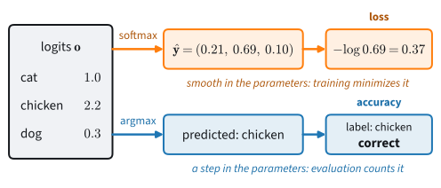
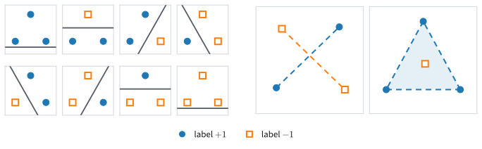

```{.python .input  n=1}
%load_ext d2lbook.tab
tab.interact_select('mxnet', 'pytorch', 'tensorflow', 'jax')
```

# Softmax Regression from Scratch
:label:`sec_softmax_scratch`

In :numref:`sec_linear_scratch` we wrote linear regression as a handful of
plain functions, with tensors and automatic differentiation, so that no part
of training stayed hidden, and in :numref:`sec_oo-design` we moved the
training loop into a `Trainer` so that we would never write it again. We
now write softmax regression the same way. What changes when the model
predicts a class instead of a number? Rather little, as it turns out.
Softmax regression differs from linear regression in three places. The model
computes one output per class instead of a single number, the softmax turns
these outputs, the logits, into probabilities, and the loss is the
cross-entropy instead of the squared error. Everything else carries over:
the `Trainer` runs the same loop with the same minibatch SGD update, and the
`FashionMNIST` class of :numref:`sec_fashion_mnist` delivers the images.

One piece of software is new, and every classifier in the book will use it.
A classifier is trained on its loss but judged by its accuracy, so we write
a base class `Classifier` that reports both. We write it, write the three
new pieces, and train the model on Fashion-MNIST. Writing the softmax from
its formula also exposes a numerical trap, which we demonstrate here and
leave to the next section to remove. Once the model is trained, the
interesting part begins. We look at what it gets wrong, at which garments it
takes for which, and, since the weights of a linear model on images are
themselves images, at what it has learned.

```{.python .input #softmax-regression-scratch-softmax-regression-implementation-from-scratch}
%%tab mxnet
import math
import numpy as np
from mxnet import autograd, gluon, init, np as mnp, npx
from mxnet.gluon import nn
from d2l import mxnet as d2l
npx.set_np()
```

```{.python .input #softmax-regression-scratch-softmax-regression-implementation-from-scratch}
%%tab pytorch
import math
import numpy as np
import torch
from torch import nn
from torch.nn import functional as F
from d2l import torch as d2l
```

```{.python .input #softmax-regression-scratch-softmax-regression-implementation-from-scratch}
%%tab tensorflow
import math
import numpy as np
import tensorflow as tf
from d2l import tensorflow as d2l
```

```{.python .input #softmax-regression-scratch-softmax-regression-implementation-from-scratch}
%%tab jax
import math
import numpy as np
import jax
from jax import numpy as jnp
from flax import nnx
import optax
from d2l import jax as d2l
```

## The Softmax

### Normalizing Each Row

We start with the softmax, the piece that turns the logits of the model into
probabilities. For a minibatch of $n$ examples the logits form a matrix
$\mathbf{O} = \mathbf{X}\mathbf{W} + \mathbf{b}$ with one row per example and
one column per class (:numref:`subsec_softmax_vectorization`). The softmax
acts on each row separately,

$$\mathrm{softmax}(\mathbf{O})_{ij} = \frac{\exp(O_{ij})}{\sum_{k=1}^q \exp(O_{ik})},$$

so entry $(i, j)$ of the result is the probability that the model assigns to
class $j$ for example $i$. Computing it takes three steps: exponentiate every
entry, sum each row, and divide each row by its sum. Only the second step
needs care with shapes. A sum with `axis=1` collapses the columns, and
`keepdims=True` keeps the collapsed axis with length 1, so the sums form a
column of shape $(n, 1)$ that broadcasts against the $n \times q$ matrix in
the division (:numref:`subsec_broadcasting`).

```{.python .input #softmax-regression-scratch-the-softmax-2}
def softmax(O):
    O_exp = d2l.exp(O)
    return O_exp / d2l.reduce_sum(O_exp, 1, keepdims=True)  # Broadcast
```

We check it on two rows of logits. The first holds the logits
$(1.0, 2.2, 0.3)$ that :numref:`sec_softmax` computed for an image scored as
cat, chicken, and dog; the second holds three equal logits.

```{.python .input #softmax-regression-scratch-the-softmax-3}
O = d2l.tensor([[1.0, 2.2, 0.3], [0.0, 0.0, 0.0]])
Y_hat = softmax(O)
Y_hat, d2l.reduce_sum(Y_hat, 1)
```

The first row reproduces the probabilities $(0.21, 0.69, 0.10)$ computed by
hand, and equal logits give every class the probability $1/3$. Both rows sum
to 1, as probabilities must.

### Overflow

Unfortunately, the formula fails for large logits. For the logits
$(1000, 0, 0)$, $\exp(1000)$ exceeds the largest single-precision number
and becomes infinite, in the numerator of the first entry and in the row
sum alike, and $\infty / \infty$ is `NaN`, although the correct answer is
$(1, 0, 0)$ up to rounding. The remedy is the invariance of
:numref:`sec_softmax`: the softmax ignores a constant added to all logits
of a row, so we may subtract the largest logit of each row first. Every
exponent is then at most 0, and nothing overflows. The framework's built-in
softmax shifts the logits in the same way. We apply the direct formula, the
shifted formula, and the built-in softmax to the same row:

```{.python .input #softmax-regression-scratch-the-softmax-overflow}
%%tab pytorch
O = d2l.tensor([[1000.0, 0.0, 0.0]])
O_max = O.amax(dim=1, keepdim=True)
softmax(O), softmax(O - O_max), torch.softmax(O, dim=1)
```

```{.python .input #softmax-regression-scratch-the-softmax-overflow}
%%tab mxnet
O = d2l.tensor([[1000.0, 0.0, 0.0]])
O_max = O.max(axis=1, keepdims=True)
softmax(O), softmax(O - O_max), npx.softmax(O, axis=1)
```

```{.python .input #softmax-regression-scratch-the-softmax-overflow}
%%tab tensorflow
O = d2l.tensor([[1000.0, 0.0, 0.0]])
O_max = tf.reduce_max(O, axis=1, keepdims=True)
softmax(O), softmax(O - O_max), tf.nn.softmax(O, axis=1)
```

```{.python .input #softmax-regression-scratch-the-softmax-overflow}
%%tab jax
O = d2l.tensor([[1000.0, 0.0, 0.0]])
O_max = O.max(axis=1, keepdims=True)
softmax(O), softmax(O - O_max), jax.nn.softmax(O, axis=1)
```

The direct formula returns `NaN` in the first entry; the shifted formula and
the built-in softmax return $(1, 0, 0)$. A `NaN` does not stay where it
arises. The loss of the minibatch becomes `NaN`, then its gradient, and after
the update the parameters, and the model is lost. Our model is in no danger,
since its inputs are pixel values between 0 and 1 and its weights stay
small, so we keep the direct formula, which shows the three steps plainly.
Nor is the shift the whole answer. It saves the softmax but not the loss,
which takes the logarithm of the result, and the logarithm of a probability
that has underflowed to 0 is $-\infty$. :numref:`sec_softmax_concise`
removes both problems at once, by computing the logarithms of the
probabilities directly from the logits.

## Loss and Accuracy

Training a classifier lowers its cross-entropy loss. The user of a
classifier has little interest in the loss and asks a different question:
how often is the decision right? Every classifier in this book therefore
reports two numbers on validation data: the loss, because training lowers
it, and the accuracy, because users ask for it. Both go into a base class
`Classifier` that extends the `Module` class of :numref:`sec_oo-design`,
so that each model supplies only its network and its loss.

### Two Uses of the Logits

A classifier for $q$ classes computes a vector of logits
$\mathbf{o} \in \mathbb{R}^q$ for each example and predicts the class with
the largest logit. Since the softmax preserves the order of the logits, this
is also the class with the largest probability. Let
$y^{(i)} \in \{1, \ldots, q\}$ be the class of example $i$. The accuracy on
$n$ examples is the fraction of examples whose largest logit belongs to the
true class,

$$\textrm{accuracy} = \frac{1}{n} \sum_{i=1}^n \mathbf{1}\Big(\mathop{\mathrm{argmax}}_j o^{(i)}_j = y^{(i)}\Big),$$
:eqlabel:`eq_accuracy`

where $\mathbf{1}(\cdot)$ is 1 if its argument is true and 0 otherwise: a
right prediction counts 1, a wrong one 0, and the accuracy is their average.
A classifier that labels 9,000 of the 10,000 Fashion-MNIST validation
images correctly has accuracy 0.9; its error rate, one minus the accuracy,
is 0.1.

We report the accuracy but cannot train on it, since it changes only in
jumps as the parameters change (:numref:`sec_softmax`). Gradient descent
needs the smooth cross-entropy loss instead. Luckily, both numbers come from
the same vector of logits, as :numref:`fig_mdl-clf-loss-accuracy` shows.


:label:`fig_mdl-clf-loss-accuracy`

It is tempting to assume that the two numbers at least move together. They
need not. A model that becomes confidently wrong on a few validation
examples pays a large loss on each of them, so its validation loss can rise
while its accuracy still improves. This is why we report both.

### The `Classifier` Class
:label:`subsec_classifier-class`

`Classifier` has a single job: on each validation minibatch, compute the
loss and the accuracy. To this end its `validation_step` replaces that of
`Module`, which returns only the loss, by one that returns a dictionary with
both metrics. The `Trainer` of :numref:`sec_oo-design` does the rest. It
averages each metric that a step returns over the validation set, weighting
every minibatch by its number of examples, so that the reported loss and
accuracy are exact means over the validation set. After each epoch it
appends the two means to `trainer.history['val_loss']` and
`trainer.history['val_acc']`.

:begin_tab:`tensorflow`
As in `Module`, the validation step calls the model with `training=False`.
:end_tab:

:begin_tab:`jax`
The `Trainer` compiles the validation step, which returns both metrics as
arrays; it averages them over the minibatches outside the compiled
function.
:end_tab:

```{.python .input #classification-the-classifier-class-1}
%%tab pytorch, mxnet, jax
class Classifier(d2l.Module):  #@save
    """The base class of classification models."""
    def validation_step(self, batch):
        Y_hat = self(*batch[:-1])
        return {'loss': self.loss(Y_hat, batch[-1]),
                'acc': self.accuracy(Y_hat, batch[-1])}
```

```{.python .input #classification-the-classifier-class-1}
%%tab tensorflow
class Classifier(d2l.Module):  #@save
    """The base class of classification models."""
    def validation_step(self, batch):
        Y_hat = self(*batch[:-1], training=False)
        return {'loss': self.loss(Y_hat, batch[-1]),
                'acc': self.accuracy(Y_hat, batch[-1])}
```

This is all there is to the validation step. What the class does not
contain is a network or a loss. These belong to its subclasses, and the rest
of this section writes both for softmax regression.

### Computing Accuracy

The method `accuracy` evaluates :eqref:`eq_accuracy` on a minibatch. `Y_hat`
holds the outputs of the model, one row per example (more leading axes are
flattened first); logits and probabilities have their largest entry in the
same place. `argmax` along the class axis gives the predicted classes. We cast
them to the data type of the labels `Y`, a formality that is needed because
some frameworks compare only values of the same type. The comparison yields
1 for each correct prediction and 0 for each wrong one, and the mean of
these values is the accuracy. With `averaged=False` the method returns the vector
of 0s and 1s itself. This is the form to ask for when we want to look at
the examples that the model gets wrong.

```{.python .input #classification-accuracy-1  n=9}
@d2l.add_to_class(Classifier)  #@save
def accuracy(self, Y_hat, Y, averaged=True):
    """Compute the fraction of correct predictions."""
    Y_hat = d2l.reshape(Y_hat, (-1, Y_hat.shape[-1]))
    preds = d2l.astype(d2l.argmax(Y_hat, axis=1), Y.dtype)
    compare = d2l.astype(preds == d2l.reshape(Y, (-1,)), d2l.float32)
    return d2l.reduce_mean(compare) if averaged else compare
```

:begin_tab:`jax`
The validation step that calls `accuracy` is compiled, so `accuracy` needs no
`jit` of its own.
:end_tab:

### The Default Optimizer

Unless a model asks for something else, it trains with minibatch stochastic
gradient descent at its learning rate `self.lr`, as the linear regression of
:numref:`chap_regression` did. The `Trainer` obtains the optimizer once, at
the start of training, by calling the model's method `configure_optimizers`.
Nothing in this default is specific to classification, so we install it on
`Module` rather than on `Classifier`, and regression models inherit it as
well. Later chapters override it to train with other optimizers.

```{.python .input #classification-the-classifier-class-2}
%%tab mxnet
@d2l.add_to_class(d2l.Module)  #@save
def configure_optimizers(self):
    return gluon.Trainer(self.collect_params(), 'sgd',
                         {'learning_rate': self.lr})
```

```{.python .input #classification-the-classifier-class-2}
%%tab pytorch
@d2l.add_to_class(d2l.Module)  #@save
def configure_optimizers(self):
    return torch.optim.SGD(self.parameters(), lr=self.lr)
```

```{.python .input #classification-the-classifier-class-2}
%%tab tensorflow
@d2l.add_to_class(d2l.Module)  #@save
def configure_optimizers(self):
    return tf.keras.optimizers.SGD(float(self.lr))
```

```{.python .input #classification-the-classifier-class-2}
%%tab jax
@d2l.add_to_class(d2l.Module)  #@save
def configure_optimizers(self):
    return optax.sgd(self.lr)
```

:begin_tab:`mxnet`
The Gluon `Trainer` receives the parameters that `collect_params` finds:
every parameter declared as a Gluon `Parameter`, including those of a model
written from scratch.
:end_tab:

## The Model and the Loss

### The Parameters

Each $28 \times 28$ image becomes a vector of $d = 784$ pixel values, and
there are $q = 10$ classes. The model therefore has a weight matrix
$\mathbf{W} \in \mathbb{R}^{784 \times 10}$, one column per class, and a bias
vector $\mathbf{b} \in \mathbb{R}^{10}$, together 7,850 parameters. As in
:numref:`sec_linear_scratch`, we draw the weights from a normal distribution
with mean 0 and standard deviation 0.01 and set the biases to 0. Such small
weights give all classes nearly equal logits, so the model starts with
predictions close to uniform, $\hat{y}_j \approx 0.1$, and a loss close to
$\log 10 \approx 2.30$. The number is worth remembering: a first minibatch
that reports a loss far from 2.30 usually points to a bug.

We register $\mathbf{W}$ and $\mathbf{b}$ as parameters of the module with
the framework's parameter type, as in :numref:`sec_oo-design`. The
default optimizer that `Classifier` inherits from `Module`, minibatch SGD at
the learning rate `lr`, finds registered parameters by itself, so this model needs no `configure_optimizers` of its
own.

:begin_tab:`pytorch`
`nn.Parameter` registers each tensor with the module, so
`model.parameters()` lists `W` and `b`.
:end_tab:

:begin_tab:`mxnet`
A Gluon `Parameter` assigned as an attribute of a block is registered with
it, so `model.collect_params()` lists `W` and `b`. `initialize` allocates
their values, which `data()` returns.
:end_tab:

:begin_tab:`tensorflow`
`add_weight` creates each variable and registers it with the Keras model, so
`model.trainable_variables` lists `W` and `b`.
:end_tab:

:begin_tab:`jax`
`nnx.Param` marks each array as a trainable parameter, so
`nnx.state(model)` contains `W` and `b`. As in :numref:`sec_oo-design`,
the argument `rngs` supplies the random key for the initialization.
:end_tab:

```{.python .input #softmax-regression-scratch-the-model-1}
%%tab pytorch
class SoftmaxRegressionScratch(Classifier):
    """Softmax regression implemented from scratch."""
    def __init__(self, num_inputs, num_outputs, lr, std=0.01):
        super().__init__()
        self.save_hyperparameters()
        self.W = nn.Parameter(d2l.normal(0, std, (num_inputs, num_outputs)))
        self.b = nn.Parameter(d2l.zeros(num_outputs))
```

```{.python .input #softmax-regression-scratch-the-model-1}
%%tab mxnet
class SoftmaxRegressionScratch(Classifier):
    """Softmax regression implemented from scratch."""
    def __init__(self, num_inputs, num_outputs, lr, std=0.01):
        super().__init__()
        self.save_hyperparameters()
        self.W = gluon.Parameter('W', shape=(num_inputs, num_outputs),
                                 init=init.Normal(std))
        self.b = gluon.Parameter('b', shape=(num_outputs,), init=init.Zero())
        self.initialize()
```

```{.python .input #softmax-regression-scratch-the-model-1}
%%tab tensorflow
class SoftmaxRegressionScratch(Classifier):
    """Softmax regression implemented from scratch."""
    def __init__(self, num_inputs, num_outputs, lr, std=0.01):
        super().__init__()
        self.save_hyperparameters()
        normal = tf.keras.initializers.RandomNormal(mean=0, stddev=std)
        self.W = self.add_weight(name='W', shape=(num_inputs, num_outputs),
                                 initializer=normal)
        self.b = self.add_weight(name='b', shape=(num_outputs,),
                                 initializer='zeros')
```

```{.python .input #softmax-regression-scratch-the-model-1}
%%tab jax
class SoftmaxRegressionScratch(Classifier):
    """Softmax regression implemented from scratch."""
    def __init__(self, num_inputs, num_outputs, lr, std=0.01, rngs=None):
        super().__init__()
        self.save_hyperparameters(ignore=['rngs'])
        rngs = nnx.Rngs(d2l.get_key()) if rngs is None else rngs
        self.W = nnx.Param(
            rngs.params.normal((num_inputs, num_outputs)) * std)
        self.b = nnx.Param(jnp.zeros(num_outputs))
```

### The Forward Pass

A minibatch of $n$ images arrives as a four-dimensional tensor
(:numref:`sec_fashion_mnist`). The method `forward` reshapes it into the
$n \times 784$ matrix $\mathbf{X}$, one flattened image per row, computes the
logits $\mathbf{O} = \mathbf{X}\mathbf{W} + \mathbf{b}$, with the bias added
to every row by broadcasting, and returns their softmax. Flattening discards
which pixels are neighbors. The model cannot use that information; the
convolutional networks of :numref:`chap_cnn` do.

:begin_tab:`mxnet`
The minibatch has shape $(n, 1, 28, 28)$, channels first. The MXNet version
reads the values of the parameters with `data()`.
:end_tab:

:begin_tab:`pytorch`
The minibatch has shape $(n, 1, 28, 28)$, channels first.
:end_tab:

:begin_tab:`tensorflow`
The minibatch has shape $(n, 28, 28, 1)$, channels last.
:end_tab:

:begin_tab:`jax`
The minibatch has shape $(n, 28, 28, 1)$, channels last.
:end_tab:

```{.python .input #softmax-regression-scratch-the-model-2}
%%tab pytorch, tensorflow, jax
@d2l.add_to_class(SoftmaxRegressionScratch)
def forward(self, X):
    X = d2l.reshape(X, (-1, self.num_inputs))  # One flattened image per row
    return softmax(d2l.matmul(X, self.W) + self.b)
```

```{.python .input #softmax-regression-scratch-the-model-2}
%%tab mxnet
@d2l.add_to_class(SoftmaxRegressionScratch)
def forward(self, X):
    X = d2l.reshape(X, (-1, self.num_inputs))  # One flattened image per row
    return softmax(d2l.matmul(X, self.W.data()) + self.b.data())
```

### The Cross-Entropy Loss

The loss of one example is the negative logarithm of the probability that
the model assigns to its true class, $l = -\log \hat{y}_y$
(:numref:`sec_softmax`). For a minibatch we need, from each row of
$\hat{\mathbf{Y}}$, the entry in the column of that example's label. The
indexing of :numref:`sec_ndarray` does this without a loop: the row
positions together with the vector of labels pick one entry per row. In code
the labels are class indices counted from 0. Here are two examples with
three classes and labels 0 and 2:

:begin_tab:`tensorflow`
As in :numref:`sec_ndarray`, `tf.gather` with `batch_dims=1` picks, in each
row, the entry at that row's label.
:end_tab:

```{.python .input #softmax-regression-scratch-the-cross-entropy-loss-1}
%%tab mxnet, pytorch, jax
y = d2l.tensor([0, 2])
y_hat = d2l.tensor([[0.1, 0.3, 0.6], [0.3, 0.2, 0.5]])
y_hat[[0, 1], y]
```

```{.python .input #softmax-regression-scratch-the-cross-entropy-loss-1}
%%tab tensorflow
y_hat = tf.constant([[0.1, 0.3, 0.6], [0.3, 0.2, 0.5]])
y = tf.constant([0, 2])
tf.gather(y_hat, y, batch_dims=1)
```

The first example gives its true class the probability 0.1, the second
0.5. The function `cross_entropy` averages the negative logarithms of these
probabilities over the minibatch. Its one line that is not part of the
definition raises each probability to at least $10^{-12}$ before the
logarithm, a crude guard that turns the infinite loss of a probability that
has underflowed to 0 into $27.6$ and, as the comment warns, into a zero
gradient; the next section replaces it by a loss that never forms the
probability.

```{.python .input #softmax-regression-scratch-the-cross-entropy-loss-2}
%%tab pytorch
def cross_entropy(y_hat, y):  #@save
    # Tiny clip to keep log finite when softmax outputs underflow to 0.
    p = y_hat[list(range(len(y_hat))), y].clamp(min=1e-12)
    return -d2l.reduce_mean(d2l.log(p))

cross_entropy(y_hat, y)
```

```{.python .input #softmax-regression-scratch-the-cross-entropy-loss-2}
%%tab mxnet
def cross_entropy(y_hat, y):  #@save
    # Tiny clip to keep log finite when softmax outputs underflow to 0.
    p = y_hat[list(range(len(y_hat))), y].clip(min=1e-12)
    return -d2l.reduce_mean(d2l.log(p))

cross_entropy(y_hat, y)
```

```{.python .input #softmax-regression-scratch-the-cross-entropy-loss-2}
%%tab jax
def cross_entropy(y_hat, y):  #@save
    # Tiny clip to keep log finite when softmax outputs underflow to 0.
    p = jnp.clip(y_hat[jnp.arange(len(y_hat)), y], min=1e-12)
    return -d2l.reduce_mean(d2l.log(p))

cross_entropy(y_hat, y)
```

```{.python .input #softmax-regression-scratch-the-cross-entropy-loss-2}
%%tab tensorflow
def cross_entropy(y_hat, y):  #@save
    p = tf.gather(y_hat, y, batch_dims=1)
    # Tiny clip to keep log finite when softmax outputs underflow to 0.
    return -tf.reduce_mean(tf.math.log(tf.maximum(p, 1e-12)))

cross_entropy(y_hat, y)
```

The loss is the mean of $-\log 0.1 \approx 2.30$ and
$-\log 0.5 \approx 0.69$, about 1.50. It becomes the loss of our model:

```{.python .input #softmax-regression-scratch-the-cross-entropy-loss-3}
@d2l.add_to_class(SoftmaxRegressionScratch)
def loss(self, y_hat, y):
    return cross_entropy(y_hat, y)
```

## Training and Evaluation

### The Training Run

With the parameters, the forward pass, and the loss in place, the `Trainer`
can fit the model to Fashion-MNIST. We train for 10 epochs with minibatches
of 256 images at learning rate 0.1, which makes 235 steps per epoch, and
the `Trainer` reports the loss and accuracy on the 10,000 validation images
after every epoch. None of the three numbers we just chose is learned, yet
each influences the result. Choosing them by their validation accuracy is a
form of model selection, and :numref:`chap_classification_generalization`
asks what such choices do to the trustworthiness of the score.

```{.python .input #softmax-regression-scratch-training}
data = d2l.FashionMNIST(batch_size=256)
model = SoftmaxRegressionScratch(num_inputs=784, num_outputs=10, lr=0.1)
trainer = d2l.Trainer(max_epochs=10)
trainer.fit(model, data)
```

The training loss falls quickly during the first epoch and slowly after it.
The validation accuracy is between 75% and 80% after one epoch and about 83%
after ten. It does not rise steadily: from one epoch to the next it can
drop by a point or two, occasionally more, since minibatch SGD keeps moving
the parameters. The training loss ends near 0.45 and the validation loss
only a few hundredths above it.

Validation metrics are also needed outside `fit`, for instance to evaluate
a trained model once on a test set. We add the method `evaluate` to the
trainer. It returns the means of the metrics of `model` over
`data.val_dataloader()`, without drawing a single training minibatch, by
calling the same `validate` that `fit` calls after every epoch
(:numref:`sec_oo-design`). With `train=True` it reads the training data
instead, still without changing the parameters.

```{.python .input #softmax-regression-scratch-the-training-run-1}
@d2l.add_to_class(d2l.Trainer)  #@save
def evaluate(self, model, data, train=False):
    """Metrics of `model` on the validation data of `data` (on its training
    data if `train`), averaged over examples."""
    self.train_dataloader = None
    self.val_dataloader = (data.train_dataloader() if train
                           else data.val_dataloader())
    self.prepare_model(model)
    return self.validate()
```

Here the metrics are means over all 10,000 validation images. After training
they equal the last point of each validation curve, which
`trainer.history['val_loss'][-1]` and `trainer.history['val_acc'][-1]`
hold.

```{.python .input #softmax-regression-scratch-prediction-accuracy}
trainer.evaluate(model, data)
```

The model labels about 83% of the validation images correctly, and the
number should not be quoted more precisely than that. Repeated runs land
anywhere between 82% and 84%, since the random initialization and the order
of the minibatches move the result by about a point
(:numref:`sec_ndarray` explains why we report such ranges).

How does this compare with the training images? The training curve above
averages the loss over each epoch while the parameters still change, so we
evaluate the trained model on all 60,000 training images.

```{.python .input #softmax-regression-scratch-the-training-run-2}
trainer.evaluate(model, data, train=True)
```

The training accuracy is about 84%, one or two points above the validation
accuracy: the model does almost as well on images it has not seen as on the
images it was fitted to. A gap this small is no accident. A linear model
cannot fit arbitrary labels of 60,000 images, so it can memorize little of
its training data, and :numref:`chap_classification_generalization` says
how large the gap could have been.

### Misclassified Images

The accuracy tells us how often the model errs, not on which images. We take
the first minibatch of 256 validation images, predict the class of each, and
count the mistakes.

```{.python .input #softmax-regression-scratch-prediction-1}
X, y = next(iter(data.val_dataloader()))
preds = d2l.astype(d2l.argmax(model(X), axis=1), y.dtype)
wrong = preds != y
print(f'{int(d2l.reduce_sum(d2l.astype(wrong, d2l.int32)))} of {len(y)} wrong')
```

We show the first eight misclassified images. Each title gives the true
class above the predicted one.

```{.python .input #softmax-regression-scratch-prediction-2}
labels = [f'{true}\n→ {pred}' for true, pred in zip(
    data.text_labels(y[wrong]), data.text_labels(preds[wrong]))]
data.visualize([X[wrong], y[wrong]], labels=labels)
```

Between 30 and 45 of the 256 images are misclassified, in line with an
error rate of about 17%. The mistakes are not wild ones. Most of them take
one top for another or one shoe for another. In fairness to
the model, some of these images are hard to label at $28 \times 28$ pixels
even for a person.

### The Confusion Matrix

Eight images are anecdotes. A *confusion matrix* $\mathbf{N}$ counts all
the mistakes. For $q$ classes it has $q \times q$ entries. Let
$\hat{c}^{(m)} = \operatorname{argmax}_j o^{(m)}_j$ be the predicted class
of example $m$, the class with the largest logit; we keep
$\hat{\mathbf{y}}$ for the predicted probabilities. Then

$$N_{ij} = \sum_{m=1}^n \mathbf{1}\big(\hat{c}^{(m)} = i\big)\, \mathbf{1}\big(y^{(m)} = j\big)$$
:eqlabel:`eq_confusion-matrix`

counts the examples of class $j$ predicted as class $i$: rows are predicted
classes and columns true classes. The diagonal holds the correct
predictions, so the accuracy is the sum of the diagonal divided by $n$, and
each off-diagonal entry counts one kind of mistake. Libraries do not agree
on the orientation; scikit-learn's `confusion_matrix`, for one, puts the
true classes in the rows. We put them in the columns for a reason that
:numref:`sec_environment-and-distribution-shift` will use. Once each column
is divided by its sum, the matrix acts on a vector of class proportions and
returns the frequencies of the predictions, $\mathbf{C}\mathbf{p} = \boldsymbol{\mu}$, an equation that can be solved for $\mathbf{p}$.

:begin_tab:`tensorflow`
`tf.math.confusion_matrix` also puts the true classes in the rows and the
predicted classes in the columns, the transpose of $\mathbf{N}$.
:end_tab:

How do we count 100 kinds of pairs without a loop over examples? One-hot
vectors (:numref:`sec_softmax`) do it. Let the rows of
$\mathbf{P} \in \{0, 1\}^{n \times q}$ be the one-hot encodings of the
predicted classes of a minibatch and the rows of
$\mathbf{Y} \in \{0, 1\}^{n \times q}$ those of the labels. Then

$$(\mathbf{P}^\top \mathbf{Y})_{ij} = \sum_{m=1}^n P_{mi} Y_{mj},$$

and a term is 1 exactly when example $m$ is predicted as $i$ and labeled
$j$, as in :eqref:`eq_confusion-matrix`. One matrix product thus counts all pairs of a minibatch, and summing
the products over the validation minibatches gives $\mathbf{N}$. The function
`one_hot` builds the one-hot rows by comparing a column of class indices with
the row $(0, 1, \ldots, q-1)$, which broadcasting expands to an $n \times q$
matrix of comparisons.

```{.python .input #softmax-regression-scratch-the-confusion-matrix-1}
def one_hot(y, q):
    """Rows of the q x q identity matrix, one per class index in y."""
    return d2l.astype(d2l.reshape(y, (-1, 1)) == d2l.arange(q, dtype=y.dtype),
                      d2l.float32)

N = d2l.zeros((10, 10))
for X, y in data.val_dataloader():
    P = one_hot(d2l.argmax(model(X), axis=1), 10)
    N += d2l.matmul(d2l.transpose(P), one_hot(y, 10))
int(d2l.reduce_sum(N))
```

The counts add up to the 10,000 validation images, so no pair was lost.
Counts depend on how many examples each class happens to have. To compare
classes, we divide each column of $\mathbf{N}$ by its sum. This gives the
matrix $\mathbf{C}$ with $C_{ij} = N_{ij} / \sum_{i'} N_{i'j}$, the
fraction of the examples of class $j$ that are predicted as class $i$, an
estimate of $P(\hat{c} = i \mid y = j)$. Column $j$ shows where the
examples of class $j$ end up, and the diagonal holds, for each class, the
fraction of its examples that the model recognizes. The display utility
`d2l.show_heatmaps` draws $\mathbf{C}$ as a grid of colored cells.

```{.python .input #softmax-regression-scratch-prediction-confusion}
C = N / d2l.reduce_sum(N, 0, keepdims=True)  # Each column sums to 1
names = data.text_labels(range(10))
d2l.show_heatmaps(d2l.reshape(C, (1, 1, 10, 10)), xlabel='true class',
                  ylabel='predicted class', figsize=(4, 4), cmap='Blues',
                  xticklabels=names, yticklabels=names)
```

The largest entries off the diagonal name the most frequent mistakes:

```{.python .input #softmax-regression-scratch-the-confusion-matrix-2}
mistakes = d2l.numpy(N) * (1 - np.eye(10))  # Zero the diagonal
for k in np.argsort(mistakes, axis=None)[::-1][:5]:
    i, j = divmod(int(k), 10)
    print(f'{names[j]} taken for {names[i]}: {int(mistakes[i, j])}')
```

The diagonal shows how often each class is recognized. Trousers, bags, and
the three kinds of shoes are recognized about 90% of the time or more, and
shirts only about half the time, between 40% and 60% depending on the run.
The errors are far from evenly spread. They form the two groups that
:numref:`sec_fashion_mnist` led us to expect. The four tops (T-shirts,
pullovers, coats, and shirts) trade most of their errors among themselves:
in every run, the five largest entries off the diagonal are pairs of tops,
and the largest of them, a pullover taken for a coat or for a shirt, or a
coat taken for a pullover, holds between a sixth and a third of its class.
Sandals, sneakers, and ankle boots form a second, smaller group, whose
errors almost all stay among the three. The four tops have similar outlines
and differ in details such as collars, buttons, and the length of the
sleeves, which change few pixels. A shirt resembles each of the other three
in some of these details, so it collects errors from all of them.

### The Learned Templates

Why these mistakes and not others? The weights tell. The score of class
$j$ is the inner product of the flattened image with column $j$ of
$\mathbf{W}$, plus a bias. Reshaped to $28 \times 28$ pixels, the column is
itself an image, a *template* for class $j$: a bright pixel where the
template is red raises the score of the class, and a bright pixel where it
is blue lowers it. We draw the ten templates on one color scale, centered
at 0.

```{.python .input #softmax-regression-scratch-what-the-model-learned}
%%tab pytorch, tensorflow
W = d2l.numpy(model.W)
templates = W.T.reshape(10, 28, 28)  # Column j of W as an image
v = np.abs(templates).max()
d2l.show_images(templates, 2, 5, titles=names, cmap='RdBu_r', vmin=-v, vmax=v);
```

```{.python .input #softmax-regression-scratch-what-the-model-learned}
%%tab mxnet
W = d2l.numpy(model.W.data())
templates = W.T.reshape(10, 28, 28)  # Column j of W as an image
v = np.abs(templates).max()
d2l.show_images(templates, 2, 5, titles=names, cmap='RdBu_r', vmin=-v, vmax=v);
```

```{.python .input #softmax-regression-scratch-what-the-model-learned}
%%tab jax
W = d2l.numpy(model.W[...])
templates = W.T.reshape(10, 28, 28)  # Column j of W as an image
v = np.abs(templates).max()
d2l.show_images(templates, 2, 5, titles=names, cmap='RdBu_r', vmin=-v, vmax=v);
```

Each template is a blurred garment, and the ten of them are the whole
model: to classify an image is to ask which template it overlaps most. The
templates of trousers, bags, and shoes have outlines that no other class
shares; the trouser template is blue between the legs, where a dress is
bright and a trouser is dark. The four tops share most of their outline,
and their templates differ mainly at the neckline and the sleeves: a few
pixels, and the same few in which the confusion matrix says they are
confused.

More training will not remove these errors. Every class score is a weighted
sum of pixels, so the boundaries between the predicted classes are
hyperplanes in the space of images, whatever the weights, and a collar is
too few pixels to tip such a sum reliably. Models that first compute
features from groups of pixels, such as the multilayer perceptrons of
:numref:`chap_perceptrons`, separate the classes better. Before we go
there, one piece of this implementation still needs repair: a softmax that
returns `NaN`, and a loss that can only hide it.

## Summary

Softmax regression from scratch adds three components to the training code
of linear regression: a weight matrix
$\mathbf{W} \in \mathbb{R}^{784 \times 10}$ and a bias
$\mathbf{b} \in \mathbb{R}^{10}$ registered as parameters, a forward pass
that flattens the images and applies the softmax to each row of
$\mathbf{O} = \mathbf{X}\mathbf{W} + \mathbf{b}$, and the cross-entropy loss,
which picks the probability of the true class in each row by indexing. The
base class `Classifier` reports, on every validation minibatch, the loss
that training lowers and the accuracy that users ask for, which changes in
steps and cannot be trained on. Ten epochs of minibatch SGD reach about 83%
validation accuracy and about 84% on the training images. The confusion
matrix, a sum of products of one-hot matrices, shows that most errors trade
one top for another, and the learned weights, viewed as ten templates, show
why: the tops differ in few pixels. The softmax written from its formula
returns `NaN` when a large logit overflows the exponential, and the floor in
the loss only hides the matching failure of the logarithm; the next section
computes the loss from the logits instead.

## Exercises

1. [code] **Underflow.** The `softmax` of this section returns `NaN` on
   the logits $(1000, 0, 0)$, and subtracting the largest logit of the row
   fixes it.
    1. Show that `softmax` also returns `NaN` on the row
       $(-1000, -1000, -1000)$, and identify the operation that produces
       the `NaN` in this case. Check that the shifted version returns
       $(1/3, 1/3, 1/3)$.
    1. Take the logits $(0, -200, 0)$ and the label `y = 1`, the class of
       the logit $-200$. Compute the shifted softmax and `cross_entropy` of
       the result. Then compute the
       gradient of this loss with respect to the logits by automatic
       differentiation, and compare it with the gradient
       $\hat{\mathbf{y}} - \mathbf{y}$ derived in :numref:`sec_softmax`.
       Explain the difference, and what it means for training on an
       example that the model gets badly wrong.

1. [code] **Cross-entropy from one-hot labels.** The `cross_entropy` of this
   section selects the correct-class probability by indexing. Implement an
   alternative that follows the definition $-\sum_j y_j \log \hat{y}_j$
   literally, by converting `y` to a one-hot matrix and taking row-wise
   inner products.
    1. Use it as the `loss` of `SoftmaxRegressionScratch` and confirm that
       training is unchanged.
    1. Time both versions on random probability matrices with $256$ rows
       and $q \in \{10, 10^3, 10^5\}$ columns, and state how the memory
       that each version allocates grows with $q$.
    1. Describe a setting in which the inner-product form applies but the
       indexing form does not.

1. **Large vocabularies.** Suppose that softmax regression predicts the
   next word from a feature vector of dimension $d = 1024$. The vocabulary
   has $V = 10^6$ words, and each minibatch holds $n = 256$ examples.
   List the operations of `forward` and `cross_entropy` whose cost grows
   with $V$. Compute the multiply-adds of the matrix product, the float32
   memory of `W`, and the float32 memory of the $n \times V$ matrix of
   probabilities, and compare each number with the Fashion-MNIST model of
   this section.

1. [code] **Hyperparameter sweep.** Retrain `SoftmaxRegressionScratch` with
   `d2l.Trainer(max_epochs=10)`, varying one hyperparameter at a time, and
   read the final losses from `trainer.history`.
    1. Plot the final validation loss against the learning rate over
       $\{0.01, 0.03, 0.1, 0.3, 1\}$.
    1. Plot the final training and validation losses against the minibatch
       size over $\{8, 32, 256, 2048\}$ at learning rate $0.1$.
    1. Compute the number of parameter updates that ten epochs over the
       60,000 training images take at each minibatch size. Use these counts
       to explain the trend in the previous plot, and predict how the
       comparison changes when every run takes the same number of updates.

1. [code] **Templates and class means.** The templates are what minibatch
   SGD made of the pixels it saw.
    1. Train `SoftmaxRegressionScratch` again with `std=0`, so that every
       weight starts at 0 and every class starts with the same logit.
       Explain why training works all the same, and compare the accuracy
       and the templates with those of the text.
    1. Show that after one SGD step from zero weights, column $j$ of
       $\mathbf{W}$ is proportional to
       $\sum_i \big(y^{(i)}_j - \tfrac{1}{10}\big)\, \mathbf{x}^{(i)}$ over
       the first minibatch: the sum of the images of class $j$ minus a
       tenth of the sum of all images.
    1. Compute the mean image of each class over the training set and
       compare it with the trained template of that class, by eye and by
       the correlation of their pixels. Where do they agree, and where does
       a template depart from the mean? Explain why a template that merely
       copied the class mean would confuse the tops even more.

:begin_tab:`mxnet`
[Discussions](https://d2l.discourse.group/t/50)
:end_tab:

:begin_tab:`pytorch`
[Discussions](https://d2l.discourse.group/t/51)
:end_tab:

:begin_tab:`tensorflow`
[Discussions](https://d2l.discourse.group/t/225)
:end_tab:

:begin_tab:`jax`
[Discussions](https://d2l.discourse.group/t/17982)
:end_tab:

<!-- slides -->

::: {.slide}
::: {.cover}
[Dive into Deep Learning · §3.3]{.kicker}

Softmax Regression from Scratch<br>**the softmax · loss and accuracy · registered parameters · cross-entropy by indexing · training · the confusion matrix · templates**
:::
:::

::: {.slide title="A Softmax Written From Its Formula Returns NaN"}
[The problem]{.kicker}

A classifier needs three pieces that linear regression did not have:
$q = 10$ outputs, the softmax, and the cross-entropy loss.

. . .

Written from its formula, the softmax fails on one large logit:

$$\mathrm{softmax}(1000, 0, 0) = \Big(\tfrac{e^{1000}}{e^{1000} + 2}, \ldots\Big) = \Big(\tfrac{\infty}{\infty}, 0, 0\Big) = (\texttt{NaN}, 0, 0)$$

- $e^{1000}$ is larger than any float32 number, so it is stored as $\infty$.
- The right answer is $(1, 0, 0)$.

::: {.d2l-note}
Write the three pieces with tensors, find where they break, train on
Fashion-MNIST, and look at what the model gets wrong and what it learned.
:::
:::

::: {.slide title="By the End of This Deck You Can"}
[Goals]{.kicker}

- compute a rowwise softmax with broadcasting, and say when it overflows;
- explain why we train on the loss and report the accuracy, and write the
  `Classifier` base class that reports both;
- register $\mathbf{W}$ ($784 \times 10$) and $\mathbf{b}$ as parameters;
- compute the cross-entropy by indexing the true-class probability;
- train with the reused `Trainer` and read `trainer.evaluate` on
  validation and training images;
- count a confusion matrix with one matrix product per minibatch, and show
  the ten columns of $\mathbf{W}$ as the templates they are.

**Running example:** Fashion-MNIST, 60,000 training and 10,000 validation
images in minibatches of 256; $28 \times 28 = 784$ pixels, 10 classes.
:::

::: {.slide title="Three New Pieces, Everything Else Reused"}
[Where this fits]{.kicker}

::: {.cols .vc}
::: {.col}
| section | adds |
|---|---|
| Softmax Regression | probabilities over classes, cross-entropy |
| Image Classification Data | Fashion-MNIST in minibatches |
| **Softmax Regression from Scratch** | **softmax regression by hand, the `Classifier` class** |
| Concise Implementation | framework layers, a stable loss |
| Measuring Classifiers | precision, recall, costs, calibration |
| Generalization in Classification | error bars, test-set reuse, VC dimension |
| Environment and Distribution Shift | correcting for shifted data |
:::

::: {.col .narrow}
- **Uses:** the `Trainer` and SGD of linear regression; `FashionMNIST`;
  softmax and cross-entropy.
- **Adds:** `Classifier`, the base class of every classifier in the book.
- **Skips:** a numerically stable loss (next deck).
:::
:::
:::

::: {.slide}
::: {.divider}
[01]{.dnum}

[The softmax]{.dtitle}

[rowwise normalization · overflow]{.dsub}
:::
:::

::: {.slide title="The Softmax Normalizes Each Row of the Logits"}
[The softmax]{.kicker}

Logits $\mathbf{O} = \mathbf{X}\mathbf{W} + \mathbf{b}$: one row per
example, one column per class.

$$\mathrm{softmax}(\mathbf{O})_{ij} = \frac{\exp(O_{ij})}{\sum_{k=1}^q \exp(O_{ik})}$$

@softmax-regression-scratch-the-softmax-2

::: {.d2l-note}
Exponentiate, sum each row, divide. `keepdims=True` keeps the sums as an
$(n, 1)$ column, which broadcasts against the $n \times q$ matrix.
:::
:::

::: {.slide title="Logits (1.0, 2.2, 0.3) Give Probabilities (0.21, 0.69, 0.10)"}
[The softmax]{.kicker}

Logits for cat, chicken, and dog on an image of a chicken, and three equal
logits:

@softmax-regression-scratch-the-softmax-3

- Equal logits give every class $1/3$.
- Every row sums to 1.
:::

::: {.slide title="Subtracting the Row Maximum Prevents the Overflow"}
[The softmax]{.kicker}

$\mathrm{softmax}(\mathbf{o} - c\mathbf{1}) = \mathrm{softmax}(\mathbf{o})$
for any $c$. With $c = \max_k o_k$ every exponent is $\le 0$:

@softmax-regression-scratch-the-softmax-overflow

::: {.d2l-note .warn}
The built-in softmax shifts first. A probability can still underflow to 0,
and $\log 0 = -\infty$: the next deck fixes the loss.
:::
:::

::: {.slide title="Check: Three Very Negative Logits"}
[Check]{.kicker}

What does the direct formula return for the logits
$(-1000, -1000, -1000)$? And the shifted one?

::: {.fragment .fade-up}
::: {.d2l-note}
**Answer.** Every $\exp(-1000)$ underflows to 0, so the direct formula
computes $0/0$, which is `NaN`, in all three entries. The shifted logits are
$(0, 0, 0)$, which give $(1/3, 1/3, 1/3)$.
:::
:::
:::

::: {.slide}
::: {.divider}
[02]{.dnum}

[Loss and accuracy]{.dtitle}

[two uses of the logits · the `Classifier` class]{.dsub}
:::
:::

::: {.slide title="The Loss Can Change While Every Decision Stays the Same"}
[The problem]{.kicker}

Two models give the correct class of an image probability $0.51$ and
$0.99$.

- Both predict that class: both decisions are **right**.
- Their losses: $-\log 0.51 \approx 0.67$ and $-\log 0.99 \approx 0.01$.

. . .

The user asks a different question: **how often is the decision right?**
That number changes only in jumps, so it cannot be trained on.

::: {.d2l-note}
Train on the loss, report the accuracy: one base class computes both.
:::
:::

::: {.slide title="Accuracy Is the Fraction of Correct Predictions"}
[Loss and accuracy]{.kicker}

Predicted class: the largest logit (the softmax keeps the order). With
logits $\mathbf{o}^{(i)}$ and classes $y^{(i)} \in \{1, \ldots, q\}$:

$$\textrm{accuracy} = \frac{1}{n} \sum_{i=1}^n \mathbf{1}\Big(\mathop{\mathrm{argmax}}_j o^{(i)}_j = y^{(i)}\Big)$$

- 9,000 of 10,000 validation images right: accuracy $0.9$, error rate
  $0.1$.
:::

::: {.slide title="Accuracy Has Zero Gradient Almost Everywhere"}
[Loss and accuracy]{.kicker}

- Margin $m = o_y - \max_{j \neq y} o_j$: right if $m > 0$, wrong if
  $m < 0$.
- Accuracy is a **step** function of the margins, hence of the parameters:
  its gradient is zero wherever it exists.
- Cross-entropy is **smooth** and decreasing in $m$: a direction at every
  point.

::: {.d2l-note .rule}
Gradient descent lowers the loss; we watch the accuracy alongside.
:::
:::

::: {.slide title="One Logit Vector, Two Uses"}
[Loss and accuracy]{.kicker}



Training reads the top branch, evaluation the bottom one.
:::

::: {.slide title="Check: What Changed?"}
[Check]{.kicker}

Between two epochs:

1. the validation loss falls from $0.40$ to $0.35$; the accuracy stays at
   88%;
2. the validation loss rises from $0.45$ to $0.50$; the accuracy rises from
   87% to 88%.

What happened in each case?

::: {.fragment .fade-up}
::: {.d2l-note}
**Answers.** 1. The model grew more confident on examples it already gets
right. 2. It fixed a few mistakes but became confidently wrong on some
others, each costing a large loss.
:::
:::
:::

::: {.slide title="Every Classifier Reports Loss and Accuracy"}
[The `Classifier` class]{.kicker}

@classification-the-classifier-class-1

- Overrides `Module.validation_step`, which returned only the loss.
- A subclass supplies its network and its loss; the next section writes
  both for softmax regression.
:::

::: {.slide title="The Trainer Averages Over Examples, Not Minibatches"}
[The `Classifier` class]{.kicker}

$10{,}000 = 39 \times 256 + 16$: the last validation minibatch holds 16
images. With $n_b$ examples and mean metric $m_b$ in minibatch $b$:

$$\bar{m} = \frac{\sum_b n_b\, m_b}{\sum_b n_b}$$

- This is the exact mean over all 10,000 images.
- An unweighted mean of the $m_b$ would count the 16 images like 256.
- Stored per epoch in `trainer.history['val_loss']`, `['val_acc']`.
:::

::: {.slide title="Accuracy in Four Lines"}
[The `Classifier` class]{.kicker}

`argmax` over the classes, compare with the labels, average the 0s and 1s:

@classification-accuracy-1

- Cast to the label type first: some frameworks compare only equal types.
- `averaged=False` returns the 0/1 vector: which examples are wrong.
:::

::: {.slide title="A Default Optimizer, Installed Once on Module"}
[The `Classifier` class]{.kicker}

The `Trainer` calls `configure_optimizers` once, at the start of training:

@classification-the-classifier-class-2

- Minibatch SGD at the model's learning rate `self.lr`.
- On `Module`, so regression models inherit it too; later chapters
  override it.
:::

::: {.slide}
::: {.divider}
[03]{.dnum}

[The model and the loss]{.dtitle}

[registered parameters · forward pass · cross-entropy]{.dsub}
:::
:::

::: {.slide title="7,850 Registered Parameters: W Is 784 × 10, b Has 10 Entries"}
[The model]{.kicker}

Weights from $\mathcal{N}(0, 0.01^2)$, biases 0, registered with the
module:

| framework | parameter type | found by the default SGD via |
|---|---|---|
| PyTorch | `nn.Parameter(tensor)` | `model.parameters()` |
| TensorFlow | `self.add_weight(...)` | `model.trainable_variables` |
| MXNet | `gluon.Parameter(...)`, read with `data()` | `model.collect_params()` |
| JAX | `nnx.Param(array)` | `nnx.state(model)` |

::: {.d2l-note}
No `configure_optimizers` of our own: the default minibatch SGD of
`Module` finds registered parameters.
:::
:::

::: {.slide title="The Forward Pass Is One (256×784)(784×10) Product and a Softmax"}
[The model]{.kicker}

Flatten each image to a row of 784 pixel values, compute
$\mathbf{O} = \mathbf{X}\mathbf{W} + \mathbf{b}$, apply the softmax:

@softmax-regression-scratch-the-model-2

- Broadcasting adds $\mathbf{b}$ to every row.
- Flattening discards which pixels are neighbors.
:::

::: {.slide title="Indexing Picks the Probability of the True Class"}
[The loss]{.kicker}

$l = -\log \hat{y}_y$. Row indices plus labels pick one entry per row, with
no loop. Labels 0 and 2:

@softmax-regression-scratch-the-cross-entropy-loss-1

::: {.d2l-note}
Labels are class indices counted from 0, as stored by the loader.
:::
:::

::: {.slide title="The Loss Is the Mean of −log over the Picked Probabilities"}
[The loss]{.kicker}

@softmax-regression-scratch-the-cross-entropy-loss-2

- $(-\log 0.1 - \log 0.5)/2 = (2.30 + 0.69)/2 \approx 1.50$.
- The one line not in the definition: a floor of $10^{-12}$ under each
  probability, so that an underflowed 0 costs $27.6$, not $\infty$.

::: {.d2l-note .warn}
A probability raised to the floor has zero gradient: a badly wrong example
stops contributing to training. The next deck removes the floor.
:::
:::

::: {.slide title="Check: The Loss Before Training"}
[Check]{.kicker}

The weights start at $\mathcal{N}(0, 0.01^2)$ and the biases at 0. Roughly
what loss should the first minibatch report?

::: {.fragment .fade-up}
::: {.d2l-note}
**Answer.** Pixel values lie in $[0, 1]$, so the logits are all close to 0
and the softmax is close to uniform, $\hat{y}_j \approx 0.1$. The loss is
about $-\log 0.1 = \log 10 \approx 2.30$.
:::
:::
:::

::: {.slide}
::: {.divider}
[04]{.dnum}

[Training and evaluation]{.dtitle}

[ten epochs · mistakes · the confusion matrix]{.dsub}
:::
:::

::: {.slide title="Ten Epochs of Minibatch SGD Reach About 83%"}
[Training]{.kicker}

::: {.cols .vc}
::: {.col .narrow}
Learning rate 0.1, 235 minibatches of 256 per epoch (the last of 96).

- 75% to 80% after one epoch, about 83% after ten; not a steady climb.
- The training loss ends near 0.45, the validation loss a few hundredths
  above it.
:::

::: {.col .fig .big}
@!softmax-regression-scratch-training
:::
:::
:::

::: {.slide title="About 83% on Validation Images, About 84% on Training Images"}
[Evaluation]{.kicker}

@softmax-regression-scratch-prediction-accuracy

@softmax-regression-scratch-the-training-run-2

- `trainer.evaluate`: means over all 10,000 validation images, or with
  `train=True` over the 60,000 training images.
- Repeated runs: 82% to 84% validation accuracy; training accuracy one or
  two points higher. A linear model memorizes little.
:::

::: {.slide title="About 40 of 256 Validation Images Are Misclassified"}
[Mistakes]{.kicker}

@!softmax-regression-scratch-prediction-1

@!softmax-regression-scratch-prediction-2

Titles: true class above the predicted one. Most mistakes confuse garments
of similar outline: one top for another, one shoe for another.
:::

::: {.slide title="The Confusion Matrix Counts Every Kind of Mistake With One Matrix Product"}
[The confusion matrix]{.kicker}

$N_{ij}$: examples of class $j$ predicted as class $i$, with
$\hat{c}^{(m)}$ the predicted class of example $m$. Rows of $\mathbf{P}$:
one-hot predictions; rows of $\mathbf{Y}$: one-hot labels.

$$N_{ij} = \sum_{m} \mathbf{1}\big(\hat{c}^{(m)} = i\big)\, \mathbf{1}\big(y^{(m)} = j\big) = (\mathbf{P}^\top \mathbf{Y})_{ij}$$

```{.python #softmax-regression-scratch-exercises}
N = d2l.zeros((10, 10))
for X, y in data.val_dataloader():
    P = one_hot(d2l.argmax(model(X), axis=1), 10)
    N += d2l.matmul(d2l.transpose(P), one_hot(y, 10))
```

- Diagonal over $n$: the accuracy. Off the diagonal: one kind of mistake
  per cell.
- Columns divided by their sums give $\mathbf{C}$, with
  $C_{ij} \approx P(\hat{c} = i \mid y = j)$: what the model does with
  one class.
:::

::: {.slide title="Shirts Are Recognized Only About Half the Time"}
[The confusion matrix]{.kicker}

::: {.cols .vc}
::: {.col}
- Trousers, bags, shoes: recognized about 90% of the time or more; shirts
  40% to 60%.
- **Tops** (T-shirt, pullover, coat, shirt) trade errors among themselves:
  the five largest off-diagonal entries are all pairs of tops.
- **Shoes** (sandal, sneaker, ankle boot): a second, smaller group.

::: {.d2l-note}
Tops share an outline and differ in collars, buttons, and sleeves, which
change few pixels.
:::
:::

::: {.col .fig}
@!softmax-regression-scratch-prediction-confusion
:::
:::
:::

::: {.slide title="Each Column of W Is a Template for Its Class"}
[What the model learned]{.kicker}

Column $j$ of $\mathbf{W}$, reshaped to $28 \times 28$: a bright pixel on
red raises the score of class $j$, on blue lowers it. One color scale for
all ten:

@!softmax-regression-scratch-what-the-model-learned

::: {.d2l-note}
The ten templates are the whole model. The four tops differ mainly at the
neckline and the sleeves: the pixels in which they are confused.
:::
:::

::: {.slide title="Weighted Sums of Pixels Draw Flat Boundaries"}
[Limits]{.kicker}

Between two classes the model predicts by the sign of an affine function
of the pixels. Lines in the plane separate every labeling of three points,
but not every labeling of four:



Hidden layers compute features first and draw curved boundaries.
:::

::: {.slide title="Check: Too Many or Too Few Shirts?"}
[Check]{.kicker}

The *shirt* column of $\mathbf{N}$ sums to 1,000; the *shirt* row sums to
800, of which 560 are on the diagonal. What fraction of the shirts does
the model recognize? What fraction of its *shirt* predictions are right?
Does it predict *shirt* too often or too rarely?

::: {.fragment .fade-up}
::: {.d2l-note}
**Answer.** $560/1000 = 0.56$ of the shirts are recognized, and
$560/800 = 0.70$ of the *shirt* predictions are right. The model predicts
*shirt* for 800 images but 1,000 are shirts: too rarely.
:::
:::
:::

::: {.slide title="Recap"}
[Wrap-up]{.kicker}

- **Softmax:** exponentiate, sum each row, divide; `NaN` on one large logit
  unless the row maximum is subtracted first.
- **Classifier:** loss for training, accuracy for reporting; both on every
  validation minibatch.
- **Model:** $\mathbf{W} \in \mathbb{R}^{784 \times 10}$, $\mathbf{b}$:
  7,850 registered parameters; one matrix product per minibatch.
- **Loss:** $-\log \hat{y}_y$ by indexing, with a crude floor at $10^{-12}$.
- **Result:** about 83% validation accuracy after ten epochs, about 84% on
  the training images.
- **Errors:** $\mathbf{N} = \sum \mathbf{P}^\top\mathbf{Y}$; shirts
  recognized about half the time, confused with other tops; the ten
  templates differ at necklines and sleeves.

**Next:** the framework's layer and a loss computed stably from the logits.
:::
