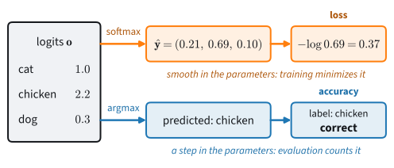
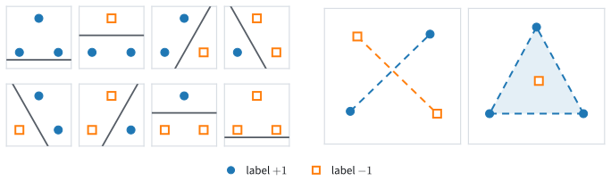

```{.python .input  n=1}
%load_ext d2lbook.tab
tab.interact_select('mxnet', 'pytorch', 'tensorflow', 'jax')
```

# Softmax Regression from Scratch
:label:`sec_softmax_scratch`

Because softmax regression is so fundamental, you ought to know how to
build every piece of it by hand. In :numref:`sec_linear_scratch`, we
assembled linear regression from raw tensors and automatic differentiation
so nothing stayed hidden behind abstractions, and in
:numref:`sec_oo-design`, we encapsulated the training loop in `Trainer` so
we would never have to rewrite it. We follow the exact same pattern here.
What actually changes when moving from regression to classification?
Surprisingly little—only three pieces: the model computes one logit per
class rather than a single scalar, the softmax transforms those logits into
probabilities, and cross-entropy replaces squared error. Everything else
reuses our existing machinery unchanged: `Trainer` drives the exact same
minibatch SGD loop, and `FashionMNIST` from :numref:`sec_fashion_mnist`
streams the images.

Along the way we introduce one reusable building block that every
classifier in the book will inherit: a `Classifier` base class that tracks
both cross-entropy loss (which we optimize) and accuracy (which users
actually care about). Implementing the raw softmax formula also lets us
trigger a classic numerical overflow bug firsthand, motivating the stable
framework formulation we will adopt in the next section. Once training
finishes, the real detective work begins: we inspect the model's
misclassifications, tally a full confusion matrix, and visualize the
learned weights themselves as ten $28 \times 28$ garment templates.

```{.python .input #softmax-regression-scratch-softmax-regression-implementation-from-scratch}
%%tab mxnet
import math
import numpy as np
from mxnet import autograd, gluon, init, np as mnp, npx
from mxnet.gluon import nn
from d2l import mxnet as d2l
npx.set_np()
```

```{.python .input #softmax-regression-scratch-softmax-regression-implementation-from-scratch}
%%tab pytorch
import math
import numpy as np
import torch
from torch import nn
from torch.nn import functional as F
from d2l import torch as d2l
```

```{.python .input #softmax-regression-scratch-softmax-regression-implementation-from-scratch}
%%tab tensorflow
import math
import numpy as np
import tensorflow as tf
from d2l import tensorflow as d2l
```

```{.python .input #softmax-regression-scratch-softmax-regression-implementation-from-scratch}
%%tab jax
import math
import numpy as np
import jax
from jax import numpy as jnp
from flax import nnx
import optax
from d2l import jax as d2l
```

## The Softmax

### Normalizing Each Row

We begin with the core mapping from real-valued logits to probabilities.
For a minibatch of $n$ examples, the logits form an $n \times q$ matrix
$\mathbf{O} = \mathbf{X}\mathbf{W} + \mathbf{b}$ with one row per example
and one column per class (:numref:`subsec_softmax_vectorization`). Softmax
operates independently on each row:

$$\mathrm{softmax}(\mathbf{O})_{ij} = \frac{\exp(O_{ij})}{\sum_{k=1}^q \exp(O_{ik})},$$

so entry $(i, j)$ gives the predicted probability of class $j$ for example
$i$. The denominator—known as the *partition function* in statistical
physics—normalizes each row to sum to 1. Computing this requires just three
steps: (i) exponentiate every entry, (ii) sum across columns (`axis=1`)
with `keepdims=True` so the row sums keep shape $(n, 1)$, and (iii) divide
each row by its normalization constant via broadcasting
(:numref:`subsec_broadcasting`).

```{.python .input #softmax-regression-scratch-the-softmax-2}
def softmax(O):
    O_exp = d2l.exp(O)
    return O_exp / d2l.reduce_sum(O_exp, 1, keepdims=True)  # Broadcast
```

Let us sanity-check `softmax` on two rows: the cat/chicken/dog logits
$(1.0, 2.2, 0.3)$ from :numref:`sec_softmax`, and a row of three identical
zeros.

```{.python .input #softmax-regression-scratch-the-softmax-3}
O = d2l.tensor([[1.0, 2.2, 0.3], [0.0, 0.0, 0.0]])
Y_hat = softmax(O)
Y_hat, d2l.reduce_sum(Y_hat, 1)
```

Sure enough, the first row matches our hand-computed probabilities
$(0.21, 0.69, 0.10)$, equal logits produce a uniform $(1/3, 1/3, 1/3)$
distribution, and every row sums to 1.

### Overflow

Be warned: you should *never* use this naive formula in production, because
it breaks down on large logits. Feed it $(1000, 0, 0)$ in 32-bit floating
point and $\exp(1000)$ overflows to $\infty$ in both the numerator and the
row sum, turning $\infty / \infty$ into `NaN`—even though the true answer
is simply $(1, 0, 0)$ to machine precision. Happily, the shift invariance
we proved in :numref:`sec_softmax` gives an immediate cure: subtracting the
maximum logit of each row before exponentiating leaves the mathematical
result identical while guaranteeing that every exponent is at most 0,
making overflow impossible. Every deep learning framework applies this
shift internally. Let us compare the naive formula, the shifted version,
and the built-in softmax on $(1000, 0, 0)$:

```{.python .input #softmax-regression-scratch-the-softmax-overflow}
%%tab pytorch
O = d2l.tensor([[1000.0, 0.0, 0.0]])
O_max = O.amax(dim=1, keepdim=True)
softmax(O), softmax(O - O_max), torch.softmax(O, dim=1)
```

```{.python .input #softmax-regression-scratch-the-softmax-overflow}
%%tab mxnet
O = d2l.tensor([[1000.0, 0.0, 0.0]])
O_max = O.max(axis=1, keepdims=True)
softmax(O), softmax(O - O_max), npx.softmax(O, axis=1)
```

```{.python .input #softmax-regression-scratch-the-softmax-overflow}
%%tab tensorflow
O = d2l.tensor([[1000.0, 0.0, 0.0]])
O_max = tf.reduce_max(O, axis=1, keepdims=True)
softmax(O), softmax(O - O_max), tf.nn.softmax(O, axis=1)
```

```{.python .input #softmax-regression-scratch-the-softmax-overflow}
%%tab jax
O = d2l.tensor([[1000.0, 0.0, 0.0]])
O_max = O.max(axis=1, keepdims=True)
softmax(O), softmax(O - O_max), jax.nn.softmax(O, axis=1)
```

The naive formula immediately produces `NaN`, whereas both the shifted
formula and the framework's built-in softmax return $(1, 0, 0)$. In real
training, a single `NaN` spreads like a virus: it poisons the minibatch
loss, then the gradients, and on the very next update wipes out the model's
parameters. For our Fashion-MNIST scratch run below, pixel inputs lie in
$[0, 1]$ and the weights stay modest, so we keep the bare three-line
`softmax` for transparency. Even shifting, however, is only half the fix:
very negative logits can still *underflow* their probability to exact zero,
sending $\log 0$ to $-\infty$ in the loss. In :numref:`sec_softmax_concise`,
we eliminate both overflow and underflow together by computing
log-probabilities directly from logits.

## Loss and Accuracy

While optimization minimizes cross-entropy loss, people deploying a
classifier rarely ask "what is its nat loss?"—they want to know how often
its predictions are right. Every classifier in this book will therefore
track two validation metrics: cross-entropy loss (the objective we
optimize) and accuracy (the metric humans interpret). We package this shared
behavior into a `Classifier` base class inheriting from `Module`
(:numref:`sec_oo-design`), leaving concrete subclasses free to define only
their architecture and loss.

### Two Uses of the Logits

Given a logit vector $\mathbf{o} \in \mathbb{R}^q$, a classifier predicts
the class with the largest logit—which, since softmax is strictly
increasing, is also the class with the highest probability. Writing
$y^{(i)} \in \{1, \ldots, q\}$ for the true class of example $i$, *accuracy*
is simply the fraction of examples predicted correctly:

$$\textrm{accuracy} = \frac{1}{n} \sum_{i=1}^n \mathbf{1}\Big(\mathop{\mathrm{argmax}}_j o^{(i)}_j = y^{(i)}\Big),$$
:eqlabel:`eq_accuracy`

where the indicator $\mathbf{1}(\cdot)$ equals 1 when its condition holds
and 0 otherwise. Predicting 9,000 of 10,000 Fashion-MNIST validation images
correctly corresponds to an accuracy of 0.90 and an error rate of 0.10.

As we saw in :numref:`sec_softmax`, we cannot differentiate accuracy
directly because it jumps in flat steps as parameters move; gradient
descent requires the smooth cross-entropy loss instead. Fortunately, both
metrics flow cleanly from the very same vector of logits
(:numref:`fig_mdl-clf-loss-accuracy`).


:label:`fig_mdl-clf-loss-accuracy`

Never assume that validation loss and validation accuracy always move in
lockstep. A model that grows overconfident on even a handful of mistakes
incurs a steep logarithmic penalty, so its validation loss can begin
climbing even while its accuracy is still inching upward. Tracking both
metrics lets us spot that divergence immediately.

### The `Classifier` Class
:label:`subsec_classifier-class`

`Classifier` has one focused job: override `validation_step` so that it
returns a dictionary containing both `'loss'` and `'acc'` on every
validation minibatch. Our `Trainer` from :numref:`sec_oo-design` handles
everything else—averaging each metric across minibatches weighted by batch
size (so the result is the exact mean over all validation examples) and
recording epoch-by-epoch values in `trainer.history['val_loss']` and
`trainer.history['val_acc']`.

:begin_tab:`tensorflow`
As in `Module`, `validation_step` passes `training=False` when invoking the
model.
:end_tab:

:begin_tab:`jax`
`Trainer` JIT-compiles `validation_step`, which returns both metrics as JAX
arrays and averages them across minibatches outside the compiled step.
:end_tab:

```{.python .input #classification-the-classifier-class-1}
%%tab pytorch, mxnet, jax
class Classifier(d2l.Module):  #@save
    """The base class of classification models."""
    def validation_step(self, batch):
        Y_hat = self(*batch[:-1])
        return {'loss': self.loss(Y_hat, batch[-1]),
                'acc': self.accuracy(Y_hat, batch[-1])}
```

```{.python .input #classification-the-classifier-class-1}
%%tab tensorflow
class Classifier(d2l.Module):  #@save
    """The base class of classification models."""
    def validation_step(self, batch):
        Y_hat = self(*batch[:-1], training=False)
        return {'loss': self.loss(Y_hat, batch[-1]),
                'acc': self.accuracy(Y_hat, batch[-1])}
```

That is all `Classifier` needs for validation; concrete subclasses will
provide their own network and loss function.

### Computing Accuracy

The `accuracy` method implements :eqref:`eq_accuracy` on a minibatch. Given
predictions `Y_hat` with one row per example (any extra leading dimensions
are flattened first), we take `argmax` along the last axis—which works
identically whether `Y_hat` holds raw logits or softmax probabilities. We
cast the predicted indices to match the integer dtype of `Y` (since several
frameworks disallow comparing mismatched integer types), compare elementwise
to obtain 1s and 0s, and return either the mean accuracy or—when
`averaged=False`—the per-example indicator vector so we can isolate the
mistakes.

```{.python .input #classification-accuracy-1  n=9}
@d2l.add_to_class(Classifier)  #@save
def accuracy(self, Y_hat, Y, averaged=True):
    """Compute the fraction of correct predictions."""
    Y_hat = d2l.reshape(Y_hat, (-1, Y_hat.shape[-1]))
    preds = d2l.astype(d2l.argmax(Y_hat, axis=1), Y.dtype)
    compare = d2l.astype(preds == d2l.reshape(Y, (-1,)), d2l.float32)
    return d2l.reduce_mean(compare) if averaged else compare
```

:begin_tab:`jax`
The validation step that calls `accuracy` is compiled, so `accuracy` needs no
`jit` of its own.
:end_tab:

### The Default Optimizer

Unless a subclass requests otherwise, we train with minibatch SGD at
learning rate `self.lr`, just as in :numref:`chap_regression`. Because
`Trainer` calls `configure_optimizers` once at the start of training—and
nothing about plain SGD is unique to classification—we attach this default
directly to `d2l.Module` so both regression and classification models
inherit it automatically. Later chapters will override it whenever they
need momentum, Adam, or custom schedules.

```{.python .input #classification-the-classifier-class-2}
%%tab mxnet
@d2l.add_to_class(d2l.Module)  #@save
def configure_optimizers(self):
    return gluon.Trainer(self.collect_params(), 'sgd',
                         {'learning_rate': self.lr})
```

```{.python .input #classification-the-classifier-class-2}
%%tab pytorch
@d2l.add_to_class(d2l.Module)  #@save
def configure_optimizers(self):
    return torch.optim.SGD(self.parameters(), lr=self.lr)
```

```{.python .input #classification-the-classifier-class-2}
%%tab tensorflow
@d2l.add_to_class(d2l.Module)  #@save
def configure_optimizers(self):
    return tf.keras.optimizers.SGD(float(self.lr))
```

```{.python .input #classification-the-classifier-class-2}
%%tab jax
@d2l.add_to_class(d2l.Module)  #@save
def configure_optimizers(self):
    return optax.sgd(self.lr)
```

:begin_tab:`mxnet`
The Gluon `Trainer` receives the parameters that `collect_params` finds:
every parameter declared as a Gluon `Parameter`, including those of a model
written from scratch.
:end_tab:

## The Model and the Loss

### The Parameters

Each $28 \times 28$ image flattens into a vector of $d = 784$ pixel
intensities, and there are $q = 10$ classes. Our model therefore needs a
weight matrix $\mathbf{W} \in \mathbb{R}^{784 \times 10}$ (one column per
class) and a bias vector $\mathbf{b} \in \mathbb{R}^{10}$, totaling 7,850
parameters. Just as in :numref:`sec_linear_scratch`, we initialize the
weights with zero-mean Gaussian noise of standard deviation 0.01 and set
all biases to 0. Because small random weights yield nearly identical logits
across classes, the untrained model begins near a uniform prediction
($\hat{y}_j \approx 0.1$) with an initial loss close to
$\log 10 \approx 2.30$—a handy sanity check to keep in mind, since a first
minibatch loss far from 2.30 almost always flags a bug in data scaling or
loss wiring.

Registering $\mathbf{W}$ and $\mathbf{b}$ with each framework's native
parameter wrapper (as in :numref:`sec_oo-design`) lets the inherited
default SGD optimizer discover them automatically, so
`SoftmaxRegressionScratch` needs no `configure_optimizers` method of its
own.

:begin_tab:`pytorch`
`nn.Parameter` registers each tensor with the module, so
`model.parameters()` lists `W` and `b`.
:end_tab:

:begin_tab:`mxnet`
A Gluon `Parameter` assigned as an attribute of a block is registered with
it, so `model.collect_params()` lists `W` and `b`. `initialize` allocates
their values, which `data()` returns.
:end_tab:

:begin_tab:`tensorflow`
`add_weight` creates each variable and registers it with the Keras model, so
`model.trainable_variables` lists `W` and `b`.
:end_tab:

:begin_tab:`jax`
`nnx.Param` marks each array as a trainable parameter, so
`nnx.state(model)` contains `W` and `b`. As in :numref:`sec_oo-design`,
the argument `rngs` supplies the random key for the initialization.
:end_tab:

```{.python .input #softmax-regression-scratch-the-model-1}
%%tab pytorch
class SoftmaxRegressionScratch(Classifier):
    """Softmax regression implemented from scratch."""
    def __init__(self, num_inputs, num_outputs, lr, std=0.01):
        super().__init__()
        self.save_hyperparameters()
        self.W = nn.Parameter(d2l.normal(0, std, (num_inputs, num_outputs)))
        self.b = nn.Parameter(d2l.zeros(num_outputs))
```

```{.python .input #softmax-regression-scratch-the-model-1}
%%tab mxnet
class SoftmaxRegressionScratch(Classifier):
    """Softmax regression implemented from scratch."""
    def __init__(self, num_inputs, num_outputs, lr, std=0.01):
        super().__init__()
        self.save_hyperparameters()
        self.W = gluon.Parameter('W', shape=(num_inputs, num_outputs),
                                 init=init.Normal(std))
        self.b = gluon.Parameter('b', shape=(num_outputs,), init=init.Zero())
        self.initialize()
```

```{.python .input #softmax-regression-scratch-the-model-1}
%%tab tensorflow
class SoftmaxRegressionScratch(Classifier):
    """Softmax regression implemented from scratch."""
    def __init__(self, num_inputs, num_outputs, lr, std=0.01):
        super().__init__()
        self.save_hyperparameters()
        normal = tf.keras.initializers.RandomNormal(mean=0, stddev=std)
        self.W = self.add_weight(name='W', shape=(num_inputs, num_outputs),
                                 initializer=normal)
        self.b = self.add_weight(name='b', shape=(num_outputs,),
                                 initializer='zeros')
```

```{.python .input #softmax-regression-scratch-the-model-1}
%%tab jax
class SoftmaxRegressionScratch(Classifier):
    """Softmax regression implemented from scratch."""
    def __init__(self, num_inputs, num_outputs, lr, std=0.01, rngs=None):
        super().__init__()
        self.save_hyperparameters(ignore=['rngs'])
        rngs = nnx.Rngs(d2l.get_key()) if rngs is None else rngs
        self.W = nnx.Param(
            rngs.params.normal((num_inputs, num_outputs)) * std)
        self.b = nnx.Param(jnp.zeros(num_outputs))
```

### The Forward Pass

Each minibatch of $n$ images arrives as a four-dimensional tensor
(:numref:`sec_fashion_mnist`). In `forward`, we flatten every image into a
784-element row vector, compute $\mathbf{O} = \mathbf{X}\mathbf{W} + \mathbf{b}$
with the bias broadcast across rows, and apply `softmax`. Notice the trade-off:
flattening throws away all 2D spatial layout—pixels that sit right next to
each other look no different to a linear layer than pixels at opposite
corners. Convolutional neural networks (:numref:`chap_cnn`) will exploit
that spatial geometry directly.

:begin_tab:`mxnet`
The minibatch has shape $(n, 1, 28, 28)$, channels first. The MXNet version
reads the values of the parameters with `data()`.
:end_tab:

:begin_tab:`pytorch`
The minibatch has shape $(n, 1, 28, 28)$, channels first.
:end_tab:

:begin_tab:`tensorflow`
The minibatch has shape $(n, 28, 28, 1)$, channels last.
:end_tab:

:begin_tab:`jax`
The minibatch has shape $(n, 28, 28, 1)$, channels last.
:end_tab:

```{.python .input #softmax-regression-scratch-the-model-2}
%%tab pytorch, tensorflow, jax
@d2l.add_to_class(SoftmaxRegressionScratch)
def forward(self, X):
    X = d2l.reshape(X, (-1, self.num_inputs))  # One flattened image per row
    return softmax(d2l.matmul(X, self.W) + self.b)
```

```{.python .input #softmax-regression-scratch-the-model-2}
%%tab mxnet
@d2l.add_to_class(SoftmaxRegressionScratch)
def forward(self, X):
    X = d2l.reshape(X, (-1, self.num_inputs))  # One flattened image per row
    return softmax(d2l.matmul(X, self.W.data()) + self.b.data())
```

### The Cross-Entropy Loss

Cross-entropy is arguably the single most widely used loss function in deep
learning. Recall from :numref:`sec_softmax` that for each example it simply
takes the negative logarithm of the predicted probability assigned to the
true class, $l = -\log \hat{y}_y$. Rather than looping over a minibatch in
Python, we use vectorized indexing (:numref:`sec_ndarray`) to pluck out one
entry per row of $\hat{\mathbf{Y}}$ using the zero-based integer labels in
`y`. Let us test this trick on two toy examples over three classes with
labels 0 and 2:

:begin_tab:`tensorflow`
As in :numref:`sec_ndarray`, `tf.gather` with `batch_dims=1` picks, in each
row, the entry at that row's label.
:end_tab:

```{.python .input #softmax-regression-scratch-the-cross-entropy-loss-1}
%%tab mxnet, pytorch, jax
y = d2l.tensor([0, 2])
y_hat = d2l.tensor([[0.1, 0.3, 0.6], [0.3, 0.2, 0.5]])
y_hat[[0, 1], y]
```

```{.python .input #softmax-regression-scratch-the-cross-entropy-loss-1}
%%tab tensorflow
y_hat = tf.constant([[0.1, 0.3, 0.6], [0.3, 0.2, 0.5]])
y = tf.constant([0, 2])
tf.gather(y_hat, y, batch_dims=1)
```

That extracts 0.1 for the first example and 0.5 for the second. Wrapping
this in `cross_entropy`, we average the negative logarithms across the
minibatch. Notice the one defensive clamp to $10^{-12}$ before taking the
logarithm: it stops an underflowed zero probability from turning into
$-\infty$, capping the per-example loss at $27.6$, though—as the comment
notes—clamping also zeroes out the gradient whenever it triggers. In the
next section, we replace this stopgap with a fused loss computed directly
from logits.

```{.python .input #softmax-regression-scratch-the-cross-entropy-loss-2}
%%tab pytorch
def cross_entropy(y_hat, y):  #@save
    # Tiny clip to keep log finite when softmax outputs underflow to 0.
    p = y_hat[list(range(len(y_hat))), y].clamp(min=1e-12)
    return -d2l.reduce_mean(d2l.log(p))

cross_entropy(y_hat, y)
```

```{.python .input #softmax-regression-scratch-the-cross-entropy-loss-2}
%%tab mxnet
def cross_entropy(y_hat, y):  #@save
    # Tiny clip to keep log finite when softmax outputs underflow to 0.
    p = y_hat[list(range(len(y_hat))), y].clip(min=1e-12)
    return -d2l.reduce_mean(d2l.log(p))

cross_entropy(y_hat, y)
```

```{.python .input #softmax-regression-scratch-the-cross-entropy-loss-2}
%%tab jax
def cross_entropy(y_hat, y):  #@save
    # Tiny clip to keep log finite when softmax outputs underflow to 0.
    p = jnp.clip(y_hat[jnp.arange(len(y_hat)), y], min=1e-12)
    return -d2l.reduce_mean(d2l.log(p))

cross_entropy(y_hat, y)
```

```{.python .input #softmax-regression-scratch-the-cross-entropy-loss-2}
%%tab tensorflow
def cross_entropy(y_hat, y):  #@save
    p = tf.gather(y_hat, y, batch_dims=1)
    # Tiny clip to keep log finite when softmax outputs underflow to 0.
    return -tf.reduce_mean(tf.math.log(tf.maximum(p, 1e-12)))

cross_entropy(y_hat, y)
```

That yields the mean of $-\log 0.1 \approx 2.30$ and $-\log 0.5 \approx 0.69$,
or roughly 1.50. Let us attach it as the model's `loss` method:

```{.python .input #softmax-regression-scratch-the-cross-entropy-loss-3}
@d2l.add_to_class(SoftmaxRegressionScratch)
def loss(self, y_hat, y):
    return cross_entropy(y_hat, y)
```

## Training and Evaluation

### The Training Run

With parameters, forward pass, and loss ready, we hand everything over to
`Trainer`. We train for 10 epochs with minibatches of 256 images and
learning rate 0.1 (235 gradient updates per epoch), tracking validation
loss and accuracy on the 10,000 test images after each epoch. Keep in mind
that `max_epochs`, `batch_size`, and `lr` are all adjustable
hyperparameters: none of them is learned by SGD, yet each shapes both
training speed and generalization. Tuning them against validation accuracy
is itself a form of model selection—we examine what repeated tuning does to
the reliability of our score in :numref:`chap_classification_generalization`.

```{.python .input #softmax-regression-scratch-training}
data = d2l.FashionMNIST(batch_size=256)
model = SoftmaxRegressionScratch(num_inputs=784, num_outputs=10, lr=0.1)
trainer = d2l.Trainer(max_epochs=10)
trainer.fit(model, data)
```

Training loss drops rapidly during the first epoch and then tapers off
gradually. Validation accuracy clears 75%–80% after a single epoch and
settles near 83% by epoch 10, with minor epoch-to-epoch wiggles of a point
or two as minibatch SGD continues nudging the weights. Training loss ends
around 0.45, with validation loss hovering just a few hundredths higher.

Often we want to evaluate a finished model without re-running `fit`—for
example, to score it once on a held-out test split. Let us add an
`evaluate` helper to `Trainer` that reuses `validate` (:numref:`sec_oo-design`)
over `data.val_dataloader()` (or `data.train_dataloader()` when
`train=True`) without modifying any parameters.

```{.python .input #softmax-regression-scratch-the-training-run-1}
@d2l.add_to_class(d2l.Trainer)  #@save
def evaluate(self, model, data, train=False):
    """Metrics of `model` on the validation data of `data` (on its training
    data if `train`), averaged over examples."""
    self.train_dataloader = None
    self.val_dataloader = (data.train_dataloader() if train
                           else data.val_dataloader())
    self.prepare_model(model)
    return self.validate()
```

Averaged across all 10,000 validation images, these metrics match the final
points recorded in `trainer.history['val_loss'][-1]` and
`trainer.history['val_acc'][-1]`.

```{.python .input #softmax-regression-scratch-prediction-accuracy}
trainer.evaluate(model, data)
```

Our classifier gets roughly 83% of the validation images right—and we
should not pretend to greater precision than that, since random
initialization and minibatch shuffling shift individual runs anywhere
between 82% and 84% (recall our discussion of reporting ranges in
:numref:`sec_ndarray`).

How well does the finished model fit the 60,000 training images? Because
the plotted training curve averages loss *during* each epoch while weights
are still moving, let us evaluate the frozen model cleanly on the training
split.

```{.python .input #softmax-regression-scratch-the-training-run-2}
trainer.evaluate(model, data, train=True)
```

Training accuracy comes in around 84%, barely one or two percentage points
above validation accuracy: the model performs almost identically on unseen
garments and on the ones it trained on. That tiny generalization gap is no
fluke. A linear model with 7,850 parameters simply lacks the capacity to
memorize arbitrary labels across 60,000 images; we will make that capacity
argument mathematically precise in
:numref:`chap_classification_generalization`.

### Misclassified Images

Overall accuracy tells us *how often* the classifier errs, not *how* it
errs. Let us pull the first minibatch of 256 validation images, generate
predictions, and inspect the mistakes directly.

```{.python .input #softmax-regression-scratch-prediction-1}
X, y = next(iter(data.val_dataloader()))
preds = d2l.astype(d2l.argmax(model(X), axis=1), y.dtype)
wrong = preds != y
print(f'{int(d2l.reduce_sum(d2l.astype(wrong, d2l.int32)))} of {len(y)} wrong')
```

Let us display the first eight misclassified images, showing the true label
above the model's prediction.

```{.python .input #softmax-regression-scratch-prediction-2}
labels = [f'{true}\n→ {pred}' for true, pred in zip(
    data.text_labels(y[wrong]), data.text_labels(preds[wrong]))]
data.visualize([X[wrong], y[wrong]], labels=labels)
```

Roughly 30 to 45 of the 256 images are misclassified, matching our ~17%
error rate. Notice how reasonable most of these errors are: the model
mostly confuses one top for another or one style of shoe for another. To be
fair to our linear classifier, at $28 \times 28$ resolution several of
these items would trip up a human observer too.

### The Confusion Matrix

Eight hand-picked errors are only anecdotes; to see the full pattern across
all 10,000 validation images, we build a *confusion matrix*
$\mathbf{N} \in \mathbb{R}^{q \times q}$. Writing
$\hat{c}^{(m)} = \operatorname{argmax}_j o^{(m)}_j$ for the predicted class
of example $m$ (reserving $\hat{\mathbf{y}}$ for predicted probabilities),
each entry

$$N_{ij} = \sum_{m=1}^n \mathbf{1}\big(\hat{c}^{(m)} = i\big)\, \mathbf{1}\big(y^{(m)} = j\big)$$
:eqlabel:`eq_confusion-matrix`

tallies how many examples of true class $j$ were predicted as class $i$.
Here rows index predicted classes and columns index true classes: diagonal
entries count correct predictions (so summing the diagonal and dividing by
$n$ recovers accuracy), while off-diagonal entries record every specific
type of confusion. Note that libraries differ in transpose convention—for
example, scikit-learn's `confusion_matrix` puts true classes along the
rows. We place true classes in the columns for a clean algebraic payoff we
will exploit in :numref:`sec_environment-and-distribution-shift`: once each
column is normalized to sum to 1, multiplying $\mathbf{C}$ by a vector of
true class proportions $\mathbf{p}$ yields the predicted class frequencies
$\boldsymbol{\mu} = \mathbf{C}\mathbf{p}$, a linear system we can invert to
recover $\mathbf{p}$ under label shift.

:begin_tab:`tensorflow`
`tf.math.confusion_matrix` likewise puts true classes in the rows and
predicted classes in the columns—the transpose of our $\mathbf{N}$.
:end_tab:

We can compute all 100 counts without a single loop over examples using
one-hot matrices (:numref:`sec_softmax`). Let
$\mathbf{P} \in \{0, 1\}^{n \times q}$ and
$\mathbf{Y} \in \{0, 1\}^{n \times q}$ hold the one-hot rows of predicted
and true classes for a minibatch. Then

$$(\mathbf{P}^\top \mathbf{Y})_{ij} = \sum_{m=1}^n P_{mi} Y_{mj}$$

adds 1 whenever example $m$ is predicted as $i$ and truly belongs to $j$,
matching :eqref:`eq_confusion-matrix` identically. Accumulating
$\mathbf{P}^\top \mathbf{Y}$ across all validation minibatches builds
$\mathbf{N}$ in a few matrix multiplications. The helper `one_hot` creates
each one-hot matrix in one broadcasted comparison against
$(0, 1, \ldots, q-1)$.

```{.python .input #softmax-regression-scratch-the-confusion-matrix-1}
def one_hot(y, q):
    """Rows of the q x q identity matrix, one per class index in y."""
    return d2l.astype(d2l.reshape(y, (-1, 1)) == d2l.arange(q, dtype=y.dtype),
                      d2l.float32)

N = d2l.zeros((10, 10))
for X, y in data.val_dataloader():
    P = one_hot(d2l.argmax(model(X), axis=1), 10)
    N += d2l.matmul(d2l.transpose(P), one_hot(y, 10))
int(d2l.reduce_sum(N))
```

All 10,000 validation images are accounted for. Because raw counts depend
on class frequency, we normalize each column of $\mathbf{N}$ by its sum to
obtain $C_{ij} = N_{ij} / \sum_{i'} N_{i'j}$, an empirical estimate of the
conditional probability $P(\hat{c} = i \mid y = j)$. Each column shows
where examples of true class $j$ land, while the diagonal gives per-class
recognition rates. Let us render $\mathbf{C}$ as a heatmap via
`d2l.show_heatmaps`.

```{.python .input #softmax-regression-scratch-prediction-confusion}
C = N / d2l.reduce_sum(N, 0, keepdims=True)  # Each column sums to 1
names = data.text_labels(range(10))
d2l.show_heatmaps(d2l.reshape(C, (1, 1, 10, 10)), xlabel='true class',
                  ylabel='predicted class', figsize=(4, 4), cmap='Blues',
                  xticklabels=names, yticklabels=names)
```

Let us also print the five largest off-diagonal entries to spotlight the
most frequent confusions:

```{.python .input #softmax-regression-scratch-the-confusion-matrix-2}
mistakes = d2l.numpy(N) * (1 - np.eye(10))  # Zero the diagonal
for k in np.argsort(mistakes, axis=None)[::-1][:5]:
    i, j = divmod(int(k), 10)
    print(f'{names[j]} taken for {names[i]}: {int(mistakes[i, j])}')
```

The heatmap confirms the exact prediction we made just from eyeing the raw
images in :numref:`sec_fashion_mnist`. Trousers, bags, and all three shoe
types are recognized roughly 90% of the time or better, whereas shirts are
identified only about half the time (40%–60% across runs). Errors cluster
tightly into two look-alike families: in every run, the five biggest
mistakes all involve swapping one top (T-shirt, pullover, coat, or shirt)
for another—with the worst single confusion (pullover vs. coat or shirt)
claiming between a sixth and a third of that class—while sandals, sneakers,
and ankle boots trade almost all of their few errors internally. Because
shirts sit visually in the middle of the four tops—sharing outlines with
all of them and differing only in collars, buttons, or sleeve cuffs—they
absorb confusions from every neighbor.

### The Learned Templates

Because our model is linear, we can literally *look* at what it learned.
Class $j$'s logit is simply the inner product between the flattened image
and column $j$ of $\mathbf{W}$ (plus $b_j$). Reshaping that 784-element
column back to $28 \times 28$ produces a visual *template* for class $j$:
bright garment pixels landing on red weights boost class $j$'s score, while
bright pixels landing on blue weights suppress it. Let us plot all ten
templates on a single shared color scale centered at zero.

```{.python .input #softmax-regression-scratch-what-the-model-learned}
%%tab pytorch, tensorflow
W = d2l.numpy(model.W)
templates = W.T.reshape(10, 28, 28)  # Column j of W as an image
v = np.abs(templates).max()
d2l.show_images(templates, 2, 5, titles=names, cmap='RdBu_r', vmin=-v, vmax=v);
```

```{.python .input #softmax-regression-scratch-what-the-model-learned}
%%tab mxnet
W = d2l.numpy(model.W.data())
templates = W.T.reshape(10, 28, 28)  # Column j of W as an image
v = np.abs(templates).max()
d2l.show_images(templates, 2, 5, titles=names, cmap='RdBu_r', vmin=-v, vmax=v);
```

```{.python .input #softmax-regression-scratch-what-the-model-learned}
%%tab jax
W = d2l.numpy(model.W[...])
templates = W.T.reshape(10, 28, 28)  # Column j of W as an image
v = np.abs(templates).max()
d2l.show_images(templates, 2, 5, titles=names, cmap='RdBu_r', vmin=-v, vmax=v);
```

Each template emerges as a ghostly silhouette of its garment, and those ten
images *are* the entire classifier: predicting a category amounts to
scoring which template an input overlaps most closely (a close cousin of
the pixel-counting naive Bayes classifier in
:numref:`sec_mdl-naive_bayes`). Trousers, bags, and footwear carve out
unmistakable profiles—notice the crisp blue gap between the trouser legs,
specifically penalizing bright center pixels that belong to dresses. The
four tops, by contrast, share almost the same overall torso and diverge
mostly around the neckline and sleeves—precisely the handful of pixels
where the confusion matrix revealed the heaviest errors.

Training longer will not erase those mistakes. Because every class score is
a fixed weighted sum of individual pixels, decision boundaries stay flat
hyperplanes in pixel space no matter how long we optimize, and a subtle
collar or button spans too few pixels to sway a global dot product
reliably. Breaking past this ceiling requires models that learn nonlinear
features from local groups of pixels—the multilayer perceptrons of
:numref:`chap_perceptrons` and convolutional networks of
:numref:`chap_cnn`. Before heading there, however, we still have one loose
end in our scratch implementation: fixing the numerical overflow and
underflow lurking inside our naive `softmax` and `cross_entropy`.

## Summary

We now have hands-on experience building both linear regression and linear
classification from scratch—reaching what would arguably have been
state-of-the-art statistical modeling in the 1960s and 1970s. Implementing
softmax regression required just three additions on top of our existing
training pipeline: a $784 \times 10$ weight matrix and 10-element bias
registered as trainable parameters, a forward pass flattening each image
and applying rowwise softmax to $\mathbf{O} = \mathbf{X}\mathbf{W} + \mathbf{b}$,
and cross-entropy computed via vectorized indexing. Along the way we built
the reusable `Classifier` base class (reporting both smooth cross-entropy
loss and discrete accuracy on validation minibatches) and `Trainer.evaluate`.
Ten epochs of minibatch SGD on Fashion-MNIST achieve roughly 83% validation
accuracy and 84% training accuracy; inspecting the confusion matrix and the
ten learned $28 \times 28$ templates reveals why errors concentrate among
look-alike tops. Finally, our naive softmax overflows to `NaN` on large
logits and relies on a crude clamp in the loss—issues we fix cleanly in the
next section by fusing softmax and cross-entropy in log space.

## Exercises

1. [code] **Underflow.** The `softmax` of this section returns `NaN` on
   the logits $(1000, 0, 0)$, and subtracting the largest logit of the row
   fixes it.
    1. Show that `softmax` also returns `NaN` on the row
       $(-1000, -1000, -1000)$, and identify the operation that produces
       the `NaN` in this case. Check that the shifted version returns
       $(1/3, 1/3, 1/3)$.
    1. Take the logits $(0, -200, 0)$ and the label `y = 1`, the class of
       the logit $-200$. Compute the shifted softmax and `cross_entropy` of
       the result. Then compute the
       gradient of this loss with respect to the logits by automatic
       differentiation, and compare it with the gradient
       $\hat{\mathbf{y}} - \mathbf{y}$ derived in :numref:`sec_softmax`.
       Explain the difference, and what it means for training on an
       example that the model gets badly wrong.

1. [code] **Cross-entropy from one-hot labels.** The `cross_entropy` of this
   section selects the correct-class probability by indexing. Implement an
   alternative that follows the definition $-\sum_j y_j \log \hat{y}_j$
   literally, by converting `y` to a one-hot matrix and taking row-wise
   inner products.
    1. Use it as the `loss` of `SoftmaxRegressionScratch` and confirm that
       training is unchanged.
    1. Time both versions on random probability matrices with $256$ rows
       and $q \in \{10, 10^3, 10^5\}$ columns, and state how the memory
       that each version allocates grows with $q$.
    1. Describe a setting in which the inner-product form applies but the
       indexing form does not.

1. **Large vocabularies.** Suppose that softmax regression predicts the
   next word from a feature vector of dimension $d = 1024$. The vocabulary
   has $V = 10^6$ words, and each minibatch holds $n = 256$ examples.
   List the operations of `forward` and `cross_entropy` whose cost grows
   with $V$. Compute the multiply-adds of the matrix product, the float32
   memory of `W`, and the float32 memory of the $n \times V$ matrix of
   probabilities, and compare each number with the Fashion-MNIST model of
   this section.

1. [code] **Hyperparameter sweep.** Retrain `SoftmaxRegressionScratch` with
   `d2l.Trainer(max_epochs=10)`, varying one hyperparameter at a time, and
   read the final losses from `trainer.history`.
    1. Plot the final validation loss against the learning rate over
       $\{0.01, 0.03, 0.1, 0.3, 1\}$.
    1. Plot the final training and validation losses against the minibatch
       size over $\{8, 32, 256, 2048\}$ at learning rate $0.1$.
    1. Compute the number of parameter updates that ten epochs over the
       60,000 training images take at each minibatch size. Use these counts
       to explain the trend in the previous plot, and predict how the
       comparison changes when every run takes the same number of updates.

1. [code] **Templates and class means.** The templates are what minibatch
   SGD made of the pixels it saw.
    1. Train `SoftmaxRegressionScratch` again with `std=0`, so that every
       weight starts at 0 and every class starts with the same logit.
       Explain why training works all the same, and compare the accuracy
       and the templates with those of the text.
    1. Show that after one SGD step from zero weights, column $j$ of
       $\mathbf{W}$ is proportional to
       $\sum_i \big(y^{(i)}_j - \tfrac{1}{10}\big)\, \mathbf{x}^{(i)}$ over
       the first minibatch: the sum of the images of class $j$ minus a
       tenth of the sum of all images.
    1. Compute the mean image of each class over the training set and
       compare it with the trained template of that class, by eye and by
       the correlation of their pixels. Where do they agree, and where does
       a template depart from the mean? Explain why a template that merely
       copied the class mean would confuse the tops even more.

:begin_tab:`mxnet`
[Discussions](https://d2l.discourse.group/t/50)
:end_tab:

:begin_tab:`pytorch`
[Discussions](https://d2l.discourse.group/t/51)
:end_tab:

:begin_tab:`tensorflow`
[Discussions](https://d2l.discourse.group/t/225)
:end_tab:

:begin_tab:`jax`
[Discussions](https://d2l.discourse.group/t/17982)
:end_tab:

<!-- slides -->

::: {.slide}
::: {.cover}
[Dive into Deep Learning · §3.3]{.kicker}

Softmax Regression from Scratch<br>**the softmax · loss and accuracy · registered parameters · cross-entropy by indexing · training · the confusion matrix · templates**
:::
:::

::: {.slide title="A Softmax Written From Its Formula Returns NaN"}
[The problem]{.kicker}

A classifier needs three pieces that linear regression did not have:
$q = 10$ outputs, the softmax, and the cross-entropy loss.

. . .

Written from its formula, the softmax fails on one large logit:

$$\mathrm{softmax}(1000, 0, 0) = \Big(\tfrac{e^{1000}}{e^{1000} + 2}, \ldots\Big) = \Big(\tfrac{\infty}{\infty}, 0, 0\Big) = (\texttt{NaN}, 0, 0)$$

- $e^{1000}$ is larger than any float32 number, so it is stored as $\infty$.
- The right answer is $(1, 0, 0)$.

::: {.d2l-note}
Write the three pieces with tensors, find where they break, train on
Fashion-MNIST, and look at what the model gets wrong and what it learned.
:::
:::

::: {.slide title="By the End of This Deck You Can"}
[Goals]{.kicker}

- compute a rowwise softmax with broadcasting, and say when it overflows;
- explain why we train on the loss and report the accuracy, and write the
  `Classifier` base class that reports both;
- register $\mathbf{W}$ ($784 \times 10$) and $\mathbf{b}$ as parameters;
- compute the cross-entropy by indexing the true-class probability;
- train with the reused `Trainer` and read `trainer.evaluate` on
  validation and training images;
- count a confusion matrix with one matrix product per minibatch, and show
  the ten columns of $\mathbf{W}$ as the templates they are.

**Running example:** Fashion-MNIST, 60,000 training and 10,000 validation
images in minibatches of 256; $28 \times 28 = 784$ pixels, 10 classes.
:::

::: {.slide title="Three New Pieces, Everything Else Reused"}
[Where this fits]{.kicker}

::: {.cols .vc}
::: {.col}
| section | adds |
|---|---|
| Softmax Regression | probabilities over classes, cross-entropy |
| Image Classification Data | Fashion-MNIST in minibatches |
| **Softmax Regression from Scratch** | **softmax regression by hand, the `Classifier` class** |
| Concise Implementation | framework layers, a stable loss |
| Measuring Classifiers | precision, recall, costs, calibration |
| Generalization in Classification | error bars, test-set reuse, VC dimension |
| Environment and Distribution Shift | correcting for shifted data |
:::

::: {.col .narrow}
- **Uses:** the `Trainer` and SGD of linear regression; `FashionMNIST`;
  softmax and cross-entropy.
- **Adds:** `Classifier`, the base class of every classifier in the book.
- **Skips:** a numerically stable loss (next deck).
:::
:::
:::

::: {.slide}
::: {.divider}
[01]{.dnum}

[The softmax]{.dtitle}

[rowwise normalization · overflow]{.dsub}
:::
:::

::: {.slide title="The Softmax Normalizes Each Row of the Logits"}
[The softmax]{.kicker}

Logits $\mathbf{O} = \mathbf{X}\mathbf{W} + \mathbf{b}$: one row per
example, one column per class.

$$\mathrm{softmax}(\mathbf{O})_{ij} = \frac{\exp(O_{ij})}{\sum_{k=1}^q \exp(O_{ik})}$$

@softmax-regression-scratch-the-softmax-2

::: {.d2l-note}
Exponentiate, sum each row, divide. `keepdims=True` keeps the sums as an
$(n, 1)$ column, which broadcasts against the $n \times q$ matrix.
:::
:::

::: {.slide title="Logits (1.0, 2.2, 0.3) Give Probabilities (0.21, 0.69, 0.10)"}
[The softmax]{.kicker}

Logits for cat, chicken, and dog on an image of a chicken, and three equal
logits:

@softmax-regression-scratch-the-softmax-3

- Equal logits give every class $1/3$.
- Every row sums to 1.
:::

::: {.slide title="Subtracting the Row Maximum Prevents the Overflow"}
[The softmax]{.kicker}

$\mathrm{softmax}(\mathbf{o} - c\mathbf{1}) = \mathrm{softmax}(\mathbf{o})$
for any $c$. With $c = \max_k o_k$ every exponent is $\le 0$:

@softmax-regression-scratch-the-softmax-overflow

::: {.d2l-note .warn}
The built-in softmax shifts first. A probability can still underflow to 0,
and $\log 0 = -\infty$: the next deck fixes the loss.
:::
:::

::: {.slide title="Check: Three Very Negative Logits"}
[Check]{.kicker}

What does the direct formula return for the logits
$(-1000, -1000, -1000)$? And the shifted one?

::: {.fragment .fade-up}
::: {.d2l-note}
**Answer.** Every $\exp(-1000)$ underflows to 0, so the direct formula
computes $0/0$, which is `NaN`, in all three entries. The shifted logits are
$(0, 0, 0)$, which give $(1/3, 1/3, 1/3)$.
:::
:::
:::

::: {.slide}
::: {.divider}
[02]{.dnum}

[Loss and accuracy]{.dtitle}

[two uses of the logits · the `Classifier` class]{.dsub}
:::
:::

::: {.slide title="The Loss Can Change While Every Decision Stays the Same"}
[The problem]{.kicker}

Two models give the correct class of an image probability $0.51$ and
$0.99$.

- Both predict that class: both decisions are **right**.
- Their losses: $-\log 0.51 \approx 0.67$ and $-\log 0.99 \approx 0.01$.

. . .

The user asks a different question: **how often is the decision right?**
That number changes only in jumps, so it cannot be trained on.

::: {.d2l-note}
Train on the loss, report the accuracy: one base class computes both.
:::
:::

::: {.slide title="Accuracy Is the Fraction of Correct Predictions"}
[Loss and accuracy]{.kicker}

Predicted class: the largest logit (the softmax keeps the order). With
logits $\mathbf{o}^{(i)}$ and classes $y^{(i)} \in \{1, \ldots, q\}$:

$$\textrm{accuracy} = \frac{1}{n} \sum_{i=1}^n \mathbf{1}\Big(\mathop{\mathrm{argmax}}_j o^{(i)}_j = y^{(i)}\Big)$$

- 9,000 of 10,000 validation images right: accuracy $0.9$, error rate
  $0.1$.
:::

::: {.slide title="Accuracy Has Zero Gradient Almost Everywhere"}
[Loss and accuracy]{.kicker}

- Margin $m = o_y - \max_{j \neq y} o_j$: right if $m > 0$, wrong if
  $m < 0$.
- Accuracy is a **step** function of the margins, hence of the parameters:
  its gradient is zero wherever it exists.
- Cross-entropy is **smooth** and decreasing in $m$: a direction at every
  point.

::: {.d2l-note .rule}
Gradient descent lowers the loss; we watch the accuracy alongside.
:::
:::

::: {.slide title="One Logit Vector, Two Uses"}
[Loss and accuracy]{.kicker}



Training reads the top branch, evaluation the bottom one.
:::

::: {.slide title="Check: What Changed?"}
[Check]{.kicker}

Between two epochs:

1. the validation loss falls from $0.40$ to $0.35$; the accuracy stays at
   88%;
2. the validation loss rises from $0.45$ to $0.50$; the accuracy rises from
   87% to 88%.

What happened in each case?

::: {.fragment .fade-up}
::: {.d2l-note}
**Answers.** 1. The model grew more confident on examples it already gets
right. 2. It fixed a few mistakes but became confidently wrong on some
others, each costing a large loss.
:::
:::
:::

::: {.slide title="Every Classifier Reports Loss and Accuracy"}
[The `Classifier` class]{.kicker}

@classification-the-classifier-class-1

- Overrides `Module.validation_step`, which returned only the loss.
- A subclass supplies its network and its loss; the next section writes
  both for softmax regression.
:::

::: {.slide title="The Trainer Averages Over Examples, Not Minibatches"}
[The `Classifier` class]{.kicker}

$10{,}000 = 39 \times 256 + 16$: the last validation minibatch holds 16
images. With $n_b$ examples and mean metric $m_b$ in minibatch $b$:

$$\bar{m} = \frac{\sum_b n_b\, m_b}{\sum_b n_b}$$

- This is the exact mean over all 10,000 images.
- An unweighted mean of the $m_b$ would count the 16 images like 256.
- Stored per epoch in `trainer.history['val_loss']`, `['val_acc']`.
:::

::: {.slide title="Accuracy in Four Lines"}
[The `Classifier` class]{.kicker}

`argmax` over the classes, compare with the labels, average the 0s and 1s:

@classification-accuracy-1

- Cast to the label type first: some frameworks compare only equal types.
- `averaged=False` returns the 0/1 vector: which examples are wrong.
:::

::: {.slide title="A Default Optimizer, Installed Once on Module"}
[The `Classifier` class]{.kicker}

The `Trainer` calls `configure_optimizers` once, at the start of training:

@classification-the-classifier-class-2

- Minibatch SGD at the model's learning rate `self.lr`.
- On `Module`, so regression models inherit it too; later chapters
  override it.
:::

::: {.slide}
::: {.divider}
[03]{.dnum}

[The model and the loss]{.dtitle}

[registered parameters · forward pass · cross-entropy]{.dsub}
:::
:::

::: {.slide title="7,850 Registered Parameters: W Is 784 × 10, b Has 10 Entries"}
[The model]{.kicker}

Weights from $\mathcal{N}(0, 0.01^2)$, biases 0, registered with the
module:

| framework | parameter type | found by the default SGD via |
|---|---|---|
| PyTorch | `nn.Parameter(tensor)` | `model.parameters()` |
| TensorFlow | `self.add_weight(...)` | `model.trainable_variables` |
| MXNet | `gluon.Parameter(...)`, read with `data()` | `model.collect_params()` |
| JAX | `nnx.Param(array)` | `nnx.state(model)` |

::: {.d2l-note}
No `configure_optimizers` of our own: the default minibatch SGD of
`Module` finds registered parameters.
:::
:::

::: {.slide title="The Forward Pass Is One (256×784)(784×10) Product and a Softmax"}
[The model]{.kicker}

Flatten each image to a row of 784 pixel values, compute
$\mathbf{O} = \mathbf{X}\mathbf{W} + \mathbf{b}$, apply the softmax:

@softmax-regression-scratch-the-model-2

- Broadcasting adds $\mathbf{b}$ to every row.
- Flattening discards which pixels are neighbors.
:::

::: {.slide title="Indexing Picks the Probability of the True Class"}
[The loss]{.kicker}

$l = -\log \hat{y}_y$. Row indices plus labels pick one entry per row, with
no loop. Labels 0 and 2:

@softmax-regression-scratch-the-cross-entropy-loss-1

::: {.d2l-note}
Labels are class indices counted from 0, as stored by the loader.
:::
:::

::: {.slide title="The Loss Is the Mean of −log over the Picked Probabilities"}
[The loss]{.kicker}

@softmax-regression-scratch-the-cross-entropy-loss-2

- $(-\log 0.1 - \log 0.5)/2 = (2.30 + 0.69)/2 \approx 1.50$.
- The one line not in the definition: a floor of $10^{-12}$ under each
  probability, so that an underflowed 0 costs $27.6$, not $\infty$.

::: {.d2l-note .warn}
A probability raised to the floor has zero gradient: a badly wrong example
stops contributing to training. The next deck removes the floor.
:::
:::

::: {.slide title="Check: The Loss Before Training"}
[Check]{.kicker}

The weights start at $\mathcal{N}(0, 0.01^2)$ and the biases at 0. Roughly
what loss should the first minibatch report?

::: {.fragment .fade-up}
::: {.d2l-note}
**Answer.** Pixel values lie in $[0, 1]$, so the logits are all close to 0
and the softmax is close to uniform, $\hat{y}_j \approx 0.1$. The loss is
about $-\log 0.1 = \log 10 \approx 2.30$.
:::
:::
:::

::: {.slide}
::: {.divider}
[04]{.dnum}

[Training and evaluation]{.dtitle}

[ten epochs · mistakes · the confusion matrix]{.dsub}
:::
:::

::: {.slide title="Ten Epochs of Minibatch SGD Reach About 83%"}
[Training]{.kicker}

::: {.cols .vc}
::: {.col .narrow}
Learning rate 0.1, 235 minibatches of 256 per epoch (the last of 96).

- 75% to 80% after one epoch, about 83% after ten; not a steady climb.
- The training loss ends near 0.45, the validation loss a few hundredths
  above it.
:::

::: {.col .fig .big}
@!softmax-regression-scratch-training
:::
:::
:::

::: {.slide title="About 83% on Validation Images, About 84% on Training Images"}
[Evaluation]{.kicker}

@softmax-regression-scratch-prediction-accuracy

@softmax-regression-scratch-the-training-run-2

- `trainer.evaluate`: means over all 10,000 validation images, or with
  `train=True` over the 60,000 training images.
- Repeated runs: 82% to 84% validation accuracy; training accuracy one or
  two points higher. A linear model memorizes little.
:::

::: {.slide title="About 40 of 256 Validation Images Are Misclassified"}
[Mistakes]{.kicker}

@!softmax-regression-scratch-prediction-1

@!softmax-regression-scratch-prediction-2

Titles: true class above the predicted one. Most mistakes confuse garments
of similar outline: one top for another, one shoe for another.
:::

::: {.slide title="The Confusion Matrix Counts Every Kind of Mistake With One Matrix Product"}
[The confusion matrix]{.kicker}

$N_{ij}$: examples of class $j$ predicted as class $i$, with
$\hat{c}^{(m)}$ the predicted class of example $m$. Rows of $\mathbf{P}$:
one-hot predictions; rows of $\mathbf{Y}$: one-hot labels.

$$N_{ij} = \sum_{m} \mathbf{1}\big(\hat{c}^{(m)} = i\big)\, \mathbf{1}\big(y^{(m)} = j\big) = (\mathbf{P}^\top \mathbf{Y})_{ij}$$

```{.python #softmax-regression-scratch-exercises}
N = d2l.zeros((10, 10))
for X, y in data.val_dataloader():
    P = one_hot(d2l.argmax(model(X), axis=1), 10)
    N += d2l.matmul(d2l.transpose(P), one_hot(y, 10))
```

- Diagonal over $n$: the accuracy. Off the diagonal: one kind of mistake
  per cell.
- Columns divided by their sums give $\mathbf{C}$, with
  $C_{ij} \approx P(\hat{c} = i \mid y = j)$: what the model does with
  one class.
:::

::: {.slide title="Shirts Are Recognized Only About Half the Time"}
[The confusion matrix]{.kicker}

::: {.cols .vc}
::: {.col}
- Trousers, bags, shoes: recognized about 90% of the time or more; shirts
  40% to 60%.
- **Tops** (T-shirt, pullover, coat, shirt) trade errors among themselves:
  the five largest off-diagonal entries are all pairs of tops.
- **Shoes** (sandal, sneaker, ankle boot): a second, smaller group.

::: {.d2l-note}
Tops share an outline and differ in collars, buttons, and sleeves, which
change few pixels.
:::
:::

::: {.col .fig}
@!softmax-regression-scratch-prediction-confusion
:::
:::
:::

::: {.slide title="Each Column of W Is a Template for Its Class"}
[What the model learned]{.kicker}

Column $j$ of $\mathbf{W}$, reshaped to $28 \times 28$: a bright pixel on
red raises the score of class $j$, on blue lowers it. One color scale for
all ten:

@!softmax-regression-scratch-what-the-model-learned

::: {.d2l-note}
The ten templates are the whole model. The four tops differ mainly at the
neckline and the sleeves: the pixels in which they are confused.
:::
:::

::: {.slide title="Weighted Sums of Pixels Draw Flat Boundaries"}
[Limits]{.kicker}

Between two classes the model predicts by the sign of an affine function
of the pixels. Lines in the plane separate every labeling of three points,
but not every labeling of four:



Hidden layers compute features first and draw curved boundaries.
:::

::: {.slide title="Check: Too Many or Too Few Shirts?"}
[Check]{.kicker}

The *shirt* column of $\mathbf{N}$ sums to 1,000; the *shirt* row sums to
800, of which 560 are on the diagonal. What fraction of the shirts does
the model recognize? What fraction of its *shirt* predictions are right?
Does it predict *shirt* too often or too rarely?

::: {.fragment .fade-up}
::: {.d2l-note}
**Answer.** $560/1000 = 0.56$ of the shirts are recognized, and
$560/800 = 0.70$ of the *shirt* predictions are right. The model predicts
*shirt* for 800 images but 1,000 are shirts: too rarely.
:::
:::
:::

::: {.slide title="Recap"}
[Wrap-up]{.kicker}

- **Softmax:** exponentiate, sum each row, divide; `NaN` on one large logit
  unless the row maximum is subtracted first.
- **Classifier:** loss for training, accuracy for reporting; both on every
  validation minibatch.
- **Model:** $\mathbf{W} \in \mathbb{R}^{784 \times 10}$, $\mathbf{b}$:
  7,850 registered parameters; one matrix product per minibatch.
- **Loss:** $-\log \hat{y}_y$ by indexing, with a crude floor at $10^{-12}$.
- **Result:** about 83% validation accuracy after ten epochs, about 84% on
  the training images.
- **Errors:** $\mathbf{N} = \sum \mathbf{P}^\top\mathbf{Y}$; shirts
  recognized about half the time, confused with other tops; the ten
  templates differ at necklines and sleeves.

**Next:** the framework's layer and a loss computed stably from the logits.
:::
